```{r}
#| purl: false
#| include: false
knitr::opts_chunk$set(
  comment = "#>",
  collapse = FALSE,
  fig.width = 9,
  fig.height = 4.4,
  fig.align = "center",
  fig.show = "hold",
  dpi = 150
)
# Every chunk runs in the project folder, so the paths on the page are the
# paths students use (saved/..., raw/...).
session_dir <- getwd()
knitr::opts_knit$set(root.dir = file.path(session_dir, "data/14-apis"))
```

::: {.content-hidden when-format="revealjs"}

[Slides](14-apis-slides.html) · [Live script](14-apis.R) ·
[Source](https://github.com/ArielOrtizBobea/aem6850/blob/main/fall-2026/sessions/14-apis.qmd) ·
[the project](data/14-apis.zip)

How to get data from an API into R, from the general ideas to the
specific. The session starts with what an API is and two studies built on
one. It takes one World Bank request apart in the browser, then requests
every page of the same series from R: access to electricity by country.
With a key, it requests a year of hourly electricity demand on New York's
grid from the EIA and finds the hour of the June 2025 heat-wave peak. It
ends by asking a language model, through its API, to label each of the 266
names in the World Bank table as an economy or a group of economies. It
compares the labels with the World Bank's own list, and asks when to call
a model from R and when to have a model write R.

**The project.** Download [14-apis.zip](data/14-apis.zip), unzip it, and
open `14-apis.Rproj`, so that R starts in the project folder. It holds:

- `wb_functions.R`: the functions `fetch()` and `flat()` for the World
  Bank requests.
- `model_call.R`: builds the request to the language model and sends
  nothing. `model_send.R` sends it and needs a key of your own.
- `saved/`: every reply the slides and exercises use, exactly as the
  servers sent it. With these files you can follow every parsing step with
  no key and no network.
- `raw/`: empty. Your own requests write their replies here.
- `SOURCE.txt`: each source, its address, the date of each request, and
  its terms of use.

## Objectives {#objectives}

By the end of this session you can:

- Explain what an API is and when to use one instead of downloading a
  file or scraping a page.
- Read a request URL: its endpoint, its query parameters and its key.
- Read a reply's status code and its JSON body.
- Send a request from R with `httr2`.
- Turn a JSON reply into a data frame with `fromJSON()`.
- Request every page of a long result and compare the rows with the total
  the API reports.
- Save each raw reply with `writeLines()` and rebuild the table from the
  saved files.
- Store an API key in `~/.Renviron` and confirm it loaded without printing
  it.
- Send a prompt to a language model from R.
- Read the model's reply into a data frame.
- Measure a model's labels against a reference list.
- Decide when to call a model from R and when to have a model write R.
- Keep API keys out of a repository and away from a coding agent.

:::

## Plan for today {#plan}

::: {style="font-size:0.92em"}

1. **APIs and why economists use them**\
   [Three ways to get data · who offers APIs · what a script gains · two
   studies]{.topics}
2. **The parts of a request and its reply**\
   [The URL · JSON · status codes · pages · rate limits and terms of
   use]{.topics}
3. **Requesting World Bank data from R**\
   [`httr2` · an error inside a reply marked OK · JSON to a data frame ·
   every page · saving the raw reply]{.topics}
4. **Hourly electricity demand from the EIA, with an API key**\
   [Keys in `~/.Renviron` · every hour of 2025 · a year in one figure ·
   the heat-wave peak]{.topics}
5. **Calling a language model's API**\
   [Your own key · labelling 266 names · tokens and cost · when to call
   a model from R · keys and coding agents]{.topics}

:::

::: {style="font-size:0.7em"}

In the R Console, while Part 1 starts:
`install.packages(c("httr2", "jsonlite"))`. Before Part 3: unzip
[14-apis.zip](data/14-apis.zip) and open `14-apis.Rproj`.

:::

::: {.content-visible when-format="revealjs"}

::: {.notes}
Ask everyone to run the install line now; it takes a minute and Part 1
needs no R. The zip link on this slide and on the Part 3 divider is the
same file as on the session page.
:::

:::

# 1 · APIs and why economists use them {#part-what}

::: {.content-visible when-format="revealjs"}

- Three ways to get data from someone else's computer
- Who offers APIs, and which need a key or a payment
- What a script gains over a manual download
- Travel speeds in 180 Indian cities, from Google Maps
- Early Twitter users by county, from Twitter's API

:::

## Three ways to get data from someone else's computer {#three-ways .smaller}

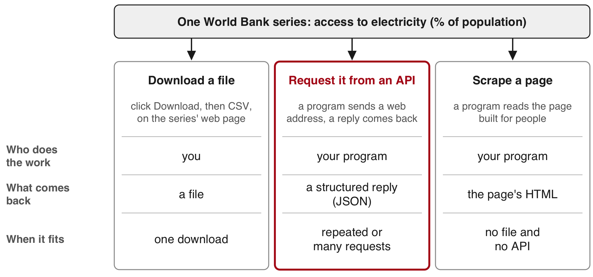{fig-align="center" fig-alt="Three lanes that reach the same World Bank series, access to electricity by country. Download a file: a person clicks Download, then CSV, on the series' web page, and a file lands in Downloads. Request it from an API: a program sends a web address and gets back a structured reply. Scrape a page: a program reads the page built for people and picks the numbers out of its layout. Under each lane: who does the work (you, your program, your program), what comes back (a file, a structured reply, the page's HTML) and when it fits (one download; repeated or many requests; no file and no API)."}

::: {style="font-size:0.75em"}

**API** (application programming interface): a service that answers
requests sent by a program, with a reply in a fixed structure.
**Server**: the computer that holds the data and answers requests.
**HTML**: the text a web page is written in.
**JSON**: a plain-text format for data.

:::

::: {.content-visible when-format="revealjs"}

::: {.notes}
All three lanes reach the same numbers. The difference is who does the
work and what comes back. The CSV link on the indicator page is itself an
api.worldbank.org address (it ends in ?downloadformat=csv), so the
download button is a request to the same API.
:::

:::

::: {.content-hidden when-format="revealjs"}

{fig-alt="The World Bank's data page for the indicator Access to electricity (% of population) for India, with the source line and the CC BY-4.0 licence, a line chart for 1993 to 2024, a Download box offering CSV, XML and Excel, and India's row in the table, 99.9 in 2024."}

A download suits a file you need once. An API suits requests you repeat
or send many times. It is also the only route to data that has no
download, such as a travel time between two points or a model's reply.
Scraping, reading the numbers out of a page built for people, is the
route when there is neither a file nor an API.

:::

## Who offers APIs, and which need a key or a payment {#who-offers .smaller}

| Kind | Source | What you get | Key | Cost |
|:--|:--|:--|:--|:--|
| Public statistics | World Bank | indicators by country and year | none | free |
| Public statistics | EIA | hourly grid data, energy prices | free, after sign-up | free |
| Platform | Google Maps Platform | travel times, places | key and a billing account | per request |
| Model provider | a company that runs a language model | written replies to prompts | key and prepaid credits | by the amount of text sent and written |

::: {style="font-size:0.85em"}

**World Bank**: an international development lender. It publishes
indicators (data series, such as access to electricity) for 217 economies
(countries and territories).
**EIA**: the US government's statistics agency for energy (the Energy
Information Administration). **Platform**: a company whose website or app
is where people search, post or trade. **Language model**: the program
behind a chat assistant. **Key**: a private string that identifies you to
the service and counts your requests.

:::

::: {.content-hidden when-format="revealjs"}

Two more statistical sources with APIs, often used in economics:
[Eurostat](https://ec.europa.eu/eurostat/web/user-guides/data-browser/api-data-access),
the European Union's statistics office (no key), and
[FRED](https://fred.stlouisfed.org/docs/api/fred/), a database of
economic series from the St. Louis branch of the US central bank (a free
key).

:::

## What a script gains over a manual download {#script-gains}

:::: {.columns}

::: {.column width="58%"}

- The script records the request: its web address (URL) names the
  series, the places and the years.
- The script saves each reply as it arrived, so you can rebuild the table
  without asking again.
- When the source revises its numbers, you run the script again.
- Some data have no download, such as travel times or a model's reply. A
  script can request them.

:::

::: {.column width="42%"}

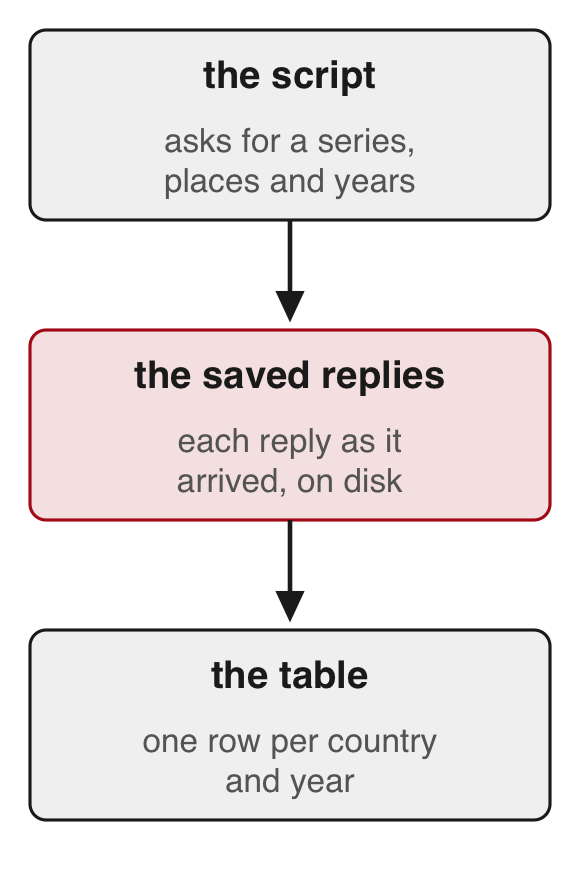{height="480px" fig-alt="A strip of three boxes joined by arrows: a script, the replies it saves to disk, and the table built from those replies."}

:::

::::

## Travel speeds in 180 Indian cities, from Google Maps {#akbar .smaller}

:::: {.columns}

::: {.column width="64%"}

[Akbar, Couture, Duranton & Storeygard (AER, 2023)](https://doi.org/10.1257/aer.20181662)

::: {.dashes style="font-size:0.9em"}

- **Question**
  - How fast can people travel by car within Indian cities, and how much
    does traffic slow them?
- **What they did**
  - They sent 57&nbsp;million requests to Google Maps' API: 2.7&nbsp;million
    car trips in 180 cities, each at about 21 departure times.
  - One trip in three ended at a business or landmark listed on Google
    Places; the rest joined random points.
  - They compared these times with trips people actually took.
- **Finding**
  - Average travel speed differs widely from one city to another.
  - Most of that difference comes from how fast cars move on empty
    roads; congestion, the slowdown from traffic, explains less.
  - Larger, denser cities are slower, only partly because of congestion.

:::

:::

::: {.column width="36%"}

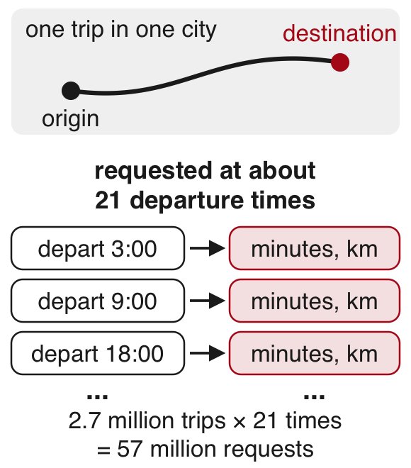{width="100%" fig-align="center" fig-alt="One origin and destination pair in a city goes into Google Maps at several departure times (3:00, 9:00, 18:00 and more); for each one the reply gives the minutes and kilometres of the drive. 2.7 million trips times 21 departure times make 57 million requests."}

::: {style="font-size:0.85em"}

**Takeaway:** an API can produce data no agency publishes, and the
authors compared it with records of real trips before using it.

:::

:::

::::

::: {.content-visible when-format="revealjs"}

::: {.notes}
From the AEA appendix: 57,175,086 requests for 2,733,330 trips, a median
of 21 departure times each. Trip types: radial 2/9, circumferential 1/9,
gravity 1/3, amenity 1/3 (the Google Places third).
:::

:::

## Early Twitter users by county, from Twitter's API {#fujiwara .smaller}

:::: {.columns}

::: {.column width="64%"}

[Fujiwara, Müller & Schwarz (JEEA, 2024)](https://doi.org/10.1093/jeea/jvad058)

::: {.dashes style="font-size:0.9em"}

- **Question**
  - Did Twitter change how people in the US voted?
- **What they did**
  - Twitter (now X) use grew quickly after South by Southwest (SXSW), a
    festival in Austin, Texas, in March 2007.
  - They pulled the profiles of about 658,000 followers of the
    festival's account through Twitter's API.
  - Join dates and typed locations placed early users in US counties.
  - Counties with more sign-ups during the 2007 festival had more Twitter
    users years later.
  - Those sign-ups are unrelated to how counties voted before Twitter, so
    the study uses them to compare votes across counties.
- **Finding**
  - Twitter lowered the vote share of the Republican Party, one of the
    two main US parties, in the 2016 and 2020 presidential elections,
    with little effect on elections to Congress (the US legislature).

:::

:::

::: {.column width="36%"}

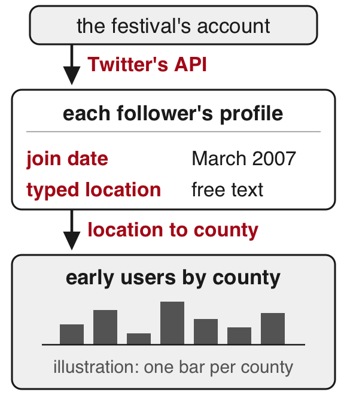{width="100%" fig-align="center" fig-alt="The festival's Twitter account leads, through the API, to its followers' profiles with a join date and a typed location, and from there to early users by county, drawn as illustrative bars, one per county."}

::: {style="font-size:0.85em"}

**Takeaway:** an API returns what the platform records (here, what users
typed in their profiles), and the researcher decides what each field
measures.

:::

:::

::::

::: {.content-visible when-format="revealjs"}

::: {.notes}
The JEEA article's data section gives 658,240 followers of @SXSW,
collected through the API in January 2019; 44,625 of them joined between 2006 and 2008, and 25,830
of those could be placed in a county.
:::

:::

# 2 · The parts of a request and its reply {#part-parts}

::: {.content-visible when-format="revealjs"}

- A request and its reply
- Requesting India's access to electricity in your browser
- The parts of the request URL
- Reading the reply in JSON format
- Status codes in every reply
- Long results arrive in pages
- Rate limits and terms of use
- Exercise 1

:::

## A request and its reply {#request-reply .smaller}

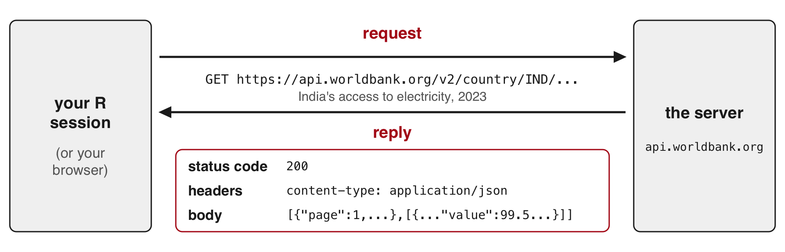{fig-align="center" fig-alt="Your browser, or R, sends a request, GET https://api.worldbank.org/v2/country/IND/..., India's access to electricity in 2023, to the server at api.worldbank.org. The server sends back a reply made of three parts: a status code, headers, and a body in JSON."}

:::: {.columns style="font-size:0.9em"}

::: {.column width="50%"}

- **GET**: the kind of request that asks for data, with everything
  written in the URL.
- **Reply**, also called a response: what comes back.
- **Status code**: a three-digit number that says if the request worked,
  such as 200.

:::

::: {.column width="50%"}

- **Header**: a labelled line sent with a request or reply, apart from
  the data, such as the body's format (`content-type`) or how many
  requests you have left.
- **Body**: the data itself.

:::

::::

::: {.content-visible when-format="revealjs"}

::: {.notes}
The counter analogy, if it helps: the menu is the documentation, the order
is the URL and its options, a membership card is the key, and the dish
comes back with a receipt (the data and the status code).
:::

:::

## Requesting India's access to electricity in your browser {#browser}

::: {style="font-size:0.7em"}

**The request.** Open this address in your browser to send a request to
the World Bank's server:
[https://api.worldbank.org/v2/country/IND/indicator/EG.ELC.ACCS.ZS?date=2023&format=json](https://api.worldbank.org/v2/country/IND/indicator/EG.ELC.ACCS.ZS?date=2023&format=json)

:::

:::: {.columns}

::: {.column width="55%"}

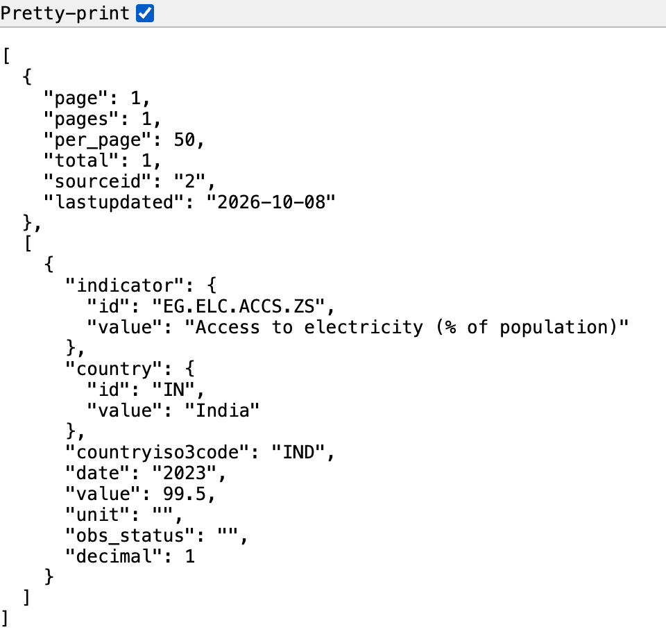{height="455px" fig-alt="The World Bank reply in Chrome with the Pretty-print box ticked: the page information (page 1, pages 1, per_page 50, total 1, sourceid 2, lastupdated 2026-10-08), then one record for India in 2023 with value 99.5."}

:::

::: {.column width="45%"}

::: {style="font-size:0.72em"}

**The reply.** The text on the left is the body of the server's reply,
in JSON. Here the browser indents it (Pretty-print ticked); other
browsers show one long line or a tree you can expand. The status code
(200, it worked) arrives too but stays out of view.

In JSON (JavaScript Object Notation), names and values come in pairs
(`"value": 99.5`). Braces `{ }` hold one record; square brackets `[ ]`
hold a list.

**Hands up:** what number do you see, and what does it measure?

:::

:::

::::

::: {.content-visible when-format="revealjs"}

::: {.notes}
Answer: 99.5, the share of India's population with access to electricity
in 2023. Ticking Pretty-print (Chrome) indents the text, one value per
line. Tested the day before: status 200, one row, no key needed. A
first request can take up to a minute when the server has not cached it.
Wait or reload.
:::

:::

## The parts of the request URL {#url-parts .smaller}

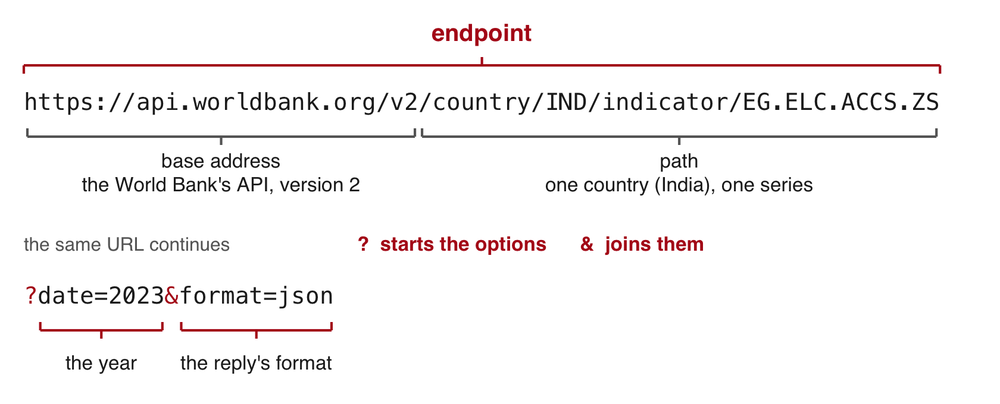{fig-align="center" fig-alt="The India request URL from the browser, on two lines. A bracket over everything before the question mark is labelled endpoint, split into the base address https://api.worldbank.org/v2, the World Bank's API version 2, and the path /country/IND/indicator/EG.ELC.ACCS.ZS, one country (India) and one series. The question mark starts the options and the ampersand joins them: date=2023 for the year and format=json for the reply's format."}

::: {style="font-size:0.8em"}

- **Endpoint**: the web address that answers one kind of request.
- **Query parameter**: a named option after the `?` that narrows what
  comes back. `date=2000:2023` asks for a range of years.
- Without `format=json`, the World Bank replies in XML, another text
  format.
- **Indicator code**: the World Bank's name for one series.
  `EG.ELC.ACCS.ZS` is "Access to electricity (% of population)".
- This API needs no key. The EIA takes its key as one more parameter
  (`api_key=...`), and model providers take it in a header.

:::

[Documentation: [the World Bank's Indicators API](https://datahelpdesk.worldbank.org/knowledgebase/articles/889392-about-the-indicators-api-documentation) · [the EIA's API](https://www.eia.gov/opendata/documentation.php)]{.source}

## Reading the reply in JSON format {#json .smaller}

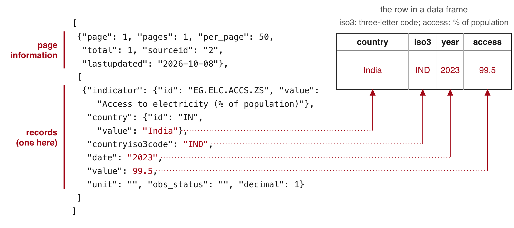{fig-align="center" fig-alt="On the left, the reply to the India request: a list whose first part, the page information, holds page 1, pages 1, per_page 50, total 1, sourceid 2 and lastupdated 2026-10-08, and whose second part, the records, holds one record: the indicator, the country India nested inside country, countryiso3code IND, date 2023 and value 99.5. Arrows lead to a row of a data frame on the right: country India, iso3 IND, year 2023, access 99.5. A note over the row: iso3 is the three-letter code, access is the % of population."}

- The reply to the India request has two parts: page information first,
  then the records.
- The country's name sits one level down, inside `"country"`.
- A CSV holds one flat table, so it cannot carry these two parts or
  values inside values.

## Status codes in every reply {#status .smaller}

| Code | Meaning | Example |
|:--|:-----|:--------|
| 200 | it worked | the India request |
| 400 | the server cannot read the request | |
| 401, 403 | the key is missing or refused | the EIA with no key: 403, `"API_KEY_MISSING"` |
| 404 | no such address | a misspelled path, `/v2/countryy/IND/...` |
| 429 | more requests than the service allows per minute, hour or day | the EIA's shared DEMO_KEY, used up: `"OVER_RATE_LIMIT"` |
| 500 and above | the server failed; try again later | a 5,000-row EIA page: 504 after 61 seconds |

`httr2`, the R package used below, stops with an error at 400 and above.
A 200 can still hold an error message in its body.

::: {.content-hidden when-format="revealjs"}

A browser shows the status of every request in its developer tools: open
them (right-click the page, then Inspect), choose the Network tab, and
reload the page.

:::

## Long results arrive in pages {#pages .smaller}

Replace `IND` with `all` in
[the request](https://api.worldbank.org/v2/country/all/indicator/EG.ELC.ACCS.ZS?date=2023&format=json)
to get one row for each of 217 economies and 49 groups of economies, such
as regions and income groups. The reply starts
`"page": 1, "pages": 6, "per_page": 50, "total": 266`.

- **Pagination**: a long result split into pages, which you request one
  after another with `page=1`, `page=2`, and so on.
- `total` counts the rows on all pages. `pages` counts the requests at
  `per_page` rows each.
- You have every row when your count equals `total`.

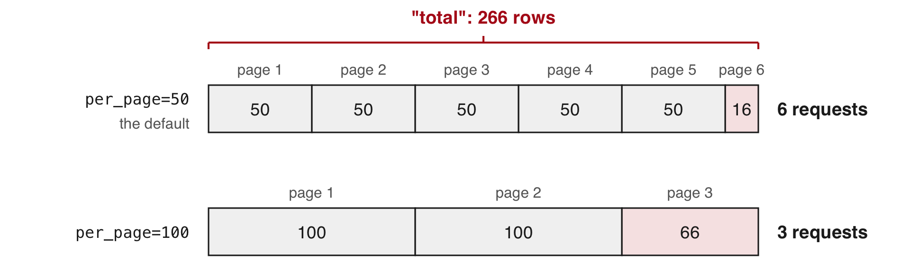{fig-align="center" width="90%" fig-alt="The 266 rows drawn as two bars, cut two ways: with per_page=50, the default, into six requests, five of 50 and one of 16; with per_page=100 into three requests, 100, 100 and 66. The short last pages are tinted."}

## Rate limits on requests {#rate-limits .code-125}

- **Rate limit**: the most requests a service accepts from you per minute,
  hour or day. Above it, the reply is 429.
- The World Bank code in this session waits one second between requests.

```{.default filename="Two header lines of an EIA reply sent with DEMO_KEY, a key everyone shares"}
x-ratelimit-limit: 10
x-ratelimit-remaining: 2
```

- In these two lines the limit is 10 requests, and 2 are left. The
  headers do not say over what period.
- The EIA counts them per internet address, and a classroom shares one,
  so the class reads the saved replies.

::: {.content-hidden when-format="revealjs"}

The EIA's API also accepts `api_key=DEMO_KEY`, a key shared by everyone.
Its replies reported a limit of 10 requests (`x-ratelimit-limit: 10`),
counted per internet address, and a classroom on one network shares a
single address, so it is often used up. Register for your own key (Part 4)
instead.

:::

## Terms of use for the data an API returns {#terms .smaller}

**Terms of use**: the rules a source sets on what you may do with its
data. Read them before you build a dataset on an API.

| Source | Terms | What they mean for you |
|:---|:-----|:-----|
| World Bank | Creative Commons Attribution licence | reuse it, with credit to the source |
| EIA | US government work, in the public domain (no copyright) | use it freely; the EIA asks for a source line |
| Google Maps Platform | its terms of service | you may not store what it returns, apart from a few short-term exceptions |
| Twitter (now X) | its developer terms | free research access ended |

[Sources: [World Bank data licences](https://datacatalog.worldbank.org/public-licenses);
[EIA copyright and reuse](https://www.eia.gov/about/copyrights_reuse.php);
[Google Maps Platform terms](https://cloud.google.com/maps-platform/terms);
[X developer terms](https://developer.x.com/en/developer-terms/agreement-and-policy).]{.source}

::: {.content-hidden when-format="revealjs"}

The World Development Indicators carry the Creative Commons Attribution
4.0 licence. The EIA's data are in the public domain; the EIA asks users
to cite it as "Source: U.S. Energy Information Administration (date)".
Google's terms restrict storing or caching what its Maps services
return. Twitter ended its free access for researchers.

:::

## Exercise 1 {#exercise-1}

Start from
[the India request](https://api.worldbank.org/v2/country/IND/indicator/EG.ELC.ACCS.ZS?date=2023&format=json).
Country codes:
[the World Bank's country list](https://api.worldbank.org/v2/country?format=json&per_page=400)
(search the page for your country's name; its code is the `id` just
before it).

::: {.panel-tabset}

### Exercise

```{r}
#| label: exercise-1
#| exercise: true
#| script: "Exercise 1 (2 minutes)"
#| eval: false
# Exercise 1 (2 minutes). In your browser; no R needed.
# Start from the request on the slide:
# https://api.worldbank.org/v2/country/IND/indicator/EG.ELC.ACCS.ZS?date=2023&format=json
#
# 1. Replace IND with another country's three-letter code:
#    CHN China, BGD Bangladesh, KEN Kenya, NGA Nigeria,
#    ETH Ethiopia, BRA Brazil, or your own country's.
# 2. Change date=2023 to date=2000.
# A first request can take up to a minute. Wait, or reload the page.
#
# Two answers to compare with the room: your country's access to
# electricity (% of population) in 2023 and in 2000.
```

### Solution

:::: {.columns}

::: {.column width="45%"}

| | 2000 | 2023 |
|:--|--:|--:|
| India | 60.3 | 99.5 |
| China | 96.7 | 100.0 |
| Bangladesh | 32.0 | 99.5 |
| Kenya | 15.2 | 76.2 |
| Nigeria | 43.2 | 61.2 |
| Ethiopia | 12.7 | 55.4 |
| Brazil | 94.4 | 99.8 |

:::

::: {.column width="55%"}

Access to electricity (% of population), World Bank (`EG.ELC.ACCS.ZS`)

::: {.content-visible when-format="revealjs"}

**One request with `date=2000:2023` returns every year from 2000 to 2023
(24 rows).**

:::

:::

::::

::: {.content-hidden when-format="revealjs"}

A colon gives a range of years: `date=2000:2023` returns `total` 24, one
row per year, newest first.

:::

:::

::: {.content-visible when-format="revealjs"}

::: {.notes}
A 30-second debrief by call-out: who has a country below 50 in 2000?
Students pick different countries, so many requests are uncached; in
testing, China 2000:2023 took 65 seconds. Tell the room to wait or
reload. If the API is slow, show the solution table.
:::

:::

# 3 · Requesting World Bank data from R {#part-r}

::: {.content-visible when-format="revealjs"}

- `httr2`
- A status 200 that holds an error
- JSON to a data frame
- `fetch()` and `flat()`
- Requesting all pages
- Rebuilding the table from saved replies
- Exercise 2

[Download [14-apis.zip](data/14-apis.zip) from the session page, unzip it,
and open `14-apis.Rproj`, so that R starts in the 14-apis
folder.]{style="font-size:0.75em"}

:::

## Sending the request from R with httr2 {#httr2 .smaller .code-110}

```{r}
#| label: first-request
#| script: "Sending the request from R with httr2"
#| filename: "R Console; needs internet and the httr2 package"
#| eval: false
# install.packages(c("httr2", "jsonlite"))   # once; jsonlite does not come with httr2
library(httr2)
req <- request("https://api.worldbank.org/v2/country/all/indicator/EG.ELC.ACCS.ZS")
req <- req_url_query(req, date = 2023, format = "json", per_page = 100, page = 1)
req
#> <httr2_request>
#> GET https://api.worldbank.org/v2/country/all/indicator/EG.ELC.ACCS.ZS?date=2023&format=json&per_page=100&page=1
#> Body: empty
resp <- req_perform(req)
resp_status(resp)
#> [1] 200
```

- The request: access to electricity (% of population) in 2023 for every
  country and group (`country/all`), page 1 at 100 rows a page.
- `httr2`: an R package that writes and sends web requests.
- `request()` takes the address. `req_url_query()` adds the parameters
  after the `?`.
- Printing `req` shows the exact URL. Nothing has been sent yet.
- `req_perform()` sends it and waits for the reply. `resp_status()` reads
  the status code.

```{r}
#| label: resp-from-saved
#| purl: false
#| include: false
# The render sends no request: rebuild the reply from the saved file, which
# holds the bytes the server sent for this request.
library(httr2)
resp <- response(
  status_code = 200,
  url = "https://api.worldbank.org/v2/country/all/indicator/EG.ELC.ACCS.ZS?date=2023&format=json&per_page=100&page=1",
  headers = list(`Content-Type` = "application/json;charset=utf-8"),
  body = charToRaw(paste(readLines("saved/wb_2023_p1.json", warn = FALSE),
                         collapse = "\n")))
```

## A status 200 whose body holds an error {#status-200-error .smaller .code-120}

```{r}
#| label: bad-code
#| script: "A status 200 whose body holds an error"
#| filename: "R Console, in the 14-apis folder; needs internet and httr2"
#| eval: false
bad <- request("https://api.worldbank.org/v2/country/all/indicator/EG.ELC.ACCS.ZZ")
bad <- req_url_query(bad, date = 2023, format = "json")
resp_bad <- req_perform(bad)
resp_status(resp_bad)
#> [1] 200
writeLines(resp_body_string(resp_bad))
#> [{"message":[{"id":"120","key":"Invalid value","value":"The provided parameter value is not valid"}]}]
# no network? writeLines(readLines("saved/wb_bad_code.json")) shows the same body
```

- The indicator code ends in ZZ instead of ZS.
- `resp_body_string()` returns the reply's body as text.
- `"key":"Invalid value"` names the error. This `"key"` is a field of the
  JSON, unrelated to API keys.
- The misspelled path `countryy` returns status 404, and `req_perform()`
  stops R with `HTTP 404 Not Found`{style="white-space:nowrap"}.
- This 200 passes `req_perform()` with no error. The parsing steps below
  fail on it later with `subscript out of bounds`{style="white-space:nowrap"},
  a message that does not name the typo.
- Read the body of every reply and count its rows.

::: {.content-visible when-format="revealjs"}

::: {.notes}
A misspelled country code (INDD) returns the same 200 and the same
message. The reply ships in the project as saved/wb_bad_code.json.
:::

:::

## Reading the JSON reply into R with fromJSON() {#fromjson .smaller .code-110}

```{r}
#| label: fromjson
#| script: "Reading the JSON reply into R with fromJSON()"
#| filename: "R Console, in the 14-apis folder; needs jsonlite and resp from the httr2 request (or the saved file)"
library(jsonlite)
first <- fromJSON(resp_body_string(resp))
# no network? first <- fromJSON("saved/wb_2023_p1.json") gives the same
str(first[[1]])
d <- first[[2]]
dim(d)
names(d)
```

- `fromJSON()` turns JSON text into R lists and data frames.
- `first` is a **list**, R's container for parts of different kinds:
  `first[[1]]` holds the page information (3&nbsp;pages, 266&nbsp;rows in
  all), `first[[2]]` this page's 100&nbsp;records.

## Flattening the records into a data frame {#flatten .smaller .code-125}

```{r}
#| label: flatten
#| script: "Flattening the records into a data frame"
#| filename: "R Console; needs d, the records of the first page"
class(d$country)             # a data frame inside the data frame
wb1 <- data.frame(country = d$country$value, iso3 = d$countryiso3code,
                  year = d$date, access = d$value)
head(wb1, 3)
wb1[wb1$iso3 == "IND", ]
```

- **Flatten**: turn nested fields into plain columns, one value per cell.
- `d$country` holds two columns, an id and the name. `$value` takes the
  name.
- `access` is the share of the population with electricity, in percent.
- India is missing: this page holds 100 of the 266 rows, and India is on
  the second page.

## fetch() to request and save one page, flat() to flatten it {#fetch-flat .smaller .code-125}

```{r}
#| label: fetch-flat
#| script: "fetch() to request and save one page, flat() to flatten it"
#| filename: "wb_functions.R (part), in the 14-apis folder; needs httr2 and jsonlite"
dir.create("raw", showWarnings = FALSE)
fetch <- function(p, year, per) {
  req <- request("https://api.worldbank.org/v2/country/all/indicator/EG.ELC.ACCS.ZS")
  req <- req_url_query(req, date = year, format = "json", per_page = per, page = p)
  txt <- resp_body_string(req_perform(req))
  writeLines(txt, paste0("raw/wb_", year, "_p", p, ".json"))  # the reply as sent
  Sys.sleep(1)                                                # one request a second
  fromJSON(txt)
}
flat <- function(reply) {
  d <- reply[[2]]
  data.frame(country = d$country$value, iso3 = d$countryiso3code,
             year = d$date, access = d$value)
}
```

- Run `source("wb_functions.R")` to define both functions. The file ships
  in the project.
- `fetch(p, year, per)` requests page `p` of one year at `per` rows a
  page, writes the reply to `raw/` as sent, waits one second, and returns
  it parsed.
- **Raw reply**: the reply exactly as the server sent it, saved before any
  parsing.
- `flat()` turns one parsed reply into the four-column table.

::: {.content-visible when-format="revealjs"}

::: {.notes}
The file ships in the zip, so nobody types it from the projector:
source("wb_functions.R").
:::

:::

## Requesting all pages and comparing rows with the total {#every-page .smaller .code-125}

```{r}
#| label: every-page
#| script: "Requesting all pages and comparing rows with the total"
#| filename: "R Console, in the 14-apis folder; needs internet, fetch() and flat(); writes three replies to raw/"
#| eval: false
first <- fetch(1, 2023, 100)
replies <- lapply(1:first[[1]]$pages, fetch, year = 2023, per = 100)
wb <- do.call(rbind, lapply(replies, flat))
c(rows = nrow(wb), total = first[[1]]$total)
#>  rows total
#>   266   266
wb[wb$iso3 == "IND", ]
#>     country iso3 year access
#> 139   India  IND 2023   99.5
```

- Page 1's information gives the number of pages (3) and the total (266).
- `lapply()` calls `fetch()` once per page, passing `year` and `per` on to
  it.
- `do.call(rbind, ...)` stacks the three pages into one table.
- The rows received equal the total the API reports.
- Rows 1 to 49 are groups of economies (regions, income and lending
  groups, World). Rows 50 to 266 are the 217 economies.

::: {.content-visible when-format="revealjs"}

::: {.notes}
A mean over all 266 rows counts some countries several times, so drop the
groups first. Page 1 is requested twice (first, then inside lapply()),
four requests in all; 4.3 seconds in testing.
:::

:::

::: {.content-hidden when-format="revealjs"}

`per_page=300` returns all 266 rows in one page, so this series needs no
loop. The loop is for the series that do not fit: most APIs cap the page
size, and the EIA caps it at 5,000 rows.

`httr2` also has helpers for paging and rate limits.
`req_perform_iterative()` with `iterate_with_offset()` requests page after
page until the last one. `req_throttle()` spaces the requests,
`req_retry()` sends a request again after a 429 or a 503, and
`req_timeout()` sets how long to wait for a slow reply (a 5,000-row EIA
page once returned a 504, a timeout at the server, after 61 seconds). The
same table as above, with the helpers:

```{r}
#| label: paging-helpers
#| purl: false
#| filename: "R Console; needs internet, httr2, jsonlite and flat()"
#| eval: false
req <- request("https://api.worldbank.org/v2/country/all/indicator/EG.ELC.ACCS.ZS")
req <- req_url_query(req, date = 2023, format = "json", per_page = 100)
req <- req_throttle(req, capacity = 1, fill_time_s = 1)  # one request a second
req <- req_retry(req, max_tries = 3)                     # again after a 429 or 503
req <- req_timeout(req, 90)                              # wait up to 90 seconds
resps <- req_perform_iterative(req,
  next_req = iterate_with_offset("page",
    resp_pages = function(resp) fromJSON(resp_body_string(resp))[[1]]$pages),
  max_reqs = Inf)
wb <- do.call(rbind, lapply(resps, function(r) flat(fromJSON(resp_body_string(r)))))
nrow(wb)
```

:::

## Rebuilding the table from the saved replies {#rebuild .smaller .code-125}

```{r}
#| label: rebuild
#| script: "Rebuilding the table from the saved replies"
#| filename: "R Console, in the 14-apis folder; needs jsonlite and flat() from wb_functions.R; reads saved/ (yours: raw/)"
replies <- lapply(paste0("saved/wb_2023_p", 1:3, ".json"), fromJSON)
wb <- do.call(rbind, lapply(replies, flat))
nrow(wb)
replies[[1]][[1]]$lastupdated
```

- `lastupdated` is the date the World Bank last revised the series. The
  saved files keep the version your results used.
- A request eight days before these reported 265 rows. Its reply was not
  saved, so nobody can say which row was added.
- A reply can take a minute to arrive. The saved files rebuild the table
  with no new request.

::: {.content-hidden when-format="revealjs"}

## R packages that write the request for you {#packages}

For the most used sources, an R package writes the request, sends it and
returns a data frame. All six are on CRAN, R's package archive.

| Package | Source | Needs |
|:--|:--|:--|
| `WDI` | World Bank indicators | nothing |
| `fredr` | FRED | a free key |
| `tidycensus` | US Census Bureau (the agency that runs the US census and its household surveys) | a free key |
| `rnassqs` | USDA NASS Quick Stats (US farm statistics: crops, livestock, prices) | a free key |
| `eia` | EIA | a free key |
| `ellmer` | language models from several providers | the provider's key |

```{r}
#| label: wdi
#| purl: false
#| filename: "R Console; needs internet and the WDI package"
#| eval: false
library(WDI)                 # install.packages("WDI") once
w <- WDI(country = "all", indicator = c(access = "EG.ELC.ACCS.ZS"),
         start = 2023, end = 2023)
nrow(w)                      # compare with the total the API reports
```

They send the same requests for you, so save what they return, with
`saveRDS()` or `write.csv()`, the day you request it.

:::

## Exercise 2 {#exercise-2 .smaller}

::: {.panel-tabset}

### Exercise

::: {style="font-size:1.4em"}

```{r}
#| label: exercise-2
#| exercise: true
#| script: "Exercise 2 (5 minutes)"
#| eval: false
# Exercise 2 (5 minutes). R Console, in the 14-apis folder.
# First run source("wb_functions.R"), which defines fetch() and flat().
# No network? Skip the requests and run
#   replies0 <- lapply(paste0("saved/wb_2000_p", 1:6, ".json"), fromJSON)
#   first0 <- replies0[[1]]
#
# 1. Request page 1 of the year 2000 with 50 rows a page:
#    first0 <- fetch(1, 2000, 50). How many pages? What total?
# 2. Request every page into replies0 with lapply(), then stack them:
#    wb0 <- do.call(rbind, lapply(replies0, flat))
# 3. Compare nrow(wb0) with the total.
# 4. Find India's row (iso3 is "IND").
#
# Two answers to compare with the room: the rows against the
# reported total, and India's access to electricity in 2000.
```

:::

### Solution

```{r}
#| label: exercise-2-solution
#| purl: false
#| filename: "R Console, in the 14-apis folder; needs jsonlite, flat() and the six saved replies"
# With the network: first0 <- fetch(1, 2000, 50), then
#   replies0 <- lapply(1:first0[[1]]$pages, fetch, year = 2000, per = 50)
replies0 <- lapply(paste0("saved/wb_2000_p", 1:6, ".json"), fromJSON)
first0 <- replies0[[1]]
c(pages = first0[[1]]$pages, total = first0[[1]]$total)
wb0 <- do.call(rbind, lapply(replies0, flat))
c(rows = nrow(wb0), total = first0[[1]]$total)
wb0[wb0$iso3 == "IND", ]
```

::: {.content-visible when-format="revealjs"}

**266 rows against a total of 266. India: 60.3% of the population in
2000, the same as the browser showed in Exercise 1.**

:::

::: {.content-hidden when-format="revealjs"}

Page 6 holds 16 rows. `sum(is.na(wb0$access))` is 7: the "Not classified"
group and six economies (American Samoa, Guinea-Bissau, North Korea,
Kosovo, Liberia, South Sudan).

:::

:::

::: {.content-visible when-format="revealjs"}

::: {.notes}
Each student sends 7 requests; in testing the full solution ran in 7.6
seconds, 7 of them Sys.sleep(). An uncached request took up to 65
seconds: anyone stuck switches to the saved/ line at the top. A live total
may differ from 266 if the World Bank updates again; the rows should still
equal the reply's own total. Debrief extras: page 6 holds 16 rows; 7
values are missing (Not classified, American Samoa, Guinea-Bissau, North
Korea, Kosovo, Liberia, South Sudan).
:::

:::

# 4 · Hourly electricity demand from the EIA, with an API key {#part-eia}

::: {.content-visible when-format="revealjs"}

- New York's grid in the EIA's data
- Getting an EIA key and storing it in `~/.Renviron`
- The EIA request in R
- Stacking two pages into the 8,760 hours of 2025
- A year of hourly demand in one figure
- The heat-wave peak

:::

## Hourly demand on New York's grid, from the EIA {#eia-grid .smaller}

:::: {.columns}

::: {.column width="53%"}

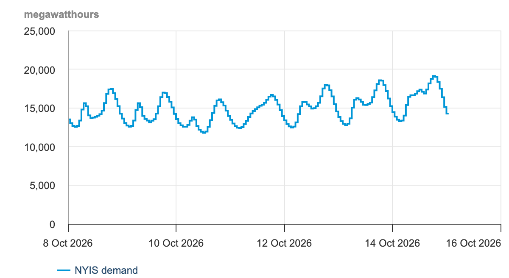{width="100%" fig-alt="One chart from the EIA's Hourly Electric Grid Monitor: NYIS demand, hour by hour, over the week before the capture, in Eastern Time, in megawatthours, between about 12,000 and 19,000."}

:::

::: {.column width="47%"}

- The EIA publishes the hourly demand of each grid operator in the 48
  contiguous US states (all but Alaska and Hawaii).
- NYISO (New York Independent System Operator) runs New York State's
  grid, Ithaca included. EIA code: `NYIS`.
- Left: a week of NYISO's demand on the EIA's Hourly Electric Grid
  Monitor, its page for people. Below: the API's first row, in R.

:::

::::

```{r}
#| label: eia-one-row
#| script: "One row of the EIA reply"
#| filename: "R Console, in the 14-apis folder; needs jsonlite and saved/eia_nyis_0.json"
p1 <- fromJSON("saved/eia_nyis_0.json")
p1$response$data[1, c("period", "respondent", "type",
                      "type-name", "value", "value-units")]
```

[`value`: demand in that hour, in megawatt-hours (MWh), the average
megawatts (MW, a rate of electricity use) over the hour. `-05` marks New
York winter time.]{style="font-size:0.8em"}

::: {.content-visible when-format="revealjs"}

::: {.notes}
The reply has 7 columns; respondent-name is left out here. The page for
people is the EIA's Hourly Electric Grid Monitor.
:::

:::

::: {.content-hidden when-format="revealjs"}

A **balancing authority** is the operator that keeps supply equal to
demand, hour by hour, in one area. Those in the 48 contiguous states
report their hourly demand, generation and flows to the EIA on Form
EIA-930, and the EIA publishes them in the
[Hourly Electric Grid Monitor](https://www.eia.gov/electricity/gridmonitor/)
and through its API. NYISO is the balancing authority for New York State.

:::

## Getting a free EIA key {#eia-key .smaller}

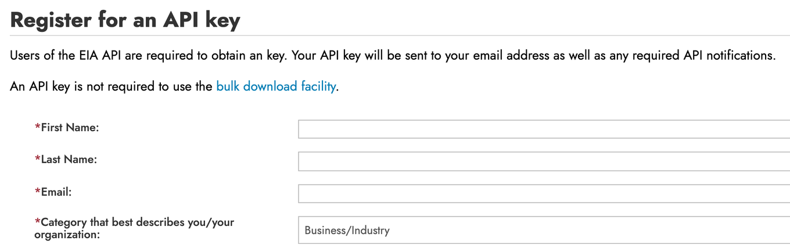{width="100%" fig-align="center" fig-alt="The top of the EIA's Register for an API key form, empty: fields for first name, last name, email and a category that describes you. The terms of service, the I agree box and the Register button sit further down the page."}

- At [eia.gov/opendata/register.php](https://www.eia.gov/opendata/register.php),
  give your name, your email and a category, and accept the terms of
  service.
- The key is free and arrives by email. In class, the replies in
  `saved/` stand in for your own requests.
- **API key**: a private string that identifies you to the EIA and counts
  your requests. Treat it like a password.

## Storing the EIA key in ~/.Renviron {#eia-renviron .smaller .code-125}

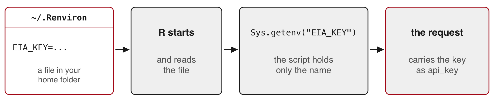{fig-align="center" fig-alt="The file ~/.Renviron holds the line EIA_KEY= followed by a key. R reads the file when it starts, the script reads the key with Sys.getenv and the name EIA_KEY, and the request carries the key."}

**Environment variable**: a named value set outside your code, which R
loads when it starts.

```{r}
#| label: eia-key-setup
#| purl: false
#| eval: false
#| filename: "R Console; once per computer"
file.edit("~/.Renviron")         # opens the file, or creates it
# add one line, keep an empty line at the end, save:
#   EIA_KEY=paste-your-key-here
# restart R (RStudio: Session > Restart R), then:
nchar(Sys.getenv("EIA_KEY"))     # above 0: the key loaded; 0: R did not find it
```

- The script holds only the name, so sharing or committing the script
  shares no secret.
- `~` is your home folder (on Windows, R uses your Documents folder). A
  Mac hides names that start with a dot, and Windows editors may add .txt
  to them, so open the file from R with `file.edit()`.

::: {.content-visible when-format="revealjs"}

::: {.notes}
In class, students without a key start from saved/ on the stacking slide.
Key holders may run the request.
:::

:::

::: {.content-hidden when-format="revealjs"}

`readRenviron("~/.Renviron")` reloads the file without restarting R.
`usethis::edit_r_environ()` opens the same file. R reads only one user
`.Renviron`: a `.Renviron` inside a project folder hides the one in your
home folder, so keep keys in `~/.Renviron`.

:::

::: {.content-hidden when-format="revealjs"}

## The EIA request for one day, written as a URL {#eia-url .smaller}

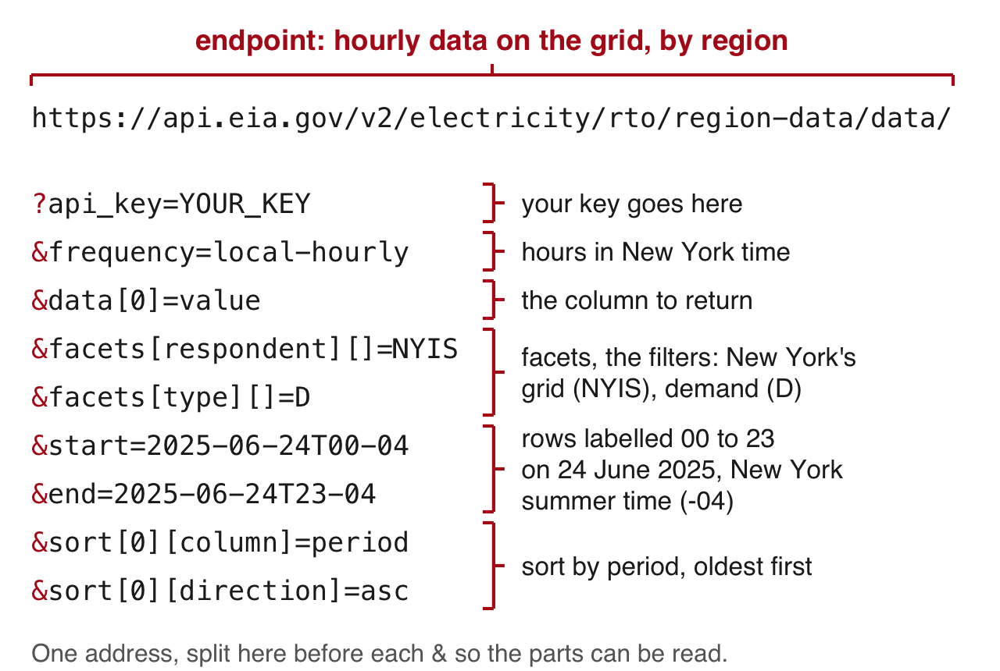{height="400px" fig-align="center" fig-alt="The EIA request for 24 June 2025 with the key left out, drawn with coloured brackets: the endpoint https://api.eia.gov/v2/electricity/rto/region-data/data/, api_key, frequency=local-hourly, data[0]=value for the column to return, facets[respondent][]=NYIS and facets[type][]=D for the filters, start=2025-06-24T00-04 and end=2025-06-24T23-04 for the rows labelled 00 to 23, and sort by period, ascending."}

- **Facet**: the EIA's word for a filter on one column. The EIA names its
  options with brackets.
- Sent with a key, this address returns 24 rows of New York's demand,
  one per hour.

::: {.content-visible when-format="revealjs"}

::: {.notes}
Tested with the demo key: 24 rows, 2025-06-24T00-04 to T23-04. If time
runs short, skip this slide and point to the page.
:::

:::

::: {.content-hidden when-format="revealjs"}

The same request as text, with your key in place of `YOUR_KEY`:

```{.default filename="The one-day EIA request"}
https://api.eia.gov/v2/electricity/rto/region-data/data/?api_key=YOUR_KEY&frequency=local-hourly&data[0]=value&facets[respondent][]=NYIS&facets[type][]=D&start=2025-06-24T00-04&end=2025-06-24T23-04&sort[0][column]=period&sort[0][direction]=asc
```

The EIA's [API browser](https://www.eia.gov/opendata/browser/electricity/rto/region-data)
builds these names for you: choose a route (here electricity, then RTO,
then region data), a frequency, the facets and the dates, and it shows the
URL. The EIA documents its key only as a URL parameter. Its
[API documentation](https://www.eia.gov/opendata/documentation.php)
describes every parameter.

{fig-alt="The EIA's API browser on the electricity, RTO, region data route, with menus for frequency, data columns and facets, and the request URL it builds shown below."}

:::

:::

## Requesting every hour of 2025 from the EIA in R {#eia-request .smaller .code-110}

```{r}
#| label: eia-request
#| script: "Requesting every hour of 2025 from the EIA in R"
#| filename: "R Console, in the 14-apis folder; needs internet, httr2, jsonlite and EIA_KEY in ~/.Renviron (no key: start from saved/)"
base <- request("https://api.eia.gov/v2/electricity/rto/region-data/data/")
base <- req_url_query(base,                   # backticks let R use names with brackets
  api_key = Sys.getenv("EIA_KEY"),
  frequency = "local-hourly",                 # hours in New York time
  `data[0]` = "value",                        # the demand number
  `facets[respondent][]` = "NYIS",            # New York's grid
  `facets[type][]` = "D",                     # D = demand
  start = "2025-01-01T00-05", end = "2026-01-01T00-05",  # -05: 5 hours behind UTC (4 in summer)
  `sort[0][column]` = "period",               # sort by hour, so that the
  `sort[0][direction]` = "asc")               # pages follow in order
eia_page <- function(offset) {
  req <- req_url_query(base, offset = offset, length = 5000)  # skip, then up to 5,000
  txt <- resp_body_string(req_perform(req))
  writeLines(txt, paste0("raw/eia_nyis_", offset, ".json"))
  Sys.sleep(1)
  fromJSON(txt)
}
```

```{r}
#| label: eia-request-send
#| purl: false
#| eval: false
#| filename: "R Console, with your own EIA key; writes raw/eia_nyis_0.json and raw/eia_nyis_5000.json"
p1 <- eia_page(0)            # a page of 5,000 rows can take a minute
p2 <- eia_page(5000)
```

- `eia_page()` is `fetch()` for the EIA: `offset` skips rows, and
  `length` caps a page at 5,000.
- `local-hourly` returns New York's clock hours. The plain `"hourly"`
  series uses UTC, the world reference clock, as many APIs do.

::: {.content-hidden when-format="revealjs"}

## What the first EIA reply holds {#eia-reply .smaller}

[The reply to the request for 2025, offset 0, as saved in
`saved/eia_nyis_0.json`]{style="font-size:0.75em"}

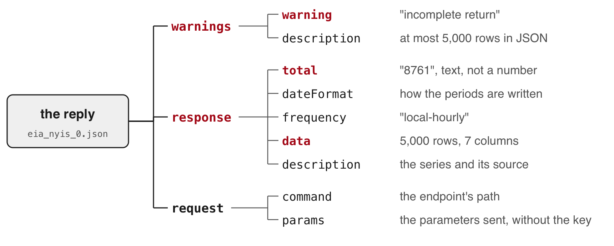{fig-align="center" width="80%" fig-alt="The reply in saved/eia_nyis_0.json drawn as a tree. warnings holds warning, incomplete return, and a description. response holds total, 8761, as text, dateFormat, frequency, data with 5,000 rows and 7 columns, and a description. request holds the command and the parameters, without the key."}

- Status 200, with a warning in the body: the API sends at most 5,000
  rows in JSON.
- The second request, offset 5000, returns the other 3,761 rows.
- The values and the total arrive as text.

:::

## Stacking the two EIA pages into the 8,760 hours of 2025 {#eia-stack .smaller}

::: {style="font-size:1.15em"}

```{r}
#| label: eia-stack
#| script: "Stacking the two EIA pages into the 8,760 hours of 2025"
#| filename: "R Console, in the 14-apis folder; needs jsonlite and the two saved EIA replies (or yours, in raw/)"
p1 <- fromJSON("saved/eia_nyis_0.json")
p2 <- fromJSON("saved/eia_nyis_5000.json")
p1$warnings$warning
eia <- rbind(p1$response$data, p2$response$data)
eia$demand <- as.numeric(eia$value)  # text to numbers
c(rows = nrow(eia), total = as.numeric(p1$response$total),
  hours = 365 * 24)
tail(eia$period, 1)                  # the last row: the end bound
eia <- eia[substr(eia$period, 1, 4) == "2025", ]           # keep the rows of 2025
c(rows = nrow(eia), repeated = anyDuplicated(eia$period))  # repeated 0: no hour appears twice
```

:::

- The end bound is included: 8,761 rows against 8,760 hours. Keep the
  rows dated 2025.

::: {.content-visible when-format="revealjs"}

::: {.notes}
The full warning: "The API can only return 5000 rows in JSON format.
Please consider constraining your request with facet, start, or end, or
using offset to paginate results." The saved replies list every parameter
they received except the key. The extra row is labelled 2026-01-01T00-05:
by the hour it ends, 23:00 to midnight on 31 December.
:::

:::

## Drawing a year of hourly demand with plot() {#eia-year}

```{r}
#| label: eia-year
#| script: "Drawing a year of hourly demand with plot()"
#| filename: "R Console; needs eia from the stacking step"
#| fig-show: hide
eia$date <- as.Date(substr(eia$period, 1, 10))       # "2025-06-24T19-04" -> 2025-06-24
eia$hour <- as.numeric(substr(eia$period, 12, 13))   # -> 19
par(mar = c(4, 6, 3, 1))                             # room for the y-axis numbers
plot(eia$date + eia$hour / 24, eia$demand, type = "l", lwd = 0.5, yaxt = "n",
     xlab = "2025, New York time", ylab = "",
     main = "Hourly electricity demand, New York's grid (NYISO), 2025. Data: EIA")
at <- seq(0, 30000, 5000)
axis(2, at = at, labels = format(at, big.mark = ","), las = 1)   # commas in the numbers
title(ylab = "Demand (megawatt-hours)", line = 4.5)
```

- `date + hour / 24` places each hour at its point within its day, so the
  line runs hour by hour through the year.

<!-- The figure goes on its own slide by hand: output-location: slide skips
     a chunk that carries a filename. -->

::: {.content-visible when-format="revealjs"}

## A year of hourly demand on New York's grid {#eia-year-output}

:::

`){fig-alt="Hourly electricity demand on New York's grid through 2025. Winter evenings reach about 23,500 megawatt-hours, spring and autumn sit between about 11,000 and 21,000, and summer peaks in late June and late July reach almost 32,000. A thin line drops to zero in mid-January."}

## What the figure shows, and two hours recorded as zero {#eia-zero .smaller .code-125}

- Winter evenings reach 23,521 MWh (22 January). The year's low is
  11,061 MWh (20 April, mid-afternoon).
- Summer peaks come in late June and late July.
- **The drop to zero.** Two hours of 15 January read 0; the hours before
  and after read 21,505 and 21,943&nbsp;MWh. They look like missing reports
  stored as 0, so set them to `NA` before any mean, total or minimum, and
  add `na.rm = TRUE` to those calls.

```{r}
#| label: eia-zero
#| script: "Two hours recorded as zero"
#| filename: "R Console; needs eia"
eia[eia$demand == 0, c("period", "demand")]
eia$demand[eia$demand == 0] <- NA
```

## The peak hour of the June 2025 heat wave {#eia-peak .smaller .code-125}

```{r}
#| label: eia-peak
#| script: "The peak hour of the June 2025 heat wave"
#| filename: "R Console; needs eia"
eia[which.max(eia$demand), c("period", "demand")]   # the row with the largest demand
```

A three-day heat wave hit New York from 23 to 25 June 2025.
[NYISO](https://www.nyiso.com/-/june-heatwave-tests-electric-grid-in-new-york)
reported 31,857 MW on 24 June, the highest on New York's grid since 2016.
The EIA labels each hour by its end, so its row 19 is the hour from 18:00
to 19:00 (6 to 7 pm). NYSRC, the council that sets the reliability rules
for New York's grid, labels the same hour by its start, 18:00.

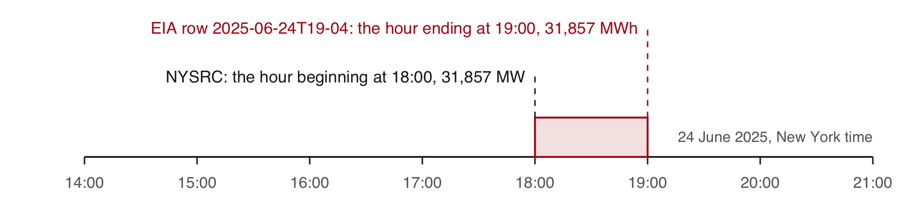{fig-align="center" fig-alt="A timeline of 24 June 2025 with a bar from 18:00 to 19:00. Above it: EIA row 19, the hour ending at 19:00. Below it: NYSRC, hour beginning 18:00, 31,857 MW."}

[Source: NYSRC (New York State Reliability Council),
[June 2025 operations report](https://www.nysrc.org/wp-content/uploads/2025/09/C.8-R1-June-2025-Ops-Report.pdf).]{.source}

::: {.content-visible when-format="revealjs"}

::: {.notes}
The EIA-930 instructions ask operators to report "by hour ending time", so
the EIA's row 19 covers 18:00 to 19:00. NYISO says rooftop and other small
solar moved the peak about three hours later; without it, demand would
have peaked near 33,410 MW at 3 pm. Daily peaks from 22 to 26 June:
26,174, 30,007, 31,857, 30,646, 24,839 (Practice 8 computes them).
:::

:::

::: {.content-hidden when-format="revealjs"}

**Hour beginning and hour ending.** The
[EIA-930 instructions](https://www.eia.gov/survey/form/eia_930/instructions.pdf)
ask operators to report each hour "by hour ending time". The EIA's row
labelled 19 on 24 June covers 18:00 to 19:00, the hour NYSRC labels by its
beginning, 18:00. The row labelled 00 on a date covers 11 pm to midnight
of the day before. Keeping the rows dated 2025 therefore keeps the hour
ending at midnight on 1 January 2025 and drops the hour ending at midnight
on 1 January 2026, a one-hour shift that moves no peak.

:::

# 5 · Calling a language model's API {#part-model}

::: {.content-visible when-format="revealjs"}

- The three requests compared
- Getting your own key
- Labelling 266 names as economies or groups
- The prompt and the request
- Reading the reply
- The labels against the World Bank's own list
- Tokens, cost and three runs
- When to call a model from R
- Keys and coding agents

:::

## The World Bank, EIA and model requests compared {#compare-requests .smaller}

| | World Bank | EIA | Language model |
|:--|:--|:--|:--|
| Method | GET | GET | POST |
| Key | none | `api_key` in the URL | `x-api-key` header |
| You send | query parameters | query parameters | a JSON body: the model, a length cap, the prompt |
| You get | JSON rows, pages, total | JSON rows, total, warnings | JSON: the text, why the model stopped, token counts |
| Cost | free | free | per token |

::: {style="font-size:0.85em"}

- **Prompt**: the instructions and material sent in one request.
- **POST**: a request that carries data in its body.
- **Token**: a unit of text, often part of a word, that a model reads and
  writes; the provider charges per token.

:::

The prompt leaves your computer, so send only data whose terms allow it.

## Getting your own API key from the provider's console {#model-key .smaller}

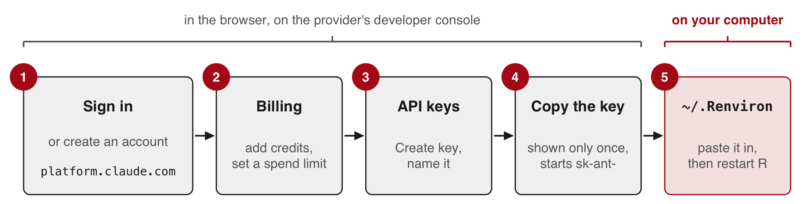{fig-align="center" fig-alt="Five numbered boxes. In the browser, on the provider's developer console: 1, sign in or create an account at platform.claude.com; 2, billing, add credits and set a spend limit; 3, API keys, Create key; 4, copy the key, which is shown only once and starts with sk-ant-. On your computer: 5, ~/.Renviron, paste the key in, then restart R."}

::: {style="font-size:0.85em"}

- **Developer console**: the provider's website for API accounts, billing
  and keys (here, [platform.claude.com](https://platform.claude.com)).
- API calls are paid per token from prepaid credits. A chat subscription
  does not cover them.
- The console shows the key only once, so paste it into `~/.Renviron`
  straight away.

:::

Today nobody needs a key. The calls run on the instructor's computer, and
their replies are in `saved/`.

::: {.content-visible when-format="revealjs"}

::: {.notes}
Steps follow the provider's "Get your API key" page. If a menu name
differs on the day, that page has the current one.
:::

:::

## Storing the model key in ~/.Renviron {#model-renviron .smaller .code-125}

```{r}
#| label: model-key-setup
#| purl: false
#| eval: false
#| filename: "R Console, on your own computer; once per computer"
file.edit("~/.Renviron")   # the same file as EIA_KEY
# add a second line, ANTHROPIC_API_KEY=paste-your-key-here; save, restart R, then:
nchar(Sys.getenv("ANTHROPIC_API_KEY"))  # above 0: loaded; 0: not found
```

- Never put a key in a script, a commit, a screenshot or a chat.
- If one leaks, delete it in the provider's developer console and create
  another.
- `nchar()` shows that the key loaded without printing it on a shared
  screen.

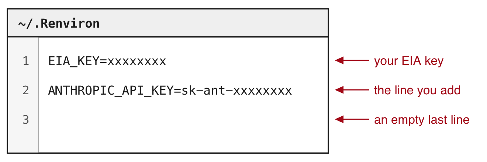{.nostretch fig-align="center" width="75%" fig-alt="The file ~/.Renviron drawn as a plain panel with numbered lines: 1, EIA_KEY=xxxxxxxx, your EIA key; 2, ANTHROPIC_API_KEY=sk-ant-xxxxxxxx, the line you add; 3, an empty last line."}

## Labelling the 266 names as economies or groups {#model-task .smaller .code-125}

:::: {.columns}

::: {.column width="45%"}

```{r}
#| label: model-task
#| script: "Labelling the 266 names as economies or groups"
#| filename: "R Console, in the 14-apis folder"
# needs wb: source("model_call.R")
# builds it and sends nothing
s <- sort(wb$country, method = "radix")
writeLines(s[180:190])   # 11 of the 266
```

:::

::: {.column width="55%"}

::: {.dashes}

- **The task**: label each of the 266 names in the World Bank's 2023
  table of access to electricity
  - `economy`: a country or a territory
  - `group`: a region, an income group, a lending group, or the world
- **Why this task**
  - Each label needs knowledge of what the name refers to: South Africa is
    an economy, Sub-Saharan Africa a group.
  - The World Bank publishes the correct label for every name, so R can
    count how many of the model's labels agree.

:::

:::

::::

[**Lending group**: the economies that borrow under one World Bank
programme, such as IDA, which lends to the poorest
countries.]{style="font-size:0.75em"}

::: {.content-visible when-format="revealjs"}

::: {.notes}
Call-out before the bullets: which of these 11 are groups? Five: North
America, Not classified, OECD members, Other small states, Pacific island
small states. Northern Mariana Islands is a US territory, an economy in the
World Bank's list. Channel Islands, also in the table, is one economy in
the list.
:::

:::

## Building the prompt from the 266 names {#model-prompt .smaller .code-110}

```{r}
#| label: model-prompt
#| script: "Building the prompt from the 266 names"
#| filename: 'model_call.R (part), in the 14-apis folder; needs jsonlite, flat() and saved/; writes raw/model_prompt.txt'
replies <- lapply(paste0("saved/wb_2023_p", 1:3, ".json"), fromJSON)
wb <- do.call(rbind, lapply(replies, flat))
# sort by name, the same way on every computer
wb <- wb[order(tolower(wb$country), method = "radix"), ]
wb$id <- 1:nrow(wb)

prompt <- paste0(
  "Below are ", nrow(wb), " names from a World Bank table. Some are single ",
  "economies (a country or a territory). Others are groups of economies ",
  "(a region, an income group, a lending group, or the world). Label each ",
  "name. Reply with CSV only: a header line id,label, then one line per ",
  "name with its number and either economy or group.\n\n",
  paste0(wb$id, ". ", wb$country, collapse = "\n"))
writeLines(prompt, "raw/model_prompt.txt")
```

```{r}
#| label: model-prompt-cleanup
#| purl: false
#| include: false
# The render writes nothing into the shipped project: remove the file the
# chunk above wrote, so raw/ stays empty.
unlink("raw/model_prompt.txt")
```

- The World Bank lists its 49 groups first, so a model could label by
  position. Sorting by name mixes the groups in with the economies.
- `method = "radix"` sorts by character code and ignores the computer's
  language settings, so every computer gets the same order. `tolower()`
  stops capitals from sorting first.
- Each name gets a number; the CSV reply repeats it, so R can match each
  label to its name.
- `collapse = "\n"` joins the names with `"\n"`, a new line, so each name
  sits on its own line.

::: {.content-visible when-format="revealjs"}

::: {.notes}
In the World Bank's own order, rows 1 to 49 are the groups, and a model
could label by position. On the instructor's computer the default sort gives
the same order; on some others it moves 13 names, which is why the line
names its method.
:::

:::

::: {.content-hidden when-format="revealjs"}

## The first lines of the prompt sent to the model {#model-prompt-head .smaller}

```{r}
#| label: model-prompt-head
#| script: "The first lines of the prompt sent to the model"
#| filename: "R Console; needs prompt"
#| class-output: out-lg
p <- strsplit(prompt, "\n")[[1]]   # the prompt, split into its lines
length(p)                          # the instructions, a blank line, 266 names
# the instructions, the blank line and names 1 to 7, wrapped at 75 characters
cat(strwrap(head(p, 9), 75), sep = "\n")
```

- The whole prompt goes in one request.
- The three saved replies answer this prompt. A copy is in
  `saved/model_prompt.txt`.

:::

## Putting the key in a header and the prompt in the body {#model-request .smaller .code-125}

```{r}
#| label: model-id
#| script: "The model's id, as on the first line of model_call.R"
#| include: false
MODEL <- "claude-opus-5-5"   # the model's id, from the provider's list of models
```

```{r}
#| label: model-request
#| script: "Putting the key in a header and the prompt in the body"
#| filename: 'model_call.R (part), plus req to print it; source("model_call.R") sets prompt and MODEL; sends nothing'
req <- request("https://api.anthropic.com/v1/messages")
req <- req_headers(req, "x-api-key" = Sys.getenv("ANTHROPIC_API_KEY"),
                   "anthropic-version" = "2023-06-01", .redact = "x-api-key")
req <- req_body_json(req, list(model = MODEL, max_tokens = 4000,
  messages = list(list(role = "user", content = prompt))))
req
```

:::: {.columns style="font-size:0.85em"}

::: {.column width="50%"}

::: {.dashes}

- **Headers**
  - `x-api-key`: the key; `.redact` keeps R from printing it
  - `anthropic-version`: the version of the request format

:::

:::

::: {.column width="50%"}

::: {.dashes}

- **Body**, in JSON
  - `model`: `MODEL`, the id on line 1 of `model_call.R`
  - `max_tokens`: a cap on the reply's length and cost; the saved replies
    used about 1,500
  - `messages`: the prompt, as one message from the user

:::

:::

::::

[`req_body_json()` makes the request a POST. Nothing is sent until
`req_perform()`.]{style="font-size:0.85em"}

## Sending the model request from R (live) {#model-send}

```{r}
#| label: model-send
#| purl: false
#| eval: false
#| filename: "model_send.R (part), instructor's computer; needs internet, req and a key"
resp <- req_perform(req)              # about 11 seconds
writeLines(resp_body_string(resp), "raw/model_live.json")
reply <- fromJSON("raw/model_live.json")
print(reply$stop_reason)              # "end_turn": the model finished
labels <- read.csv(text = reply$content$text[reply$content$type == "text"])
print(table(labels$label))            # each saved run: economy 217, group 49
```

- Each call costs money. The reply is saved to `raw/model_live.json`.
- The three calls sent before class took 11.0 to 11.2 seconds each
  (`saved/model_runs.csv`).
- If it fails, the next slide shows a reply saved before class.

::: {.content-visible when-format="revealjs"}

::: {.notes}
Run nchar(Sys.getenv("ANTHROPIC_API_KEY")) before class, off screen.
Never open ~/.Renviron or print Sys.getenv() on the projector. In RStudio,
in the 14-apis project: source("model_send.R"), which sources model_call.R
first. Expect "end_turn", then economy 217 and group 49. If the counts
differ, say so: replies can differ between runs. The comparison continues
on the saved reply. A 400, 402, 429 or 529 all go straight to the next
slide.
:::

:::

## Reading the text and the stop reason in the model's reply {#model-reply .smaller .code-110}

Reply to the labelling prompt, run on the instructor's computer before
class (`saved/model_reply_1.json`).

:::: {.columns}

::: {.column width="44%"}

[The file, shortened to the fields used here, with the CSV text cut after
two labels.]{style="font-size:0.75em"}

```{r}
#| label: model-reply-json
#| purl: false
#| echo: false
#| comment: ""
r <- jsonlite::fromJSON("saved/model_reply_1.json", simplifyVector = FALSE)
r$content <- lapply(r$content, function(b) {
  b$signature <- NULL
  if (!is.null(b$text)) b$text <- paste0(substr(b$text, 1, 27), "...")
  b
})
r$usage <- r$usage[intersect(c("input_tokens", "output_tokens", "output_tokens_details"),
                             names(r$usage))]
cat(jsonlite::toJSON(r[c("content", "stop_reason", "usage")],
                     auto_unbox = TRUE, pretty = TRUE))
```

:::

::: {.column width="56%"}

```{r}
#| label: model-reply
#| script: "Reading the text and the stop reason in the model's reply"
#| filename: "R Console, in the 14-apis folder; needs jsonlite; no key"
reply <- fromJSON("saved/model_reply_1.json")
reply$content$type
reply$stop_reason
txt <- reply$content$text[reply$content$type == "text"]
labels <- read.csv(text = txt)   # CSV from a string
str(labels)                      # 266 rows, one per name
```

::: {style="font-size:0.75em"}

- The content can begin with a **thinking block**: the reasoning the
  model writes before its answer. Its text is left out of the reply by
  default.
- **Stop reason**: why the reply ended. `"end_turn"`: the model
  finished. `"max_tokens"`: your cap cut it off mid-list. Read it before
  the text.

:::

:::

::::

## The World Bank's own list of economies and groups {#wb-countries .smaller .code-110}

```{r}
#| label: wb-countries-request
#| script: "The World Bank's own list of economies and groups"
#| filename: "R Console, in the 14-apis folder; needs internet and httr2; no key; writes raw/wb_countries.json"
#| eval: false
req_cl <- request("https://api.worldbank.org/v2/country")
req_cl <- req_url_query(req_cl, format = "json", per_page = 400)   # every entry, one page
writeLines(resp_body_string(req_perform(req_cl)), "raw/wb_countries.json")
```

The copy saved before class ships in `saved/`:

```{r}
#| label: wb-countries
#| script: "Reading the World Bank's list"
#| filename: "R Console, in the 14-apis folder; needs jsonlite and saved/wb_countries.json (or yours, in raw/)"
cl <- fromJSON("saved/wb_countries.json")[[2]]
nrow(cl)
table(cl$region$value == "Aggregates")   # TRUE: a group of economies
```

- Each entry has a name and a region. The World Bank gives every group the
  region `"Aggregates"`.
- The list has 296 entries: the same 217 economies as the table, and 79
  groups.
- The table uses 49 of the 79 groups.
- **Reference list**: labels you already trust, used to measure the
  model's.

::: {.content-hidden when-format="revealjs"}

The same list is in the browser at
[api.worldbank.org/v2/country?format=json&per_page=400](https://api.worldbank.org/v2/country?format=json&per_page=400).
Its other fields give each economy's income group and lending category.

:::

## The model's labels compared with the World Bank's list {#model-vs-list .smaller}

```{r}
#| label: model-vs-list
#| script: "The model's labels compared with the World Bank's list"
#| filename: "R Console; needs wb from model_call.R, labels from the reply, and cl"
miss <- is.na(match(wb$country, cl$name))   # TRUE: no exact match in the list
wb$country[miss]
pos <- match(trimws(wb$country), trimws(cl$name))   # each name's row in the list
wb$reference <- ifelse(cl$region$value[pos] == "Aggregates", "group", "economy")
wb$model <- labels$label[match(wb$id, labels$id)]   # each label on its name, by number
table(model = wb$model, list = wb$reference)
sum(wb$model == wb$reference)
```

- The list writes those two names with a space at the end
  (`"Sub-Saharan Africa "`). `trimws()` removes spaces at the start and
  end of a text, so every name finds its row.
- The model agrees with the World Bank on all 266 names.
- The model has likely seen this list: these names and groups are on many
  public pages.
- On your own texts, measure agreement on a hand-labelled sample before
  trusting the rest.

::: {.content-visible when-format="revealjs"}

::: {.notes}
Matching by the three-letter code fails for five groups whose code is
empty in the table: the four income groups and Not classified. Hence the
match by name.

Why 266 of 266 is a weak test, if asked. The task is easy: a word search
(income, IDA, states, Asia, Africa, Arab...) written knowing the answers
gets about 260 of 266, and its misses are economies named like regions
(South Africa, Saudi Arabia, American Samoa). The prompt copies the World
Bank's own categories, so the score measures the prompt and the model
together. Zero errors in 266 still fits an error rate near 1% overall and
near 6% on the 49 groups (three divided by the count).
:::

:::

::: {.content-hidden when-format="revealjs"}

Matching by the three-letter code instead of the name fails for five
groups whose `countryiso3code` is empty in the table: "High income", "Low
income", "Lower middle income", "Upper middle income" and "Not
classified".

:::

::: {.content-hidden when-format="revealjs"}

## Tokens and what a call costs {#model-tokens .smaller .code-125}

The same reply (`saved/model_reply_1.json`).

```{r}
#| label: model-tokens
#| script: "Tokens and what a call costs"
#| filename: "R Console; needs reply and wb"
c(input = reply$usage$input_tokens,                               # tokens in the prompt
  output = reply$usage$output_tokens,                             # written, reasoning included
  reasoning = reply$usage$output_tokens_details$thinking_tokens)  # of which reasoning
round(c(input = reply$usage$input_tokens,
        output = reply$usage$output_tokens) / nrow(wb), 1)   # per name
```

cost in dollars = (input tokens × input price + output tokens × output
price) / 1,000,000, with prices in dollars per million tokens. This call:
(2,597 × input price + 1,488 × output price) / 1,000,000.

- Prices are on the provider's
  [pricing page](https://platform.claude.com/docs/en/about-claude/pricing).
- Each name adds about 10 tokens in and 6 out.
- Twice the names cost about twice as much.

:::

## Tokens, cost and three runs of the same request {#model-three-runs .smaller .code-110}

```{r}
#| label: model-three-runs
#| script: "Comparing three runs of the same request"
#| filename: "R Console, in the 14-apis folder; needs jsonlite, the three saved replies and wb with its reference column"
runs <- lapply(paste0("saved/model_reply_", 1:3, ".json"), fromJSON)  # three runs of the labelling request
run_row <- function(r) {
  lab <- read.csv(text = r$content$text[r$content$type == "text"])
  data.frame(input = r$usage$input_tokens, output = r$usage$output_tokens,
             reasoning = r$usage$output_tokens_details$thinking_tokens,
             agree = sum(lab$label[match(wb$id, lab$id)] == wb$reference))
}
do.call(rbind, lapply(runs, run_row))   # tokens; agree: names whose label matches the list
```

- **Cost** in dollars = (input tokens × input price + output tokens ×
  output price) / 1,000,000, with prices per million tokens on the
  provider's [pricing page](https://platform.claude.com/docs/en/about-claude/pricing).
  Each name adds about 10 tokens in and 6 out.
- All three runs gave the same 266 labels, each matching the list. Nothing
  guarantees the same labels on the next run, so each reply is saved.
- **Temperature**, a setting for how much replies vary: the same request
  sent with `temperature = 0` got status 400, because this model no longer
  accepts it.

::: {.content-hidden when-format="revealjs"}

```{r}
#| label: model-temperature
#| script: "The same request with temperature = 0"
#| filename: "R Console, in the 14-apis folder; needs jsonlite and saved/model_temperature0.json"
fromJSON("saved/model_temperature0.json")$error$message
```

:::

::: {.content-visible when-format="revealjs"}

::: {.notes}
On harder items, runs disagree, and the items where they disagree are the
ones to read by hand.
:::

:::

::: {.content-hidden when-format="revealjs"}

`saved/model_runs.csv` records each run's status, the seconds it took
(11.0 to 11.2), its stop reason, its token counts, its rows and its
agreement with the World Bank's list. A request that fails, such as the
one with `temperature = 0`, is not billed.

:::

## When to call a model from R, and when to have it write R {#model-or-r .smaller}

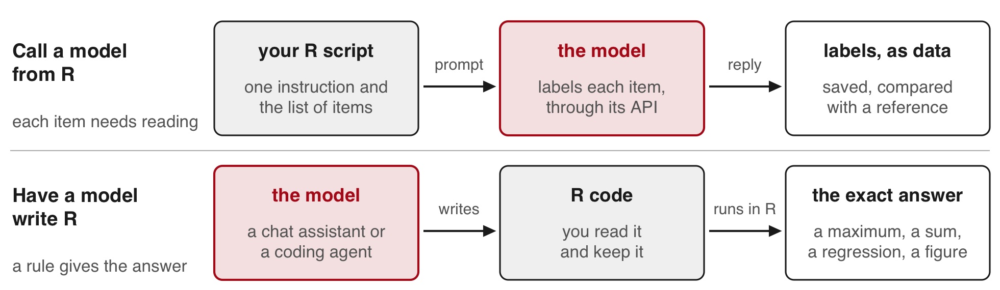{.nostretch fig-align="center" width="90%" fig-alt="Two lanes. Call a model from R, when each item needs reading: your R script sends one instruction and the list of items to the model through its API, the model labels each item, and the labels come back as data, saved and compared with a reference. Have a model write R, when a rule gives the answer: a chat assistant or a coding agent writes R code, which you read and keep, and R runs it to give the exact answer, such as a maximum, a regression or a figure."}

:::: {.columns style="font-size:0.8em"}

::: {.column width="50%"}

::: {.dashes}

- **Call a model from R**, through its API, in your script
  - examples: job titles to occupation codes, open survey answers to
    categories
  - the same request reruns on thousands of items
  - today: the 266 names, scored by the World Bank's list

:::

:::

::: {.column width="50%"}

::: {.dashes}

- **Have a model write R**, in a chat assistant or a **coding agent** (a
  program that writes and runs code on your computer)
  - R computes the answer exactly and for free
  - a task of this kind today: the peak hour, one line of R
    (`which.max()`) on 8,760 hours

:::

:::

::::

**Rule of thumb:** if a formula, a rule or a list gives the answer, compute
it in R. If each item needs reading, send the items to the model and
measure its labels on a hand-labelled sample.

::: {.content-visible when-format="revealjs"}

::: {.notes}
The 266 names fit the first route, and the World Bank's list also gives
their answer: in your own work you would join that list in R. The session
uses them because that known answer measures the model. Job titles, open
survey answers, firm descriptions and news headlines have no such list.
The peak hour fits the second route: a model asked for it reads 8,760
numbers and makes a claim, while one line of R gives the answer.
:::

:::

::: {.content-hidden when-format="revealjs"}

The labelling task fits the first route: the same question about each of
266 names, answered by reading them. The World Bank's list also gives the
answer for these names, so in your own work you would join it in R. The
session uses the task because that known answer measures the model. Job
titles, open survey answers, firm descriptions and news headlines have no
such list. The peak hour fits the second route: a model asked for it reads
8,760 numbers and makes a claim, while one line of R gives the answer. Both
routes end with a step you verify yourself: agreement with a hand-labelled
sample or a reference for the labels, and a reading of the code for the
computation.

:::

## Keeping API keys out of the repo and away from the agent {#agent-keys .smaller}

:::: {.columns}

::: {.column width="53%"}

::: {style="font-size:0.85em"}

When a coding agent writes and runs your R code:

- **The key stays in `~/.Renviron`**, outside the project. The code reads
  `Sys.getenv("EIA_KEY")`; the agent never needs the key itself.
- **Never paste a key into the chat.** What the agent reads, files and
  printed output included, goes to the model's provider with the
  conversation.
- **Keep `ANTHROPIC_API_KEY` out of your shell's startup file.** An agent
  started from that shell can use it and bill your API credits instead of
  your subscription.
- **Before each commit**, read what you are about to commit
  (`git diff --cached`).
- **If a key leaks**, delete it in the provider's console and create a new
  one. Removing it from the repo does not undo the leak.

:::

:::

::: {.column width="47%"}

```{.default filename="CLAUDE.md: the agent's instructions, in the project"}
API keys are in ~/.Renviron.
Read them with Sys.getenv("NAME").
Never print a key, write it to a
file or put it in printed output.
```

```{.default filename=".claude/settings.json: the agent may not open the file"}
{
  "permissions": {
    "deny": ["Read(~/.Renviron)"]
  }
}
```

[The instructions are a request. The setting is enforced on the agent's
own reads, `cat` included, but not on the code it runs: R still reads the
file when it starts, which is how your script gets the key.]{style="font-size:0.8em"}

:::

::::

::: {.content-hidden when-format="revealjs"}

Both files are Claude Code's; other coding agents have their own
instructions file and permission settings. The deny rule's syntax and its
limits are in Claude Code's
[permissions documentation](https://code.claude.com/docs/en/permissions),
and how it picks up `ANTHROPIC_API_KEY` from the shell is in its
[authentication documentation](https://code.claude.com/docs/en/authentication).
A key kept in `~/.Renviron` is read only by R, so the agent's own login is
unaffected.

:::

## Practice {#practice}

::: {.content-visible when-format="revealjs"}

Ten exercises on the session page, with solutions behind a click, all in
the 14-apis project. Tasks&nbsp;6 and&nbsp;7 need your own EIA key. Only
the last step of task 10 needs your own model key.

- **1–3** World Bank requests: agricultural land in 2020; China and India,
  2000–2023; 2023 at 20&nbsp;rows a page
- **4–5** Errors and packages: misspelled codes that still return status
  200; the same table from `WDI`, an R package for World Bank data
- **6–8** The EIA: one day of New York demand; every hour of 2025 for Texas
  or California; the ten days with New York's highest peak demand
- **9–10** Model replies: tokens per name and cost of the saved replies;
  20&nbsp;names labelled by hand, compared with the model's labels

:::

::: {.content-hidden when-format="revealjs"}

```{r}
#| label: practice
#| exercise: true
#| script: "Practice"
#| eval: false
# Practice. Run in the 14-apis folder after source("wb_functions.R"), or
# work from the files in saved/. Tasks 6 and 7 need your own EIA key and
# the base request and eia_page() from the EIA request. Task 8 needs eia
# from the stacking step. Tasks 9 and 10: run source("model_call.R") first;
# it builds wb, prompt and req from saved/ and sends nothing.

# World Bank requests
#  1. Add an indicator argument to fetch(). Request agricultural land
#     (% of land area, AG.LND.AGRI.ZS) for 2020, every page. Compare the
#     rows with the total. How many economies have no value?
#  2. In one URL, request China's and India's access to electricity for
#     2000 to 2023 (country/CHN;IND, date=2000:2023). Plot both series.
#  3. Request 2023 at 20 rows a page. How many requests does that take,
#     and how long with Sys.sleep(1) between them?

# Errors and packages
#  4. Misspell the country code (INDD), then the indicator code
#     (EG.ELC.ACCS.ZZ). Record the status and body of each. Add a line to
#     fetch() that stops with the API's message when a reply has no total.
#  5. Get the 2023 table with WDI(..., extra = TRUE). Compare its row
#     count and India's value with yours; drop the rows whose region is
#     "Aggregates" (the groups of economies).

# The EIA (your own key)
#  6. Store your EIA key and confirm it loaded with nchar(). Request NYIS
#     demand for 24 June 2025 only (start 2025-06-24T00-04, end
#     2025-06-24T23-04). Compare the 24 rows with the same day in saved/.
#  7. Request every hour of 2025, local time, for Texas (ERCO, ERCOT, which
#     runs most of Texas's grid) or California (CISO, the California
#     Independent System Operator). Their hours carry their own offsets:
#     -06 for ERCO, -08 for CISO. Rows against the total and the calendar;
#     hours at 0; the peak hour.
#  8. Compute New York's daily peaks with
#     tapply(eia$demand, eia$date, max, na.rm = TRUE). List the ten highest
#     days. How many fall in June and July?

# Model replies
#  9. From saved/model_reply_1.json to _3.json: input and output tokens,
#     per name too, and each run's cost at prices from the provider's
#     pricing page. What would labelling 10,000 names cost?
# 10. Draw 20 names: set.seed(6850); s <- sort(sample(wb$id, 20)). Label
#     each one economy or group by hand, before you look at any answer.
#     Compare your labels with the model's (saved/model_reply_1.json) and
#     with the World Bank's list. With your own key: run
#     source("model_send.R") and compare your run's labels with the saved
#     ones.
```

::: {.callout-tip collapse="true"}
## Solutions

**1.** 266 rows against a total of 266. Eight rows have no value, seven
of them economies. `flat()` still names the column `access`.

```{r}
#| label: practice-1
#| purl: false
#| eval: false
fetch <- function(p, year, per, indicator = "EG.ELC.ACCS.ZS") {
  req <- request(paste0("https://api.worldbank.org/v2/country/all/indicator/", indicator))
  req <- req_url_query(req, date = year, format = "json", per_page = per, page = p)
  txt <- resp_body_string(req_perform(req))
  writeLines(txt, paste0("raw/wb_", indicator, "_", year, "_p", p, ".json"))
  Sys.sleep(1)
  fromJSON(txt)
}
first <- fetch(1, 2020, 100, indicator = "AG.LND.AGRI.ZS")
ag_replies <- lapply(1:first[[1]]$pages, fetch, year = 2020, per = 100,
                     indicator = "AG.LND.AGRI.ZS")
ag <- do.call(rbind, lapply(ag_replies, flat))
c(rows = nrow(ag), total = first[[1]]$total, no_value = sum(is.na(ag$access)))
ag$country[is.na(ag$access)]                 # one group and seven economies
```

**2.** `total` is 48: 24 years for each country, in one page.

```{r}
#| label: practice-2
#| purl: false
#| eval: false
r <- request("https://api.worldbank.org/v2/country/CHN;IND/indicator/EG.ELC.ACCS.ZS")
r <- req_url_query(r, date = "2000:2023", format = "json", per_page = 100)
two <- flat(fromJSON(resp_body_string(req_perform(r))))
nrow(two)                                    # 48
two$year <- as.numeric(two$year)
ind <- two[two$iso3 == "IND", ]
chn <- two[two$iso3 == "CHN", ]
plot(ind$year, ind$access, type = "l", ylim = c(0, 100), las = 1,
     xlab = "Year", ylab = "Access to electricity (% of population)")
lines(chn$year, chn$access, lty = 2)
legend("bottomright", c("India", "China"), lty = 1:2)
```

**3.** 14 pages, so 14 requests (15 if you request page 1 first, as on
the slides), and 266 rows. `Sys.sleep(1)` adds at least 14 seconds of
waiting to the time each reply takes. In testing, uncached pages of 20
rows took from a few seconds to a minute each, and the 15 requests took
close to four minutes.

```{r}
#| label: practice-3
#| purl: false
#| eval: false
first <- fetch(1, 2023, 20)
first[[1]]$pages
system.time(replies20 <- lapply(1:first[[1]]$pages, fetch, year = 2023, per = 20))
nrow(do.call(rbind, lapply(replies20, flat)))
```

**4.** Both misspellings return status 200 with the same body: message id
120, "The provided parameter value is not valid". A good reply has a
`total` in its first part; this one has none.

```{r}
#| label: practice-4
#| purl: false
#| eval: false
bad <- request("https://api.worldbank.org/v2/country/INDD/indicator/EG.ELC.ACCS.ZS")
bad <- req_url_query(bad, date = 2023, format = "json")
resp_bad <- req_perform(bad)
resp_status(resp_bad)                        # 200
writeLines(resp_body_string(resp_bad))       # message id 120
# fetch() from solution 1, with one more line
fetch <- function(p, year, per, indicator = "EG.ELC.ACCS.ZS") {
  req <- request(paste0("https://api.worldbank.org/v2/country/all/indicator/", indicator))
  req <- req_url_query(req, date = year, format = "json", per_page = per, page = p)
  txt <- resp_body_string(req_perform(req))
  writeLines(txt, paste0("raw/wb_", indicator, "_", year, "_p", p, ".json"))
  Sys.sleep(1)
  reply <- fromJSON(txt)
  if (is.null(reply[[1]]$total)) stop(txt)   # no total: the body is a message
  reply
}
fetch(1, 2023, 100, indicator = "EG.ELC.ACCS.ZZ")   # stops with the API's message
```

**5.** `WDI()` sends the same requests and returns a data frame; with
`extra = TRUE` it adds a `region` column, which reads "Aggregates" for the
groups. Compare the rows with 266 before the drop and with the economies
after it, and India's value with 99.5.

```{r}
#| label: practice-5
#| purl: false
#| eval: false
library(WDI)
w <- WDI(country = "all", indicator = c(access = "EG.ELC.ACCS.ZS"),
         start = 2023, end = 2023, extra = TRUE)
nrow(w)
w[w$iso3c == "IND", c("country", "year", "access")]
w <- w[w$region != "Aggregates", ]
nrow(w)
```

**6.** 24 rows, from `2025-06-24T00-04` to `2025-06-24T23-04`. The peak
row is `2025-06-24T19-04` at 31,857, the same as in `saved/`.
`req_url_query()` replaces a parameter the request already has, so the
`base` request takes the new dates.

```{r}
#| label: practice-6
#| purl: false
#| eval: false
one_day <- req_url_query(base, start = "2025-06-24T00-04", end = "2025-06-24T23-04")
one <- fromJSON(resp_body_string(req_perform(one_day)))$response$data
nrow(one)
one[which.max(as.numeric(one$value)), c("period", "value")]
```

**7.** Replace the respondent and the bounds in `base`; `eia_page()`
then sends the new request (it still names its files `eia_nyis_`). Keep
the rows dated 2025, as for New York.

```{r}
#| label: practice-7
#| purl: false
#| eval: false
base <- req_url_query(base, `facets[respondent][]` = "ERCO",
                      start = "2025-01-01T00-06", end = "2026-01-01T00-06")
pages <- lapply(c(0, 5000), eia_page)
tx <- do.call(rbind, lapply(pages, function(p) p$response$data))
tx$demand <- as.numeric(tx$value)
c(rows = nrow(tx), total = as.numeric(pages[[1]]$response$total))
tx <- tx[substr(tx$period, 1, 4) == "2025", ]
c(rows = nrow(tx), zeros = sum(tx$demand == 0))
tx[which.max(tx$demand), c("period", "demand")]
```

**8.** 24 June (31,857), 25 June (30,646) and 29 July (30,645) lead. All
ten days fall in June and July.

```{r}
#| label: practice-8
#| purl: false
peaks <- tapply(eia$demand, eia$date, max, na.rm = TRUE)
top <- sort(peaks, decreasing = TRUE)[1:10]
top
table(months(as.Date(names(top))))
```

**9.** Each run sent 2,597 input tokens and wrote 1,488 to 1,492: about
10 in and 6 out per name. Multiply by the prices on the pricing page and
divide by a million. 10,000 names take about 38 calls of this size, so
about 38 times the cost of one. Send them in batches of a few hundred: a
reply longer than `max_tokens` stops with `"max_tokens"`.

```{r}
#| label: practice-9
#| purl: false
runs <- lapply(paste0("saved/model_reply_", 1:3, ".json"), fromJSON)
tokens <- sapply(runs, function(r) c(input = r$usage$input_tokens,
                                     output = r$usage$output_tokens))
tokens
round(tokens / nrow(wb), 1)                  # per name
# cost of each run, with prices per million tokens p_in and p_out:
#   (tokens["input", ] * p_in + tokens["output", ] * p_out) / 1e6
```

**10.** The 20 names, with the model's label and the World Bank's. Compare
your own labels with both columns. A random 20 holds only two groups here,
so it says little about how well groups are labelled. When one label is
rare, draw the sample within the model's labels (for example 10 names it
called group and 10 it called economy), or draw a larger sample.

```{r}
#| label: practice-10
#| purl: false
cl <- fromJSON("saved/wb_countries.json")[[2]]
pos <- match(trimws(wb$country), trimws(cl$name))
wb$reference <- ifelse(cl$region$value[pos] == "Aggregates", "group", "economy")
reply <- fromJSON("saved/model_reply_1.json")
labels <- read.csv(text = reply$content$text[reply$content$type == "text"])
wb$model <- labels$label[match(wb$id, labels$id)]
set.seed(6850)
s <- sort(sample(wb$id, 20))
wb[s, c("id", "country", "model", "reference")]
```

```{r}
#| label: practice-10-request
#| purl: false
#| eval: false
# with your own key: send the request again and compare the two runs
saved_labels <- labels$label                 # the labels in saved/model_reply_1.json
source("model_send.R")                       # sends it; labels now holds your run's
sum(labels$label == saved_labels)            # names on which the two runs agree
```

:::

## Quick reference {#quick-reference}

| Function | What it does |
|:--|:--|
| `request(url)` | starts a request to an address |
| `req_url_query(req, name = value)` | adds query parameters to the URL, or replaces them |
| `req_headers(req, name = value)` | adds a header |
| `req_headers(req, name = value, .redact = "name")` | adds a header that R never prints, for a key |
| `req_body_json(req, list(...))` | adds a JSON body and makes the request a POST |
| `req_perform(req)` | sends the request and waits for the reply |
| `resp_status(resp)` | the reply's status code |
| `resp_body_string(resp)` | the reply's body as text |
| `fromJSON(txt)` | JSON text, or a JSON file, to R lists and data frames |
| `read.csv(text = txt)` | reads CSV from a string, such as a model's reply |
| `order(tolower(x), method = "radix")` | alphabetical order, the same on every computer |
| `match(x, y)` | the position of each element of `x` in `y` |
| `trimws(x)` | removes spaces at the start and end of a text |
| `writeLines(txt, file)` | saves the reply as it arrived |
| `Sys.getenv("NAME")` | reads an environment variable, such as a key |
| `Sys.sleep(1)` | waits one second |
| `file.edit("~/.Renviron")` | opens the file that holds your keys |

**Sources.**
[Akbar, Couture, Duranton & Storeygard (AER, 2023)](https://doi.org/10.1257/aer.20181662);
[Fujiwara, Müller & Schwarz (JEEA, 2024)](https://doi.org/10.1093/jeea/jvad058).
World Bank, World Development Indicators, `EG.ELC.ACCS.ZS`, and the World
Bank's country list (Creative Commons Attribution 4.0). U.S. Energy Information Administration, Hourly
Electric Grid Monitor, NYISO demand. NYISO's heat-wave notice and NYSRC's
June 2025 operations report, linked above.

The replies in `saved/` were requested (the model's id is on the first
line of `model_call.R`), the screenshots captured and the console steps
written in October 2026; pages and menu names may have changed since.

**Links:** [slides](14-apis-slides.html) ·
[httr2](https://httr2.r-lib.org) ·
[World Bank Indicators API](https://datahelpdesk.worldbank.org/knowledgebase/articles/889392-about-the-indicators-api-documentation) ·
[EIA API documentation](https://www.eia.gov/opendata/documentation.php) ·
[EIA API browser](https://www.eia.gov/opendata/browser/electricity/rto/region-data) ·
[EIA key registration](https://www.eia.gov/opendata/register.php) ·
[the provider's API reference](https://platform.claude.com/docs/en/api/messages) ·
[Syllabus](../syllabus.qmd)

:::

```{r}
#| purl: false
#| include: false
source(file.path(session_dir, "_purl.R"))
purl_session(file.path(session_dir, "14-apis.qmd"),
             file.path(session_dir, "14-apis.R"))
```
