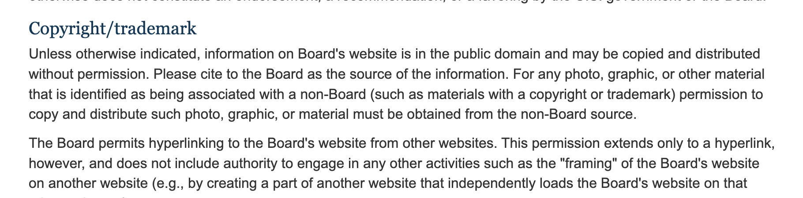
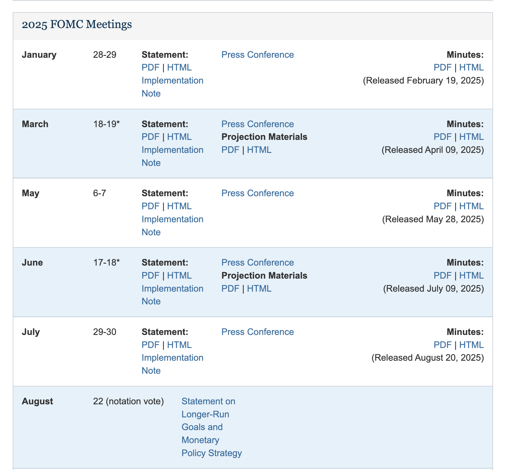
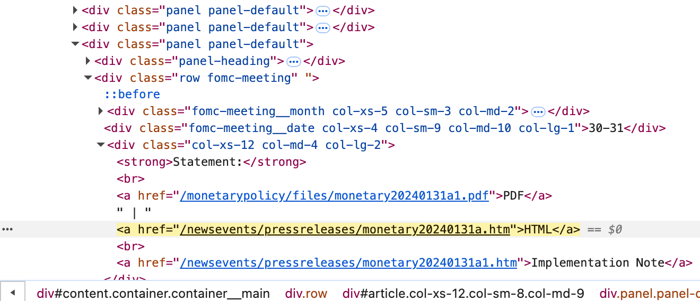
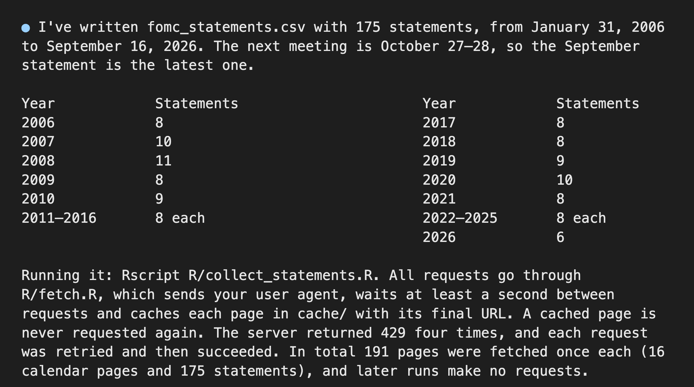

```{r}
#| purl: false
#| include: false
knitr::opts_chunk$set(
  comment = "#>",
  collapse = FALSE,
  fig.width = 9,
  fig.height = 4.4,
  fig.align = "center",
  fig.show = "hold",
  dpi = 150
)
options(width = 80)
# Every chunk runs in the project folder, so the paths on the page are the
# paths students use (cache/..., mine/..., agent_run/...).
session_dir <- getwd()
knitr::opts_knit$set(root.dir = file.path(session_dir, "data/15-scraping"))
```

::: {.content-hidden when-format="revealjs"}

[Slides](15-scraping-slides.html) · [Live script](15-scraping.R) ·
[Source](https://github.com/ArielOrtizBobea/aem6850/blob/main/fall-2026/sessions/15-scraping.qmd) ·
[the project](data/15-scraping.zip)

How to get data out of pages built for people. The session asks one
question of one site, the Federal Reserve's: what has its policy
committee said after each meeting since 2006? It starts with whether a
site may be scraped at all, reads a saved page into R with `rvest` and
CSS selectors, fetches one page politely, loops over fifteen more, and
sorts out static pages from dynamic ones and the six ways to find every
page a site holds. It ends with four other collectors: a coding agent
that scraped every statement from a four-paragraph brief, an AI browser
agent reading a page, the Wayback Machine's copies of a page as it was,
and a Wikipedia article's edit history.

**The project.** Download [15-scraping.zip](data/15-scraping.zip), unzip
it, and open `15-scraping.Rproj`, so that R starts in the project folder.
It holds:

- `cache/`: every page the slides use, saved as the server sent it on
  18 October 2026: the meeting calendar, the fifteen year pages, 243
  press-release pages, the press-release feed, two Wayback Machine
  listings and one 2015 snapshot, a Wikipedia article's revision history
  and one Wikipedia table page. With these files every slide runs with
  no network.
- `fomc_statements.csv`: the file this session builds, one row per policy
  statement since 2006.
- `fetch_page.R`: the fetch function from the slides, with Exercise 2's
  two long lines as comments.
- `agent_run/`: what a coding agent was asked, what it wrote and what it
  produced, captured in prep.
- `reference_scrape.R` and `build_statements.R`: the scripts that built
  `cache/` and the CSV.
- `SOURCE.txt`: each source, its address, the date of each request, the
  Board's public-domain line, and the rule that decides what counts as a
  statement.
- `mine/`: created in class by `fetch_page()`. Your own fetches go here,
  so the shipped pages never change.

## Objectives {#objectives}

By the end of this session you can:

- Say whether a site may be scraped from its terms of use, its
  robots.txt, copyright and the personal data on it.
- Read a saved web page into R with `read_html()`.
- Find an element's class with the browser's inspector.
- Pick elements out with CSS selectors, `html_elements()`,
  `html_element()`, `html_text2()` and `html_attr()`.
- Read an HTML table with `html_table()`.
- Fetch a page politely: a user agent with your address, one request a
  second, every page saved once as raw bytes, a fetch log.
- Read a server's status code and act on it.
- Tell a static page from a dynamic one and find the file it loads.
- Name six ways to find every page on a site.
- Compare a scraped file with the site's own lists, its feed and the
  scraper's own log.
- Fetch a page's past version from the Wayback Machine.
- Read a Wikipedia article's revision history from its API.

:::

## Plan for today {#plan}

::: {style="font-size:0.92em"}

1. **Whether you may scrape a site**\
   [Terms of use · robots.txt · copyright and facts · personal data]{.topics}
2. **Reading a saved web page into R**\
   [HTML · the inspector · CSS selectors · `rvest` · an HTML table]{.topics}
3. **Fetching politely**\
   [The user agent · the server's replies · CAPTCHAs and login walls ·
   `fetch_page()` · a loop over 15 pages]{.topics}
4. **Kinds of pages, and finding every page**\
   [Static and dynamic pages · files and feeds · six routes to the full
   list]{.topics}
5. **Other collectors**\
   [A coding agent · an AI browser agent · the Wayback Machine ·
   Wikipedia's edit history]{.topics}

:::

::: {style="font-size:0.7em"}

In the R Console, while Part 1 runs:
`install.packages(c("rvest", "httr2", "jsonlite"))`. Before Part 2: unzip
[15-scraping.zip](data/15-scraping.zip) and open `15-scraping.Rproj`.

:::

::: {.content-visible when-format="revealjs"}

::: {.notes}
Ask everyone to run the install line now. Part 1 needs no R. The zip
link on this slide and on the Part 2 divider is the same file as on the
session page.
:::

:::

## What web scraping is, and the three routes to someone else's data {#three-routes .smaller}

{fig-align="center" fig-alt="Three lanes that all reach the Federal Reserve's data. Download a file: the interest-rate release page offers its series as a CSV file. Request a feed: the address json/ne-press.json returns every press release as one data file in JSON. Scrape a page built for people: a program reads one statement page and picks the paragraphs out of its layout. Under each lane, what comes back: a file, a structured reply, the page's HTML."}

::: {style="font-size:0.78em"}

**Web scraping**: a program reads pages built for people and copies chosen
pieces into a table. **HTML** is the text a web page is written in; the
**server** is the computer that holds the pages and answers requests; a
**feed or API** is a service that answers a program with data in a fixed
structure. The Federal Reserve is the US central bank; its Federal Open
Market Committee (FOMC) sets the policy interest rate at eight scheduled
meetings a year and publishes a written statement after each one.

Scrape when the first two routes do not give what you need. The
statements' text exists only on the pages.

:::

::: {.content-visible when-format="revealjs"}

::: {.notes}
The feed holds 4,648 releases in the saved copy; your number will be
larger. The interest-rate release (H.15) offers its data files from its
own page.
:::

:::

## Online prices scraped from 56 retailers, compared with their in-store prices {#cavallo .smaller}

[Cavallo (AER, 2017)](https://doi.org/10.1257/aer.20160542)

::::: {.columns}

::: {.column width="56%"}

::: {.dashes style="font-size:0.9em"}

- **Question.** Are the prices a retailer posts online the same as the
  prices in its stores?
- **What he did.** A scraping program for each of 56 large retailers in
  10 countries. Hired workers scanned the same products' barcodes in the
  stores and entered the shelf price; the program took the online price
  within a week.
- **Finding.** Prices were identical about 72 percent of the time. Price
  changes were not synchronised across the two channels but had similar
  frequency and size.
- **Takeaway:** scraped prices can stand in for prices collected by hand
  once you have measured how often the two agree.

:::

:::

::: {.column width="44%"}

{width="100%" fig-align="center" fig-alt="One retailer's website goes through a scraper into a table of prices per product per day. Beside it a worker in the store scans the same product's barcode and writes down the shelf price. The two prices are compared."}

:::

:::::

## Requests for men or women in a million Chinese job ads, from a crawler {#kuhn-shen .smaller}

[Kuhn & Shen (QJE, 2013)](https://doi.org/10.1093/qje/qjs046)

::::: {.columns}

::: {.column width="56%"}

::: {.dashes style="font-size:0.9em"}

- **Crawler**: a program that follows links from page to page and saves
  each one.
- **What they did.** Collected 1,051,706 ads from Zhaopin.com, one of the
  largest Chinese online job boards, with a crawler over four periods,
  and coded which ads asked for a man or a woman.
- **Finding.** Gender-targeted ads were common, favoured women as often
  as men, and were much less common in jobs requiring more skill.
- **Takeaway:** a crawler turns a job board into data on what employers
  ask for, in their own words.

:::

:::

::: {.column width="44%"}

{width="100%" fig-align="center" fig-alt="A crawler starts at a job board's listing page, follows each link to an ad, saves the ad, and moves to the next listing page. The saved ads become rows of a table: the job, the employer, and whether the ad asks for a man or a woman."}

:::

:::::

## Discrimination in rental housing, measured with inquiries to scraped listings {#christensen .smaller}

[Christensen & Timmins (QJE, 2023)](https://doi.org/10.1093/qje/qjad029)

::::: {.columns}

::: {.column width="56%"}

::: {.dashes style="font-size:0.88em"}

- **Context.** US law (the Fair Housing Act) bans discrimination by race
  in renting a home.
- **What they did.** A bot collected every three-bedroom, two-bathroom
  rental listing on a major online platform in five US metropolitan
  areas, with each neighbourhood's amenities and pollution, and sent each
  listing inquiries from fictitious renters whose names signal different
  groups. The replies are the experiment's data.
- **Finding.** Discrimination cost the equivalent of 4.4 and 3.5 percent
  of annual income for African American and Hispanic/Latinx renters.
- **Takeaway:** scraping chose which homes to ask about and described
  each neighbourhood; the bot's inquiries supplied the replies.

:::

:::

::: {.column width="44%"}

{width="100%" fig-align="center" fig-alt="Rental listings go through a scraper into a table of homes with their neighbourhood's amenities and pollution. From the table, inquiries go out to each listing from renters with different names, and the replies come back and are recorded."}

:::

:::::

# 1 · Whether you may scrape a site {#part-allowed}

::: {.content-visible when-format="revealjs"}

- Terms of use
- robots.txt
- Copyright and facts
- Personal data
- A show of hands

:::

## Terms of use set a site's rules for visitors {#terms .smaller}

{fig-align="center" fig-alt="The Copyright/trademark section of the Federal Reserve Board's disclaimer page: unless otherwise indicated, information on the Board's website is in the public domain and may be copied and distributed without permission; please cite the Board as the source. Material identified as non-Board, such as photos and graphics, keeps its owner's permission."}

::: {style="font-size:0.78em"}

- **Terms of use**: the legal rules a site sets for visitors. Using the
  site, or signing in, means accepting them, and they may forbid
  automated copying. Found in footer links named Terms, Legal, Website
  Policies or Disclaimer.
- **The Fed**, from [federalreserve.gov/disclaimer.htm](https://www.federalreserve.gov/disclaimer.htm):
  the Board's own material is in the **public domain** (nobody holds the
  copyright, so anyone may copy it), with a citation to the Board.
  Material a site marks as someone else's keeps that owner's terms.
- **Zillow**, a US website that lists homes for sale and rent: its terms
  allow copying "without the aid of any automated processes and only as
  necessary for your personal use" and forbid "automated queries
  (including screen and database scraping, spiders, robots, crawlers
  ...)".
- **Copyright** is the owner's right to control copies of a text, image
  or recording. In the US, facts are not covered: a telephone directory's
  names and numbers may be copied by anyone (Feist v. Rural, 1991).
  Prices, dates and vote counts are facts; the wording of a text is
  covered unless it is public domain or licensed.

:::

::: {.content-hidden when-format="revealjs"}

Outside the US, the European Union also protects a database built with
substantial investment, apart from copyright (the database right,
Directive 96/9/EC, article 7), even when it holds only facts. For a
project: collect the facts; republishing scraped full texts, for example
in a replication package, needs the text to be public domain (the Fed) or
licensed (Wikipedia: CC BY-SA, with attribution). The EU's copyright
directive of 2019 (Directive 2019/790) gives research organisations an
exception for text and data mining of material they may lawfully access
(article 3; article 4 covers other uses).

Zillow's terms of use, on the clause about automated access: users may
"copy information from the Services without the aid of any automated
processes and only as necessary for your personal use" and may not
"conduct automated queries (including screen and database scraping,
spiders, robots, crawlers, bypassing 'captcha' or similar precautions, or
any other automated activity with the purpose of obtaining information
from the Services)".

**hiQ Labs v. LinkedIn.** hiQ, an analytics firm, scraped public LinkedIn
profiles to sell reports to employers. An appeals court held in April
2022 that hiQ raised serious questions whether scraping public pages is
access "without authorization" under the US anti-hacking law (the CFAA).
The trial court found in November 2022 that hiQ had breached LinkedIn's
User Agreement, which bans scraping; a consent judgment followed in
December 2022 (hiQ to stop scraping and destroy the data), and it
recorded a CFAA violation for hiQ's access to password-protected pages
through fake accounts. Public pages can be off-limits under a site's
terms, and pages behind a login are off-limits under the law.

:::

## robots.txt lists the paths a site asks programs to skip {#robots .smaller}

::: {style="font-size:0.8em"}

**robots.txt**: a plain-text file at a site's main address
(`/robots.txt`) that tells programs which paths to stay out of. Servers
do not enforce it. A polite scraper follows it.

- **federalreserve.gov/robots.txt** answers 404, the server's code for a
  page that does not exist (its sitemap.xml too). The standard for
  robots.txt (RFC 9309) reads a 4xx reply as no restriction.
- **zillow.com/robots.txt**, 328 lines; the lines that matter:

:::

```{.default filename="zillow.com/robots.txt, selected lines (line numbers as comments)"}
# Access to and use of Zillow.com is governed by our Terms of Use. See https://www.zillow.com/corp/Terms.htm
User-agent: *                   # line 3: every program
Allow: /homes/for_sale/$        # one of 64 Allow lines: the listing-index pages
Disallow: /homes/               # line 50, one of 212 Disallow lines: the listings
User-agent: Amazonbot           # one of 11 crawlers named in a later block ...
Disallow: /                     # ... allowed only guides and blog pages
Crawl-delay: 1                  # line 302, inside that named-crawler block
Sitemap: https://www.zillow.com/xml/indexes/us/static.xml.gz   # 15 Sitemap lines
```

::: {style="font-size:0.72em"}

`User-agent` names the programs a block applies to (`*` is every
program); `Disallow` the paths to skip; `Allow` the exceptions (`$` means
the address ends there); `Crawl-delay` the seconds to wait between
requests (not in the standard, but some sites write it); `Sitemap` where
the site lists the pages it wants found (Part 4).

:::

::: {.content-visible when-format="revealjs"}

::: {.notes}
The file forbids the listing pages a researcher would want; that is the
hands question two slides on. The three social-media crawlers at lines
261 to 265 form their own group with two Allow lines; the four at lines
304 to 309 are fully disallowed. Measured 18 October 2026.
:::

:::

::: {.content-hidden when-format="revealjs"}

RFC 9309, section 2.3.1.3: "If a server status code indicates that the
robots.txt file is unavailable to the crawler, then the crawler MAY
access any resources on the server." The RFC defines no `Crawl-delay`
field and lists `Sitemap` as a record outside the protocol.

:::

## Personal data on the pages you scrape {#personal-data .smaller}

{fig-align="center" fig-alt="Three lines of a press-conference transcript: a reporter gives her name and her newspaper, then asks the chair about interest rates."}

::: {style="font-size:0.8em"}

- **Personal data**: information that identifies a living person: a name,
  a photo, an address, an email, an IP address.
- **On the Fed's site.** The statements name the voting members,
  officials acting in their public roles. The press-conference
  transcripts name each reporter and outlet (above).
- **For research.** Collect only the fields you need (the Wikipedia
  request in Part 5 leaves the editor's name out). Research on
  identifiable people goes to the IRB (the university board that approves
  research on people) before collection. The EU's data-protection law
  (GDPR) covers personal data even on public pages, and counts an IP
  address as an identifier.

**Hands.** Who would scrape Zillow's listings for a research project,
given its terms and its robots.txt?

:::

::: {.content-visible when-format="revealjs"}

::: {.notes}
One or two call-outs on why. The answer the part builds to is no, or
through bought data (Part 4's last row). GDPR: article 4(1) defines
personal data; recital 30 names IP addresses and cookie identifiers.
:::

:::

# 2 · Reading a saved web page into R with `rvest` and CSS selectors {#part-reading}

::: {.content-visible when-format="revealjs"}

- The Fed's meeting calendar, and the file we build
- HTML, the browser inspector, CSS selectors
- `read_html()`, `html_elements()`, `html_text2()`, `html_attr()`
- Three selectors, three counts
- An HTML table with `html_table()`
- Exercise 1

Before this part: unzip [15-scraping.zip](data/15-scraping.zip) and open
`15-scraping.Rproj`.

:::

## The Fed's meeting calendar, and the file this session builds {#calendar .smaller}

::::: {.columns}

::: {.column width="52%"}

{height="400px" fig-align="center" fig-alt="The 2025 panel of the Federal Reserve's meeting calendar: one row per meeting with the month, the dates, links to the statement as PDF and HTML, the implementation note, the press conference and the minutes. The August row reads 22 (notation vote) and links only a Statement on Longer-Run Goals."}

:::

::: {.column width="48%"}

::: {style="font-size:0.68em"}

The committee issues its statement on the last day of a meeting.
Unscheduled calls, and votes taken in writing (notation votes), happen in
crises.

**The pages** at [federalreserve.gov/monetarypolicy/fomccalendars.htm](https://www.federalreserve.gov/monetarypolicy/fomccalendars.htm):
one panel per year (2021 to 2027), one row per meeting, with links to the
statement (PDF and HTML), an implementation note (the technical
instructions that go with the decision), the press conference and the
minutes; one page per year for 2006 to 2020; each statement on its own
page.

**The target.** `fomc_statements.csv`: one row per policy statement, 171
rows, 31 January 2006 to 16 September 2026; columns `date`, `url`,
`words`, `text`, `scheduled` (TRUE after a scheduled meeting, FALSE after
an unscheduled call or notation vote). After the next meeting your number
will be larger by one.

:::

:::

:::::

[Every page used today was saved into `cache/` on 18 October 2026: 268
requests, one a second, a contact address, all answered 200. `SOURCE.txt`
lists every file.]{.source}

## Elements, tags, classes, ids and attributes in HTML {#html .smaller}

{fig-align="center" fig-alt="Left, the HTML of the January 2024 calendar row, trimmed to nine lines: a div with class row fomc-meeting, inside it a div with class fomc-meeting__month holding January in bold, a div with class fomc-meeting__date holding 30-31, and a div with the Statement links: PDF, HTML and Implementation Note, each an a tag with an href. Right, the same row as the browser draws it. Four arrows join the month, the dates, the HTML link and the Implementation Note link to their lines of HTML."}

::: {style="font-size:0.74em"}

**Element**: one labelled piece of the page (a heading, a link, a box).
**Tag**: the label in angle brackets (`div`, `a`, `strong`). **Class**: a
name the site gives to elements of one kind (`fomc-meeting`); many
elements share it. **Id**: a name given to one element (`article` on the
statement pages). **Attribute**: a named value inside a tag; a link's
address is its `href`. The addresses are relative (they start with `/`);
the site's name goes in front when you fetch them.

:::

## Finding an element with the browser inspector {#inspector .smaller}

::::: {.columns}

::: {.column width="62%"}

{fig-align="center" fig-alt="The browser's Elements panel with the HTML of a calendar row expanded: a div with class row fomc-meeting selected, and inside it the month, the dates and the Statement links, with the HTML link to monetary20240131a.htm highlighted."}

:::

::: {.column width="38%"}

::: {style="font-size:0.72em"}

**Browser inspector**: the panel that shows the HTML behind whatever you
point at.

1. Right-click a meeting date on the live page.
2. Choose **Inspect**.
3. Read the class names on the highlighted line and on the lines inside
   it.

Safari needs "Show features for web developers" turned on in its
Advanced settings first. Many of you have never opened this panel: try it
tonight.

Inspect shows the page after its scripts ran. `read_html()` gets what
**View Source** shows (right-click, View Page Source). If the two differ,
the page is dynamic (Part 4).

:::

:::

:::::

## Picking out elements with CSS selectors {#selectors .smaller}

::: {style="font-size:0.85em"}

**CSS selector**: a short pattern that names elements by tag, class
(`.`), id (`#`), position inside another element (a space) or attribute
(`[ ]`). The counts come from the saved calendar.

| Selector | Picks | Count |
|:--|:--|--:|
| `p` | every paragraph (by tag) | 50 |
| `.fomc-meeting` | every element with class `fomc-meeting` | 57 |
| `#article` | the one element with id `article` | 1 |
| `#article p` | paragraphs inside that element | 4 |
| `a[href$='a.htm']` | links whose address ends in `a.htm` | 53 |

`.fomc-meeting` matches the class `fomc-meeting` exactly, not
`fomc-meeting__month`. `[href*='x']` means the address contains `x`
anywhere; `[href$='x']` means it ends in `x`.

:::

## Reading the saved calendar with `read_html()` {#read-html .smaller}

```{r}
#| label: read-html
#| filename: "R Console, in the 15-scraping folder; needs rvest; reads cache/fomccalendars.htm; no network"
# install.packages(c("rvest", "httr2", "jsonlite"))   # once
library(rvest)
cal    <- read_html("cache/fomccalendars.htm")       # the calendar as saved
panels <- html_elements(cal, ".panel-default")       # one panel per year
length(panels)
titles <- html_text2(html_element(panels, "h4"))     # the first h4 inside each panel
titles
```

::: {style="font-size:0.78em"}

`read_html()` reads a file or an address into R. `html_elements()`
returns every match. `html_element()` returns the first match inside each
element. `html_text2()` returns the text as the browser shows it. The
order is the page's order: 2026 first, 2027 last.

:::

## The 2024 meeting rows as text {#rows-2024 .smaller}

```{r}
#| label: rows-2024
#| filename: "R Console; needs panels and titles from the previous step"
p2024 <- panels[titles == "2024 FOMC Meetings"]
rows  <- html_elements(p2024, ".fomc-meeting")
length(rows)
data.frame(month = html_text2(html_element(rows, ".fomc-meeting__month")),
           dates = html_text2(html_element(rows, ".fomc-meeting__date")))
```

::: {style="font-size:0.78em"}

Eight rows, the eight scheduled meetings of a year. The asterisk marks a
meeting that also publishes the members' economic projections.

:::

## The links in one row, with `html_attr()` {#html-attr .smaller}

```{r}
#| label: html-attr
#| filename: "R Console; needs rows"
links <- html_elements(rows[1], "a")                 # the links in the January row
data.frame(text = substr(html_text2(links), 1, 24),  # substr(): the first 24 characters
           file = basename(html_attr(links, "href")))  # basename(): the file name at the end of the address
```

::: {style="font-size:0.78em"}

`html_attr()` returns one attribute of each element; `href` is the
address. Seven links in one row, three of them to press releases named
`monetary...`; only one is the policy statement, and the address alone
does not say which. The two helpers keep the print to 80 columns; the
full address of row 5 is `/newsevents/pressreleases/monetary20240131b.htm`.

:::

## Counting statement links with three selectors, set against what the calendar lists {#three-counts .smaller}

```{r}
#| label: three-counts
#| filename: "R Console; needs cal"
a1 <- html_elements(cal, ".fomc-meeting a[href*='pressreleases/monetary']")  # address contains this
a2 <- html_elements(cal, ".fomc-meeting a[href$='a.htm']")                   # address ends in a.htm
c(contains = length(a1), ends_a = length(a2), text_HTML = sum(html_text2(a1) == "HTML"))
```

::: {style="font-size:0.78em"}

- **What the calendar lists.** 57 rows: 46 meetings held by the capture
  date, 10 scheduled after it, and one row that is not a meeting
  (Exercise 1 finds it). The 100 links are 46 statements, 46
  implementation notes, 6 longer-run-goals statements and 2 balance-sheet
  plans. The 47th `a.htm` link is the release in that odd row.
- The selector decides what you count, so the count is set against what
  the site lists. The selectors start with `.fomc-meeting` because six
  `a.htm` links sit outside the rows (53 on the page, 47 inside). `sum()`
  of a TRUE/FALSE vector counts the TRUEs.

:::

## Reading an HTML table with `html_table()` {#html-table .smaller}

```{r}
#| label: html-table
#| filename: "R Console, in the 15-scraping folder; needs rvest; reads cache/wiki_fed_chairs.htm"
wiki   <- read_html("cache/wiki_fed_chairs.htm")
chairs <- as.data.frame(html_table(html_element(wiki, "table.wikitable")))  # the first table of that class
dim(chairs)
unlist(chairs[1, 4:5])          # the header spans two rows; its second row arrives as data
chairs <- chairs[-1, ]                                         # drop it
names(chairs) <- c("no", "portrait", "name", "start", "end", "duration", "appointer", "experience", "education")
tail(chairs[, c("no", "name", "start", "end")], 3)
```

::: {style="font-size:0.72em"}

The Wikipedia article "Chair of the Federal Reserve" (text CC BY-SA).
`html_table()` turns one `<table>` into a data frame (rvest returns a
tibble, a data frame that prints differently; `as.data.frame()` keeps the
print the deck uses). A two-row header gives repeated names and a first
row that is really a header: drop it and name the columns yourself.
Footnote markers (`[h]`) and "(born 1953)" sit inside the cells; the
cleaning is yours.

:::

::: {.content-hidden when-format="revealjs"}

{fig-alt="The top of the Wikipedia table of Federal Reserve chairs: a header row with Name, Term split into Start and End, Duration, Appointer, Experience and Education, then the first four chairs with portraits; Woodrow Wilson's cell spans two rows."}

:::

## Exercise 1 {#exercise-1 .smaller}

::: {.panel-tabset}

### Exercise

::: {style="font-size:1.4em"}

```{r}
#| label: exercise-1
#| exercise: true
#| script: "Exercise 1 (5 minutes)"
#| eval: false
# Exercise 1 (5 minutes). R Console, in the 15-scraping folder; needs rvest.
# No network. If you do not have cal, panels and titles yet, run these three:
#   cal    <- read_html("cache/fomccalendars.htm")
#   panels <- html_elements(cal, ".panel-default")
#   titles <- html_text2(html_element(panels, "h4"))
#
# 1. Keep the panel titled "2025 FOMC Meetings".
# 2. Select its .fomc-meeting rows and count them with length().
# 3. Print each row's month (.fomc-meeting__month) and dates
#    (.fomc-meeting__date) in one data frame.
# 4. Find the row that is not a scheduled meeting.
#
# Two answers to compare with the room: the number of rows, and
# which row is not a meeting.
```

:::

### Solution

```{r}
#| label: exercise-1-solution
#| purl: false
#| filename: "R Console; needs panels and titles"
p2025 <- panels[titles == "2025 FOMC Meetings"]
rows  <- html_elements(p2025, ".fomc-meeting")
length(rows)
data.frame(month = html_text2(html_element(rows, ".fomc-meeting__month")),
           dates = html_text2(html_element(rows, ".fomc-meeting__date")))
```

::: {.content-visible when-format="revealjs"}

**Nine rows. Row 6, "August 22 (notation vote)", is a decision taken in
writing without a meeting. Its release approved updates to the
committee's Statement on Longer-Run Goals, so it is not a policy
statement; its link ends in `a.htm`, which is why the count before was 47
and not 46.**

:::

:::

::: {.content-visible when-format="revealjs"}

::: {.notes}
Uses only the functions of the last four slides. This is the one year
where a count of rows and a count of policy statements differ. Debrief by
call-out: who got nine?
:::

:::

# 3 · Fetching politely {#part-fetching}

::: {.content-visible when-format="revealjs"}

- Identifying yourself with a user agent
- What the server's reply means
- CAPTCHAs and login walls
- `fetch_page()`: pause, retry, save once, log
- The 15 year pages in a loop
- Exercise 2

:::

## Identifying yourself with a user agent {#user-agent .smaller}

::: {style="font-size:0.8em"}

**User agent**: the name a program sends with every request; it should
say who you are and how to reach you. **Status code**: the three-digit
number in every reply; 200 means OK. Measured on bls.gov (the Bureau of
Labor Statistics, the US agency for employment and price statistics),
one request per row.

| User agent sent | Reply |
|:--|:--|
| httr2's default name | 403 Forbidden, an "Access Denied" page |
| `AEM 6850 class exercise` (a name, no email) | 403 Forbidden |
| `AEM 6850 class exercise; <your email>` | 200 OK, the page |

The site's [policy](https://www.bls.gov/bls/pss.htm): "BLS also reserves
the right to block robots that do not contain information that can be
used to contact the owner. Blocking may occur in real time."

:::

```{r}
#| label: bls
#| eval: false
#| purl: false
#| filename: "R Console; needs internet and httr2; two requests; run after class (Practice 6), not in the room"
library(httr2)
req <- request("https://www.bls.gov/cpi/")
req <- req_error(req, is_error = function(resp) FALSE)   # a 403 comes back as a reply, not an R error
resp_status(req_perform(req))                            # httr2's default user agent
#> [1] 403
req <- req_user_agent(req, "AEM 6850 class exercise; <your netid>@cornell.edu")
resp_status(req_perform(req))
#> [1] 200
```

::: {.content-visible when-format="revealjs"}

::: {.notes}
The 403 page's own words: "Automated retrieval programs (commonly called
robots or bots) can cause delays and interfere with other customers'
timely access to information. Therefore, bot activity that doesn't
conform to BLS usage policy is prohibited." Wikimedia's policy asks for a
contact address as well (Part 5). The policy page itself answers 403 to a
user agent without an email. Measured 18 October 2026.
:::

:::

## What the server's reply means, and what to do {#status-codes .smaller}

::: {style="font-size:0.82em"}

| Reply | Meaning | What to do | Today |
|:--|:--|:--|:--|
| 200 | it worked | go on; save the page | every Fed page |
| 301, 302 | the address moved | httr2 follows it; save the final address | 46 of 268 prep requests |
| 403 | forbidden | stop; read the site's policy; identify yourself | BLS, no address |
| 404 | no such page | record it; do not retry | the Fed's robots.txt |
| 429 | too many requests | wait, then retry with a longer pause each time | none, at one a second |
| 500 and above | the server failed | retry later | |

A 200 that is a consent, login or error page passes silently: before
saving, test for a string the real page must contain (a sentinel), such
as "FOMC statement" in the title element.

:::

::: {style="font-size:0.68em"}

**Rate limit**: the most requests a site accepts from one address per
minute or hour; above it, 429, often with a `Retry-After` line in the
reply's header (its metadata) saying how long to wait. **Backoff**:
waiting longer after each failure. `req_retry()` does both.

:::

::: {.content-visible when-format="revealjs"}

::: {.notes}
The prep scrape's 268 requests and the agent's 191, at one per second,
all returned 200. Keep every request's status in a log; the log is how
you know which pages you still owe. The redirects were the old
/press/monetary/ addresses on the 2006 to 2010 year pages.
:::

:::

## What to do at a CAPTCHA and at a login wall {#captcha-login}

{.r-stretch fig-align="center" fig-alt="Two columns. Left, a CAPTCHA: a test that a person is at the keyboard, such as distorted letters or picking pictures. It is the site's refusal to programs: stop, slow down, put your name and address in the user agent, then ask the site for access or for its feed. Do not have a program solve it. Right, a login wall: the page shows only after you sign in. It is a terms question: the terms you accepted say what a program may copy. Where they allow it, use your own credentials in your own session, at the rate a person would read. Pages behind your login are also where an AI browser agent fits."}

::: {style="font-size:0.66em"}

Address spoofing (pretending the request comes from another computer) and
proxy rotation (sending requests through many borrowed addresses) exist
to get around a refusal; sites ban the scrapers that use them, and they
are not a technique in this course.

:::

::: {.content-hidden when-format="revealjs"}

A logged-in session in R, where the terms allow it: `req_cookie_preserve()`
keeps the cookies a site sets across requests, and a browser's "Copy as
cURL" on a request made while signed in, passed through
`curl_translate()`, reproduces that request in httr2 with your cookie. The
cookie is a credential: it never goes in a script, a repository or a
chat. Zillow's terms name "bypassing 'captcha' or similar precautions"
among forbidden automated activity, and the hiQ consent judgment recorded
a violation of the US anti-hacking law for reaching password-protected
pages through fake accounts.

:::

## `fetch_page()`, a user agent, a pause, retries, raw bytes saved once, and a log {#fetch-page .smaller}

```{r}
#| label: fetch-page
#| filename: "R Console, in the 15-scraping folder; needs httr2; defines fetch_page() and fetches nothing yet. Also shipped as fetch_page.R: source(\"fetch_page.R\")"
library(httr2)
dir.create("mine", showWarnings = FALSE)                  # your own fetches go here; cache/ stays as shipped
if (!file.exists("mine/fetch_log.csv")) writeLines("url,file,time,status", "mine/fetch_log.csv")
fetch_page <- function(url, file, ua) {
  if (file.exists(file)) return("already saved")          # never fetch a page twice
  req  <- request(url)
  req  <- req_user_agent(req, ua)                         # who you are and how to reach you
  req  <- req_retry(req, max_tries = 4)                   # a 429 or 503: wait (Retry-After if given), try again
  req  <- req_error(req, is_error = function(resp) FALSE) # a 403 or 404 comes back as a reply, not an R error
  resp <- req_perform(req)
  if (resp_status(resp) == 200) writeBin(resp_body_raw(resp), file)   # the bytes exactly as sent
  write(paste(url, file, format(Sys.time()), resp_status(resp), sep = ","),
        "mine/fetch_log.csv", append = TRUE)              # one log row per request, failures included
  Sys.sleep(1)                                            # one request a second
  resp_status(resp)
}
```

::: {style="font-size:0.7em"}

**Cache**: the saved copy of each page on disk, so a rerun reads from disk
and never fetches twice. **Raw bytes**: the reply exactly as the server
sent it; `writeBin()` keeps them (`writeLines()` would re-encode). **Fetch
log**: one row per request (url, file, time, status);
`read.csv("mine/fetch_log.csv")` reads it back. The pause keeps the room
at one request a second per laptop; all 39 laptops share one Cornell
address.

:::

## Visiting the fifteen year pages in a loop, on the shipped copies {#year-loop .smaller}

```{r}
#| label: year-loop
#| filename: "R Console, in the 15-scraping folder; needs rvest, httr2 and fetch_page(); the year pages are in cache/, so nothing is fetched"
ua  <- "AEM 6850 student; <your netid>@cornell.edu"
out <- data.frame()
for (y in 2006:2020) {
  url  <- sprintf("https://www.federalreserve.gov/monetarypolicy/fomchistorical%d.htm", y)
  file <- sprintf("cache/fomchistorical%d.htm", y)
  ok   <- fetch_page(url, file, ua)                        # "already saved", fifteen times
  page <- read_html(file)
  h5   <- html_text2(html_elements(page, ".panel-default h5"))   # one heading per meeting or call
  out  <- rbind(out, data.frame(year = y, listed = length(h5),
                                statements = sum(html_text2(html_elements(page, "a")) == "Statement")))
}
```

::: {style="font-size:0.78em"}

**Pagination**: a list split across pages that a scraper visits in turn;
here one page per year, with the year in the address, which
`sprintf("%d")` fills in. Each year page lists its meetings and calls as
panels with an `h5` heading ("January 30-31 Meeting - 2007", "August 10
Conference Call - 2007", "March 2 (unscheduled) Meeting - 2020", "March
23 (notation vote) - 2020"); the policy statement is the link named
"Statement". `sum()` counts the TRUEs. Output on the next slide.

:::

## The year pages that list more entries than statements {#year-counts .smaller}

```{r}
#| label: year-counts
#| filename: "R Console; needs out from the loop"
colSums(out[, c("listed", "statements")])
print(out[out$listed != out$statements, ], row.names = FALSE)   # the eight years that differ
```

::: {.dashes style="font-size:0.72em"}

- 145 entries, 129 links named Statement; the seven years not printed
  list eight meetings and eight statements each
- the extras are conference calls (2007: 3, 2008: 6, 2009: 3, 2010: 2,
  2011: 2), unscheduled entries (2013, 2014, two in 2020; 2019's issued a
  statement, so its counts match), four notation votes and one cancelled
  meeting (2020)
- some calls issued a statement and some did not: 2009's three issued
  none; 2008's six issued three
- the 2006 to 2010 pages link an older address form
  (`/newsevents/press/monetary/20080122b.htm`, 46 of the 239 addresses),
  which redirects to the current one
- three policy statements end in `b` (17 August 2007, 22 January 2008, 16
  December 2008), so a rule "ends in `a.htm`", which worked on the
  calendar, drops them

:::

::: {.content-hidden when-format="revealjs"}

The full table:

```{r}
#| label: year-counts-full
#| purl: false
print(out, row.names = FALSE)
```

Four of the 129 links named Statement lead to liquidity or implementation
releases (August 2007, March 2008, May 2010, October 2019); Part 5 meets
them.

:::

## Exercise 2 {#exercise-2 .smaller}

::: {style="font-size:0.8em"}

On 15 June 2022 the committee raised its target range for the federal
funds rate (the rate banks charge each other overnight) to 1-1/2 to 1-3/4
percent. Each laptop sends one request; the cached copy is the fallback.

:::

::: {.panel-tabset}

### Exercise

::: {style="font-size:1.25em"}

```{r}
#| label: exercise-2
#| exercise: true
#| script: "Exercise 2 (5 minutes)"
#| eval: false
# Exercise 2 (5 minutes). R Console, in the 15-scraping folder; needs
# fetch_page() from the slide (or source("fetch_page.R")). One live request.
# Copy the two long lines from fetch_page.R or from the session page.
#
# 1. Put your own address in the user agent:
#    ua <- "AEM 6850 student; <your netid>@cornell.edu"
# 2. Fetch the 15 June 2022 statement into mine/:
#    fetch_page("https://www.federalreserve.gov/newsevents/pressreleases/monetary20220615a.htm",
#               "mine/monetary20220615a.htm", ua)
#    No network? file.copy("cache/monetary20220615a.htm", "mine/"), then the same line.
# 3. Read the saved file with read_html() and select "#article p".
# 4. Count the paragraphs with length(); print them with html_text2().
#
# Two answers to compare with the room: the number of paragraphs, and
# which paragraph names the member who voted against the decision.
```

:::

### Solution

```{r}
#| label: exercise-2-solution
#| purl: false
#| eval: false
#| filename: "R Console; needs fetch_page() and ua. Output from the prep fetch; the shipped copy gives the same eight paragraphs"
fetch_page("https://www.federalreserve.gov/newsevents/pressreleases/monetary20220615a.htm",
           "mine/monetary20220615a.htm", ua)
#> [1] 200
s  <- read_html("mine/monetary20220615a.htm")
ps <- html_text2(html_elements(s, "#article p"))
length(ps)
#> [1] 8
substr(ps, 1, 60)                       # substr(): the first 60 characters of each paragraph
#> [1] "June 15, 2022"
#> [2] "For release at 2:00 p.m. EDT"
#> [3] "Overall economic activity appears to have picked up after ed"
#> [4] "The invasion of Ukraine by Russia is causing tremendous huma"
#> [5] "The Committee seeks to achieve maximum employment and inflat"
#> [6] "In assessing the appropriate stance of monetary policy, the "
#> [7] "Voting for the monetary policy action were Jerome H. Powell,"
#> [8] "Implementation Note issued June 15, 2022"
```

::: {.content-visible when-format="revealjs"}

**Eight paragraphs. Three are not statement text: the date line, "For
release at 2:00 p.m. EDT", and the last one, a link to the implementation
note. The vote is paragraph 7: Esther L. George voted against, preferring
an increase of 0.5 percentage point.**

:::

:::

::: {.content-visible when-format="revealjs"}

::: {.notes}
Debrief by call-out: run step 2 again and it returns "already saved" at
once; read.csv("mine/fetch_log.csv") shows one row, status 200; open the
page in the browser: the same paragraphs, with the site's header and the
note link around them. 39 requests leave the room, one per laptop, each
with a user agent and a one-second pause; the prep and agent runs saw no
429 at one per second, and req_retry() handles one if it comes. Older
statements carry other extras: the January 2006 statement opens with "For
immediate release" and ends with the Board's discount-rate action.
:::

:::

# 4 · Kinds of pages, and finding every page on a site {#part-pages}

::: {.content-visible when-format="revealjs"}

- A static page and a dynamic one
- The Network tab, and a headless browser
- Files at an address
- Six routes to the full list
- Bought data

:::

## A static page and a dynamic one {#dynamic .smaller}

::::: {.columns}

::: {.column width="55%"}

{fig-align="center" fig-alt="The browser's Network panel open on the Federal Reserve's press-release list page, filtered to ne-press: one request for json/ne-press.json, the file the page's scripts load to fill the list."}

:::

::: {.column width="45%"}

::: {style="font-size:0.7em"}

**Static page**: the text the server sends is the page you see.
**Dynamic page**: the server sends a frame and scripts, and the scripts
fetch the content after the page loads, so `read_html()` gets the empty
frame.

**Measured.** The saved copy of
`federalreserve.gov/newsevents/pressreleases.htm` is 85 KB of HTML with 0
occurrences of "FOMC statement", while the browser shows hundreds of
release titles.

**The test.** View Source, then search for a title you can see. If it is
missing from the source, the page is dynamic (`grepl()` on the saved HTML
does the same).

**The remedies, in order.**

- the file the page loads, found in the Network tab (here
  `/json/ne-press.json`, read on the next slide)
- "Copy as cURL" on that request, then `curl_translate()` in httr2, which
  turns the browser's request into R code
- a headless browser (a browser run by a program, with no window) when no
  clean file shows: `read_html_live()` in rvest, which needs the chromote
  package and a Chrome install; slower, and the terms still apply

:::

:::

:::::

::: {.content-visible when-format="revealjs"}

::: {.notes}
The feed's address is assembled by the page's script, so it is not in the
HTML or in the main script file; the Network tab (filtered to Fetch/XHR)
is where it shows.
:::

:::

::: {.content-hidden when-format="revealjs"}

{fig-alt="The Federal Reserve's press-release list page in a browser: a date filter, type checkboxes, and the first releases listed by date."}

In more detail: open the inspector, choose the Network tab, filter to
Fetch/XHR, and reload the page; the requests the page's scripts make
appear with their addresses. When a site offers a JSON endpoint the page
itself calls, request that endpoint with the same politeness as a page.
`read_html_live()` opens a real browser in the background through the
chromote package, so install chromote and have Chrome on the computer.

:::

## Reading the feed the page loads, and other files at an address {#feed .smaller}

```{r}
#| label: feed
#| warning: false
#| filename: "R Console, in the 15-scraping folder; needs jsonlite; reads cache/ne-press.json (live address https://www.federalreserve.gov/json/ne-press.json, one request in prep)"
library(jsonlite)
feed <- fromJSON("cache/ne-press.json")     # warns about a byte-order mark (three invisible bytes some files begin with); harmless
dim(feed)
fs <- feed[grepl("FOMC statement", feed$t), ]   # titles that contain the phrase; t is the title column
nrow(fs)
table(fs$t)[c("Federal Reserve issues FOMC statement", "FOMC statement")]
```

::: {style="font-size:0.7em"}

**JSON**: a plain-text format for data; `fromJSON()` turns it into a data
frame with seven columns: `d` the date, `t` the title (HTML-escaped: `&`
written as `&amp;`), `pt` the type, `l` the link, and three more. The feed
gives every address in one request; the text still lives on each page.
179 titles contain "FOMC statement"; the file has 171 rows, and Part 5
says why.

**Files at an address.** `fetch_page()` saves a PDF or a CSV the same way,
since `writeBin()` keeps the bytes. What differs is the tool that reads
the saved file: a PDF with another tool (the pdftools package), a CSV
with `read.csv()`, an image with an image package.

:::

## Six routes to every page on a site {#six-routes .smaller}

::: {style="font-size:0.64em"}

| Route | Example | When it fits | Load on the server |
|:--|:--|:--|:--|
| The site's feed or API | `ne-press.json`: 4,648 releases in one request | the site offers one | one request |
| The sitemap | `bls.gov/sitemap.xml`, an index of sitemaps, named in robots.txt | lists what the site wants indexed | one request per sitemap file |
| An index page with links | the calendar: 57 rows, 100 release links | a list page exists | one page |
| Pagination and address patterns | one year page per year; `?page=2` elsewhere | the address carries the page number | one request per page |
| A crawler that follows every link | the job board in Kuhn & Shen (QJE, 2013) | no list exists | the heaviest; robots.txt governs it |
| Bought data | postings a vendor's crawler collects and sells | the vendor's licence fits your use | none |

Ordered by load on the server. **Sitemap**: an XML file listing a site's
pages for search engines; a sitemap index lists other sitemaps. Bought data:
[Hershbein & Kahn (AER, 2018)](https://doi.org/10.1257/aer.20161570) built
on about 100 million postings a vendor had crawled.

:::

::: {.content-visible when-format="revealjs"}

::: {.notes}
The BLS index opens with sitemap-home.xml, advisory/sitemap-advisory.xml,
air/sitemap-air.xml, and answers 403 without a contact address. The
Internet Archive's listing also holds pages the site has since removed
(Part 5). Whatever the route, write down what you believe the full list
is and compare your count with it.
:::

:::

::: {.content-hidden when-format="revealjs"}

{fig-alt="An XML sitemap index from bls.gov listing sitemap files for each section of the site."}

Hershbein and Kahn found that skill requirements in postings rose more in
US metropolitan areas hit harder by the 2008 recession and stayed higher.
Their postings came from Burning Glass Technologies, through a special
agreement, for 2007 and 2010 to 2015.

:::

# 5 · Other collectors {#part-collectors}

::: {.content-visible when-format="revealjs"}

- The brief to a coding agent, and what its run did
- Its file against the site's lists and its feed
- Three statements against the pages; its report against its log
- An AI browser agent
- Past versions from the Wayback Machine
- One page's edit history

:::

## The brief to the coding agent {#brief .smaller}

::: {style="font-size:0.8em"}

**Coding agent**: an AI tool that writes and runs code on your computer
from plain-language instructions. It ran in an empty folder holding only
the brief, with its file and shell tools allowed up front, so it asked
nothing mid-run.

:::

```{.default filename="Terminal, in an empty folder holding brief.txt"}
$ ls
brief.txt
$ cat brief.txt
Collect every FOMC policy statement (the Federal Open Market Committee's statement on its
policy decision, issued after a scheduled meeting or an unscheduled call) from January 2006
to the latest one, from the Federal Reserve's website.

Start from the meeting calendar at https://www.federalreserve.gov/monetarypolicy/fomccalendars.htm
(2021 onward) and the one page per year at
https://www.federalreserve.gov/monetarypolicy/fomchistoricalYYYY.htm for 2006 to 2020.

Rules: send a user agent that identifies the request as "AEM 6850 class demo; <address>";
at most one request per second; save every page you fetch in cache/ and never fetch the same
page twice; if the server answers 429, wait and retry.

Write fomc_statements.csv with one row per statement and the columns date (YYYY-MM-DD), url
(the address after redirects), words, text (the statement's paragraphs only), scheduled
(TRUE after a scheduled meeting, FALSE after an unscheduled call). Use R. Print the number
of statements per year when you are done.
```

::: {style="font-size:0.7em"}

The brief defines a policy statement and names no pitfall (implementation
notes, longer-run-goals statements, the notation vote, `b` addresses,
liquidity releases), so the comparison has something to find.

:::

## What the run did {#agent-run .smaller}

::::: {.columns}

::: {.column width="58%"}

{fig-align="center" fig-alt="The coding agent's closing message: it wrote fomc_statements.csv with 175 statements from January 31, 2006 to September 16, 2026, a table of statements per year, and a paragraph on how it ran: a user agent, at least a second between requests, every page cached once, 191 pages fetched."}

:::

::: {.column width="42%"}

::: {style="font-size:0.72em"}

From the brief alone, the agent collected 175 statements in about 8
minutes.

- wall time 8 min 13 s
- 191 pages (16 list pages, 175 statements), each once, every reply 200
- 175 rows, 31 January 2006 to 16 September 2026; `scheduled` FALSE on 10
- its rule: a statement is the link named "Statement" under each heading
  on a year page, or the "HTML" link after "Statement:" on the calendar
- its closing message listed its own doubts: two FALSE rows are liquidity
  programmes "easy to drop if you want rate decisions only"; one address
  is misnamed (June 2007)

:::

:::

:::::

[Run 1, captured with a terminal coding agent started in an empty folder
holding only the brief, permissions approved up front, October 2026; the
tool's screens change between versions, the steps do not.]{.source}

::: {.content-visible when-format="revealjs"}

::: {.notes}
Switch to the terminal of the run started before class and read its final
table aloud against this slide; the slide carries the captured run as the
fallback. Process: 37 tool calls, 179 lines of R in two files (fetch.R, a
cached fetcher with the user agent, a one-second spacing and a 429 wait;
collect_statements.R); it chose dplyr, stringr and readr beside rvest and
httr2, packages the course does not use. A second run the same evening
took 7 min 28 s and gave the same 175 dates. If the live run is shown, its
own numbers replace these.
:::

:::

## The agent's file against the reference file, the site's lists and the feed {#agent-vs-site .smaller}

```{r}
#| label: agent-vs-site
#| filename: "R Console, in the 15-scraping folder; reads agent_run/fomc_statements.csv (run 1, as captured) and fomc_statements.csv (built in prep from cache/)"
agent <- read.csv("agent_run/fomc_statements.csv")
ours  <- read.csv("fomc_statements.csv")
c(agent = nrow(agent), reference = nrow(ours))
yr <- data.frame(year = 2006:2026)
yr$agent <- as.vector(table(substr(agent$date, 1, 4)))   # rows per year; substr(): characters 1 to 4
yr$ours  <- as.vector(table(substr(ours$date,  1, 4)))
yr[yr$agent != yr$ours, ]
```

::: {.dashes style="font-size:0.7em"}

- 175 is every link the site labels as a statement (129 named Statement
  on the year pages, 46 named HTML on the calendar); the four extra rows
  are liquidity and swap-line releases (10 August 2007, 11 March 2008,
  9 May 2010) and a statement on policy implementation (11 October 2019)
- the press-release feed disagrees with both files: five of its 179 "FOMC
  statement" titles are in neither (swap lines, the longer-run-goals
  statement, a change of release times, normalization principles)
- the reference rule, written in `SOURCE.txt`: a page counts when its own
  title says "FOMC statement" and the release decides the policy stance.
  Two lists of one site disagree on what a statement is; the researcher
  writes the rule down and reconciles every difference

:::

::: {.content-hidden when-format="revealjs"}

The feed comparison in code:

```{r}
#| label: agent-vs-feed
#| purl: false
feed_url <- paste0("https://www.federalreserve.gov", fs$l)
substr(fs$t[!(feed_url %in% agent$url)], 1, 75)      # in the feed, not in the agent's file
agent$date[!(agent$url %in% feed_url)]               # in the agent's file, not in the feed's set
```

:::

## Three statements drawn with a seed, against the pages {#seeded-draw .smaller}

::::: {.columns}

::: {.column width="40%"}

{fig-align="center" fig-alt="The statement page of 29 October 2008: the date, the title FOMC statement, For immediate release, four paragraphs of text, the voting paragraph and the Board's related discount-rate action."}

:::

::: {.column width="60%"}

```{r}
#| label: seeded-draw
#| filename: "R Console; needs agent and ours"
set.seed(6850)
pick <- sample(nrow(agent), 3)
agent[pick, c("date", "words", "scheduled")]
agent$text[pick] == ours$text[match(agent$date[pick], ours$date)]   # match(): the row of ours with the same date
agent[nrow(agent), c("date", "words")]            # the latest statement, so the scrape ran to the end
```

::: {style="font-size:0.7em"}

**Seed**: a starting number that makes a random draw repeat on every
computer, so the room draws the same three. On the page, the first
sentence matches the row's text and the header and the note link are
absent. The latest statement opens with its vote ("approved the following
statement for release by a 12 – 0 vote"); older ones end with a voting
paragraph.

:::

:::

:::::

::: {.content-visible when-format="revealjs"}

::: {.notes}
Both files date the June 2007 statement 28 June from the page's own date
line, where the address says 0618: the address carries a typo. The
January 2012 row is the policy statement (20120125a), not the
longer-run-goals statement released the same day (20120125c). On the 171
shared dates the two files' word counts differ on two rows, by 3 and 8
words, from different rules on headings and links inside a paragraph.
:::

:::

## The agent's report against its own log {#agent-log .smaller}

::: {style="font-size:0.8em"}

**The claim**, from the agent's closing message: "The server returned 429
four times, and each request was retried and then succeeded."

:::

```{r}
#| label: agent-log
#| filename: "R Console, in the 15-scraping folder; reads agent_run/fetch_log.txt"
log <- readLines("agent_run/fetch_log.txt")
c(lines = length(log), fetched = sum(startsWith(log, "fetched")))
sub("fetched https://www.federalreserve.gov", "", grep("429", log, value = TRUE))   # the lines that contain 429
```

::: {style="font-size:0.78em"}

The agent ran `grep -c 429 fetch_log.txt`, got 4, and wrote that four 429
replies came. The four lines are the statements of 29 April in 2009,
2015, 2020 and 2026. Every line in its log is a successful fetch; no 429
reply came. A number in an agent's summary is a claim about its files;
the log is where you confirm it.

:::

::: {.content-visible when-format="revealjs"}

::: {.notes}
The log covers 172 of the 191 fetches; the 16 list pages and three
statements were fetched before the logged run, and all 191 are in its
cache.
:::

:::

## An AI browser agent reads the calendar page {#browser-agent .smaller}

::::: {.columns}

::: {.column width="58%"}

{height="425px" fig-align="center" fig-alt="A run of a browser agent, drawn from its transcript: the question asks how many rows the 2025 panel of the Federal Reserve's calendar lists and which row is not a meeting; the agent opens the page, searches it for notation vote, scrolls to the 2025 panel and reads its rows; it answers nine rows, and August 22 (notation vote), which links only a Statement on Longer-Run Goals. The page's 2025 panel is shown beside the transcript."}

:::

::: {.column width="42%"}

::: {style="font-size:0.64em"}

**AI browser agent**: a tool that opens pages in your browser and reads
them for an assistant, in your own session.

**What it is for**

- finding the structure of a page you have never seen (which class holds
  the date)
- a handful of pages
- pages behind your own login, in your own session, where the terms
  allow

**Why it does not collect 170 pages**

- slow (seconds to a minute per page, against about one second per page
  for a loop with its pause) and a cost per page
- no saved copy of what it read, so nothing to cite or re-run, and a
  different answer each run
- the site's terms apply to it as to any program

:::

:::

:::::

[Drawn from a run in the Claude desktop app's browser pane, October 2026: the page as it loaded, the agent's steps and its answer.]{.source}

::: {.content-visible when-format="revealjs"}

::: {.notes}
Compare its answer with Exercise 1: nine rows, 22 August.
:::

:::

## Past versions of a page from the Wayback Machine {#wayback .smaller}

```{r}
#| label: wayback
#| filename: "R Console, in the 15-scraping folder; needs jsonlite and rvest; reads the CDX reply and the 2015 snapshot in cache/ (the two live addresses are on the page)"
cdx <- fromJSON("cache/wayback_calendar_cdx.json")      # a header row, then one capture per year
cdx[c(2, 9, 20), 1]                                      # three of the 19 timestamps
snap <- read_html("cache/fomccalendars_20150102.htm")   # the page as captured on 2 January 2015
length(html_elements(snap, ".panel-default"))            # today's selector finds nothing
html_text2(html_elements(snap, "th#year"))               # th#year: a th element whose id is year
sum(html_text2(html_elements(snap, "a")) == "Statement")
```

::: {style="font-size:0.68em"}

**The Wayback Machine**: the Internet Archive's store of saved copies of
web pages, back to 1996. **Snapshot**: one saved copy, at one time.
**CDX**: the archive's index, queried by address, which lists every
capture with its timestamp, status and type. 19 yearly captures, 2008 to
2026, fetched with the `id_` flag, which returns the page as captured
without the archive's banner. In January 2015 the page was built from
tables, so the 2025 selectors find nothing: a redesign dates every
selector, and a scrape over past snapshots is written once per layout.
The listing of every statement address holds 4,670 rows; 1,778 answered
200, and 999 of those differ only by a query string (the part of an
address after `?`): collapse by `urlkey`, filter by status and mimetype,
strip query strings, and pause between requests to the archive too.
Documentation: the [CDX server](https://github.com/internetarchive/wayback/tree/master/wayback-cdx-server).

:::

::: {.content-hidden when-format="revealjs"}

{fig-alt="The Wayback Machine's toolbar above the Federal Reserve's calendar page as it looked in January 2015, in an older site design with a 2014 FOMC Meetings table."}

The two live addresses:

```{.default filename="The CDX query and the snapshot address (paused two seconds apart in prep)"}
https://web.archive.org/cdx/search/cdx?url=federalreserve.gov/monetarypolicy/fomccalendars.htm&output=json&fl=timestamp,original,statuscode&filter=statuscode:200&collapse=timestamp:4
https://web.archive.org/web/20150102155451id_/https://www.federalreserve.gov/monetarypolicy/fomccalendars.htm
```

The statements listing (`cache/wayback_statements_cdx.json`, every
distinct address under `newsevents/pressreleases/monetary*`, one row per
`urlkey`): 4,670 rows; 1,778 answered 200, 2,270 answered 404, 539
redirected, 80 are revisit records; 999 of the 1,778 carry a query string
and 811 distinct paths remain after stripping; this address form begins
in March 2017, and older captures sit under `/press/monetary/`, a separate
query. The `id_` modifier is a Wayback address convention ("identity",
the capture with no alterations) that the CDX README does not document.
Searches found no top-journal paper built on the archive; the slide cites
the archive's own documentation.

:::

## Reading one page's edit history from Wikipedia's API {#wiki-history .smaller}

```{r}
#| label: wiki-history
#| filename: "R Console, in the 15-scraping folder; needs jsonlite; reads cache/wiki_powell_revisions_1.json to _4.json (the four replies)"
# https://en.wikipedia.org/w/api.php?action=query&prop=revisions&titles=Jerome_Powell
#   &rvlimit=500&rvprop=ids|timestamp|size|comment&format=json&formatversion=2
j <- fromJSON("cache/wiki_powell_revisions_1.json")          # the first reply
j$continue$rvcontinue                                        # where the next request starts
one <- function(i) {
  j  <- fromJSON(sprintf("cache/wiki_powell_revisions_%d.json", i))
  pg <- j$query$pages
  pg$revisions[[1]]                                          # the revisions of the one page
}
revs <- do.call(rbind, lapply(1:4, one))                     # the four replies, stacked
nrow(revs)
first <- revs[1:3, c("timestamp", "size", "comment")]
first$comment <- substr(first$comment, 1, 45)
first
```

::: {style="font-size:0.68em"}

The article "Jerome Powell" (chair of the Federal Reserve from 2018 to
2026; text CC BY-SA, the four replies saved in `cache/` in October 2026).
**Revision**: one saved edit of a page, with its time, size in bytes and
the editor's note. Four replies of up to 500 revisions, each
continued from the previous reply's `rvcontinue` value until a reply has
none; Wikimedia's [user-agent policy](https://foundation.wikimedia.org/wiki/Policy:Wikimedia_Foundation_User-Agent_Policy)
asks for a contact address. The request left out `user`: the editor field
names people, and anonymous editors appear by IP address (Part 1).

:::

::: {.content-hidden when-format="revealjs"}

The request chunk, for your own page (one request per reply, with your
address; stop when a reply has no `continue`):

```{r}
#| label: wiki-request
#| eval: false
#| purl: false
#| filename: "R Console; needs httr2 and jsonlite; one request per reply; not run at render"
ua   <- "AEM 6850 student; <your netid>@cornell.edu"
base <- paste0("https://en.wikipedia.org/w/api.php?action=query&prop=revisions&titles=Jerome_Powell",
               "&rvlimit=500&rvprop=ids%7Ctimestamp%7Csize%7Ccomment&format=json&formatversion=2")
cont <- ""; i <- 1
repeat {
  fetch_page(paste0(base, cont), sprintf("mine/wiki_revisions_%d.json", i), ua)
  j <- fromJSON(sprintf("mine/wiki_revisions_%d.json", i))
  if (is.null(j$continue)) break
  cont <- paste0("&rvcontinue=", j$continue$rvcontinue); i <- i + 1
}
```

:::

## Edits per year to the Jerome Powell article, and two papers built on edit histories {#edits-per-year .smaller}

```{r}
#| label: edits-per-year
#| output-location: slide
#| fig-alt: "A bar chart of edits per year to the Wikipedia article Jerome Powell, 2012 to 2026: about ten a year until 2016, a jump in 2017, the year of his nomination as chair, a peak above 300 in 2020, and between 66 and 243 a year since."
# R Console; needs revs
year <- substr(revs$timestamp, 1, 4)
barplot(table(year), las = 2,            # las = 2: year labels upright
        ylab = "Edits", main = "Edits per year to the Wikipedia article 'Jerome Powell'")
```

::: {style="font-size:0.74em"}

The edits track the news about him: the busiest months are November 2020,
November 2017 (his nomination as chair) and January 2026.

- [Zhang & Zhu (AER, 2011)](https://doi.org/10.1257/aer.101.4.1601) used
  Chinese Wikipedia's edit histories around a block of the site in
  mainland China: contributors who were not blocked cut their
  contributions by 42.8 percent on average when their group shrank.
- [Greenstein & Zhu (AER P&P, 2012)](https://doi.org/10.1257/aer.102.3.343)
  measured the political slant of 28 thousand US-politics articles across
  their revision histories: early articles leaned Democrat and the slant
  fell over the decade, mostly through new articles rather than edits to
  old ones.

**Takeaway:** a page's edit history is data on what changed and when. The
site's own API gives it. Send a contact address, and leave the editor
field out unless the study needs it and the IRB has approved it.

:::

## Practice {#practice .smaller}

::: {.content-visible when-format="revealjs"}

Ten exercises on the session page, with solutions behind a click, all in
the 15-scraping folder. Task&nbsp;6 sends two requests to bls.gov: after
class, not in the room.

- **1–3** Selectors on the saved calendar: press-conference links per
  year; the minutes' release dates; the meetings marked with an asterisk
- **4–5** The year pages: meetings against calls and notation votes in
  2008 and 2020; which calls issued a statement
- **6** Identifying yourself: the BLS request with and without a contact
  address, after class
- **7** Whether you may scrape: the terms, robots.txt and sitemap of a
  site from your own research
- **8–9** Past versions: the Wayback captures of a page you use; the edit
  history of a Wikipedia page you choose
- **10** The statements file: words per statement since 2006 as a plot,
  and the medians by year

:::

::: {.content-hidden when-format="revealjs"}

```{r}
#| label: practice
#| exercise: true
#| script: "Practice"
#| eval: false
# Practice. Run in the 15-scraping folder with rvest, httr2 and jsonlite
# loaded, after the saved calendar is read (cal, panels, titles) and
# fetch_page() is defined. Your fetches go to mine/. Tasks 1-5 and 10 need
# no network. Task 6 sends two requests to bls.gov: after class, not in the room.

# Selectors on the saved calendar (cache/fomccalendars.htm)
#  1. Count the links named "Press Conference" inside .fomc-meeting rows,
#     per panel. Which years have one for every meeting?
#  2. The minutes' release dates sit in text like "(Released February 21,
#     2024)" inside .fomc-meeting__minutes. Pull them out with regmatches()
#     and regexpr(). How many rows have one?
#  3. Count the dates ending in an asterisk (the meetings that also publish
#     the members' projections). How many per year?
# The year pages (cache/fomchistorical2008.htm, 2020.htm)
#  4. Read the h5 headings and sort them into meetings, conference calls,
#     unscheduled meetings, notation votes and a cancelled meeting.
#  5. For each call or notation vote, count the links named "Statement"
#     inside its panel. Which issued a statement?
# Identifying yourself (after class, one request per line)
#  6. Run the two BLS requests from the user-agent slide with req_error()
#     so the reply comes back. Record both status codes and the first 200
#     characters of each body with resp_body_string().
# Whether you may scrape (no code needed)
#  7. For one site you would use in your own research: find its terms of
#     use and its robots.txt. Write three lines: what the terms say about
#     automated access, which paths robots.txt disallows, and whether a
#     feed, API or sitemap exists. Follow one Sitemap: line: is it a
#     sitemap or an index of sitemaps, and is the page you need in it?
# Past versions
#  8. Query the CDX index for a page you use, with collapse=timestamp:4 and
#     filter=statuscode:200. How many captures per year? Fetch the oldest
#     with the id_ flag through fetch_page() into mine/ and read one element
#     with the selector that works on today's page. Does it?
#  9. Request the revision history of a Wikipedia page you choose, with
#     your contact user agent and rvprop=ids|timestamp|size|comment, paging
#     with rvcontinue until it is absent. Plot edits per year. Do not
#     request the user field.
# The statements file (fomc_statements.csv)
# 10. plot(as.Date(d$date), d$words). Compute the median words per year
#     with tapply(). Which year's statements were longest, which shortest?
#     Open the longest (which.max) and the shortest (which.min) in the
#     browser and say what each announced.
```

::: {.callout-note collapse="true" title="Solutions"}

```{r}
#| label: practice-solutions
#| purl: false
#| fig-height: 3.6
# 1. Press-conference links per panel
pc <- sapply(panels, function(p) sum(html_text2(html_elements(p, ".fomc-meeting a")) == "Press Conference"))
setNames(pc, titles)
# 2. Minutes' release dates
mins <- html_text2(html_elements(cal, ".fomc-meeting__minutes"))
rel  <- regmatches(mins, regexpr("Released [A-Za-z]+ [0-9]{1,2}, [0-9]{4}", mins))
c(rows_with_minutes_cell = length(mins), with_a_release_date = length(rel))
# 3. Dates ending in an asterisk, per panel
star <- sapply(panels, function(p) sum(grepl("\\*$", html_text2(html_elements(p, ".fomc-meeting__date")))))
setNames(star, titles)
# 4. The 2008 and 2020 headings, sorted
for (y in c(2008, 2020)) {
  h <- html_text2(html_elements(read_html(sprintf("cache/fomchistorical%d.htm", y)), ".panel-default h5"))
  kind <- ifelse(grepl("Conference Call", h), "conference call",
          ifelse(grepl("notation vote", h), "notation vote",
          ifelse(grepl("cancelled", h), "cancelled meeting",
          ifelse(grepl("unscheduled", h), "unscheduled meeting", "meeting"))))
  print(y); print(table(kind))
}
# 5. Which calls and notation votes issued a statement (2008)
p08 <- html_elements(read_html("cache/fomchistorical2008.htm"), ".panel-default")
h08 <- html_text2(html_element(p08, "h5"))
st  <- sapply(p08, function(p) sum(html_text2(html_elements(p, "a")) == "Statement"))
data.frame(entry = h08, statement = st)[!grepl("Meeting", h08), ]
# 6. After class: the two BLS requests from the user-agent slide, with
#    resp_body_string(req_perform(req)) for the body. Prep saw 403, then 200.
# 7. Open: your own site.
# 8. For the Fed's calendar: 19 captures, 2008 to 2026, one per year; the
#    2025 selector .panel-default returns 0 on the 2015 capture.
# 9. For "Jerome Powell": 1,613 revisions in four replies (more live).
# 10. Words per statement
d <- read.csv("fomc_statements.csv")
plot(as.Date(d$date), d$words, xlab = "", ylab = "Words per statement", pch = 16, col = "#B31B1B")
med <- tapply(d$words, substr(d$date, 1, 4), median)
round(med)
c(longest_year = names(which.max(med)), shortest_year = names(which.min(med)))
d$url[c(which.max(d$words), which.min(d$words))]
```

:::

## Quick reference {#reference}

| Call | What it does |
|:--|:--|
| `read_html(x)` | reads a saved file or an address into R |
| `html_elements(x, css)` | every element matching a CSS selector |
| `html_element(x, css)` | the first match inside each element |
| `html_text2(x)` | the text as the browser shows it |
| `html_attr(x, "href")` | one attribute of each element |
| `html_table(x)` | one `<table>` as a data frame |
| `request(url)` | starts a request |
| `req_user_agent(req, ua)` | sets the name your program sends |
| `req_retry(req, max_tries = 4)` | waits and retries on 429 and 503 |
| `req_error(req, is_error = function(resp) FALSE)` | returns a 403 or 404 as a reply, not an error |
| `req_perform(req)` | sends the request and waits for the reply |
| `resp_status(resp)` | the reply's status code |
| `resp_body_raw(resp)`, `resp_body_string(resp)` | the body as bytes, or as text |
| `writeBin(bytes, file)` | saves the bytes exactly as sent |
| `Sys.sleep(1)` | waits one second |
| `fromJSON(file)` | JSON to R lists and data frames |
| `sprintf("...%d...", y)` | puts a number into a text |
| `substr(x, 1, n)`, `basename(path)` | the first n characters; the file name at the end of a path |
| `set.seed(n)`, `sample(n, k)` | a repeatable random draw |
| `match(x, y)` | the position of each element of `x` in `y` |

**Sources.**
[Cavallo (AER, 2017)](https://doi.org/10.1257/aer.20160542);
[Kuhn & Shen (QJE, 2013)](https://doi.org/10.1093/qje/qjs046);
[Christensen & Timmins (QJE, 2023)](https://doi.org/10.1093/qje/qjad029);
[Hershbein & Kahn (AER, 2018)](https://doi.org/10.1257/aer.20161570);
[Zhang & Zhu (AER, 2011)](https://doi.org/10.1257/aer.101.4.1601);
[Greenstein & Zhu (AER P&P, 2012)](https://doi.org/10.1257/aer.102.3.343).
Board of Governors of the Federal Reserve System, federalreserve.gov
(public domain; [disclaimer](https://www.federalreserve.gov/disclaimer.htm)).
Wikipedia contributors, "Jerome Powell" and "Chair of the Federal Reserve"
(CC BY-SA 4.0). Internet Archive, Wayback Machine
([CDX server documentation](https://github.com/internetarchive/wayback/tree/master/wayback-cdx-server)).
[RFC 9309](https://www.rfc-editor.org/rfc/rfc9309);
[BLS website policies](https://www.bls.gov/bls/pss.htm);
[Wikimedia user-agent policy](https://foundation.wikimedia.org/wiki/Policy:Wikimedia_Foundation_User-Agent_Policy).

The pages in `cache/` were saved on 18 October 2026, the screens captured
the same month, and the agent runs made that evening; sites and
interfaces change, the steps do not.

**Links:** [slides](15-scraping-slides.html) ·
[rvest](https://rvest.tidyverse.org) ·
[httr2](https://httr2.r-lib.org) ·
[Syllabus](../syllabus.qmd)

:::

```{r}
#| purl: false
#| include: false
source(file.path(session_dir, "_purl.R"))
purl_session(file.path(session_dir, "15-scraping.qmd"),
             file.path(session_dir, "15-scraping.R"))
```
