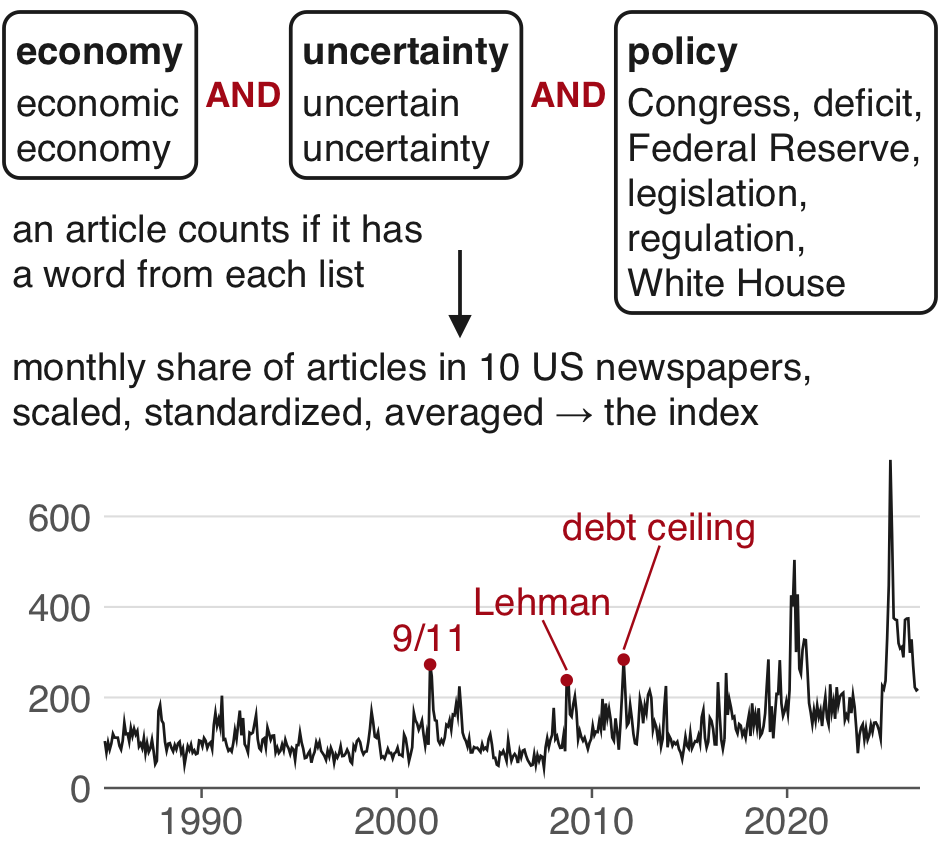
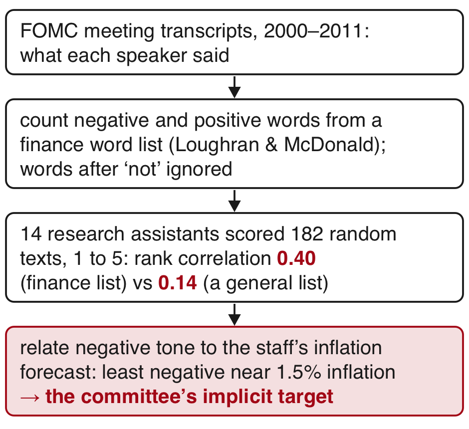
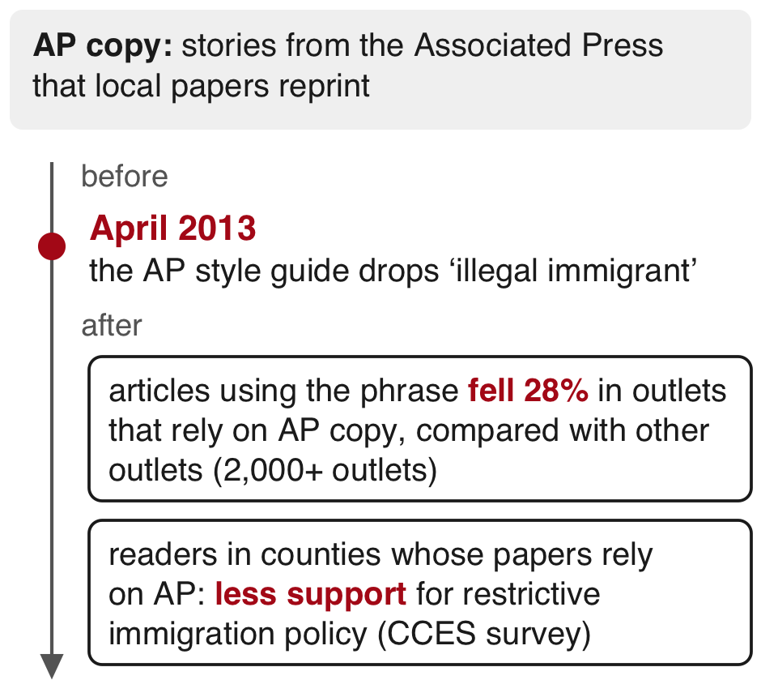
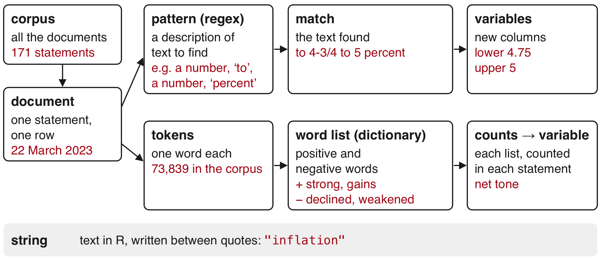
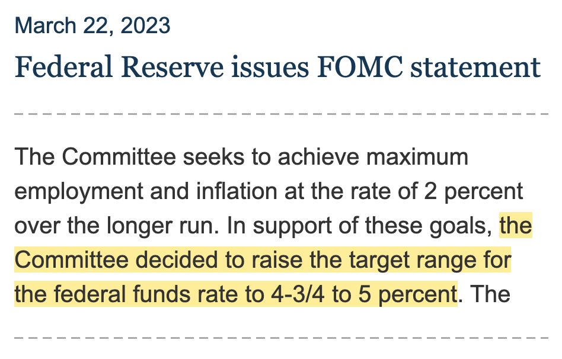
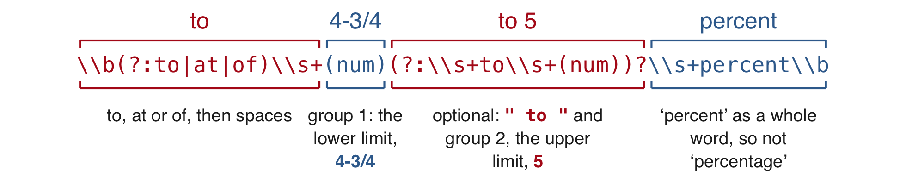
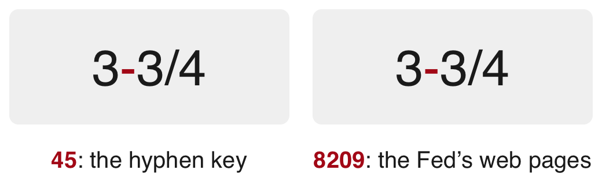

```{r}
#| purl: false
#| include: false
knitr::opts_chunk$set(
  comment = "#>",
  collapse = FALSE,
  fig.width = 9,
  fig.height = 4.4,
  fig.align = "center",
  fig.show = "hold",
  dpi = 150
)
options(width = 80)
# Every chunk runs in the project folder, so the paths on the page are the
# paths students use.
session_dir <- getwd()
knitr::opts_knit$set(root.dir = file.path(session_dir, "data/16-text-regex"))
```

::: {.content-hidden when-format="revealjs"}

[Slides](16-text-regex-slides.html) · [Live script](16-text-regex.R) ·
[Source](https://github.com/ArielOrtizBobea/aem6850/blob/main/fall-2026/sessions/16-text-regex.qmd) ·
[the project](data/16-text-regex.zip)

How to turn text into variables with patterns and word counts. The
Federal Reserve's policy statements since 2006 carry the code and both
exercises. Two variables come out of them: the target range for the
policy rate, pulled out of each statement with a regular expression and
compared with the Fed's own daily series, and the tone of each statement,
counted with a finance word list. A chatbot writes the extraction code
here, as it often will in your own work, so the session teaches enough of
the syntax to read a pattern piece by piece and to test it on the whole
corpus.

**The project.** Install the packages once, in the R Console:
`install.packages(c("stringr", "stopwords"))`. Download
[16-text-regex.zip](data/16-text-regex.zip), unzip it, and open
`16-text-regex.Rproj`, so that R starts in the project folder. It holds:

- `fomc_statements.csv`: every policy statement of the Federal Open
  Market Committee from January 2006 to September 2026, one row each
  (date, url, words, text, scheduled).
- `fred_target_range.csv`: the Fed's target for the policy rate on every
  day, from FRED.
- `lm_words.csv`: the positive and negative word lists of Loughran and
  McDonald.
- `chat_prompt.txt`, `chat_reply.md` and `chat_reply.R`: a prompt to a
  chatbot, its full reply, and the reply's code, unchanged.
- `SOURCE.txt`: each source, its address, its terms of use and the date
  it was collected.

## Objectives {#objectives}

By the end of this session you can:

- Find a word in many documents with `str_detect()`.
- Count a word in each document with `str_count()`.
- Write a pattern with character classes, quantifiers, `^`, `$` and
  `\\b`.
- Extract numbers from text with capture groups and `str_match()`.
- Rerun a test on strings copied from the documents after every change
  to a pattern.
- Read a chatbot's pattern piece by piece, including `(?: )`, lazy `.*?`
  and the options of `regex()`.
- Compare an extracted variable with FRED's daily series row by row.
- Find a look-alike character by its code point with `utf8ToInt()`.
- Replace a character in every document with `str_replace_all()`.
- Split text into words with `str_extract_all()`.
- Count words with `table()` after dropping stop words.
- Score each statement's net tone with a finance word list.
- Give the base R name of each `stringr` function used.

:::

## Plan for today {#plan}

::: {style="font-size:0.74em"}

1. **Text as data in economics**\
   [Three studies · the terms]{.topics}
2. **Regex basics in `stringr`**\
   [The Fed statements · finding a word · character classes · quantifiers · anchors · whole words · testing a pattern · capture groups · Exercise 1]{.topics}
3. **Extracting the target range with a chatbot's pattern**\
   [Reading the pattern piece by piece · running it on 171 statements · comparing with the Fed's daily target · a hyphen that looks like another · fixing the code · base R names]{.topics}
4. **Counting words and scoring tone**\
   [Splitting text into words · counting them · stop words · Exercise 2 · a finance word list · net tone]{.topics}
5. **What patterns and counts miss**

:::

::: {.content-visible when-format="revealjs"}

[In the R Console, during Part 1: `install.packages(c("stringr", "stopwords"))`.
Before Part 2: unzip [16-text-regex.zip](data/16-text-regex.zip) and open
`16-text-regex.Rproj`.]{.source}

:::

## Turning a statement's text into variables {#text-to-variables .smaller}

::::: {.columns}

::: {.column width="52%"}

::: {style="font-size:0.88em; border-left: 4px solid #B31B1B; padding: 0.3em 0.9em; background: #F7F7F7;"}

The Federal Open Market Committee decided today to establish a target
range for the federal funds rate of [0&nbsp;to&nbsp;1/4&nbsp;percent]{style="background:#FFF3B0"}.

Since the Committee's last meeting, labor market conditions have
[deteriorated]{style="color:#B31B1B;font-weight:600"}, and the available
data indicate that consumer spending, business investment, and industrial
production have [declined]{style="color:#B31B1B;font-weight:600"}.
Financial markets remain quite [strained]{style="color:#B31B1B;font-weight:600"}
and credit conditions tight. Overall, the outlook for economic activity
has [weakened]{style="color:#B31B1B;font-weight:600"} further.

:::

:::

::: {.column width="48%"}

::: {.dashes style="font-size:0.9em"}

- **A pattern** finds [0&nbsp;to&nbsp;1/4&nbsp;percent]{style="background:#FFF3B0"}
  → `lower` = 0 and `upper` = 0.25.
- **A count of listed words**: the whole statement has
  [8 negative]{style="color:#B31B1B;font-weight:600"} and 2 positive words
  in 403 → **net tone** =&nbsp;100&nbsp;×&nbsp;(2&nbsp;−&nbsp;8)&nbsp;/&nbsp;403&nbsp;=&nbsp;−1.49.
- Run on all 171 statements from 2006 to 2026, each method gives a column
  you can plot and compare with other data.

:::

:::

:::::

[Paragraphs 1 and 2 of the policy statement of 16 December 2008, during
the financial crisis. The Federal Reserve, the US central bank, publishes
a statement after each policy meeting.]{.source}

# 1 · Text as data in economics {#part-text-data}

::: {.content-visible when-format="revealjs"}

- A keyword index from newspapers
- The tone of Fed meetings
- One phrase before and after a style rule
- The terms

During Part 1, in the R Console:
`install.packages(c("stringr", "stopwords"))`.

:::

## A monthly index of economic policy uncertainty from newspaper articles {#bbd .smaller}

::::: {.columns}

::: {.column width="56%"}

::: {.dashes style="font-size:0.7em"}

- [Baker, Bloom & Davis (QJE, 2016)](https://doi.org/10.1093/qje/qjw024)
  counted, each month, the articles in 10 large US newspapers that
  contain a word from each of three lists. The lists also take variants
  such as "uncertainties" and "the Fed". (Congress is the US
  legislature; the White House is the President's office.)
- Teams of University of Chicago students read about 12,000 randomly
  drawn articles and marked whether each discussed economic policy
  uncertainty. Their verdicts chose the policy words and tested the
  count.
- **Keyword index**: the share of documents in each period that contain
  chosen words.
- **Finding.** The index rises near close presidential elections, the
  Gulf Wars (1991 and 2003, both in Iraq), 9/11, the failure of Lehman
  Brothers (a large US investment bank, September 2008), and the 2011
  dispute in Congress over the legal limit on federal borrowing.
- **Takeaway:** a widely used index is a count of documents matching
  three word lists, and people reading a sample by hand gave it
  credibility.

:::

:::

::: {.column width="44%"}

{fig-align="center" fig-alt="Three word lists joined by AND: economy (economic, economy), uncertainty (uncertain, uncertainty) and policy (Congress, deficit, Federal Reserve, legislation, regulation, White House). An article counts if it has a word from each list; the monthly share of such articles in 10 newspapers, scaled and averaged, is the index."}

[The index, monthly, January 1985 to September 2026: Baker, Bloom & Davis,
policyuncertainty.com.]{.source}

:::

:::::

::: {.content-visible when-format="revealjs"}

::: {.notes}
The scaling: divide by all articles in that paper and month, standardize
each paper's series, average the 10, set the mean to 100 (section 2.1 of
NBER WP 21633). The list of the 10 papers is on policyuncertainty.com.
:::

:::

## The tone of Fed meetings, scored with a finance word list {#shapiro-wilson .smaller}

::::: {.columns}

::: {.column width="56%"}

::: {.dashes style="font-size:0.7em"}

- **Transcript**: a lightly edited word-for-word record of an FOMC
  meeting, released after five years.
- **Word list (dictionary)**: a fixed list of words tied to a category,
  such as negative words.
- [Shapiro & Wilson (REStud, 2022)](https://doi.org/10.1093/restud/rdab094)
  counted the negative and positive words on the lists of
  [Loughran & McDonald (JF, 2011)](https://doi.org/10.1111/j.1540-6261.2010.01625.x)
  in what each speaker said at each meeting. 14 research assistants
  scored 182 randomly drawn texts, and the word score agreed with them
  far better than a general-purpose list did.
- They related negative tone to the staff's inflation forecast at each
  meeting. Negativity was lowest near 1.5 percent inflation.
- **Finding.** Over 2000–2011 the committee aimed at about 1.5 percent
  inflation, below the 2 percent usually assumed. The Fed first announced
  a 2 percent goal in January 2012.
- **Takeaway:** a word count on Fed text estimated the inflation goal the
  committee worked to before it announced one, once people's scores on a
  random sample backed the count.

:::

:::

::: {.column width="44%"}

{fig-align="center" fig-alt="Four steps: FOMC meeting transcripts from 2000 to 2011; counts of negative and positive words from a finance word list, ignoring words after not; 14 research assistants' scores of 182 random texts, rank correlation 0.40 against 0.14 for a general list; negative tone related to the staff's inflation forecast, least negative near 1.5 percent."}

:::

:::::

::: {.content-visible when-format="revealjs"}

::: {.notes}
The method details (14 research assistants, 182 scores on a 1 to 5 scale,
rank correlation 0.40 against 0.14 for the Harvard General Inquirer,
words after "not" ignored) are from the FRBSF working paper version
(2019-02, January 2021). The published abstract gives about 1.5 percent
over 2000-11.
:::

:::

## One phrase counted before and after a news agency changed its style rule {#djourelova .smaller}

::::: {.columns}

::: {.column width="56%"}

::: {.dashes style="font-size:0.72em"}

- The Associated Press (AP) is a US news agency. Many local papers
  reprint its stories, called AP copy. Its style guide, the wording rules
  its reporters follow, dropped "illegal immigrant" in April 2013.
- [Djourelova (AER, 2023)](https://doi.org/10.1257/aer.20211537) counted
  the phrase in more than 2,000 US print and online outlets. In outlets
  that relied on AP copy, articles using it fell by 28% compared with
  other outlets.
- She linked answers to a large US election survey to the AP reliance of
  the newspapers sold in each respondent's county.
- **Finding.** Readers exposed to the change through local media
  supported restrictive immigration policy less.
- **Takeaway:** an exact phrase count works when the wording itself is
  what you study.

:::

:::

::: {.column width="44%"}

{fig-align="center" fig-alt="A timeline with one marker in April 2013, when the AP style guide dropped 'illegal immigrant'. After it, articles using the phrase fell 28 percent in outlets that rely on AP copy, and readers in counties whose papers rely on AP supported restrictive immigration policy less."}

:::

:::::

::: {.content-visible when-format="revealjs"}

::: {.notes}
The counts (more than 2,000 outlets, 28 percent, the CCES survey) are from
the May 2020 working paper version. The AER abstract confirms the finding
on readers.
:::

:::

## Terms for text as data, shown on the Fed statements {#terms .smaller}

{width="96%" fig-align="center" fig-alt="A diagram of the terms on the Fed file. The corpus holds all 171 statements; a document is one statement, one row; a string is text in R between quotes. Two lanes leave the document. A pattern, or regular expression, describes text to find; the match is the text found, 'to 4-3/4 to 5 percent'; the variables lower and upper come from it. Tokens are single words, 73,839 in the corpus; a word list marks positive and negative words; the counts give the variable net tone."}

# 2 · Regex basics in stringr {#part-regex}

::: {.content-visible when-format="revealjs"}

- The Fed's policy statements
- Finding a word
- Character classes and quantifiers
- Anchors and whole words
- Testing a pattern
- Capture groups
- Exercise 1

Unzip [16-text-regex.zip](data/16-text-regex.zip) and open
`16-text-regex.Rproj`.

:::

## The Fed's policy statements, today's documents {#statement .smaller}

::::: {.columns}

::: {.column width="48%"}

{fig-align="center" fig-alt="The third paragraph of the Federal Reserve's statement of 22 March 2023, as the Fed's page shows it, with the sentence 'the Committee decided to raise the target range for the federal funds rate to 4-3/4 to 5 percent' highlighted."}

:::

::: {.column width="52%"}

::: {.dashes style="font-size:0.82em"}

- The Federal Reserve ("the Fed") is the US central bank.
- Its **Federal Open Market Committee (FOMC)** sets the policy interest
  rate. It meets eight times a year and publishes a statement after each
  meeting. A few statements follow unscheduled meetings.
- The **federal funds rate** is the rate banks charge each other for
  overnight loans. The Fed steers it.
- The **target range** is the band the FOMC announces for that rate.
  "4-3/4 to 5 percent" means 4.75 to 5. Before 16 December 2008 the FOMC
  announced a single number.

:::

:::

:::::

[The file holds every statement from 31 Jan 2006 to 16 Sep 2026, collected
from federalreserve.gov: 171 statements, 165 of them after scheduled
meetings. The Fed's pages are in the public domain.]{.source}

::: {.content-visible when-format="revealjs"}

::: {.notes}
This is the file the scraping session built. The meeting came 12 days
after Silicon Valley Bank failed, which is why paragraph 2 opens "The U.S.
banking system is sound and resilient."
:::

:::

## Loading the statements and finding a word with `str_detect()` and `str_count()` {#detect .smaller}

```{r}
#| filename: "R Console, in the 16-text-regex folder; needs stringr; reads fomc_statements.csv (date, url, words, text, scheduled)"
# install.packages(c("stringr", "stopwords"))   # once
library(stringr)                     # text functions; every name starts with str_
fomc <- read.csv("fomc_statements.csv")
dim(fomc)
c(inflation = sum(str_detect(fomc$text, "inflation")),
  Inflation = sum(str_detect(fomc$text, "Inflation")),
  either    = sum(str_detect(fomc$text, regex("inflation", ignore_case = TRUE))))
fomc$n_infl <- str_count(fomc$text, regex("inflation", ignore_case = TRUE))
summary(fomc$n_infl)
fomc$date[which(fomc$n_infl == 0)]   # which(): the positions where the condition is TRUE
```

::: {style="font-size:0.72em"}

**Literal pattern**: the word itself. Matching is case-sensitive, so
"Inflation" and "inflation" are different patterns;
`regex(..., ignore_case = TRUE)` matches either. `str_detect()` returns
TRUE or FALSE for each statement and `sum()` counts the TRUEs.
`str_count()` returns the number of matches in each statement, which
makes it a variable.

:::

::: {.content-visible when-format="revealjs"}

::: {.notes}
Paragraphs inside `text` are separated by a blank line ("\n\n"). The
three statements with no "inflation" are the unscheduled 17 Aug 2007 and
23 Mar 2020 and the emergency cut of 3 Mar 2020.
:::

:::

## Matching one character from a set with `\\d`, `[ ]` and `[^ ]` {#classes .smaller}

```{r}
#| filename: "R Console; needs stringr"
x <- "the Committee decided to raise the target range for the federal funds rate to 4-3/4 to 5 percent."
str_view(x, "\\d")
str_view(x, "[0-9/-]")
str_view(x, "[^a-z ]")      # ^ inside brackets: any character NOT in the set
```

::: {.dashes style="font-size:0.74em"}

- R strings write each backslash twice. You type `"\\d"` and the pattern
  receives `\d`.
- **Character class**: a set in brackets, any one of which can match.
  `[^ ]` matches any one character not in the set. A hyphen placed last
  in brackets is a plain hyphen.
- **`\\d`**: one digit. **`\\s`**: one space or line break.
- `str_view()` marks each match with `< >`.

:::

## Matching any character with `.` and a period with `\\.` {#dot .smaller}

```{r}
#| filename: "R Console; needs x"
str_view(x, "r.te")          # . : any one character
str_view(x, "\\.")           # \\. : a period
c(str_count(x, "."), str_count(x, "\\."))
```

::: {.dashes style="font-size:0.78em"}

- **The dot `.`**: any one character.
- **Escape**: a backslash that turns a special character such as `.`
  back into a plain one.
- `x` has 97 characters. `"."` matches each of them, and `"\\."` only the
  full stop.

:::

## Repeating a piece with the quantifiers `+`, `*`, `?` and `{n}` {#quantifiers .smaller}

```{r}
#| filename: "R Console; needs x and fomc"
str_extract_all(x, "[0-9/-]+")                   # + : one or more of the piece before
str_extract(x, "\\d+-\\d+/\\d+")
table(str_extract(fomc$text, "\\d+ basis points"), useNA = "ifany")
table(str_extract(fomc$text, "\\d+/\\d+ percentage points?"))   # ? : zero or one "s"
```

::: {.dashes style="font-size:0.7em"}

- **Quantifier**: a mark after a piece saying how many times it may
  repeat. `+` one or more, `*` zero or more, `?` zero or one, `{2}`
  exactly two.
- **Basis point**: one hundredth of a percentage point. A move from 5 to
  5.25 percent is 25 basis points, or 1/4 percentage point.
- `str_extract()` returns the first match in each statement, or NA when
  there is none; `useNA = "ifany"` makes `table()` count the NAs.
  `str_extract_all()` returns every match. The Fed writes "4-3/4" for
  4.75.

:::

## Anchors with `^` and `$`, and whole words with `\\b` {#anchors-words .smaller}

```{r}
#| filename: "R Console; needs fomc"
sum(str_detect(fomc$text, "^Information received"))      # ^ : at the start of the text
str_detect(c("5", "4-3/4", "4-3/4 to 5"), "^[0-9/-]+$")   # $ : at the end
sum(str_count(fomc$text, "rate"))
sum(str_count(fomc$text, "\\brate\\b"))                   # \\b : a word boundary
caught <- unlist(str_extract_all(fomc$text, "[a-z]*rate[a-z]*"))
head(sort(table(caught), decreasing = TRUE), 6)
```

::: {.dashes style="font-size:0.68em"}

- **Anchor**: `^` pins the pattern to the start of the text and `$` to
  the end; with both, the whole string must match. Inside brackets `^`
  means NOT.
- **Word boundary `\\b`**: the edge between a letter and a space, a
  punctuation mark, or the start or end of the text.
- **False positive**: text the pattern catches but should skip. The
  literal "rate" catches 219 other words, such as "moderate" (144 times);
  another 58 are "rates", which you may want. `unlist()` puts every
  statement's matches in one vector for `table()`.

:::

::: {.content-visible when-format="revealjs"}

::: {.notes}
Statements from 2009 to January 2020 open with "Information received
since ..."; most statements since July 2022 open with "Recent indicators"
(23 of 34). The opening phrase is a variable you can build (Practice 1).
:::

:::

## Testing a pattern on two vectors of strings from the statements {#tests .smaller}

```{r}
#| filename: "R Console; needs stringr"
should_match <- c("the federal funds rate", "longer-term interest rates")
should_skip  <- c("at a moderate pace", "to generate sustained improvement")
str_detect(should_match, "\\brate\\b")
str_detect(should_skip, "\\brate\\b")
str_detect(should_match, "\\brates?\\b")      # ? makes the "s" optional
str_detect(should_skip, "\\brates?\\b")
str_detect(should_skip, "rate")               # the literal catches both
```

::: {.dashes style="font-size:0.72em"}

- **Should-match and should-skip tests**: short vectors of real strings
  the pattern must catch and must leave alone, rerun after every change.
- **False negative**: text the pattern misses but should catch ("rates"
  under `\\brate\\b`).
- Copy test strings from the documents. When the corpus shows a case the
  pattern gets wrong, add that string to one of the two vectors.

:::

## Capture groups, alternatives with `|`, and `(?: )` with `str_match()` {#groups .smaller}

```{r}
#| filename: "R Console; needs stringr"
r <- c("4-3/4", "1-1/2", "5")
m <- str_match(r, "(\\d+)-(\\d+)/(\\d+)")
m
is.na(m[, 1])                        # TRUE where the pattern found no match
p <- c("keep its target for the federal funds rate at 5-1/4 percent",
       "raise the target range for the federal funds rate to 4-3/4 to 5 percent",
       "establish a target range for the federal funds rate of 0 to 1/4 percent")
str_match(p, "(?:at|to|of) ([0-9/-]+) percent")
```

::: {.dashes style="font-size:0.66em"}

- **Capture group**: a part of the pattern inside `( )`. `str_match()`
  returns the whole match in column 1, then one column per group.
- **`|`** matches the piece on either side of it. **`(?: )`** groups
  pieces for `?` or `|` without adding a column.
- A match is one unbroken run. After "to 4-3/4" comes " to", so the
  search moves on to "to 5 percent". A range needs a second number group.

:::

::: {.content-visible when-format="revealjs"}

::: {.notes}
The phrases come from 8 Aug 2006, 22 Mar 2023 and 16 Dec 2008. The same
constructions come back in the chatbot's pattern in Part 3.
:::

:::

## Exercise 1 {#exercise-1 .smaller}

::: {.panel-tabset}

### Exercise

::: {style="font-size:1.1em"}

```{r}
#| label: exercise-1
#| exercise: true
#| script: "Exercise 1 (5 minutes)"
#| eval: false
# Exercise 1 (5 minutes). R Console, in the 16-text-regex folder; needs
# stringr and fomc. The decision sentence says "decided to raise",
# "decided to lower", "decided to keep" or "decided to maintain", then the
# target. Test strings from the statements:
should_match <- c("decided to raise the target range",
                  "decided to keep the target range")
should_skip  <- c("preferred to lower the target range",
                  "decided to continue purchasing additional")
# 1. Write verb_pat, a pattern with one capture group for the verb, in the
#    form "decided to (...|...|...|...)".
# 2. Run str_detect(should_match, verb_pat) and
#    str_detect(should_skip, verb_pat). You want TRUE TRUE, then FALSE FALSE.
# 3. Pull the verb from every statement with v <- str_match(fomc$text, verb_pat)
#    and count column 2 with table(v[, 2], useNA = "ifany").
# 4. Find the first statement that returns NA with k <- which(is.na(v[, 2]))[1].
#    Print its date with fomc$date[k], and its decision sentence with
#    str_extract(fomc$text[k], "[^.]*decided[^.]*").
#
# Two answers to compare with the room: how many statements return NA, and
# why the first one fails.
```

:::

### Solution

```{r}
#| label: exercise-1-solution
#| purl: false
#| filename: "R Console; needs fomc, should_match and should_skip"
verb_pat <- "decided to (raise|lower|keep|maintain)"
c(str_detect(should_match, verb_pat), str_detect(should_skip, verb_pat))
v <- str_match(fomc$text, verb_pat)
table(v[, 2], useNA = "ifany")
k <- which(is.na(v[, 2]))[1]
c(fomc$date[k], str_extract(fomc$text[k], "[^.]*decided[^.]*"))
```

::: {.content-visible when-format="revealjs"}

**71 statements return NA. The first, 31 Jan 2006, says "decided today to
raise": "today" sits between the two words, and both tests passed
anyway.**

:::

:::

::: {.content-visible when-format="revealjs"}

::: {.notes}
With "decided (?:today )?to (raise|lower|keep|maintain)", 37 NA remain
(keep 45, lower 20, maintain 44, raise 25). Most read "will maintain" or
"reaffirmed its view", the wordings Part 3 meets. A student who writes
"(today )?" with plain parentheses finds the verb in column 3; "(?: )"
keeps it in column 2. The test strings occur in the corpus: "decided to
raise the target range" in 21 statements, "decided to keep the target
range" in 23, "preferred to lower the target range" in 8 dissents,
"decided to continue purchasing additional" in 6.
:::

:::

# 3 · Extracting the target range with a chatbot's pattern {#part-chatbot}

::: {.content-visible when-format="revealjs"}

- The prompt and the reply
- Reading the pattern piece by piece
- Running it on 171 statements
- Comparing with the Fed's daily target
- A hyphen that looks like another
- Fixing the code
- Base R names

:::

## A student's prompt to a chatbot, and the code in its reply {#prompt-reply .smaller}

::: {.prompt style="font-size:0.74em; border-left: 4px solid #B31B1B; padding: 0.2em 0.8em; background: #F7F7F7;"}

I have a data frame in R called fomc with a column text that holds the
full text of every FOMC statement since 2006, one statement per row. Each
statement says what the Fed decided about its policy rate, for example:
"the Committee decided to raise the target range for the federal funds
rate to 4-3/4 to 5 percent." Write R code with stringr that extracts the
target range from each statement into two numeric columns, lower and
upper (here 4.75 and 5).

:::

```{.r filename="chat_reply.R in the zip: the reply's code, unchanged (it also defines num and to_num())"}
# 1. Isolate the part of the statement describing the decision on the funds rate
seg <- str_extract(
  fomc$text,
  regex("decided.*?federal funds rate.*?percent\\b", ignore_case = TRUE, dotall = TRUE)
)
# 2. Pull out "to/at/of X [to Y] percent"
pat <- str_c("\\b(?:to|at|of)\\s+(", num, ")(?:\\s+to\\s+(", num, "))?\\s+percent\\b")
m   <- str_match(seg, pat)
# 3. Convert to numeric
first  <- to_num(m[, 2])
second <- to_num(m[, 3])
fomc$lower <- first
fomc$upper <- ifelse(is.na(second), first, second)
```

::: {style="font-size:0.66em"}

The reply: "For your example, `"...to 4-3/4 to 5 percent."` gives
`lower = 4.75` and `upper = 5`." The prompt gives one example sentence and
no test. The full reply is on the session page.

:::

[Reply from Claude (claude-sonnet-5-5) through Anthropic's API, 20 October
2026, to the prompt shown. The same prompt in the chat at claude.ai can
return different code.]{.source}

::: {.content-visible when-format="revealjs"}

::: {.notes}
This is the chatbot the course recommended. Students will get different
code if they paste the prompt; the steps that follow apply to any reply.
:::

:::

::: {.content-hidden when-format="revealjs"}

::: {.callout-note collapse="true" title="The full reply, as it came back"}

```{r}
#| echo: false
#| results: asis
#| purl: false
cat(readLines("chat_reply.md", encoding = "UTF-8"), sep = "\n")
```

:::

:::

## Reading the reply's number pattern and `to_num()` {#num .smaller}

```{r}
#| filename: "R Console, in the 16-text-regex folder; needs stringr and fomc"
source("chat_reply.R")      # runs the reply's code, unchanged
str_view(c("5", "1/4", "4-3/4", "0.25"), num)
to_num(c("4-3/4", "1/4", "5", "0"))
```

{width="94%" fig-align="center" fig-alt="The pattern num split into three pieces: backslash d plus, one or more digits; an optional group of a period and digits, as in .25; an optional group of either -3/4 or /4."}

::: {.dashes style="font-size:0.66em"}

- **`source()`** runs every line of a script file. `chat_reply.R` defines
  `num`, `to_num()`, `seg` and `pat`, and adds `lower` and `upper` to
  `fomc`.
- **Known-answer test**: inputs whose right output you know before
  running. `to_num()` anchors its pattern with `^` and `$` and captures
  the whole number, the numerator and the denominator, so "4-3/4" becomes
  4 + 3/4.

:::

## Greedy `.*` and lazy `.*?` in the reply's first step {#greedy-lazy .smaller}

```{r}
#| filename: "R Console; needs fomc and seg from chat_reply.R"
i <- which(fomc$date == "2023-03-22")
greedy <- str_extract(fomc$text[i], regex("decided.*percent", dotall = TRUE))
lazy   <- str_extract(fomc$text[i], regex("decided.*?percent", dotall = TRUE))
c(nchar(greedy), nchar(lazy))       # nchar() counts characters
seg[i]                              # the reply's step 1 on this statement
```

::: {.dashes style="font-size:0.72em"}

- **Greedy `.*`** takes as many characters as it can. Here it runs to the
  statement's last "percent", "...returning inflation to its 2 percent".
- **Lazy `.*?`** takes as few as it can.
- **`dotall = TRUE`** lets `.` match a line break, so a match can run
  from one paragraph into the next.
- The reply's reason: "This keeps it from picking up other numbers in the
  statement, such as the 2 percent inflation goal, "25 basis points", or
  the discount rate."

:::

## Reading the reply's range pattern piece by piece {#range-pattern .smaller}

```{r}
#| filename: "R Console; needs seg, pat and i"
str_match(seg[i], pat)              # the reply's step 2
```

{width="96%" fig-align="center" fig-alt="The text 'to 4-3/4 to 5 percent' above the four pieces of the reply's pattern: to, at or of then spaces; group 1, the lower limit; an optional ' to ' with group 2, the upper limit; and percent as a whole word."}

::: {style="font-size:0.72em"}

**`str_c()`** joins strings end to end (base R `paste0()`); the reply
builds `pat` from `num` twice. On this statement group 1 is the lower
limit and group 2 the upper, and `to_num()` turns them into 4.75 and 5.

:::

## The reply's code on all 171 statements, and the tests it suggests {#reply-all .smaller}

```{r}
#| filename: "R Console; needs fomc after source(\"chat_reply.R\")"
sum(is.na(fomc$upper))                         # its first test prints these rows; here, a count
summary(fomc[, c("lower", "upper")])           # its second test
sum(fomc$lower > fomc$upper, na.rm = TRUE)     # its third: lower <= upper everywhere
```

::: {.dashes style="font-size:0.7em"}

- The reply ends with three tests: print `fomc[is.na(fomc$upper), "text"]`,
  run `summary()`, and "check that `lower <= upper` everywhere". It says
  "statements with no rate decision (a few unscheduled statements about
  liquidity facilities, for example) return `NA`."
- The code gives the right answer on the prompt's example, and its tests
  run. They find 32 statements with no number, more than "a few", and no
  row with lower above upper. Reading the 32 texts shows wordings the
  pattern does not expect.
- The tests cannot say whether the other 139 values are right.

:::

## Comparing the extracted range with FRED's daily target {#fred .smaller}

```{r}
#| filename: "R Console; needs fomc after the reply's code; reads fred_target_range.csv"
fred <- read.csv("fred_target_range.csv")                # date, lower, upper: one row per day
k <- match(as.Date(fomc$date) + 1, as.Date(fred$date))    # + 1: the day after each statement
fomc$fred_lower <- fred$lower[k]
fomc$fred_upper <- fred$upper[k]
fomc$agree <- fomc$lower == fomc$fred_lower & fomc$upper == fomc$fred_upper
table(fomc$agree, useNA = "ifany")
fomc$date[which(!fomc$agree)]
```

::: {.dashes style="font-size:0.66em"}

- **FRED**, the free data service of the Federal Reserve Bank of St.
  Louis, gives the target for every day: DFEDTAR, the single target to
  15 Dec 2008 (copied into both columns), then DFEDTARL and DFEDTARU, the
  lower and upper limits.
- **`match()`** finds the position of each statement's next day among
  FRED's dates. Adding 1 to a date gives the next day: on that day FRED
  shows the range just decided.
- `which()` skips NA, so only the nine wrong statements print. In all
  nine, lower equals upper, so the reply's lower <= upper test passes on
  every one.

:::

::: {.content-visible when-format="revealjs"}

::: {.notes}
Since March 2017 a new range takes effect, and appears in FRED, the day
after the statement (30 changes). From 2006 to 2016 FRED shows it from the
statement date (16 changes). On the statement date itself 106 agree.
:::

:::

## Drawing the extracted range against FRED's target {#fig-fred .smaller}

```{r}
#| label: fig-fred-range
#| filename: "R Console; needs fomc with the reply's lower, upper and agree, and fred"
#| fig-show: hide
#| fig-width: 9
#| fig-height: 4.7
d <- as.Date(fomc$date) + 1                                   # the day after
ok <- fomc$agree %in% TRUE
bad <- fomc$agree %in% FALSE
plot(as.Date(fred$date), fred$upper, type = "s", col = "grey60", ylim = c(0, 6),
     xlab = "", ylab = "Percent", las = 1)
lines(as.Date(fred$date), fred$lower, type = "s", col = "grey60")
points(d[ok], fomc$upper[ok], pch = 16, cex = 0.7)
points(d[bad], fomc$lower[bad], pch = 4, cex = 1.4, lwd = 2, col = "firebrick")
rug(d[is.na(fomc$agree)], col = "darkorange", lwd = 2, ticksize = 0.04)
text(as.Date(c("2010-04-01", "2012-11-01", "2015-08-01", "2021-03-01")), c(0.8, 1.05, 1.65, 1.0),
     c("\"will maintain\"", "2014: the match\nruns too far", "\"reaffirmed\"", "the Fed's\nhyphen"),
     col = c("darkorange", "firebrick", "darkorange", "firebrick"), cex = 0.9)
legend("top", ncol = 4, bty = "n", cex = 0.85,
       legend = c("FRED: lower and upper", "equal (130)", "wrong (9)", "NA (32)"),
       col = c("grey60", "black", "firebrick", "darkorange"),
       lty = c(1, NA, NA, 1), lwd = c(1, NA, 2, 2), pch = c(NA, 16, 4, NA))
```

::: {.content-visible when-format="revealjs"}

## The extracted range against FRED's target, 2006 to 2026 {#fig-fred-output .smaller}

:::

`){fig-alt="FRED's daily target from 2006 to 2026 as grey step lines, with the reply's values as black points that sit on the line in 130 statements, red crosses for 9 wrong values (six in 2014 and three around 2020 and 2022), and orange ticks along the bottom for 32 statements with no value, clustered in 2009 to 2010, 2015, 2017 to 2018 and 2025 to 2026."}

::: {.content-visible when-format="revealjs"}

[FRED's daily target (grey) and the reply's values on the day after each
statement: upper limit where they agree, lower limit where they do not
(red), NA as orange ticks. 171 statements; sources: federalreserve.gov,
FRED.]{.source}

:::

## Why 41 statements came back missing or wrong {#why-41 .smaller}

::: {style="font-size:0.6em"}

| What the statement says | Count | Dates | Returns |
|:------------------------------------------|--:|:-------------------------|:-----------|
| "will maintain the target range ... at 0 to 1/4 percent", with no "decided" | 13 | 18&nbsp;Mar&nbsp;2009 to 21&nbsp;Sep&nbsp;2010 | NA |
| "reaffirmed its view that the current 0 to 1/4 percent target range ..." | 8 | 17&nbsp;Dec&nbsp;2014 to 28&nbsp;Oct&nbsp;2015 | NA |
| the range only in the instruction to the New York Fed (a regional Fed bank) | 1 | 23&nbsp;Mar&nbsp;2020 | NA |
| no target stated | 1 | 17&nbsp;Aug&nbsp;2007 | NA (right) |
| the Fed's hyphen inside the upper number ("3&#8209;3/4", character 8209) | 9 | 13&nbsp;Dec&nbsp;2017 to 29&nbsp;Apr&nbsp;2026 | NA |
| the Fed's hyphen inside the lower number ("1&#8209;1/2", character 8209) | 3 | 11&nbsp;Dec&nbsp;2019, 29&nbsp;Jan&nbsp;2020, 15&nbsp;Jun&nbsp;2022 | 1.75 to 1.75 |
| an earlier "decided" about asset purchases: the match runs up to 2,354 characters, across paragraphs, to "to 1/4 percent" | 6 | 19&nbsp;Mar to 29&nbsp;Oct&nbsp;2014 | 0.25 to 0.25 |

:::

::: {.content-visible when-format="revealjs"}

::: {.notes}
The 2014 segments run 2,330 to 2,354 characters with two paragraph
breaks, except 29 Oct 2014 (851 characters). In these statements "federal
funds rate" follows the range, so the first "to X percent" in the
stretch is "to 1/4 percent". The reply's explanation quotes "by 1/2
percentage point, to 1 to 1-1/4 percent" as a phrase it handles; that is
3 Mar 2020, written with the Fed's hyphen, so that row is NA.
:::

:::

## Two hyphens that look the same {#hyphens .smaller}

```{r}
#| filename: "R Console; needs fomc, seg and num from chat_reply.R"
j <- which(fomc$date == "2025-12-10")
str_view(seg[j], num)
utf8ToInt(str_extract(seg[j], "3.3/4"))     # the number that identifies each character
utf8ToInt("3-3/4")                           # typed with the hyphen key
sum(str_detect(fomc$text, "\u2011"))         # statements with character 8209
```

::::: {.columns}

::: {.column width="50%"}

{fig-align="center" fig-alt="Two versions of 3-3/4 side by side that look the same: one typed with the hyphen key, character 45, and one from the Fed's web pages, character 8209, the non-breaking hyphen."}

:::

::: {.column width="50%"}

::: {.dashes style="font-size:0.66em"}

- **Code point**: the number a computer stores for each character.
  Unicode is the standard list of them.
- **Character 8209**: a non-breaking hyphen. Web pages use it to keep
  "3-3/4" on one line. In R, `"\u2011"` writes it.
- The `-` in a pattern matches only character 45.

:::

:::

:::::

::: {.content-visible when-format="revealjs"}

::: {.notes}
The Fed's pages use character 8209 fifty times, in 34 statements from
July 2015 on, and in 12 of them it sits inside a number.
:::

:::

::: {.content-hidden when-format="revealjs"}

**Characters and encodings.** A file stores each character as bytes, and
an encoding is the rule that turns bytes back into characters. UTF-8 is
the rule the statements file uses and the default in current R. Read with
the wrong rule, the same bytes give different characters: reading the file
with `read.csv("fomc_statements.csv", fileEncoding = "CP1252")` turns
"Today’s" into "Today’s". The fix is to read the file again with the
right rule (`encoding = "UTF-8"`), which gives the text back exactly;
converting the damaged text back with `iconv()` does not restore every
character.

:::

## Changing the reply's code until 170 of 171 statements equal FRED {#fixes .smaller}

```{r}
#| filename: "R Console; needs fomc, num, to_num() and the FRED columns"
fomc$text <- str_replace_all(fomc$text, "\u2011", "-")       # 1. the Fed's hyphen becomes "-"
seg <- str_extract(fomc$text, regex("(?:decided|maintain|reaffirmed)[^.]*?percent\\b",
                                    ignore_case = TRUE))      # 2. one sentence; 3. three verbs
m <- str_match(seg, str_c("(", num, ")(?:\\s+to\\s+(", num, "))?\\s+percent\\b"))   # 3. the range anywhere in it
fomc$lower <- to_num(m[, 2])
fomc$upper <- ifelse(is.na(m[, 3]), fomc$lower, to_num(m[, 3]))
fomc$agree <- fomc$lower == fomc$fred_lower & fomc$upper == fomc$fred_upper
table(fomc$agree, useNA = "ifany")
```

::: {.dashes style="font-size:0.72em"}

- **`str_replace_all(x, p, r)`** replaces every match of `p` in `x` with
  `r`.
- Change 2 uses `[^.]*?` in place of `.*?` and drops `dotall`, so the
  match stays inside one sentence.

:::

## Missing and wrong values after each change to the reply's code {#fix-table .smaller}

::: {style="font-size:0.8em"}

Counted against FRED on the day after each statement:

| After | NA | Wrong | Equal to FRED |
|:------------------------------------|--:|--:|--:|
| The reply as given | 32 | 9 | 130 |
| 1. Replace character 8209 with "-" | 23 | 6 | 142 |
| 2. Keep the match in one sentence | 36 | 0 | 135 |
| 3. Accept "maintain" and "reaffirmed"; take the range wherever it sits in the sentence | 1 | 0 | 170 |

:::

::: {.dashes style="font-size:0.74em"}

- Change 2 turns the six 2014 values into NA, and does the same to seven
  statements that had been right only because the match crossed
  sentences.
- The last NA is 17 Aug 2007, which states no target.
- The failing sentences, each with its expected numbers, are the test
  strings to paste back to the chatbot when you ask for a fix.

:::

::: {.content-visible when-format="revealjs"}

::: {.notes}
The seven: 3 Nov 2010, 14 Dec 2010, 26 Jan 2011, 15 Mar 2011, 27 Apr
2011, 18 Dec 2013 and 29 Jan 2014. The code for the two middle rows is on
the page.
:::

:::

::: {.content-hidden when-format="revealjs"}

The two middle rows of the table, run on a fresh copy of the reply's
output:

```{r}
#| filename: "R Console, in the 16-text-regex folder; needs stringr; reads the files again"
#| purl: false
f <- read.csv("fomc_statements.csv")
f$text <- str_replace_all(f$text, "\u2011", "-")
k2 <- match(as.Date(f$date) + 1, as.Date(fred$date))
count_rows <- function(lo, up) {
  ag <- lo == fred$lower[k2] & up == fred$upper[k2]
  c(missing = sum(is.na(ag)), wrong = sum(ag %in% FALSE), equal = sum(ag %in% TRUE))
}
s1 <- str_extract(f$text, regex("decided.*?federal funds rate.*?percent\\b",
                                ignore_case = TRUE, dotall = TRUE))   # after change 1
m1 <- str_match(s1, pat)
count_rows(to_num(m1[, 2]), ifelse(is.na(m1[, 3]), to_num(m1[, 2]), to_num(m1[, 3])))
s2 <- str_extract(f$text, regex("decided[^.]*?federal funds rate[^.]*?percent\\b",
                                ignore_case = TRUE))                  # after change 2
m2 <- str_match(s2, pat)
count_rows(to_num(m2[, 2]), ifelse(is.na(m2[, 3]), to_num(m2[, 2]), to_num(m2[, 3])))
```

:::

## The base R name of each `stringr` function {#base-r .smaller}

::: {style="font-size:0.66em"}

Chatbots write either.

| `stringr` | base R | What differs |
|:--------------------------------|:-------------------------------|:---------------------------|
| `str_detect(x, p)` | `grepl(p, x)` | base R puts the pattern first |
| `str_extract(x, p)` | `regmatches(x, regexpr(p, x))` | base R drops strings with no match, so the result is shorter than `x` |
| `str_match(x, p)` | `regmatches(x, regexec(p, x))` | a list, not a matrix; an optional group that did not match is `""`, not NA |
| `str_replace_all(x, p, r)` | `gsub(p, r, x)` | |
| `str_split(x, p)` | `strsplit(x, p)` | `strsplit()` drops a final empty string |
| `str_c(...)` | `paste0(...)` | `paste0()` writes NA as "NA"; `str_c()` returns NA |
| `regex(p, ignore_case = TRUE)` | `ignore.case = TRUE` | |

:::

::: {.content-visible when-format="revealjs"}

::: {.notes}
Engine: the code that runs a pattern. Base R has two, and perl = TRUE
picks the second. The default engine reads (?: ), \\b and .*? as stringr
does, and its dot also matches a line break.
:::

:::

::: {.content-hidden when-format="revealjs"}

**Engine**: the code that runs a pattern. Base R has two, and
`perl = TRUE` picks the second.

The other functions used today:

| `stringr` | base R |
|:--|:--|
| `str_count(x, p)` | `lengths(regmatches(x, gregexpr(p, x)))` |
| `str_extract_all(x, p)` | `regmatches(x, gregexpr(p, x))` |
| `str_sub(x, 1, 4)` | `substr(x, 1, 4)` |
| `str_to_lower(x)` | `tolower(x)` |

On all 171 statements, the `grepl()` and `gregexpr()` counts equal the
`stringr` results with or without `perl = TRUE`. The two engines differ on
the dot: the default engine's `.` matches a line break, which `stringr`'s
does only with `dotall = TRUE`; with `perl = TRUE`, `.` stops at a line
break unless the pattern starts with `(?s)`. So the reply's first step,
run through `regexpr()`, gives 23 NA with the default engine (the same as
`stringr` with `dotall`) and 36 with `perl = TRUE`. `perl = TRUE` also
adds lookarounds such as `(?=...)`. The three changes written in base R
give 170 of 171 with either engine (Practice 5).

:::

# 4 · Counting words and scoring tone {#part-words}

::: {.content-visible when-format="revealjs"}

- Splitting text into words
- Counting them
- Stop words
- Exercise 2
- A finance word list
- Net tone

:::

## Splitting statements into words {#tokens .smaller}

```{r}
#| filename: "R Console; needs stringr and fomc"
i <- which(fomc$date == "2023-03-22")
fomc$year <- as.numeric(str_sub(fomc$date, 1, 4))               # characters 1 to 4 of "2023-03-22"
tokens <- str_extract_all(str_to_lower(fomc$text), "[a-z]+")     # every run of letters
head(tokens[[i]], 12)                                             # 22 Mar 2023
length(tokens[[i]])
```

::: {.dashes style="font-size:0.74em"}

- **Token**: one unit of text after splitting, here a word in lower case.
- `str_to_lower()` comes first so "Inflation" and "inflation" count as
  one word. `tokens` is a list with one vector of words per statement,
  and `[[i]]` picks one.
- Numbers drop out, and "Committee's" becomes "committee" and "s".

:::

::: {.content-visible when-format="revealjs"}

::: {.notes}
The file's `words` column says 365 for this statement. It counts words
differently, which is why the slides say tokens.
:::

:::

## Counting words with `table()`, and dropping stop words {#stop-words .smaller}

```{r}
#| filename: "R Console; needs tokens and the stopwords package"
all_words <- unlist(tokens)
length(all_words)
head(sort(table(all_words), decreasing = TRUE), 8)
stop_words <- stopwords::stopwords("en")     # pkg::fun(): a package's function without library()
kept <- all_words[!all_words %in% stop_words & nchar(all_words) > 1]   # !x %in% y: x is not in y
head(sort(table(kept), decreasing = TRUE), 8)
```

::: {.dashes style="font-size:0.68em"}

- **Stop words**: very common words dropped before counting ("the", "of",
  "will"). This list has 175. **Term frequency**: a word's count divided
  by all words; "inflation" is 1,330 of 73,839, or 1.8 percent.
- `nchar(all_words) > 1` drops 1,793 one-letter tokens: middle initials
  such as the H in Jerome H. Powell, and the s of "Committee's" and
  "U.S.". The stop list also drops "not", "no" and "against".

:::

## Exercise 2 {#exercise-2 .smaller}

::: {.panel-tabset}

### Exercise

::: {style="font-size:1.3em"}

```{r}
#| label: exercise-2
#| exercise: true
#| script: "Exercise 2 (5 minutes)"
#| eval: false
# Exercise 2 (5 minutes). R Console; needs fomc (with its year column) and
# tokens from the previous slides.
#
# 1. Put the words of the 2022 statements in one vector:
#      w22 <- unlist(tokens[fomc$year == 2022])
# 2. Put the words of every statement before 2022 in a second vector, before.
# 3. Keep the 2022 words that never appear in before (use %in% and !).
# 4. Count them with table() and sort them, largest first.
#
# Two answers to compare with the room: the most frequent new word, and the
# new words that are people's names.
```

:::

### Solution

```{r}
#| label: exercise-2-solution
#| purl: false
#| filename: "R Console; needs fomc and tokens"
w22    <- unlist(tokens[fomc$year == 2022])
before <- unlist(tokens[fomc$year < 2022])
new    <- w22[!w22 %in% before]
head(sort(table(new), decreasing = TRUE), 16)
```

::: {.content-visible when-format="revealjs"}

**"war" (8), then "russia" and "ukraine" (7 each) and "invasion" (6): from
16 Mar 2022 the statements say "The invasion of Ukraine by Russia is
causing tremendous human and economic hardship." The names are four new
voting members.**

:::

:::

::: {.content-visible when-format="revealjs"}

::: {.notes}
Each statement lists the members who voted. Lisa D. Cook and Philip N.
Jefferson appear from 15 Jun 2022, Michael S. Barr and Susan M. Collins
from 27 Jul 2022; "d" and "n" are middle initials. Of the 2,886 words in
the 2022 statements, 105 are new, 27 different words. The exercise needs
no stop words, so a student whose stopwords install failed can still do
it.
:::

:::

## A finance word list of positive and negative words {#lm .smaller}

```{r}
#| filename: "R Console; reads lm_words.csv"
lm_words <- read.csv("lm_words.csv")         # word, list: "positive" or "negative"; lower case
table(lm_words$list)
pos <- lm_words$word[lm_words$list == "positive"]
neg <- lm_words$word[lm_words$list == "negative"]
c("liability", "tax", "cost") %in% neg
```

::: {.dashes style="font-size:0.68em"}

- [Loughran & McDonald (JF, 2011)](https://doi.org/10.1111/j.1540-6261.2010.01625.x)
  built the lists for 10-Ks, the yearly report every listed US company
  files with the Securities and Exchange Commission (the US regulator of
  stock markets).
- **Finding.** In 10-Ks from 1994 to 2008, almost three-fourths of the
  words a general-purpose list (the Harvard General Inquirer, built for
  psychology and sociology) counted as negative are words such as tax,
  cost and liability, which are not negative in financial text.
- **Takeaway:** a word list built for one kind of text misreads another,
  so choose one built for your domain and read what it scores.

:::

[Free for use in academic research; commercial licences from the authors
(sraf.nd.edu).]{.source}

## Net tone of one statement, then of all 171 {#net-tone .smaller}

```{r}
#| filename: "R Console; needs tokens, pos and neg"
net_tone <- function(w) 100 * (sum(w %in% pos) - sum(w %in% neg)) / length(w)
j <- which(fomc$date == "2008-12-16")
w <- tokens[[j]]
w[w %in% neg]
w[w %in% pos]
net_tone(w)
fomc$tone <- sapply(tokens, net_tone)        # sapply(): the function on each statement's words
fomc[which.min(fomc$tone), c("date", "tone")]
fomc[which.max(fomc$tone), c("date", "tone")]
```

::: {style="font-size:0.7em"}

**Net tone**: positive words minus negative words, per 100 words. On
16 Dec 2008, during the financial crisis, the committee cut its target to
a range of 0 to 1/4 percent; the statement has 403 tokens.

:::

::: {.content-visible when-format="revealjs"}

::: {.notes}
The lowest, 16 Sep 2008, came the day after Lehman Brothers filed for
bankruptcy. Its 220 tokens contain 1 positive and 7 negative words.
:::

:::

## Drawing the target range and net tone of every statement {#fig-tone .smaller}

```{r}
#| label: fig-range-tone
#| filename: "R Console; needs fomc after the three changes, with tone, and fred"
#| fig-show: hide
#| fig-width: 9
#| fig-height: 5.2
par(mfrow = c(2, 1), mar = c(2, 5, 0.5, 1))
plot(as.Date(fred$date), fred$upper, type = "s", col = "grey60", ylim = c(0, 6),
     xlab = "", ylab = "Target, percent", las = 1)
points(as.Date(fomc$date) + 1, fomc$upper, pch = 16, cex = 0.5)
plot(as.Date(fomc$date), fomc$tone, type = "h", ylim = c(-3.4, 2.8),
     xlab = "", ylab = "Net tone", las = 1)
abline(h = 0, col = "grey60")
lab <- which(fomc$date %in% c("2008-09-16", "2020-03-03", "2021-07-28"))
text(as.Date(fomc$date[lab]), fomc$tone[lab], c("16 Sep 2008", "3 Mar 2020", "28 Jul 2021"),
     pos = c(1, 3, 3), cex = 0.8, xpd = NA)
```

::: {.content-visible when-format="revealjs"}

## Target range and net tone, 2006 to 2026 {#fig-tone-output .smaller}

:::

`){fig-alt="Two panels from 2006 to 2026. Top: FRED's upper limit as a grey step line with the extracted upper limits as points on it. Bottom: net tone per statement as vertical bars around zero, lowest on 16 September 2008, with 3 March 2020 and 28 July 2021 labelled among the most positive."}

::: {.content-visible when-format="revealjs"}

[Top: FRED's upper limit (grey) and the upper limit extracted after the
three changes (points). Bottom: net tone per 100 words, Loughran-McDonald
lists, one bar per statement; 103 above zero, 54 below, 14 at zero. Mean
tone is lowest in 2008 (−1.73) and highest in 2018 (+1.53).]{.source}

:::

# What patterns and counts miss {#part-miss}

::: {.content-visible when-format="revealjs"}

- Words the finance list misreads in Fed statements
- Negation, context and the event behind the words
- Practice

:::

## Words the finance list scores in Fed statements, and what they mean there {#misread .smaller}

::: {style="font-size:0.74em"}

| Word | List | Times | In a Fed statement |
|:--|:--|--:|:---------------------------|
| unemployment | negative | 154 | a statistic: "unemployment rate" (141) |
| against | negative | 86 | the vote: "Voting against" (75) |
| impede | negative | 46 | one set phrase about risks to the committee's goals |
| declined | negative | 45 | good news in "the unemployment rate declined" (18 statements) |
| stability | positive | 223 | the goal: "price stability" (218) |
| exceptionally | positive | 56 | always "exceptionally low", about the rate |

:::

::: {style="font-size:0.74em"}

Dropping unemployment, against, stability and exceptionally leaves the
lowest statement unchanged and makes 12 Jun 2024 the highest (Practice 8).

:::

::: {.content-visible when-format="revealjs"}

::: {.notes}
The impede phrase is "if risks emerge that could impede the attainment of
the Committee's goals", 45 times with a straight apostrophe and once with
a curly one.
:::

:::

## What patterns and word counts miss {#miss .smaller}

::: {style="font-size:0.74em"}

After three changes, 170 of 171 target ranges equal FRED's, and every
match can be printed and read.

:::

```{r}
#| filename: "R Console; needs fomc"
s <- str_extract(fomc$text[fomc$date == "2012-09-13"], "economic growth might not[^.]*")
str_view(s, "\\b(not|strong|improvement)\\b")
```

::: {.dashes style="font-size:0.68em"}

- **Negation.** 13 Sep 2012 (also 24 Oct and 12 Dec 2012): "strong" and
  "improvement" count as positive. Each word is scored on its own, so the
  "not" before them changes nothing.
- **Context.** 25 Apr 2012, "the unemployment rate has declined but
  remains elevated": "unemployment" and "declined" count as negative for
  news a reader calls good.
- **The event behind the words.** 3 Mar 2020, an emergency cut as the
  coronavirus spread, is the 8th most positive of 171 statements.
  "Coronavirus" and "risks" are on neither list.
- **New wording and look-alike characters** give NA or a wrong number
  with no error message.

:::

::: {.content-visible when-format="revealjs"}

::: {.notes}
The full 13 Sep 2012 sentence opens "The Committee is concerned that",
and "concerned" is on the negative list, so the sentence nets +1. Shapiro
and Wilson ignored words after "not", ran their estimates without
"unemployment", and filtered phrases such as "price stability"; their
estimates barely moved (working paper version).
:::

:::

## Practice {#practice .smaller}

::: {.content-visible when-format="revealjs"}

Ten exercises on the session page, with solutions behind a click, all on
the files in the 16-text-regex folder. None needs a network.

- **1–4** Patterns and numbers: the opening phrase by year; basis-point
  moves and dissents; the vote count in the 2026 statements; ranges
  written as "<1", "1-5", "15+"
- **5** Base R: the three changes with `gsub()`, `regmatches()` and
  `regexec()`
- **6–7** Word counts: "inflation" as a share of words by year; the three
  word lists of Baker, Bloom & Davis on the statements
- **8–9** Tone: without the four misread words; the words after "not"
- **10** Characters: every character in the statements that is not on
  the keyboard

:::

::: {.content-hidden when-format="revealjs"}

Task 7 uses the word lists of
[Baker, Bloom & Davis (QJE, 2016)](https://doi.org/10.1093/qje/qjw024).

```{r}
#| label: practice
#| exercise: true
#| script: "Practice"
#| eval: false
# Practice. Run in the 16-text-regex folder with stringr loaded, after the
# slides' code has built fomc (with the three changes), tokens, pos, neg
# and the FRED columns.

# Patterns and numbers
#  1. Label each statement by its opening with ^: "Information received",
#     "Recent indicators", or "other". Count them by year with table().
#  2. Run str_match(fomc$text, "(\\d+) basis points") and table() column 2.
#     Read each matching sentence. Which matches are not the committee's
#     decision? Change the pattern so only decisions match.
#  3. The 2026 statements give the vote ("by a 12 – 0 vote"). Extract the
#     two numbers as numeric columns. Why does "by a (\\d+) - (\\d+) vote"
#     fail? Use utf8ToInt() on the character between the numbers.
#  4. Split c("<1", "1-5", "5-10", "15+") into numeric low and high columns,
#     once with gsub() and strsplit() and once with str_match().
# Base R
#  5. Rewrite the three changes with gsub(), regmatches() with regexpr(),
#     and regexec(). Do the same 170 statements equal FRED?
# Word counts
#  6. For each statement, compute the share of its tokens that are
#     "inflation". Average it by year with tapply(share, fomc$year, mean),
#     which applies mean() within each year, and plot it. Which year is
#     highest, which lowest?
#  7. Apply the core words of the three lists of Baker, Bloom & Davis
#     (QJE, 2016) to the statements with \\b and |. How many statements
#     match each list, and all three, and in which years?
# Tone
#  8. Recompute net tone after removing "unemployment" and "against" from
#     neg, and "stability" and "exceptionally" from pos. Which statements
#     are now lowest and highest? Where does 3 Mar 2020 land?
#  9. List the word after every "not" with str_match_all(), which returns
#     str_match()'s matrix for every match in each statement. How many are
#     on the positive list, and how many on the negative list?
# Characters
# 10. List every character with a code point above 127, with its code
#     point, its count, and the statements it appears in. Which would you
#     replace before matching?
```

::: {.callout-note collapse="true" title="Solutions"}

```{r}
#| label: practice-solutions
#| purl: false
#| filename: "R Console; needs fomc, tokens, pos, neg, num, to_num() and fred"
# 1. Openings by year
op <- ifelse(str_detect(fomc$text, "^Information received"), "Information received",
      ifelse(str_detect(fomc$text, "^Recent indicators"), "Recent indicators", "other"))
table(op)
table(fomc$year, op)[c("2009", "2019", "2020", "2022", "2026"), ]
# 2. Basis points: 20 matches, 7 of them in dissents
bp <- str_match(fomc$text, "(\\d+) basis points")
table(bp[, 2])
dec <- str_match(fomc$text, "decided[^.]*?(\\d+) basis points")
table(dec[, 2])
# 3. The vote: the character between the numbers is an en dash, 8211
vt <- str_match(fomc$text, "by a (\\d+) (.) (\\d+) vote")
vt[!is.na(vt[, 1]), ]
utf8ToInt(vt[!is.na(vt[, 1]), 3][1])
# 4. Ranges written as "<1", "1-5", "15+": "<1" is read as 0 to 1, "15+" as 15 and up
r4 <- c("<1", "1-5", "5-10", "15+")
parts <- strsplit(gsub("[<+]", "", r4), "-")
low  <- sapply(parts, function(p) as.numeric(p[1]))
high <- sapply(parts, function(p) as.numeric(p[2]))
below <- grepl("^<", r4)                 # "<1": 0 to 1
high[below] <- low[below]
low[below]  <- 0
data.frame(r4, low, high)
r4m <- str_match(r4, "^(<)?(\\d+)(?:-(\\d+))?(\\+)?$")
data.frame(r4, low = ifelse(is.na(r4m[, 2]), as.numeric(r4m[, 3]), 0),
           high = ifelse(is.na(r4m[, 2]), as.numeric(r4m[, 4]), as.numeric(r4m[, 3])))
# 5. The three changes in base R
tx  <- gsub("\u2011", "-", fomc$text)
sg  <- regmatches(tx, regexpr("(?:decided|maintain|reaffirmed)[^.]*?percent\\b", tx,
                              ignore.case = TRUE, perl = TRUE))
has <- grepl("(?:decided|maintain|reaffirmed)[^.]*?percent\\b", tx,
             ignore.case = TRUE, perl = TRUE)
seg_b <- rep(NA_character_, length(tx))
seg_b[has] <- sg
mb <- regmatches(seg_b, regexec(paste0("(", num, ")(?:\\s+to\\s+(", num, "))?\\s+percent\\b"),
                                seg_b, perl = TRUE))
lo <- sapply(mb, function(v) if (length(v)) to_num(v[2]) else NA)
hi <- sapply(mb, function(v) if (length(v) && v[3] != "") to_num(v[3]) else NA)
hi <- ifelse(is.na(hi), lo, hi)
table(lo == fomc$fred_lower & hi == fomc$fred_upper, useNA = "ifany")
# 6. "inflation" as a share of tokens, by year
share <- sapply(tokens, function(w) mean(w == "inflation"))
by_year <- tapply(share, fomc$year, mean)
round(100 * by_year[c(which.max(by_year), which.min(by_year))], 2)
plot(as.numeric(names(by_year)), 100 * by_year, type = "b", xlab = "",
     ylab = "\"inflation\", percent of tokens", las = 1)
# 7. The three word lists of Baker, Bloom & Davis
E <- str_detect(fomc$text, regex("\\beconom(y|ic)\\b", ignore_case = TRUE))
U <- str_detect(fomc$text, regex("\\buncertain(ty)?\\b", ignore_case = TRUE))
P <- str_detect(fomc$text, "\\b(Congress|deficit|Federal Reserve|legislation|regulation|White House)\\b")
c(economy = sum(E), uncertainty = sum(U), policy = sum(P), all_three = sum(E & U & P))
table(fomc$year[E & U & P])
# 8. Tone without the four misread words
pos2 <- setdiff(pos, c("stability", "exceptionally"))
neg2 <- setdiff(neg, c("unemployment", "against"))
tone2 <- sapply(tokens, function(w) 100 * (sum(w %in% pos2) - sum(w %in% neg2)) / length(w))
round(cor(fomc$tone, tone2), 2)
fomc$date[c(which.min(tone2), which.max(tone2))]
match(which(fomc$date == "2020-03-03"), order(-tone2))     # its rank, most positive first
# 9. The word after "not"
nm <- str_match_all(str_to_lower(fomc$text), "\\bnot ([a-z]+)")
after_not <- unlist(lapply(nm, function(x) x[, 2]))
length(after_not)
c(positive = sum(after_not %in% pos), negative = sum(after_not %in% neg))
# 10. Characters above code point 127
ch <- unlist(strsplit(read.csv("fomc_statements.csv")$text, ""))
odd <- ch[sapply(ch, utf8ToInt) > 127]
sort(table(sapply(odd, utf8ToInt)), decreasing = TRUE)
```

:::

:::

::: {.content-hidden when-format="revealjs"}

## Quick reference {#reference}

**Pattern pieces:** `.` any character · `\\.` a period · `\\d` a digit ·
`\\s` a space or line break · `[ ]` one of a set · `[^ ]` one not in the
set · `+` one or more · `*` zero or more · `?` zero or one · `{n}` exactly
n · `.*?` as few as possible · `^` start · `$` end · `\\b` a word boundary
· `( )` a capture group · `(?: )` a group with no column · `|` either
side · `regex(p, ignore_case = TRUE, dotall = TRUE)`.

**Functions:** `str_detect`, `str_count`, `str_view`, `str_extract`,
`str_extract_all`, `str_match`, `str_replace_all`, `str_sub`, `str_c`,
`str_to_lower`, `regex`, `utf8ToInt`, `match`, `table`, `sort`, `unlist`,
`which`, `is.na`, `%in%`, `sapply`, `which.min`, `which.max`.

**The word list.** The shipped file keeps the words whose Positive or
Negative flag in the master dictionary is a year above 0, because a
negative year marks a word removed from the list. It leaves out 17
removed words, so it has 347 positive and 2,345 negative words; Shapiro
and Wilson used an earlier version. The master dictionary has five more
lists (uncertainty, litigious, strong modal, weak modal, constraining).

**Sources.**
[Baker, Bloom & Davis (QJE, 2016)](https://doi.org/10.1093/qje/qjw024);
[Shapiro & Wilson (REStud, 2022)](https://doi.org/10.1093/restud/rdab094),
"Taking the Fed at its Word: A New Approach to Estimating Central Bank
Objectives using Text Analysis" (method details from
[FRBSF Working Paper 2019-02](https://doi.org/10.24148/wp2019-02));
[Djourelova (AER, 2023)](https://doi.org/10.1257/aer.20211537);
[Loughran & McDonald (JF, 2011)](https://doi.org/10.1111/j.1540-6261.2010.01625.x)
and their [master dictionary](https://sraf.nd.edu/loughranmcdonald-master-dictionary/).
FRED, Federal Reserve Bank of St. Louis:
[DFEDTAR](https://fred.stlouisfed.org/series/DFEDTAR),
[DFEDTARL](https://fred.stlouisfed.org/series/DFEDTARL),
[DFEDTARU](https://fred.stlouisfed.org/series/DFEDTARU).
Board of Governors of the Federal Reserve System, federalreserve.gov
(public domain; [disclaimer](https://www.federalreserve.gov/disclaimer.htm)).

The statements were collected from federalreserve.gov in October 2026,
FRED's series were downloaded the same month, and the word list is the
authors' March 2026 update.

**Links:** [slides](16-text-regex-slides.html) ·
[stringr](https://stringr.tidyverse.org) ·
[Syllabus](../syllabus.qmd)

:::

```{r}
#| purl: false
#| include: false
source(file.path(session_dir, "_purl.R"))
purl_session(file.path(session_dir, "16-text-regex.qmd"),
             file.path(session_dir, "16-text-regex.R"))
```
