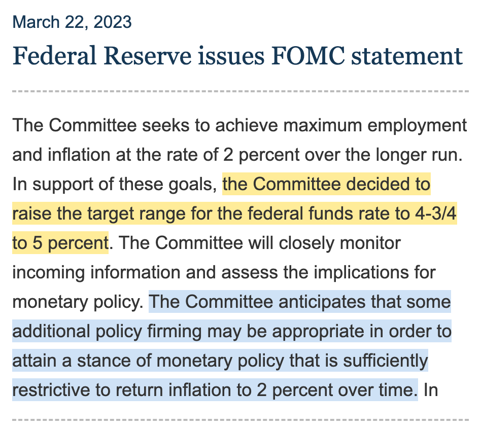
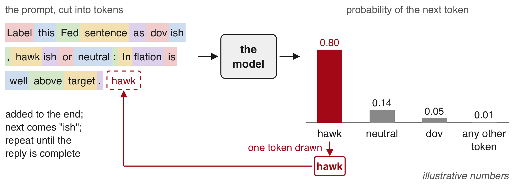
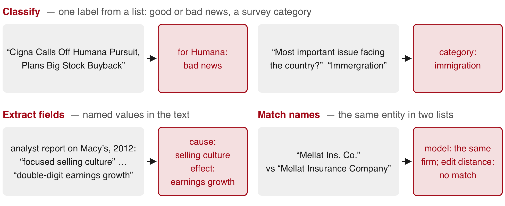
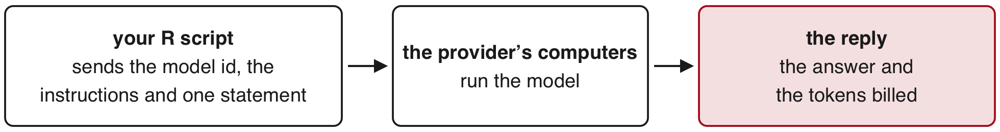
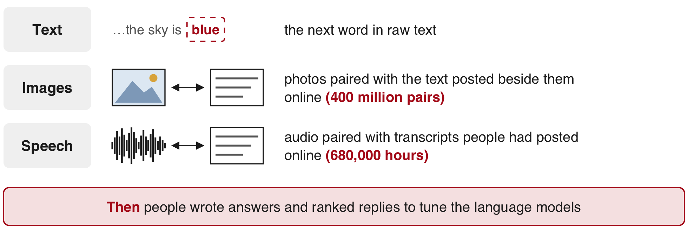
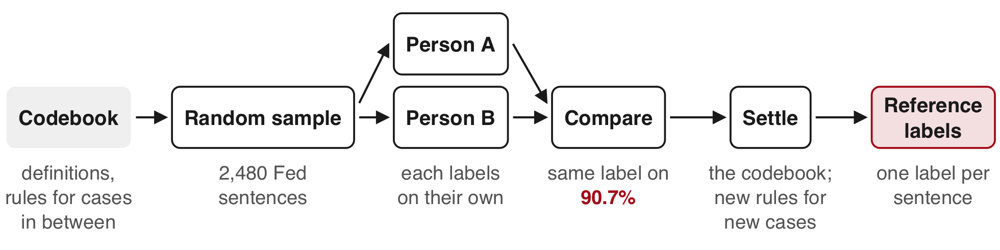
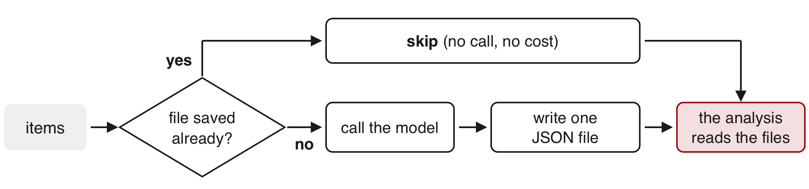
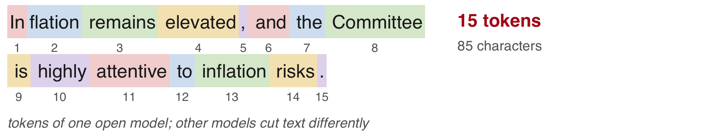
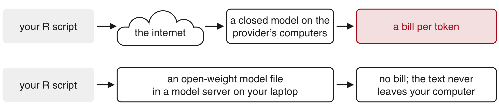
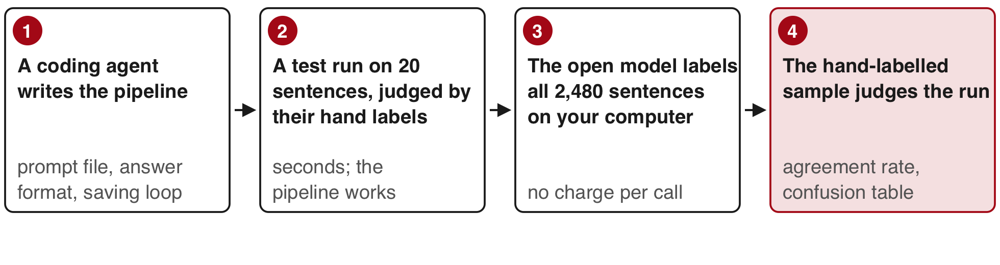

```{r}
#| purl: false
#| include: false
knitr::opts_chunk$set(
  comment = "#>",
  collapse = FALSE,
  fig.width = 9,
  fig.height = 4.4,
  fig.align = "center",
  fig.show = "hold",
  dpi = 150
)
options(width = 80)
# Every chunk runs in the project folder, so the paths on the page are the
# paths students use.
session_dir <- getwd()
knitr::opts_knit$set(root.dir = file.path(session_dir, "data/17-text-llms"))
fig_dir <- file.path(session_dir, "figures/17-text-llms")
```

::: {.content-hidden when-format="revealjs"}

[Slides](17-text-llms-slides.html) · [Live script](17-text-llms.R) ·
[Source](https://github.com/ArielOrtizBobea/aem6850/blob/main/fall-2026/sessions/17-text-llms.qmd) ·
[the project](data/17-text-llms.zip)

How to use a large language model to read text and return variables, and
how to know when to trust what it returns, in four sections: when to use a
language model; what a label is and what hand labels are for; one
classification run on a closed model from R, from the data to the bill;
and the same run on an open-weight model on your own computer. Two tasks
run through the session, both on text from the Federal Reserve. The first
reads the target range for the policy rate out of each of the 171 policy
statements since 2006 and compares it with the Fed's own daily series. The
second labels 2,480 sentences from Fed documents as hawkish, dovish or
neutral and compares the labels with those two people made by hand.

**The project.** Install the package once, in the R Console:
`install.packages("jsonlite")`. Download
[17-text-llms.zip](data/17-text-llms.zip), unzip it, and open
`17-text-llms.Rproj`, so that R starts in the project folder. Nobody needs
an API key: every model reply was saved before class and ships in the
folder. It holds:

- `fomc_statements.csv`: every policy statement of the Federal Open Market
  Committee from January 2006 to September 2026 (date, url, words, text,
  scheduled).
- `fred_target_range.csv`: the Fed's target for the policy rate on every
  day, from FRED.
- `tdw_sentences.csv`: 2,480 sentences from Fed minutes, press conferences
  and speeches, each labelled by hand (Trillion Dollar Words).
- `lm_words.csv`: the positive and negative word lists of Loughran and
  McDonald.
- `codebook.txt` and `range_prompt.txt`: the two prompts sent to the model.
- `model_setup.R`, `save_replies.R`, `run_all.R` and `demo.R`: the code that
  made the closed model's replies (needs `ellmer` and a key); `run_local.R`:
  the open model's run (needs `ellmer` and a model server).
- `replies/` and `demo/`: every saved reply, raw and as CSV files.
- `statement_sentences.csv`: the 171 statements cut into sentences.
- `README.txt` and `SOURCE.txt`: how the replies were made, and each
  source with its terms of use.

## Objectives {#objectives}

By the end of this session you can:

- Say what a language model can do with text (classify, extract fields,
  match names), with a research example of each, and decide whether a text
  task calls for a regular expression, a language model or a person.
- Explain what a label is and what hand labels are for: a few hundred
  random ones check a model's error rate, thousands train a model, and an
  outside record can replace them; and how two people make them.
- Follow a classification run on a closed model from R: the codebook as the
  prompt, a fixed answer format, the saved raw reply, and the agreement
  rate, base rate and confusion table against the hand labels.
- Run the same classification on an open-weight model on your own computer
  and compare its labels, speed and cost with the closed model's, with a
  coding agent writing and running the pipeline.
- Explain why a reply can change between runs, and keep a result
  reproducible: one model id, every raw reply saved, reruns from disk.

:::

## Plan for today {#plan}

::: {.slide-text}

1. **When to use an LLM**\
   [What a language model does · three things it can do with text · a regular expression, a model or a person · one task both ways · caveats · Exercise 1]{.topics}
2. **The use of labels**\
   [What a label is · checking a model's error rate · hand labels to train a model or to check it · how two people make them · agreement]{.topics}
3. **Using a closed LLM**\
   [2,480 Fed sentences labelled by hand · the codebook as the model's instructions · the call from R · one saved reply · five sentences: you, then the model live · why every reply is saved · the score on all 2,480 · where the errors are · Exercise 2 · the cost]{.topics}
4. **Using an open-weight LLM**\
   [What an open-weight model is · downloading one · the same call from R · open against closed on 2,480 sentences · what hardware buys you · a coding agent runs it · the stance of every Fed statement, 2006–2026]{.topics}

:::

::: {.content-visible when-format="revealjs"}

::: {.slide-text}

**LLM**: a large language model, a program that writes a reply to written
instructions. Running example: the policy statements of the Fed (the US
central bank) and sentences from its meetings. All model answers were saved
before class, so no account or password is needed. In the R Console, now:
`install.packages("jsonlite")` to read them. Then download and unzip
[17-text-llms.zip](data/17-text-llms.zip) from this session's page on the
course website and open `17-text-llms.Rproj`. That page also holds the
full code and eleven practice exercises, with solutions.

:::

:::

::: {.notes}
The Fed is the Federal Reserve.
:::

## The Fed's statement of 22 March 2023 {#statement}

::::: {.columns}

::: {.column width="56%"}

{width="82%"}

:::

::: {.column width="44%"}

Today's running example is the text the Fed publishes. The **FOMC**, the
rate committee of the US **central bank** (the Fed), publishes a statement
after each meeting. A statement sets a target range
for the main interest rate and hints which way rates go next.

::: {.dashes}

- **target range**: the band for the **federal funds rate**, the rate on
  overnight loans between banks.
- **hawkish**: pointing to higher rates, to slow inflation.
- **dovish**: pointing to lower rates, to support jobs and growth.

:::

:::

:::::

[Yellow: the target range the statement sets. Blue: a hint about future
rates ("firming": raising them). Board of Governors of the Federal Reserve
System; public domain.]{.source}

::: {.notes}
The project holds all 171 statements, 31 Jan 2006 to 16 Sep 2026. The FOMC
meets eight times a year on a schedule. This meeting came 12 days
after Silicon Valley Bank, a large US bank, failed (10 Mar 2023). Read the
blue sentence aloud: it is hawkish.
:::

::: {.content-visible unless-format="revealjs"}
The FOMC is the Federal Open Market Committee of the Federal Reserve ("the
Fed"), the US central bank. It sets the rate and publishes a statement after
each meeting. A central bank is the institution that sets a country's main
interest rate; other examples are the People's Bank of China and the European
Central Bank. The federal funds rate is the rate banks charge each other for
overnight loans, and "4-3/4 to 5 percent" is 4.75 to 5. Hawkish hints point to
tighter **monetary policy** (the central bank's setting of interest rates);
dovish hints point to easier policy.
:::

## Two variables from the same statement {#two-tasks}

::: {.slide-text}

A language model reads the Fed's statement of 22 March 2023 and returns a
number and a judgement.

:::

::: {.slide-text}

| | The target range | The stance of a sentence |
|:--|:--|:--|
| The model reads | one whole statement | one sentence at a time |
| Example | "...the Committee decided to [raise the target range for the federal funds rate to 4-3/4 to 5 percent]{style="background:#FFF3B0"}" | "[The Committee anticipates that some additional policy firming may be appropriate...]{style="background:#D6E4F5"}" |
| The model returns | lower = 4.75, upper = 5 | one label (here hawkish) |
| Checked against | FRED, the Fed's own daily record of the range | labels two people made by hand (stance has no official record) |

:::

::: {.slide-text}

**FRED**: the free data service of the Federal Reserve Bank of St. Louis.
**stance**: which way a sentence leans, toward higher rates (hawkish),
lower rates (dovish), or neither (neutral).

:::

::: {.content-visible unless-format="revealjs"}

Both examples come from the statement of 22 March 2023 on the previous
slide. The model returns two numbers for the target range, and for stance
one label: hawkish, dovish or neutral. Section 1 covers the target range;
sections 3 and 4 cover stance. **language model**: a program that writes a
reply to written instructions (section 1). The first variable has a right
answer recorded elsewhere; the second is a judgement, so people make the
reference by hand.

:::

# 1 · When to use an LLM {#part-when}

::: {.content-visible when-format="revealjs"}

- What a language model does
- Three things it can do with text: classify, extract, match
- Choosing the tool for the task
- Testing a pattern and a model on one task
- Three caveats before using a model
- Exercise 1

What can a language model do with text, and when is it the right tool?
Economists turn text into variables; a model is one of three ways to do it.

:::

## What a language model does {#what-model}

{width="80%" fig-align="center"}

::: {.dashes}

- **LLM** (large language model): a model trained on a vast amount of
  text to predict the next token; "model" on these slides means one.
  **token**: a word or a piece of a word. **prompt**: the instructions
  plus the item you send. **reply**: the text the model writes back, one
  token at a time.
- A **word count**, the older tool, scores each word on its own from fixed
  lists of good and bad words: *confident* counts as good even after "not",
  and "not" and "despite" count for nothing.
- The model reads every token with the tokens around it before it writes,
  so "not yet confident" reads as doubt.

:::

::: {.notes}
A phone keyboard's next-word suggestion works the same way, trained on far
less text.
:::

```{r}
#| purl: false
#| include: false
# Values for the markdown tables below, read from the saved replies.
tdw0 <- read.csv("tdw_sentences.csv")
lab0 <- read.csv("replies/labels_run1.csv")
mod_of <- function(id) lab0$stance[match(id, lab0$id)]
```

## Three things a language model can do with text {#uses}

::: {.slide-text}

Each use turns text into a variable. Classifying picks a label from a
list; extracting copies pieces out of the text; matching decides whether
two names mean the same firm. **edit distance**: the number of characters
to change to turn one name into the other. The examples, each explained
on the next slides: a takeover headline, a misspelled survey answer, a
stock analyst's report, a firm name written two ways.

:::

{width="84%" fig-align="center"}

[Classify: [Lopez-Lira & Tang (JFE, 2026)](https://doi.org/10.1016/j.jfineco.2026.104335);
[Bursztyn et al. (AER, 2025)](https://doi.org/10.1257/aer.20231468), example
from Mellon et al. (2024). Extract: [Li et al. (RFS, 2026)](https://doi.org/10.1093/rfs/hhaf081).
Match: [Dell (JEL, 2025)](https://doi.org/10.1257/jel.20241733);
Allen & Hatfield (2025).]{.source}

::: {.content-visible unless-format="revealjs"}

All four examples are real and used in published research.

A regular expression (a written pattern) can do some extraction when the
wording never changes. The other uses depend on what the words mean, which
is where a model helps.

The extraction paper is by Li, Mai, Shen, Yang & Zhang. The survey example
comes from Mellon et al. (the journal *Research & Politics*, 2024);
"Immergration" is the respondent's own spelling. The name pair comes from
Allen & Hatfield (Federal Reserve working paper, 2025).

JFE: *Journal of Financial Economics*; RFS: *Review of Financial Studies*;
AER: *American Economic Review*; JEL: *Journal of Economic Literature*.

:::

## Classifying text: sentiment and stance {#classify}

::: {.dashes}

- **Sentiment**: whether a text is good or bad news for someone.
- **Stance**: which way a text leans, such as toward higher or lower
  interest rates.

:::

| "Cigna Calls Off Humana Pursuit, Plans Big Stock Buyback" | For Humana's stock |
|:-----------------------------------------|:-----------------------------|
| A language model | **bad news**: a buyer willing to pay above market price walked away |
| A data vendor's sentiment score, −1 to +1 | **+0.65**, good news |

::: {.dashes}

- [Lopez-Lira & Tang (JFE, 2026)](https://doi.org/10.1016/j.jfineco.2026.104335):
  a model's sentiment labels on 159,137 headlines predicted stock returns.
- [de Kok (Management Science, 2025)](https://doi.org/10.1287/mnsc.2023.03253):
  a model flagged evasive answers on earnings calls and matched hand
  labels on 96% of them.

:::

[Cigna, a US health insurer, had been trying to buy Humana. Headline from
December 2023; example from Lopez-Lira & Tang, working-paper version,
pp. 15–16. JFE: *Journal of Financial Economics*.]{.source}

::: {.content-visible unless-format="revealjs"}

Lopez-Lira & Tang's model read 159,137 company news headlines (2021–2024)
and answered whether each was good, bad or unclear for the stock. They
used no hand labels: the answers were checked against how the stocks then
moved, and they predicted returns.

On earnings calls, managers answer questions from stock analysts each
quarter. In de Kok's study the model labelled whether each answer dodged
the question, and it agreed with labels people made by hand on 96% of
answers.

In December 2023 Cigna had been trying to buy Humana; both are US health
insurers. The model called the headline bad news for Humana's stock, since
a buyer would have paid more than the market price for Humana's shares.
The commercial sentiment score for the same headline was +0.65 on a scale
from −1 to +1 (good news).

Section 3 classifies sentences from the US central bank
(the Fed) as hawkish (pointing to higher interest rates), dovish (lower)
or neutral.

:::

::: {.content-hidden when-format="revealjs"}

## Classifying open-ended survey answers {#code-open}

Survey researchers call this **coding**. It is the same task as
classifying headlines, with more categories (50 in this survey), written
rules for each in a **codebook**, and answers typed by respondents,
misspellings included.

| Answer to "What is the single most important issue facing the country?" | Category |
|:-----------------------------------------------|:-------------|
| "a bad economy" | economy |
| "Immergration" | immigration |

A keyword search for "immigration" misses the misspelled answer.

::: {.dashes}

- [Andre et al. (REStud, 2026)](https://doi.org/10.1093/restud/rdag014):
  two research assistants coding with a codebook agreed on 88% of answers.
- A model given the authors' codebook reproduced their hand codes in
  [Bursztyn et al. (AER, 2025)](https://doi.org/10.1257/aer.20231468)
  (correlations of 0.54 to 0.86) and in
  [Link et al. (QJE, 2026)](https://doi.org/10.1093/qje/qjag047).

:::

[British Election Study example from Mellon et al. (*Research & Politics*,
2024), who coded these answers into 50 categories with six models.]{.source}

::: {.content-visible unless-format="revealjs"}

Surveys often ask an open question and let people write their answer.
[Andre, Haaland, Roth, Wiederholt & Wohlfart (REStud, 2026)](https://doi.org/10.1093/restud/rdag014)
had more than 10,000 answers on the causes of inflation coded by research
assistants with a codebook.
[Bursztyn, Handel, Jiménez-Durán & Roth (AER, 2025)](https://doi.org/10.1257/aer.20231468)
used a model to recode 265 answers on why students keep using social media
apps.
[Link, Peichl, Pfäuti, Roth & Wohlfart (QJE, 2026)](https://doi.org/10.1093/qje/qjag047)
recoded 200 answers the same way.

:::

:::

## Extracting fields from documents {#extract}

Extracting copies named pieces out of a document into columns, one
**field** per column. A label picked from a list is classification.

| Field | Copied from an analyst report on Macy's, March 2012 |
|:------|:------------------------------------------------|
| cause | "focused selling culture" |
| effect | "double-digit earnings growth through 2015" |

::: {.dashes}

- [Li, Mai, Shen, Yang & Zhang (RFS, 2026)](https://doi.org/10.1093/rfs/hhaf081):
  a model read the culture passages of about 2.4 million analyst reports.
  It extracted cause and effect, and classified each passage's culture
  type and tone.
- On 200 passages labelled by hand, the culture type was right 98.5% of
  the time.

:::

[Analyst report: a stock analyst's report on a company, here by JP Morgan.
*Review of Financial Studies*; example from the authors' working-paper
version.]{.source}

::: {.content-visible unless-format="revealjs"}

In full: the model read the passages on corporate culture in about 2.4
million reports by stock analysts and returned three fields for each: the
type of culture (one of six), its tone, and cause-and-effect statements.
Checked against 200 passages the authors labelled by hand, it was right on
the culture type 98.5% of the time, and on the tone 97.5%. The example
comes from an analyst report on the retailer Macy's, March 2012.

Today's own extraction (section 1): the target range for the Fed's main
interest rate, read from each of the Fed's 171 policy statements.

:::

## Matching names across datasets {#match}

::: {.dashes}

- The same firm is written differently in different files, so linking two
  datasets means matching names.
- [Dell (JEL, 2025)](https://doi.org/10.1257/jel.20241733): matching 1950s
  Japanese firm records with a language model's **embeddings** (numbers a
  model assigns to a text, close for texts that mean the same), trained
  further on hand-linked examples, found the right firm 91% of the time, against 27% for **edit distance** (the
  number of characters you must change to turn one name into the other).

:::

::: {.slide-text}

| Name in the second list | The same firm as "Mellat Insurance Company"? | Edit distance |
|:--|:--|--:|
| "Mellat Ins. Co." | yes | 11 |
| "Mellot Insurance Corp." | no, a different firm | 5 |

:::

::: {.slide-text}

Edit distance calls the different firm the closer match. A model reads
"Ins." as "Insurance" and "Co." as "Company".

:::

[Name pair from Allen & Hatfield (Federal Reserve working paper, 2025),
on firms in the US sanctions list. Edit distances from R's `adist()`.]{.source}

## Choosing the tool for the task {#three-ways}

Three tools turn text into a variable. The task decides which one:

::: {.slide-text}

| | A pattern (regular expression) | A language model | A person |
|:--|:--|:--|:--|
| Suits | a fixed format: dates, codes | meaning that changes with the wording | few items, or the reference labels |
| Cost | free | per token, or free on your own computer | about 15 seconds a sentence |
| Speed on today's data | 171 Fed statements in under a second | the same 171 in 18 seconds | 2,480 Fed sentences in about 10 hours |
| Same answer every run | yes | not guaranteed | not guaranteed either |
| Checked against | example strings, or an outside record | an outside record, or a hand-labelled sample | a second person |

:::

::: {.slide-text}

Start from the task: if the wording never changes, write a pattern; if
meaning matters, use a model and check it; if the items are few or the
labels are the reference, read them yourself. **regular expression**: a
written search pattern that matches text by its form.

:::

```{r}
#| purl: false
#| include: false
# The target range three ways, computed for the summary slide; the
# step-by-step code is on the session page.
fomc <- read.csv("fomc_statements.csv")
fred <- read.csv("fred_target_range.csv")
rng <- read.csv("replies/range_model.csv")
k0 <- match(as.Date(fomc$date) + 1, as.Date(fred$date))
k1 <- match(fomc$date, rng$date)
mod_ok0 <- rng$lower[k1] == fred$lower[k0] & rng$upper[k1] == fred$upper[k0]
n_mod_ok <- sum(mod_ok0, na.rm = TRUE)
range_cost <- sum(c(sum(rng$input_tokens), sum(rng$output_tokens)) * c(2, 10)) / 1e6
```

::: {.content-visible unless-format="revealjs"}
A pattern also suits repeated sentences, and you check it against example
strings you write. A person also suits high-stakes items. The speeds are for
reading the 171 Fed statements (pattern and model) and for labelling the 2,480
Fed sentences by hand.
:::

## Testing a pattern and a model on one task {#range-results}

::: {.slide-text}

The choice, tested on one task. From each of the Fed's 171 policy
statements (2006–2026), read the target range for the federal funds rate,
the Fed's main interest rate, once with a pattern and once with a model,
and compare each with FRED, the Fed's own daily record of the range (from
the Federal Reserve Bank of St. Louis).

:::

::: {.slide-text}

| | A regular expression | A language model |
|:--|:--|:--|
| Right, against FRED | 145 of the 145 it read | `r n_mod_ok` of 171 |
| No answer | 26: the 25 statements of 2006–2008 that set one number ("at 5-1/4 percent"), and 17 Aug 2007, which states no target | 1: 17 Aug 2007, left empty as its instructions said |
| Time and cost | under a second, free | 18 seconds, about `r round(100 * range_cost)` cents |

:::

::: {.slide-text}

The pattern would need a second pattern for the single-number years; the
model read both wordings. When the wording is fixed, the free pattern does
the job. The code for both, step by step, is on the session page.

:::

::: {.content-hidden when-format="revealjs"}

### The target range, step by step {#range-steps}

The code behind the slide "Testing a pattern and a model on one task": the model called once per statement, the regular expression, FRED, and the comparison.

### Calling a model from R, for the target range {#calling-range}

{width="70%" fig-align="center"}

```{r}
#| eval: false
#| purl: false
#| filename: "model_setup.R and run_all.R (parts), instructor's computer; needs ellmer and an API key in ~/.Renviron"
library(ellmer)            # install.packages("ellmer") once; calls language models from R
MODEL <- "<model id>"      # the full model id from the provider's list, written once
RANGE_PROMPT <- paste(readLines("range_prompt.txt"), collapse = "\n")
chat <- chat_anthropic(system_prompt = RANGE_PROMPT, model = MODEL, cache = "none")
```

::: {.dashes}

- **API**: an address that takes a request from your program and sends
  back a reply. **API key**: a password that identifies your account and
  bills it for each call. It lives in `~/.Renviron`, a text file in your
  home folder that R reads when it starts; never in a script.
- **system prompt**: the instructions sent with every item.
  **pinned model**: the full id of one fixed model version, written once
  in `MODEL`. **provider**: the company that runs the model. `cache = "none"`
  turns off prompt caching, so every piece of text sent is billed at one
  price (caching is explained on the session page).

:::

::: {.notes}
Never open ~/.Renviron on the projector. Getting a key is on the page.
:::

### Asking for the range in a fixed format {#fixed-format}

::::: {.columns}

::: {.column width="36%"}

::: {.slide-text}

You read one policy statement of the Federal Open Market Committee
(FOMC). Report the target for the federal funds rate that the statement
sets or keeps, in percent, as two numbers: lower and upper. "4-3/4 to 5
percent" is 4.75 and 5. A single target, such as "5-1/4 percent", is the
same number twice. Use only the text of the statement. If it states no
target, leave both out.

:::

[`range_prompt.txt`, the instructions sent with each statement. The
federal funds rate is the Fed's main interest rate.]{.source}

:::

::: {.column width="64%"}

```{r}
#| filename: "R Console, in the 17-text-llms folder; reads fomc_statements.csv"
fomc <- read.csv("fomc_statements.csv")   # 171 statements
i <- which(fomc$date == "2023-03-22")
```

```{r}
#| eval: false
#| purl: false
#| filename: "instructor's computer, before class: one call; needs chat (the model and these instructions, previous slide)"
range_type <- type_object(
  lower = type_number("Lower limit, in percent, such as 4.75",
                      required = FALSE),
  upper = type_number("Upper limit, in percent, such as 5",
                      required = FALSE))
chat$clone()$chat_structured(fomc$text[i], type = range_type)
```

```{r}
#| echo: false
#| purl: false
r0 <- read.csv("replies/range_model.csv")
str(list(lower = r0$lower[r0$date == "2023-03-22"], upper = r0$upper[r0$date == "2023-03-22"]))
```

:::

:::::

::: {.slide-text}

**schema** (fixed output format): the boxes the reply must fill, each with
a name and a type, like a form. The reply arrives as **JSON**, a text
format of named fields (`{"lower": 4.75, "upper": 5}`), and ellmer turns
it into an R list. `required = FALSE` lets the model leave both boxes
empty when a statement states no target. `$clone()` gives a fresh copy of
the chat, because a chat keeps every earlier turn and sends it again.

:::

### Ranges from all 171 statements {#all-ranges}

```{r}
#| eval: false
#| purl: false
#| filename: "instructor's computer, once before class: 171 calls; chat and range_type from the previous slide"
ranges <- parallel_chat_structured(chat, as.list(fomc$text), type = range_type,
                                   include_tokens = TRUE, on_error = "continue")
ranges$date <- fomc$date
write.csv(ranges[, c("date", "lower", "upper", "input_tokens", "output_tokens")],
          "replies/range_model.csv", row.names = FALSE)
```

```{r}
#| filename: "R Console; needs fomc (the 171 statements); reads the saved answers; no API key"
rng <- read.csv("replies/range_model.csv")   # the model's target range: date, lower, upper, tokens
head(rng, 3)
k <- match(fomc$date, rng$date)              # rng's row for each statement, matched by date
fomc$mod_lower <- rng$lower[k]
fomc$mod_upper <- rng$upper[k]
```

::: {.slide-text}

Before class, each of the 171 FOMC statements went to the language model
with its instructions (`chat`) and the two-number format (`range_type`).
It returned the lower and upper limits of the target range for the
federal funds rate, the Fed's main interest rate; FRED's record checks
them on the next slides. Before December 2008 the Fed set a single number,
so lower equals upper.

`parallel_chat_structured()`: one conversation per statement, 10 at a
time. `include_tokens = TRUE`: adds the tokens billed (section 3).
`on_error = "continue"`: keeps going past a failed call. `match(a, b)`:
the position in `b` of each element of `a`.

:::

### Reading the target range with a regular expression {#pattern}

```{r}
#| filename: "R Console; needs fomc (the 171 statements) and i (the row of 22 March 2023)"
txt <- gsub("\u2011", "-", fomc$text)    # the non-breaking hyphen becomes "-"
m <- regmatches(txt, regexec("([0-9/-]+) to ([0-9/-]+) percent", txt))
m[[i]]
to_number <- function(x) sapply(parse(text = sub("-", "+", x)), eval)   # "4-3/4" becomes 4+3/4
fomc$pat_lower <- to_number(sapply(m, function(x) x[2]))   # group 1; NA where nothing matched
fomc$pat_upper <- to_number(sapply(m, function(x) x[3]))   # group 2
sum(is.na(fomc$pat_lower))
```

::: {.slide-text}

**regular expression**: `[0-9/-]` is one digit, slash or hyphen, and `+`
means one or more of them. **capture group**: a part of the pattern in
`( )` whose text is kept; `regmatches()` returns the whole match, then
group 1, then group 2. Some statements use a non-breaking hyphen, which
looks like "-" but is a different character, so `gsub()` replaces it
first. `parse()` reads text as R code and `eval()` runs it; running text
as code could run anything, but here the pattern lets only digits, "/"
and "-" through. Of the 26 NA, 25 are statements of 2006 to 2008 that set
a single target rate, with no "to"; the other, 17 Aug 2007, states no
target at all.

:::

### The target range in FRED {#fred}

```{r}
#| filename: "R Console; needs fomc (the 171 statements); reads fred_target_range.csv"
fred <- read.csv("fred_target_range.csv")  # 7,578 days: date, lower, upper
fred[fred$date >= "2023-03-21" & fred$date <= "2023-03-23", ]
k <- match(as.Date(fomc$date) + 1, as.Date(fred$date))   # FRED's row for the day after
fomc$fred_lower <- fred$lower[k]
fomc$fred_upper <- fred$upper[k]
```

::: {.slide-text}

FRED, the data service of the Federal Reserve Bank of St. Louis, records
the target range the Fed actually set on every day. It is the reference
for checking both the regular expression and the language model's
answers. The day after
each statement, FRED shows the range that statement set, so the code reads
FRED's row for the day after. Adding 1 to a date gives the
next day. Before 16 Dec 2008 the FOMC set one number, and the file copies
it into `lower` and `upper`.

:::

::: {.notes}
Since the statement of 15 Mar 2017, a new range appears in FRED from the
day after the statement; before that, on the statement day. On the
statement date itself, 30 statements disagree, all from 15 Mar 2017 on.
:::

### Comparing the pattern and the model with FRED {#compare-fred}

```{r}
#| filename: "R Console; needs fomc with the ranges from the pattern, the model and FRED"
fomc$pat_ok <- fomc$pat_lower == fomc$fred_lower & fomc$pat_upper == fomc$fred_upper
fomc$mod_ok <- fomc$mod_lower == fomc$fred_lower & fomc$mod_upper == fomc$fred_upper
table(pattern = fomc$pat_ok, model = fomc$mod_ok, useNA = "ifany")   # useNA: count the NA too
show <- c("date", "mod_lower", "mod_upper", "fred_lower", "fred_upper")
fomc[which(!fomc$mod_ok | is.na(fomc$mod_ok)), show]
```

```{r}
#| purl: false
#| include: false
n_mod_ok <- sum(fomc$mod_ok, na.rm = TRUE)
n_mod_bad <- sum(!fomc$mod_ok | is.na(fomc$mod_ok))
range_secs <- 18
```

::: {.slide-text}

`NA`: no answer. Read every row that differs. The one row here is 17 Aug
2007: that statement states no target, though FRED shows 5.25 that day.
The model gave no numbers, as its instructions asked. An answer of 5.25 would have
matched FRED from facts the model learned in training, with no support in
the text.

:::

:::

## Three caveats before using a model {#misleads}

A language model reads text you supply. Before you rely on its labels:

::: {.dashes}

- **Results move with the model and the prompt** (the instructions sent).
  Across models and prompts, the estimated effect of a "good news" label on
  the next day's stock return ran from −2.48 to 0.08: even the sign changed.
  Labelling a random 5% by hand measures the model's errors, so you can
  report them and correct the estimate for them.
- **It costs money**, charged per token (a piece of text).
- **It remembers text from its training**, so it may have seen the outcome
  you want to predict: it completed 344 descriptions of bills before the US
  Congress (proposed laws) word for word. What it knows about a firm can
  change its answer:

:::

| Headline (only the firm's name differs) | Model's answer |
|:------------------------------------|:--------------|
| "**Facebook** not planning to extend European privacy law globally" | good for the stock |
| "**Blahblahblah** not planning to extend European privacy law globally" | bad for the stock |

[Bills, stock returns and the 5% fix: [Ludwig, Mullainathan & Rambachan (*Annual Review of Economics*, 2026)](https://doi.org/10.1146/annurev-economics-120925-105620).
Headline pair: [Glasserman & Lin (*Journal of Financial Data Science*, 2024)](https://doi.org/10.3905/jfds.2023.1.143).]{.source}

::: {.content-visible unless-format="revealjs"}

[Ludwig, Mullainathan & Rambachan (*Annual Review of Economics*, 2026)](https://doi.org/10.1146/annurev-economics-120925-105620)
gave a model the first half of 10,000 descriptions of congressional
bills and 10,000 financial headlines from 2019; it wrote out the rest
word for word for 344 bills and 60 headlines. A model that read the
outcome during its training can seem to predict it. In the same paper,
the regression coefficient of the next day's stock return on a model's
"good news" label ranged from −2.48 to 0.08 across models and prompts
(the instructions sent). Their fix: label a random 5% of the items by
hand, measure the model's errors there, and correct the estimate. Other
costs: a price per token, answers that can change between runs (section 3),
and text you may not send off your computer, such as survey answers
covered by a data-use agreement. In the headline pair from
[Glasserman & Lin (*Journal of Financial Data Science*, 2024)](https://doi.org/10.3905/jfds.2023.1.143),
the firm's name alone changed the answer.

:::

## Exercise 1 {#exercise-1}

::: {.panel-tabset}

### Exercise

With your neighbour, no computer (4 minutes). For each task: a regular
expression (a written search pattern), a language model or a person? For
each model answer, what would you check it against?

1. The date of each FOMC (Fed rate-setting committee) meeting, from the statement's first line
2. Every five-digit US ZIP code in 100,000 addresses
3. How often "inflation" appears in each statement
4. 50,000 product reviews: positive or negative
5. 3,000 answers to "Why did you move?", sorted into reasons
6. 20,000 firm names in loan records, matched to a list of listed firms
7. The amount in 10,000 contracts: "USD 1.2 million", "$1,200,000" or in words
8. 2 million job ads, coded into occupations
9. Whether one 40-page court ruling supports a claim in your paper
10. 200 Fed (US central bank) sentences, labelled to judge a model's labels

```{r}
#| label: exercise-1
#| exercise: true
#| script: "Exercise 1 (4 minutes)"
#| include: false
#| eval: false
# Exercise 1 (4 minutes). A discussion with your neighbour; no code to run.
# For each task, decide whether it calls for a pattern ("regex"), a language
# model ("model") or a person ("person").
tasks <- c(
  "1. the date of each FOMC meeting, from the statement's first line",
  "2. every five-digit US ZIP code in 100,000 addresses",
  "3. how often 'inflation' appears in each statement",
  "4. 50,000 product reviews: positive or negative",
  "5. 3,000 answers to 'Why did you move?', sorted into reasons",
  "6. 20,000 firm names in loan records, matched to a list of listed firms",
  "7. the amount in 10,000 contracts: 'USD 1.2 million', '$1,200,000' or in words",
  "8. 2 million job ads, coded into occupations",
  "9. whether one 40-page court ruling supports a claim in your paper",
  "10. 200 Fed sentences, labelled to judge a model's labels")
# 1. Compare with your neighbour. Where do you differ, and why?
# 2. For each "model" answer: what would you check it against?
#
# Two answers to compare with the room: the tasks where you and your
# neighbour differ, and what you would check task 6 against.
```

### Solution

**1–3 a regular expression · 4–8 a language model · 9–10 a person**

::: {.slide-text}

Patterns for fixed formats (1–3). A model where meaning matters, checked
on a hand-labelled sample (4–8; task 7 can mix a pattern for the fixed
formats with a model for the rest). A person for one high-stakes item (9)
and for the reference labels (10). Task 6 is checked against a few hundred
pairs matched by hand.

:::

:::

::: {.content-visible when-format="revealjs"}

::: {.notes}
A discussion, with no code and no API key. Several tasks have
defensible second answers: 3 is a word count, which is a pattern; 7 mixes
both.
:::

:::

# 2 · The use of labels {#part-labels}

::: {.content-visible when-format="revealjs"}

- What a label is
- Checking a model's error rate
- Hand labels to train a model or to check it
- How two people make hand labels
- Agreement between two people

What is a label, and when do you make labels by hand: to train a model, or
to check how often it is wrong? A model's answers are a measurement, and you
need something to compare them with.

:::

## What a label is {#label}

A **label** is the category assigned to one item. Data in which every
item carries one are **labelled data**. (The Fed: the US central bank.)

| Item | Label | Assigned by |
|:------------------------------|:----------------------|:--------------------|
| Fed sentence: "And inflation is well above target." | hawkish (higher interest rates ahead; the other labels: dovish, neutral) | two researchers (a **hand label**) |
| the same sentence | hawkish | a language model |
| Survey answer, misspelled: "Immergration" | immigration | a survey coder |

::: {.dashes}

- **A label is not a feature.** Features describe the item (its words,
  its date).
- **A label is not the codebook.** The codebook is the written guide for
  choosing labels, such as "inflation rising: hawkish"; a label is what one
  item gets.
- **A label is not the truth.** It measures the true category with error
  (misclassification); the two researchers agreed on 9 in 10 Fed sentences.

:::

::: {.notes}
The same word is used for audio and images: the transcript of a clip, or
the object in a photo, is its label.
:::

## Checking a model's error rate {#why-labels}

A model's labels have an unknown error rate. Compare them with a reference:

::: {.dashes}

- **An outside record**, when one exists: the Fed's target range (its main
  interest rate), read by a model from 171 policy statements and checked
  against FRED, the Fed's daily record: 170 of 171 matched.
- **Hand labels on a random sample**, when none exists: nobody records
  whether a Fed sentence is hawkish (pointing to higher rates), so two
  people label a sample; the model's agreement with them is its score.

:::

About 200 random items pin the error rate within about ±7 percentage
points (two standard errors of a share near one half); all 2,480 Fed
sentences within ±2. Once checked, the model labels other text, which
nobody labels by hand.

::: {.content-visible unless-format="revealjs"}

A model's label is a measurement, like an answer to a survey question. It
has an error rate, and you do not know it until you compare the labels with
something you trust. Without a reference you cannot tell a model that is
right 95% of the time from one that is right half the time.

The target range is the one the Fed sets for its main interest rate. FRED
confirmed the model's reading on 170 of the 171 statements with no hand
labels at all. When no record exists, a random sample of about 200 items
labelled by hand pins the model's error rate down to within about 7
percentage points either way.

FRED is the free data service of the Federal Reserve Bank of St. Louis; it
records the target range the Fed set on every day. The ±7 points is two
standard errors of an error rate near one half, 2√(0.5 × 0.5 / 200) ≈ 0.071.

**hand label**: a category a person assigns to an item after reading it.
**random sample**: items drawn by chance, so the easy ones are not picked
by eye.

:::

## What hand labels are for {#labels-for}

::: {.slide-text}

Hand labels have two jobs. Thousands train (fine-tune) a model for your
own categories; a few hundred random ones check a model's output. A large
model used as it is needs only the check, and an outside record can
replace even that.

:::

::: {.slide-text}

| | Text | Audio | Images |
|:--|:--|:--|:--|
| **Train** | [Moreno-Medina et al. (QJE, 2025)](https://doi.org/10.1093/qje/qjaf004) trained a model on about 200,000 news stories labelled by topic, to sort TV news into topics | clips transcribed by hand train a speech-to-text model for one accent or subject | photos labelled by workers paid per photo on online platforms |
| **Check** | two people label Fed sentences hawkish (higher rates), dovish (lower) or neutral: how often the model agrees | a hand transcript of a short clip: the share of words the model gets wrong | random photos labelled by hand: how often the model agrees |
| **No hand labels** | the Fed's interest-rate target range read by the model, compared with FRED, the Fed's own daily record | the model's list of who spoke when, compared with the official transcript | fire damage read from photos of homes, compared with inspection records |

:::

[The Fed: the US central bank. QJE: *Quarterly Journal of Economics*.]{.source}

::: {.content-visible unless-format="revealjs"}

Today's two tasks sit in the Text column: reading the target range for the
Fed's main interest rate (checked against FRED, the St. Louis Fed's daily
record) and labelling each Fed sentence hawkish, dovish or neutral
(pointing to higher interest rates, lower ones, or neither; checked
against hand labels). Audio and image models fall into the same
three cases.

Training a model on labelled examples so that it learns the categories is
called fine-tuning. In the TV-news study, about 200,000 online news stories
came already labelled by topic and were used to fine-tune the model that
then sorted TV news. Labels that check a model's output are a random sample
of a few hundred, made before anyone sees the model's labels. For the Fed
sentences, the check reports how often the model agrees with the two people
and which labels it mixes up.

:::

::: {.content-hidden when-format="revealjs"}

## How the models were trained {#trained}

{width="84%" fig-align="center"}

::: {.dashes}

- The models learned from existing text; used as is, they need hand labels mainly to check answers.
- **zero-shot**: instructions alone, as today. **few-shot**: plus a few labelled examples.

:::

[NeurIPS and ICML are the main machine-learning conferences. Text: [Brown et al. (NeurIPS, 2020)](https://proceedings.neurips.cc/paper/2020/hash/1457c0d6bfcb4967418bfb8ac142f64a-Abstract.html);
images: [Radford et al. (ICML, 2021)](https://proceedings.mlr.press/v139/radford21a.html);
speech: [Radford et al. (ICML, 2023)](https://proceedings.mlr.press/v202/radford23a.html);
tuning on people's answers and rankings:
[Ouyang et al. (NeurIPS, 2022)](https://proceedings.neurips.cc/paper_files/paper/2022/hash/b1efde53be364a73914f58805a001731-Abstract-Conference.html).]{.source}

::: {.content-visible unless-format="revealjs"}
So do we always need hand labels? The models behind today's AI tools, for text,
images and speech, were trained mostly on material people had already written or
posted for other purposes, so no one labelled it for the model. Today the
language model never sees the 2,480 hand labels of the Fed sentences: they only
judge its labels, as the official daily record of the target range judges the
model's reading of it. With zero-shot prompting the model works from
instructions alone; with few-shot prompting a few labelled examples go into the
instructions.
:::

:::

## How two people make hand labels {#flow}

{width="100%" fig-align="center"}

::: {.slide-text}

How the 2,480 sentences from documents of the Fed (the US central bank)
in the Trillion Dollar Words dataset of
[Shah, Paturi & Chava (ACL, 2023)](https://doi.org/10.18653/v1/2023.acl-long.368)
got their labels: hawkish (pointing to higher interest rates), dovish
(lower) or neutral. Two of the dataset's authors each labelled the
sentences on their own with the **codebook**, the written rules. They
agreed on 90.7% and settled the rest with the codebook, adding a rule for
each new kind of case. The published dataset holds only the settled
labels: the **reference labels**, which a model is judged against.

:::

::: {.notes}
The two had taken finance coursework; one was from the US and one from
India. Two TAs grading the same exam with one rubric work the same way.
The sampling and the sentence splits are on the page.
:::

::: {.content-visible unless-format="revealjs"}
The sentences come from the US central bank (the Fed). The **random
sample**: 5 sentences per document (one set of minutes, one press
conference or one speech), among sentences with a word about monetary
policy. The codebook includes rules for unclear cases.
:::

## Agreement between two people {#agreement}

```{r}
#| filename: "R Console"
a <- c("dovish", "neutral", "neutral")    # person A's labels for three sentences
b <- c("dovish", "hawkish", "neutral")    # person B, the same three
a == b
mean(a == b)                              # mean() of TRUE and FALSE is the share TRUE
```

::: {.dashes}

- **agreement rate**: the share of items given the same label.
- **inter-rater agreement**: the agreement rate between two people who
  labelled the same items on their own. The two who labelled the 2,480 Fed
  sentences with the codebook agreed on 90.7% before settling the rest.
- A model that reaches about 90% does as well as careful people.

:::

[Agreement before resolving disagreements: 89.0% for sentences from
meeting minutes, 95.0% for press conferences, 91.1% for speeches, 90.7% in
all (Shah, Paturi & Chava, ACL, 2023, Table 9).]{.source}

# 3 · Using a closed LLM {#part-hands}

::: {.content-visible when-format="revealjs"}

Can a **closed model**, one that runs on the provider's computers and bills
each call, label the 2,480 Fed sentences, and how would we know?

1. The data: 2,480 sentences, each labelled by two people
2. The call from R, one reply, and why every reply is kept
3. Live: you label five sentences, then the model does, twice
4. The score on all 2,480, and a cheaper rule (Exercise 2)
5. The bill

No account with the provider is needed: the saved replies and the data are
in the session's zip file.

:::

## 2,480 Fed sentences labelled by hand {#tdw}

```{r}
#| filename: "R Console, in the 17-text-llms folder (unzipped from 17-text-llms.zip); reads tdw_sentences.csv"
tdw <- read.csv("tdw_sentences.csv")   # tdw: Trillion Dollar Words, the dataset's name
dim(tdw)
tdw$annotators <- c("dovish", "hawkish", "neutral")[tdw$label + 1]   # the release codes 0, 1, 2
table(tdw$annotators)
```

The reference for checking the model: a published dataset, Trillion
Dollar Words, with sentences from the minutes (meeting records), press
conferences and speeches of the Fed (the US central bank). Two researchers
(**annotators**) labelled each one on their own and settled the rest
together; the file holds the settled label as 0, 1, 2, turned into words
above:

::: {.dashes}

- "In addition, U.S. inflation remains muted." **dovish** (pointing to lower rates)
- "And inflation is well above target." **hawkish** (pointing to higher rates)
- "Most other interest rates in short-term markets were little changed over the period." **neutral**

:::

[Trillion Dollar Words: [Shah, Paturi & Chava (ACL, 2023)](https://doi.org/10.18653/v1/2023.acl-long.368);
ACL: the main conference in computational linguistics.]{.source}

::: {.content-visible unless-format="revealjs"}

The sentences come from the minutes of the Fed's rate-setting committee
(FOMC, 1996–2022), the Fed chair's press conferences (2011–2022) and
speeches by Fed officials (1996–2022). **minutes**: the written record of
a meeting, published about three weeks later. Hawkish means pointing to
higher interest rates; dovish, to lower. The published file codes the
labels 0, 1, 2 (dovish, hawkish, neutral). SOURCE.txt in the folder lists
the file's six columns: id, sentence, year, label (the 0, 1, 2 code),
split (train or test) and orig_index. Row ids of the three examples:
284 (dovish), 904 (hawkish), 147 (neutral). Licence CC BY-NC 4.0: credit
the authors, say what you changed, no commercial use.

:::

## The codebook as the model's instructions {#codebook}

::: {.slide-text}

The two people labelled each sentence by a **codebook**: the written
definition of each label, with rules for the cases in between. Condensed
to the box below, it is also what the model is told, so the model and the
people follow the same rules:

:::

```{.default filename="codebook.txt, in the project folder; sent to the model with every sentence"}
You label one sentence from a document of the US Federal Reserve: FOMC
meeting minutes, the chair's press conferences, or speeches by Fed officials.
dovish: the sentence points to future easing of monetary policy (lower rates).
hawkish: the sentence points to future tightening of monetary policy (higher rates).
neutral: mixed signals, no change in policy, or not about the policy stance.
Rules for the cases in between:
- Inflation falling, unemployment rising, or growth projected low: dovish.
- Inflation rising, unemployment falling, growth projected high, or output above potential: hawkish.
- Unemployment or growth unchanged, maintained or sustained: neutral.
- The dollar rising in value: dovish. The dollar falling in value: hawkish.
- Oil, energy or house prices falling: dovish. Rising: hawkish.
- The Fed expecting low inflation: dovish. High inflation: hawkish.
- A foreign country's own economy or trade policy: neutral.
- "Accommodative", or a focus on "maximum employment": dovish.
- "Mixed", "moderate" or "reaffirmed": neutral.
Give exactly one label.
```

[FOMC: the Fed's rate-setting committee. **potential output**: what the
economy can produce with full use of its workers and machines.
**accommodative**: keeping rates low. A stronger dollar makes imports
cheaper and lowers inflation, so it is dovish. Condensed once from the
annotators' guide ([Shah, Paturi & Chava, ACL, 2023](https://doi.org/10.18653/v1/2023.acl-long.368)),
before any reply, and never edited after.]{.source}

::: {.notes}
Graders who share one rubric work the same way.
:::

::: {.content-visible unless-format="revealjs"}

**label**: the category given to one item, from a fixed set; here the item
is one sentence, and every sentence gets exactly one label. The guide's
rules for four of its eight topics (**trade deficit**: imports above
exports):

| Topic | dovish | hawkish | neutral |
|:--|:--|:--|:--|
| The US economy | inflation falls; unemployment rises; growth projected low | inflation rises; unemployment falls; growth projected high; output above potential | unemployment or growth unchanged, maintained or sustained |
| The dollar | rises in value | falls in value | |
| Energy and house prices | fall | rise | |
| Foreign countries | US trade deficit falls | US trade deficit rises | a foreign country's own economy or trade policy |

The prompt was condensed from the guide once, before any reply, and never
edited to raise the model's agreement with the hand labels. The chair is
the Fed chair.

:::

## Calling the closed model from R {#calling}

{width="66%" fig-align="center"}

```{r}
#| eval: false
#| purl: false
#| filename: "Run by the instructor before class: model_setup.R (part); needs ellmer and an API key in ~/.Renviron"
library(ellmer)            # install.packages("ellmer") once; calls language models from R
MODEL <- "<model id>"      # the full model id from the provider's list, written once
CODEBOOK <- paste(readLines("codebook.txt"), collapse = "\n")       # the box on the previous slide
stance_type <- type_object(stance = type_enum(c("dovish", "hawkish", "neutral")))   # the only answers allowed
chat <- chat_anthropic(system_prompt = CODEBOOK, model = MODEL, cache = "none")
chat$chat_structured("And inflation is well above target.", type = stance_type)    # one sentence in, one label out
```

::: {.dashes}

- **closed model**: runs on the **provider**'s computers (Anthropic for
  `chat_anthropic()`), weights unpublished, each call billed through the
  **API**, the web address R sends requests to. The **API key** is a
  password that bills your account, kept in `~/.Renviron`, never in a script.
- **system prompt**: instructions sent with every item, here the codebook
  with each sentence. `type_enum()` limits the reply to the three labels
  (**enum**: a fixed list of allowed answers); `cache = "none"`: no discount
  on the resent instructions, so the bill later is the full price. The run
  before class: this call once per sentence, 2,480 times.

:::

::: {.notes}
Never open ~/.Renviron on the projector. Getting a key is on the page.
:::

::: {.content-visible unless-format="revealjs"}

**API**: an address that takes a request from your program and sends back
a reply. The API key identifies your account and bills it for each call.
`~/.Renviron` is a text file in your home folder that R reads when it
starts. `type_object()` makes the reply one named field, `stance`. The
2,480 calls were made by `save_replies()` (in the session's
`save_replies.R`, shown further down this page), which calls the model
once per sentence and saves each reply as one file in `replies/run1`;
`replies/run2` holds a second full run.

:::

## One saved reply, as the provider sent it {#raw-reply}

Each call's reply was saved as one file before anything was done with
it. The file for "And inflation is well above target." (sentence 904,
hawkish by hand):

```{r}
#| collapse: true
#| filename: "R Console, in the 17-text-llms folder; needs jsonlite; reads one saved file; no API key"
library(jsonlite)                        # reads JSON, the text format replies arrive in
r <- fromJSON("replies/run1/904.json")   # one of the 2,480 saved files
r$answer$stance                          # the label the model gave
r$reply$model                            # the model id the provider reports
r$reply$content$text                     # the reply's text, as the model wrote it
r$reply$stop_reason                      # why the model stopped writing
unlist(r$reply$usage[c("input_tokens", "output_tokens")])   # tokens billed: sent, written back
```

::: {.slide-text}

**raw reply**: the reply exactly as the provider sent it. **token**: a word or a piece of a word, the unit
providers bill by. **stop reason**: `end_turn` means the model finished its
answer. The session's results are read from these 2,480 files.

:::

::: {.content-visible unless-format="revealjs"}

`fromJSON()` turns the file into an R list. `answer` is the label as R
received it; `reply` is the provider's message in full: its `model` is the
exact version that answered, `content` holds the text the model wrote (the
label as JSON, because the call asked for a fixed format), `stop_reason`
says why it stopped (`end_turn`: it finished; `max_tokens` would mean it
was cut off) and `usage` the tokens billed. `replies/run2/` holds a second
full run; the open models' labels are in `replies/local_*.csv`.

:::

```{r}
#| purl: false
#| include: false
run2_0 <- read.csv("replies/labels_run2.csv")
n_changed <- sum(lab0$stance[match(run2_0$id, lab0$id)] != run2_0$stance)
```

## Why every reply is saved to disk {#saving}

::: {.dashes}

- A reply can change. The model draws each token of its reply from
  probabilities, so close calls can flip: two full runs over the 2,480
  sentences, same codebook and model id, changed `r n_changed` labels.
  **temperature**, the setting for how much the draws vary, cannot be set
  on the newest closed models (the call returns an error).
- Providers also retire models. A saved **raw reply**, like the file for
  sentence 904 on the previous slide, keeps the label, the exact model id,
  the text and the tokens billed, with no call needed again.

:::

```{r}
#| eval: false
#| purl: false
#| filename: "save_replies.R (part), inside the loop over items j; the whole function is in the project and on the session page"
if (file.exists(f)) next                                       # f: this item's file; saved already: skip
chat <- chat_anthropic(system_prompt = prompt, model = MODEL, cache = "none")   # a fresh conversation per item
ans <- chat$chat_structured(texts[j], type = type)              # the call: one label back
rec <- list(id = ids[j], answer = ans, model = MODEL,
            reply = chat$last_turn()@json)                     # the reply as the provider sent it (JSON)
```

::: {.slide-text}

A fresh chat for each item, because a chat resends its whole conversation
and earlier sentences would sway later ones. An interrupted run resumes
where it stopped, and a rerun makes no call.

:::

::: {.content-visible unless-format="revealjs"}

{width="72%" fig-align="center"}

The newest closed models reject a temperature setting with an error. An
open model on your own computer accepts a temperature and a seed, and its
file never changes. Even under one fixed model id, the provider's serving
software can change small details of a reply. The two full runs of 2,480
sentences used the same prompt, schema and model id. The same five
sentences, run twice before class with `demo.R` (`annotators`: the two
people's label; `run1`, `run2`: the model's label in each run):

```{r}
#| filename: "R Console; reads demo/demo_run1.csv and demo/demo_run2.csv; no key"
d1 <- read.csv("demo/demo_run1.csv")   # id, sentence, annotators, stance
d2 <- read.csv("demo/demo_run2.csv")
data.frame(sentence = substr(d1$sentence, 1, 50), annotators = d1$annotators,
           run1 = d1$stance, run2 = d2$stance)
```

:::

## Five Fed sentences to label yourself {#five}

::: {.slide-text}

Now the live part: five sentences drawn at random with a **seed**
(`set.seed(6850)`, the same five for everyone). Label each **hawkish**
(higher interest rates ahead), **dovish** (lower) or **neutral** before
the model does, because a label you have seen pulls yours towards it.

:::

::: {.slide-text}

1. Mortgage rates, corporate bond rates, and other yields and asset prices
   moved in sympathy, with important effects on the cost of borrowing and
   hence, presumably, on aggregate demand.
2. Several mentioned that the revisions to the NIPA pointed to a modest
   downward adjustment in projected growth of actual and potential GDP,
3. We expect the economy will continue to perform well, with the job
   market strengthening further and inflation rising to 2 percent over the
   next couple of years.
4. However, it was noted that the Committee had in place tools that would
   enable it to remove policy accommodation quickly if necessary to avoid
   an undesirable increase in inflation.
5. On the upside, bottlenecks, supply disruptions, and historically high
   rates of resource utilization were seen as potential sources of
   greater-than-expected inflationary pressures, particularly if there
   were a significant rise in inflation expectations that altered
   inflation dynamics.

:::

[**moved in sympathy**: moved together. **NIPA**: the US national accounts.
**several**: several Committee members. **the Committee**: the group in the
Fed that sets interest rates. **policy accommodation**: keeping rates low.
**resource utilization**: how fully workers and factories are in use.]{.source}

::: {.notes}
A student without R labels on paper. Ask the room for its labels on
sentence 3: the people labelled it neutral, the model hawkish.
:::

::: {.content-visible unless-format="revealjs"}
**random sample**: items drawn by chance, so the easy and the interesting
ones are not picked by eye. **seed**: a number that fixes a random draw,
like shuffling a deck the same way every time. Take one minute and label by
the rules in the codebook. Sentences 1, 2, 4 and 5 come from meeting
minutes, so "several" means several committee members.
:::

## The closed model labels your five live {#live}

```{r}
#| eval: false
#| purl: false
#| filename: "Run by the instructor, live: demo.R, part 1; needs ellmer (calls models from R), the API key and model_setup.R"
source("model_setup.R")                    # loads ellmer; MODEL, CODEBOOK, stance_type
tdw <- read.csv("tdw_sentences.csv")
set.seed(6850)
pick <- sample(nrow(tdw), 5)               # the five sentences you labelled
chat <- chat_anthropic(system_prompt = CODEBOOK, model = MODEL, cache = "none")
five <- as.list(tdw$sentence[pick])
live1 <- parallel_chat_structured(chat, five, type = stance_type, on_error = "stop")   # stop at the first error
live2 <- parallel_chat_structured(chat, five, type = stance_type, on_error = "stop")
data.frame(annotators = c("dovish", "hawkish", "neutral")[tdw$label[pick] + 1],   # the file codes labels 0, 1, 2
           live1 = live1$stance, live2 = live2$stance)
identical(live1$stance, live2$stance)
```

::: {.slide-text}

The five you just labelled, sent from this laptop to the closed model
twice, now, with the codebook as instructions (`CODEBOOK`) and the three
labels as the only answers allowed (`stance_type`). Watch whether the two
runs agree with each other and with your labels; `identical()` prints TRUE
when the runs match. `parallel_chat_structured()` sends the five at once,
each as a fresh conversation; `annotators` is the two people's label. If
the call fails, the next slide prints the saved run's labels for the same
five.

:::

::: {.notes}
Before class, off screen: nchar(Sys.getenv("ANTHROPIC_API_KEY")). Read out
whatever identical() prints. Any error, no network, or no table after
about 30 seconds: say so and move on; the scoring slide prints the saved
labels of the five.
:::

## The closed model scored on all 2,480 sentences {#model-all}

```{r}
#| filename: "R Console; needs tdw (the 2,480 Fed sentences); reads the closed model's saved labels; no key"
labels <- read.csv("replies/labels_run1.csv")         # the 2,480 saved replies, collected: id, stance, tokens
tdw$model <- labels$stance[match(tdw$id, labels$id)]  # the model's label next to the people's
set.seed(6850); pick <- sample(nrow(tdw), 5)          # the five you labelled: a seed fixes a random draw
data.frame(annotators = tdw$annotators[pick], model = tdw$model[pick])
mean(tdw$model == tdw$annotators)                     # agreement rate on all 2,480
```

::: {.slide-text}

Before class the closed model labelled all 2,480 sentences following the
codebook, one call each; `labels_run1.csv` collects the saved replies
(`stance`: the label), and reading it needs no key. On your five it
matches the two people on 3; on all 2,480, on
`r sprintf("%.1f%%", 100 * mean(tdw$model == tdw$annotators))`, its
**agreement rate** with the hand labels, the same measure as between two
people. The two people agreed with each other on 90.7%, so the model falls
well short of a careful person. Whether that rate is good enough depends
on the use; the measured error is what you report.

:::

::: {.content-visible unless-format="revealjs"}
The model labelled all 2,480 hand-labelled Fed sentences before class, one
request each to the provider's API, with `codebook.txt` as instructions
and each answer limited to the three labels. Its answers were saved one
file per sentence in `replies/run1/`, then collected into `labels_run1.csv`
with the tokens each request used. `pick` holds the five row numbers drawn
with `set.seed(6850)`; five sentences say little about how good a model is,
which is why the score uses all 2,480. On a random 200 sentences an
agreement rate can be off by about 7 points either way, on all 2,480 by
about 2.
:::

## Where the model's labels go wrong {#confusion}

```{r}
#| filename: "R Console; needs tdw with columns annotators (hand labels) and model (the model's labels)"
tab_m <- table(annotators = tdw$annotators, model = tdw$model)   # hand labels in rows, the model's in columns
round(prop.table(tab_m, 1), 2)        # shares within each row
diag(tab_m)                           # counts where both agree: the diagonal
sum(diag(tab_m)) / sum(tab_m)         # over all 2,480: the agreement rate
```

```{r}
#| purl: false
#| include: false
agree_model <- mean(tdw$model == tdw$annotators)
off <- prop.table(tab_m, 1); diag(off) <- 0
worst <- which(off == max(off), arr.ind = TRUE)[1, ]
worst_txt <- paste0(rownames(off)[worst[1]], " sentences labelled ", colnames(off)[worst[2]],
                    " (", round(100 * max(off)), "% of that row)")
```

::: {.dashes}

- **Confusion table**: as row shares, the diagonal is the share of each
  hand label the model gets right. As counts, the diagonal adds up to
  `r format(sum(diag(tab_m)), big.mark = ",")` of 2,480, the
  `r sprintf("%.1f%%", 100 * agree_model)` (the row shares weighted by row
  size). Largest mix-up: `r worst_txt`.
- **Base rate**: 1,224 of the 2,480 hand labels are neutral, so always
  answering "neutral" scores 49.4% with no model at all. The model beats
  it; check this first for any model.

:::

::: {.content-visible unless-format="revealjs"}

```{r}
#| filename: "R Console; needs tdw (the 2,480 Fed sentences, with the people's labels in column annotators)"
round(prop.table(table(tdw$annotators)), 3)   # prop.table(): counts as shares
mean(tdw$annotators == "neutral")             # a rule that always answers "neutral"
```

**base rate**: how common each category is. In the TV-news study of
Moreno-Medina et al. (QJE, 2025), only 3,405 of the 200,000 news stories
used to train their model were about crime: a rule that labels every story
"not crime" agrees on over 98% and finds no crime story at all. The
diagonal of the confusion table is the share of each hand label the model
gets right. On a random 200 sentences an agreement rate can be off by
about 7 points either way, and on all 2,480 by about 2.

:::

## Exercise 2 {#exercise-2}

::: {.panel-tabset}

### Exercise

A cheaper rule than a model is a **word count**. The
[Loughran & McDonald (*Journal of Finance*, 2011)](https://doi.org/10.1111/j.1540-6261.2010.01625.x)
word lists sort words into positive and negative; they were built to score
the tone of company annual reports, not policy stance. The rule borrows
them: **net tone** is positive minus negative words per 100 words, and
good news points to higher rates, so positive means hawkish, negative
dovish, zero neutral. Score the rule as the model was scored (4 minutes,
R Console, in the 17-text-llms folder):

1. Its agreement rate with the hand labels. Above the 49.4% base rate?
2. Its confusion table as row shares: which wrong label do the people's
   hawkish sentences get most?

```{r}
#| label: exercise-2
#| exercise: true
#| script: "Exercise 2 (4 minutes)"
#| filename: "R Console; needs tdw (the 2,480 hand-labelled sentences); reads lm_words.csv"
#| eval: false
dict <- read.csv("lm_words.csv")              # Loughran-McDonald word lists
pos <- dict$word[dict$list == "positive"]
neg <- dict$word[dict$list == "negative"]
w <- strsplit(tolower(tdw$sentence), "[^a-z]+")   # the words of each sentence
tdw$tone <- sapply(w, function(x) 100 * (sum(x %in% pos) - sum(x %in% neg)) / length(x))
tdw$rule <- ifelse(tdw$tone < 0, "dovish", ifelse(tdw$tone > 0, "hawkish", "neutral"))
# 1. agreement rate: mean(tdw$rule == tdw$annotators)
# 2. confusion table: tab_r <- table(annotators = tdw$annotators, word_rule = tdw$rule)
#    then round(prop.table(tab_r, 1), 2)
```

### Solution

```{r}
#| purl: false
#| include: false
dict <- read.csv("lm_words.csv")
pos <- dict$word[dict$list == "positive"]
neg <- dict$word[dict$list == "negative"]
w <- strsplit(tolower(tdw$sentence), "[^a-z]+")
tdw$tone <- sapply(w, function(x) 100 * (sum(x %in% pos) - sum(x %in% neg)) / length(x))
tdw$rule <- ifelse(tdw$tone < 0, "dovish", ifelse(tdw$tone > 0, "hawkish", "neutral"))
```

```{r}
#| label: exercise-2-solution
#| purl: false
#| filename: "R Console; after the exercise code"
mean(tdw$rule == tdw$annotators)
tab_r <- table(annotators = tdw$annotators, word_rule = tdw$rule)
round(prop.table(tab_r, 1), 2)
```

The rule agrees on `r sprintf("%.1f%%", 100 * mean(tdw$rule == tdw$annotators))`,
below the base rate; the model reached `r sprintf("%.1f%%", 100 * agree_model)`.
It calls 41% of hawkish sentences neutral and 34% dovish, because the
lists score good or bad news, not the direction of policy:

::: {.dashes}

- "...were **not yet confident** that the recent progress ... would be
  sustained." Dovish by hand; net tone +3.6, so the rule says hawkish:
  *confident* and *progress* count as positive, "not" counts for nothing.
- "...the unemployment rate had **declined** substantially." Hawkish by
  hand; net tone −6.7, so the rule says dovish: *declined* counts as
  negative, though falling unemployment points to higher rates.

:::

:::

::: {.content-visible when-format="revealjs"}

::: {.notes}
Everyone gets the same numbers here, so the room's comparison confirms the
code. Why the rule fails: the word lists score good or bad news, and good
news (falling unemployment) points to higher rates.
:::

:::

::: {.content-visible unless-format="revealjs"}

Three sentences the word count misreads; Model is the closed model's saved
label:

| Sentence (id) | Net tone | Hand label | Model |
|:------------------------------|--:|:--|:--|
| "...were **not yet confident** that the recent progress toward the Committee's employment objective would be sustained." (1028) | +3.6 | dovish | `r mod_of(1028)` |
| "**Despite** a recent uptick in consumer prices, year-over-year consumer inflation remained at a very low level." (172) | +5.6 | dovish | `r mod_of(172)` |
| "...the unemployment rate had **declined** substantially." (1054) | −6.7 | hawkish | `r mod_of(1054)` |

The three sentences come from Fed meeting minutes and speeches, and each
has a label two people gave by hand. A word count and a language model try
to recover it. Sentence ids are rows of `tdw`, the 2,480 hand-labelled
sentences.

A **word list** (dictionary) is a set of words sorted in advance into
positive and negative; the Loughran & McDonald lists were built for
company annual reports. Falling unemployment is good news that points to
higher rates, so sentence 3 is hawkish. Net tone measures good or bad
news; the hand labels record which way policy leans.

:::

## The cost of 2,480 labels {#cost}

```{r}
#| filename: "R Console; needs labels (the model's saved labels and tokens); PRICE: the provider's list, dated"
PRICE <- c(input = 2, output = 10)   # dollars per million tokens; provider's list, 25 Oct 2026
tok <- colSums(labels[, c("input_tokens", "output_tokens")])
tok                                   # tokens billed for 2,480 labels
sum(tok * PRICE) / 1e6                # dollars; 1e6 is one million
hours <- 2 * 2480 * 15 / 3600         # two people, 15 seconds a sentence (an assumption)
WAGE <- 20; c(hours = hours, dollars = hours * WAGE)   # $20 an hour for a person labelling (an assumption)
```

::: {.dashes}

- **token**: a word or a piece of a word, the unit billed. **input
  tokens**: the codebook plus one sentence, resent with every call;
  **output tokens**: the reply, at several times the input price.
- cost = input tokens × input price + output tokens × output price, per
  million tokens; prices change, so the code keeps them in one dated
  constant, and every reply reports its own token counts.
- About $3.95 for 2,480 labels; two people at 15 seconds a sentence, about
  21 hours and $413, which is why hand-labelled samples stay small.
  Cheaper: a batch of requests answered within hours (half price), a
  smaller model, fewer calls.

:::

::: {.content-visible unless-format="revealjs"}

{width="88%" fig-align="center"}

The closed model's 2,480 labels were billed per token to the account the
API key belongs to, apart from any monthly plan for the provider's chat
app. Output tokens include any reasoning the model writes before its
answer ("thinking"), billed too. Output costs several times more than
input, and the fixed instructions travel with every call, so cost grows
with the number of calls. Batched requests (sent together, answered within
hours) cost about half the price.

:::

::: {.content-hidden when-format="revealjs"}

### Rerunning from the saved replies {#rerun}

```{r}
#| filename: "R Console; needs jsonlite, and tdw (the 2,480 Fed sentences, the model's labels in column model); reads the saved answers in replies/run1/"
library(jsonlite)
files <- list.files("replies/run1", full.names = TRUE)
length(files)
r <- fromJSON(files[1])
r$reply$usage$input_tokens                    # tokens billed for this one call
replies <- lapply(files, fromJSON)            # under a second
ids <- sapply(replies, function(x) x$id)
stance <- sapply(replies, function(x) x$answer$stance)
identical(stance[match(tdw$id, ids)], tdw$model)
```

::: {.slide-text}

**`lapply()`**: like `sapply()`, but keeps each result as it is, in a
list. Each saved file holds one sentence's id, the model's label and the
raw answer. The model's labels used in this session were built from these files. Rebuilding
them gives the same labels with no call to the model, even after the
provider changes the model or stops offering it.

:::

```{r}
#| label: fig-stance
#| fig-show: hide
#| fig-width: 10
#| fig-height: 5
#| echo: false
#| purl: false
st <- read.csv("statement_sentences.csv")          # id, sid, date, sentence
lab <- read.csv("replies/statement_labels.csv")    # id (the sentence's sid), stance
st$stance <- lab$stance[match(st$sid, lab$id)]
score <- c(dovish = -1, neutral = 0, hawkish = 1)[st$stance]
stance_by_date <- tapply(score, st$date, mean)     # (hawkish - dovish) / sentences
fomc$stance <- as.numeric(stance_by_date[fomc$date])
w2 <- strsplit(tolower(fomc$text), "[^a-z]+")
fomc$tone <- sapply(w2, function(x) 100 * (sum(x %in% pos) - sum(x %in% neg)) / length(x))
ev <- as.Date(c("2008-09-16", "2020-03-15", "2022-03-16"))
par(mfrow = c(2, 1), mar = c(2, 4.5, 1, 4.5))
xr <- range(as.Date(fomc$date))
plot(as.Date(fomc$date), fomc$stance, type = "h", xlab = "", ylab = "Model's stance", xlim = xr)
abline(h = 0, v = ev, col = "grey")
par(new = TRUE)                                    # the target rate on the same panel, right axis
fr <- fred[as.Date(fred$date) >= xr[1] & as.Date(fred$date) <= xr[2], ]
plot(as.Date(fr$date), fr$upper, type = "l", col = "#B31B1B", lwd = 1.5, axes = FALSE,
     xlab = "", ylab = "", xlim = xr)
axis(4, col = "#B31B1B", col.axis = "#B31B1B")
mtext("Target rate, %", side = 4, line = 2.5, col = "#B31B1B", cex = 0.9)
plot(as.Date(fomc$date), fomc$tone, type = "h", xlab = "", ylab = "Net tone per 100 words")
abline(h = 0, v = ev, col = "grey")
```

:::

# 4 · Using an open-weight LLM {#part-open}

::: {.content-visible when-format="revealjs"}

- What an open-weight model is, and the main ones
- Downloading the server and one model file
- The same call from R, and open against closed on 2,480 sentences
- What hardware buys you
- A coding agent runs the open model
- The stance of every Fed statement, 2006–2026

An **open-weight model** is a file you download once and run on your own
computer, with no bill per call. Can it do the closed model's job?

:::

## What an open-weight model is {#what-open}

{width="88%" fig-align="center"}

::: {.dashes}

- **Weights**: the numbers inside a model, set in training (also called
  parameters). An **open-weight model** publishes them as a **model file**,
  gigabytes in size, that anyone can download; a **closed model** keeps them
  on the provider's computers.
- A **model server**, a free program, runs the file on your own computer
  and answers R the way a provider's API does. The file must fit in memory:
  about its size plus a few gigabytes.
- Each lab publishes a family in several sizes, listed on the next slide;
  speed depends on your machine.

:::

::: {.content-visible unless-format="revealjs"}

Top row: the closed model. Your R script sends each request over the
internet to the provider's computers, which run the model and bill each
token. Bottom row: the open-weight model. The same R script sends the
request to a model server running on your own laptop, which holds the
downloaded model file; nothing is billed and the text never leaves your
computer, which matters for text under a data-use agreement. The server
used here and the model files are named in the page's last section.

:::

## The main open-weight models and their sizes {#open-models}

::: {.slide-text}

Each lab publishes a family in several sizes; Qwen is the one run on this
laptop next. **Parameters**: the numbers inside the model (its weights),
in billions. Stored at about 5 bits each (8 to a byte), as today's files
are, they take about 0.6 GB of memory per billion, which decides what can
run the model.

:::

::: {.slide-text}

| Family (maker) | Billions of parameters | Memory needed, and what has it |
|:------|:------|:----------------------|
| Gemma (Google) | 2 to 31 | 1 to 20 GB: a laptop |
| gpt-oss (OpenAI) | 21 and 117 | 13 GB: a laptop; 65 GB: one data-centre GPU |
| Qwen (Alibaba) | 0.8 to 397 | 0.5 to 240 GB: a laptop, up to a GPU server |
| Llama (Meta) | 1 to 405 | 1 to 245 GB: the same |
| DeepSeek | 284 and 1,600 | 170 GB and 1 TB: a GPU server |
| Kimi (Moonshot) | 1,000 and 2,800 | 0.6 and 1.7 TB: one or two GPU servers |
| Claude, GPT, Gemini | closed, not published | the maker's data centre, reached through the API |

:::

[Sizes as the makers publish them, October 2026. **GPU server**: eight
data-centre graphics processors (GPUs) of 80 GB or more, rented by the
hour. The largest open models are **mixtures of experts**: all parameters
sit in memory, but each token uses a fraction of them (49 billion of
DeepSeek's 1,600), so they run faster than their size suggests. The
makers of the closed models publish no sizes; the one widely cited figure,
1.8 trillion for a 2023 GPT model, came from a chip maker's 2024
keynote.]{.source}

::: {.content-visible unless-format="revealjs"}

The table gives the smallest and largest open-weight sizes each family
offered in October 2026 (Gemma 4: 2, 4, 12, 26 and 31 billion; gpt-oss:
21 and 117; Qwen3.5: 0.8 to 397; Llama: 1 billion in Llama 3.2 to 405 in
Llama 3.1, with Llama 4 at 109 and 400; DeepSeek V4: 284 and 1,600; Kimi
K2 and K3: 1,000 and 2,800), from the makers' model pages. Memory is
computed at 0.6 GB per billion parameters, which matches this project's
files (3.3 GB for 4 billion, 17 GB for 27 billion, with the vision parts
and the embeddings stored at higher precision). A mixture of experts
splits the model into blocks and routes each token through a few of them;
the speed of the next slides' laptop run depends on the parameters used
per token, the memory on the total. The 1.8-trillion figure was shown for
a 2023 model in a chip maker's conference keynote (GTC, March 2024); the
model's maker has never confirmed it, and no maker of a closed model
publishes a size.

:::

## Downloading the server and one model file {#download}

::: {.slide-text}

On this laptop, in the Terminal: install the model server (here Ollama) once, download
(**pull**) one small model file, list what is installed, and send one
sentence through it. No account and no key.

:::

```{.default filename="Terminal, on the instructor's laptop; captured 26 Oct 2026"}
$ brew install ollama                 # once; or the installer from the server's website
$ ollama serve                        # starts the server; keep this tab open (the installer app does it for you)
$ ollama pull qwen3.5:4b-q4_K_M       # one model file, downloaded once
pulling manifest
pulling e56a899b1540: 100% ▕██████████████████▏ 675 MB
pulling a9d0a3e1d8c9: 100% ▕██████████████████▏ 2.6 GB
pulling 788a4d94bc3f: 100% ▕██████████████████▏ 177 B
verifying sha256 digest
writing manifest
success
$ ollama list
NAME                  SIZE
qwen3.5:27b-q4_K_M    17 GB
qwen3.5:4b-q4_K_M     3.3 GB
qwen3.5:9b-q4_K_M     6.6 GB
$ ollama run qwen3.5:4b-q4_K_M --think=false "Label this sentence from the US Federal Reserve \
    as hawkish (pointing to higher interest rates), dovish (lower rates) or neutral. \
    Answer with one word. Sentence: And inflation is well above target."
Hawkish
```

::: {.slide-text}

The file's name says its size in billions of weights and how the weights
are compressed to fit in memory. `--think=false` turns off the reasoning
text some models write before answering.

:::

## The same call from R, to the open model {#open-model}

```{r}
#| eval: false
#| purl: false
#| filename: "Run by the instructor, live: demo.R, part 2; needs ellmer and the model server"
LOCAL_MODEL <- "<model file name>"   # the open model's file, set once
chat_local <- chat_ollama(model = LOCAL_MODEL, system_prompt = CODEBOOK,
                          params = params(temperature = 0, seed = 6850,
                                          reasoning_effort = "none"))
sapply(tdw$sentence[pick], USE.NAMES = FALSE,
       function(s) chat_local$clone()$chat_structured(s, type = stance_type)$stance)
```

```{r}
#| filename: "R Console; needs tdw (the 2,480 sentences) and pick (your five); reads the open model's saved labels; no key"
open4 <- read.csv("replies/local_4b.csv")   # id, stance, seconds; the small open model, before class
data.frame(annotators = tdw$annotators[pick], closed = tdw$model[pick],
           open = open4$stance[match(tdw$id[pick], open4$id)])
```

::: {.slide-text}

`chat_ollama()` replaces `chat_anthropic()`; `CODEBOOK`, `stance_type` and
the sentences are the same. The open model accepts a **temperature** of 0 and a **seed**, so a run repeats
exactly; `reasoning_effort = "none"` turns off thinking (2 seconds a
sentence instead of 23 to 126). Live now: your five sentences. In the
table, the same run saved before class, `annotators` is the two people's
hand label, `closed` the closed model's, `open` the open model's; the
closed model matches the people on 3 of 5, the open model on 2.

:::

::: {.content-visible unless-format="revealjs"}

The call is the one from section 3 with `chat_ollama()` in place of
`chat_anthropic()`: `CODEBOOK` holds the written rules, `stance_type` the
three allowed labels (hawkish, dovish, neutral), `tdw` the 2,480 Fed
sentences, `pick` the five you labelled; `$clone()` starts a fresh
conversation and `chat_structured()` returns one allowed label. The first of
the five ("Mortgage rates, corporate bond rates, and other yields ... moved
in sympathy") is hawkish in the hand labels; the closed model and all three
open sizes say neutral. Thinking (the reasoning some models write out before
answering) adds 23 to 126 seconds a sentence; with it off, 2 to 8 depending
on the model's size. The small model file is named in the page's last
section.

:::

## Open against closed on 2,480 sentences {#sizes}

```{r}
#| filename: "R Console; needs tdw (the 2,480 sentences), tok and PRICE (the cost slide); reads the open models' saved labels"
score <- function(stance, seconds, dollars)
  c(agreement = mean(stance == tdw$annotators, na.rm = TRUE),
    sec_each = median(seconds, na.rm = TRUE),
    hours_all = sum(seconds, na.rm = TRUE) / 3600, dollars = dollars)
open <- sapply(c("4b", "9b", "27b"), function(s) {          # billions of weights
  d <- read.csv(paste0("replies/local_", s, ".csv"))         # id, stance, seconds
  d <- d[match(tdw$id, d$id), ]
  score(d$stance, d$seconds, 0)
})
closed <- c(agreement = mean(tdw$model == tdw$annotators),
            sec_each = 2.0, hours_all = 10.5 / 60,     # 2 s a call, 8 at a time (run log)
            dollars = sum(tok * PRICE) / 1e6)          # tok: the tokens billed, cost slide
round(cbind(open, closed), 3)
```

::: {.slide-text}

Three sizes of one open-weight model, run on this laptop (64 GB), and the
closed model each labelled all 2,480 hand-labelled Fed sentences (hawkish,
dovish or neutral). The 27-billion model agrees with the hand labels as
often as the closed model, free per call but over 5 hours to its 10
minutes; the 9-billion does worse than the 4-billion. So yes, an open
model can do the closed model's job here, at the cost of time, once each
candidate is scored against the hand labels. Always "neutral" would score
0.494; the two people agreed on 0.907.

:::

::: {.content-visible unless-format="revealjs"}
The models and the laptop are named in the page's last section.
The model file stores the weights at about 5 bits each, so 9.7 billion
weights make about 6.6 GB. `sec_each` is the median seconds a sentence took;
`hours_all` the time for all 2,480 as they were run: the open models one
sentence at a time, the closed model 8 requests at a time. The closed
model's 2 seconds a call come from the run log: 8 parallel streams of 310
calls took about 10.3 minutes each.
:::

## What hardware buys you {#hardware}

::: {.slide-text}

To run an open-weight model, its whole file must sit in **memory** (a Mac's
shared memory, or a PC's graphics-card memory), so memory decides which
models fit. **Memory bandwidth**, in gigabytes a second (GB/s), decides how
fast the model writes, because each new token reads the whole file once.

:::

::: {.slide-text}

| Machine | Memory | Bandwidth | Largest model that fits | Speed, this laptop = 1 |
|:----------------------|-------:|----------:|:----------------|------:|
| Typical laptop | 16 GB | about 100 GB/s | about 9 billion weights | about ¼ |
| This laptop | 64 GB | 400 GB/s | about 35 billion | 1 (measured) |
| Desktop graphics card | 32 GB | 1,792 GB/s | about 27 billion | about 4.5 |
| Rented data-centre GPU | 80 GB and up | over 3,000 GB/s | 70 billion and up | about 8 |

:::

[**GPU**: a graphics card, the processor these models run on; its memory
is the model's alone, while a laptop shares its memory with everything
else running. Speed: tokens written per second, estimated from bandwidth
except this laptop's. The machines, their specifications and prices:
session page.]{.source}

::: {.notes}
More memory buys larger models; more bandwidth buys speed; a closed model
is the option when neither is enough, at a price per token.
:::

## A coding agent runs the open model {#agent-route}

::: {.slide-text}

The last step: a **coding agent**, an AI tool such as Claude Code, writes
and runs code from a request in plain words, this pipeline included. A
request of this kind produced this project's `run_local.R`:

:::

```{.default}
In R with the ellmer package (it calls language models from R), write
run_local.R: label every sentence in tdw_sentences.csv with the open model
that the model server on this computer runs, with codebook.txt as the
system prompt (the rules sent with every sentence) and the three-label
answer format from model_setup.R. Save id, label and seconds to a CSV,
skipping ids already saved. Before the full run, show me the labels of 20
sentences next to their hand labels.
```

{width="82%" fig-align="center"}

::: {.slide-text}

A test on 20 sentences shows that the pipeline works; the open model then
labels all 2,480 for nothing; the hand-labelled sample judges the result.
`run_local.R` and its output, `replies/local_4b.csv`, are in the project
folder you unzipped.

:::

## Stance and net tone, 2006–2026 {#stance-figure}

::: {.slide-text}

The checked closed model (the 27-billion open model would do as well)
labelled the `r format(nrow(st), big.mark = ",")` sentences of the 171 Fed
policy statements, which nobody labelled by hand. Each bar is one statement:

:::

`){width="62%" fig-align="center"}

::: {.slide-text}

Stance (top) moves with the Fed's rate (red). Net tone (bottom), the word
count, does not: it measures good or bad news, a different thing.

:::

[Stance: hawkish minus dovish share of the closed model's labels on each
statement's sentences. Red: the Fed's target rate (upper limit, FRED). Net
tone: positive minus negative words per 100. Grey: Sep 2008 (Lehman
Brothers fails), Mar 2020 (pandemic rate cut), Mar 2022 (first rise after
it).]{.source}

::: {.notes}
Point to the grey lines: the day after Lehman Brothers failed (Sep 2008),
the emergency rate cut as the pandemic spread (Mar 2020), and the first rate
rise after the pandemic (Mar 2022). Stance stays below zero while rates sit
near zero and above zero while the Fed raises them. Net tone uses the
Loughran-McDonald finance word lists. Code on the session page.
:::

::: {.content-visible unless-format="revealjs"}

Every sentence of the Fed's 171 policy statements was labelled by the model
with the same instructions; stance is the share of hawkish sentences minus
the share of dovish ones. Stance is below zero while the Fed held rates near
zero (2008–2015, 2020–21) and above zero while it raised them (2006, 2018,
2022–23). Net tone falls with bad economic news (2007–09) and stays above
zero in most other years.

The `r format(nrow(st), big.mark = ",")` sentences leave out the paragraph
that lists how each committee member voted. No hand labels exist for these
sentences. Grey lines: 16 Sep 2008, the day after the bank Lehman Brothers
failed; 15 Mar 2020, an emergency rate cut as the pandemic spread; 16 Mar
2022, the first rate rise after the pandemic.

The FOMC, the Fed's rate committee, meets eight times a year on a schedule
and publishes a statement after each meeting. The 171 statements run from
31 Jan 2006 to the last bar, 16 Sep 2026. The 2,480 hand-labelled sentences
are a different set, taken from Fed minutes, press conferences and
speeches. Net tone is positive minus negative words per 100 words, counted
with the finance word lists of
[Loughran & McDonald (*Journal of Finance*, 2011)](https://doi.org/10.1111/j.1540-6261.2010.01625.x),
built for company annual reports.

:::

## Practice {#practice}

::: {.content-visible when-format="revealjs"}

Eleven exercises on the session page, with solutions behind a click, on
the files in the 17-text-llms folder. Tasks 1–9 need no key; task 10
needs ellmer and your own key; task 11 an open model on your own
computer.

- **1–2** The target range for the Fed's main interest rate: a second
  regular expression for the years with a single target rate · the
  statements where the model and FRED (the Fed's daily record) differ
- **3–5** The 2,480 hand-labelled Fed sentences: sentences that appear
  twice with different labels · twenty more labelled by you · sentences the
  dataset's authors cut at a comma
- **6–8** Model against hand labels: the table of mix-ups read by column ·
  sentences about inflation · the rule that counts positive and negative
  words, against the model
- **9** Runs and cost: the labels that changed between two runs · the cost
  of each run
- **10** With your own API key (needs the ellmer package): a few labelled
  examples added to the instructions
- **11** With an open model (one you download and run on your own
  computer): twenty sentences labelled for free

:::

::: {.content-hidden when-format="revealjs"}

```{r}
#| label: practice
#| exercise: true
#| script: "Practice"
#| eval: false
# Practice. Run in the 17-text-llms folder after the slides' code has built
# fomc (with the pattern, model and FRED columns), tdw (with annotators,
# model, tone and rule), labels, pos and neg. Tasks 1-9 need no key; task 10
# needs ellmer and your own API key; task 11 an open model on your computer.

# The target range
#  1. Before December 2008 the FOMC set a single number ("keep its target for
#     the federal funds rate at 5-1/4 percent", "raise its target for the
#     federal funds rate by 25 basis points to 4-1/2 percent"; a basis point
#     is 0.01 percentage point). Write a second pattern for these, fill in
#     the 26 NA, and compare with FRED. Which statement is still NA, and why
#     is NA the right answer there?
#  2. Print every statement where the model's range differs from FRED's or
#     from the pattern's. Read the decision sentence of each: which is right?
# Hand labels
#  3. Find the sentences that appear more than once in tdw with duplicated().
#     How many different sentences is that, and how many carry two labels?
#     What did the model give each of those?
#  4. Draw 20 sentences with set.seed(17) and sample(), and label them before
#     you look. Your agreement with the annotators and with the model, and
#     your confusion table against the annotators.
#  5. Count the sentences that end with a comma (pieces of split sentences)
#     with grepl(). The model's agreement with the annotators on them and on
#     the rest.
# Agreement
#  6. Build the confusion table with
#     tab_m <- table(annotators = tdw$annotators, model = tdw$model), then read
#     it by column with round(prop.table(tab_m, 2), 2): of the sentences the
#     model called hawkish, what share did the annotators call hawkish?
#  7. Split the sentences by whether they contain "inflation", in any case
#     (grepl() with ignore.case = TRUE). The base rate and the model's
#     agreement in each group.
#  8. On the sentences where the word-count rule and the model disagree,
#     which one agrees with the annotators more often?
# Runs and cost
#  9. Read replies/labels_run2.csv into run2 and add its stance column to tdw
#     as model2. List the sentences whose label changed between the two runs,
#     with their annotators' labels, and compare their length with the rest.
#     Then the cost of each saved run from its tokens and PRICE, and the cost
#     of 100,000 sentences.
# With your own key (optional)
# 10. Run source("model_setup.R") and source("save_replies.R") first, with
#     MODEL set to a model your key can call. Add three labelled sentences
#     from split == "train", one per label, to the codebook (few-shot). Label
#     20 sentences of split == "test" drawn with set.seed(6850), save each raw
#     reply with save_replies(), and compare agreement with the zero-shot
#     labels of the same 20.
# With an open model on your own computer (optional)
# 11. Install a local model server and one open model file (steps below).
#     Label the same 20 sentences with chat_ollama(), LOCAL_MODEL and
#     reasoning_effort = "none". Compare its agreement and its seconds per
#     sentence with the closed model's labels of the same 20.
```

::: {.callout-note collapse="true"}

## Solutions

```{r}
#| label: practice-solutions
#| purl: false
#| filename: "R Console; after the slides' code"
# 1
p2 <- "federal funds rate (?:at|by [0-9]+ basis points to|[0-9]+ basis points to) ([0-9/-]+) percent"
m2 <- regmatches(txt, regexec(p2, txt, perl = TRUE))
single <- to_number(sapply(m2, function(x) x[2]))
fill <- is.na(fomc$pat_lower) & !is.na(single)
fomc$pat_lower[fill] <- single[fill]
fomc$pat_upper[fill] <- single[fill]
sum(fomc$pat_lower == fomc$fred_lower & fomc$pat_upper == fomc$fred_upper, na.rm = TRUE)
fomc$date[is.na(fomc$pat_lower)]
# 2
fomc[which(!fomc$mod_ok | is.na(fomc$mod_ok) | fomc$mod_lower != fomc$pat_lower), show]
# 3
dup <- tdw$sentence %in% tdw$sentence[duplicated(tdw$sentence)]
length(unique(tdw$sentence[dup]))
two <- tapply(tdw$annotators[dup], tdw$sentence[dup], function(x) length(unique(x)) > 1)
sum(two)
tdw[tdw$sentence %in% names(two)[two], c("id", "annotators", "model")]
# 4
set.seed(17)
p20 <- sample(nrow(tdw), 20)
table(tdw$annotators[p20])
mean(tdw$model[p20] == tdw$annotators[p20])
# 5
comma <- grepl(",$", tdw$sentence)
sum(comma)
c(comma = mean(tdw$model[comma] == tdw$annotators[comma]),
  rest = mean(tdw$model[!comma] == tdw$annotators[!comma]))
# 6
round(prop.table(tab_m, 2), 2)
# 7
infl <- grepl("inflation", tdw$sentence, ignore.case = TRUE)
round(prop.table(table(infl, tdw$annotators), 1), 3)
c(inflation = mean(tdw$model[infl] == tdw$annotators[infl]),
  other = mean(tdw$model[!infl] == tdw$annotators[!infl]))
# 8
dis <- tdw$rule != tdw$model
c(rule = mean(tdw$rule[dis] == tdw$annotators[dis]),
  model = mean(tdw$model[dis] == tdw$annotators[dis]))
# 9
run2 <- read.csv("replies/labels_run2.csv")
tdw$model2 <- run2$stance[match(tdw$id, run2$id)]
ch <- tdw$model != tdw$model2
tdw[ch, c("id", "annotators", "model", "model2")]
c(changed = median(nchar(tdw$sentence[ch])), rest = median(nchar(tdw$sentence[!ch])))
tok2 <- colSums(run2[, c("input_tokens", "output_tokens")])
sum(tok2 * PRICE) / 1e6
sum(tok * PRICE) / 1e6 / 2480 * 1e5
```

Task 10 and 11 are open-ended: the numbers depend on your run. For task
11, `replies/local_9b.csv` holds the 9-billion-parameter model's labels
for comparison.

:::

:::

::: {.content-hidden when-format="revealjs"}

## On the page only {#page-only}

**Getting and storing a key.** Create an account in the provider's
developer console, add billing and a spend limit, then create a key; it is
shown once. In R, `file.edit("~/.Renviron")`, add a line
`ANTHROPIC_API_KEY=...`, restart R, and confirm with
`nchar(Sys.getenv("ANTHROPIC_API_KEY"))`. Then `install.packages("ellmer")`.
Calls from R are billed per token to the account the key belongs to,
separately from a chat subscription. Never put a key in a script, a
commit or a screenshot.

**Model ids.** A **model alias** is a short name that points to the latest
version of one model. Write the full id from the provider's list instead;
providers retire old versions on a schedule.

**Prompt caching.** By default ellmer marks the prompt for the provider's
cache: the first call writes the prompt to the cache at a higher price,
and later calls within a few minutes read it at a much lower one. It
lowers the bill on long runs with one prompt, and it splits the token
count into three kinds. The session turns it off with `cache = "none"`, so
every input token is billed alike and the cost slide adds up.

**The reply without a schema.** The same request for 22 March 2023, sent
with `chat$clone()$chat(fomc$text[i])` instead of `chat_structured()`,
returned this, saved before class:

```{r}
#| echo: false
#| purl: false
cat(readLines("replies/no_schema_reply.txt"), sep = "\n")
```

To get the two numbers out of a reply like this, your code would need a
pattern, and the wording can change from one call to the next.

**The scoring code behind the three sentences.**

```{r}
#| eval: false
s <- tdw$sentence[c(1028, 172, 1054)]
w3 <- strsplit(tolower(s), "[^a-z]+")
round(sapply(w3, function(x) 100 * (sum(x %in% pos) - sum(x %in% neg)) / length(x)), 1)
```

**The code behind the closing figure.**

```{r}
#| eval: false
st <- read.csv("statement_sentences.csv")          # id, sid, date, sentence
lab <- read.csv("replies/statement_labels.csv")    # id (the sentence's sid), stance
st$stance <- lab$stance[match(st$sid, lab$id)]
score <- c(dovish = -1, neutral = 0, hawkish = 1)[st$stance]   # each label picks its score
stance_by_date <- tapply(score, st$date, mean)     # (hawkish - dovish) / sentences
fomc$stance <- as.numeric(stance_by_date[fomc$date])
w2 <- strsplit(tolower(fomc$text), "[^a-z]+")
fomc$tone <- sapply(w2, function(x) 100 * (sum(x %in% pos) - sum(x %in% neg)) / length(x))
ev <- as.Date(c("2008-09-16", "2020-03-15", "2022-03-16"))   # three statements, marked
par(mfrow = c(2, 1), mar = c(2, 4.5, 1, 4.5))
xr <- range(as.Date(fomc$date))
plot(as.Date(fomc$date), fomc$stance, type = "h", xlab = "", ylab = "Model's stance", xlim = xr)
abline(h = 0, v = ev, col = "grey")
par(new = TRUE)                                    # the target rate on the same panel, right axis
fr <- fred[as.Date(fred$date) >= xr[1] & as.Date(fred$date) <= xr[2], ]
plot(as.Date(fr$date), fr$upper, type = "l", col = "#B31B1B", lwd = 1.5, axes = FALSE,
     xlab = "", ylab = "", xlim = xr)
axis(4, col = "#B31B1B", col.axis = "#B31B1B")
mtext("Target rate, %", side = 4, line = 2.5, col = "#B31B1B", cex = 0.9)
plot(as.Date(fomc$date), fomc$tone, type = "h", xlab = "", ylab = "Net tone per 100 words")
abline(h = 0, v = ev, col = "grey")
```

The **stance index** is hawkish sentences minus dovish sentences, divided
by all sentences; Shah, Paturi & Chava (ACL, 2023, section 5.2) use the
same formula for each document. Each distinct sentence was labelled once,
and its label applies wherever it repeats.

**One sentence the model labelled differently.**

```{r}
#| purl: false
idx <- which(tdw$annotators == "hawkish" & tdw$model == "neutral")
set.seed(6850)
s3 <- idx[sample(length(idx), 3)]
writeLines(strwrap(paste0(tdw$id[s3], " (annotators: ", tdw$annotators[s3],
                          "; model: ", tdw$model[s3], ") ", tdw$sentence[s3]), width = 75))
```

A pattern in the mistakes points to a rule missing from the codebook, or
to sentences people could label either way. Before choosing between a new
prompt, new categories and labelling by hand, read a seeded sample of
about 30 disagreements and sort each into one of four kinds: a rule
missing from the codebook, a sentence people could label either way, a
fragment cut at a comma, or a plain model error.

**Reporting the labels in a paper.** The methods paragraph names the model
id and run dates; the prompt file and the schema; the reference (2,480
sentences, two annotators, 90.7% agreement before settling, settled by the
guide); the model's agreement against the 49.4% base rate, with the
confusion table; and where the replies are saved.

**The whole `save_replies()` function** (in `save_replies.R`):

```{r}
#| eval: false
save_replies <- function(texts, ids, folder, prompt, type) {
  dir.create(folder, recursive = TRUE, showWarnings = FALSE)    # make the folder if it is missing
  for (j in seq_along(texts)) {
    f <- file.path(folder, paste0(ids[j], ".json"))            # one file per item
    if (file.exists(f)) next                                   # saved already: no call, no cost
    chat <- chat_anthropic(system_prompt = prompt, model = MODEL, cache = "none")
    ans <- chat$chat_structured(texts[j], type = type)
    rec <- list(id = ids[j], answer = ans, model = MODEL,
                reply = chat$last_turn()@json)                 # the reply as the provider sent it
    writeLines(jsonlite::toJSON(rec, auto_unbox = TRUE, null = "null"), f)
  }
}
```

**Writing the pipeline with a coding agent.** The scripts in this
project (`model_setup.R`, `save_replies.R`, `run_all.R`, `demo.R`) were
written by a coding agent from a written plan, then run on two test calls,
one per prompt, before any full run. The test calls are where the agent's
first draft changed: they showed that ellmer's prompt cache was on, so
`cache = "none"` went into every call. A request of the kind that produces
such a pipeline, as an example:

> In R with the ellmer package, write a function save_replies(texts, ids,
> folder, prompt, type) that sends each text to the model in MODEL as its
> own conversation, with prompt as the system prompt and type as the
> schema; saves each reply, raw, as one JSON file named by its id; and
> skips any id whose file already exists, so an interrupted run resumes and
> a rerun makes no call. Then write the lines that read every file back
> into a data frame of id, label, input tokens and output tokens. Do not
> run anything that calls the model; I will run two test calls first.

**Making a result reproducible.** The full model id in `MODEL`; the
prompts in files; every raw reply saved as it arrives, one file per item,
and committed with the code; the analysis reading only the saved files;
and a README naming the model id, the prompt files, the schema, the run
dates, the number of calls and the tokens.

**Open models on your own computer.** Install a local model server
([Ollama](https://ollama.com), free, MIT licence) and pull one model file,
then call it from R with `chat_ollama()`. The file used here is
`qwen3.5:9b-q4_K_M` (9.7 billion parameters at 4 bits, 6.6 GB, Apache 2.0
licence); the 4- and 27-billion-parameter files of the same model are
`qwen3.5:4b-q4_K_M` (3.3 GB) and `qwen3.5:27b-q4_K_M` (17 GB). You need
memory of about the file size plus a few GB. Some files of the same model
refuse a schema ("structured output is unavailable"); the q4_K_M files
accept one. Switch thinking off with `params(reasoning_effort = "none")`.
`run_local.R` in the project labels all 2,480 sentences with the open model
and saves id, label and seconds to a CSV, skipping ids already saved; it is
the script the slide "A coding agent runs the open model" describes.

**The machines behind the hardware table**, as their makers list them
(read 25 Oct 2026): this laptop is a MacBook Pro with the Apple M2 Max
chip, 64 GB, 400 GB/s; a MacBook Pro with M5 Max, up to 128 GB, 460 or
614 GB/s; an NVIDIA RTX 5090 graphics card, 32 GB, 1,792 GB/s, $1,999
list; an NVIDIA DGX Spark, 128 GB, 273 GB/s, about $3,999 reported; a Mac
Studio with M3 Ultra, up to 512 GB, 819 GB/s, $9,499 for 512 GB at its
2025 launch. Prices change fast; look them up again before buying.

**How the Trillion Dollar Words labels were made.** The authors kept
sentences with a word from the dictionary of
[Gorodnichenko, Pham & Talavera (AER, 2023)](https://doi.org/10.1257/aer.20220129),
drew 5 at random per document, split sentences at "but", "however", "even
though", "although", "while" or ";" when each piece still held a policy
word, and labelled the pieces again (2,379 sentences became 2,480). Two of
the authors labelled every sentence on their own; they agreed on 90.7%
before settling (Table 9), and cases the guide did not cover were looked
up and added to it. The authors also asked a chat model, at temperature
zero and from instructions alone, to label held-out sentences: its
weighted F1 was 0.587, against 0.711 for their retrained model and 0.517
for a word-list rule (Table 5). **F1** is a score from 0 to 1 that
combines how many of a label's items are found and how many of those
found are right; it is a different measure from the agreement rate.

**The precision of an agreement rate.** Plus or minus 2√(p(1−p)/n), two
standard errors: at p = 0.5, ±2.0 points on 2,480 sentences and ±7.1 on
200.

**FRED's timing.** Since the statement of 15 Mar 2017 a new range appears
in FRED from the day after the statement, and before that on the
statement day.

**Data notes on the labelled sentences.** 61 duplicate rows (46 sentences,
5 with two labels); 46 sentences end with a comma; 44 carried damaged
characters ("—" for a dash), repaired in the shipped file; in 78 of the
198 sentences that cite a year, the year cited is more than 2 after the
`year` column, which ships as released.

**Provenance.** Closed model `claude-sonnet-5-5`, with the prompts and
schemas in the project, run 25 Oct 2026; open models as above, run on the
instructor's laptop the same day; price per token from the provider's
list on 25 Oct 2026.

**Sources.**
[Lopez-Lira & Tang (JFE, 2026)](https://doi.org/10.1016/j.jfineco.2026.104335);
[Moreno-Medina, Ouss, Bayer & Ba (QJE, 2025)](https://doi.org/10.1093/qje/qjaf004);
[Doh, Song & Yang (AEJ: Macro, 2026)](https://doi.org/10.1257/mac.20220312);
[Shah, Paturi & Chava (ACL, 2023)](https://doi.org/10.18653/v1/2023.acl-long.368)
and the [dataset](https://huggingface.co/datasets/gtfintechlab/fomc_communication)
(CC BY-NC 4.0);
[Loughran & McDonald (JF, 2011)](https://doi.org/10.1111/j.1540-6261.2010.01625.x);
[Gorodnichenko, Pham & Talavera (AER, 2023)](https://doi.org/10.1257/aer.20220129);
the four training papers on the slide "How the models were trained";
[ellmer](https://ellmer.tidyverse.org); FRED, Federal Reserve Bank of St.
Louis: [DFEDTAR](https://fred.stlouisfed.org/series/DFEDTAR),
[DFEDTARL](https://fred.stlouisfed.org/series/DFEDTARL),
[DFEDTARU](https://fred.stlouisfed.org/series/DFEDTARU); Board of
Governors of the Federal Reserve System, federalreserve.gov (public
domain; [disclaimer](https://www.federalreserve.gov/disclaimer.htm)).

**Links:** [slides](17-text-llms-slides.html) ·
[ellmer](https://ellmer.tidyverse.org) · [Syllabus](../syllabus.qmd)

:::

```{r}
#| purl: false
#| include: false
source(file.path(session_dir, "_purl.R"))
purl_session(file.path(session_dir, "17-text-llms.qmd"),
             file.path(session_dir, "17-text-llms.R"))
```
