```{r}
#| purl: false
#| include: false
knitr::opts_chunk$set(
  comment = "#>",
  collapse = FALSE,
  fig.width = 9,
  fig.height = 4.4,
  fig.align = "center",
  fig.show = "hold",
  dpi = 150
)
options(width = 80)
# Every chunk runs in the project folder, so the paths on the page are the
# paths students use.
session_dir <- getwd()
knitr::opts_knit$set(root.dir = file.path(session_dir, "data/18-documents"))
fig_dir <- file.path(session_dir, "figures/18-documents")
```

::: {.content-hidden when-format="revealjs"}

[Slides](18-documents-slides.html) · [Live script](18-documents.R) ·
[Source](https://github.com/ArielOrtizBobea/aem6850/blob/main/fall-2026/sessions/18-documents.qmd) ·
[the project](data/18-documents.zip)

How a page becomes a table you can trust. Three kinds of page run through
the session: a born-digital PDF (the Federal Reserve's weekly balance
sheet), a scan of a printed page (a table from the 1899 annual report of
the Comptroller of the Currency) and a handwritten record (ten-year sheets
of monthly rainfall from Abbotsbury, Dorset). Three ways in: the text layer
stored inside a PDF, OCR on a page image, and a vision model that returns a
table from the image, with a coding agent able to drive any of them. One
habit throughout: every extracted number is checked against something the
page itself prints (a total, an accounting identity, a row count) and
against a second reading where one exists.

**The project.** Download [18-documents.zip](data/18-documents.zip), unzip
it, and open `18-documents.Rproj`, so that R starts in the project folder.
The [live script](18-documents.R) opens by loading the packages it uses
and installing any that are missing (the `tesseract` package brings the
OCR program and its English training data with it; on Linux install the
poppler and tesseract system libraries first). Nobody needs an API key:
every model reply is saved in the folder. Its `README.md` says what is
where:

- `data/`: the raw files, exactly as downloaded: the Fed's H.4.1 release
  of 3 October 2024 (`h41.pdf`), one page of the Comptroller of the
  Currency's 1899 report (`comp1899_p.pdf`), the Abbotsbury rainfall
  sheets (`sheets/`) and the volunteers' typing of them (`volunteers/`).
- `data_clean/`: everything computed from those: the 1899 page as a
  300-dpi image, the OCR output (`ocr/`, also for anyone whose
  `tesseract` install fails), the reference copy of the 1899 table, and
  the rainfall sheets as long tables.
- `replies/`: every vision-model reply, as returned; `sizes/` holds the
  same pages read by a smaller and a larger model.
- `logs/`: `model_calls.csv`, one line per model call with its seconds
  and tokens.
- `code/`: the scripts that made `data_clean/`, `replies/` and `logs/`,
  numbered in the order of the lecture; `run_everything.R` runs them all.
- `agent/`: the CSV files and transcripts of the two coding-agent runs.

## Objectives {#objectives}

By the end of this session you can:

- Diagnose a document (text layer or picture, print or handwriting) and
  choose the route.
- Turn a table in a born-digital PDF into a data frame.
- Explain what OCR does and judge whether its output is good enough.
- Read a page image, printed or handwritten, into a table with a vision
  model.
- Check every extracted number against the page itself and a second
  reading.
- Decide when an agent on a few pages is enough and when a loop is needed.

:::

## Plan for today {#plan}

::: {.slide-text}

1. **Choosing how to read a document**\
   [Five routes from a page to a table, three studies that took them, and our three documents]{.topics}
2. **Reading a born-digital PDF**\
   [The H.4.1, the Federal Reserve's balance sheet: its text layer, line by line, into a data frame; Exercise 1]{.topics}
3. **Reading a scan of a printed page**\
   [How OCR and a vision model read; two OCR readings of an 1899 bank table, scored by the totals the page prints; then a vision model]{.topics}
4. **Reading a handwritten page**\
   [Rainfall sheets: your typing of one year, the volunteers' typing and a vision model's reading, checked against each other and the written totals; Exercise 2; a sheet handed to an agent, live]{.topics}
5. **Reading thousands of pages**\
   [Cost and cells right by reader and model size; an agent for a few pages, a loop for many]{.topics}

:::

::: {.content-visible when-format="revealjs"}

::: {.slide-text}

Now: unzip [18-documents.zip](data/18-documents.zip) from the session
page, open `18-documents.Rproj`, then the live script: its first lines
load the packages and install any that are missing. No account with a
model provider is needed: every model reply is saved in the folder.

:::

:::

# 1 · Choosing how to read a document {#part-routes}

## Five routes from a page to a table {#routes}

::: {.slide-text}

How the document was made decides which routes apply.

:::

::: {.dashes}

- **Born-digital PDF**, made by software: the words are stored as characters
  - 1 · The text layer: those characters, copied out exactly
- **Scan of a printed page**: a picture, pixels with no characters
  - 2 · OCR, optical character recognition: software that turns printed letters into characters
  - 3 · A vision model: an AI model that reads a page image into a table
- **Handwritten page**: OCR reads it poorly
  - 3 · A vision model, as for a scan
  - 4 · Typing by hand, double keyed: two people type each page, differences re-read
- **Any of the three**
  - 5 · Already typed by someone else: an archive, volunteers, a paper's posted data

:::

::: {.notes}
Cost per page: the text layer nothing, OCR seconds, a vision model cents,
typing by hand dollars. Hand entry is still the standard for small
high-stakes tables; double keying is how data-entry firms price it.
:::

::: {.content-visible unless-format="revealjs"}

How each route fails. The text layer fails only when there is none: a
scan stores pixels, so a PDF made from a scan has no words to copy unless
someone has run OCR on it. OCR misreads digits, merges columns and drops
rows, more often on a blurred or low-resolution scan. A vision model can
drop a cell or invent a number, and its reply can differ between two runs
on the same page. Typing by hand makes typos, which double keying
catches. Someone else's typing varies in quality and needs its own check
against the page. The number of pages and the cost of an error decide
between the routes a document allows.

:::

## Bank balance sheets read by OCR {#paper-banks}

::::: {.columns}

::: {.column width="40%"}

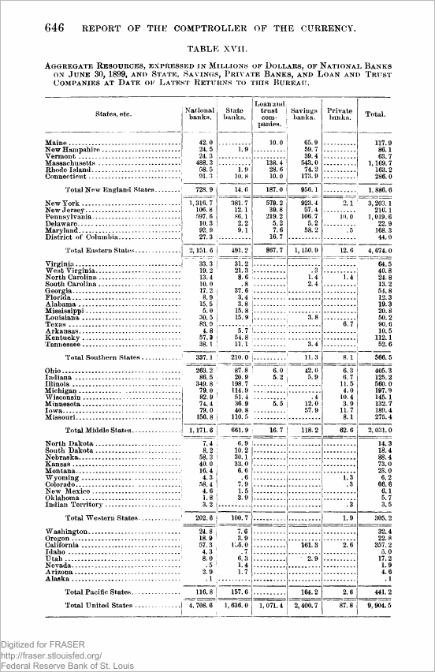{width="62%" fig-align="center"}

:::

::: {.column width="60%"}

::: {.dashes}

- The question in [Correia, Luck & Verner (QJE, 2026)](https://doi.org/10.1093/qje/qjaf044):
  why do banks fail, and can a failure be seen coming in a bank's own
  published accounts?
- The route: OCR on the balance sheet of every national bank, printed
  each year in the reports of the Comptroller of the Currency, the US
  office that supervises those banks, up to 1941, joined to the banks'
  later regulatory filings: a panel of US banks from 1863 to 2024. One of those pages is
  read three ways in Part 3.
- The check: every balance sheet obeys assets = liabilities + capital, the
  **accounting identity**. Wherever OCR's numbers broke it, a person
  re-read the page.
- The finding: failing banks show rising losses and weakening solvency
  years ahead, so failures are predictable from public accounts.

:::

:::

:::::

[Left: printed page 646 of the 1899 report, from FRASER, the digital
archive of the Federal Reserve Bank of St. Louis; a US government
publication, so public domain.]{.source}

::: {.notes}
The identity is the paper's quality control: it tells you which OCR rows
to re-read by hand without reading all of them.
:::

## India's statistical volumes typed by hand {#paper-india}

::::: {.columns}

::: {.column width="42%"}

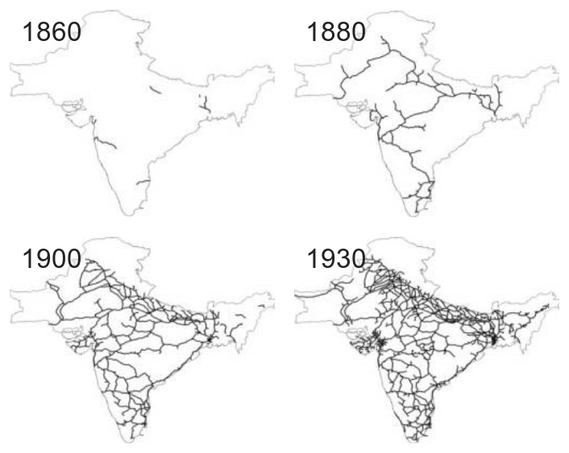{width="100%" fig-align="center"}

:::

::: {.column width="58%"}

::: {.dashes}

- The question in [Donaldson (AER, 2018)](https://doi.org/10.1257/aer.20101199):
  how large were the gains from a transport network, and where did they
  come from? The case: the railroads built across British-ruled India
  from 1853 on.
- The route: the government's printed statistical volumes, which nobody
  had digitized, entered page by page into a panel of 235 districts by
  year: crop prices, output, daily rainfall and trade.
- The finding: a railroad's arrival cut trade costs and price gaps
  between regions, raised trade, and raised real incomes in the
  districts it reached.

:::

:::

:::::

[Left: Figure 1 of the paper, the railroad network (thick lines) inside
the outline of colonial India in 1860, 1880, 1900 and 1930.]{.source}

::: {.notes}
AER: American Economic Review. The rainfall series matters later: the
handwritten sheets in Part 4 are the raw form such series come from.
:::

## London's weekly death reports typed by hand {#paper-fog}

::::: {.columns}

::: {.column width="55%"}

::: {.dashes}

- The question in [Hanlon (REStat, 2024)](https://doi.org/10.1162/rest_a_01190):
  how many deaths did London's coal-smoke fogs cause, and did the toll
  change as the city changed?
- The route: weekly death counts typed from the printed weekly reports
  of the Registrar General, the office that recorded births and deaths in
  England; the daily weather notes in the same reports, read as text,
  date every heavy fog (right).
- The finding: a fog week raised deaths, so trapped coal smoke killed;
  the toll was larger while measles and tuberculosis were common, and
  fell with them.

:::

:::

::: {.column width="45%"}

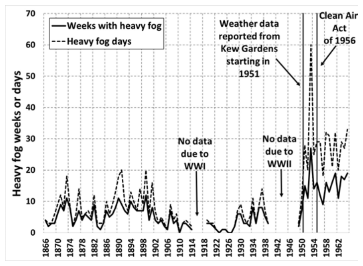{width="100%" fig-align="center"}

:::

:::::

[Right: heavy-fog weeks and days per year, Figure 11 of the paper's
working-paper version (NBER, 2018).]{.source}

::: {.content-visible unless-format="revealjs"}

The weather note the fog dates come from, for the week of 7 February
1880 (Figure 9 of the working-paper version):

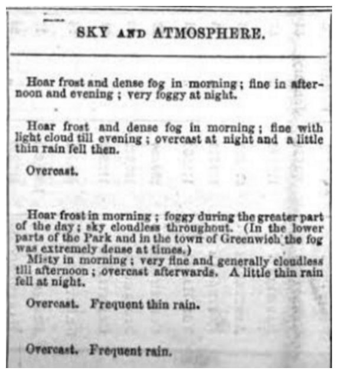{width="40%"}

:::

::: {.notes}
REStat: Review of Economics and Statistics. Two kinds of extraction on
one source: numbers from the tables, dates from the text. The typed
death counts are public at the UK Data Service.
:::

## One document for each kind of page {#three-docs}

::: {.slide-text}

|  | The H.4.1 | The 1899 page | The rainfall sheets |
|:--|:--|:--|:--|
|  | 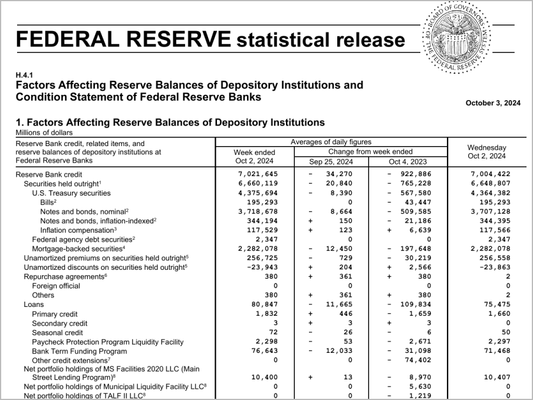{.lightbox width="100%"} | 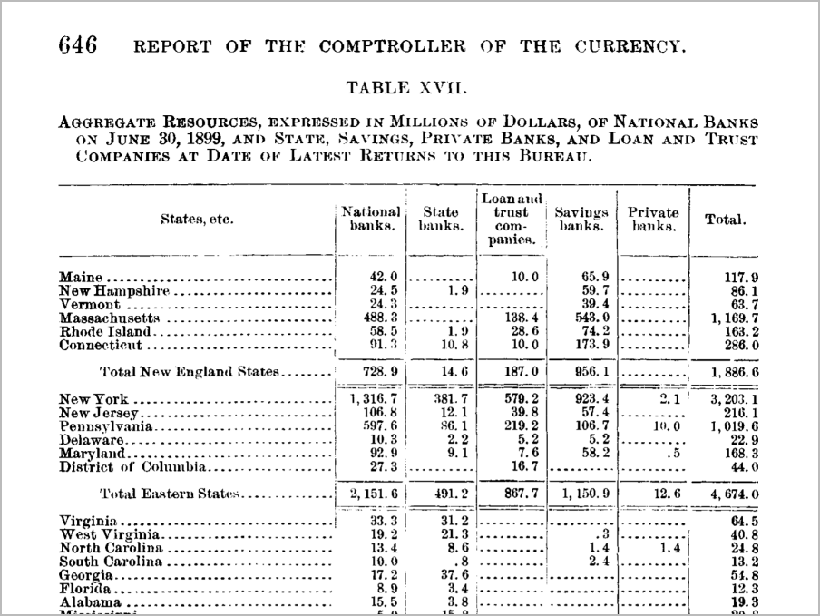{.lightbox width="100%"} | 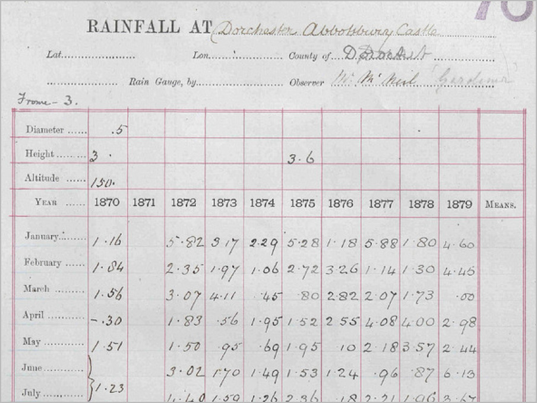{.lightbox width="100%"} |
| What it is | the Federal Reserve's weekly balance sheet | a table from the Comptroller's 1899 report | monthly rainfall at Abbotsbury, England |
| Kind of page | born-digital PDF | scan of a printed page | handwritten |
| Where it lives | the website of the Fed, the US central bank | FRASER, the St. Louis Fed's digital archive | the Met Office archive |
| Already typed | the same numbers as a CSV | the archive's OCR text, misreads included | every cell, by Rainfall Rescue volunteers |

: {tbl-colwidths="[13,29,29,29]"}

:::

::: {.notes}
A balance sheet lists what an institution owns (assets) and what it owes
(liabilities); capital is the difference. The rainfall sheet is one of
66,000 the Met Office holds.
:::

::: {.content-visible unless-format="revealjs"}

The Federal Reserve publishes the H.4.1 every Thursday; the release of 3
October 2024 is the one used here (public domain). The Comptroller's
annual reports are on FRASER; the 1899 report is a 907-page scan with an
OCR text layer the archive added (public domain). The rainfall sheets
come from Rainfall Rescue, a citizen-science project that transcribed
the Met Office's ten-year sheets (CC BY 4.0: reuse with credit).

Where printed records live, beyond these three:

| Source | What it holds | What you get | Licence |
|:--|:--|:--|:--|
| FRASER, the digital archive of the Federal Reserve Bank of St. Louis | US economic and financial documents, 1790s on | scans, most with a text layer made by OCR | US government work, public domain; some items restricted |
| HathiTrust, Internet Archive, Google Books | library scans of books and series | scans with OCR text; full view once a book is out of copyright | varies by item |
| National archives, statistical offices | census forms, registers, reports | scans; some transcriptions | varies by country |
| Citizen-science projects (Zooniverse) | records that volunteers typed | transcriptions as CSV, with the page images | usually open (CC BY): reuse with credit |

:::

::: {.content-visible unless-format="revealjs"}

### Asking each document for its text {#probe}

```{r}
#| filename: "R Console, in the 18-documents folder; needs pdftools and magick"
library(pdftools)                               # reads the text and the pages of a PDF
pdf_info("data/h41.pdf")$keys$Creator           # h41.pdf, the H.4.1: which program made it
substr(pdf_text("data/h41.pdf")[1], 1, 120)     # the first 120 characters of its page 1 text
substr(pdf_text("data/comp1899_p.pdf")[1], 1, 140)   # the 1899 page, a scan: text too?
img <- magick::image_read("data/sheets/abbotsbury_1870s.jpg")   # a handwritten rainfall sheet, a JPEG
magick::image_info(img)[, 1:3]                  # an image has pixels, no text to ask for
```

::: {.slide-text}

`pdf_info()` names the program that made a PDF; `pdf_text()` returns the
words stored inside it, if any. The H.4.1, made in Word, holds clean
text. The 1899 page holds text too, the archive's OCR, misreads
included (Part 3 counts them). The rainfall sheet is a JPEG: pixels, no text. The answer a
document gives picks its route.

:::

`pdf_info()` reads the file's metadata; the one-page cut of the 1899
volume carries none, the full volume names the scanning software.
`pdf_text()` returns one string per page. The sheet goes through magick,
which reads images.

:::

## The file and the check for each route {#route-choice}

::: {.slide-text}

Every reading gets a check: a total the page prints, or a second reading.

| Route | The file in the folder, and the part that uses it | The check |
|:--|:--|:--|
| 1 · Text layer | `data/h41.pdf`, the H.4.1, the Fed's balance sheet (Part\ 2) | assets = liabilities + capital; the twelve Reserve Banks add to the Total |
| 2 · OCR | `data_clean/comp1899_p.png`, the 1899 page, bank resources by state (Part\ 3) | each row's five kinds of bank add to its Total |
| 3 · Vision model | its saved replies in `replies/`, for the 1899 page (Part\ 3) and the rainfall sheets (Part\ 4) | the same row sums; a sheet's months add to the total the observer wrote |
| 4 · Typing by hand | `data/sheets/abbotsbury_1870s.jpg`, a rainfall sheet: you type one year (Part\ 4) | your typing against the volunteers' typing of the same sheet |
| 5 · Already typed | FRASER's OCR text in `data/comp1899_p.pdf` (Part\ 3); the volunteers' files in `data/volunteers/` (Part\ 4) | FRASER's: the row sums; the volunteers': the written totals |

: {tbl-colwidths="[18,46,36]"}

:::

::: {.slide-text}

A **coding agent**, an AI assistant that runs commands in a folder on
your computer, can run routes 1 to 3 on any of these files; its output
gets the same check.

:::

::: {.content-visible unless-format="revealjs"}

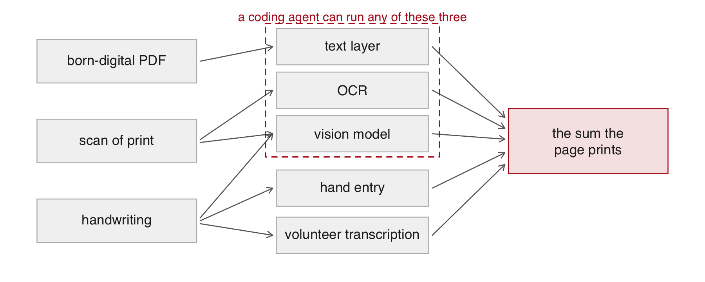{width="66%" fig-align="center"}

The agent used in this session reads PDFs and images directly, so "read
the image itself" is the vision route run from the terminal. It appears
three times: on the H.4.1 in Part 2, live on a rainfall sheet in Part 4,
and in the closing choice between an agent and a loop.

:::

# 2 · Reading a born-digital PDF {#part-pdf}

## Born-digital PDFs and their challenges {#pdf-challenges}

::: {.slide-text}

A born-digital PDF stores every character, so R can read its text.
Three things still stand between that text and a table, and the H.4.1
has all three:

:::

::: {.dashes}

- The text comes as lines, not rows and columns: the table is rebuilt from the lines.
- Numbers carry thousands commas and footnote marks such as "(0)", and a minus sign can sit apart from its number.
- A long table runs across pages, its header repeated on each.

:::

## Total assets in the Fed's balance sheet {#table5}

::: {.slide-text}

The first number to pull out of the PDF: Total assets, on page 6 of the H.4.1.

:::

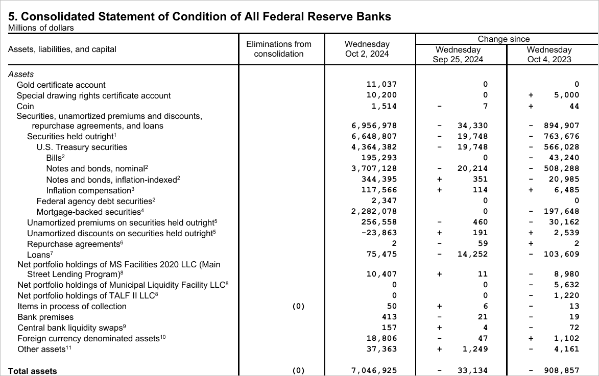{width="92%" fig-align="center"}

::: {.slide-text}

Table 5, the balance sheet of the twelve Reserve Banks combined, in
millions of dollars, as of 2 October 2024 (the release came out on the
3rd); page 7 prints Total liabilities and Total capital.

:::

::: {.notes}
7,046,925 million is about 7.0 trillion dollars.
:::

## Finding a row in the text layer {#text-layer}

::: {.slide-text}

A printed row is one line of the text, so finding a row is a search for its label.

:::

```{r}
#| filename: "R Console, in the 18-documents folder; needs pdftools"
library(pdftools)                              # reads the text stored in a PDF
txt <- pdf_text("data/h41.pdf")                # the H.4.1, the Fed's balance sheet: one string per page
length(txt)
lines <- strsplit(txt[6], "\n")[[1]]           # page 6 (Table 5), one element per printed line
length(lines)
line <- grep("Total assets", lines, value = TRUE)   # the line that holds the Total assets row
line
```

::: {.slide-text}

`pdf_text()` keeps the layout: the columns arrive as runs of spaces; on
this line the amount in millions of dollars, then the changes on the
week and on the year.

:::

::: {.notes}
The spaces are what make the columns; they are not reliable enough to
split on blindly, which is why the next slide uses a pattern.
:::

## Pulling the amount out with a capture group {#capture}

```{r}
#| filename: "R Console, in the 18-documents folder; needs stringr"
library(stringr)
m <- str_match(line, "Total assets\\s+\\(0\\)\\s+([0-9,]+)")   # ( ) captures the amount on the Total assets line
m
assets <- as.numeric(gsub(",", "", m[, 2]))    # drop the thousands commas
assets
```

::: {.slide-text}

A **capture group**, the part of the pattern in parentheses, turns one
line into one number; `\\s+` is any run of spaces. The "(0)" after the
label is a footnote marker the Fed prints; the pattern steps over it. The
amount is in millions, so 7,046,925 is about $7.0 trillion.

:::

::: {.notes}
`str_match` returns a matrix: the whole match, then one column per group.
:::

## Exercise 1 {#exercise-1}

::: {.panel-tabset}

### Exercise

Five minutes. Test assets = liabilities + capital with the two totals
page 7 of `h41.pdf` prints, Total liabilities and Total capital.

1. `lines7 <- strsplit(txt[7], "\n")[[1]]`, page 7 of `txt`, the H.4.1 as
   text; then `grep()` each label.
2. Pull each amount with `str_match()` and one capture group; the "(0)"
   footnote marker after a label may be missing.
3. Test assets = liabilities + capital, with `assets` from the last
   slide, 7,046,925.

```{r}
#| label: exercise-1
#| exercise: true
#| script: "Exercise 1 (5 minutes)"
#| include: false
#| eval: false
# Exercise 1 (5 minutes). Page 7 holds Total liabilities and Total capital.
# 1. lines7 <- strsplit(txt[7], "\n")[[1]]; find the two lines with grep().
# 2. Pull each amount with str_match() and one capture group.
# 3. Test: liabilities + capital == assets.
```

### Solution

```{r}
#| label: exercise-1-solution
#| exercise: true
#| script: "Exercise 1, solution"
lines7 <- strsplit(txt[7], "\n")[[1]]
grep("Total liabilities|Total capital", lines7, value = TRUE)
amount <- function(label, lines) {
  l <- grep(label, lines, value = TRUE)[1]
  as.numeric(gsub(",", "", str_match(l, paste0(label, "\\s+(?:\\([0-9]+\\)\\s+)?([0-9,]+)"))[, 2]))
}
liabilities <- amount("Total liabilities", lines7)
capital     <- amount("Total capital", lines7)
c(liabilities = liabilities, capital = capital, assets = assets)
liabilities + capital == assets
```

:::

::: {.content-visible when-format="revealjs"}

::: {.notes}
Ask who got TRUE. A FALSE here means a wrong line or a stray footnote
marker, which is the point: the identity catches it.
:::

:::

## A table that spans two pages {#table6}

::: {.slide-text}

Table 6 of the H.4.1 is one table printed on pages 8 and 9; in the text layer each page is its own string.

:::

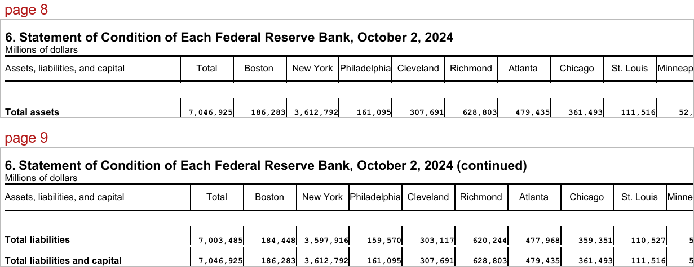{width="100%" fig-align="center"}

::: {.slide-text}

The table has 13 columns of amounts, the Total and each of the twelve
Reserve Banks, one row per balance-sheet item: the asset rows on page 8,
the liability and capital rows on page 9 under a repeated header and the
word "continued". The next slides read each page's rows by one rule and
stack the two pages into one table.

:::

::: {.notes}
Boston, New York, Philadelphia, Cleveland, Richmond, Atlanta, Chicago,
St. Louis, Minneapolis, Kansas City, Dallas, San Francisco.
:::

## Finding table rows by counting amounts {#count-amounts}

::: {.content-visible unless-format="revealjs"}

The pattern `amt` matches one printed amount: digits with thousands
commas, a sign kept, and two guards (a lookbehind and a lookahead) that
refuse a digit glued to a letter or a bracket, so footnote markers such
as "(0)" and "loans1" do not count. `rows_of()` keeps the lines of a
page with 13 matches, splits each into its label (the line minus its
amounts and any footnote marker) and its 13 numbers, and gives a label
split over two lines its first words back from the line above.

```{r}
#| filename: "R Console, in the 18-documents folder; needs stringr"
amt <- "[-+]?\\s*(?<![A-Za-z0-9()])(?:[0-9]{1,3}(?:,[0-9]{3})+|[0-9]+)(?![0-9)])"   # an amount, sign kept
rows_of <- function(page) {                     # page 8 or 9 of txt, the release as text
  ln <- strsplit(txt[page], "\n")[[1]]
  keep <- which(str_count(ln, amt) == 13)       # 13 matches of amt, the amount pattern: a table row
  label <- str_trim(str_replace(ln[keep], paste0("\\s*(\\([0-9]+\\)\\s+)?", amt, ".*$"), ""))
  above <- ln[keep - 1]                          # the line above: the start of a wrapped label
  wrapped <- str_count(above, amt) == 0 & str_count(str_trim(above), " ") >= 1
  label[wrapped] <- paste(str_trim(above[wrapped]), label[wrapped])
  nums <- t(sapply(str_extract_all(ln[keep], amt), function(a) as.numeric(gsub("[ ,]", "", a))))
  data.frame(item = str_replace(label, "[0-9]+$", ""), nums, check.names = FALSE) |> setNames(c("item", banks))
}
```

:::

::: {.slide-text}

A row of Table 6 is a line with 13 amounts: the Total and the twelve Reserve Banks.

:::

```{r}
#| filename: "R Console, in the 18-documents folder; amt and rows_of() are defined on the session page"
lines8 <- strsplit(txt[8], "\n")[[1]]           # page 8 of txt (the H.4.1, the Fed's balance sheet, as text)
n <- str_count(lines8, amt)                     # amt, a pattern for one printed amount: matches per line
table(n)
banks <- c("Total", "Boston", "New York", "Philadelphia", "Cleveland", "Richmond", "Atlanta",
           "Chicago", "St. Louis", "Minneapolis", "Kansas City", "Dallas", "San Francisco")
tab6 <- rbind(rows_of(8), rows_of(9))           # rows_of(): the lines with 13 amounts, as label + numbers
dim(tab6)
head(tab6[, 1:3], 2)                             # one row per item: its label, the Total, then the banks
```

::: {.slide-text}

Page 8 has nine lines with 13 amounts; the others hold none (headers,
blanks, footnotes) or one to three (the release number, the dated title,
half of a label split over two lines). `tab6` stacks pages 8 and 9: 24
rows, one per item, in the columns named in `banks`.

:::

## The banks add to the Total within rounding {#districts}

::: {.slide-text}

On every row of `tab6` the twelve Reserve Banks should add to the Total.

:::

```{r}
#| filename: "R Console, in the 18-documents folder"
diff <- rowSums(tab6[, banks[-1]]) - tab6$Total      # the twelve bank columns minus the Total column
table(diff)
tab6$item[diff != 0]
```

::: {.slide-text}

They do exactly on 17 rows and within two million on 7: the Fed rounds
each column to the nearest million. A difference in the thousands would
mean a shifted column or a wrapped row kept.

:::

::: {.notes}
The Interdistrict settlement row prints a plus or minus before each
amount; `amt` keeps the sign, and the row nets to -1 against a printed 0.
:::

## A coding agent's Table 6 matches ours {#agent-table6}

::: {.slide-text}

Before class a coding agent was given `h41.pdf` and one request: Table 6 as a CSV, the twelve Reserve Banks checked against the Total on every row.

:::

```{r}
#| filename: "R Console; agent/table6_agent.csv was written by a coding agent before class"
theirs <- read.csv("agent/table6_agent.csv", check.names = FALSE)   # the agent's CSV, made before class
dim(theirs)                                       # 24 rows; it added a Section column (which part of the table)
ours <- do.call(paste, tab6[, banks])             # each row of our tab6 as one string of 13 amounts
setequal(ours, do.call(paste, theirs[, banks]))   # the same 24 rows in the agent's table? (banks: the 13 columns)
```

::: {.slide-text}

In 52 seconds it returned the same 24 rows of numbers as `tab6`, our
Table 6, and
reported the same seven rows where the banks miss the Total by rounding
(last slide).

:::

::: {.agent}

**With an agent.** Ask for the table and the check in one request, then
test the claim yourself: against your own table row by row, or, with no
table of your own, against a sum the page prints.

:::

::: {.content-visible unless-format="revealjs"}

The agent's transcript is in `agent/table6_transcript.txt`.

:::

# 3 · Reading a scan of a printed page {#part-ocr}

## Scans of printed pages and their challenges {#scan-challenges}

::: {.slide-text}

A scan is a picture of a printed page: the file holds pixels, so there
is no text to copy until OCR turns the letter shapes into characters.
Archives often run OCR before posting a scan, as FRASER did for the
Comptroller's reports.

:::

::: {.dashes}

- The errors are silent: a misread digit looks like any other number.
- OCR misreads digits, merges columns and drops rows, more often on a faint, skewed or low-resolution scan.
- An archive's OCR text looks like a text layer, misreads included.

:::

## How OCR and a vision model read a page {#ocr-vs-model}

::: {.slide-text}

OCR matches the letter shapes of each word and scores its confidence; a
vision model reads squares of the image with your instructions and
writes the reply in the format you ask for.

:::

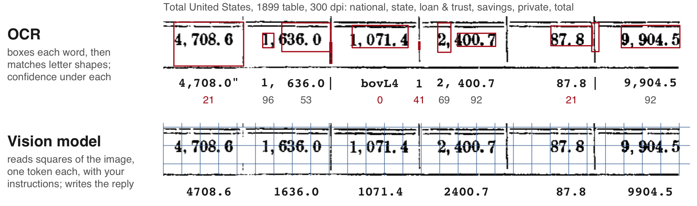{width="88%" fig-align="center"}

::: {.slide-text}

| | OCR | Vision model |
|:----|:----------|:----------|
| Reads | print, word by word | print, layout, handwriting |
| A misread | garbled, scored low: bovL4 at 0 | a plausible number, unscored |
| Two runs | the same text | can differ |
| Runs on | your computer, free | a provider's servers, billed per **token** |

:::

::: {.notes}
The row is the last one of the 1899 bank table that follows, scanned at
300 dpi. Top: tesseract's own word boxes and confidences (`ocr_data()`);
it wrote 4,708.0" for 4,708.6 and bovL4 for 1,071.4, both scored low, and
87.8, right, also at 21. Bottom: the model's saved reading of the same
row, every number right. The reply's words are tokens too, and each is
billed.
:::

::: {.content-visible when-format="revealjs"}

::: {.notes}
The squares are 28 pixels a side, as the provider documents; the full
1899 page holds about 5,400 of them, so it is shrunk slightly to the
4,784 a request takes at most.
:::

:::

## The 1899 bank table and its printed totals {#comp1899}

::: {.slide-text}

Every row's five columns add to its Total, and every region's states add to its row: the sums that check each reading of this page.

:::

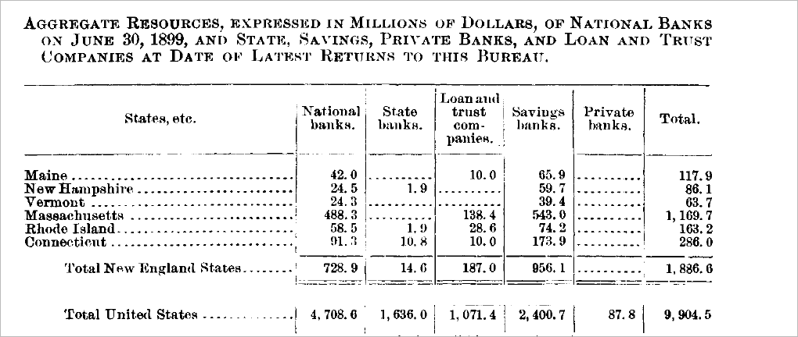{width="88%" fig-align="center"}

::: {.slide-text}

Table XVII of the 1899 report: the resources of every kind of bank in
each state, millions of dollars, scanned by FRASER at 300 **dpi** (dots
per inch, the resolution of a page image). A reference copy of all 348
numbers, read cell by cell from enlarged crops and confirmed by every
one of those sums, scores the three readings that follow.

:::

::: {.notes}
Blank cells mean no banks of that kind reported. The columns: national
banks, state banks, loan and trust companies, savings banks, private banks.
:::

## 11 rows of the archive's OCR don't add up {#archive-ocr}

::: {.slide-text}

Summing each row's five columns against its printed Total flags 11 of the 58 rows in FRASER's OCR text.

:::

```{r}
#| filename: "R Console, in the 18-documents folder; needs pdftools"
arch <- strsplit(pdf_text("data/comp1899_p.pdf"), "\n")[[1]]   # the text FRASER's OCR stored in the 1899 page's PDF, by line
grep("Total United States|Total New England", arch, value = TRUE)   # two of the table's 58 rows
a <- read.csv("data_clean/ocr/comp1899_archive.csv")    # that text parsed into 58 rows before class (code/2_ocr_runs.R)
sum(abs(rowSums(a[, 2:6], na.rm = TRUE) - a$total) > 0.05)   # rows whose five bank columns (2:6) miss the Total
```

::: {.slide-text}

FRASER, the archive, ran OCR on its scan of the 1899 page and stored
the text inside the PDF, so the layer carries OCR's habits: spaces
inside numbers, a digit read as another (14.0 above is 14.6 on the
page), a cell that vanished. The sum flags a row before anyone knows
which cell is wrong.

:::

::: {.notes}
Selecting text on the scan in a PDF viewer highlights these same words:
that is the text layer.
:::

## Running tesseract and reading its confidence {#tesseract}

::: {.slide-text}

Running OCR yourself gives a **confidence** for every word, 0 to 100; the low-confidence numbers are the cells to re-read first.

:::

```{r}
#| filename: "R Console, in the 18-documents folder; needs tesseract (about 15 seconds)"
library(tesseract)                                        # the OCR program, with English training data
ocr_txt <- ocr("data_clean/comp1899_p.png")               # the 1899 bank table as a 300-dpi image
tes <- strsplit(ocr_txt, "\n")[[1]]
grep("Total United States", tes, value = TRUE)            # the table's last row, all US banks
words <- ocr_data("data_clean/comp1899_p.png")            # every word with a confidence, 0 to 100
head(words[grepl("^[0-9,.]+$", words$word) & words$confidence < 80, c("word", "confidence")])   # doubted numbers
```

::: {.slide-text}

tesseract is a free OCR program; running it yourself also lets you
choose the resolution. Of the doubted numbers, 488.3 at 38 is right on
the page (Massachusetts, national banks); 002008 is no number on the
page. The
printed rules between columns come out as bars, brackets and letters
(bovL4 above is 1,071.4).

:::

::: {.notes}
A student whose `tesseract` install fails can read `data_clean/ocr/comp1899_300.txt`
instead.
:::

## OCR accuracy at 300 and 100 dpi {#dpi}

::: {.slide-text}

On page 8 of the H.4.1, whose true numbers are known, tesseract reads all 13 amounts of the Total assets row at 300 dpi and none at 100.

:::

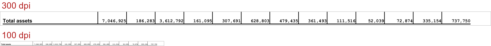{width="90%" fig-align="center"}

::: {.content-visible unless-format="revealjs"}

The test: page 8 of `h41.pdf` rendered as an image at each resolution,
read by tesseract, and its Total assets row compared with the 13 true
amounts from the text layer (`lines8` and `amt` from Part 2).

```{r}
#| filename: "R Console, in the 18-documents folder; needs pdftools, tesseract and stringr; lines8 and amt from Part 2"
ta <- lines8[grep("Total assets", lines8)]   # the Total assets line of page 8, from the PDF's text
truth <- as.numeric(gsub("[ ,]", "", str_extract_all(ta, amt)[[1]]))   # its 13 amounts, pulled by amt
right <- sapply(c(300, 100), function(d) {
  png <- pdf_convert("data/h41.pdf", pages = 8, dpi = d, filenames = sprintf("data_clean/ocr/h41_p8_%d.png", d), verbose = FALSE)
  l <- grep("Total assets", strsplit(ocr(png), "\n")[[1]], value = TRUE)[1]
  if (is.na(l)) return(0)                                 # OCR found no such line
  l <- gsub("\\s*,\\s*", ",", gsub("[]|})]", "", l))     # OCR's stray spaces around commas, and its rules
  got <- as.numeric(gsub("[ ,]", "", str_extract_all(l, amt)[[1]]))
  sum(got[seq_along(truth)] == truth, na.rm = TRUE)
})
```

:::

```{r}
#| filename: "R Console; right is computed on the session page: page 8 of h41.pdf as an image, read by tesseract"
setNames(right, c("300 dpi", "100 dpi"))                  # of the 13 amounts in the Total assets row, read right
```

::: {.slide-text}

The page's text layer gives the true row; the page, rendered as an
image at each resolution, goes to tesseract. At 300 dpi all 13 come out
right once OCR's stray spaces around commas are removed; at 100 dpi (the
lower strip, at its true size) it finds no table at all.

:::

## Scoring three readings of the 1899 page {#ocr-verdict}

::: {.slide-text}

A reading passes a row when the row's five columns add to its printed Total; only the vision model passes all 58.

| Reading of the 1899 page (bank resources by state) | Rows found, of 58 | Rows whose five columns add to the Total | Cells matching the page, of 348 |
|:--|--:|--:|--:|
| The archive's (FRASER's) OCR text, stored in the PDF | 58 | 47 | 336 |
| tesseract, OCR run here at 300 dpi | 53 | 14 | 277 |
| A vision model, an AI model reading the image (next slide) | 58 | 58 | 348 |

:::

::: {.slide-text}

The two OCR readings disagree on 72 cells, the archive right on 64; a
failing row names its cells for re-reading, and tesseract's confidence
says which first.

:::

## A vision model gets all 348 cells right {#model-1899}

::: {.slide-text}

A vision model, an AI model that reads an image, returned all 58 rows of the 1899 page: every row adds to its printed Total and all 348 cells match the page.

:::

::: {.content-visible unless-format="revealjs"}

```{r}
#| filename: "R Console, in the 18-documents folder; needs jsonlite; no account needed"
library(jsonlite)                                           # reads JSON, the text format model replies arrive in
m1899 <- fromJSON("replies/comp1899_run1.json")             # the model's saved reading of the 1899 page, one row each
nrow(m1899)
```

:::

::: {.slide-text}

| Total US row | National | State | Loan & trust | Savings | Private | Total |
|:--|--:|--:|--:|--:|--:|--:|
| Printed | 4,708.6 | 1,636.0 | 1,071.4 | 2,400.7 | 87.8 | 9,904.5 |
| Archive OCR (FRASER) | 4, 708. 6 | 1,636.0 | 1,071.4 | 2,400.7 | 87.8 | 9, 904.5 |
| tesseract | 4,708.0" | 1, 636.0 | bovL4 | 2, 400.7 | 87.8 | 9,904.5 |
| Vision model | 4708.6 | 1636.0 | 1071.4 | 2400.7 | 87.8 | 9904.5 |

:::

::: {.slide-text}

The archive's text breaks numbers with spaces and tesseract garbles
digits (bovL4 is 1,071.4). The call, on the session page, took two
requests in one chat, a plain table first and then the same rows in a
fixed reply format: 36 seconds.

:::

::: {.notes}
One call with the fixed format alone returned one or two rows, three
times over; the two-step form in one chat is what worked. The failed
replies are kept in the cache folder.
:::

::: {.content-visible unless-format="revealjs"}

The working call (`code/3_model_1899.R`), in one chat: a plain request
with the image, then the structured request:

```r
chat  <- chat_anthropic(system_prompt = PROMPT, model = MODEL, cache = "none")
md    <- chat$chat("Transcribe every row of the table on this page as a markdown table, one row per printed row, blank cells left empty.",
                   content_image_file("data_clean/comp1899_p.png", resize = "none"))
reply <- chat$chat_structured("Now return the same rows as structured data.", type = type_array(row_type))
```

`resize = "none"` matters: the package's default shrinks the image to fit
512 pixels a side, which makes the digits unreadable. The three failed
one-call replies are kept in `replies/comp1899_direct_run1.json` to `_run3.json`.

:::

# 4 · Reading a handwritten page {#part-vision}

## Handwritten pages and their challenges {#handwriting-challenges}

::: {.slide-text}

A handwritten page is kept as an image, a scan or a photograph, like a
printed one. The writing is what makes it harder:

:::

::: {.dashes}

- OCR, built for print, reads handwriting as noise.
- Each writer forms digits a little differently, so 2.55 and 2.65 can look alike.
- The layout varies from sheet to sheet: a brace across two months, a blank cell, a note beside a number.
- A vision model can drop a cell or write a number that is not on the page, and the written totals do not catch every such number.

:::

## Rainfall sheets typed by volunteers {#rainfall-rescue}

::::: {.columns}

::: {.column width="38%"}

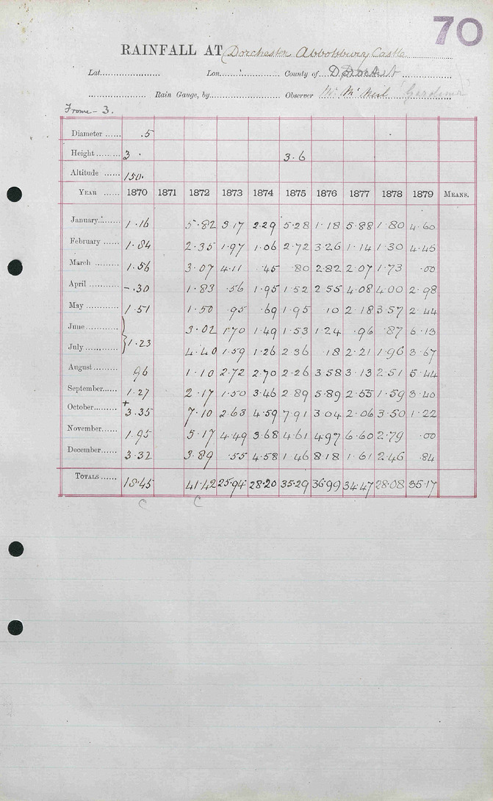{width="64%" fig-align="center"}

[The 1870s Abbotsbury sheet; Met Office archive, via Rainfall Rescue
(CC BY 4.0).]{.source}

:::

::: {.column width="62%"}

::: {.dashes}

- A rainfall sheet is a 12-by-10 table written by an observer: months
  as rows, years as columns, inches of rain (1 inch = 25.4 mm), and a
  Total row for each year.
- The Met Office, the UK's weather service, holds about 66,000 such
  sheets, 1677 to 1960.
- In 2020, 16,000 volunteers typed them in a few weeks on Zooniverse, a
  citizen-science site, several people per sheet, entries reconciled:
  open data, [Hawkins et al. (Geoscience Data Journal, 2023)](https://doi.org/10.1002/gdj3.157).
- The 18-documents folder holds five sheets from Abbotsbury Castle, on
  the Dorset coast of southern England, the 1860s to the 1910s, with the
  volunteers' file for each; the handwriting changes between decades.

:::

:::

:::::

::: {.notes}
Rainfall Rescue ran from March to April 2020. Ed Hawkins (University of
Reading) led it.
:::

::: {.content-visible unless-format="revealjs"}

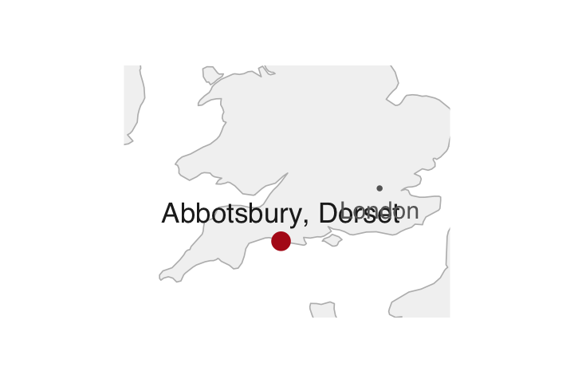{width="40%"}

:::

## OCR fails on a handwritten sheet {#ocr-handwriting}

::: {.slide-text}

OCR, trained on print, reads handwriting as noise: a few digits survive, in no usable order.

:::

```{r}
#| filename: "R Console, in the 18-documents folder; needs tesseract"
cat(substr(ocr("data/sheets/abbotsbury_1870s.jpg"), 1, 400))
```

::: {.slide-text}

For a handwritten page the route is a vision model or a person.

:::

## The volunteers' typing of the 1870s sheet {#volunteers}

::: {.slide-text}

Route 5, already typed: the Rainfall Rescue volunteers' file for the 1870s sheet, read in as `vol`, the reading the next slides compare against.

:::

```{r}
#| filename: "R Console, in the 18-documents folder"
f <- "data/volunteers/TYRain_1870-1879_04_pt1-page-064.csv"     # the 1870s Abbotsbury sheet as the volunteers typed it
vol <- read.csv(f, skip = 4, check.names = FALSE)[1:13, 1:11]  # skip 4 metadata lines; rows 1:13 = Jan..Dec + Total
names(vol)[1] <- "month"
vol[vol == -999] <- NA                                     # -999: the volunteers could not read the cell
head(vol, 4)                                               # inches of rain; 1871 is empty on the sheet
```

::: {.slide-text}

A blank is an empty cell on the sheet; -999 marks a cell they could
not read.

:::

::: {.notes}
Two more rows in the file, dropped here, hold the project's own sum of
the months and its gap from the written total.
:::

## Typing by hand, checked by double keying {#own-typing}

::::: {.columns}

::: {.column width="28%"}

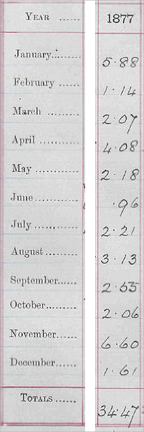{height="500px" fig-align="center"}

:::

::: {.column width="72%"}

::: {.slide-text}

Route 4: type one year yourself and compare it with `vol`, the volunteers' typing. A month where the two differ is a cell to re-read: double keying, the way hand entry is checked.

:::

```{r}
#| eval: false
#| filename: "R Console, in the 18-documents folder; needs vol from the slide before"
# type the 12 months of 1877 on one line, January first, spaces between
mine <- scan(text = readline("1877, January to December: "))
# the months where your typing and the volunteers' differ
month.abb[which(mine != vol[1:12, "1877"])]
```

::: {.slide-text}

Type the 1877 column of the 1870s rainfall sheet at left, in inches,
the raised dot as the decimal point (5.88, .96): `readline()` waits for
the line you type, `scan()` turns it into numbers.

:::

:::

:::::

::: {.notes}
About three minutes. September 1877 is the cell typings split on: 2.55
or 2.65. The written total, 34.47, is reached only with 2.55. The model
reads 2.65, two slides on.
:::

## Asking a vision model to read the sheet {#vision-call}

::: {.slide-text}

The call sends the image of the 1870s sheet and a **schema**, a fixed format for the reply: one object per year, twelve months and the written total, null for a blank cell.

:::

```{r}
#| eval: false
#| purl: false
#| filename: "Run by the instructor before class, code/4_model_sheets.R (part); needs ellmer and a model provider account"
library(ellmer)
MODEL  <- "<model id>"                              # the model's full id, written once
PROMPT <- paste(readLines("code/prompt_sheet.txt"), collapse = "\n")   # the instructions, quoted on the page
cells  <- setNames(rep(list(type_number(required = FALSE)), 13), c(tolower(month.abb), "total"))   # null allowed
year_type <- do.call(type_object, c(list(year = type_integer()), cells))   # the reply format: one object per year
chat  <- chat_anthropic(system_prompt = PROMPT, model = MODEL, cache = "none")
img   <- content_image_file("data/sheets/abbotsbury_1870s.jpg", resize = "none")   # the sheet's image, full size
reply <- chat$chat_structured(img, type = type_array(year_type))   # one object per year column, saved as JSON
```

```{r}
#| filename: "R Console, in the 18-documents folder; needs jsonlite; no account needed"
library(jsonlite)                                           # reads JSON, the format of the saved reply
mod_y <- fromJSON("replies/abbotsbury_1870s_run1.json")     # the saved reply for the 1870s sheet: one row per year
mod <- data.frame(month = vol$month, t(as.matrix(mod_y[, -1])), check.names = FALSE)   # months as rows, as in vol
names(mod)[-1] <- mod_y$year
head(mod, 2)
```

::: {.slide-text}

The instructions, on the page, ask for every number copied as written,
nothing computed. The reply was saved before class; `mod` is the
model's reading in the layout of `vol`, the volunteers' typing.

:::

::: {.content-visible unless-format="revealjs"}

The prompt, in full (`code/prompt_sheet.txt`): "This image is a ten-year
sheet of handwritten monthly rainfall in inches. Rows are the months
January to December, then a row with the written annual total. Columns
are years. Return one object per year column. Copy every number exactly
as written on the sheet. Where a cell is blank or you cannot read it,
return null. Do not compute or correct anything."

The loop that filled `replies/` before class, one call per sheet, never
twice:

```{r}
#| eval: false
#| purl: false
#| filename: "code/4_model_sheets.R (part): the loop that filled replies/ before class"
for (s in c("1860s", "1870s", "1880s", "1890s", "1910s")) {   # the five rainfall sheets
  out <- sprintf("replies/abbotsbury_%s_run1.json", s)
  if (file.exists(out)) next                                  # done already: never call twice
  reply <- chat_anthropic(system_prompt = PROMPT, model = MODEL, cache = "none")$chat_structured(
    content_image_file(sprintf("data/sheets/abbotsbury_%s.jpg", s), resize = "none"), type = type_array(year_type))
  jsonlite::write_json(reply, out, pretty = TRUE, digits = NA, auto_unbox = TRUE, null = "null", na = "null")
}
```

:::

## The model's months against the written total {#month-sums}

::: {.slide-text}

Each year's twelve months must add to the total the observer wrote, so one sum checks twelve cells.

:::

```{r}
#| filename: "R Console, in the 18-documents folder"
months <- 1:12                                              # the twelve month rows of mod
round(colSums(mod[months, -1]) - unlist(mod[13, -1]), 2)   # months minus the written Total, row 13, per year
```

::: {.slide-text}

`mod` is the model's reading of the 1870s sheet; row 13 holds the
written totals. Zero: the model's months reach the total. NA: a blank
month (1871 is empty; in 1870 one figure covers June and July, so June
is blank). The 0.1 in 1877 is one misread digit, found on the next
slide.

:::

## Model against volunteers, cell by cell {#cell-agreement}

::: {.slide-text}

The model's reading and the volunteers' typing agree on 106 of the 107 cells both hold.

:::

```{r}
#| filename: "R Console, in the 18-documents folder"
m <- as.matrix(mod[months, -1])                             # the model's twelve month rows of the 1870s sheet
v <- as.matrix(vol[months, -1])                             # the volunteers' typing of the same cells
mean(m == v, na.rm = TRUE)                                  # share of cells where the two readings agree
which(m != v, arr.ind = TRUE)                               # where they differ: row 9 September, column 8 = 1877
```

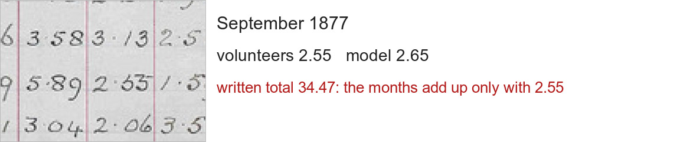{width="62%" fig-align="center"}

::: {.slide-text}

The one difference, September 1877, reads 2.55 or 2.65; the written
total is reached only with 2.55. A reading can
also leave a cell empty where the sheet has a number, or put a number
where the sheet has none; Exercise 2 meets the second.

:::

## Exercise 2 {#exercise-2}

::: {.panel-tabset}

### Exercise

Six minutes. Find the cells where only one reading of the 1910s sheet
holds a number, and read them on the image.

1. The volunteers' file `data/volunteers/TYRain_1910-1919_11_pt1-page-034.csv`,
   read as `vol` was (skip 4 lines, rows 1:13).
2. The model's saved reply `replies/abbotsbury_1910s_run1.json`, read as
   `mod` was (`fromJSON()`, then transposed to months as rows).
3. The share of cells where the two agree, then the cells where one
   reading holds a number and the other does not.
4. Those cells on the image, `data/sheets/abbotsbury_1910s.jpg`: what does
   the sheet say there?

```{r}
#| label: exercise-2
#| exercise: true
#| script: "Exercise 2 (6 minutes)"
#| include: false
#| eval: false
# Exercise 2 (6 minutes). The 1910s sheet, two readings.
# 1. vol2 from data/volunteers/TYRain_1910-1919_11_pt1-page-034.csv (skip = 4, rows 1:13).
# 2. mod2 from replies/abbotsbury_1910s_run1.json, transposed to months as rows.
# 3. mean(m2 == v2, na.rm = TRUE) on all 13 rows; then the cells where
#    is.na(m2) != is.na(v2): a number on one side only.
# 4. Open data/sheets/abbotsbury_1910s.jpg and read those cells yourself.
```

### Solution

```{r}
#| label: exercise-2-solution
#| exercise: true
#| script: "Exercise 2, solution"
vol2 <- read.csv("data/volunteers/TYRain_1910-1919_11_pt1-page-034.csv", skip = 4, check.names = FALSE)[1:13, 1:11]
names(vol2)[1] <- "month"; vol2[vol2 == -999] <- NA
mod2_y <- fromJSON("replies/abbotsbury_1910s_run1.json")
mod2 <- data.frame(month = vol2$month, t(as.matrix(mod2_y[, -1])), check.names = FALSE); names(mod2)[-1] <- mod2_y$year
m2 <- as.matrix(mod2[, -1]); v2 <- as.matrix(vol2[, -1])     # all 13 rows: the months and the Total
mean(m2 == v2, na.rm = TRUE)                                   # on the cells both readings hold
which(is.na(m2) != is.na(v2), arr.ind = TRUE)                  # a number on one side only
m2[is.na(v2) & !is.na(m2)]
```

::: {.slide-text}

The two readings agree on all 52 cells both hold. In the Total row for
1912, 1913 and 1917 the model wrote -1.00 where the volunteers typed
nothing: on the sheet those cells hold the letters N.R., no record. The
model turned a word into a number, and nothing in the file says so.

:::

:::

::: {.content-visible when-format="revealjs"}

::: {.notes}
Ask for the agreement share and for one cell where the room read the
image. The answer on who is right comes from the image, not from either
file.
:::

:::

## Which check catches each model error {#failures}

::: {.slide-text}

Summing the months catches a doubled figure. It misses a total the model invented for a year the sheet leaves blank: with no months to add, the check returns NA, as it does for any blank year.

| The model's errors, one call on each of the five sheets | Cells | Caught by |
|:--|--:|:--|
| Left empty by the model where the volunteers typed a number | 0 | the month sum falls short of the written total |
| A figure the observer wrote across two months (a brace), copied by the model into both | 4 | the month sum overshoots the written total |
| -1.00 written by the model as a year's total where the sheet says N.R., no record | 3 | only a second reading, or the image |
| Different numbers in the two readings | 7 | the second reading; the month sum when the error is large |

: {tbl-colwidths="[56,10,34]"}

:::

::: {.slide-text}

A **dropped cell** is a number the model left out; the sum falls short.
An **invented number** is a value that is not on the page, such as the
-1.00 the model wrote for 1912, 1913 and 1917, where the 1910s sheet says
N.R., no record. Only a second reading, or the image, catches it.

:::

::: {.notes}
A second run wrote 0.00 into all thirteen cells of an empty year: replies
differ between runs, which is why every reply is saved.
:::

## Reading the 1880s sheet with a coding agent {#agent-sheet}

::::: {.columns}

::: {.column width="42%"}

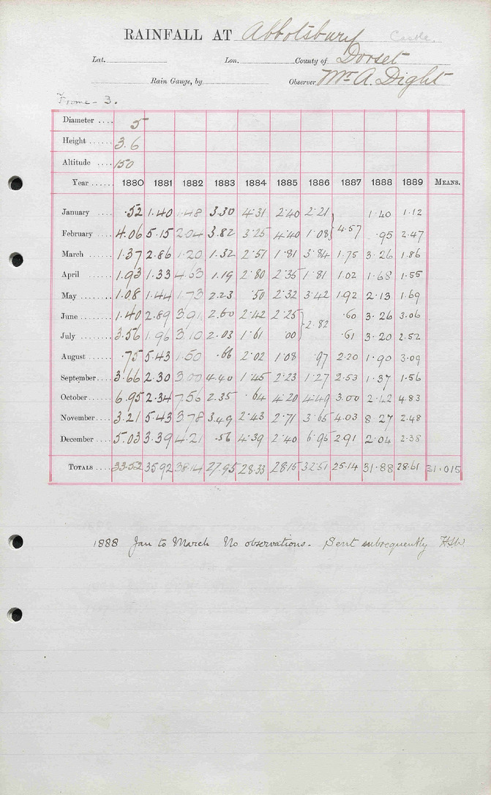{width="62%" fig-align="center"}

:::

::: {.column width="58%"}

::: {.slide-text}

Run live: a coding agent, in a folder holding only this image, is asked
for the sheet as a CSV and a check of each year's months against the
written total. Before class it put each braced figure in one month and
reported all ten years reconciled: a claim to test, by the sum it prints
and the braced cells on the image.

:::

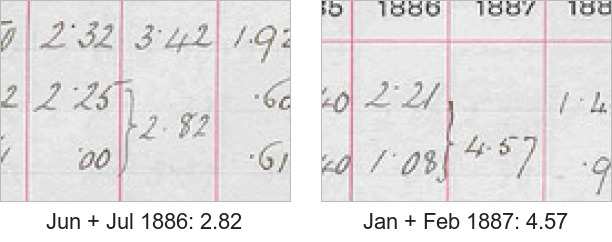{width="76%" fig-align="center"}

::: {.slide-text}

The single model call (last slide) copied each braced figure into both
of its months and overshot the written totals. Before class the agent
took 41 seconds.

:::

:::

:::::

::: {.notes}
Run sheet: the folder on the desktop holds only the JPEG; paste the
request from agent/request_1880s.txt; expect about a minute. If it stalls
past two minutes, the captured run is in agent/abbotsbury_1880s_transcript.txt.
The volunteers left the four braced cells blank, so their file misses
the two written totals by exactly 2.82 and 4.57; the project's own
difference row flags both years.
:::

# 5 · Reading thousands of pages {#part-scale}

## Cost per page by reader and model size {#cost}

::: {.slide-text}

A model bills by the tokens it reads and writes, pieces of image and
text: a rainfall sheet costs a tenth of a cent with the small model and
3 cents with the large.

:::

```{r}
#| filename: "R Console, in the 18-documents folder"
log <- read.csv("logs/model_calls.csv")  # each call before class; three sizes of one model
# $ per million tokens read, written (provider's list, 29 Oct 2026); / 1e4 below gives cents
PRICE <- rbind(small = c(0.10, 0.50), medium = c(2, 10), large = c(4, 20))
log$cents <- (log$input_tokens * PRICE[log$size, 1] + log$output_tokens * PRICE[log$size, 2]) / 1e4
log$page <- ifelse(log$page == "1899", "1899 page", "rainfall sheet")
round(tapply(log$cents, list(log$size, log$page), mean), 2)   # cents per page, mean of the calls
```

::: {.slide-text}

| Reader | 70,000 report pages like 1899's | 66,000 handwritten sheets |
|:------|---------:|---------:|
| tesseract (free OCR) | free; 15 s a page, 290 hours | fails on handwriting |
| Small model | about $400 | about $70 |
| Medium model | about $6,400 | about $800 |
| Large model | about $15,600 | about $1,900 |

:::

::: {.notes}
The 1899 page costs more than a sheet because its reply holds 348
numbers, written twice by the two-step call. A model takes about 10
seconds a sheet at any size; the hours are one call at a time, and eight
calls at once cut them by eight. The 70,000 pages assume every volume is
the size of 1899's.
:::

::: {.content-visible when-format="revealjs"}

::: {.notes}
Prices: the provider's list on 29 Oct 2026, $ per million tokens in and
out: small 0.10/0.50, medium 2/10, large 4/20; batch requests cost half.
The provider also sells a larger model at 10/50, not run here. Other
providers sell similar ladders: OpenAI's from 0.10/0.50 to 10/50,
Google's Gemini from 0.25/1.50 to 2/10; ellmer's chat_openai() and
chat_google_gemini() take the same request. A cloud OCR service (AWS
Textract) charges by the page: $1.50 per 1,000 pages for text, $15 with
tables, so the 70,000 pages with tables cost about $1,050.
:::

:::

## Cells right by reader and model size {#accuracy}

::: {.slide-text}

On the printed page every model size gets 347 or 348 of the 348 cells
right, so the cheapest model will do; on the handwritten sheets the
small model writes hundreds of numbers into blank cells.

:::

::: {.slide-text}

| | Free OCR (tesseract) | Small model | Medium model | Large model |
|:------------------------|--------:|------:|------:|------:|
| Cents per 1899 page | 0 | 0.58 | 9.13 | 22.22 |
| 1899: cells matching the reference, of 348 | 277 | 347 | 348 | 347 |
| 1899: rows adding to their Total, of 58 | 14 | 57 | 58 | 57 |
| Cents per rainfall sheet | 0 | 0.10 | 1.21 | 2.94 |
| Sheets: cells matching the volunteers, of 666 | fails | 642 | 655 | 662 |
| Sheets: numbers in blank cells | fails | 390 | 16 | 65 |

:::

::: {.slide-text}

Sheet counts add two runs of five sheets; the volunteers are Rainfall
Rescue's typists. Score a sample this way before a big run: a row off
its Total flags a wrong cell, and a number in a blank cell flags an
invented one.

:::

::: {.notes}
The scores come from code/8_compare_sizes.R on the saved replies in
replies/sizes/ (the small and large models) and in replies/ (the
medium model, the one the deck uses). The 666
cells are those where both a model and the volunteers hold a number. The
small model's miss on the 1899 page is 1,836.6 for 1,886.6 (Total New
England, Total); the large model's is a blank for 136.0 (California,
state banks). The numbers in blank cells leave out the braced months,
where one figure covers two months; most of the large model's 65 are
zeros in a blank year.
:::

## The small model's numbers in blank years {#blank-columns}

::: {.slide-text}

The 1890s sheet has two years filled in; in both runs the small model
wrote numbers into the eight blank years, and run 2's zeros even add to
their zero totals.

:::

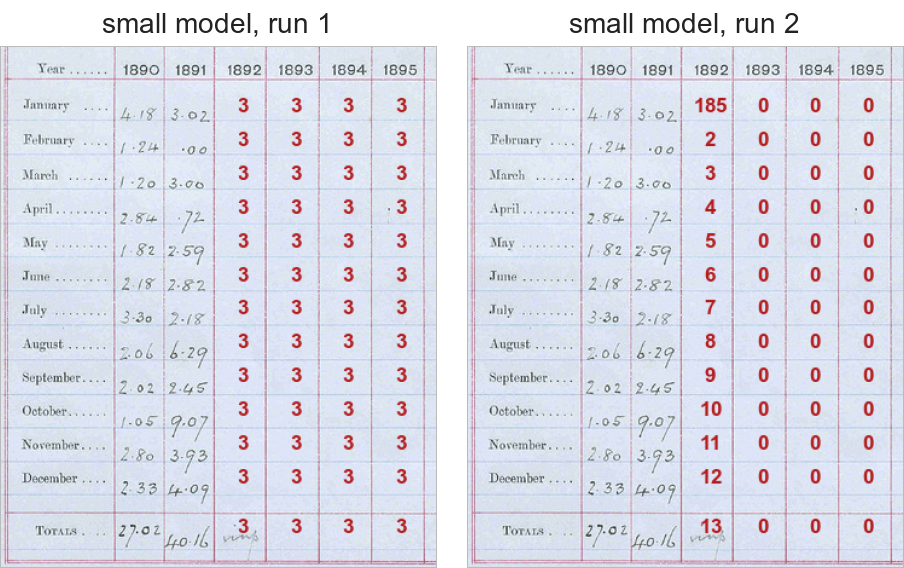{width="70%" fig-align="center"}

::: {.notes}
In red, what the small model wrote into 1892 to 1895; it did the same
for 1896 to 1899. Run 1 wrote 3 in every cell; run 2 counted from 185
and 2 up to 13, then wrote zeros. The zeros pass the months-against-total
check, so only counting numbers in blank cells catches them.
:::

## Choosing between an agent and a loop {#agent-or-loop}

::: {.slide-text}

A few pages go to an agent; a job you must rerun, audit or scale goes
into a loop. Agent or loop is who runs the route: a coding agent told in
a chat session what to do, or a script that loops over the pages, calls
the model and saves every reply.

:::

::: {.slide-text}

| | An agent in a session | A loop in a script |
|:--|:--|:--|
| Pages | a few, up to some dozens | hundreds to millions |
| Repeating it | you, typing the request again; the answer may change | anyone with the script, from the saved replies, identical |
| What is kept | the files it wrote, if you ask | every raw reply, the instructions, the model's id |
| Cost per page | the agent's own calls, many per page, not itemised | one model call, cents |
| Checks | the ones you ask for, read in its reply | the ones in the code, run on every page |

:::

::: {.slide-text}

Either way the test is a sum the page prints, recomputed from the
numbers extracted.

:::

## Practice {#practice}

::: {.content-visible when-format="revealjs"}

Five exercises on the session page, with solutions behind a click, on
the files in the 18-documents folder; none needs a model provider
account, every reply is saved.

- 1, the text layer: turn Table 1 of `h41.pdf`, the Fed's balance sheet,
  into a data frame and test every row against the total it prints.
- 2, OCR: read the 1899 bank table with tesseract at 200 dpi and count
  the cells of its Total United States row that come out right, against
  300 dpi.
- 3, the model: compare the model's saved reply for the 1890s rainfall
  sheet with the volunteers' typing, and read the differing cells on the
  image.
- 4, the checks: test the months of the 1860s sheet against the written
  totals, for the model's reply and for the volunteers' file.
- 5, cost: count the pages of the Comptroller's report for 1900 on
  FRASER and estimate the hours and dollars a run would take with each
  model size.

:::

::: {.content-hidden when-format="revealjs"}

```{r}
#| label: practice
#| exercise: true
#| script: "Practice"
#| eval: false
# Practice. Run in the 18-documents folder after the slides' code has built
# txt, amt, tab6, vol, mod and months. No task needs a key.

# The text layer
#  1. Table 1 of data/h41.pdf ("Factors Affecting Reserve Balances", pages 1-2)
#     prints a total row for reserve bank credit. Build the table as a data
#     frame with the rows_of() approach and test the printed total.

# OCR
#  2. pdf_convert("data/comp1899_p.pdf", dpi = 200, ...) then ocr(); pull the
#     "Total United States" row and count the cells that match the printed
#     values (4,708.6 1,636.0 1,071.4 2,400.7 87.8 9,904.5). Compare with
#     300 dpi (data_clean/ocr/comp1899_300.txt).

# The model
#  3. The 1890s sheet: replies/abbotsbury_1890s_run1.json against
#     data/volunteers/TYRain_1890-1899_09_pt1-page-113.csv. Agreement share, the
#     differing cells, and your own reading of each on
#     data/sheets/abbotsbury_1890s.jpg.

# The checks
#  4. The 1860s sheet: for the volunteers' file and the model's reply,
#     colSums of the months minus the written Total, by year. Which years
#     miss, in which reading, and why (look at the sheet)?

# Cost
#  5. On FRASER, find the Comptroller's annual report for 1900 and its page
#     count. With the seconds and tokens of the 1899 page in
#     logs/model_calls.csv, how long and how much would a run over the whole
#     volume take with each model size?
```

:::

::: {.content-hidden when-format="revealjs"}

## Sources {#sources}

[Correia, Luck & Verner (QJE, 2026)](https://doi.org/10.1093/qje/qjaf044);
[Donaldson (AER, 2018)](https://doi.org/10.1257/aer.20101199);
[Hanlon (REStat, 2024)](https://doi.org/10.1162/rest_a_01190);
[Hawkins et al. (Geoscience Data Journal, 2023)](https://doi.org/10.1002/gdj3.157)
and the [Rainfall Rescue data](https://github.com/ed-hawkins/rainfall-rescue)
(CC BY 4.0, Zenodo record 5770390); Board of Governors of the Federal
Reserve System, [H.4.1 release of 3 October 2024](https://www.federalreserve.gov/releases/h41/20241003/)
(public domain); [FRASER](https://fraser.stlouisfed.org/title/annual-report-comptroller-currency-56),
Federal Reserve Bank of St. Louis, Annual Report of the Comptroller of the
Currency, 1899, Volume 1 (US federal work);
[pdftools](https://docs.ropensci.org/pdftools/),
[tesseract](https://docs.ropensci.org/tesseract/),
[ellmer](https://ellmer.tidyverse.org).

**Links:** [slides](18-documents-slides.html) · [Syllabus](../syllabus.qmd)

:::

```{r}
#| purl: false
#| include: false
source(file.path(session_dir, "_purl.R"))
purl_session(file.path(session_dir, "18-documents.qmd"),
             file.path(session_dir, "18-documents.R"))
```
