```{r}
#| purl: false
#| include: false
knitr::opts_chunk$set(
  comment = "#>",
  collapse = FALSE,
  fig.width = 9,
  fig.height = 4.4,
  fig.align = "center",
  fig.show = "hold",
  dpi = 150
)
options(width = 80)
# Every chunk runs in the project folder, so the paths on the page are the
# paths students use.
session_dir <- getwd()
knitr::opts_knit$set(root.dir = file.path(session_dir, "data/19-audio"))
fig_dir <- file.path(session_dir, "figures/19-audio")
```

::: {.content-hidden when-format="revealjs"}

[Slides](19-audio-slides.html) · [Live script](19-audio.R) ·
[Source](https://github.com/ArielOrtizBobea/aem6850/blob/main/fall-2026/sessions/19-audio.qmd) ·
[the project](data/19-audio.zip)

Who said what, and when, in the Federal Reserve's press conference of
1 February 2023, and how far can the table built from it be trusted? A
speech-to-text model writes every word of the 44-minute recording with its
time. A second model marks which voice is talking when. R joins the two
into one row per turn, and the times give the pause before each answer,
the speaking rate and how often the chair says "you know". The Fed's own
transcript is the reference throughout: the turn counts are set against its
speaker tags, and the words of a 30-second passage against its text.

**The project.** Download [19-audio.zip](data/19-audio.zip),
unzip it, and open `19-audio.Rproj`, so that R starts in the project
folder. The scripts load the one package they use, jsonlite, and install
it if it is missing. Nobody needs Python, an account or the network: every model reply
is saved in the folder, and the R code reads only those files. Its
`README.md` says what is where:

```default
19-audio/
  data/        the Fed's transcript PDF and the clips cut from the recording;
               media/ holds the video, its sound and two model files (not in the zip)
  replies/     every model reply, exactly as returned, and the Fed's text
  code/        1_words.R to 6_wer.R and align.R, in lecture order; run_everything.R
  data_clean/  what the scripts compute: words.rds, seg.rds, w.rds, utterances.csv
  logs/        run times, the models' own logs, what the scripts print
  tools/       SETUP.md and the Python scripts that made the replies
```

## Objectives {#objectives}

By the end of this session you can:

- Explain how a recording becomes data: a vector of samples, stored whole
  (WAV) or compressed (MP3), and turned into a spectrogram before a model
  writes any word.
- Explain what a speech-to-text model returns (words, times, the model's
  own rating of each word) and why it writes what a captioner would write.
- Explain how speaker labels are made from the voice alone, and why their
  resolution is the window the method listens to.
- Turn the two raw outputs into a table with one row per turn (speaker,
  start, end, text), rebuilt from the saved files in seconds.
- Measure from the times: turns per speaker, the pause before each answer,
  speaking rate, how often a filler phrase is said.
- Judge a transcript against a reference: turn counts against the official
  transcript, word-error rate on a 30-second passage, which words the errors
  fall on.
- Decide where to run a model, on the laptop or through an API, from the
  recording's terms, its length and the need to rerun.

Left out: pitch and energy measured, and emotion (the sound itself); running
Python in class; translation and forced alignment.

:::

## Plan for today {#plan}

::: {.slide-text}

What we are going to do today

1. **Foundations of sound data**\
   [Waves · samples · loudness, pitch, timbre · files · spectrogram]{.topics}
2. **Recorded speech as research data**\
   [Why transcribe · two studies]{.topics}
3. **Speech models**\
   [Kinds of model · spectrogram to words · the loop]{.topics}
4. **Who said what, and when**\
   [Replies · speaker labels · join by time · the clip in R]{.topics}
5. **Pauses, speaking rate and "you know"**\
   [Pauses · speaking rate · "you know"]{.topics}
6. **Word-error rate against the Fed's transcript**\
   [`adist()` · normalization · four runs]{.topics}

[Today: what was said, by whom and when, from the words and their times.
How it was said is a separate question, answered from the sound.]{.source}

:::

::: {.content-visible when-format="revealjs"}

## The project folder {#project-folder}

::: {.slide-text}

Unzip [19-audio.zip](data/19-audio.zip) and open `19-audio.Rproj`, so R
starts in the project folder. Every path on the slides is relative to it.

:::

```{.default filename="19-audio/, as its README.md describes it"}
19-audio/
  data/        the transcript PDF and five clips; the full 44-min recording (85 MB) is NOT in the zip
  replies/     the two models' replies, as returned
  code/        the R scripts, in lecture order: 0_sound.R to 6_wer.R, align.R
  data_clean/  what the scripts compute: words.rds, seg.rds, w.rds (saved R tables), utterances.csv
  logs/        run times, printed output
  tools/       SETUP.md and the Python scripts that made the replies
```

::: {.slide-text}

The recording: the Fed's press conference of 1 Feb 2023, 44 min.
`replies/` holds both models' replies, made before class in Python. In class
everything runs in R. The scripts in `code/` follow the slides and install
their packages if missing.

:::

:::

# 1 · Foundations of sound data {#part-sound}

## Sound is a wave {#wave}

::: {.slide-text}

Sound is a wave of air pressure. A vibrating object, such as the vocal
folds, pushes and pulls the air beside it. Each layer of air pushes the
next, so the swings in pressure travel outward.

:::

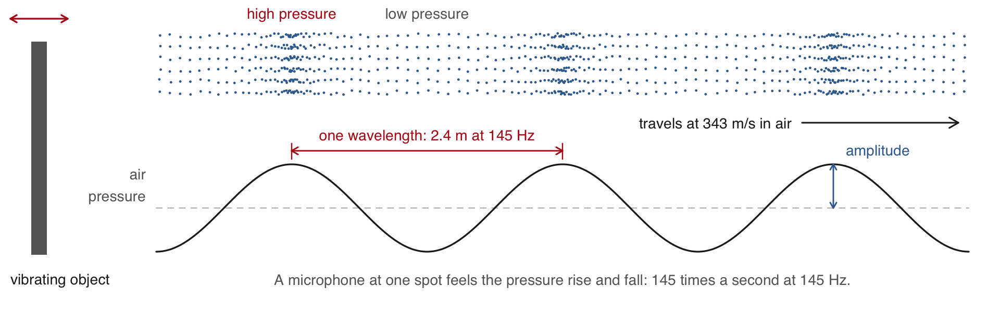{width="88%" fig-align="center"}

::: {.dashes}

- **Frequency**: vibrations a second, in hertz (Hz). Powell's vocal folds
  vibrate about 145 times a second in "afternoon".
- **Amplitude**: how far the pressure swings from normal, heard as loudness.
  Each bit of air moves back and forth in place and passes the push on.

:::

::: {.notes}
Wavelength = speed / frequency: 343 / 145 = 2.37 m in air at 20 °C. The
dots are drawn at one instant; a microphone at one spot sees the bands go
past, so it records pressure over time, which is what the next slide plots.
:::

::: {.content-visible unless-format="revealjs"}

A vibrating object, such as the vocal folds, a guitar string or a speaker
cone, pushes the air beside it on each swing forward and pulls it on each
swing back. The air does not flow: each layer moves back and forth in
place and pushes the next, so bands of slightly higher and lower pressure
travel outward at the speed of sound, 343 metres a second in air at 20 °C.
The **frequency** is how many times a second the object vibrates, and so
how many bands pass a fixed point each second; the **amplitude** is how far
the pressure swings from normal. The **wavelength**, the distance between
two bands of high pressure, is the speed divided by the frequency: 2.4 m
for Powell's 145 Hz. A microphone at one spot feels the pressure rise and
fall as the bands pass, and that is the record the rest of this part works
with.

:::

## How sound travels through a medium {#medium}

::: {.slide-text}

Sound needs something to carry the pushes: air, water, a wall. Its speed
depends on what carries it, and nothing carries it in a vacuum.

:::

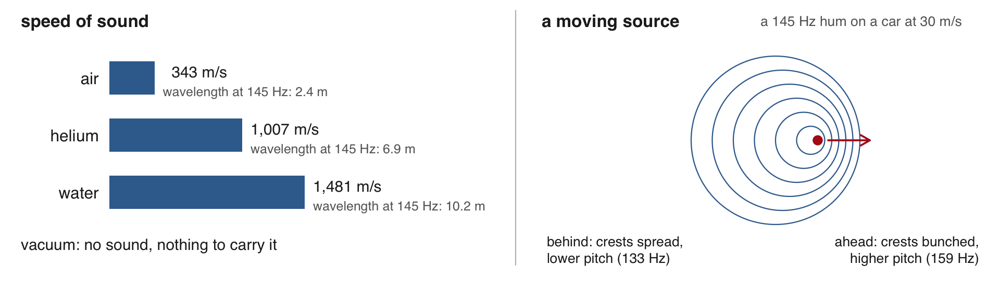{width="88%" fig-align="center"}

::: {.dashes}

- **Helium**: sound travels about 3 times faster. The pitch stays, but the
  throat's resonances rise, so the voice sounds thinner.
- **Water**: about 4 times faster. Ears built for air hear it poorly and
  struggle to tell where it comes from.
- **Motion**: a source coming toward you bunches the crests and sounds
  higher; going away, lower (the Doppler effect).

:::

::: {.notes}
Speeds at 20 °C: air 343 m/s, helium 1,007, fresh water 1,481. Doppler for
a source moving at v toward a still listener: f × c / (c − v); a 145 Hz hum
on a car at 30 m/s is heard at 159 Hz ahead and 133 Hz behind.
:::

::: {.content-visible unless-format="revealjs"}

The speed of sound depends on how stiff and how dense the medium is: about
343 m/s in air, 1,007 in helium and 1,481 in fresh water, all at 20 °C, and
faster still in steel. In helium the vocal folds vibrate at about the same
rate, so the pitch barely moves, but the resonances of the throat and mouth,
which depend on the speed of sound, rise by nearly three times; the
overtones they boost shift up and the voice sounds thin and cartoonish.
Under water the ear, built to pick up pressure swings in air, works poorly,
and since sound arrives at the two ears with a quarter of the delay it has
in air, it is hard to tell where a sound comes from. A moving source sends
each crest from a little further along, so the crests ahead are closer
together and arrive more often: a higher frequency. Behind it they spread
out: a lower one. A 145 Hz hum on a car at 30 m/s (108 km/h) is heard at
159 Hz as it comes and 133 Hz as it goes.

:::

## A recording is a vector of numbers {#vector}

::: {.slide-text}

A recording is one long vector of numbers. Played back, they give the
whole sound up to 8,000 Hz. Here: the first 2 minutes of the Fed's press
conference of 1 Feb 2023.

:::

::::: {.columns}

::: {.column width="56%"}

```{r}
#| label: sound-vector
#| script: "A recording as a vector of numbers"
#| filename: "code/0_sound.R; installs tuneR if missing"
#| collapse: true
#| fig.show: hide
#| fig-width: 5
#| fig-height: 3.1
library(tuneR)
wav <- readWave("data/clips/open2min.wav")
wav@samp.rate          # samples a second
length(wav@left)       # samples in 2 minutes
i <- 112800 + 1:800    # 50 ms from 7.05 s
wav@left[i[1:6]]       # the first six
plot((i - 1) / 16000, wav@left[i], type = "l",
     main = "\"Good\", 7.05 to 7.10 s",
     xlab = "seconds", ylab = "amplitude")
```

:::

::: {.column width="44%"}

```{r}
#| echo: false
#| purl: false
#| out-width: "100%"
knitr::include_graphics(knitr::fig_chunk("sound-vector", "png"), error = FALSE)
```

:::

:::::

::: {.dashes}

- **Sample**: one measurement of the microphone's voltage at one instant,
  stored as a whole number (not a statistical sample).
- **Sampling rate**: measurements per second, in hertz (Hz, per second);
  16,000 here.
- Plotted: Powell's "Good". Two minutes hold 1,920,000 numbers; the 44:37
  conference, about 42.8 million.

:::

::: {.notes}
"Good afternoon" is the first thing Powell says. The model places "Good"
from 6.62 s; the sound itself starts near 7.05 s.
:::

::: {.content-visible unless-format="revealjs"}

The microphone turns air pressure into a voltage, and the recorder measures
that voltage 16,000 times a second. `readWave()` returns a Wave object:
`@left` holds the samples of its one channel (a stereo file has `@right` as
well), `@samp.rate` the sampling rate and `@bit` the bits per sample, 16
here, so each sample is a whole number from −32,768 to 32,767. The 50
milliseconds plotted start where the sound of "Good", the first word of the
conference, begins. The speech-to-text model places the word from 6.62 s;
from 6.62 to 7.05 s the recording holds only the room's noise and a click.

The first two minutes of the conference, Powell's opening statement
(`data/clips/open2min.mp3`):

<audio controls preload="none" src="data/19-audio/data/clips/open2min.mp3"></audio>

:::

## Loudness is amplitude {#amplitude}

::: {.slide-text}

Amplitude is the size of the swings away from 0, heard as loudness. A louder
sound swings further, both ways.

:::



::: {.tone-demo data-mode="amplitude"}
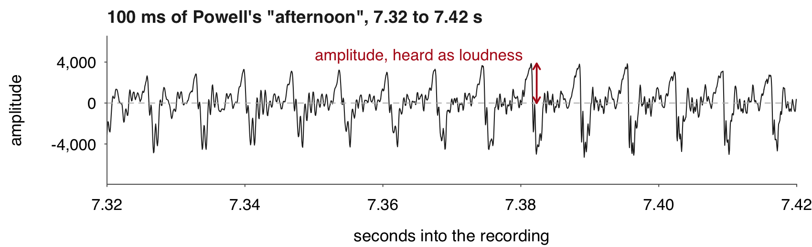{width="90%" fig-align="center"}
:::

[Chair Powell's "afternoon", 7.32 to 7.42 s of the Fed's press conference of
1 Feb 2023, a stretch where his voice is steady.]{.source}

::: {.dashes}

- **Amplitude**: the stored number itself, a position on a scale of whole
  numbers from −32,768 to 32,767 (16 bits). It has no physical unit.
- Silence sits at 0. Powell's "Good" reaches about 8,000, a quarter of the
  loudest the file can hold.

:::

::: {.notes}
"Good" (7.05 to 7.46 s) runs from −6,082 to 8,005. It starts with an
irregular creak (pulses about 14 ms apart), so the figures here use the
steady "-ernoon". A louder "afternoon" would have bigger swings at the same
145 cycles a second.
:::

::: {.content-visible unless-format="revealjs"}

**Amplitude** is how far the samples swing from zero, which the ear hears as
loudness; it says nothing about pitch. The recorder scales the microphone's
voltage to a 16-bit whole number, from −32,768 to 32,767, so a sample has no
physical unit, only a position on that scale.

:::

## Pitch is frequency {#pitch}

::: {.slide-text}

Pitch is how many times a second the wave repeats, its frequency, in hertz.
One cycle of "afternoon" lasts 6.9 ms, so its pitch is 145 Hz.

:::

::: {.tone-demo data-mode="pitch"}
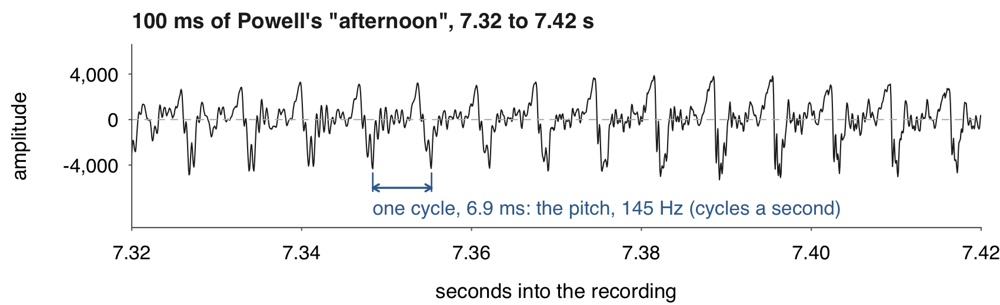{width="90%" fig-align="center"}
:::

[Chair Powell's "afternoon", 7.32 to 7.42 s of the Fed's press conference of
1 Feb 2023: about 14 cycles.]{.source}

::: {.dashes}

- The vocal folds open and close at that rate: 85 to 180 times a second for
  a man.
- We hear about 20 to 20,000 Hz. Speech sits almost all below 8,000 Hz, the
  highest a file of 16,000 samples a second holds.

:::

::: {.notes}
f0 measured on this stretch: the first spectrum peak within 10 dB of the
strongest, 144.5 Hz, one cycle 6.92 ms.
:::

::: {.content-visible unless-format="revealjs"}

**Frequency** is how many times a second the wave repeats, in hertz; the
repeat rate of a voice is its **pitch**. Powell's "afternoon" repeats every
6.9 milliseconds, 145 times a second. A man's pitch usually runs from about
85 to 180 Hz, a woman's higher. The ear hears from about 20 to 20,000 Hz,
but speech carries almost all its information below 8,000 Hz, the highest
frequency a file of 16,000 samples a second can hold.

:::

## Timbre is the mix of overtones {#timbre}

::: {.slide-text}

Timbre is the mix of overtones a voice carries above its pitch. It makes
vowels differ and voices recognisable.

:::

::: {.tone-demo data-mode="timbre"}
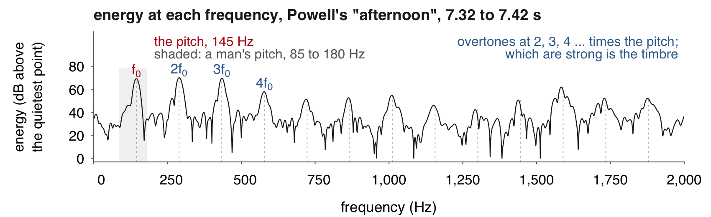{width="90%" fig-align="center"}
:::

[Chair Powell's "afternoon", 7.32 to 7.42 s, as the energy at each frequency
(the spectrum), in decibels (dB, a log scale) above the quietest point
shown. Its first peak, the pitch, sits at 145 Hz.]{.source}

::: {.dashes}

- **Overtone**: a weaker wave sounding with the pitch, at a whole multiple
  of it: 290, 435, 580 Hz ... over 145 Hz. The mouth boosts some, damps others.
- **Time**, the length of sounds and pauses, is the fourth dimension. The
  rest of the session measures it.

:::

::: {.notes}
The peaks line up at whole multiples of f0 up to 13 f0. The floor, 0 dB, is
the quietest point between 0 and 2,000 Hz; the pitch peak stands about 69 dB
above it.
:::

::: {.content-visible unless-format="revealjs"}

The vocal folds do not produce a pure tone: each puff of air carries
**overtones** at 2, 3, 4 and more times the pitch, the peaks in the figure.
The throat, mouth and lips act as a filter that strengthens some overtones
and weakens others; which are strong is the **timbre**, and it changes with
the shape of the mouth, which is why an "a" and an "oo" sung at one pitch
sound different, and why voices are recognisable. **Time** covers how long
sounds and pauses last.

:::

:::::::: {.content-visible unless-format="revealjs"}

## How sound is stored {#storage}

::: {.slide-text}

A sound file stores those numbers, whole or compressed. The highest
frequency it keeps is half its sampling rate.

:::

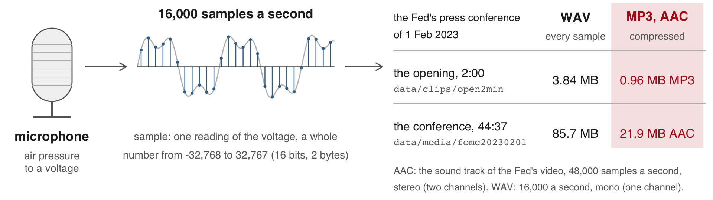{width="88%" fig-align="center"}

::: {.dashes}

- **WAV** keeps every sample as a 16-bit integer. **MP3** and **AAC** drop
  what the ear barely hears.
- At 16 kHz the file keeps up to 8 kHz, enough for speech.

:::

```{.default filename="Run in the project folder, so paths are relative to it; not run in class: the Fed's video to the 16 kHz mono WAV"}
# Terminal (RStudio's works), needs ffmpeg. -vn: drop the video; -ac 1: mono; -ar 16000: 16,000 a second
ffmpeg -i data/media/fomc20230201_270p.mp4 -vn -ac 1 -ar 16000 data/media/fomc20230201.wav
# R console: the same with the av package, which carries its own ffmpeg
av::av_audio_convert("data/media/fomc20230201_270p.mp4", "data/media/fomc20230201.wav",
                     channels = 1, sample_rate = 16000)
```

::: {.content-visible unless-format="revealjs"}

The Fed's video carries its sound as AAC at 48,000 samples a second in
stereo: six times the samples of the 16 kHz mono WAV, in a quarter of its
size. Written out whole at that rate, the same 44:37 would fill 514 MB. The
models read 16 kHz mono, so one ffmpeg line converts the sound before
anything else: `-vn` drops the video, `-ac 1` mixes the two channels into
one, and `-ar 16000` resamples to 16,000 a second. A sampled wave holds
frequencies up to half its sampling rate: 8 kHz at 16 kHz, which keeps what
tells words apart; a CD's 44.1 kHz keeps up to 22 kHz, the top of human
hearing. The clips ship as WAV, which the models read, and as MP3, which
this page plays.

:::

::::::::

## From samples to a picture of sound {#spectrogram}

::: {.slide-text}

A speech-to-text model first turns the vector into a **spectrogram**: the
same sound, as energy by frequency over time. It measures the energy at each
frequency in 25-ms windows, one every 10 ms. <button class="clip-play" type="button" data-src="data/19-audio/data/clips/open2min.mp3" data-start="6.5" data-end="7.8">▶ "Good afternoon"</button>

:::

::::: {.columns}

::: {.column width="58%"}

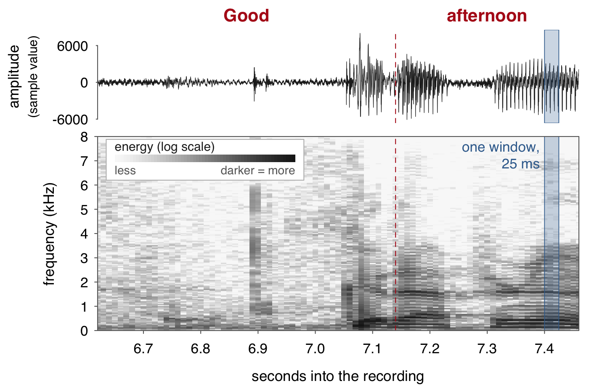{width="100%"}

:::

::: {.column width="42%"}

::: {.dashes}

- **Frequency**: how many times a second the pressure swings, in Hz.
- **Window**: 25 ms, 400 samples, measured as one.
- **Mel scale**: frequencies spaced the way the ear hears them, pooled
  into 80 bands.
- One second: 100 windows × 80 bands (128 in the large model).

:::

:::

:::::

[Chair Powell's "Good afternoon", 6.62 to 7.46 s of the Fed's press
conference of 1 Feb 2023. Word times and the dashed boundary are the
model's. The shade is the energy at that frequency in that window,
on a log scale. Darker is louder.]{.source}

::: {.notes}
The dashed line is the model's boundary between the two words. The
spectrogram on the slide stops at 8 kHz, half the sampling rate.
:::

::: {.content-visible unless-format="revealjs"}

The spectrogram is computed from the vector and nothing else. It keeps
the energy at each frequency and drops the phase, the exact timing of each
wave within a window, so the vector can be rebuilt from it only
approximately; what tells words apart survives. The figure computes the
spectrogram the way a model's first step does,
before the mel step: windows of 25 milliseconds (400 samples) every 10
milliseconds, each through a Fourier transform (`fft()` in R), which says
how much of each frequency the window holds; the shaded band is one
window. The models then pool the
frequencies into bands on the mel scale, narrow at low frequencies and wide
at high ones, since the ear tells low pitches apart more finely than high
ones, and take the log of the energy: 80 bands for the small model, 128 for
the large. A 30-second chunk, the piece the model reads at once, becomes
3,000 windows. The word boundaries drawn are the model's: it
places "Good" from 6.62 s, while the sound itself starts near 7.05 s.

:::

# 2 · Recorded speech as research data {#part-research}

## When a transcript is not enough {#why-transcribe}

::: {.slide-text}

With a reliable transcript, a speech-to-text model adds nothing to the
words. It is run in four cases.

:::

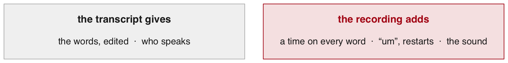{width="80%" fig-align="center"}

::: {.dashes}

- **No transcript**: interviews, focus groups, hearings, radio, archives,
  most recordings.
- **A sanitized transcript**: fillers, restarts and stutters edited out, as
  in the Fed's.
- **No times**: pauses and speaking rate need timestamps, which typed
  transcripts never carry.
- **How it was said**: pitch, energy and tone, which no transcript holds.

:::

::: {.slide-text}

Today works on the first three cases. The fourth needs the sound itself.

:::

::: {.notes}
The Fed's transcript of 1 Feb 2023 is the model's reference in this
session. Tone means something only once each stretch of sound is tied to
its words and its speaker, which is what the timestamps and the speaker
labels give. False starts go the same way as restarts in the Fed's text.
:::

## Machine transcripts of political speech {#paper-asr}

::: {.slide-text}

Much political speech is recorded but never typed. Proksch, Wratil and
Wäckerle turned it into text by speech recognition, then into each speaker's
position by a text model.

:::

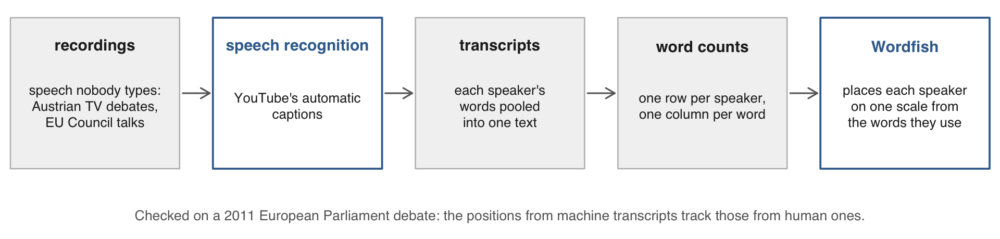{width="90%" fig-align="center"}

::: {.dashes}

- [Proksch, Wratil & Wäckerle (Political Analysis, 2019)](https://doi.org/10.1017/pan.2018.62):
  candidates' positions in Austria's 2017 campaign; conflict in EU budget talks.
- **Wordfish**: a text model. Speakers who use the same words more often
  land close together on its scale.
- **Word-error rate**: wrong, missing and extra words per word of the true
  text.

:::

::: {.notes}
Validation: the European Parliament's 2011 State of the Union debate,
57 speakers, heard in English, French and German through the interpreters.
Word-error rates: YouTube 0.03 English, 0.12 French, 0.10 German; Google's
API 0.21, 0.26, 0.21. Austrian TV debates 0.30, Council debates 0.06 (both
YouTube). The Council publishes no verbatim record of its sessions.
:::

::: {.content-visible unless-format="revealjs"}

Party conferences, some legislatures, television debates and talk shows are
recorded but rarely transcribed, and paying people to type them is too
expensive for most research. The authors first test speech recognition on
the European Parliament's 2011 State of the Union debate, which has human
transcripts and was interpreted into English, French and German: YouTube's
automatic captions scored a word-error rate of 0.03 in English, 0.12 in
French and 0.10 in German, Google's speech API 0.21, 0.26 and 0.21. Speaker
positions and sentiment scaled from the machine transcripts track those from
the human ones. They then apply it to the 2017 Austrian election debates on
television (candidates move toward their opponents' positions) and to
ministers' speeches in the Council of the EU on the long-term budget, of
which no verbatim record exists. Their R package `wersim` adds transcription
errors at a chosen extra rate and estimates again, to show how far a result
depends on transcript quality.

:::

## Police body-camera footage as data {#paper-bodycam}

::: {.slide-text}

Voigt et al. had the body-camera footage of 981 traffic stops in Oakland
transcribed. Officers spoke less respectfully to Black drivers than to white
drivers.

:::

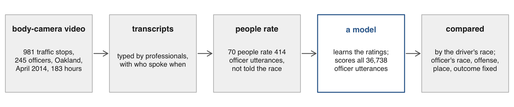{width="90%" fig-align="center"}

::: {.dashes}

- [Voigt et al. (PNAS, 2017)](https://doi.org/10.1073/pnas.1702413114): the
  gap holds with the officer's race, the offense, the place and the outcome
  of the stop held fixed.
- The transcribers did both of this session's jobs by hand: the words, and
  who spoke when.

:::

::: {.notes}
682 Black and 299 white drivers, 68.1% of the 1,440 such stops that month.
White drivers were 57% more likely to hear one of the most respectful
utterances (top 10%), Black drivers 61% more likely to hear one of the least
respectful (bottom 10%). Officer speech to the dispatcher or other officers
was removed using the transcribers' speaker labels.
:::

::: {.content-visible unless-format="revealjs"}

The footage is 183 hours from 981 stops made by 245 officers of the Oakland
Police Department in April 2014. Professional transcribers typed each stop
while listening to the audio and watching the video, and labelled who was
speaking at each point; the labels let the authors drop what officers said
to the dispatcher or to each other. Seventy participants rated 414 officer
utterances for respect without being told the driver's race, and a model
trained on those ratings scored all 36,738 officer utterances. White drivers
were 57% more likely to hear one of the most respectful utterances, Black
drivers 61% more likely to hear one of the least respectful. The paper
treats the footage as data rather than as evidence kept for complaints.

:::

:::::: {.content-visible unless-format="revealjs"}

Two studies of typed transcripts needed no speech model at all: the words
already existed. They show what such data can answer once the words exist.

## FOMC meeting transcripts as data on deliberation {#paper-fomc}

::: {.slide-text}

In late 1993 FOMC members learned that their recorded meetings would be
published. Newer members then discussed more topics, cited more data and
moved toward the chair's topics.

:::

::::: {.columns}

::: {.column width="36%"}

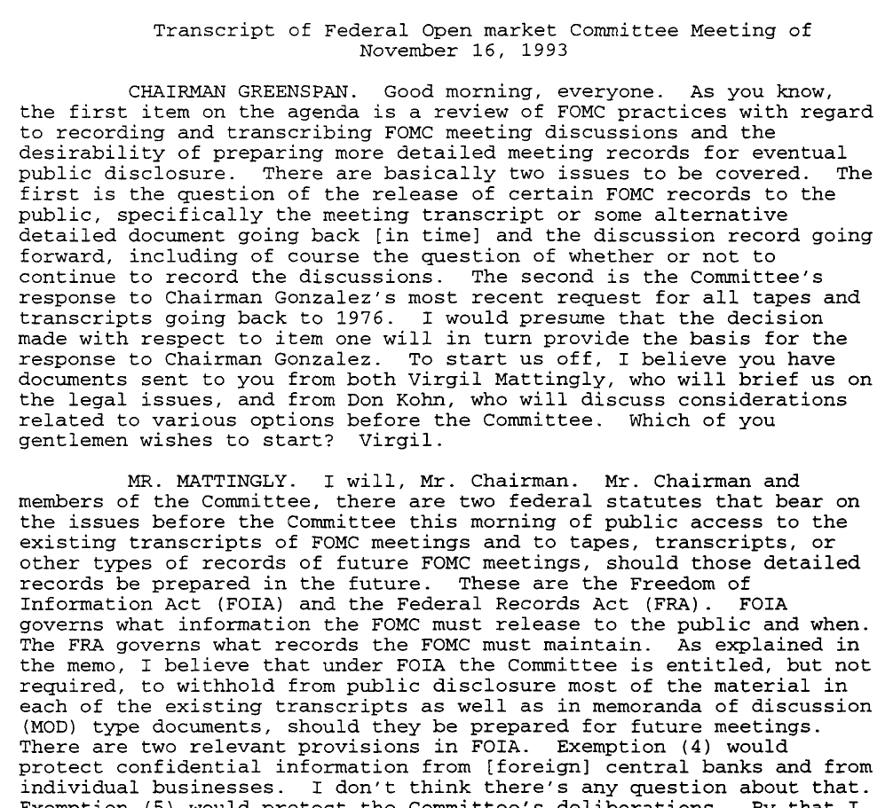{width="100%" fig-align="center"}

[FOMC transcript, 16 Nov 1993, federalreserve.gov]{.source}

:::

::: {.column width="64%"}

::: {.dashes}

- [Hansen, McMahon & Prat (QJE, 2018)](https://doi.org/10.1093/qje/qjx045)
  compare meetings before and after.
- **Natural experiment**: a change the researcher did not make.
- **Topic model**: groups of words that appear together (topics), with each
  speaker's share of each.

:::

**Takeaway:** what people say in a meeting, tagged by speaker, is data on
behaviour.

:::

:::::

::: {.notes}
The paper ran no speech model: a typed transcript exists for every FOMC
meeting since March 1976. The chair was Alan Greenspan. "Toward the chair's
topics": topic shares closer to the chair's. More topics and more data reads
as preparation (discipline); speaking like the chair reads as conformity.
The paper's influence measure says discipline dominates.
:::

::: {.content-visible unless-format="revealjs"}

The paper needed no speech model: the Fed has typed a transcript of every
FOMC meeting since March 1976. The change the authors use is the decision,
in November 1993, to publish those transcripts after five years; members new
to the committee changed how they spoke more than experienced ones. A topic
model reads every member's words and returns, for each speaker, the share of
each topic, so "more like the chair" means topic shares closer to those of
the chair, Alan Greenspan. The two effects have names in the paper. More
topics and more data read as better preparation, which the authors call
discipline; speaking more like the chair reads as conformity. Their measure
of each member's influence on the discussion says discipline dominates.

:::

## Political risk measured from earnings calls {#paper-risk}

::: {.slide-text}

The share of an earnings call spent on political phrases near a word for
risk measures the firm's political risk.

:::

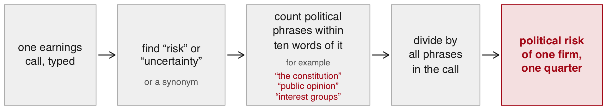{width="90%" fig-align="center"}

::: {.dashes}

- **Earnings call**: a listed firm's managers answering analysts on its
  quarterly results.
- [Hassan, Hollander, van Lent & Tahoun (QJE, 2019)](https://doi.org/10.1093/qje/qjz021):
  firms with more political risk hire and invest less and lobby more.

:::

**Takeaway:** a few minutes of typed talk per firm, over thousands of firms,
is a firm-level variable.

::: {.notes}
The measure: the share of each call's two-word phrases that come from
political texts and sit within ten words of a word for risk or
uncertainty. The phrases shown are from the paper's own table of top
political bigrams. Most of its variation lies between firms, not over time.
A vendor types the calls.
:::

::: {.content-visible unless-format="revealjs"}

The measure counts the two-word phrases (bigrams) of each call that come
from political texts and sit within ten words of "risk", "uncertainty" or
a synonym, and divides by all the call's bigrams. The sample is 178,173
calls of 7,357 US-listed firms from 2002 to 2016, with transcripts licensed
from a vendor. The three phrases in the figure come from the paper's own
table of the most political bigrams.

[Sautner, van Lent, Vilkov & Zhang (JF, 2023)](https://doi.org/10.1111/jofi.13219)
measure firms' exposure to climate change from the same kind of transcript:
more than 10,000 firms in 34 countries, 2002 to 2020, with a method that
discovers the climate keywords from the text itself.

:::

::::::

::::: {.content-visible unless-format="revealjs"}

## Where recordings come from {#sources-of-audio}

::: {.slide-text}

A recording's terms say whether a transcript exists, whether the audio may be
copied and where it may go. **Public domain**: no copyright, anyone may copy.
**Licence**: a contract on what you may do with a file.

| Source | What exists | Terms |
|:--|:--|:--|
| The Fed's press conferences | video; a transcript the next day, its final version two weeks later | public domain |
| FOMC meetings | transcripts, out after five years | public domain |
| ECB press conferences | webcast and transcript on ecb.europa.eu | ECB copyright; free use with the ECB cited |
| Earnings calls | audio and transcripts of firms' quarterly results calls, sold by a data vendor | a licence, which sets what may be copied or sent out |
| Your own interviews | nothing until you record it | **consent** from each person; approval by the **IRB**, the university board for research with people |

: {tbl-colwidths="[27,40,33]"}

:::

[The two studies before used typed transcripts, which carry no times; a
recording gives each word's time. The Fed's website "is in the public
domain".]{.source}

{width="80%" fig-align="center"}

The Fed's page for the conference holds the embedded video and the
"Transcript" link. The preliminary transcript went up the day after the
conference, with the video; the final version (the one in the project) came
about two weeks later. The Fed's wording continues: "Please cite to the
Board as the source of the information."

One more source, for comparison: oral arguments at the US Supreme Court,
the highest US court. The audio of every argument is posted on
supremecourt.gov the day it is heard (the online archive starts with the
2010 Term; recordings exist since 1955). The site states no reuse terms;
a work of the US government carries no copyright (17 U.S.C. 105).

Both studies in this part took their transcripts from one vendor under
licence. The vendor kept the audio of each call for about a year
([Mayew & Venkatachalam (JF, 2012)](https://doi.org/10.1111/j.1540-6261.2011.01705.x)).

:::::

## The Fed press conference of 1 February 2023 {#conference}

::: {.slide-text}

This session analyzes one recording: what Chair Powell and the reporters
said at the Fed's press conference of 1 Feb 2023. It checks everything it
builds against the Fed's own transcript.
A **turn** is one person's talk until another speaks. The transcript tags 76.

:::

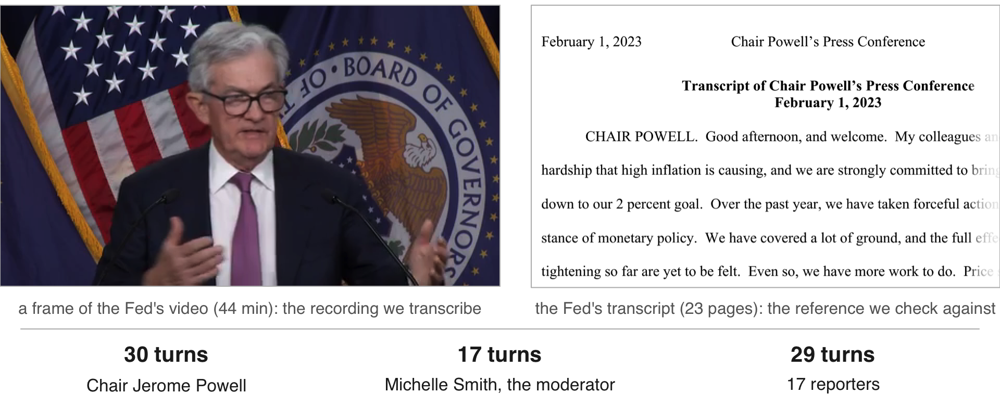{width="74%" fig-align="center"}

::: {.dashes}

- After each meeting of the FOMC, the Fed's rate-setting committee, Chair
  Powell reads a statement on camera. He then answers reporters for about 40
  minutes. Michelle Smith, the moderator, calls each reporter by first name.

:::

::: {.notes}
44 min 37 s, 23 pages, 19 speakers. Chair Jerome Powell has 30 turns;
Michelle Smith of the Fed's staff moderates and calls each reporter by
first name (17 turns); 17 reporters have 29. The 25 basis points are on
transcript page 1, the range on page 3. A basis point is a hundredth of a
percentage point. Times are mm:ss on the video. Her exact title in February
2023 is not confirmed, hence "of the Fed's staff".
:::

::: {.content-visible unless-format="revealjs"}

The FOMC meets eight times a year. That day it raised its interest rate by
0.25 percentage point (25 basis points; a basis point is a hundredth of a
percentage point), to 4½ to 4¾ percent. The conference lasted 44 minutes 37
seconds; the transcript runs to 23 pages and names 19 speakers. Chair Jerome Powell has 30 turns. Michelle
Smith of the Fed's staff moderates: she calls each reporter by first name,
17 turns in all. The 17 reporters have 29 turns. The figure pairs a frame
of the Fed's video (Powell answering, at about 16:11) with page 1 of the
transcript, which opens "CHAIR POWELL. Good afternoon, and welcome."

:::

# 3 · Speech models {#part-models}

## Kinds of audio models {#model-kinds}

::: {.slide-text}

Each kind of model does a different job on a recording. Most read speech;
the last reads every other sound. This session uses the first two.

:::

::: {.dashes}

- **Speech-to-text**: turns the sound into words, with a start and end time
  for each.
  - For transcripts, word counts and speaking rates.
- **Speaker labels** (diarization): find where the voice changes; label each
  voice.
  - For turns: who said each word.
- **Forced alignment**: takes an existing transcript and finds when each
  word is said.
  - For timing a trusted text, such as the Fed's.
- **Translation**: writes speech in another language, directly or through a
  transcript.
  - For sources in a language you do not read. The transcript lets you check it.
- **Voice measures**: track pitch and loudness over time, or score emotion.
  - For how something was said, beside what was said.
- **Chat models with audio**: answer a question about a recording, in prose.
  - For a quick summary; its times and labels are rough.
- **Sound events**: label sounds other than speech, such as cars, birdsong or
  a dog barking, with their times.
  - For counts of events: traffic, wildlife, noise.

:::

::: {.notes}
A speaker-label model gives anonymous voices (SPK00, SPK01 ...), not names.
Forced alignment needs the words first; it only finds when each is said.
A chat model's times and labels are guesses to check by ear.
:::

::: {.content-visible unless-format="revealjs"}

Speech-to-text and speaker labels are separate models run separately; this
session joins their replies by time. **Forced alignment** starts from a text
that already exists and finds when each of its words is spoken, which suits
a recording with a trusted transcript, such as the Fed's. **Translation**
models write the words of one language in another. **Voice measures** read
the sound itself: pitch, loudness, and the scores of models trained on
acted emotions. **Chat models** that accept audio answer a question about a
recording in prose; their times and speaker labels are rough and need
checking by ear.

:::

## From the spectrogram to words {#how-it-writes}

::: {.slide-text}

The speech-to-text model reads the **spectrogram** and writes like a
**language model**: it predicts each word from those before.

:::

1. One part reads the spectrogram; the other writes one word at a time, to
   fit the sound and the words already written.
2. Where the sound is hard to read, the words already written have more
   influence. Each repeat makes the next likelier, so a loop keeps going.
   Example below.
3. **Small and large**: one model in two sizes. The large has 11 times the
   parameters: slower, but better on unclear sound.

```{.default filename="Example: Powell at 35:22, as each model wrote it (Python, before class; replies/words.json, words_base.json)"}
large  but I think we, we're going to be cautious about declaring victory and, you know,
       sending signals that we think ...
small  but I think we we're going to be cautious about about declaring victory and you know
       that's not going to be a good example of the fact that we are going to be cautious
       about the fact that we are going to be cautious about the declaring victory and ...
       from 35:33 to the end: "we are going to be cautious about the fact that", repeated
```

[The large one matches the Fed's transcript.]{.source}
<button class="clip-play" type="button" data-src="data/19-audio/data/clips/loop90.mp3" data-start="52.2" data-end="63.3">▶ Hear 35:22 to 35:33</button>

::: {.notes}
The large model's lines match what Powell said (the Fed's transcript has
"we're going to be cautious about declaring victory"). The small model takes
the real "we're going to be cautious about", drifts, and from 35:33 every
segment it writes is "we are going to be cautious about the fact that" to the
end of the recording: 4,414 words and 9.6 minutes of audio lost. No restarts
either. On
this recording the large model wrote "you know" 70 times and the Fed's
transcript keeps 75.
:::

::: {.content-visible unless-format="revealjs"}

The model family was trained on 680,000 hours of audio from the web, each
paired with the transcript found with it, after machine-made captions were
filtered out ([Radford et al. (ICML, 2023)](https://proceedings.mlr.press/v202/radford23a.html)).
Human transcripts drop fillers and restarts, so the model learned to drop
them too: the Fed's 23-page transcript holds no "um" or "uh", and the model
wrote none. The part that reads the spectrogram (the encoder) turns each
30-second chunk into a summary of what sounds happened when; the part that
writes (the decoder) is a language model that picks each next word from the
words written so far and from that summary.

:::

:::::::: {.content-visible unless-format="revealjs"}

## The small model's loop {#loop}

::: {.slide-text}

The small model repeats one phrase from 34:57 to the end. The large model
does not. Both are sizes of one speech-to-text model, each run on the whole
recording.

:::

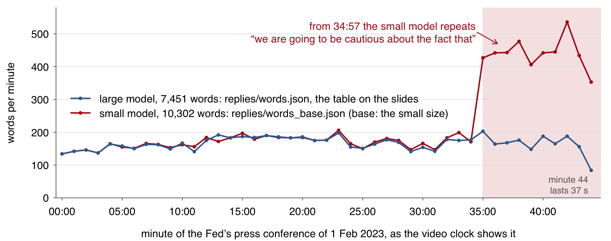{width="80%" fig-align="center"}

1. The model reads the recording in 30-second pieces, chunks, each started
   from the previous chunk's text, so a loop passes on. Started fresh, the
   small model wrote 7,264 words and no loop.
2. The small model reads the sound less well, so continuing its own text
   wins over the sound more often. Any size can loop on a harder recording.

::: {.notes}
Large and small are two sizes of one model family. The fresh-start run is
replies/words_base_nocond.json (condition on previous text switched off).
The other usual guards: a check that flags text which compresses too well
(a repeat compresses very well), and a retry with more randomness in the
choice of words.
:::

::: {.content-visible unless-format="revealjs"}

Both transcripts of 34:30 to 36:00, timed to the audio: at 35:28 the small model stamps 119 words on one instant, then repeats one phrase while Powell keeps talking.



:::

::: {.content-visible unless-format="revealjs"}

The model reads the recording 30 seconds at a time and, by default, gives
the writer the text of the previous chunk as its starting context, which
keeps names and spellings consistent across chunks. A repeat at the end of
one chunk therefore becomes the likeliest start of the next, and the loop
runs to the end of the file. The small model's run with that context
switched off (`replies/words_base_nocond.json`) has no loop. The usual
guards are that switch, a check on how well the text compresses (a repeated
phrase compresses very well), and a retry with more randomness in the choice
of words. The same mechanism writes words nobody said during silence or
music.

:::

::::::::

# 4 · Who said what, and when {#part-who}

## What the models return, and the table we build {#the-table}

::: {.slide-text}

This part uses two different models: a **speech-to-text model**, which
wrote every word with its time, and a **speaker-label model**, which marked
which voice talks when. Both ran before class; this part joins their replies.

:::

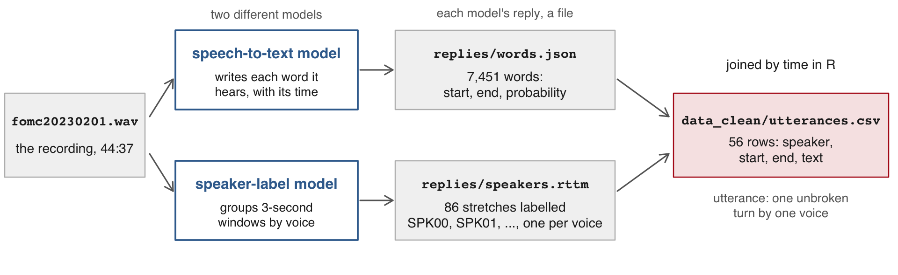{width="88%" fig-align="center"}

```{.default filename="data_clean/utterances.csv, 3 of its 56 rows (times in seconds; text cut at 45 characters)"}
  speaker  start    end  text
1 SPK00    11.10 417.73  colleagues and I understand the hardship that
2 SPK02   425.29 450.75  Chris Rugeber, Associated Press. Thank you fo
3 SPK00   452.63 490.93  So it is important that overall financial con
```

::: {.slide-text}

The question for the rest of the session: how far can this table be trusted?

:::

::: {.notes}
An utterance is the speaker-label literature's word for a turn; the file
keeps it. Why row 1 starts at "colleagues" comes with the join.
:::

## The two replies, made in Python before class {#python-replies}

::: {.slide-text}

Two Python scripts wrote `replies/` before class, in about 6 minutes. They
are not run in class. Everything after them runs in R.

:::

```{.python filename="code/python/1_words.py: the speech-to-text reply, replies/words.json (5 min)"}
import json, mlx_whisper
reply = mlx_whisper.transcribe("data/media/fomc20230201.wav",
    path_or_hf_repo="mlx-community/whisper-large-v3-turbo",   # the large model
    language="en", word_timestamps=True)                      # a time on every word
json.dump(reply, open("replies/words.json", "w"))
```

```{.default filename="code/python/2_speakers.py: the speaker labels, replies/speakers.rttm (35 s), in four steps"}
1. 30-ms frames marked speech or not; 3-s windows, one every 1.5 s, kept if at least half speech
2. one voice embedding per window, from a model trained on thousands of voices
3. the embeddings clustered: the windows of one cluster share a label
4. each window labels its middle 1.5 s; neighbours with the same label merge into a stretch
```

::: {.notes}
Both scripts rebuilt the shipped files exactly on 3 Nov 2026 (the clip's
104 words; speakers.rttm byte for byte). They need the Python environment
of tools/SETUP.md and the full WAV, which is not in the zip.
:::

:::::::: {.content-visible unless-format="revealjs"}

## What a speech-to-text model returns {#reply}

::: {.slide-text}

The speech-to-text model returns one JSON file. It holds the whole text,
then segments, each with its words and their start, end and probability.

:::

```{.json filename="replies/words.json, the Fed's press conference of 1 Feb 2023: its first segment, Chair Powell's"}
{"text": " Good afternoon and welcome. My colleagues and I ...", "language": "en",
 "segments": [{"id": 0, "start": 6.62, "end": 8.40, "text": " Good afternoon and welcome.",
     "words": [{"word": " Good",      "start": 6.62, "end": 7.14, "probability": 0.558},
               {"word": " afternoon", "start": 7.14, "end": 7.46, "probability": 0.996},
               {"word": " and",       "start": 7.46, "end": 8.14, "probability": 0.681},
               {"word": " welcome.",  "start": 8.14, "end": 8.40, "probability": 0.997}]},
   ...1,710 more segments]}
```

::: {.dashes}

- **JSON**: a text format for nested lists. **Segment**: a phrase returned
  as one piece. **Timestamp**: seconds from the start of the recording.
- **Probability**: the model's own rating of the word it chose, so a
  confidently wrong word scores high.
- **Raw reply**: the file as the model wrote it, never edited by hand. This
  one, from the large model, holds 1,711 segments and 7,451 words.

:::

::: {.content-visible unless-format="revealjs"}

The slide leaves out the token list and three scores each segment carries:
`avg_logprob`, the average log-probability of its tokens; `compression_ratio`,
how much its text shrinks when compressed, high for text that repeats
itself; and `no_speech_prob`, the model's rating that the stretch holds no
speech. The compression ratio comes back below.

:::

::::::::

## Reading the speech-to-text reply in R {#read-reply}

::: {.slide-text}

The speech-to-text reply is one JSON file: the whole text, then segments,
each with its words and their start, end and probability. `fromJSON()`
reads it; one line stacks the 1,711 segments' words into 7,451 rows.

:::

```{r}
#| script: "Reading the reply in R"
#| filename: "code/1_words.R, in the 19-audio folder (open 19-audio.Rproj first); the script installs jsonlite if it is missing"
library(jsonlite)
stt <- fromJSON("replies/words.json")
names(stt)
# stt$segments: one row per segment; its words column holds a small table per row
words <- do.call(rbind, stt$segments$words)    # stack the 1,711 per-segment word tables
words <- words[, c("word", "start", "end", "probability")]
words$word <- trimws(words$word)               # the model puts a space before each word
dim(words)
```

::::: {.columns}

::: {.column width="48%"}

```{r}
#| filename: "code/1_words.R; words from above"
head(words, 4)
```

:::

::: {.column width="52%"}

::: {.slide-text}

`stt`, short for speech to text, holds the whole reply. `words` has one row
per word. **Probability** is the model's own rating of the word it chose.

:::

:::

:::::

## The reply beside the Fed's transcript {#reply-vs-fed}

::: {.slide-text}

The speech-to-text model's word count comes close to that of the Fed's
transcript of its press conference of 1 Feb 2023.

| | The model's reply | The Fed's transcript |
|:--|--:|--:|
| Words | 7,451 | 7,365 |
| "you know" | 70 | 75 |

: {tbl-colwidths="[30,35,35]"}

The transcript's count leaves out its page headers and its speaker tags ("CHAIR POWELL."). "You know" is a filler phrase, counted per answer
later in the session. Spelling differs: the model writes "2%" where the Fed writes "2
percent".

:::

::: {.content-visible unless-format="revealjs"}

The Fed's count comes from the text layer of its PDF, saved as
`replies/fed_transcript.txt`, once the lines that are not speech are
dropped:

```{r}
#| filename: "code/1_words.R, in the 19-audio folder; base R"
fed <- readLines("replies/fed_transcript.txt", encoding = "UTF-8", warn = FALSE)
fed <- sub("^\f", "", fed)                                   # a form feed starts each page
header <- "^(February 1, 2023|FINAL|Page [0-9]+ of 23|.*Press Conference)$"
fed <- fed[fed != "" & !grepl(header, fed)]                  # blank lines, page headers
fed <- sub("^[A-Z][A-Z-]+( [A-Z][A-Z-]+)+\\. ", "", fed)     # speaker tags: "CHAIR POWELL. "
fed_text <- paste(fed, collapse = " ")
length(strsplit(trimws(fed_text), "\\s+")[[1]])              # the Fed's spoken words
```

:::

::: {.content-visible unless-format="revealjs"}

### Counting the small model's words per minute {#loop-in-r}

[Radford et al. (ICML, 2023)](https://proceedings.mlr.press/v202/radford23a.html)
also name the failure in the words-per-minute figure of Part 3: a model that
reads the text it has just written can fall into repeating it. Run again
with each chunk decoded on its own (`replies/words_base_nocond.json`), the small model
writes 7,264 words and no loop (Practice 1). The loop shows in a word count
and in the segment's own `compression_ratio`: a text that repeats itself
compresses well.

```{r}
#| filename: "R Console, in the 19-audio folder; needs jsonlite; words and stt from the slides before"
small <- fromJSON("replies/words_base.json")                       # the small model, same settings
small_words <- do.call(rbind, small$segments$words)
per_min <- rbind(large = table(floor(words$start / 60)),          # words per minute of the conference
                 small = table(floor(small_words$start / 60)))
per_min[, 34:45]                                                   # minutes 33 to 44
c(large = max(stt$segments$compression_ratio), small = max(small$segments$compression_ratio))
```

:::

:::::::: {.content-visible unless-format="revealjs"}

## When a speaker-label model is needed {#rttm}

::: {.slide-text}

A recording with one voice (a lecture, a read statement, a podcast
monologue) needs only the speech-to-text model. A second, speaker-label
model is needed when the research question is who said it.

:::

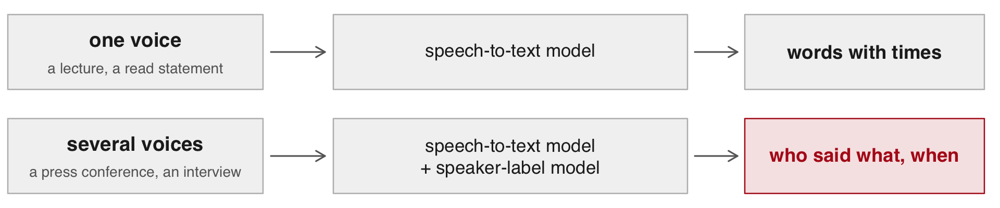{width="80%" fig-align="center"}

::: {.dashes}

- Who said it is the question in the Fed's press conference of 1 Feb 2023.
  It is also the question in an earnings call, an interview or a committee
  meeting.
- **Speaker diarization**: marking which voice is talking when, with one
  anonymous label per voice.

:::

::::::::

## What a speaker-label model returns {#rttm-file}

::: {.slide-text}

The speaker-label model returns stretches with a start, a duration and a label
such as `SPK00`, and no names.

:::

```{r}
#| filename: "code/2_speakers.R, in the 19-audio folder; replies/speakers.rttm is the speaker-label model's reply"
#| collapse: true
readLines("replies/speakers.rttm", n = 2)
seg <- read.table("replies/speakers.rttm")[, c(4, 5, 8)]   # start, duration, label
names(seg) <- c("start", "dur", "speaker")
seg$end <- seg$start + seg$dur
seg <- seg[order(seg$start), ]
head(seg, 3)
c(stretches = nrow(seg), labels = length(unique(seg$speaker)))
```

::: {.dashes}

- **RTTM**: plain text, one line per stretch, ten columns; start in 4,
  duration 5, label 8.
- 86 stretches, 19 labels for the Fed's press conference of 1 Feb 2023: as
  many as the people its transcript names. Made in 58 s on a laptop, with no
  account.

:::

## How speaker labels are made {#how-labels}

::: {.slide-text}

The speaker-label model gives windows that sound alike one label. A voice
shorter than a window gets no label of its own.

:::

::: {.dashes}

- **Window**: a 3-second stretch of the recording, one every 1.5 s. A
  window under half speech gets no label.
- **Voice embedding**: numbers that sit close for the same voice;
  **clustering** groups them. **Labelled stretch**: consecutive windows with
  the same label, merged.
- At 15:23 the moderator's half-second "Howard" sits in four seconds of
  quiet and is dropped. At 21:38 a reporter's "Yes" inside Powell's window
  takes his label.

:::

<button class="clip-play" type="button" data-src="data/19-audio/data/clips/howard10.mp3" data-start="0" data-end="10">▶ "Howard", 15:19 to 15:29</button>
<button class="clip-play" type="button" data-src="data/19-audio/data/clips/yes6.mp3" data-start="0" data-end="6.4">▶ "Yes", 21:34 to 21:40</button>

::: {.notes}
Each kept window labels its middle 1.5 s. "Howard." gets no label; "Yes."
became Powell's.
:::

## Speaker labels across the conference {#labels-timeline}

::: {.slide-text}

In the Fed's press conference of 1 Feb 2023, `SPK00` (Chair Powell) holds
the long stretches. The moderator's name call "Howard." at 15:23 falls in a
4.5-s gap whose windows were dropped. `SPK07`, the reporter's label, follows
it. Windows overlap, so they are drawn on two rows. <button class="clip-play" type="button" data-src="data/19-audio/data/clips/howard10.mp3" data-start="0" data-end="10">▶ "Howard", 15:19 to 15:29</button>

:::

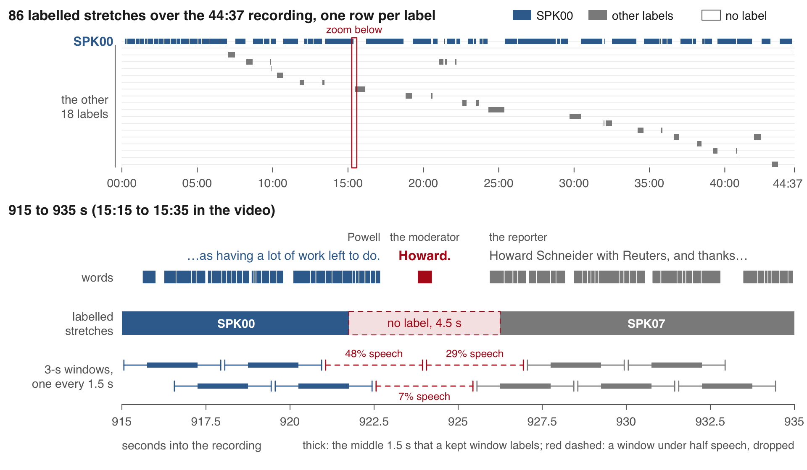{width="88%" fig-align="center"}

::: {.notes}
Top: the 86 stretches, one row per label: SPK00 has 56 of them, 1,896 of
the 2,415 labelled seconds; 262 s of the conference carry no label. Bottom:
915 to 935 s; the windows starting at 921.0, 922.5 and 924.0 s hold too
little speech and are dropped.
:::

::: {.content-visible unless-format="revealjs"}

The shipped labels come from `tools/diarize_ecapa.py`. An energy gate
keeps a 3-second window only when more than half its 30-millisecond frames
hold speech; 1,566 windows were kept. Each kept window becomes an
embedding from a network trained on thousands of voices, the embeddings are
clustered, each window labels its middle 1.5 s, and neighbours with the
same label merge into one stretch. So a stretch's edges fall on the
1.5-second grid, and nothing shorter than a window is heard as a voice of
its own. A half-second word inside a window the other voice fills takes
that voice's label: a reporter's "Yes." at 21:38 became Powell's. In the
top panel one label holds the long stretches (56 of them, 1,896 of the
2,415 labelled seconds: Powell), the other 18 hold short ones, and 262
seconds of the conference carry no label. The bottom panel zooms on 915 to
935 s: the windows that start at 921.0, 922.5 and 924.0 s hold too little
speech and are dropped, and "Howard." falls between two stretches.

A finer method scores every frame for up to three local voices before it
embeds and clusters, and resolves turns shorter than a second. Its weights
sit behind an account on the model-hosting site: a click that accepts each
model's user conditions and a read token, with the code itself under an
open licence. `tools/SETUP.md` lists the steps. Its file would be another
RTTM, and the `read.table()` lines above read any RTTM file.

:::

:::::::: {.content-visible unless-format="revealjs"}

## Joining by time with findInterval() {#join}

::: {.slide-text}

Joining by time: each word takes the label of the stretch holding its
midpoint, or `NA`, R's mark for a missing value.

:::

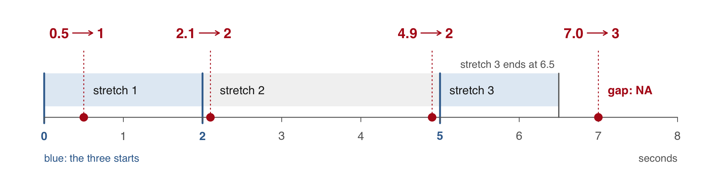{width="52%" fig-align="center"}

```{r}
#| filename: "R Console; base R; the figure's three stretches start at 0, 2 and 5 s"
#| collapse: true
findInterval(c(0.5, 2.1, 4.9, 7.0), c(0, 2, 5))   # the last start at or before each time
```

::: {.slide-text}

`findInterval()` gives, for each time, the last stretch that starts at or
before it. A time past that stretch's end, such as 7.0 after stretch 3 ends
at 6.5, lies in a gap and gets `NA`.

:::

::::::::

## A speaker label for every word {#join-words}

::: {.slide-text}

Each of the 7,451 words of the Fed's press conference of 1 Feb 2023 takes
the label of the stretch holding its midpoint. 267 words (3.6%) fall before
the first stretch or in a gap and get none.

:::

```{r}
#| filename: "code/3_join_turns.R, in the 19-audio folder; needs words (the 7,451-word table) and seg (the 86 stretches)"
#| collapse: true
mid <- (words$start + words$end) / 2     # a word goes with the stretch holding most of it
i <- findInterval(mid, seg$start)        # the last stretch that starts before the midpoint
i[i == 0] <- NA                          # before the first stretch
i[!is.na(i) & mid > seg$end[i]] <- NA    # past that stretch's end, in a gap
words$speaker <- seg$speaker[i]
c(no_label = sum(is.na(words$speaker)), share = round(mean(is.na(words$speaker)), 3))
words[words$start > 923 & words$start < 926.5, ]
```

::: {.slide-text}

The stretches come from the speaker-label model. `probability` is the
speech-to-text model's own rating of each word. The rows from 923 to 926.5 s
hold the moderator's name call "Howard." and the reporter's own "Howard
Schneider". Neither "Howard" has a label.

:::

::: {.notes}
Joining by time: attaching to each word the stretch whose start and end
surround it. The first five words, "Good afternoon and welcome. My" (6.62
to 11.10 s), fall before the first stretch (11.25 s), which is why row 1 of
the table begins at "colleagues". "Howard." at 923.79 s falls in a gap.
:::

::: {.content-visible unless-format="revealjs"}

**Joining by time** attaches to each word the stretch whose start and end
surround it. The midpoint decides for a word that straddles the edge of a
stretch. The first five words of the conference, "Good afternoon and
welcome. My" (6.62 to 11.10 s), fall before the first stretch, which starts
at 11.25 s; that is why row 1 of the utterance table begins at
"colleagues". "Howard.", the moderator's name call at 923.79 s, falls in the gap
between two stretches, as does the first "Howard" of the reporter's own
introduction.

:::

## Turns numbered with cumsum() {#turns}

::: {.slide-text}

A turn starts wherever the label changes. A running total of those changes
numbers the turns: 56 in all, 27 of them Chair Powell's.

:::

```{r}
#| filename: "code/3_join_turns.R, in the 19-audio folder; needs words, the 7,451-word table with its speaker labels"
w <- words[!is.na(words$speaker), ]                          # the 7,184 labelled words
new_turn <- c(TRUE, w$speaker[-1] != w$speaker[-nrow(w)])    # TRUE where the label changes
w$turn <- cumsum(new_turn)
max(w$turn)
turn_label <- tapply(w$speaker, w$turn, unique)              # one label per turn
sort(table(turn_label), decreasing = TRUE)[1:4]
powell <- names(sort(table(w$speaker), decreasing = TRUE))[1] # the label with the most words
powell
```

::: {.slide-text}

`cumsum()` is a running total in which TRUE counts as 1. Labels A A B B B A
give changes TRUE FALSE TRUE FALSE FALSE TRUE, so turns 1 1 2 2 2 3.
`tapply()` splits a column by a grouping and applies a function to each
piece. `powell` is `SPK00`, the label with the most words: Chair Powell's.

:::

::: {.notes}
Powell's label is the one with the most words; the moderator's turns are on
the next slide. Of the 19 labels, one has 27 turns, one has 5,
seven have 2 and ten have 1.
:::

::: {.content-visible unless-format="revealjs"}

The turns of every label, and the three labels with the most words:

```{r}
#| filename: "code/3_join_turns.R, in the 19-audio folder; w and turn_label from above"
table(turn_label)
head(sort(table(w$speaker), decreasing = TRUE), 3)
```

:::

## Turn counts against the transcript {#turns-vs-fed}

::: {.slide-text}

In the Fed's press conference of 1 Feb 2023, the speaker labels give Chair
Powell 27 turns against the transcript's 30. The moderator gets 0 against
17. Each of her name calls is shorter than the labels' 3-second window.

| Speaker | Transcript | From labels | Why, and when to listen in the video |
|:--|--:|--:|:--|
| Powell | 30 | 27 | Two answers merged. At 21:38 a reporter's 0.5-s "Yes." inside a window Powell fills took his label. At 28:47 the 4.3-s follow-up "Can we get there with the 5%?" got none. "Go ahead." at 09:48 was never written by the speech-to-text model. |
| Moderator | 17 | 0 | 16 name calls written ("Howard." at 15:23), all in gaps between labelled stretches. "Colby, and then Howard." at 11:41 was never written: 6.6 s with no words. |
| Reporters | 29 | 26 + 3 strays | Two pairs of reporters share a label. Three stray labels, each on one to four words, fall at 09:53, 40:48 and 44:31. |

: {tbl-colwidths="[13,13,13,61]"}

Michelle Smith, the moderator, calls each reporter by first name. Of her 16
written name calls, 13 last 0.6 s or less. The longest, "Let's go to Brendan
for the last question." at 43:03, lasts 1.8\ s.

:::

::: {.notes}
Names come from the Fed's transcript. Strays: SPK04, four words at 09:53
("December? You know, we're"); SPK17, "That's" at 40:48; SPK01, "Thank" at
44:31. Shared labels: Siegel and Guida as SPK03, Rabinovitch and Robb as
SPK14. The model spelled Rugaber "Rugeber". Optional plays at 15:23 and
21:38 if time allows.
:::

## The utterance table with tapply() {#utterances}

::: {.slide-text}

One `tapply()` per column over the turn number collapses `w`, the 7,184
labelled words, into `utt`, the utterance table. It has 56 rows of speaker,
start, end and text.

:::

```{r}
#| filename: "code/4_utterances.R, in the 19-audio folder; needs w, the labelled words with their turn numbers"
utt <- data.frame(
  speaker = tapply(w$speaker, w$turn, unique),
  start   = tapply(w$start,   w$turn, min),
  end     = tapply(w$end,     w$turn, max),
  text    = tapply(w$word,    w$turn, paste, collapse = " "))   # a turn's words as one string
nrow(utt)
write.csv(utt, "data_clean/utterances.csv", row.names = FALSE)
first <- head(utt, 5); first$text <- substr(first$text, 1, 45)  # substr(): characters 1 to 45
print(first, right = FALSE)
```

::: {.slide-text}

`paste(collapse = " ")` glues a turn's words into one string. The pauses,
rates and counts that follow read the saved CSV. Names come from the text.
The label with the most words opens with "Good afternoon": Chair Powell.
"Chris Rugeber, Associated Press" introduces himself.

:::

::: {.content-visible unless-format="revealjs"}

The moderator has no label to name. A named copy of the table takes one
lookup vector; the reporters can be named the same way from their
introductions:

```{r}
#| filename: "code/4_utterances.R, in the 19-audio folder; utt from above"
who <- c(SPK00 = "Powell", SPK02 = "Rugaber (AP)")
utt$name <- who[utt$speaker]       # NA for the labels not yet named
head(utt[, c("speaker", "name", "start")], 3)
```

:::

## The 30-second clip transcribed in R {#live-run}

::: {.slide-text}

`code/5_transcribe.R` turns sound into words in R with the `whisper`
package. On the 30-second clip, Powell's answer at 16:09, the tiny model
takes about 4 s.

:::

```{r}
#| eval: false
#| script: "The 30-second clip transcribed in R"
#| filename: "code/5_transcribe.R, in the 19-audio folder; the first run downloads torch's library and the model (151 MB) once"
want <- c("whisper")
need <- want[!(want %in% installed.packages()[,"Package"])]
if (length(need)) install.packages(need)
rscript <- file.path(R.home("bin"), "Rscript")    # torch's own library, once, in a separate R
if (system2(rscript, c("-e", shQuote("quit(status = !torch::torch_is_installed())"))) != 0)
  system2(rscript, c("-e", shQuote("torch::install_torch()")))
library(whisper)
options(whisper.consent = TRUE)                   # lets it download the model file once
out <- transcribe("data/clips/schneider30.wav", model = "tiny", language = "en")
cat(strwrap(out$text, 80), sep = "\n")
```

```{.default filename="What the last line printed on the instructor's laptop, 3 Nov 2026"}
So I guess I would say it this way. We can now say I think for the first time
that the disinflationary process has started. We can see that and we see it
really in goods prices so far. Good prices is a big sector. ...
```

::: {.notes}
Run sheet. Before class: run code/5_transcribe.R once, so the model is
downloaded. In class: run it again; about 4 s. Students should run it once
before class too: 151 MB each over the room's Wi-Fi is slow. If it fails:
the shipped replies in replies/ carry on the session.
:::

## Exercise 1 {#exercise-1}

::: {.panel-tabset}

### Exercise

Transcribe the 30-second clip yourself and set it beside the Fed's text of
the same passage. 5 minutes.

1. Run `code/5_transcribe.R`. It prints the model's words, then the Fed's.
2. Find three places where the two differ.
3. Set `model <- "base"` and run it again. Which differences remain?

```{r}
#| label: exercise-1
#| exercise: true
#| script: "Exercise 1 (5 minutes)"
#| include: false
#| eval: false
# Exercise 1 (5 minutes). The 30-second clip transcribed, beside the Fed's text.
# 1. source("code/5_transcribe.R"): the tiny model's words, then the Fed's.
# 2. Find three places where the two texts differ.
# 3. In the script, set model <- "base" and run it again. Which remain?
# Compare with your neighbours: the differences you found, and which
# survive the larger model.
```

### Solution

::: {.dashes}

- Tiny writes "Good prices" for "Goods prices", and "supply change" for
  "supply chains". It adds "around a quarter of them" at the cut.
- Both sizes drop Powell's restarts ("We—this is", "We—you know") and write
  "to the very beginning" for "since the very beginning".
- Base fixes "Goods prices" but keeps "supply change".

:::

:::

::: {.content-visible unless-format="revealjs"}

A faster R route, `audio.whisper`, compiles the models' C++ version from
source and uses the graphics chip: the large model on the same clip in
about 2 s. Its R console after the rehearsal, on the instructor's laptop
(`logs/live_run_r.txt`). While it works, `predict()` prints each segment
with its times. The last line, `head(out$tokens, 4)`, was added for the
note on tokens below.

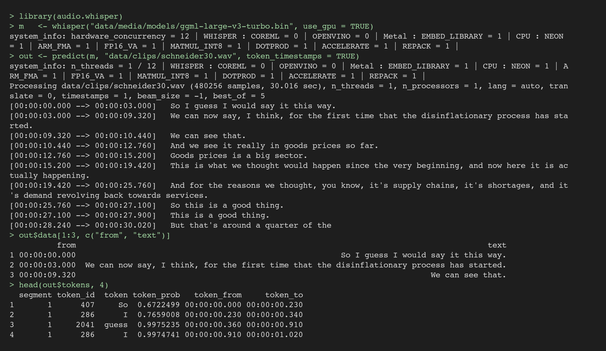{width="88%" fig-align="center"}

### The R route, set up once {#r-route}

`audio.whisper` runs the same open speech-to-text models inside R, through
whisper.cpp, a C++ version of them. It is not on CRAN, so R compiles it from
its source code once. The build calls cmake, a build tool, and on a Mac it
needs the Xcode command line tools. On the instructor's laptop the release
compiled in 66 s. Metal, Apple's interface to the graphics chip, is built in
by default. `use_gpu = TRUE` in `whisper()` uses it; without it the model
runs on the processor.

```{.bash filename="Terminal, once, as it worked on the instructor's laptop; cmake from pip (brew install cmake also works)"}
python3 -m venv ~/cmake-env && ~/cmake-env/bin/pip install cmake      # cmake in its own environment
export PATH=~/cmake-env/bin:$PATH
curl -L -o audio.whisper_0.5.0.tar.gz \
  https://github.com/bnosac/audio.whisper/archive/refs/tags/0.5.0.tar.gz
MAKEFLAGS=-j10 R CMD INSTALL audio.whisper_0.5.0.tar.gz               # 66 s; "Including METAL backend"
```

The same from R loads the package and compiles it only if it is missing;
cmake must be on the PATH:

```{r}
#| eval: false
#| purl: false
#| filename: "R Console, once; needs cmake and the compiler above; installs remotes if it is missing"
want <- c("remotes")
need <- want[!(want %in% installed.packages()[,"Package"])]
if (length(need)) install.packages(need)
if (!requireNamespace("audio.whisper", quietly = TRUE))
  remotes::install_github("bnosac/audio.whisper", ref = "0.5.0")   # compiles whisper.cpp, about a minute
library(audio.whisper)
```

Each model file is downloaded once from the model-hosting site. The large
one, 1.6 GB, took 54 s here:

```{r}
#| eval: false
#| purl: false
#| filename: "R Console, in the 19-audio folder; writes data/media/models/ggml-large-v3-turbo.bin"
whisper_download_model("large-v3-turbo", model_dir = "data/media/models", overwrite = FALSE)
```

Four model files, timed on the instructor's laptop on 2 November 2026. A
clip time is `predict()` alone, with `language = "en"` and the model already
loaded; loading adds 0.2 to 2 s. The word-error rate is on the 30-second
clip against the Fed's text, as in Part 6.

| Model file | Size | Clip, graphics chip | Clip, processor | The 44:37 conference | Word-error rate |
|:--|--:|--:|--:|:--|--:|
| `ggml-base.bin`, this session's small model | 148 MB | 1.1 s | 1.2 s | 34 s, graphics chip | 0.067 |
| `ggml-small.bin` | 488 MB | 1.1 s | 4.1 s | 3 min 48 s, processor | 0.067 |
| `ggml-large-v3-turbo.bin`, the large model | 1,625 MB | 2.3 s | 13.2 s | 2 min 5 s, graphics chip; 13 min 3 s, processor | 0.038 |
| `ggml-large-v3.bin` | 3,095 MB | 3.7 s | not run | not run | 0.048 |

: {tbl-colwidths="[30,10,13,13,22,12]"}

On the whole conference the large model looped once: it wrote one sentence
eight times, from 32:34 to 32:39. The two smaller files ran it with no loop.

`out$tokens` holds one row per token, with its own times and probability. A
token is a piece of a word: the clip's 101 words come as 126 tokens ("Goods"
is "Good" and "s"). A token that begins with a space begins a new word, so
the words can be rebuilt from the tokens.

The R route gives no speaker labels. Its `diarize` option splits a stereo
recording by channel, and the conference's sound is mono.
`replies/speakers.rttm` came from a second model, run in Python.

:::

:::::::: {.content-visible unless-format="revealjs"}

## Other routes, more complex {#other-routes}

::: {.slide-text}

Three routes beyond audio.whisper in R turn a recording into words with
times, and who spoke. Each costs setup, money or the audio leaving the laptop. The first made the
shipped replies, the files in `replies/` this session reads.

| Route | What you install | Where the audio goes | Cost | Time | What comes back |
|:--|:--|:--|:--|:--|:--|
| **Python on the laptop** | Python and a model file | stays on the laptop | free | clip 8.5 s; conference 5 min 7 s | word times, word-error rate 0.029 on the 30-s clip (edits per reference word); speaker labels from a second model |
| **An API from R**, a service your code sends the file to | httr2 and a key (a password your code sends) | the provider's servers | a fee per minute | not run here | word times if asked; speaker labels from some services |
| **A chat model through ellmer**: upload, ask for a transcript | ellmer and a key | the provider's servers | a fee by audio length | not run here | prose; rough times and speaker labels if asked |

: {tbl-colwidths="[20,16,13,10,12,29]"}

:::

::: {.notes}
The API and chat rows were not run: this laptop holds no key for a service
that takes audio. A chat model writes prose, so its times are guesses to
check by ear. The Python command and its terminal capture are on the page
under this slide; the capture is the demo's second fallback.
:::

::: {.content-visible unless-format="revealjs"}

The recording's terms decide the two rows that send audio away: licensed or
confidential audio may not go to a provider's servers. A model file on the
laptop gives the same words on every run. A chat model that accepts audio
takes the file through ellmer's `$file_upload()`, with a prompt that asks
for a verbatim transcript.

### The Python route {#python-route}

Every file in `replies/` came from this route, on the instructor's laptop on
2 November 2026; `tools/SETUP.md` has the model ids, settings, commands and
run times. One terminal line transcribes the clip:

```{.bash filename="Terminal, in the 19-audio folder, with the Python environment of tools/SETUP.md active"}
mlx_whisper data/clips/schneider30.wav --model mlx-community/whisper-large-v3-turbo \
  --language en --word-timestamps True --output-format json \
  --output-dir replies --output-name clip30_live
```

`mlx_whisper`, a speech-to-text program, runs the large model and asks for
English, word times and JSON, under a new name. Its 104 words match the
shipped `replies/clip30_turbo.json`, which Part 6 scores. The whole
conference takes 5 min 7 s. The terminal after a rehearsal, on the
instructor's laptop:

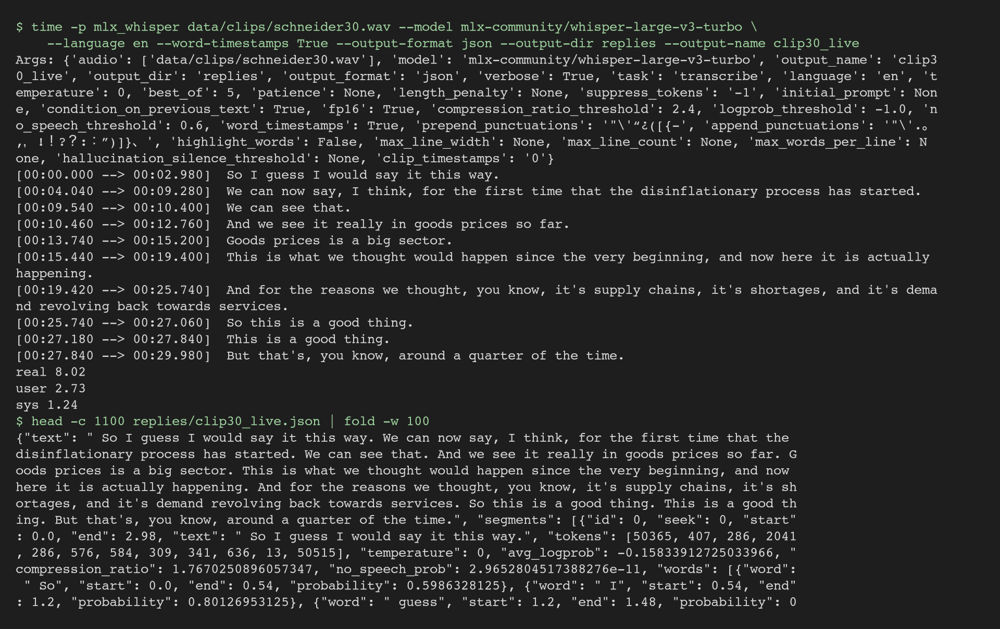{width="88%" fig-align="center"}

### The API route in R {#api-route}

A request to a speech-to-text API is one upload: a multipart POST (a
request that carries a file) with the audio and a few parameters. One of
them asks for a time on every word; without it the reply holds segments
only. The reply is JSON with the same word table the laptop run writes,
and some services return speaker labels in the same call. The provider
charges per minute of audio and decides when a model is retired, so the
saved reply is the object a paper can be rebuilt from. The shape of the
request, with no provider named:

```{r}
#| eval: false
#| purl: false
#| filename: "Not run in class: the shape of a speech-to-text request; needs httr2, an account and a key in ~/.Renviron"
library(httr2)
resp <- request("https://api.example.com/v1/transcriptions") |>      # the provider's address
  req_headers(Authorization = paste("Bearer", Sys.getenv("STT_API_KEY"))) |>
  req_body_multipart(file = curl::form_file("data/clips/schneider30.wav"),
                     model = "<model id>",
                     word_timestamps = "true") |>                    # its name varies by provider
  req_perform()
reply <- resp_body_json(resp)    # the text, then the words with their start and end
```

### The raw replies saved beside the table {#raw-replies}

Every model reply is kept exactly as returned, beside the code that reads
it and a README that says how it was made. For each reply the README
records the model and its settings, the date and time the file was
written, the run time and the word count; for `words.json`: "the full
conference, ... a time on every word; 00:40, 307 s; 7,451 words."

The rebuild is one line, `source("code/run_everything.R")`. It takes about
a second and prints the same lines as `logs/run_everything.log`. A new
transcription takes minutes, and it may not return the same words. Two of
the files, `replies/words.json` and `replies/speakers.rttm`, came from
Python; the commands that made them are in `tools/SETUP.md`. The R route
writes a transcript of its own and no speaker labels. Nothing in `replies/` is edited by hand, and a live run
writes under a new name beside the shipped reply.

**How the audio was fetched and cut** (from `tools/SETUP.md`). The Fed's
page embeds a video player whose public configuration names the video
file; the MP4 link it returns expires within minutes, so it is asked for
afresh each time. One ffmpeg line turns the video's sound into the 16 kHz
mono WAV the model reads (`ffmpeg -i video.mp4 -vn -ac 1 -ar 16000 out.wav`),
and two more cut the clips. `data/media/` is not in the zip. The video
and its sound (246 MB) are one click away on federalreserve.gov, and the two
model files of the R route (1.8 GB) one line away in R.

:::

::::::::

# 5 · Pauses, speaking rate and "you know" {#part-pauses}

## The pause before an answer {#pause}

::: {.slide-text}

`utt` is the utterance table built in R a few slides back, from the two
replies (`code/4_utterances.R` saved it). The pause before a turn is its start
minus the previous row's end.

:::

```{r}
#| filename: "code/6_pauses.R, in the 19-audio folder; reads data_clean/utterances.csv, which code/4_utterances.R wrote"
utt <- read.csv("data_clean/utterances.csv")
utt$words <- lengths(strsplit(utt$text, " "))                       # words per turn
powell <- names(which.max(tapply(utt$words, utt$speaker, sum)))     # the label with the most words
clock  <- function(s) sprintf("%02d:%02d", floor(s / 60), floor(s %% 60))   # seconds to mm:ss
# x <- c(10, 20, 30); c(NA, x[-3]) gives NA 10 20: the previous row's value
utt$pause <- utt$start - c(NA, utt$end[-nrow(utt)])                 # this start minus the previous end
head(utt[, c("speaker", "start", "end", "pause")], 6)
```

::: {.slide-text}

The **pause before an answer**: from the end of the question to the start of
the answer. `clock()` turns seconds into mm:ss, the video's clock. The first question starts 7.56 s after Chair Powell's opening statement
ends. The moderator's name call "Chris Rugeber.", with no speaker label,
sits inside the gap.

:::

::: {.notes}
So a gap in the table is not always silence. Powell's first answer came
1.88 s after the question.
:::

## Speaking rate per turn {#rate}

::: {.slide-text}

Words divided by a turn's duration give its speaking rate. Chair Powell's
median turn runs at 3.0 words a second, the reporters' at 3.2.

:::

```{r}
#| filename: "code/6_pauses.R; needs utt (the utterance table, one row per turn) and powell (SPK00, Chair Powell)"
utt$rate <- utt$words / (utt$end - utt$start)          # words per second
utt$who  <- ifelse(utt$speaker == powell, "Powell", "others")
med <- tapply(utt$rate, utt$who, median)
round(cbind(turns = table(utt$who), per_second = med, per_minute = 60 * med), 1)
round(utt$rate[1], 2)                                  # the opening statement
```

::: {.slide-text}

**Speaking rate**: words per second within a turn. `ifelse()` picks one of
two values per row. `tapply()` takes each group's median. Powell first reads
a prepared opening statement, 960 words in 407 s, 2.36 a second, then answers
questions. A turn that merges two answers (28:47) also spans the question
between them, so it reads slower.

:::

::: {.notes}
The rate uses each turn's own start and end, so a label gap between turns
does not enter it.
:::

## Counting "you know" in each answer {#you-know}

::: {.slide-text}

A filler phrase counted per turn separates read speech from spoken. In the
speech-to-text model's text, Chair Powell's 960-word opening statement has
none; his 26 answers have 63.

:::

```{r}
#| label: you-know-bars
#| script: Counting "you know" in each answer
#| fig.show: !expr if (knitr::pandoc_to("revealjs")) "hide" else "hold"
#| filename: "code/6_pauses.R; needs utt (one row per turn), powell (SPK00, Chair Powell) and clock() (seconds to mm:ss)"
mine <- utt[utt$speaker == powell, ]
hits <- gregexpr("\\byou know\\b", mine$text, ignore.case = TRUE)   # every match in each turn
mine$you_know <- lengths(regmatches(mine$text, hits))               # how many per turn
c(opening = mine$you_know[1], answers = sum(mine$you_know[-1]),
  per_100_words = round(100 * sum(mine$you_know[-1]) / sum(mine$words[-1]), 2))
barplot(100 * mine$you_know / mine$words, names.arg = clock(mine$start), las = 2,
        ylab = "\"you know\" per 100 words", main = "Each of Powell's 27 turns, by its start time")
```

::: {.slide-text}

A **filler phrase** is said while thinking and carries no content.
`gregexpr()` finds every match, `regmatches()` pulls them out, `lengths()`
counts them. `\\b` marks a word boundary. Over the conference the
speech-to-text model wrote 70 and the Fed's transcript keeps 75. "Um" and
"uh" are not counted: the models leave them out, as their training
transcripts do.

:::

::: {.notes}
An edited transcript keeps some fillers and cuts others. Fillers drop out in
any language the model is run from: it learned from human transcripts that
omit them. A prompt written full of fillers brings a few back (Part 6, the
prompted runs); the Python route takes a prompt, R's whisper package has no
prompt argument. So this session does not count "um". The barplot is on the
page.
:::

::: {.content-visible unless-format="revealjs"}

Chair Powell's read opening statement at 00:11 has no "you know", and 18 of
his 26 spoken answers have at least one: 4.2 per 100 words at 38:30 (5 in
119 words), 1.4 in the 652-word answer at 25:24. Each bar is one of his 27
turns, at its start on the video's clock, drawn by the `barplot()` line of
the counting code.

The count for every Powell turn:

```{r}
#| filename: "code/6_pauses.R, in the 19-audio folder; mine and clock() from above"
data.frame(at = clock(mine$start), mine[, c("words", "you_know")])
```

:::

:::::::: {.content-visible unless-format="revealjs"}

## The median pause and the longest {#exercise-2}

::: {.panel-tabset}

### Exercise

Find the pause before each of Chair Powell's answers: how many, the median,
the longest and its time on the video's clock. 4 minutes, in the R Console.
His first row, the opening statement, has no question before it.

```{.default filename="What the slides have built"}
utt      the utterance table, one row per turn; pause = its start minus the previous turn's end, in s
powell   SPK00, the label with the most words (Chair Powell)
clock()  turns seconds into mm:ss, the video's clock
```

1. Keep Powell's rows of `utt` that have a pause; count them and take the
   median pause.
2. The longest, with `which.max()`: its pause, `clock()` of its start,
   `substr()` of its text.

Compare with your neighbours: the median pause, and the clock time of the
longest with its first words.

```{r}
#| label: exercise-2
#| exercise: true
#| script: "Exercise 2 (4 minutes)"
#| include: false
#| eval: false
# Exercise 2 (4 minutes). The pause before each Powell answer.
# 1. utt with its pause column, powell and clock(), as built on the slides before.
# 2. answers <- Powell's rows that have a pause (the opening statement has none).
# 3. How many answers; median(answers$pause).
# 4. The longest: its pause, clock(start), and the first words of its text
#    (substr(text, 1, 45)).
# Two answers to compare with the room: the median pause in seconds, and the
# clock time of the longest pause with what the answer begins with.
```

### Solution

```{r}
#| label: exercise-2-solution
#| purl: false
#| filename: "code/6_pauses.R; utt, powell and clock() as built on the slides before"
answers <- utt[utt$speaker == powell & !is.na(utt$pause), ]
nrow(answers); median(answers$pause)
top <- answers[which.max(answers$pause), ]
data.frame(at = clock(top$start), pause = top$pause, text = substr(top$text, 1, 45))
answers[order(answers$pause, decreasing = TRUE)[1:5], c("start", "pause")]
```

::: {.slide-text}

26 answers, a median pause of 1.76 s; the longest, 6.56 s at 22:58, after
Jeanna Smialek's question.

:::

:::

::: {.content-visible when-format="revealjs"}

::: {.notes}
After the solution, play pause_2258.mp3 from the session page (22:50 to
23:00): the room hears words inside the "pause".
:::

:::

::: {.content-visible unless-format="revealjs"}

The longest pause, 22:50 to 23:00 of the conference
(`data/clips/pause_2258.mp3`):

<audio controls preload="none" src="data/19-audio/data/clips/pause_2258.mp3"></audio>

:::

::::::::

## The five longest pauses, listened to {#pauses-heard}

::: {.slide-text}

All five longest pauses before Chair Powell's answers in `utt`, the
utterance table, hold words with no speaker label. The longest real silence
before an answer is 4.58 s, at 43:38.

| At | Pause in `utt` | Silence between words | Words in the gap with no label |
|:--|--:|--:|:--|
| 22:58 | 6.56 | 3.14 | 7: "on the committee. So, the committee, obviously," |
| 43:38 | 5.90 | 4.58 | 3: "summer? Look, it's" |
| 37:03 | 4.66 | 2.10 | 4: "outcome? I'm not particularly" |
| 23:45 | 4.34 | 1.26 | 6: "between moves? I mean, I think" |
| 38:30 | 3.06 | 2.18 | 3: "on the economy?" |

: {tbl-colwidths="[10,17,19,54]"}

The pause in `utt` runs from the question's last labelled word to the
answer's first. Words the labels missed sit inside it, in 16 of his 26
answers. The silence is the largest gap between consecutive
words there. A long pause is played back, and its words read, before it is
reported.

:::

::: {.notes}
Play pause_4338.mp3 from the page (43:30 to 43:44), the debt-ceiling
question, the last of the conference, before "Look, it's very hard to think
about all the different possibilities". At 22:58 the 3.14 s falls between
"committee." and "So,". Reporters: Smialek at 22:58 and 23:45, Rabinovitch
at 37:03, Horsley at 38:30, Pedersen at 43:38.
:::

::: {.content-visible unless-format="revealjs"}

The longest real silence, 43:30 to 43:44 (`data/clips/pause_4338.mp3`):
the debt-ceiling question, the last of the conference, and the start of the
answer, "Look, it's very hard to think about all the different
possibilities".

<audio controls preload="none" src="data/19-audio/data/clips/pause_4338.mp3"></audio>

:::

## The pause before every Powell answer {#pause-figure}

::: {.slide-text}

For Chair Powell's 26 answers, the silence between words is the number to
report: median 1.07 s against the table's 1.76 s. The table's gaps hold
words with no speaker label, which fell between labelled stretches.

:::

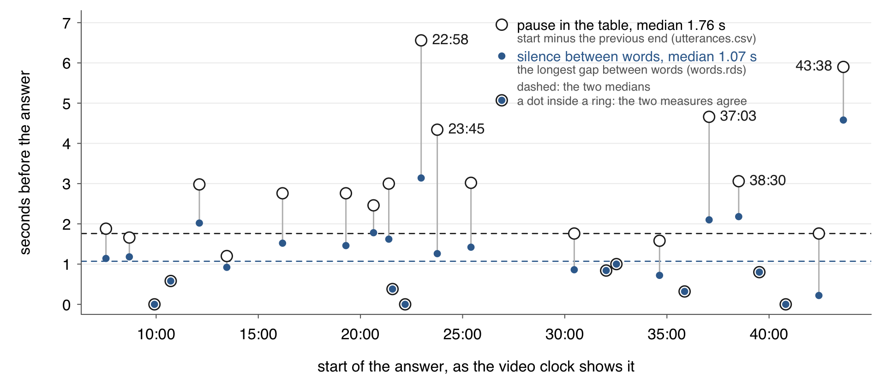{width="86%" fig-align="center"}

::: {.slide-text}

Open circles come from `data_clean/utterances.csv`, the utterance table.
Blue dots come from `data_clean/words.rds`, the 7,451-word table that
`code/1_words.R` saves, with each word's start and end.

:::

[Chair Powell's 26 answers in the Fed's press conference of 1 Feb 2023.]{.source}

::: {.content-visible unless-format="revealjs"}

The silence comes from the word table. For each answer, take every word that
starts at or after the end of the previous turn and before the answer
starts, and find the longest gap in that sequence, counted from the previous
turn's end to the answer's start. The comparison allows 0.005 s either way:
the times are written to the hundredth, and a time read back from the CSV
can differ from the JSON's in the last binary digit (1425.61 against
1425.6099999999999).

```{r}
#| filename: "code/6_pauses.R, in the 19-audio folder; utt, powell, clock() and words from the slides before"
utt$prev_end <- c(NA, utt$end[-nrow(utt)])                # where the turn before ends
answers <- utt[utt$speaker == powell & !is.na(utt$pause), ]
silence <- function(from, to) {                           # the longest gap from one time to another
  g <- words[words$start > from - 0.005 & words$start < to - 0.005, ]   # the words in between
  max(c(g$start, to) - c(from, g$end))
}
answers$silence <- mapply(silence, answers$prev_end, answers$start)
c(table = median(answers$pause), words = median(answers$silence))
words[words$start > 1371.7 & words$start < 1378.3, c("word", "start", "end", "speaker")]
```

The nine words around 22:58: the question ends with "shared on the
committee." (no label; "shared" starts the instant the labelled part of the
question ends), then 3.14 s of silence, then "So, the committee,
obviously," (no label), and Powell's labelled answer starts with "did".
The slide counts only the words that start after the previous turn's end:
16 answers hold such words, and each of the five longest gaps holds one
word fewer than the rule above takes in (17 answers by that rule).

:::

# 6 · Word-error rate against the Fed's transcript {#part-wer}

## The Fed's passage beside the model's words {#passage}

::: {.slide-text}

On a 30-second clip, the large speech-to-text model's 104 words differ from
the transcript's 105 in three places. The transcript's text is the
**reference transcript**, the text treated as correct.

:::

::::: {.columns}

::: {.column width="50%"}

```{=html}
<div class="sourceCode"><pre class="sourceCode"><code>So I guess I would say it this way. We can now
say, I think, for the first time that the
disinflationary process has started. We can see
that. And we see it, really, in goods prices so
far. Goods prices is a big sector. <mark>We—</mark>this is
what we thought would happen since the very
beginning, and now here it is actually
happening, and for the reasons we thought.
<mark>We—</mark>you know, it's supply chains, it's
shortages, and it's demand revolving back
towards services. So this is a good thing. This
is a good thing. But that's, you know, around a
quarter of the</code></pre></div>
```

[The Fed's transcript, page 9: `replies/clip30_fed.txt`]{.source}

:::

::: {.column width="50%"}

```{=html}
<div class="sourceCode"><pre class="sourceCode"><code>So I guess I would say it this way. We can now
say, I think, for the first time that the
disinflationary process has started. We can see
that. And we see it really in goods prices so
far. Goods prices is a big sector. This is what
we thought would happen since the very
beginning, and now here it is actually
happening. And for the reasons we thought, you
know, it's supply chains, it's shortages, and
it's demand revolving back towards services. So
this is a good thing. This is a good thing. But
that's, you know, around a quarter of the
<mark>time.</mark></code></pre></div>
```

[What the large speech-to-text model wrote from the clip: `replies/clip30_turbo.json`]{.source}

:::

:::::

::: {.slide-text}

The clip: Chair Powell answering Howard Schneider of Reuters, 16:09.6 to
16:39.6 of the Fed's press conference of 1 Feb 2023. It ends mid-sentence.
Neither text holds an "um". The transcript's editors kept two restarts,
"We—", that the model dropped. The model guessed "time." at the cut.
Punctuation and capitals are not counted.

:::

::: {.notes}
Play schneider30.mp3 from the session page. The clip stops before the
transcript's next words, "PCE price index". The 23-page transcript holds no
"um" or "uh", and the model wrote none: the editors and the model make the
same kind of edit.
:::

::: {.content-visible unless-format="revealjs"}

The 30-second clip (`data/clips/schneider30.mp3`):

<audio controls preload="none" src="data/19-audio/data/clips/schneider30.mp3"></audio>

:::

:::::::: {.content-visible unless-format="revealjs"}

## Word-error rate on an eleven-word example {#wer-toy}

::: {.slide-text}

Word-error rate is substitutions plus deletions plus insertions, divided by
the reference's word count. Three edits in eleven words give 0.27.

:::

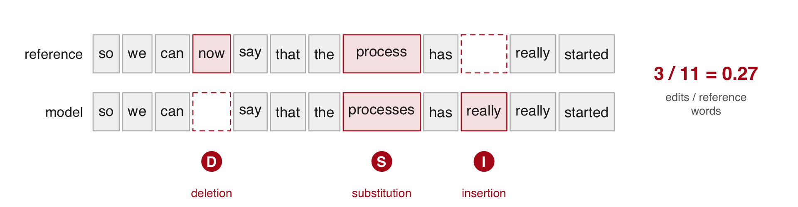{width="86%" fig-align="center"}

::: {.dashes}

- **Substitution**: a wrong word in place of the right one ("processes" for
  "process"). **Deletion**: a reference word the model left out ("now").
  **Insertion**: a word the model added (the first "really", after "has").
- **Word-error rate**: the three counts summed and divided by the
  reference's length. A model that adds many words can score above 1.

:::

::::::::

## Counting word edits with adist() {#adist}

::: {.slide-text}

**Word-error rate**: the substitutions, deletions and insertions that turn
the reference into the model's text, over the reference's word count.
`adist()` counts them; one character per word makes it count words.

:::

```{r}
#| filename: "code/7_wer.R; base R only"
#| collapse: true
word_edits <- function(ref, hyp) {
  vocab <- unique(c(ref, hyp))                  # every distinct word
  r <- intToUtf8(match(ref, vocab) + 1000)      # one character per word, past the ordinary letters
  h <- intToUtf8(match(hyp, vocab) + 1000)
  adist(r, h, counts = TRUE)
}
ref <- strsplit("so we can now say that the process has really started", " ")[[1]]
hyp <- strsplit("so we can say that the processes has really really started", " ")[[1]]
d <- word_edits(ref, hyp)
attr(d, "counts")[1, 1, ]
sum(attr(d, "counts")) / length(ref)
attr(d, "trafos")
```

::: {.slide-text}

**Edit distance**: the fewest substitutions, deletions and insertions that
turn one sequence into the other. `ref` is the reference, `hyp` the model's text (its hypothesis). `match()`
numbers each word, and `intToUtf8()` turns each number into one character. The path in `"trafos"` reads M match, S
substitution, D deletion, I insertion.

:::

## Normalizing both texts before scoring {#normalize}

::: {.slide-text}

Both texts are written by the same rules before counting, and those rules
decide the score.

:::

```{r}
#| filename: "code/7_wer.R, in the 19-audio folder; base R"
to_words <- function(x) {
  x <- tolower(paste(x, collapse = " "))
  x <- gsub("[-/—–]", " ", x)          # dashes and slashes split words: "We—this" -> "we this"
  x <- gsub("[^a-z0-9' ]", "", x)      # other punctuation dropped; the straight apostrophe stays
  strsplit(trimws(x), " +")[[1]]
}
to_words("We—this is what we thought. We—you know, it's P.C.E.")
ref <- to_words(readLines("replies/clip30_fed.txt", encoding = "UTF-8", warn = FALSE))
length(ref)
```

::: {.slide-text}

**Normalization**: writing both texts by the same rules before comparing
them. The transcript PDF prints a curly apostrophe (`’`) where the
speech-to-text models write a straight one (`'`). Left curly, the punctuation rule drops it, and "it's" becomes "its". On the
30-s clip, Powell's answer at 16:09, the large model's 3 edits (0.029) then
become 7 (0.067). `replies/clip30_fed.txt`, the transcript's text for
the clip, ships with straight apostrophes.

:::

::: {.notes}
"4½" loses its fraction, so numbers are read by eye.
:::

## Four runs scored on the 30-second clip {#four-runs}

::: {.slide-text}

On the 30-s clip, Powell's answer at 16:09, the large model makes 3 edits
against the Fed's 105-word passage; the small one makes 9.

:::

```{r}
#| filename: "code/7_wer.R; needs jsonlite, ref (the 105 reference words), to_words() and word_edits() from the slides before"
runs <- c(small = "replies/clip30_base.json",   small_prompt = "replies/clip30_base_prompt.json",
          large = "replies/clip30_turbo.json",  large_prompt = "replies/clip30_turbo_prompt.json")
hyps  <- lapply(runs, function(f) to_words(fromJSON(f)$text))   # one word vector per file
score <- function(h) { k <- attr(word_edits(ref, h), "counts")[1, 1, ]
                       c(model_words = length(h), k, rate = round(sum(k) / length(ref), 3)) }
t(sapply(hyps, score))                                          # one row per run
```

::: {.slide-text}

Small (`clip30_base.json`) and large (`clip30_turbo.json`) are two sizes of
one speech-to-text model. `word_edits()` counts
`ins` (words added), `del` (reference words left out) and `sub` (words
replaced). `rate` is their sum over the 105 reference words.
A **prompt** is text put in front of the model before it writes. The
`small_prompt` run stopped writing at 12.7 s, so 67 reference words are deletions.

:::

::: {.notes}
model_words counts the words in each reply's text field after
normalization.
:::

:::::::: {.content-visible unless-format="revealjs"}

## A prompt full of fillers {#prompt-runs}

::: {.slide-text}

A prompt full of fillers barely moves the large speech-to-text model:
word-error rate 0.029 to 0.048. It stops the small one at 12.7 s of the 30-s
clip (Powell at 16:09, 1 Feb 2023), 67 words short (0.648).

:::

::: {.content-visible when-format="revealjs"}

```{r}
#| filename: "code/7_wer.R; hyps (the four runs' words) and score() (the edit counter) from the slide before"
#| purl: false
t(sapply(hyps, score))
```

:::

```{r}
#| filename: "code/7_wer.R, in the 19-audio folder; needs jsonlite"
fromJSON("replies/clip30_base_prompt.json")$segments[, c("start", "end")]   # small model, prompted: one segment
substr(fromJSON("replies/clip30_turbo_prompt.json")$text, 1, 51)             # large model, prompted: first words
```

::: {.slide-text}

The model continues a prompt in its style. This one lists fillers the models
drop ("Um, uh, so, you know, I- I think..."). The large model then writes
restarts ("I would— I would") and an "Uh" that the Fed's transcript lacks.
Each is one edit, a word added, dropped or replaced.

:::

::: {.notes}
The prompted "Uh," sits at 3.62 s with probability 0.12.
:::

::::::::

:::::::: {.content-visible unless-format="revealjs"}

## Where the errors fall {#errors}

::: {.slide-text}

The large model's three errors on the 30-second clip are two restarts
("We—") the transcript printed and one word guessed at the cut. None is a
wrong word.

:::

```{r}
#| filename: "code/7_wer.R, in the 19-audio folder; needs ref (the 105 reference words) and hyps (each run's words)"
source("code/align.R")     # align(): walks attr(d, "trafos") and prints one row per edit
```

::::: {.columns}

::: {.column width="50%"}

```{r}
#| filename: "code/7_wer.R: the large model (replies/clip30_turbo.json)"
align(ref, hyps$large)
```

:::

::: {.column width="50%"}

```{r}
#| filename: "code/7_wer.R: the small model (replies/clip30_base.json)"
align(ref, hyps$small)
```

:::

:::::

::: {.slide-text}

**Alignment**: the two texts lined up word by word. `op`: D a reference word the model left out, S a word it replaced, I a word
it added. `ref_pos` is the place in the reference; 46 and 71 are the
transcript's two "We—". The small model writes wrong words ("change" for
"chains"). It drops "you know" twice, which biases a filler count.

:::

::: {.content-visible unless-format="revealjs"}

`align()` in full, from `code/align.R`:

```{r}
#| filename: "code/7_wer.R, in the 19-audio folder"
cat(readLines("code/align.R"), sep = "\n")
```

The prompted large run adds the restarts and the "Uh" the prompt invited,
and guesses another word at the cut:

```{r}
#| filename: "code/7_wer.R, in the 19-audio folder; ref, hyps and align() from above"
align(ref, hyps$large_prompt)
clip <- do.call(rbind, fromJSON("replies/clip30_turbo.json")$segments$words)
tail(clip, 2)                      # the last two words, both placed at 29.98 s
```

The guessed "time." has the lowest probability in the clip, 0.12; the
"the" before it, 0.49, also sits at the cut. One clip of the chair into a
good microphone measures the chair: a reporter on a room microphone needs
a clip of their own (Practice 8 starts the habit).

:::

::::::::

## How far the table can be trusted {#trust}

::: {.slide-text}

The utterance table, built in this session from the two models' replies, has
one row per turn (one speaker's stretch). On a 30-s clip it gets 97 words in
100 right. The measures on words and times stand. Its speaker labels miss
every turn shorter than 3 seconds.

| What was measured | Against what | Result, the table's number first |
|:--|:--|:--|
| Words | the Fed's own transcript: its text of the 30-s clip (Powell's answer at 16:09) and its word count over the conference | word-error rate 0.029; 7,451 words against 7,365; "you know" 70 against 75 |
| Turns | the transcript's speaker tags | Powell, the Fed chair, 27 turns of 30; the moderator, who calls on the reporters, 0 of 17; 267 words with no label (3.6%) |
| Pauses | listening, and the gaps between words | the five longest are gaps in the labels; median 1.76 s by the table, 1.07 s by the words |

: {tbl-colwidths="[16,36,48]"}

One caveat: the word times are the model's reconstruction of where each word
falls. The guessed "time." at the clip's cut has a zero-length time, 29.98
to 29.98 s.

:::

::: {.content-visible unless-format="revealjs"}

What a paper that uses such a table reports: the model, its settings and
the date it ran; that the raw reply is kept; a word-error rate on a clip
against a reference; the turn counts against a transcript; and the share of
words with no label.

:::

## Practice {#practice}

::: {.content-visible when-format="revealjs"}

Ten tasks on the session page, run in the 19-audio folder on the Fed's press
conference of 1 Feb 2023. They use `words`, `seg`, `w`, `utt` and the two
30-s clip replies.

- **1–2** `words`: the small model, chunks read alone · ten lowest
  probabilities
- **3–4** `seg`, `w`: labels by word start · 68 runs of unlabelled words
- **5–7** `utt`: longest answer · silences over 2.5 s · silence before
  answers
- **8–10** word-error rate: your transcript of the opening (earphones) ·
  curly apostrophes · small-model clip errors

:::

::: {.content-hidden when-format="revealjs"}

```{r}
#| label: practice
#| exercise: true
#| script: "Practice"
#| eval: false
# Practice. Run in the 19-audio folder after the slides' code has built
# words (with its speaker column), seg, w, utt (with pause, words and rate),
# powell, clock(), to_words(), word_edits(), ref, hyps and align().
# None needs Python, an account or the network; task 8 needs earphones.

# Reading model output
#  1. replies/words_base_nocond.json is the small model run again with each
#     30-second chunk decoded without the text before it. Read its words as
#     on the slides and count them per minute with table(floor(start / 60)).
#     Does it still loop after 34:57? Set minutes 35 to 44 beside the large
#     model's.
#  2. The ten words in words with the lowest probability, with their clock
#     times. Where in the conference do they fall?
# Speaker labels
#  3. Label each word by its start time instead of its midpoint. How many
#     words change label?
#  4. rle(is.na(words$speaker)) gives the runs of unlabelled words. How many
#     runs are there, and how many are the moderator calling a reporter by
#     name?
# Measures from the times
#  5. Powell's longest answer by words, his opening statement left out: its
#     start, end and length in seconds. Read its text. Is it one answer?
#  6. Every silence over 2.5 s between consecutive words in words, with the
#     words on either side and the clock time it ends. What happens in the
#     two longest?
#  7. For each Powell answer, the longest silence between words from the end
#     of the previous turn to the start of the answer. The median and the
#     longest, with its clock time, against the table's 1.76 s.
# Word-error rate
#  8. With earphones, write your own transcript of 0:06 to 0:36 of
#     data/clips/open2min.mp3 by the rules on the session page, before you
#     open any model file; save it as data_clean/my_opening.txt. Score the
#     large and small models' words that start before 36.6 s against it, and
#     against the Fed's text of the same passage.
#  9. Put the PDF's curly apostrophes back into the reference with
#     gsub("'", "\u2019", ...) and score the large model again. Which words
#     change, and what is the rate?
# Alignment
# 10. align(ref, hyps$small) lists the small model's nine errors on the
#     clip. Find each in data/clips/schneider30.mp3 with the times of the
#     model's segments, and listen. Which are wrong words, and which are
#     restarts?
```

**Rules for the hand transcript of task 8.** Write it before you open any
model file. Play the clip at reduced speed, in three passes. Keep fillers,
restarts and repeated words; write numbers as spoken and acronyms as
letters. Mark a word you cannot make out `[unclear]` and leave it out of
the count.

<audio controls preload="none" src="data/19-audio/data/clips/open2min.mp3"></audio>

::: {.callout-note collapse="true" title="Solutions"}

```{r}
#| label: practice-solutions
#| purl: false
#| filename: "R Console; after the slides' code"
# 1. No loop without conditioning: within a few words of the large model
nc <- do.call(rbind, fromJSON("replies/words_base_nocond.json")$segments$words)
nrow(nc)
rbind(large = table(floor(words$start / 60))[36:45],
      no_conditioning = table(floor(nc$start / 60))[36:45])
# 2. The ten lowest probabilities
low <- words[order(words$probability)[1:10], c("word", "start", "probability")]
low$at <- clock(low$start)
low
# 3. Labels by start time instead of midpoint
label_at <- function(t) {
  i <- findInterval(t, seg$start)
  i[i == 0] <- NA
  i[!is.na(i) & t > seg$end[i]] <- NA
  seg$speaker[i]
}
by_start <- label_at(words$start)
changed <- ifelse(is.na(by_start) | is.na(words$speaker),
                  is.na(by_start) != is.na(words$speaker), by_start != words$speaker)
sum(changed)
# 4. The runs of unlabelled words
r <- rle(is.na(words$speaker))
last <- cumsum(r$lengths); first <- last - r$lengths + 1
na_runs <- data.frame(from = first, to = last, n = r$lengths)[r$values, ]
nrow(na_runs)
na_runs$at <- clock(words$start[na_runs$from])
na_runs$text <- substr(mapply(function(a, b) paste(words$word[a:b], collapse = " "),
                              na_runs$from, na_runs$to), 1, 50)
print(na_runs[, c("at", "n", "text")], row.names = FALSE)
# 5. Powell's longest answer (his first row is the opening statement)
long <- utt[utt$speaker == powell, ][-1, ]
long <- long[which.max(long$words), ]
c(start = long$start, end = long$end, seconds = long$end - long$start, words = long$words)
clock(long$start)
# 6. Silences over 2.5 s between consecutive words
gap <- words$start[-1] - words$end[-nrow(words)]
big <- which(gap > 2.5)
length(big)
head(data.frame(gap = gap[big], after = words$word[big], before = words$word[big + 1],
                ends_at = clock(words$start[big + 1]))[order(-gap[big]), ], 5)
# 7. The silence before each answer, from the word table
answers$silence <- mapply(silence, answers$prev_end, answers$start)
c(median = median(answers$silence), longest = max(answers$silence))
clock(answers$start[which.max(answers$silence)])
# 8. The two models from 0:06 to 0:36, against the Fed's text of the passage
fed_open <- to_words(gsub("\u2019", "'", sub(" of the Federal Reserve.*$", "", fed_text)))
large_open <- to_words(words$word[words$start < 36.6])
small_open <- to_words(small_words$word[small_words$start < 36.6])
rbind(large = c(attr(word_edits(fed_open, large_open), "counts")[1, 1, ]),
      small = c(attr(word_edits(fed_open, small_open), "counts")[1, 1, ]))
if (file.exists("data_clean/my_opening.txt")) {     # your own transcript, once written
  mine_ref <- to_words(readLines("data_clean/my_opening.txt", warn = FALSE))
  sapply(list(large = large_open, small = small_open),
         function(h) round(sum(attr(word_edits(mine_ref, h), "counts")) / length(mine_ref), 3))
}
# 9. The curly apostrophes put back
curly <- to_words(gsub("'", "\u2019", readLines("replies/clip30_fed.txt", encoding = "UTF-8", warn = FALSE)))
k <- attr(word_edits(curly, hyps$large), "counts")[1, 1, ]
c(k, rate = round(sum(k) / length(curly), 3))
setdiff(curly, ref)
# 10. The small model's errors, and where its segments fall in the clip
align(ref, hyps$small)
fromJSON("replies/clip30_base.json")$segments[, c("start", "end", "text")]
```

Task 1: no loop; minutes 35 to 44 run 190 161 161 164 143 189 169 192 157
78 words against the large model's 203 164 168 176 148 188 165 188 156 84.
Task 2: four of the five lowest fall between 33:48 and 35:54 ("for" at
34:14, probability 0.0009); the fifth is "Thank" at 44:31, a reporter at the
very end. Task 3: 43 words. Task 4: 68 runs, 16 of them the moderator's
name calls ("Chris Rugeber.", "Rachel.", "Neil.", "Howard.", "Victoria." and,
for "Jeanna and then Steve", "Gina and this team."). Task 5: 652 words,
25:24 to 29:35 (250.7 s): two answers to Steve Liesman, merged around his
unlabelled follow-up "Can we get there with the 5%?" at 28:47. Task 6:
twenty silences; the longest, 6.86 s, ends at 18:48 with "Nick", and the
next, 6.58 s, ends at 11:47, where the transcript has "Colby, and then
Howard." and the model wrote nothing. Task 7: median 1.07 s, longest 4.58 s
at 43:38. Task 8: your rate depends on your transcript; against the Fed's
text the models lose points on "we've" for "we have" and "2 %" for "2
percent", which are normalization, not hearing. Task 9: 1 insertion, 2
deletions and 4 substitutions, 0.067: "it's" three times and "that's".
Task 10: the six places of the slide, with "since" heard as "to" and
"chains" as "change".

:::

:::

::: {.content-hidden when-format="revealjs"}

## Sources {#sources}

[Hansen, McMahon & Prat (QJE, 2018)](https://doi.org/10.1093/qje/qjx045);
[Hassan, Hollander, van Lent & Tahoun (QJE, 2019)](https://doi.org/10.1093/qje/qjz021);
[Sautner, van Lent, Vilkov & Zhang (JF, 2023)](https://doi.org/10.1111/jofi.13219);
[Mayew & Venkatachalam (JF, 2012)](https://doi.org/10.1111/j.1540-6261.2011.01705.x);
[Radford et al. (ICML, 2023)](https://proceedings.mlr.press/v202/radford23a.html).
Board of Governors of the Federal Reserve System,
[Transcript of Chair Powell's Press Conference, February 1, 2023](https://www.federalreserve.gov/mediacenter/files/FOMCpresconf20230201.pdf),
final version, and the [conference page](https://www.federalreserve.gov/monetarypolicy/fomcpresconf20230201.htm)
with the video (public domain);
[FOMC meeting transcript, November 16, 1993](https://www.federalreserve.gov/monetarypolicy/files/FOMC19931116meeting.pdf)
(public domain); [jsonlite](https://cran.r-project.org/package=jsonlite).
The models, their versions and the commands behind every reply are in
`tools/SETUP.md`.

**Links:** [slides](19-audio-slides.html) · [Syllabus](../syllabus.qmd)

:::

```{r}
#| purl: false
#| include: false
source(file.path(session_dir, "_purl.R"))
purl_session(file.path(session_dir, "19-audio.qmd"),
             file.path(session_dir, "19-audio.R"))
```
