```{r}
#| purl: false
#| include: false
knitr::opts_chunk$set(
  comment = "#>",
  collapse = FALSE,
  fig.width = 9,
  fig.height = 4.4,
  fig.align = "center",
  fig.show = "hold",
  dpi = 150
)
options(width = 80)
# Every chunk runs in the project folder, so the paths on the page are the
# paths students use.
session_dir <- getwd()
knitr::opts_knit$set(root.dir = file.path(session_dir, "data/20-audio-ii"))
```

::: {.content-hidden when-format="revealjs"}

[Slides](20-audio-ii-slides.html) · [Live script](20-audio-ii.R) ·
[Source](https://github.com/ArielOrtizBobea/aem6850/blob/main/fall-2026/sessions/20-audio-ii.qmd) ·
[the project](data/20-audio-ii.zip)

A voice carries more than its words: how high it is, how much it moves, how
loud it is, how activated it sounds. This session measures those cues in the
answers Jerome Powell gave at the Fed's 24 press conferences of 2021-2023, with
the 11 rate hikes of those years as the test case. Pitch and loudness come from
R, emotion scores from a model run before class, and your own ears are the
check on the model. A recording also passes through a press room, a microphone
and a gain, so each measure is read for how much of it is the speaker and how
much is the recording.

**The project.** Download [20-audio-ii.zip](data/20-audio-ii.zip), unzip it, and
open `20-audio-ii.Rproj`, so that R starts in the project folder. The scripts
load what they use, wrassp and tuneR, and install them if they are missing.
Nobody needs Python, an account or the network: the model's scores are saved in
the folder. Its `README.md` says what is where.

## Objectives {#objectives}

By the end of this session you can:

- Explain what a recording of a voice holds beyond the words: pitch level, pitch
  range and loudness over time, and the two scores emotion research uses, arousal
  (how activated the speaker sounds) and valence (how positive).
- Explain why a voice measure is read against the speaker's own baseline, and
  tell variation from the speaker apart from variation from the recording.
- Read a study that uses voice or other sound as data and say what was measured,
  with what tool, and what it was compared with.
- Measure the pitch and loudness of a recording in R and read them against a
  speaker's baseline.
- Explain what an emotion model is trained on and what it returns, and why a
  model that does well on its training data can fail on other speech.
- Judge how far an emotion score can be trusted on a given recording, from its
  agreement with ratings by ear on a random sample of clips.

Left out: the words and speaker labels (loaded from file); text sentiment; video
and faces; any causal claim about the hikes.

:::

## Plan for today {#plan}

::: {.slide-text}

What we are going to do today

1. **What the voice carries**\
   [Cues · pitch level and range · arousal, valence · baseline]{.topics}
2. **The voice as research data**\
   [Congress · the Fed · listeners]{.topics}
3. **Measuring pitch and loudness in R**\
   [A known tone · one clip · Exercise 1]{.topics}
4. **Voice models**\
   [What they are · actors and executives]{.topics}
5. **The emotion score against your ear**\
   [A random draw · Exercise 2]{.topics}
6. **Powell through the hikes**\
   [Across conferences · hikes and holds · within one]{.topics}
7. **Sound beyond speech**\
   [Gunfire · forests]{.topics}

[Today: the subtle cues in a voice, and how much of each measure is the speaker. Left
aside: the words, text sentiment, video and faces.]{.source}

:::

## The project folder {#project-folder}

::: {.slide-text}

Unzip [20-audio-ii.zip](data/20-audio-ii.zip) and open `20-audio-ii.Rproj`, so
every path on the slides works.

:::

```{.default filename="20-audio-ii/, as its README.md describes it"}
20-audio-ii/
  data/clips/  15-s clips of Powell, clip1 to clip8 and the named clips; a 160-s excerpt
  data_clean/  tone.csv (one row per turn), clips.csv, meetings.csv, turns_excerpt.csv, quiet.csv
  replies/     the emotion model's scores, as returned
  code/        1_pitch_energy.R, 2_ear.R, 3_conferences.R, run_everything.R
  logs/        run times, printed output
  tools/       the Python and R that made replies/ and tone.csv from the full recordings
```

::: {.slide-text}

The scripts install what they need. Nobody runs Python. The full recordings
(7 GB) stay out of the zip.

:::

# 1 · What the voice carries {#part-voice}

## The 24 press conferences {#conferences}

::: {.slide-text}

The FOMC raised rates at 11 of its 24 meetings in 2021-2023. Jerome Powell, its
chair, took reporters' questions after every one.

:::

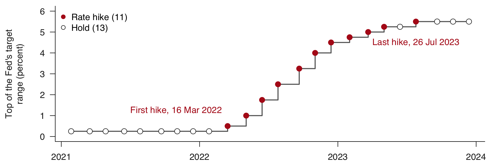{width="90%" fig-align="center"}

[A **rate hike** is a meeting that raised the target rate; a **hold** left it. A
**turn** is one person's unbroken stretch of talk; an **answer** is a Powell turn
after his opening statement. Of 608 answers, 571 run 15 s or longer. We keep
those, since shorter turns give too little sound to measure.]{.source}

::: {.notes}
Dates: the Fed's table of target-range changes. The labelled table of turns was
built from the recordings before class and loads from file.
:::

## Two answers from one conference {#two-answers}



::: {.slide-text}

A transcript gives the words of these two answers. Only the recording tells you
the first sounds calm and the second activated, meaning animated and urgent.

:::

:::: {.columns}

::: {.column width="48%"}

<button class="clip-play" type="button" data-src="data/20-audio-ii/data/clips/calm.mp3" data-start="0" data-end="15">▶ Calm, 39:49</button>

"The economy is in quite a different place than when we tapered back in, I guess
it was, 2013."

:::

::: {.column width="48%"}

<button class="clip-play" type="button" data-src="data/20-audio-ii/data/clips/activated.mp3" data-start="0" data-end="15">▶ Activated, 25:15</button>

"That's a decision for the Committee. I would put it to you this way."

:::

::::

[Powell, press conference of 3 Nov 2021, first 15 s of each answer. Times run from the
start of the recording. Words as in the Fed's transcript, pp. 21 and 13.]{.source}

## What a voice carries beyond the words {#cues}

::: {.slide-text}

A recording holds cues a transcript leaves out. Today puts numbers on some of
them and leaves the rest aside.

:::

::: {.dashes}

- **Measured today**
  - Pitch level: how high the voice is.
  - Pitch range: how much it moves, animated or flat.
  - Loudness, measured as energy, the size of the wave.
  - A model's scores: arousal (how activated), valence (how positive).
- **Left aside today**
  - Hesitation.
  - Voice quality: creaky or strained.
  - Accent, laughter and sarcasm.

:::

[Pitch range, first 15 s of the two answers just played: 16.1 Hz in the calm one and
34.0 Hz in the activated one. **Hz**: cycles a second.]{.source}

## Pitch and energy tracks of one answer {#tracks}

::: {.slide-text}

A recording holds tracks beyond the words. These 15 s have a pitch level of
109.9 Hz, a pitch range of 34.0 Hz and a mean energy of 55.7 dB.

:::

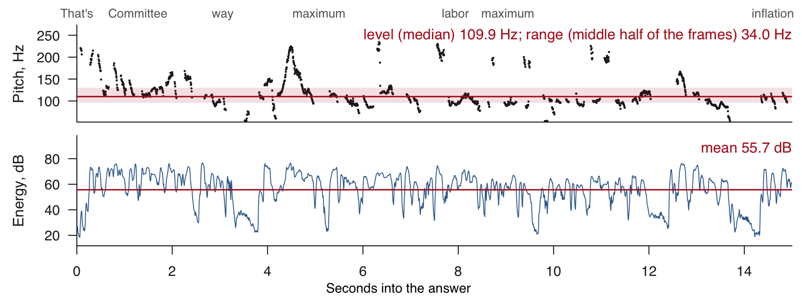{width="94%" fig-align="center"}

[A **pitch tracker** is software that estimates pitch in each 5-ms slice. A **voiced
frame** is a slice where the vocal folds vibrate: vowels yes, "s" and "t" no. **Pitch level** is the median over voiced frames; **pitch range** is
their interquartile range, the width of the middle half. **Energy** is the size
of the wave in decibels (dB), heard as loudness; halving the wave takes off
6 dB. Powell, 3 Nov 2021, 25:15. Plotting code: `code/1_pitch_energy.R`.]{.source}

::: {.notes}
A tracker can jump to double the true pitch. The median and the interquartile
range both ignore a few jumps. 51% of these frames are voiced.
:::

::: {.content-visible unless-format="revealjs"}

`rmsana()` computes the root mean square of the samples in a 20-ms Hamming
window, one value every 5 ms. Its decibels run roughly from a sample value of 1
(a tone of amplitude 8,000 reads 76.4 dB), so they compare recordings with each
other and give no absolute loudness.

:::

## Arousal and valence {#arousal-valence}

::: {.slide-text}

Emotion research scores speech on two scales. **Arousal** is how activated a
speaker sounds, **valence** how positive. An **emotion model** returns both,
roughly from 0 to 1.

:::

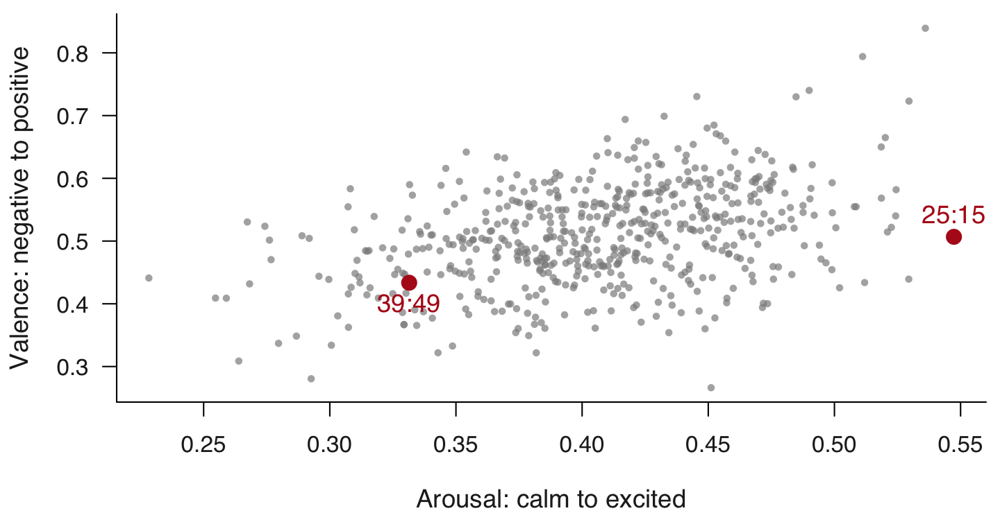{width="66%" fig-align="center"}

[First 15 s of each of Powell's 571 answers, one dot each. The answer at 25:15 of
3 Nov 2021 has the highest arousal of the 571. A third score, dominance,
correlates 0.94 with arousal across answers, so we show two. **Correlation** runs
from −1 to 1: how closely two lists move together.]{.source}

## A speaker's baseline and the z-score {#baseline}

::: {.slide-text}

Speakers differ far more than one speaker varies. So a measure is read against
that speaker's own usual level, the **baseline**.

:::

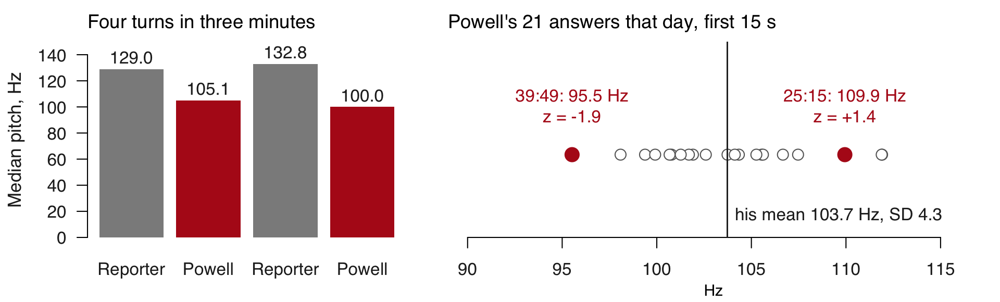{width="92%" fig-align="center"}

[A **z-score** is the distance from the baseline in standard deviations:
(109.9 − 103.7) / 4.3 = +1.4. Press conference of 3 Nov 2021; right panel, the
first 15 s of each of Powell's answers of 15 s or more.]{.source}

## How a recording changes a voice measure {#chain}

::: {.slide-text}

Powell measures 63.3 dB on 15 Jun 2022 and 47.7 dB on 20 Sep 2023, a factor of 6
in the wave's height. His pitch level differs by only 2.3 Hz.
That gap in loudness points to the recording.

:::

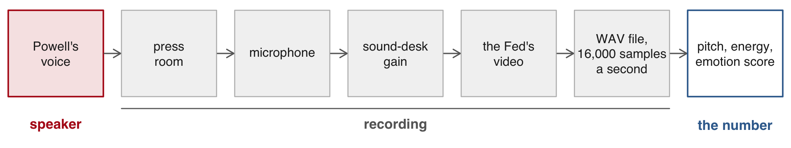{width="92%" fig-align="center"}

::: {.slide-text}

How much of a voice measure is the speaker, and how much is the recording?

<button class="clip-play" type="button" data-src="data/20-audio-ii/data/clips/jun2022.mp3" data-start="0" data-end="15">▶ 15 Jun 2022, 9:44</button>
<button class="clip-play" type="button" data-src="data/20-audio-ii/data/clips/sep2023.mp3" data-start="0" data-end="15">▶ 20 Sep 2023, 9:11</button>

:::

[**Gain**: a multiplier applied to every sample, set at the sound desk, the mixer between
microphone and video. Both clips are Powell at a press conference.]{.source}

# 2 · The voice as research data {#part-research}

## Vocal pitch in Congress {#paper-congress}

::: {.slide-text}

Small rises in a legislator's pitch measure emotional intensity. Women in Congress
show more of it when speaking about women.

:::

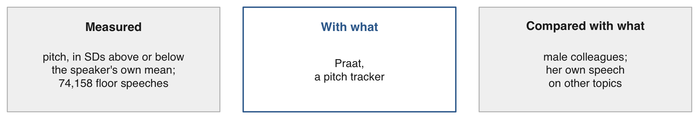{width="90%" fig-align="center"}

::: {.dashes}

- [Dietrich, Hayes & O'Brien (APSR, 2019)](https://doi.org/10.1017/s0003055419000467).
  Women averaged 206.01 Hz when mentioning women and 203.27 Hz otherwise.
- A recording archive with no labels can answer a question about behaviour once
  the comparison is built in.

:::

[**Floor speech**: a speech in the chamber during debate; here speeches of 50 or more
words, Jan 2009 to Aug 2014. Praat is free software for analysing speech.]{.source}

::: {.notes}
The authors argue that small pitch changes are hard for a speaker to control.
:::

## Tone of voice and share prices {#paper-fed}

::: {.slide-text}

A more positive tone in the Fed chair's voice raises share prices over the following
days. The Fed's actions and the sentiment of its texts are held fixed.

:::

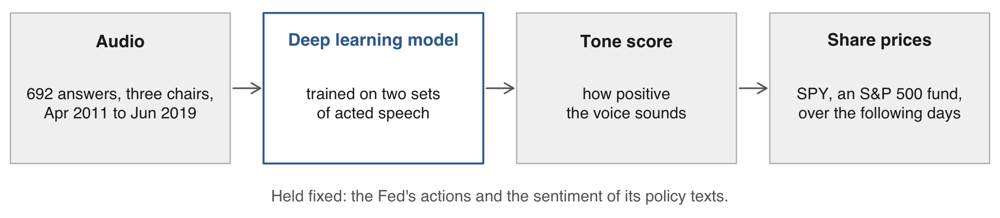{width="90%" fig-align="center"}

::: {.dashes}

- [Gorodnichenko, Pham & Talavera (AER, 2023)](https://doi.org/10.1257/aer.20220129).
  After five days, about 100 basis points per unit of tone, or about 75 per SD. No
  significant effect on the same day.
- How a message is spoken can be a variable in an economics paper, so the quality
  of the score matters.

:::

[**Text sentiment**: how positive the written words are. **Basis point**: one hundredth
of a percentage point.]{.source}

::: {.content-visible unless-format="revealjs"}

Read in the accepted manuscript; the typeset AER text was not reached. The two sets of
acted speech are RAVDESS and TESS.

:::

## Listeners rating voices {#paper-listeners}

::: {.slide-text}

Anonymous listeners judged speakers' race from the voice alone. Wages differ by how
accurately listeners identified the speaker.

:::

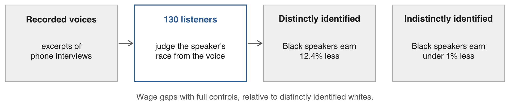{width="90%" fig-align="center"}

::: {.dashes}

- [Grogger (JHR, 2011)](https://doi.org/10.1353/jhr.2011.0017). **Distinctly
  identified**: four or more of five listeners judged the speaker's race accurately.
- Ratings by listeners can be the measure in a published study. You will rate
  clips by ear later today.

:::

::: {.content-visible unless-format="revealjs"}

Read in the draft revised January 2009; the JHR text is paywalled. There, 130 listeners,
mostly graduate students, heard excerpts of phone interviews. Relative to distinctly
identified whites, the gaps for distinctly and indistinctly identified Black speakers are
18.8% and 2.3% (not significant) in the base specification, and 12.4% and under 1% with
full controls. The published abstract also states about 12 percent; an earlier working
paper's abstract gives about 10 percent and about 2 percent.

:::

## What each study measured {#studies-table}

::: {.slide-text}

To read a voice study, ask what was measured, with what tool, and compared with
what.

| Study | Measured | With | Compared with |
|:--|:--|:--|:--|
| [Dietrich et al. (APSR, 2019)](https://doi.org/10.1017/s0003055419000467) | a legislator's pitch against own mean | a pitch tracker (Praat) | male colleagues, own speech on other topics |
| [Gorodnichenko et al. (AER, 2023)](https://doi.org/10.1257/aer.20220129) | tone | a model trained on acted speech | share prices, Fed actions held fixed |
| [Grogger (JHR, 2011)](https://doi.org/10.1353/jhr.2011.0017) | how a voice is heard | anonymous listeners | wages of speakers listeners identified as white |
| Today | pitch, energy, emotion score | a pitch tracker, a model, your ears | Powell's own baseline, 24 press conferences |

:::

::: {.content-visible unless-format="revealjs"}

**More studies.** [Alexopoulos, Han, Kryvtsov & Zhang (JME, 2024)](https://doi.org/10.1016/j.jmoneco.2023.09.002)
build emotion indices from the words, voice and face of Bernanke and Yellen at 32
congressional testimonies, 2010-2017 (confirmed in the working paper). [Purnell, Idsardi & Baugh (JLSP, 1999)](https://doi.org/10.1177/0261927x99018001002)
show that landlords discriminate by dialect over the telephone.
[Edmans, Fernandez-Perez, Garel & Indriawan (JFE, 2022)](https://doi.org/10.1016/j.jfineco.2021.08.014)
use the positivity of the songs a country streams as a measure of national
sentiment; it goes with higher returns the same week and lower returns the next (accepted version).

:::

# 3 · Measuring pitch and loudness in R {#part-r}

## Pitch of a known tone {#known-tone}

::: {.slide-text}

Can we measure how a voice sounds without a model? Yes, in R, and the reading only means
something against the speaker's own baseline. First the tool: a fixed rule, with no training.
A 120 Hz tone made in R comes back from the pitch tracker `ksvF0()` as 120 Hz.

:::

```{r}
#| script: "Pitch of a known tone"
#| filename: "R Console, in the 20-audio-ii folder. Installs wrassp and tuneR if missing; writes data_clean/tone120.wav"
#| output: false
#| message: false
want <- c("wrassp", "tuneR")
need <- want[!(want %in% installed.packages()[,"Package"])]
if (length(need)) install.packages(need)
lapply(want, function(i) require(i, character.only = TRUE))
rm(want, need)
x <- round(8000 * sin(2 * pi * 120 * (1:48000) / 16000))     # 3 s at 120 Hz
writeWave(Wave(x, samp.rate = 16000, bit = 16), "data_clean/tone120.wav")
p <- ksvF0("data_clean/tone120.wav", gender = "m", toFile = FALSE)
length(p$F0)             # 600: one value every 5 ms
median(p$F0[p$F0 > 0])   # 120.03
```

::: {.dashes}

- `wrassp` measures pitch and energy in sound files. `tuneR` reads and writes them.
- `sin()` builds 3 s at 16,000 samples a second.
- `gender = "m"` sets the search range to 50-400 Hz, which fits Powell.

:::

## Pitch and energy of one clip {#one-clip}

::: {.slide-text}

Two calls measure any WAV file. `voice()` reduces them to pitch level, pitch range,
mean energy and voiced share.

:::

```{r}
#| script: "Pitch and energy of one clip"
#| filename: "R Console, in the 20-audio-ii folder; wrassp from the slide before. The clip: 3 Nov 2021, 25:15, 15 s"
#| collapse: true
f <- "data/clips/activated.wav"
p <- ksvF0(f, gender = "m", toFile = FALSE)
round(p$F0[786:793], 1)     # 3.93 to 3.96 s: zeros, then voice starts
voice <- function(f, from = 0, to = 0) {
  p <- ksvF0(f, beginTime = from, endTime = to, gender = "m", toFile = FALSE)
  e <- rmsana(f, beginTime = from, endTime = to, toFile = FALSE)
  v <- p$F0[p$F0 > 0]       # the voiced frames
  c(pitch = median(v), range = IQR(v), energy = mean(e$rms), voiced = mean(p$F0 > 0))
}
round(voice(f), 2)
```

[The clip is Powell's activated answer from the press conference of 3 Nov 2021. **Range** is the
interquartile range, `IQR()`. `F0` is the pitch track, zero where no pitch was found. `rmsana()` returns energy in
dB every 5 ms. A start and end of 0 mean the whole file, so `voice()` also serves one
turn. It runs in about 0.01 s.]{.source}

::: {.content-visible unless-format="revealjs"}

To draw the two tracks, set the zeros to `NA` and make two plots:
`plot(p$F0)` after `p$F0[p$F0 == 0] <- NA`, then `plot(rmsana(f, toFile = FALSE)$rms, type = "l")`.
`code/1_pitch_energy.R` holds the figure's version. A second tracker, `mhsF0()`,
returns `$pitch` and agrees with `ksvF0()` within 5 Hz on the conferences compared.

:::

## Halving the volume {#halving}

::: {.slide-text}

Recordings differ in volume, so we test which measures depend on it. Halving every sample
cuts energy by 6 dB. Pitch level moves under 1 Hz.

:::

```{r}
#| script: "Halving the volume"
#| filename: "R Console, in the 20-audio-ii folder; f and voice() from the slide before; writes data_clean/half.wav"
#| collapse: true
w <- readWave(f)
w@left <- as.integer(round(w@left / 2))    # every sample cut in half
writeWave(w, "data_clean/half.wav")
round(rbind(as_recorded = voice(f), half = voice("data_clean/half.wav")), 2)
```

::: {.dashes}

- `w@left` holds the samples.
- So energy depends on the recording's volume, and pitch level does not.

:::

::: {.content-visible unless-format="revealjs"}

### Pitch and energy per turn {#per-turn}

One loop over a table of turns gives each speaker's pitch and energy from one
press conference. Reporters run near 130 Hz, Powell near 100.

```{r}
#| script: "Pitch and energy per turn"
#| filename: "R Console, in the 20-audio-ii folder; voice() from the slides before"
#| collapse: true
turns <- read.csv("data_clean/turns_excerpt.csv")
g <- "data/clips/excerpt_20211103.wav"          # 160 s of 3 Nov 2021, starting at 480 s
m <- t(sapply(1:nrow(turns), function(i) voice(g, turns$start[i] - 480, turns$end[i] - 480)))
cbind(turns[, c("speaker", "start", "end")], round(m, 2))
```

SPK00 is Powell, SPK02 a reporter; the labels were made before class and load from
file. `sapply()` runs `voice()` per row, and `t()` turns the result so each turn is a
row. For your own data: a WAV and a table of start and end times.

:::

## A clip against Powell's baseline {#against-baseline}

::: {.slide-text}

Against his other first 15 s that day, the clip at 25:15 is 1.44 SD up in pitch level
and 1.87 SD up in pitch range.

:::

```{r}
#| script: "A clip against Powell's baseline"
#| filename: "R Console, in the 20-audio-ii folder; f and voice() from the slides before; reads data_clean/tone.csv"
#| collapse: true
tone <- read.csv("data_clean/tone.csv")
ans  <- tone[tone$type == "answer" & tone$end - tone$start >= 15, ]   # 571 answers
z <- function(x, base = x) (x - mean(base)) / sd(base)
nov <- ans[ans$date == "2021-11-03", ]             # his 21 answers that day
v <- voice(f)
round(c(pitch  = z(v[["pitch"]], nov$pitch15),
        range  = z(v[["range"]], nov$iqr15),
        energy = z(v[["energy"]], nov$energy15)), 2)
```

[`tone.csv` has one row per turn, 24 conferences; `type` is "answer" for Powell's
replies. `pitch`, `pitch_iqr` and `energy` cover the whole turn. `pitch15`, `iqr15` and
`energy15` cover its first 15 s, so a 15-s clip is compared like with like. `z()` takes
a value and a baseline.]{.source}

## Exercise 1 {#exercise-1}

::: {.panel-tabset}

### Exercise

Measure two clips of Powell answering at press conferences, and read each against his answers
that day. 5 minutes.

1. Run `voice()` on each clip.
2. Keep his answers on each date from `ans`.
3. z-score each clip's pitch level, pitch range and energy against its own date.

```{r}
#| label: exercise-1
#| exercise: true
#| script: "Exercise 1 (5 minutes)"
#| include: false
#| eval: false
# Exercise 1 (5 minutes). Two clips, each against Powell's answers that day.
# In the 20-audio-ii folder, with voice(), z() and ans as on the slides before.
# Clips, first 15 s of each answer:
#   data/clips/answer_20211103.wav   3 Nov 2021, 8:25
#   data/clips/answer_20230201.wav   1 Feb 2023, 7:33
# 1. Run voice() on each clip.
# 2. Keep his answers on each date from ans.
# 3. z-score each clip's pitch, range and energy against its own date,
#    with pitch15, iqr15 and energy15.
# Two answers to compare with the room: which clip is higher in hertz,
# and which is higher against its own day.
```

[Clips: `data/clips/answer_20211103.wav` (3 Nov 2021, 8:25) and
`data/clips/answer_20230201.wav` (1 Feb 2023, 7:33). `voice()` measures a clip.
`ans` holds his answers of 15 s or more, and `pitch15`, `iqr15` and `energy15` are their first
15 s. Two answers to compare with the room: which clip is higher in hertz, and
which is higher against its own day.]{.source}

### Solution

```{r}
#| purl: false
#| filename: "R Console, in the 20-audio-ii folder; voice(), z() and ans from the slides before"
#| collapse: true
a <- voice("data/clips/answer_20211103.wav")
b <- voice("data/clips/answer_20230201.wav")
feb <- ans[ans$date == "2023-02-01", ]
read <- function(v, d) round(c(pitch = z(v[["pitch"]], d$pitch15), range = z(v[["range"]], d$iqr15),
                               energy = z(v[["energy"]], d$energy15)), 2)
round(rbind(a, b), 2)
rbind(a = read(a, nov), b = read(b, feb))
```

[The 2021 clip is 10 Hz higher. Against its own day the 2023 clip is the higher one,
in level and in range.]{.source}

:::

## Two clips, each compared with that day's answers {#two-clips}

::: {.slide-text}

The clip that is lower in hertz is the higher one against its own day.

:::

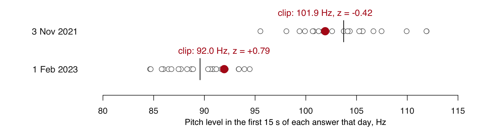{width="92%" fig-align="center"}

::: {.dashes}

- 3 Nov 2021: "We try to focus on what we can control". 1 Feb 2023: "So it is
  important that overall financial conditions…".
- Powell's pitch fell between 2021 and 2023. Within each day his answers still vary
  around that day's mean.

:::

# 4 · Voice models {#part-models}

## What a voice model is {#what-voice-model}

::: {.slide-text}

Pitch and energy came from a fixed rule. A voice model is trained, and turns speech into
scores for how it sounds. Speech-to-text and speaker-label models turn the same sound into
words and speaker labels.

| | Speech-to-text | Speaker labels | Emotion model |
|:--|:--|:--|:--|
| Returns, for Powell at 25:15 | "That's a decision for the Committee." | SPK00 | arousal 0.547, valence 0.507 |
| Learned from | recordings with transcripts | recordings of known speakers | clips rated by people |
| Checked against | a reference transcript | the turns in a transcript | ratings by ear |

: {tbl-colwidths="[24,30,24,22]"}

:::

::: {.dashes}

- Speech-to-text can be scored right or wrong, because a transcript records what was said.
- Tone has no such record. An emotion score can only be compared with what listeners hear.

:::

[Press conference of 3 Nov 2021, first 15 s of the answer at 25:15.]{.source}

## How an emotion model is trained {#training}

::: {.slide-text}

Clips of speech are rated on scales, and a model learns to predict the ratings. It
returns a new clip's position on those scales.

:::

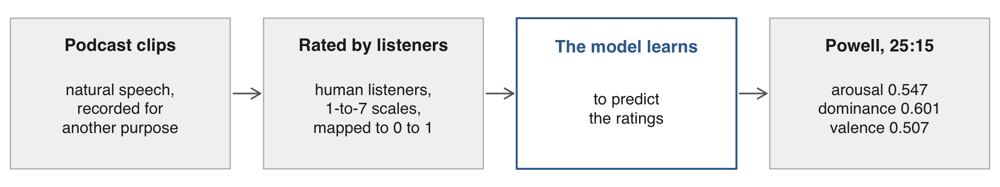{width="92%" fig-align="center"}

::: {.dashes}

- **Training data**, the examples a model learns from, comes in two types:
  - **Natural speech**: recorded for another purpose, then rated by listeners. Today's model
    learned from this.
  - **Acted speech**: actors perform an emotion on request, such as "happy" or "angry". The
    request is the label.
- The scale comes from those ratings, so it has no fixed meaning for a Fed chair.

:::

[**Arousal**: how activated a speaker sounds. **Dominance**: how in control. **Valence**: how positive.
Powell, the Fed's chair, 25:15 into a press conference. Today's model:
[Wagner et al. (TPAMI, 2023)](https://doi.org/10.1109/tpami.2023.3263585), read as the arXiv preprint.]{.source}

::: {.content-visible unless-format="revealjs"}

The ratings come from human listeners: the corpus's authors describe crowdsourced ratings,
later joined by trained students, with at least five raters per speaking turn
([The MSP-Podcast Corpus, 2025 overview](https://arxiv.org/abs/2509.09791), seen in summary).

:::

## How a tone classifier is scored {#auc}

::: {.slide-text}

The study on the next slide tests a classifier, another kind of voice model: each sentence gets
a probability of positive, neutral and negative. **AUC** scores how well those probabilities rank
the sentences.

| Probability of "negative" | Other sentence: 0.7 | Other sentence: 0.6 | Other sentence: 0.2 |
|:--|:--|:--|:--|
| Truly negative sentence: 0.9 | right | right | right |
| Truly negative sentence: 0.4 | wrong | wrong | right |

:::

::: {.dashes}

- Pair each truly negative sentence with each other sentence. A pair is right when the truly
  negative one gets the higher probability.
- AUC is the share of pairs right: 4 of 6 here, or 67. Repeat for each tone and average.
- Guessing gets half the pairs right, so 50. A perfect model gets 100.
- Accuracy would mislead: 89% of sentences on calls are neutral, so always answering
  "neutral" scores 89 with no skill. Its AUC is 50.

:::

[Made-up probabilities, to show the arithmetic. Listeners' labels decide which sentences are
truly negative. **AUC**: area under the curve.]{.source}

::: {.content-visible unless-format="revealjs"}

In base R, the table's arithmetic is `mean(outer(c(0.9, 0.4), c(0.7, 0.6, 0.2), ">"))`, which
returns 0.667. A tie counts as half a pair, so a model that gives every sentence the same
probability scores 50. [Ewertz et al.](https://doi.org/10.1111/1475-679x.70015) report this
measure one tone against the rest, averaged over the three tones without weights (p. 245).
AUC is a ranking measure: it does not say the model would pick the right label for a given
sentence. The 89% comes from their 5,000 call sentences, labelled by three authors.

:::

## Models trained on actors fail on executives {#paper-executives}

::: {.slide-text}

Many emotion models learn from actors instead of rated natural speech. Tested on
executives, they do little better than guessing. One retrained on calls does better.

:::

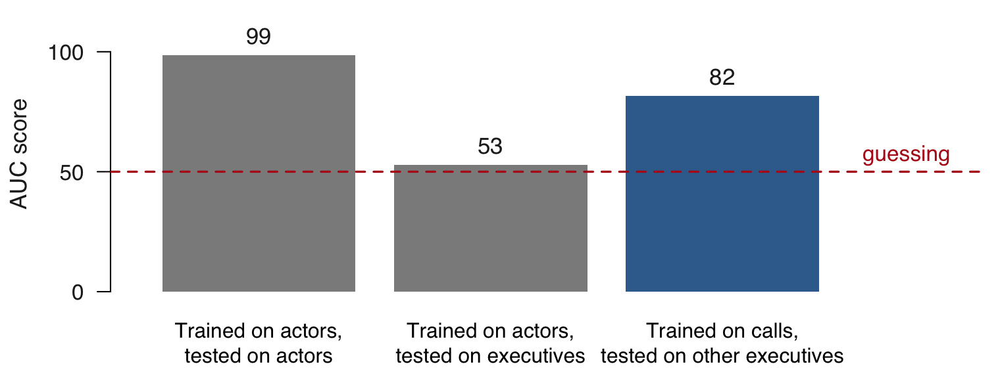{width="60%" fig-align="center"}

::: {.dashes}

- **What the models classify**: is a sentence's tone of voice positive, neutral or negative?
  The right answer is the emotion the actor was asked to perform, or for executives, the
  label human listeners gave.
- Today's model learned from podcast clips, so this is a caution by analogy. Test a score
  on speech like yours.

:::

[**AUC** as on the slide before: 50 is guessing, 100 is perfect.
[Ewertz, Knickrehm, Nienhaus & Reichmann (JAR, 2026)](https://doi.org/10.1111/1475-679x.70015), p. 245: 5,000 sentences from quarterly earnings calls.]{.source}

::: {.content-visible unless-format="revealjs"}

In the same comparison, F1 scores run 91.06 on actors, 6.63 on executives and 51.35 for
the retrained model. The acted sets are RAVDESS and TESS. Three authors labelled the
5,000 call sentences by majority vote, all with neutral wording, and 89% came out neutral in
tone. The retrained model is scored on speakers it did not train on. The retrained model relates to
future firm performance. Read in the version of record.

**An earlier study and its critics.** [Mayew & Venkatachalam (JF, 2012)](https://doi.org/10.1111/j.1540-6261.2011.01705.x)
measured managers' affect on earnings calls with commercial voice software (LVA, from
Nemesysco, confirmed in a 2008 draft) and found it informative about the firm's future.
[Lacerda (PERILUS, 2012)](http://web.archive.org/web/20240916080243/http://www.ling.su.se/polopoly_fs/1.80956.1331884755!/menu/standard/file/MoneyTalksThePowerOfVoice_PERILUS_20120314.pdf),
a critical review in a departmental series of Stockholm University (archived copy),
argues that the software cannot measure emotion and calls the results void. Ewertz
et al. report that estimates from earlier vocal tone models are largely unrelated
to firm performance.

:::

## Emotion scores for the 24 press conferences {#python}

::: {.slide-text}

Before class we ran today's emotion model, trained on podcast clips, on the audio of all 24
press conferences, one 10-s window at a time. It runs in Python, so R only reads its scores.
You test those scores by ear in the next part.

:::

```{.python filename="tools/emotion_windows.py (part, simplified): ran before class, about half a minute per conference; you do not run it"}
model_name = "audeering/wav2vec2-large-robust-12-ft-emotion-msp-dim"
W = int(10 * sr)                           # 10 s = 160,000 samples
for s in range(0, len(x), W):              # one window at a time
    seg = x[s:s + W]
    y = processor(seg, sampling_rate=sr)["input_values"][0].reshape(1, -1)
    out = model(torch.from_numpy(y).to(device))[1][0].detach().cpu().numpy()
```

```{.default filename="replies/emotion_20211103.csv, two rows as returned: 3 Nov 2021, 1510 to 1530 s"}
window_start,window_end,arousal,dominance,valence
1510.00,1520.00,0.669097,0.669171,0.490495
1520.00,1530.00,0.500852,0.572668,0.520989
```

[A **window** is a fixed stretch scored as one piece. The answer at 25:15 starts at
1514.68 s, so the first window holds about 4 s of the reporter's question. Clips are
scored whole, with one 15-s window each (`replies/emotion_clips.csv`,
`replies/emotion_openings.csv`). Halving the volume of the clip at 25:15 leaves its arousal
score at 0.547 to 0.546, since the model rescales the sound before scoring it.]{.source}

::: {.content-visible unless-format="revealjs"}

`processor` rescales each window, so the file's overall level does not reach the
model. The model's licence is CC BY-NC-SA 4.0, for research use; the scores were
made on 2 Nov 2026. The recordings come from the Fed's video with
`ffmpeg -vn -ac 1 -ar 16000`; `tools/pitch_all.R` wrote the pitch and energy columns
of `tone.csv` from them in about a minute, and `tools/SETUP.md` has the rest.

:::

## Arousal follows pitch and energy, valence does not {#draws}

::: {.slide-text}

Do the model's two scores repeat what R can measure? Pitch level, pitch range and energy
explain 37% of its arousal score and 7% of its valence score.

:::

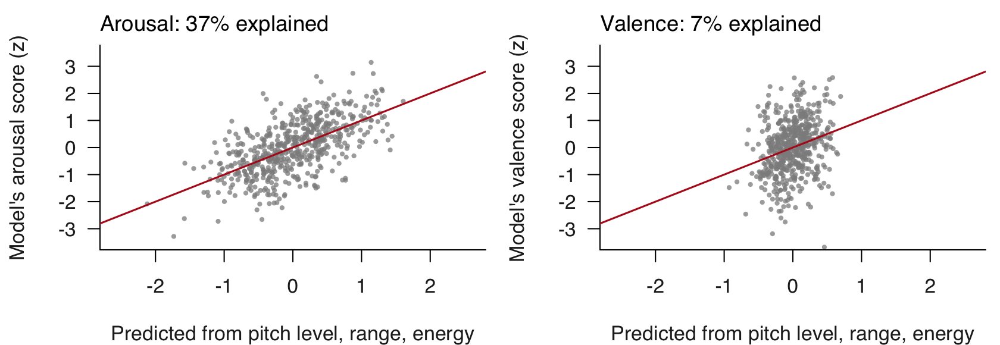{width="76%" fig-align="center"}

::: {.dashes}

- Each dot is one of Powell's answers: our own calculation on today's data.
- So measures from R can partly check arousal. Valence needs something else: the model
  picks up word information carried in the sound
  ([Wagner et al., TPAMI, 2023](https://doi.org/10.1109/tpami.2023.3263585)).

:::

[**Arousal**: how activated a speaker sounds. **Valence**: how positive. Each answer averages its 10-s windows.
571 answers, each measure z-scored within its conference. **Explain**: the R-squared of a regression. In Canada's House of Commons, transcripts capture sentiment and
miss arousal ([Cochrane et al., Political Communication, 2022](https://doi.org/10.1080/10584609.2021.1952497)).]{.source}

::: {.content-visible unless-format="revealjs"}

Wagner et al. (arXiv preprint) map 1-to-7 rating scales to 0-1, and find the model fair across gender groups and less so across
individual speakers, one more reason to read a speaker against their own baseline.

A valence pair to hear what the score picks up. 3 May 2023 (p. 20), "we shouldn't
even be talking about a world in which the U.S. doesn't pay its bills", first 15 s:
arousal 0.420, valence 0.346. 20 Sep 2023 (p. 24), "It's, it's a good thing that the
economy's strong.", first 15 s: arousal 0.419, valence 0.678.

:::

# 5 · The emotion score against your ear {#part-ear}

## Rating arousal by ear {#rating}

::: {.slide-text}

Ratings by ear on a random sample tell us how far a score can be trusted on this
speaker. You rate before seeing any score.

:::

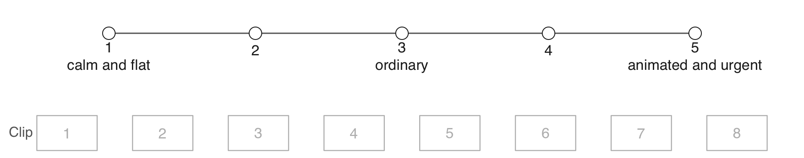{width="84%" fig-align="center"}

::: {.dashes}

- Rate the voice, setting the content aside as far as you can.
- The model trained on podcast clips. It has no record of accuracy on this speaker.
- The clips play from the instructor's laptop. You may instead use earbuds and the
  numbered buttons on the session page.

:::

## Eight clips drawn at random {#draw}

::: {.slide-text}

A seeded draw from Powell's 571 answers picks the clips, so nobody chooses where the model looks good. You will
rate them by ear, and `cor()` compares your ratings with the emotion model's scores.

:::

```{r}
#| script: "Eight clips drawn at random"
#| filename: "R Console, in the 20-audio-ii folder; ans from the slides before; reads data_clean/clips.csv"
#| collapse: true
ans <- ans[order(ans$date, ans$start), ]            # the 571 answers in a fixed order
set.seed(6850)
pick <- ans[sample(nrow(ans), 8), c("date", "start")]
s <- round(pick$start)
pick$clock <- sprintf("%d:%02d", s %/% 60, s %% 60)  # seconds to m:ss
rownames(pick) <- 1:8
pick[, c("date", "clock")]
clips <- read.csv("data_clean/clips.csv")           # holds the scores too: print none before rating
round(cor(clips$pitch, clips$energy), 2)            # cor() on pitch and energy, so no score shows yet
```

[A **seed** makes the same draw every time. Each clip is the first 15 s of its answer,
with its volume set to one common level for playing. Correlation needs no shared scale, so
1-to-5 ratings can go beside a 0-to-1 score.]{.source}

::: {.content-visible unless-format="revealjs"}

Clips 4 and 7 start 0.35 s and 0.42 s after the drawn time, past the reporter's
"Thanks." and a fragment of a phrase. The energy in `clips.csv` is the clip as
recorded, before its gain.

:::

## Exercise 2 {#exercise-2}

<button class="clip-play" type="button" data-src="data/20-audio-ii/data/clips/clip1.mp3" data-start="0" data-end="15">▶ 1</button>
<button class="clip-play" type="button" data-src="data/20-audio-ii/data/clips/clip2.mp3" data-start="0" data-end="15">▶ 2</button>
<button class="clip-play" type="button" data-src="data/20-audio-ii/data/clips/clip3.mp3" data-start="0" data-end="15">▶ 3</button>
<button class="clip-play" type="button" data-src="data/20-audio-ii/data/clips/clip4.mp3" data-start="0" data-end="15">▶ 4</button>
<button class="clip-play" type="button" data-src="data/20-audio-ii/data/clips/clip5.mp3" data-start="0" data-end="15">▶ 5</button>
<button class="clip-play" type="button" data-src="data/20-audio-ii/data/clips/clip6.mp3" data-start="0" data-end="15">▶ 6</button>
<button class="clip-play" type="button" data-src="data/20-audio-ii/data/clips/clip7.mp3" data-start="0" data-end="15">▶ 7</button>
<button class="clip-play" type="button" data-src="data/20-audio-ii/data/clips/clip8.mp3" data-start="0" data-end="15">▶ 8</button>

::: {.panel-tabset}

### Exercise

Rate arousal for eight clips by ear, then compare your ratings with the model and with
a neighbour. 7 minutes.

1. Listen to clips 1 to 8 in order. Rate each: 1 calm and flat, 3 ordinary, 5 animated
   and urgent. Rate before anything else.
2. Type your ratings and a neighbour's into R.
3. `cor()` with the model, and with your neighbour.
4. Your gap from the model, clip by clip.

```{r}
#| label: exercise-2
#| exercise: true
#| script: "Exercise 2 (7 minutes)"
#| include: false
#| eval: false
# Exercise 2 (7 minutes). The model's arousal score against your ear.
# In the 20-audio-ii folder, with clips and z() as on the slides before.
# 1. Listen to clips 1 to 8 in order. Rate each: 1 calm and flat, 3 ordinary,
#    5 animated and urgent. Rate before anything else.
# 2. mine      <- c( , , , , , , , )     # your eight ratings
#    neighbour <- c( , , , , , , , )     # a neighbour's eight
# 3. cor(mine, clips$arousal)  and  cor(mine, neighbour)
# 4. round(z(mine) - z(clips$arousal), 2)   # your gap from the model, clip by clip
# Two answers to compare with the room: your cor() with the model beside your
# cor() with your neighbour, and the clip with your largest gap.
```

[Two answers to compare with the room: your `cor()` with the model beside your `cor()`
with your neighbour, and the clip with your largest gap.]{.source}

### Solution

```{r}
#| purl: false
#| filename: "R Console, in the 20-audio-ii folder; clips from the slide before. The model's side; the ratings are yours"
#| collapse: true
round(clips$arousal, 3)
round(c(pitch = cor(clips$pitch, clips$arousal), range = cor(clips$range, clips$arousal)), 2)
```

[Across these eight, the score follows pitch level and pitch range. All-equal ratings make
`cor()` return `NA` with a warning.]{.source}

:::

## The eight clips, scored {#scored}

::: {.slide-text}

Here are the emotion model's scores for how activated each 15 s you rated sounds, arousal on a 0-to-1 scale.
Eight clips give a rough reading: random ratings correlate above 0.5 or below −0.5 with these
scores about one time in five.

:::

::: {.content-visible when-format="revealjs"}

| Clip | Date | Clock | Model's arousal | Words begin (transcription model) |
|:--|:--|:--|--:|:--|
| 1 | 13 Dec 2023 | 35:46 | 0.364 | The question of whether there have been fundamental... |
| 2 | 1 Nov 2023 | 36:04 | 0.414 | You know, the progress is probably going to come in lumps |
| 3 | 28 Apr 2021 | 6:54 | 0.480 | Thank you. So, no, it is not time yet. |
| 4 | 4 May 2022 | 41:37 | 0.410 | Well, so as I mentioned |
| 5 | 26 Jan 2022 | 50:13 | 0.403 | do monitor the slope of the yield curve |
| 6 | 28 Apr 2021 | 54:08 | 0.524 | you're very faint. So if someone has a volume |
| 7 | 22 Mar 2023 | 29:08 | 0.299 | No, we, if we need to raise |
| 8 | 4 May 2022 | 32:44 | 0.389 | I think it's certainly possible that we'll need to move |

: {tbl-colwidths="[6,14,8,16,56]"}

:::

::: {.content-hidden when-format="revealjs"}

::: {.callout-tip collapse="true"}

## The scores, for after you rate

| Clip | Date | Clock | Model's arousal | Words begin (transcription model) |
|:--|:--|:--|--:|:--|
| 1 | 13 Dec 2023 | 35:46 | 0.364 | The question of whether there have been fundamental... |
| 2 | 1 Nov 2023 | 36:04 | 0.414 | You know, the progress is probably going to come in lumps |
| 3 | 28 Apr 2021 | 6:54 | 0.480 | Thank you. So, no, it is not time yet. |
| 4 | 4 May 2022 | 41:37 | 0.410 | Well, so as I mentioned |
| 5 | 26 Jan 2022 | 50:13 | 0.403 | do monitor the slope of the yield curve |
| 6 | 28 Apr 2021 | 54:08 | 0.524 | you're very faint. So if someone has a volume |
| 7 | 22 Mar 2023 | 29:08 | 0.299 | No, we, if we need to raise |
| 8 | 4 May 2022 | 32:44 | 0.389 | I think it's certainly possible that we'll need to move |

:::

:::

[Scores: one 15-s window per clip; SD 0.069, against 0.053 across the same 15 s of all
571 answers. Random: 20,000 sets of 1-to-5 ratings against these eight scores. Clip 6
opens on Powell telling a reporter he is very faint. **Clock**: time into the recording.]{.source}

::: {.content-visible unless-format="revealjs"}

Read your correlation with the model beside your neighbour's, since people disagree too.
A paper would use more clips and more than one rater, and report their agreement beside
the model's. On 8 clips an r of 0.6 has a 95% interval from −0.18 to 0.92; on 50 clips
an r of 0.5 runs from 0.26 to 0.68.

The 10-s windows that touch a clip reach 3.5 to 8.3 s before the answer, into sound
nobody hears here. That is why the clips were scored whole, with
`python -I tools/emotion_windows.py clip.wav out.csv --win 15`. Across the 571 answers
the two ways of scoring correlate 0.92.

:::

# 6 · Powell through the hikes {#part-hikes}

## Energy and pitch by conference {#by-conference}

::: {.slide-text}

Energy varies mostly between conferences, and Powell's and the reporters' correlate 0.92.
That points to the recording.

:::

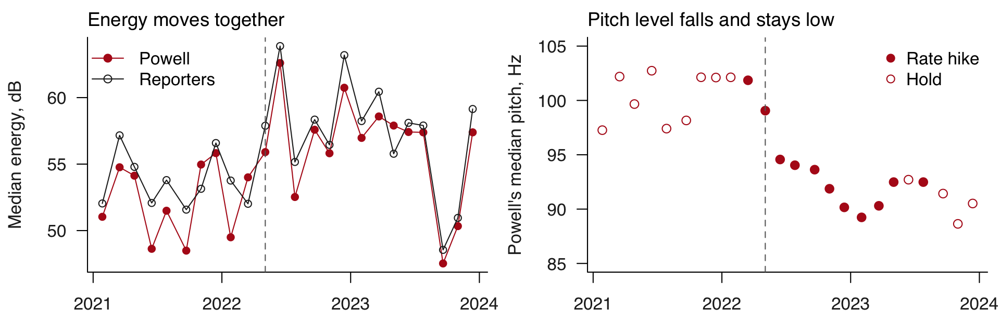{width="88%" fig-align="center"}

::: {.dashes}

- Share of variance between conferences: energy 0.94, pitch level 0.79, arousal 0.43,
  valence 0.13.
- Powell's pitch fell from 100.1 Hz in 2021 to 91.1 Hz in 2023. Why is unknown. The fall
  comes close to the dashed line, 4 May 2022, and these data cannot separate his voice
  from the press room.

:::

[Medians of the 571 answers per conference; **reporters**: other speakers' turns of 10 s or
more. "It's nice to see everyone in person for the first time in a couple years."
[Powell, transcript of 4 May 2022, p. 1](https://www.federalreserve.gov/mediacenter/files/FOMCpresconf20220504.pdf).]{.source}

::: {.content-visible unless-format="revealjs"}

The code behind the figure and the shares. A share of 1 means answers differ only by which
conference they come from; `ave()` replaces each value with its group's mean.

```{r}
#| script: "Energy and pitch by conference"
#| filename: "code/3_conferences.R (part), in the 20-audio-ii folder; ans from the slides before; reads data_clean/meetings.csv"
#| collapse: true
share <- function(x, g) 1 - sum((x - ave(x, g))^2) / sum((x - mean(x))^2)
round(sapply(ans[, c("energy", "pitch", "arousal", "valence")], share, g = ans$date), 2)
conf <- aggregate(cbind(pitch, energy, arousal) ~ date, ans, median)
meet <- read.csv("data_clean/meetings.csv")
conf <- merge(conf, meet[, c("date", "decision")])
others <- tone[tone$type == "other" & tone$end - tone$start >= 10 & !is.na(tone$energy), ]
conf <- merge(conf, setNames(aggregate(energy ~ date, others, median), c("date", "reporters")))
round(cor(conf$energy, conf$reporters), 2)
plot(as.Date(conf$date), conf$pitch, pch = ifelse(conf$decision == "hike", 19, 1),
     ylim = c(85, 105), xlab = "Press conference", ylab = "Powell's median pitch, Hz")
abline(v = as.Date("2022-05-04"), lty = 2)
legend("topright", c("Rate hike", "Hold"), pch = c(19, 1))
```

**The energy evidence in full.** Powell's and the reporters' conference medians correlate
0.92 in levels and 0.86 in their moves from one conference to the next; by period, 0.66
before 4 May 2022 and 0.96 from it. The gap between the two series has an SD of 1.6 dB,
against 4.0 dB for Powell alone, and within one conference the median SD of his answers is
1.0 dB. From 26 Jul to 20 Sep 2023, Powell goes from 57.4 to 47.5 dB and the reporters from
57.9 to 48.5 dB. The quietest 1% of frames (`data_clean/quiet.csv`) runs 1.2 to 16.8 dB in
the 10 conferences before 4 May 2022 and 25.1 to 44.3 dB in the 14 from it. Only the 4 May
2022 sentence is stated in a transcript, and no transcript mentions microphones. Remote
attendance before that date, and each later conference's format, are inferred from
transcripts and calendars, so "from 4 May 2022" is the label throughout.

**The pitch fall.** After the last hike his conference medians run 91.4, 88.6 and 90.5 Hz.
His read statements fall too (104.6, 98.2, 93.1 Hz by year), so the mix of questions does
not explain it. Pitch and the quiet level correlate −0.81 across conferences, which is why
the timing cannot separate the press room from his voice.

**Which measures move with the reporters.** Moves from one conference to the next correlate
0.86 for energy, 0.62 for arousal (rough interval 0.29 to 0.82, on 23 moves) and −0.07 for
pitch. Halving the volume cuts energy by 6 dB and leaves arousal at 0.547 to 0.546, so a
shared rise in arousal is something other than level: the microphone, the press room or
the mood.

:::

## Hikes against holds {#hikes-holds}

::: {.slide-text}

At rate hikes, Powell's pitch and arousal are below all holds and above the later holds.
The sign depends on which holds you keep.

| Measure | Hike (11) | Hold, all (13) | Holds, Jun-Dec 2023 (4) |
|:--|--:|--:|--:|
| Pitch, Hz | 93.6 | 97.5 | 90.8 |
| Arousal | 0.404 | 0.415 | 0.391 |

:::

::: {.dashes}

- Each cell is the mean of conference medians, 571 answers.
- 9 of the 13 holds came before 4 May 2022, when reporters returned in person, and 10 of the 11 hikes on or after it. The
  9 earlier holds average 100.4 Hz and 0.426.
- This table cannot separate hikes from the calendar or from that return.

:::

::: {.content-visible unless-format="revealjs"}

```{r}
#| script: "Hikes against holds"
#| filename: "code/3_conferences.R (part), in the 20-audio-ii folder; conf from the section before"
#| collapse: true
later <- conf$decision == "hold" & conf$date >= "2022-03-01"
round(rbind(hike  = colMeans(conf[conf$decision == "hike", c("pitch", "arousal", "energy")]),
            hold  = colMeans(conf[conf$decision == "hold", c("pitch", "arousal", "energy")]),
            later = colMeans(conf[later, c("pitch", "arousal", "energy")])), 3)
```

From May 2022 only: hike (10) 92.8 Hz and 0.400; hold (4) 90.8 Hz and 0.391.

:::

## Arousal through the Q&A {#through-qa}

::: {.slide-text}

Inside one conference the press room and microphone stay the same. Powell's arousal, the
model's score for how activated he sounds, falls from +0.32 SD to −0.39 SD.

:::

```{r}
#| script: "Arousal through the Q&A"
#| filename: "code/3_conferences.R (part), in the 20-audio-ii folder; ans and z() from the slides before"
#| collapse: true
ans$quarter <- ave(ans$start, ans$date, FUN = function(s) ceiling(4 * rank(s) / length(s)))  # 1 to 4: position in that day's Q&A
by_quarter <- function(v) tapply(ave(ans[[v]], ans$date, FUN = z), ans$quarter, mean)        # z within date, then mean by quarter
round(sapply(c("arousal", "energy", "pitch"), by_quarter), 2)
```

::: {.dashes}

- That fall is about 0.02 on the 0-to-1 scale. The last quarter is below the first in 20
  of 24 conferences.
- From 4 May 2022, when reporters returned in person, it runs +0.51 to −0.54; before, +0.01 to −0.16. Reporters' arousal also
  drops in the last quarter (−0.35).
- Reporters, topics and fatigue all change through the hour, so the cause stays open.

:::

[**Q&A**: the questions after the opening statement. Each measure is z-scored within its
conference, and answers are sorted into four about equal groups by position.]{.source}

::: {.content-visible unless-format="revealjs"}

The recording holds still through the hour: the quietest tenth of frames by quarter runs
35.62, 34.57, 35.83 and 35.63 dB, and the reporters' energy −0.02, −0.04, +0.19 and −0.12 SD.
Quarters hold 134, 145, 142 and 150 answers. Valence also falls: +0.49, −0.05, −0.10, −0.29.

:::

## 7 · Sound beyond speech {#beyond}

::: {.slide-text}

Sound other than speech can measure things reports miss. The source of a measure can set
the result.

:::

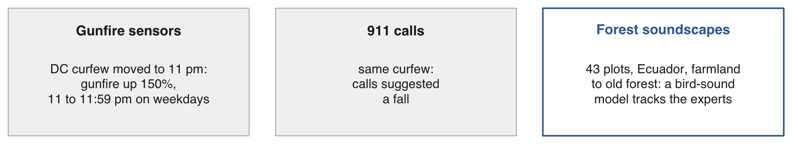{width="92%" fig-align="center"}

::: {.dashes}

- [Carr & Doleac (REStat, 2018)](https://doi.org/10.1162/rest_a_00720). **Gunfire sensors**
  (ShotSpotter) triangulate gunshots, and technicians verify them.
- [Müller et al. (Nature Communications, 2023)](https://doi.org/10.1038/s41467-023-41693-w).
  A **soundscape** is all the sound at a place over time. The sound model's bird scores
  explain 69% of the variation in the animal communities experts identify, which track
  forest recovery after farming.

:::

[**Curfew**: a rule keeping minors indoors at night. **911**: the US emergency number.]{.source}

::: {.content-visible unless-format="revealjs"}

Calls to 911, the US emergency number, depend on who chooses to report, which is why a
sensor and a call can show opposite signs for the same curfew. The marginal hour is 11 to
11:59 pm on weekdays, when the curfew moved from midnight to 11 pm. The June 2017 draft
reports a 22% fall in calls alongside a table that is not significant, so the slide gives
no size.

Müller et al. (published) recorded 43 plots in Ecuador's lowland Chocó, 2 minutes every 15
minutes for two weeks. The 69% is an adjusted R-squared of the sound model's bird axis
against the vertebrate composition experts identified; that composition reflects the
recovery gradient. Five acoustic indices reach 0.62 against the same response. Their Fig. 3a
is CC BY 4.0.

Dietrich et al.: read in the published version, including the means on p. 948. Cochrane et
al.: confirmed in the author's PDF.

:::

## Practice {#practice}

::: {.content-visible when-format="revealjs"}

Nine tasks on the session page run in the 20-audio-ii folder, with solutions behind a click.
None needs Python or the full recordings.

- **1–2** By ear and by tracker: valence (how positive) · a second pitch tracker, `mhsF0()`
- **3–5** The clips: halving the volume · jumps in the pitch track · a baseline of all 571 answers
- **6–8** Across conferences: arousal by quarter · Powell against reporters · before and
  after reporters returned in May 2022
- **9** Your own voice

:::

::: {.content-hidden when-format="revealjs"}

```{r}
#| label: practice
#| exercise: true
#| script: "Practice"
#| eval: false
# Practice. Run in the 20-audio-ii folder after the slides' code has built
# voice(), z(), ans (with quarter), clips, conf and others.
# None needs Python, an account or the network.

# By ear and by tracker
#  1. Rate the eight clips for valence, 1 to 5, then cor() with clips$valence.
#  2. Run the second tracker mhsF0() (it returns $pitch) on the two clips of
#     Exercise 1. How far does the gap between them move?
# The clips
#  3. Halve the clips of Exercise 1, as on the slide. What moves?
#  4. In data/clips/activated.wav, what share of voiced frames lies outside 2/3 to
#     1.5 times the median? Draw the track with plot(p$F0).
#  5. Read the clips of Exercise 1 against all 571 answers instead of their own day.
#     What happens to the signs?
# Across conferences
#  6. First against last quarter per conference. In how many does arousal fall?
#     Energy? Pitch?
#  7. Reporters against Powell by conference, in levels and with diff(), for energy,
#     pitch and arousal.
#  8. Means of conference medians before and after 4 May 2022, for Powell and for the
#     reporters. What else changed in May 2022?
# Your own voice
#  9. Record yourself on a phone, convert the file with
#     av::av_audio_convert(file, "me.wav", channels = 1, sample_rate = 16000)
#     and run voice("me.wav"). Levels from a phone cannot be compared with the Fed's.
```

::: {.callout-tip collapse="true"}

## Solutions

```{r}
#| purl: false
#| collapse: true
# 1. The model's valence for the eight, with what it follows
round(clips$valence, 3); round(sd(clips$valence), 3)
round(c(pitch = cor(clips$valence, clips$pitch), arousal = cor(clips$valence, clips$arousal)), 2)
# 2. The second tracker
med <- function(f) { x <- mhsF0(f, gender = "m", toFile = FALSE)$pitch; median(x[x > 0]) }
round(c(med("data/clips/answer_20211103.wav"), med("data/clips/answer_20230201.wav")), 1)
# 3. Halving
half <- function(f) { w <- readWave(f); w@left <- as.integer(round(w@left / 2))
  h <- tempfile(fileext = ".wav"); writeWave(w, h); round(voice(h), 2) }
half("data/clips/answer_20211103.wav"); half("data/clips/answer_20230201.wav")
# 4. Jumps
x <- ksvF0(f, gender = "m", toFile = FALSE)$F0; x <- x[x > 0]
round(100 * mean(x < median(x) * 2 / 3 | x > median(x) * 1.5), 1)
# 5. Against all 571
round(c(z(a[["pitch"]], ans$pitch15), z(b[["pitch"]], ans$pitch15)), 2)
# 6. Last quarter below first, conferences of 24
fall <- function(v) { w <- ave(ans[[v]], ans$date, FUN = z)
  sum(tapply(w[ans$quarter == 4], ans$date[ans$quarter == 4], mean) <
        tapply(w[ans$quarter == 1], ans$date[ans$quarter == 1], mean)) }
sapply(c("arousal", "energy", "pitch"), fall)
# 7. Reporters against Powell
rp <- aggregate(cbind(energy, pitch, arousal) ~ date, others, median)
pw <- aggregate(cbind(energy, pitch, arousal) ~ date, ans, median)
round(sapply(c("energy", "pitch", "arousal"), function(v)
  c(levels = cor(pw[[v]], rp[[v]]), moves = cor(diff(pw[[v]]), diff(rp[[v]])))), 2)
# 8. Before and after
after <- pw$date >= "2022-05-04"
round(rbind(powell_before = colMeans(pw[!after, -1]), powell_from = colMeans(pw[after, -1]),
            reporters_before = colMeans(rp[!after, -1]), reporters_from = colMeans(rp[after, -1])), 3)
```

Task 5: against his own day the 2023 clip is the higher one; against all 571 the 2021 clip
is. Task 9: a stand-in phone file made from the first clip gave 102.56 Hz and 52.94 dB
against 101.91 and 56.02, so pitch survives the trip and energy moves.

:::

:::

::: {.content-hidden when-format="revealjs"}

## Sources {#sources}

[Dietrich, Hayes & O'Brien (APSR, 2019)](https://doi.org/10.1017/s0003055419000467);
[Gorodnichenko, Pham & Talavera (AER, 2023)](https://doi.org/10.1257/aer.20220129);
[Grogger (JHR, 2011)](https://doi.org/10.1353/jhr.2011.0017);
[Ewertz, Knickrehm, Nienhaus & Reichmann (JAR, 2026)](https://doi.org/10.1111/1475-679x.70015);
[Wagner et al. (TPAMI, 2023)](https://doi.org/10.1109/tpami.2023.3263585);
[Cochrane et al. (Political Communication, 2022)](https://doi.org/10.1080/10584609.2021.1952497);
[Carr & Doleac (REStat, 2018)](https://doi.org/10.1162/rest_a_00720);
[Müller et al. (Nature Communications, 2023)](https://doi.org/10.1038/s41467-023-41693-w);
[Mayew & Venkatachalam (JF, 2012)](https://doi.org/10.1111/j.1540-6261.2011.01705.x);
[Lacerda (PERILUS, 2012)](http://web.archive.org/web/20240916080243/http://www.ling.su.se/polopoly_fs/1.80956.1331884755!/menu/standard/file/MoneyTalksThePowerOfVoice_PERILUS_20120314.pdf);
[Alexopoulos, Han, Kryvtsov & Zhang (JME, 2024)](https://doi.org/10.1016/j.jmoneco.2023.09.002);
[Purnell, Idsardi & Baugh (JLSP, 1999)](https://doi.org/10.1177/0261927x99018001002);
[Edmans, Fernandez-Perez, Garel & Indriawan (JFE, 2022)](https://doi.org/10.1016/j.jfineco.2021.08.014).
Board of Governors of the Federal Reserve System, press conference pages, videos and
transcripts, 2021-2023 (public domain). [wrassp](https://cran.r-project.org/package=wrassp),
[tuneR](https://cran.r-project.org/package=tuneR). The model and the commands behind every
reply are in `tools/SETUP.md`.

**Links:** [slides](20-audio-ii-slides.html) · [Syllabus](../syllabus.qmd)

:::

```{r}
#| purl: false
#| include: false
unlink(c("data_clean/tone120.wav", "data_clean/half.wav"))
source(file.path(session_dir, "_purl.R"))
purl_session(file.path(session_dir, "20-audio-ii.qmd"),
             file.path(session_dir, "20-audio-ii.R"))
```
