```{r}
#| purl: false
#| include: false
knitr::opts_chunk$set(
  comment = "#>",
  collapse = FALSE,
  fig.width = 9,
  fig.height = 4.4,
  fig.align = "center",
  fig.show = "hold",
  dpi = 150
)
options(width = 80)
# Every chunk runs in the project folder, so the paths on the page are the
# paths students use.
session_dir <- getwd()
knitr::opts_knit$set(root.dir = file.path(session_dir, "data/21-photos"))
```

::: {.content-hidden when-format="revealjs"}

[Slides](21-photos-slides.html) · [Live script](21-photos.R) ·
[Source](https://github.com/ArielOrtizBobea/aem6850/blob/main/fall-2026/sessions/21-photos.qmd) ·
[the project, without the photographs](data/21-photos.zip)

Can 365 photographs of one Beijing skyline, one each morning of 2014, measure
the fine-particle pollution a monitor recorded on the same days? A general
vision model, asked in words before class, scored the haze in each photograph
from 0 to 10. This session shows what vision models return for a photograph and
who builds them, and what economists have done with photographs. It then works
that one case in full: it reads the saved replies, turns 365 of them into a
table, and judges the score against the monitor on days kept out of the
fitting.

**The project.** The class zip, with the 365 photographs, is a separate
download for the class, with a Cornell NetID:

https://cornell.box.com/s/u0idko147d8p6zzkvbbrit46icdg1kl6

Unzip it and open `21-photos.Rproj`, so that R starts in the project folder.
The scripts load what they use, `jpeg` and `jsonlite`, and install them if
they are missing. Nobody needs Python, an account or the network: every model
reply is saved in the folder. Its `README.md` says what is where. The
[zip on this page](data/21-photos.zip) carries the code, the monitor file,
the replies and the street photograph, and leaves out the 365 photographs:
`code/1_one_photo.R` and the photographs drawn in `code/3_judge.R` need them.

**The photographs.** Zou Yi (邹毅), a structural engineer in Beijing, photographed
the same view from his apartment window every morning of 2014 and posted the
year on Weibo as one composite (北京·一目了然, season 2; Sina Weibo @邹毅的邹,
WeChat @声闻于天). We have no connection to him; his series is the running
example because the camera, the place and the hour are held fixed, and any
fixed camera with an instrument nearby would serve as well. The photographs are
shown here with credit for teaching. The public zip and the public repository
leave out `data/composite/` and `data_clean/tiles/`.

## Objectives {#objectives}

By the end of this session you can:

- Explain what a photograph is as data: an array of numbers with a time, a
  place and a camera behind it.
- Say what a vision model returns for a photograph (a label, boxes and a count,
  a mask, an embedding, text, a number on a scale) and name the three routes to
  a model (a general model asked in words, a pre-trained task model, a model
  trained on your own labels), and say which route fits a study.
- Name three things economists have done with photographs (measure a place
  nobody surveyed, predict a decision or a price from what an image shows,
  measure who and what published images show) and where photographs that cover
  a place over time come from.
- Turn a photograph into a number by asking a general model in words, with a
  scale and a structured reply, and explain in outline how a model gets from
  pixels to an answer.
- Judge a photo-based measure against an outside reference on photographs held
  out from the fitting, and read its error.
- Train a regression on a pre-trained model's numbers for each photograph, to go
  from a photograph to a quantity directly, and compare routes on the same
  held-out days.
- Recognise the error structure photographs carry (light, angle, weather, time
  of day, differences across groups), what such error does to a comparison, and
  the selection in who took the photograph, where and when.

Left out: running an object detector yourself, faces, satellite imagery.

:::

## Plan for today {#plan}

::: {.slide-text}

What we are going to do today

1. **What vision models do**\
   [What they return · three routes · choosing one]{.topics}
2. **What economists do with photographs**\
   [Neighbourhoods · houses · decisions and prices · books and news · cameras]{.topics}
3. **An application to air pollution in Beijing**\
   [365 photographs and a pollution monitor · asking a model · judging its score · Exercise 1 · training a model · Exercise 2]{.topics}
4. **What can go wrong**\
   [Error by weather · time windows · biased comparisons · selection]{.topics}

:::

[Today: can 365 morning photographs of one Beijing skyline measure what a
pollution monitor recorded on the same days? One kind of answer, a number: first
from a general model asked in words, then from a model trained on the monitor.
Left aside: detectors, faces, satellites.]{.source}

# 1 · What vision models do {#part-map}

## One street photograph {#one-photo}

::: {.slide-text}

One photograph of a street in Porlamar, Venezuela. The next slides show what
vision models return for it.

:::

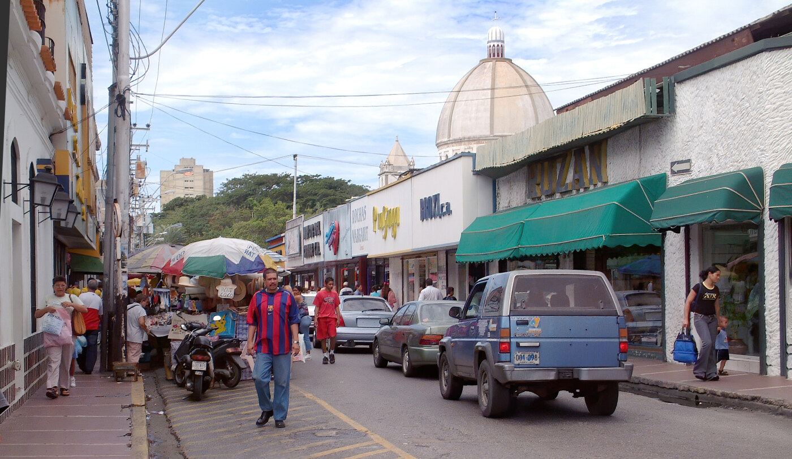{width="80%" fig-align="center"}

[Calle Velásquez, Porlamar, Venezuela, by Wilfredor, Wikimedia Commons,
CC0.]{.source}

## Vision tasks, as the model hub lists them {#hub-tasks}

::: {.slide-text}

Hugging Face is a public website where labs and companies post models that
anyone can download. It files every model under a task. Five of its vision
tasks, each with a model's real output on this photograph.

:::

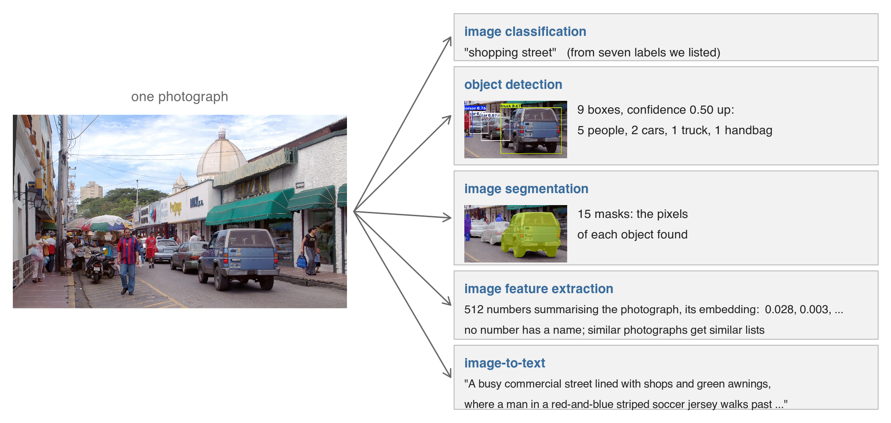{width="100%" fig-align="center"}

[Task names as Hugging Face's task list gives them; it lists others, such as
depth estimation and text-to-image, not used here. The detector, the segmenter
and the embedding model were downloaded from it; the label and the caption come
from a general vision model asked in words. The 512 numbers are an
**embedding**: a model trained to give similar photographs similar numbers
produces them. Haze or colour is in them, with no number of its own.]{.source}

## Vision models, as Dell groups them {#dell-families}

::: {.slide-text}

Dell (JEL, 2025) reviews deep learning for economists and groups models by what
they return: a category, a continuous value, a vector. The street photograph
gives an example of each. Today's haze score, 0 to 10 for a skyline photograph,
is a continuous value.

:::

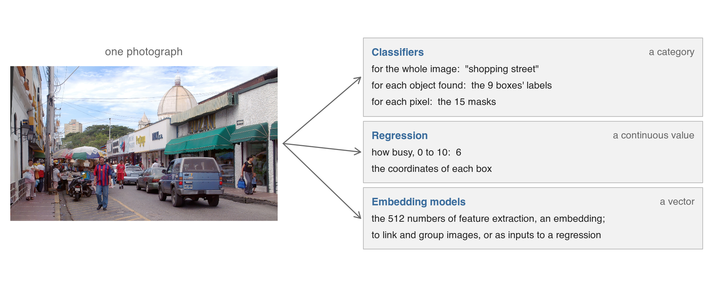{width="100%" fig-align="center"}

[A detector drew boxes round 9 objects on this photograph; a segmenter marked
the pixels of 15 objects, their **masks**. An **embedding** is a list of
numbers describing the whole photograph.
[Dell (JEL, 2025)](https://doi.org/10.1257/jel.20241733) files box coordinates
under regression; a caption has no family.]{.source}

## Three routes to a vision model {#builders}

::: {.slide-text}

A vision model takes a photograph and returns an answer. All three routes start
from a model somebody already trained; they differ in who sets the question.
Today runs route 1, then route 3, on 365 Beijing photographs.

:::

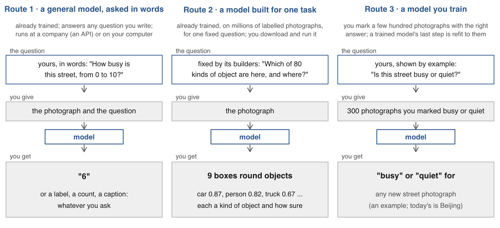{width="94%" fig-align="center"}

[**Training** sets a model's numbers from photographs with the right answers
attached, their **labels**. An **API** is a company's web service: a program
sends a request and gets a reply. In route 2 the model is a detector; each
decimal is how sure it is, from 0 to 1.]{.source}

::: {.content-visible unless-format="revealjs"}

**Six questions for one photograph.** Our combination of the two groupings: six
questions an economist can put to a photograph, one per kind of variable, each
with its real answer on the street photograph. Five are the hub's tasks; the
number on a scale is Dell's regression.

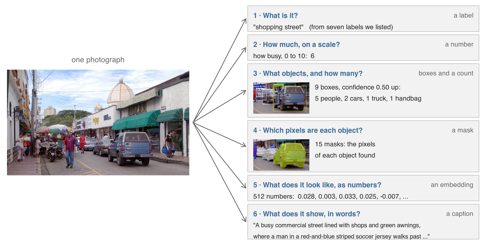{width="100%" fig-align="center"}

**Each question by each route.** Filled cells are real outputs on the street
photograph. Today fills the bold cell: a number, by route 1.

| Question · answer | Route 1: a general model, in words | Route 2: a pre-trained task model | Route 3: your own labels |
|:--|:--|:--|:--|
| **1** What is it? · label | "shopping street" (of seven) | one of its fixed categories | your categories |
| **2** How much? · number | busy 6 of 10; **haze 0 to 10** | | a score from your labels |
| **3** What objects? · boxes | 5 cars, 20 people | 9 boxes at 0.50 or more | your objects |
| **4** Which pixels? · mask | | 15 masks: objects' pixels | your objects |
| **5** Numbers · embedding | | 512 numbers for the photo | |
| **6** In words · caption | a sentence: "A busy ..." | | |

Empty cells: not run here; most are possible. The general model counted 5 cars
and 20 people; the detector's 9 boxes at confidence 0.50 hold 2 cars and 5
people, and at 0.10 ten people: a count depends on the model and the cutoff.
The economist's reference: [Dell (JEL, 2025)](https://doi.org/10.1257/jel.20241733).


**What each route needs from you, and roughly what it costs.** A general model
asked in words needs a question, a scale, a reply format and a key, and charges
by tokens: 536 input tokens per 167 by 222 tile, 4,460 to 4,567 per question on
the full-size street photograph; the 365 calls used 195,640 input and 27,305
output tokens. A pre-trained task model needs a download and a computer, no
labels and no per-call charge, and gives only its fixed classes. A model trained
on your labels needs a few hundred to a few thousand labelled photographs, a
pre-trained model to start from, and a held-out set.

```default
cost of the 365 calls, at the price table of 2026-11-09:  about 1.3 USD
```

**The task names** are the computer-vision task list of the Hugging Face model
hub, read 2026-11-09: image classification, object detection, image
segmentation, image feature extraction, image-to-text, keypoint detection, depth
estimation, mask generation, zero-shot image classification, zero-shot object
detection, image-to-image, text-to-image. [EconDL](https://econdl.github.io/) is
the companion site to Dell (JEL, 2025).

**Counts at two cutoffs.** The detector draws 19 boxes at confidence 0.10 and 9
at 0.50: 10 people or 5, and 2 cars either way. The general model, asked in
words, counted 5 cars and 20 people. The **cutoff** is the confidence below
which a box is dropped. Report the model and the cutoff with every count, and
count a sample by hand to compare.

| Counted by | Cars | People |
|:--|--:|--:|
| the general model, asked in words | 5 | 20 |
| the detector, boxes at confidence 0.50 or more | 2 | 5 |
| the detector, boxes at 0.10 or more | 2 | 10 |

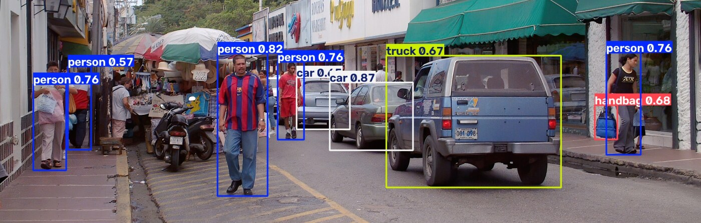{width="49%"}
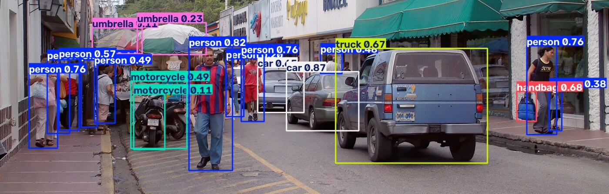{width="49%"}

**How the street outputs were made.** `tools/detect_street.py` ran an open
detector with 80 everyday object classes, an open segmenter and an open
embedding model; the three are named there and nowhere on the deck. The 19
boxes: 11 person, 2 car, 2 motorcycle, 2 umbrella, 1 truck, 1 handbag; 15
masks; 512 numbers in `data_clean/street/embedding.csv`, one line with no
header, read with `scan()` or `read.csv(header = FALSE)`.
`tools/describe_street.R` asked the four questions in
`replies/street_prompts.txt`, with the seven labels offered.

:::

## Choosing a route for a study {#choosing-route}

::: {.slide-text}

Dell (JEL, 2025) advises an existing model first, and your own when it falls short.

:::

|  | Route 1: a general model, asked in words | Route 2: a model built for one task | Route 3: a model you train |
|:-----|:-----------|:-----------|:-----------|
| **Fits when** | your question is new and no photographs have the right answer attached | the task it was built for is your question, such as finding cars | a few hundred photographs have the right answer attached (their labels) |
| **In its favour** | nothing to train; you can ask anything | no fee, at any scale; a file you keep, so others can rerun it | your question, in your units (micrograms); often the most accurate |
| **Against it** | a fee per photograph; the model can be withdrawn; coarse numbers | answers only its task; more mistakes on photographs unlike those it learned from | labels take time to make; may fail on another camera or city |

::: {.slide-text}

On every route, check the result against a reference on photographs kept aside,
and save every reply.

:::

[[Dell (JEL, 2025)](https://doi.org/10.1257/jel.20241733): try an existing model
first; starting from a trained model, a few hundred to a few thousand labels
are often enough; a company's model can be withdrawn, which a downloadable
model avoids. The table is our summary.]{.source}

## From pixels to an answer {#pixels-to-answer}

::: {.slide-text}

Inside a detector the numbers become edges, edges become parts and objects, and
a last step answers its one question: which of 80 kinds of object is this? Here
it answers "truck". It says nothing of colour, make or size, because it was not
trained to. Your own labels replace that last step.

:::

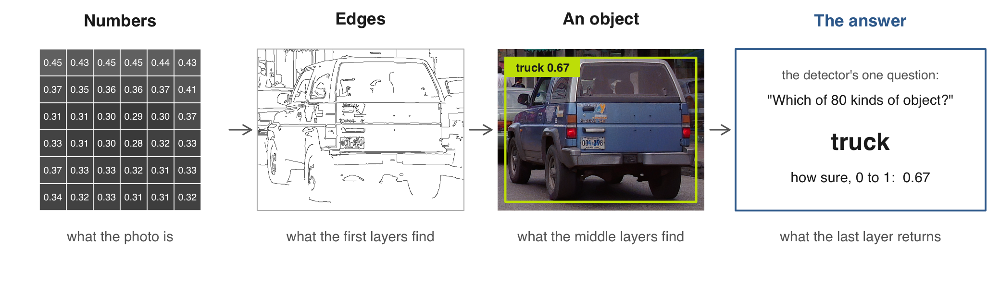{width="100%" fig-align="center"}

[A simplified picture of convolutional networks, the kind most detectors use.
General vision models first cut the photograph into patches and work
differently inside; they also build from simple patterns up to whole objects. A
**layer** is one stage of the computation. The grid holds 36 pixels, each a
number from 0 (black) to 1 (white).]{.source}

# 2 · What economists do with photographs {#part-uses}

## Street images that measure a neighbourhood {#uses-place}

::: {.slide-text}

A photograph can measure a place nobody surveyed. Two studies turned street
images into a number for every neighbourhood and set it beside census data.

:::

::: {.dashes}

- [Gebru et al. (PNAS, 2017)](https://doi.org/10.1073/pnas.1700035114) found 22
  million vehicles in 50 million street images of 200 cities. A neighbourhood's
  mix of cars predicts its income, race and voting.
- [Naik et al. (PNAS, 2017)](https://doi.org/10.1073/pnas.1619003114) compared
  street images of five US cities taken years apart. Neighbourhoods dense with
  college graduates were more likely to improve.

:::

{width="100%" fig-align="center"}

[The first step of Gebru et al., on our street photograph: an open detector
draws a box round each object, with a label and its confidence from 0 to 1.
They then classified each car's make, model and year. Calle Velásquez,
Porlamar, Venezuela, by Wilfredor, Wikimedia Commons, CC0.]{.source}

## Street images of single houses {#uses-houses}

::: {.slide-text}

A street image also describes one house at a time: upkeep, boarded windows,
equipment on the roof. Administrative records rarely hold these.

:::

::: {.dashes}

- [Johnson, Tidwell & Villupuram (JREFE, 2020)](https://doi.org/10.1007/s11146-019-09713-z)
  scored curb appeal from Street View photos near Denver. A home's curb appeal
  and its neighbour's together account for up to 7% of its sale price.
- [Zou & Wang (ISPRS Journal, 2021)](https://doi.org/10.1016/j.isprsjprs.2021.03.020)
  found abandoned houses one by one in Street View images of older industrial
  US cities.
- [Yu et al. (Joule, 2018)](https://doi.org/10.1016/j.joule.2018.11.021) located
  rooftop solar panels across the US, from satellite images.

:::

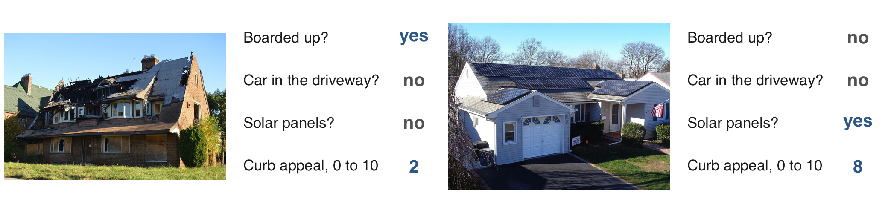{width="96%" fig-align="center"}

[Two houses, each with an open vision model's real answers to four questions.
Each answer classifies the whole photograph. With several houses in one frame, a
detector first finds each house and a classifier then labels it. **Curb
appeal**: how attractive a house looks from the street. All three studies are in
field journals. Photographs, public domain: Detroit, by Nyttend; US Department
of Energy.]{.source}

## Photographs that predict decisions and prices {#uses-saw}

::: {.slide-text}

A photograph holds qualitative information that no column records. In the first
two studies the image predicts a decision or a price. The third estimates an
effect.

:::

:::: {.columns}

::: {.column width="68%"}

::: {.dashes}

- [Ludwig & Mullainathan (QJE, 2024)](https://doi.org/10.1093/qje/qjad055): a
  mug shot's pixels account for up to half of the predictable variation in
  judges' jailing decisions.
- [Aubry et al. (JF, 2023)](https://doi.org/10.1111/jofi.13203): a model values
  paintings from their image and catalogue facts. Those it values above the
  auction house's estimate sell above it.
- [Zhang et al. (Management Science, 2022)](https://doi.org/10.1287/mnsc.2021.4175):
  Airbnb listings given professional photographs had 8.98% higher occupancy,
  comparing before and after.

:::

:::

::: {.column width="30%"}

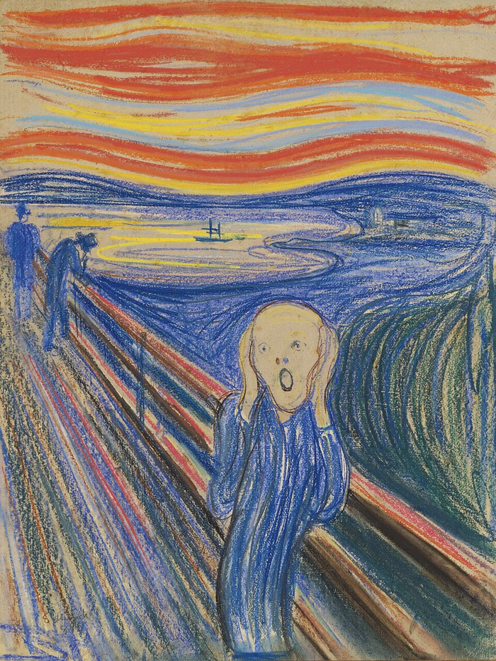{width="100%"}

:::

::::

[A bidder's view: Munch, The Scream (pastel, 1895), sold in 2012 for 119.9
million dollars; public domain. A **mug shot** is the police photograph taken at
an arrest. Ludwig & Mullainathan present their result as a way to generate
hypotheses about what in a face matters.]{.source}

## Images in books and news {#uses-content}

::: {.slide-text}

Published images can be the object of study. These studies measure who appears
in them and what mood they carry.

:::

:::: {.columns}

::: {.column width="64%"}

::: {.dashes}

- [Adukia et al. (QJE, 2023)](https://doi.org/10.1093/qje/qjad028) detected the
  faces drawn in a century of children's books. They classified skin colour,
  race, gender and age, to measure who is shown.
- [Obaid & Pukthuanthong (JFE, 2022)](https://doi.org/10.1016/j.jfineco.2021.06.002)
  classified news photographs by mood. Their daily pessimism index, 1926 to
  2018, predicts stock-market return reversals.

:::

:::

::: {.column width="34%"}

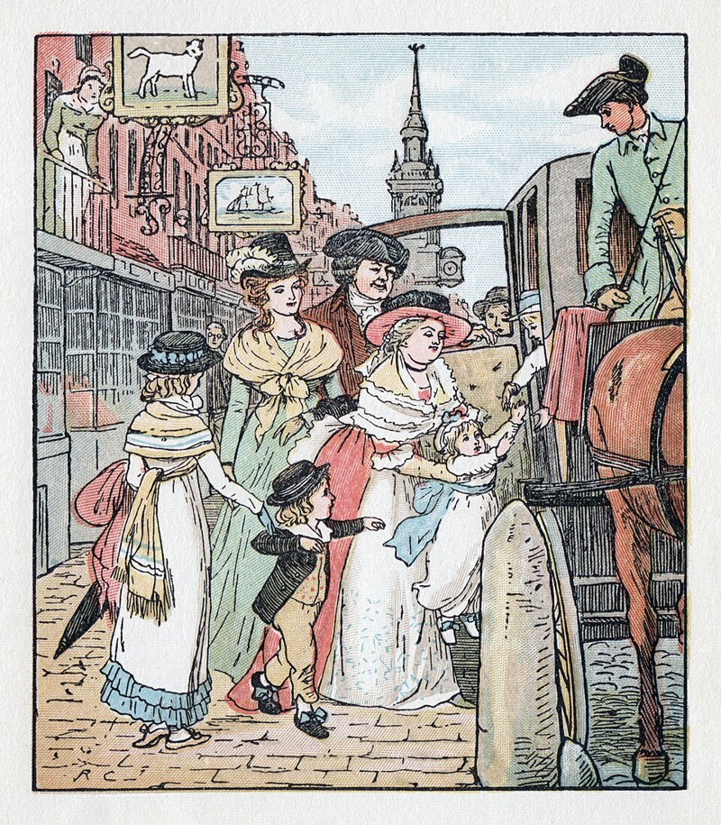{width="100%"}

:::

::::

[An illustration by Randolph Caldecott for a children's picture book (1878),
shown as an example of the images such a study reads. Public domain, Wikimedia
Commons.]{.source}

## Cameras that cover a place over time {#uses-cameras}

::: {.slide-text}

A fixed camera photographs one place again and again. With a record beside it,
the photographs can be judged, as today's are against a pollution monitor.

:::

| Camera | A model could read | The record beside it |
|:-------------|:-----------|:---------------|
| A city's traffic cameras, live | vehicles per frame | counts of vehicles entering a toll zone |
| A shopping-mall camera | people per frame | heads marked by hand |
| Cameras over fields, daily for years | planting, green-up, harvest | each camera's greenness index |

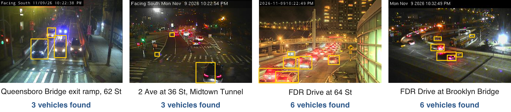{width="100%" fig-align="center"}

[Four New York City traffic-camera frames with an open detector's boxes; it
misses most of the queue on FDR Drive. Vehicles pay a toll to enter Manhattan
south of 60th Street, and the transit authority publishes the entries every 10
minutes. Read 9 November 2026: 964 city cameras; a mall's 2,000 frames with
60,000 heads marked (Chen et al., 2012); over 1,000 PhenoCam cameras.]{.source}

# 3 · An application to air pollution in Beijing {#part-data}

## The question, the model and the monitor {#design}

::: {.slide-text}

Can 365 morning photographs of one Beijing skyline measure the air pollution a
monitor recorded on the same days?

:::

::: {.dashes}

- **The first model's task**: look at one photograph and rate the haze from 0
  to 10. It is used as it comes. Nothing is trained, and it never sees the monitor.
- **The monitor**: a device on the US Embassy roof that recorded PM2.5, fine
  particles in the air, every hour. Its daily mean judges each score afterwards,
  and later trains a second model.

:::

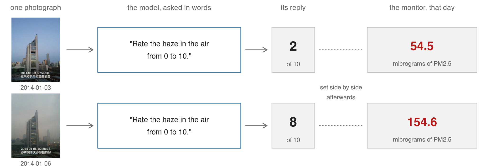{width="94%" fig-align="center"}

[Two mornings of 2014 from the same window, with the model's real replies and
the monitor's daily means. Photographs: Zou Yi (邹毅). Monitor: US Department of
State, Mission China air quality monitoring program.]{.source}

## 365 mornings of one skyline {#composite}

::: {.slide-text}

Zou Yi, a structural engineer in Beijing, photographed the same view from his
apartment window every morning of 2014 and posted the year on Weibo as one
composite. We have no connection to him. His series is today's running example
because the place and the camera are fixed and the hour follows sunrise; only
the air changes. Any fixed camera with an instrument nearby would do.

:::

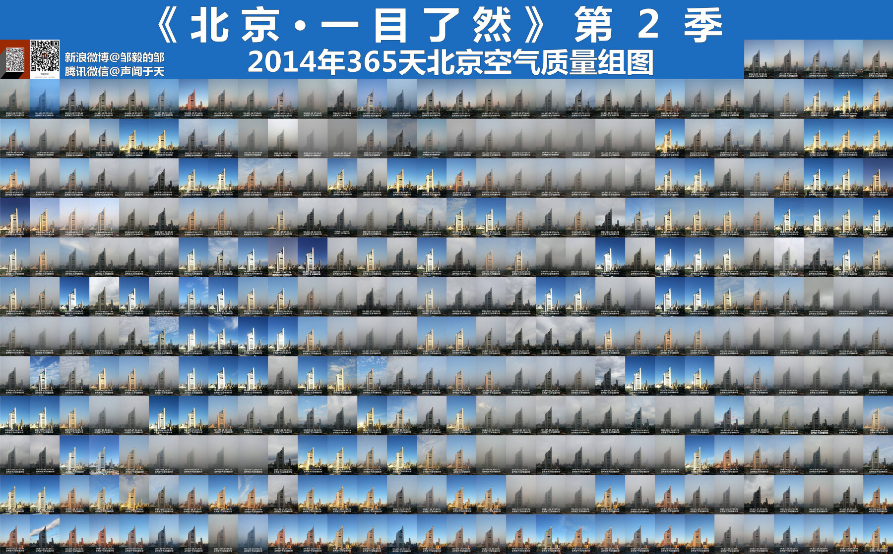{.r-stretch}

[A **composite** tiles the 365 photographs into one image. **Metadata** is what
comes with a photograph besides its pixels: when, where, with what camera. Here
the time is burned into every caption: about 06:00 in June, 07:30 to 08:00 in
December, one morning at 10:19. Zou Yi (邹毅), 北京·一目了然 season 2; Sina Weibo
@邹毅的邹, WeChat @声闻于天. Shown with credit for teaching; the full set is not
redistributed.]{.source}

::: {.content-visible unless-format="revealjs"}

The composite is a 30 by 14 grid of 167 by 222 px tiles: the top two rows hold
the title strip and the five photographs of 1 to 5 January at their right end,
rows 3 to 14 hold the rest. `tools/cut_tiles.R` cuts the 365 tiles into
`data_clean/tiles/<date>.jpg`. The capture times, read from the captions, run
from 05:55 (17 June) to 08:33 (7 October), with one morning (6 October) at
10:19; summer about 06:00 to 06:45, winter about 07:00 to 08:05, the week of 6
to 11 October late. The caption on the 21 December tile reads 2012; it is a
typo in the original, and the tile sits in the December row.

:::

## The monitor's daily PM2.5 in 2014 {#monitor-year}

::: {.slide-text}

The US Embassy monitor in Beijing measured PM2.5, fine particles in the air,
every hour of 2014. Its daily mean ran from 6.5 to 449.8 micrograms per cubic
metre, with a median of 74. The next slide shows the photographs of the five
dirtiest days (red) and the five cleanest (blue).

:::

```{r}
#| label: monitor-year
#| echo: false
#| purl: false
#| fig-width: 9
#| fig-height: 3.6
#| out-width: "96%"
local({
  p <- read.csv("data_clean/pm25_daily.csv"); p$date <- as.Date(p$date)
  o <- order(p$pm25); lo <- o[1:5]; hi <- rev(o)[1:5]
  par(mar = c(2.4, 4.4, 0.4, 0.6), cex.lab = 0.9, las = 1)
  plot(p$date, p$pm25, type = "h", col = "grey60", lwd = 1.4, xaxt = "n", xlab = "",
       ylab = "daily PM2.5 at the monitor", ylim = c(0, 470), yaxs = "i")
  axis(1, at = as.Date(sprintf("2014-%02d-15", 1:12)), labels = month.abb, tick = FALSE, line = -0.6)
  segments(p$date[hi], 0, p$date[hi], p$pm25[hi], col = "#B31B1B", lwd = 2)
  points(p$date[hi], p$pm25[hi], pch = 16, col = "#B31B1B")
  points(p$date[lo], p$pm25[lo], pch = 16, col = "#3A6C9C")
  abline(h = 25, lty = 2, col = "grey25")
  legend(as.Date("2014-04-10"), 465, bty = "n", cex = 0.9, pch = 16, col = c("#B31B1B", "#3A6C9C"),
         legend = c(sprintf("the five dirtiest days; the highest, %s: %.1f", format(p$date[hi[1]], "%d %b"), p$pm25[hi[1]]),
                    sprintf("the five cleanest days; the lowest, %s: %.1f", format(p$date[lo[1]], "%d %b"), p$pm25[lo[1]])))
})
```

[One bar per day: the mean of that day's hourly readings. The dashed line is 25
micrograms per cubic metre, the World Health Organization's guideline for one
day at the time; 318 of the 365 days were above it. These readings are what the
photographs are judged against. From `data_clean/pm25_daily.csv`.]{.source}

## The five cleanest and the five dirtiest days {#extremes}

::: {.slide-text}

The photograph of each of those ten days, with the monitor's daily mean. Top
row: the five cleanest days. Bottom row: the five dirtiest. The second
photograph is grey under cloud on one of the cleanest days.

:::

```{r}
#| label: extremes
#| echo: false
#| purl: false
#| fig-width: 9.6
#| fig-height: 4.4
#| out-width: "88%"
local({
  p <- read.csv("data_clean/pm25_daily.csv")
  o <- order(p$pm25); show <- c(o[1:5], rev(o)[1:5])
  par(mfrow = c(2, 5), mar = c(0, 0, 1.6, 0))
  for (k in show) {
    plot(as.raster(jpeg::readJPEG(sprintf("data_clean/tiles/%s.jpg", p$date[k]))))
    title(sprintf("%s, monitor %.1f", p$date[k], p$pm25[k]), cex.main = 1.0,
          col.main = if (p$pm25[k] > 100) "#B31B1B" else "#3A6C9C")
  }
})
```

[Each title: the date and the monitor's daily PM2.5, micrograms per cubic metre.
Each photograph was taken between about 06:00 and 08:30; the monitor's value is
the whole day's mean. Photographs: Zou Yi (邹毅).]{.source}

## The project folder {#project-folder}

::: {.slide-text}

Unzip the class download and open `21-photos.Rproj`, so every path on the
slides works. The folder holds Zou Yi's Beijing photographs, the monitor's
PM2.5 file and a vision model's haze score for every photograph.

:::

```{.default filename="21-photos/, as its README.md describes it"}
21-photos/
  data/composite/    Zou Yi's 365 photographs as he published them: one large image
  data/pollution/    the US Embassy monitor's hourly PM2.5 file for 2014, as downloaded
  data/street/       one public-domain street photograph (Porlamar, Venezuela), for the model map
  data_clean/tiles/  the 365 photographs cut out one by one, <date>.jpg, 167 by 222 px
  data_clean/        the tables the scripts build: PM2.5 by day, the model's scores, both joined by date
  replies/haze/      the vision model's haze score and reason for each photograph, saved as returned
  replies/street/    its four answers on the street photograph; replies/*.txt: the questions asked
  code/              1_one_photo.R, 2_replies.R, 3_judge.R in lecture order; run_everything.R runs all three
  tools/             what made data_clean/ and replies/ before class (needs a paid model key or Python)
```

::: {.slide-text}

The scripts install what they need. Nobody needs Python, an account or the
network: every model answer is already in `replies/`. The zip on the course
page carries no photographs; the class download with them sits behind a
Cornell login.

:::

## A photograph as an array of numbers {#array}

::: {.slide-text}

In R a photograph is an array: 222 rows by 167 columns by 3 colour bands, every
number between 0 and 1. Every vision model starts from these numbers.

:::

```{r}
#| label: idiom-jpeg
#| script: "A photograph as an array of numbers"
#| filename: "R Console, in the 21-photos folder. Installs jpeg and jsonlite if missing"
#| output: false
#| message: false
want <- c("jpeg", "jsonlite")
need <- want[!(want %in% installed.packages()[,"Package"])]
if (length(need)) install.packages(need)
lapply(want, function(i) require(i, character.only = TRUE))
```

```{r}
#| filename: "R Console, in the 21-photos folder; jpeg from the chunk before; reads data_clean/tiles/2014-01-06.jpg"
img <- readJPEG("data_clean/tiles/2014-01-06.jpg")
dim(img)                        # rows, columns, colour bands
round(img[1:3, 1:3, 1], 2)      # the top-left corner of the red band: sky
round(img[150, 80, ], 3)        # one pixel on the tower: its red, green and blue
```

[A **pixel** is one small square of the picture, one number per band. An
**array** has three dimensions, rows, columns and bands; `dim()` prints the
sizes. A **band** is the red, green or blue layer: 0 is none of that colour, 1
is all of it. The tile is 2014-01-06, one of the Beijing
mornings.]{.source}

::::: {.content-visible unless-format="revealjs"}

**Two mornings as numbers.**

::: {.slide-text}

On the clear morning the sky's blue band is highest, 0.77 against 0.47 red. On
the hazy morning the three bands sit together near 0.7, which is grey.

:::

```{r}
#| label: two-mornings
#| script: "Two mornings as numbers"
#| filename: "R Console, in the 21-photos folder; img, the 6 January tile from the array slide; reads data_clean/tiles/2014-01-03.jpg"
#| fig-width: 6
#| fig-height: 2.2
clear <- readJPEG("data_clean/tiles/2014-01-03.jpg")
par(mfrow = c(1, 2), mar = c(0, 0, 2, 0))      # two panels side by side, room for a title
plot(as.raster(clear)); title("2014-01-03, monitor 54.5")
plot(as.raster(img));   title("2014-01-06, monitor 154.6")
round(apply(clear[1:55, , ], 3, mean), 2)      # 3: one mean per band, over the sky rows
round(apply(img[1:55, , ], 3, mean), 2)
```

[The top 55 rows are the sky above the tower; the three numbers are their mean
red, green and blue. The titles give the monitor's PM2.5 that day, micrograms
per cubic metre. A vision model's first layers work from differences like these
in every pixel at once.]{.source}

:::::

::::: {.content-visible unless-format="revealjs"}

**The monitor's daily mean.**

::: {.slide-text}

The US Embassy monitor's hourly PM2.5 file has 8,760 rows; 99 hours are marked
-999, missing. The daily mean averages the valid hours, so no day is lost: 32
days have 13 to 23 valid hours.

:::

```{r}
#| label: daily-mean
#| script: "The monitor's daily mean"
#| filename: "R Console, in the 21-photos folder; what tools/monitor_daily.R does; reads data/pollution/"
h <- read.csv("data/pollution/Beijing_2014_HourlyPM25_created20150203.csv",
              skip = 2, fileEncoding = "latin1")     # two note lines above the header; the unit's symbol
c(hours = nrow(h), missing = sum(h$Value == -999))    # -999 is the file's mark for a missing hour
h$Value[h$Value == -999] <- NA
h$date <- as.Date(sprintf("%d-%02d-%02d", h$Year, h$Month, h$Day))   # %d a number, %02d padded to two digits
pm <- aggregate(Value ~ date, data = h, FUN = mean)   # one mean per day over its valid hours; NA rows dropped
names(pm)[2] <- "pm25"; pm$pm25 <- round(pm$pm25, 1)
nrow(pm)                                              # no day lost
pm[pm$date %in% as.Date(c("2014-01-03", "2014-01-06")), ]   # the two mornings shown above
```

[The **reference** is the outside measurement a photo-based score is judged
against; here the monitor, in micrograms per cubic metre. `aggregate()` gives
one mean per group. The year's worst day is 2014-02-25, at 449.8.]{.source}

::: {.content-visible unless-format="revealjs"}

The file's eleven columns are Site, Parameter, Date, Year, Month, Day, Hour,
Value, Unit, Duration and QC Name; the two header lines name the US Department
of State Data Use Statement and the Mission China air quality monitoring
program. 333 days have all 24 hours and 32 have 13 to 23; 9 December has 13,
none before 11:00. `tools/monitor_daily.R` writes `data_clean/pm25_daily.csv`
with the daily mean and the number of valid hours. The model never chose three
of the eight sky levels: rain, snow, night or dark.

:::

:::::

## The question and the reply format {#question}

::: {.slide-text}

The question is plain English, kept in a text file. An R script sent it with
each of the 365 photographs to Anthropic's general vision model, through its API
(route 1). The model is used as it comes. Its reply has a fixed form: a score, a sky
condition from a list of eight, one reason.

:::

```{.markdown filename="replies/haze_prompt.txt: the question, sent with each of the 365 photographs"}
This photograph of the Beijing skyline was taken from the same window one morning in 2014.
Rate the haze in the air from 0 to 10. 0 is a perfectly clear day: sharp distant buildings,
a blue sky. 10 is the densest smog: the nearest tower barely visible, no horizon.
Also name the sky condition you see and give one short reason for the score.
```

```{.json filename="the reply for the photograph of 2014-01-06, the hazy morning, in the form the schema requires"}
{"haze": 8, "sky": "heavy haze", "reason": "The near tower is visible but washed out,
 the distant buildings fade into a uniform gray-brown murk, and no sky or horizon is discernible."}
```

```{.markdown}
haze    an integer from 0 to 10
sky     clear, light haze, heavy haze, overcast, fog or mist, rain, snow, night or dark
reason  one short sentence
```

[The **prompt** is the question, in words. A **structured reply** has named
fields that code reads; here JSON, text with named fields in braces. The
**schema** lists the fields and their allowed values. Sent from R to Anthropic's
API on 9 November 2026, before class; every reply is saved in `replies/haze/`
and the model's name is in `replies/haze_prompt.txt`.]{.source}

::: {.content-visible unless-format="revealjs"}

**The request, run before class.** One request carries the photograph as text
and the question. It asks for JSON against the schema. The script saves the
reply to disk unchanged, one file per morning. Nobody runs it today.

```{.r filename="tools/score_photos.R, part, simplified (httr2); model, api_version, prompt and schema are set at its top"}
one_request <- function(file) {
  request("https://api.anthropic.com/v1/messages") |>              # the address
    # who is asking: the key, read from ~/.Renviron, never typed here
    req_headers("x-api-key" = Sys.getenv("ANTHROPIC_API_KEY"),
                "anthropic-version" = api_version,
                "content-type" = "application/json") |>
    req_body_json(list(                                            # what is sent
      model = model, max_tokens = 400,                             # the longest reply allowed
      # the three fields we require, as a schema
      output_config = list(format = list(type = "json_schema", schema = schema)),
      messages = list(list(role = "user", content = list(
        # the photograph, its bytes written out as text (base64)
        list(type = "image", source = list(type = "base64", media_type = "image/jpeg",
                                           data = base64encode(file))),
        list(type = "text", text = prompt))))))                    # the question shown above
}
resp <- req_perform(one_request("data_clean/tiles/2014-01-06.jpg"))   # send it
writeLines(resp_body_string(resp), "replies/haze/2014-01-06.json")     # saved unchanged
```

A **saved reply** is the whole response written to one file before anything is
parsed. An **API key** is a secret string that bills an account; it lives in
`~/.Renviron` and is read with `Sys.getenv()`. **base64** writes a file's bytes
out as plain text, so an image can travel inside a request. `request()`,
`req_headers()`, `req_body_json()` and `req_perform()` are httr2's.

**The request in full.** `tools/score_photos.R` sets `model`, `api_version`,
`prompt` and `schema` once at the top, sends four requests at a time with
`req_perform_parallel()`, retries failures, skips the days already saved and
logs the failures in `logs/`. The model's name and the version header are in
the script and in `replies/haze_prompt.txt`: the one provenance line of the
project. **Why every reply is saved whole:** the parse can be redone, the call
cannot be repeated for the same answer.

:::

## The same question to a model on this laptop {#local-demo}

::: {.slide-text}

The question of the slide before, rate the haze from 0 to 10, can also go to an
open vision model on this laptop: no account, no network, about two seconds a
photograph. R sends the request to a server program on the same machine. For
the hazy morning of 6 January it gives 8, as Anthropic's model did.

:::

```{.r filename="code/4_local_model.R, part; its top sets model, prompt and schema. Needs the Ollama app running"}
# httr2 and base64enc are loaded; prompt is the question, schema its three reply fields
ask_local <- function(file) {
  request("http://localhost:11434/api/chat") |>         # the model server on this laptop
    req_body_json(list(model = model, format = schema,   # which model; the reply's form
      stream = FALSE, think = FALSE,                     # one reply, in one piece
      options = list(temperature = 0),                   # the same answer every time
      messages = list(list(role = "user", content = prompt,         # the same question
                           images = list(base64encode(file)))))) |> # the photograph, as text
    req_timeout(300) |> req_perform() |> resp_body_json()
}
r <- ask_local("data_clean/tiles/2014-01-06.jpg")        # the hazy morning
cat(r$message$content)
```

```{.json filename="its reply, as saved on 9 November 2026"}
{"haze": 8, "sky": "fog or mist", "reason": "The distant buildings are barely visible through the thick haze."}
```

[An **open** model is one whose file anyone can download and run. **Ollama** is
a free program that runs such models and answers requests at `localhost`, an
address on this machine. `request()` and the `req_` functions are httr2's. Over
the 365 photographs its scores and those of Anthropic's model correlate 0.95.]{.source}

## Reading each reply into a table {#read-replies}

::: {.slide-text}

Each saved reply is the model's answer about one photograph: a haze score 0 to
10, a sky condition, a reason. A function turns one reply into a one-row table;
`lapply()` runs it over files and `do.call(rbind, ...)` stacks the rows. Three
files make three rows, joined to the monitor's daily mean by date.

:::

```{r}
#| label: read-replies
#| script: "Reading each reply into a table"
#| filename: "R Console, in the 21-photos folder; jsonlite from the first code slide; reads replies/haze/ and data_clean/pm25_daily.csv"
files <- list.files("replies/haze", full.names = TRUE)        # 365 files, one per morning
read_reply <- function(f) {
  r <- fromJSON(f)                                             # the saved reply, as an R list
  a <- fromJSON(r$content$text[r$content$type == "text"])      # its one text block, parsed again
  data.frame(date = as.Date(sub("\\.json$", "", basename(f))),  # the file's name is the date
             haze = a$haze, sky = a$sky, reason = a$reason)
}
x <- do.call(rbind, lapply(files[1:3], read_reply))            # three files, three rows
pm <- read.csv("data_clean/pm25_daily.csv"); pm$date <- as.Date(pm$date)   # the monitor's daily mean, one row per day
merge(x[, 1:3], pm[, 1:2], by = "date")                       # merge(): the two tables joined by date
```

[`fromJSON()` turns JSON into an R list; `merge()` joins two tables on a shared
column; `code/2_replies.R` does all 365. A **token** is the unit a model reads
and is charged by: 536 in and 71 out for this tile.]{.source}

::: {.content-visible unless-format="revealjs"}

One saved reply, opened with `fromJSON("replies/haze/2014-01-06.json")`, is an R
list: `usage` holds the tokens in and out, `content` the blocks of the reply, and
the one text block of type `text` is a JSON string with the three fields, which
`fromJSON()` parses a second time. `basename()`
gives a path's last part and `sub()` drops the `.json`.

:::

## Two models' haze scores against the monitor {#by-score-figure}

::: {.content-visible unless-format="revealjs"}

```{r}
#| label: by-score
#| script: "The monitor's reading at each score"
#| filename: "R Console, 21-photos folder; reads data_clean/haze_pm25.csv: one row per day, the score and the PM2.5"
#| fig-show: hide
d <- read.csv("data_clean/haze_pm25.csv"); d$date <- as.Date(d$date)
round(cor(d$haze, d$pm25), 3)
round(tapply(d$pm25, d$haze, median))     # the monitor's median at each score
boxplot(pm25 ~ haze, data = d, xlab = "the model's haze score, 0 to 10",
        ylab = "PM2.5 at the monitor, micrograms per cubic metre")
```

`tapply()` applies one function by group.

:::

```{r}
#| purl: false
#| include: false
lc <- read.csv("replies/local/haze_local.csv"); lc$date <- as.Date(lc$date)
both <- merge(d[, c("date", "haze", "pm25")], lc[, c("date", "haze_local")], by = "date")
r2 <- function(x) sprintf("%.2f", cor(x, both$pm25))
```

::: {.slide-text}

Left: the scores from Anthropic's model, reached through its API. They are the
scores used from here on. Right: the open model on this laptop, asked the same
question. Both rise with the monitor's PM2.5.

:::

```{r}
#| label: by-score-figure
#| echo: false
#| purl: false
#| fig-width: 9.6
#| fig-height: 2.7
#| out-width: "100%"
par(mfrow = c(1, 2), mar = c(3.4, 4.2, 1.6, 0.5), cex.lab = 0.9, mgp = c(2.2, 0.7, 0))
boxplot(pm25 ~ factor(haze, levels = 0:10), data = both, ylim = c(0, 460), main = "Anthropic's model, through its API",
        cex.main = 0.95, xlab = "haze score, 0 to 10", ylab = "daily PM2.5 at the monitor")
boxplot(pm25 ~ factor(haze_local, levels = 0:10), data = both, ylim = c(0, 460), main = "the open model on this laptop",
        cex.main = 0.95, xlab = "haze score, 0 to 10", ylab = "")
```

|  | Anthropic's model (API) | Open model on this laptop |
|:--------------------|:-----------|:-----------|
| Correlation with the monitor | `r r2(both$haze)` | `r r2(both$haze_local)` |
| Cost of the 365 photographs | 1.33 dollars | nothing |
| Time for the 365 photographs | about 4 minutes | about 12 minutes |

[Each box holds the middle half of the days at that score; the line inside is
the median. **PM2.5**: fine particles in the air, micrograms per cubic metre.
**Correlation**: how closely two lists move together, from -1 to 1. Cost on 9
November 2026: 195,640 tokens in and 27,305 out, at 4 and 20 dollars per
million. The API took four requests at a time; the laptop one.]{.source}

## Fitting days and held-out days {#split}

::: {.slide-text}

The score runs 0 to 10 and the monitor reads micrograms per cubic metre, so a
line fitted from score to micrograms turns one into the other. A seeded draw
puts 255 of the 365 days in a fitting set for that line and holds out 110 to
judge it.

:::

```{r}
#| label: split
#| script: "Fitting days and held-out days"
#| filename: "R Console, in the 21-photos folder; d, the 365 days, from the slides before"
set.seed(6850)
fit <- sample(nrow(d), round(0.7 * nrow(d)))     # row numbers of the fitting days
c(fitting = length(fit), held_out = nrow(d) - length(fit))
```

::: {.dashes}

- **Fitting days**: the days the line is fitted on. **Held-out days**: kept out
  of the fitting; judging a line on its own fitting days flatters it.
- **Seed**: the same random draw every time, so everyone's 110 days are the same.
- This is an **out-of-sample** test: the measure is judged on days it never saw.
  **Cross-validation** repeats such a split several times; today uses one split.

:::

## From a score to micrograms {#calibration}

::: {.slide-text}

On the fitting days a straight line gives 5.7 micrograms plus 19.5 per point of
haze. A score of 8 reads as 161, a 9 as 181, a 10 as 200. A line is the simplest
choice: it treats every point of haze as worth the same.

:::

```{r}
#| label: calibration
#| script: "From a score to micrograms"
#| filename: "R Console, in the 21-photos folder; d and fit from the slide before"
m <- lm(pm25 ~ haze, data = d[fit, ])           # fitted on the 255 fitting days only
round(coef(m), 2)                                # micrograms at a score of 0, micrograms per point
setNames(round(predict(m, newdata = data.frame(haze = 0:10))), 0:10)   # micrograms at each score
d$pred <- predict(m, newdata = d)                # the line applied to all 365 days
```

[**Calibration**: turning the 0-to-10 score into the monitor's unit with a line
fitted on the fitting days only. `lm()` fits the line, `predict()` applies it to
any score, held-out days included; `setNames()` labels the eleven predictions
with their scores.]{.source}

## The error on the held-out days {#error}

::: {.slide-text}

On the 110 held-out days the photograph misses the monitor by 44 micrograms on
average. Guessing the fitting days' mean every day misses by 66. The photograph
cuts the error by a third.

:::

```{r}
#| label: held-out-error
#| script: "The error on the held-out days"
#| filename: "R Console, in the 21-photos folder; d, fit and m from the slides before"
#| fig-show: hide
held <- d[-fit, ]                                            # the 110 days kept out of the fitting
round(c(mae = mean(abs(held$pred - held$pm25)),
        guess_the_mean = mean(abs(mean(d$pm25[fit]) - held$pm25))), 1)
head(held[order(abs(held$pred - held$pm25)), c("date", "haze", "sky", "pm25", "pred")], 3)   # the smallest misses
plot(held$pm25, held$pred, pch = 16, col = "grey30",
     xlab = "PM2.5 at the monitor, micrograms per cubic metre", ylab = "PM2.5 predicted from the photograph")
abline(0, 1, lty = 2)                                        # where prediction equals measurement
```

[**Mean absolute error**: the average size of the miss, in the reference's
units, sign ignored. The comparison guess is the fitting days' mean, 95.8.
`order()` sorts rows by a column, `abs()` drops the sign.]{.source}

::: {.content-visible unless-format="revealjs"}

On the held-out days the predicted and the measured values correlate 0.71. The
median miss is 24 micrograms; 80 of the 110 days are within 50. Aubry et al.
(JF, 2023) judge their price prediction the same way, on sales the model never
saw, with the auction house's estimate as the alternative; the figure after
Exercise 2 sets the two side by side.

:::

## The error on the held-out days {#error-figure}

::: {.slide-text}

The 110 held-out days. Each horizontal band is one score the photograph got;
the highest band is a 9, which reads 181. The dashed line is where prediction
equals measurement; the days the monitor read 271 to 450 all sit at 161 or 181,
so the line tops out.

:::

```{r}
#| label: held-out-error-figure
#| echo: false
#| purl: false
#| fig-width: 8
#| fig-height: 4.2
#| out-width: "88%"
par(mar = c(4.2, 4.4, 0.5, 0.5), cex.lab = 0.9)
plot(held$pm25, held$pred, pch = 16, col = "grey30",
     xlab = "PM2.5 at the monitor, micrograms per cubic metre", ylab = "PM2.5 predicted from the photograph")
abline(0, 1, lty = 2)
```

## Exercise 1 {#exercise-1}

::: {.panel-tabset}

### Exercise

A model scored the haze in each Beijing photograph from 0 to 10; a fitted line
turned the score into micrograms of PM2.5 (`pred`). On the 110 held-out days
(`held`) it misses the monitor (`pm25`) by 44 on average. Find the ten largest
misses, draw those photographs, and say what nine share. 5 minutes.

1. `held$err <- held$pred - held$pm25`: positive means the photograph read too high.
2. Sort by `abs(err)` with `order()`; keep ten rows.
3. Draw the ten photographs with `readJPEG()` and `as.raster()` in a 2 by 5
   grid, titled with date, score, prediction and the monitor's PM2.5.
4. One line on what nine share, one on the tenth.

```{r}
#| label: exercise-1
#| exercise: true
#| script: "Exercise 1 (5 minutes)"
#| include: false
#| eval: false
# Exercise 1 (5 minutes). The ten held-out days the photograph got most wrong.
# An average miss hides which days went wrong; the largest misses show what the measure cannot see.
# In the 21-photos folder, with held (the 110 held-out days, with pred) as on the slides before
# (or run code/3_judge.R sections 1 to 4 first).
# 1. held$err <- held$pred - held$pm25               # positive: the photograph read too high
# 2. worst <- held[order(-abs(held$err)), ][1:10, c("date", "haze", "sky", "pm25", "pred")]
#    worst$pred <- round(worst$pred); worst                  # whole micrograms
# 3. Draw the ten tiles, each titled with its date, score, prediction and the monitor's reading:
#    par(mfrow = c(2, 5), mar = c(0, 0, 2, 0))
#    for (i in 1:10) {
#      plot(as.raster(readJPEG(sprintf("data_clean/tiles/%s.jpg", worst$date[i]))))   # the file name from the date
#      title(sprintf("%s\nscore %d reads %.0f, monitor %.0f", worst$date[i], worst$haze[i],
#                    worst$pred[i], worst$pm25[i]), cex.main = 0.8)   # %s text, %d a whole number, %.0f no decimals
#    }
# 4. One line on what nine of the ten share, and one on the day that does not fit.
# Two answers to compare with the room: on how many of the ten the photograph read too low,
# and what nine of those mornings have in common.
```

[`held`, `order()` and `abs()` from the slides before, or run `code/3_judge.R`
sections 1 to 4 first. Two answers to compare with the room: on how many of the
ten the photograph read too low, and what nine of those days share.]{.source}

### Solution

```{r}
#| label: exercise-1-solution
#| purl: false
#| filename: "R Console, in the 21-photos folder; held from the slides before. The tile loop is in the Exercise tab"
#| collapse: true
held$err <- held$pred - held$pm25
worst <- held[order(-abs(held$err)), ][1:10, c("date", "haze", "sky", "pm25", "pred")]
worst$pred <- round(worst$pred); worst
sum(worst$pred > worst$pm25)
```

[All ten read too low. Nine are mornings scored 8 or 9, where the line can give
at most 161 or 181, and the monitor read 271 to 450. The tenth, 28 December, was
a clear morning after a night of smog.]{.source}

:::

## The ten worst held-out days {#worst-ten}

::: {.slide-text}

Nine of the ten largest misses on the 110 held-out days share one pattern. The
line tops out: it gives a 9 only 181 and an 8 only 161 micrograms per cubic
metre, and the monitor read 271 to 450. The tenth was a clear morning after a
night of smog, scored 2 at a daily mean of 196.

:::

```{r}
#| label: worst-ten
#| echo: false
#| purl: false
#| fig-width: 9.6
#| fig-height: 4.3
#| out-width: "92%"
par(mfrow = c(2, 5), mar = c(0, 0, 2, 0))
for (i in 1:10) {
  plot(as.raster(readJPEG(sprintf("data_clean/tiles/%s.jpg", worst$date[i]))))
  title(sprintf("%s\nscore %d reads %.0f, monitor %.0f", worst$date[i], worst$haze[i],
                worst$pred[i], worst$pm25[i]), cex.main = 0.8)
}
```

[Each title: the date, the model's score, what the line predicts, the monitor's
daily PM2.5. The model's reason for 2014-02-25: "even the nearby tower is washed
out and low-contrast ... no distant buildings or horizon are visible".]{.source}

::: {.content-visible unless-format="revealjs"}

The model's reason for each of the ten, as saved:

```{r}
#| label: worst-reasons
#| echo: false
#| purl: false
for (i in 1:10) cat(sprintf("%s  score %d, monitor %.1f\n   %s\n", worst$date[i], worst$haze[i],
                            worst$pm25[i], d$reason[d$date == worst$date[i]]))
```

Two patterns. The scale tops out: fourteen days scored 9 and one scored 10, and
the line cannot say more than 200, while the monitor passed 271 on 43 days. The
window: 28 December was photographed at 08:12 under a clear sky after a night of
smog (444 at 02:00, 160 at 08:00, 32 by 13:00), scored 2, daily mean 196. On the
06:00-to-08:00 mean the readings change where it matters: 28 December 180, 16
January 496, 25 February 391; 9 December has no reading before 11:00.

:::

## The monitor's mean at each score {#lookup}

::: {.slide-text}

The line treats every point of haze as worth 19.5 micrograms. The fitting days
say otherwise: the monitor's mean is 187 at a score of 8 and 297 at 9. Using
that mean as the prediction cuts the held-out miss from 44 to 38.

:::

```{r}
#| label: lookup
#| script: "The monitor's mean at each score"
#| filename: "R Console, in the 21-photos folder; d (with pred), fit and m from the slides before"
mu <- tapply(d$pm25[fit], d$haze[fit], mean)        # the monitor's mean at each score, fitting days only
round(rbind(mean_at_score = mu, line = predict(m, newdata = data.frame(haze = as.integer(names(mu))))))
d$pred2 <- as.numeric(mu[as.character(d$haze)])     # each day's score looked up in that table
held <- d[-fit, ]                                   # the 110 held-out days, as before
round(c(line = mean(abs(held$pred - held$pm25)), mean_at_score = mean(abs(held$pred2 - held$pm25))), 1)
```

[A score is **ordinal**: it ranks the days, and the step from 8 to 9 need not
equal the step from 1 to 2. Its rank correlation with the monitor is 0.75. The
columns are the scores 1 to 10; one fitting day scored 10.]{.source}

## A model trained on the monitor's readings {#trained}

::: {.slide-text}

So far the monitor's readings did one job: fit the line that turns the 0-to-10
haze score into micrograms of PM2.5. Now a model is trained on them. An embedding
model somebody else trained turns each Beijing photograph into 512 numbers, and we fit
a regression from those numbers to the monitor on the 255 fitting days. On the
110 held-out days it misses by 36 micrograms on average. The haze score missed
by 44 with the line and 38 with the mean at each score.

:::

```{r}
#| label: trained
#| script: "A model trained on the monitor's readings"
#| filename: "R Console, in the 21-photos folder; d (with pred) and fit from the slides before; reads data_clean/tile_embeddings.csv"
E  <- read.csv("data_clean/tile_embeddings.csv")       # one row per day: the date, then 512 numbers
X  <- as.matrix(E[, -1])                               # the same days, in the same order as d
pc <- prcomp(X[fit, ])                                 # the 512 numbers summarised, on the fitting days only
Z  <- as.data.frame(predict(pc, X)[, 1:15])            # the 15 strongest combinations, for all 365 days
tm <- lm(d$pm25[fit] ~ ., data = Z[fit, ])             # micrograms from the 15 numbers, fitting days only
d$trained <- predict(tm, newdata = Z)                  # our regression's micrograms, all days
held <- d[-fit, ]                                      # the 110 held-out days, as before
miss <- function(p) mean(abs(p - held$pm25))            # the average miss on the held-out days
round(c(line = miss(held$pred), mean_at_score = miss(held$pred2), trained = miss(held$trained)), 1)
```

[An **embedding** is the list of numbers a trained model computes for a
photograph; `tools/embed_tiles.py` made the table before class. `prcomp()` finds
the combinations of the 512 numbers that vary most across photographs, the
**principal components**; we keep 15. The embedding model is used as it comes
(route 2); fitting our regression on its numbers is route 3, a model trained on
your own labels: here the monitor's readings.]{.source}

```{r}
#| purl: false
#| include: false
loc <- read.csv("replies/local/haze_local.csv");   loc$date <- as.Date(loc$date)
dak <- read.csv("replies/local/direct_local.csv"); dak$date <- as.Date(dak$date)
d$haze_local <- loc$haze_local[match(d$date, loc$date)]
held$local  <- predict(lm(pm25 ~ haze_local, data = d[fit, ]), newdata = d[-fit, ])
held$direct <- dak$pm25_direct[match(held$date, dak$date)]
miss <- function(p) sprintf("%.1f", mean(abs(p - held$pm25)))
```

## Six approaches, judged on the same days {#routes-compared}

::: {.slide-text}

Six approaches to predicting the monitor's PM2.5 (fine particles in the air)
from a photograph, on the 110 held-out days. Blue is the prediction, grey the
monitor. The haze score with a table misses by 38, the trained regression by 36.

:::

```{r}
#| label: routes-figure
#| echo: false
#| purl: false
#| fig-width: 9.6
#| fig-height: 4.5
#| out-width: "100%"
rt <- list(
  list("The monitor", "the real daily PM2.5", NULL, NA),
  list("No photograph", "the fitting days' mean, the same guess every day", rep(mean(d$pm25[fit]), nrow(held)), 1),
  list("Laptop model, asked for micrograms", "its answer in micrograms, used as it is", held$direct, 0),
  list("Laptop model's haze score, then a line", "its 0-to-10 score turned into micrograms by a fitted line", held$local, 2),
  list("Anthropic's haze score, then a line", "the same, with the scores used so far today", held$pred, 2),
  list("Anthropic's haze score, then a table", "each score replaced by the monitor's mean at that score", held$pred2, 10),
  list("A regression trained on the monitor", "on 15 summaries of each photograph's 512 embedding numbers", held$trained, 16))
par(mar = c(0, 0, 0, 0)); plot.new(); plot.window(xlim = c(0, 9.6), ylim = c(0, 4.5), xaxs = "i", yaxs = "i")
n <- length(rt); rh <- 4.08 / n; x0 <- 6.3; x1 <- 9.5; top <- 4.1
text(0.05, 4.33, "Approach", adj = 0, font = 2, cex = 0.92)
text(4.85, 4.33, "Fitted numbers", adj = 1, font = 2, cex = 0.92)
text(6.0, 4.33, "Average miss", adj = 1, font = 2, cex = 0.92)
text((x0 + x1) / 2, 4.33, "110 held-out days, Jan to Dec", adj = 0.5, font = 2, cex = 0.92)
segments(0, 4.17, 9.6, 4.17, lwd = 1.2)
xs <- x0 + (seq_len(nrow(held)) - 1) / (nrow(held) - 1) * (x1 - x0)
ys <- function(v, k) top - k * rh + 0.07 + pmin(v, 460) / 460 * (rh - 0.14)
for (k in seq_len(n)) {
  r <- rt[[k]]; yc <- top - (k - 0.5) * rh
  text(0.05, yc + 0.11, r[[1]], adj = 0, cex = 1.0, font = 2)
  text(0.05, yc - 0.13, r[[2]], adj = 0, cex = 0.8, col = "grey35")
  if (k > 1) {
    text(4.6, yc, r[[4]], adj = 1, cex = 1.0)
    text(5.85, yc, sprintf("%.1f", mean(abs(r[[3]] - held$pm25))), adj = 1, cex = 1.0, font = 2)
    lines(xs, ys(held$pm25, k), col = "grey70", lwd = 1.1)
    lines(xs, ys(r[[3]], k), col = "#3A6C9C", lwd = 1.5)
  } else lines(xs, ys(held$pm25, k), col = "grey20", lwd = 1.5)
}
```

[**Average miss**: mean absolute error on the held-out days, micrograms per
cubic metre. **Fitted numbers**: how many were set using the monitor; the
regression has 15 slopes and a constant. Every series is on one scale, 0 to
460. Asked for micrograms, the laptop model gave only `r length(unique(held$direct))` different answers.]{.source}

## What the trained model reads as clean and polluted {#trained-photos}

::: {.slide-text}

The held-out Beijing photographs with our regression's five lowest predictions
of PM2.5 (top) and five highest (bottom). From 255 mornings and the monitor's
readings it learned what pollution looks like: a tower lost in grey reads high.

:::

```{r}
#| label: trained-photos
#| echo: false
#| purl: false
#| fig-width: 9.6
#| fig-height: 4.4
#| out-width: "88%"
o <- order(held$trained); show <- held[o[c(1:5, (nrow(held) - 4):nrow(held))], ]
par(mfrow = c(2, 5), mar = c(0, 0, 2.4, 0))
for (i in 1:10) {
  plot(as.raster(readJPEG(sprintf("data_clean/tiles/%s.jpg", show$date[i]))))
  title(sprintf("%s\ntrained %.0f, monitor %.0f", show$date[i], show$trained[i], show$pm25[i]), cex.main = 1.0)
}
```

[Each title: the date, the trained model's prediction and the monitor's daily
PM2.5, in micrograms per cubic metre. None of these ten days was used to fit the
model. Its highest prediction is `r round(max(held$trained))`; the monitor
reached `r round(max(held$pm25))`.]{.source}

## Exercise 2 {#exercise-2}

::: {.panel-tabset}

### Exercise

Our regression predicts the monitor's PM2.5 from 15 numbers per photograph: the
first 15 principal components (`pc`) of the 512 numbers a trained model computed
for it (`X`). More numbers always fit the 255 fitting days (`fit`) better. Do
they predict the 110 held-out days better? 5 minutes.

1. Write `err(k)`: refit with the first `k` components and return the average
   miss on the fitting days and on the 110 held-out days.
2. Run it for 5, 15, 40 and 100. Which of the two misses keeps falling as `k` grows?
3. Take the ten days the first method, the haze score and its line (`pred`), got
   most wrong. On how many is the regression (`trained`) closer to the monitor?

```{r}
#| label: exercise-2
#| exercise: true
#| script: "Exercise 2 (5 minutes)"
#| include: false
#| eval: false
# Exercise 2 (5 minutes). The trained model with fewer and with more numbers.
# More numbers always fit the fitting days better. Do they predict the held-out days better?
# In the 21-photos folder, with pc, X, d (with pred and trained), fit and held as on the slides before
# (or run code/3_judge.R sections 1 to 7 first).
# 1. err <- function(k) {
#      Zk <- as.data.frame(predict(pc, X)[, 1:k, drop = FALSE])
#      mk <- lm(d$pm25[fit] ~ ., data = Zk[fit, , drop = FALSE])
#      c(k = k, fitting = mean(abs(fitted(mk) - d$pm25[fit])),
#        held_out = mean(abs(predict(mk, newdata = Zk[-fit, , drop = FALSE]) - d$pm25[-fit])))
#    }
# 2. round(t(sapply(c(5, 15, 40, 100), err)), 1)      # one row per k
# 3. w <- held[order(-abs(held$pred - held$pm25)), ][1:10, c("date", "pm25", "pred", "trained")]
#    sum(abs(w$trained - w$pm25) < abs(w$pred - w$pm25))
# Two answers to compare with the room: which miss keeps falling as k grows,
# and on how many of the ten days the trained model is closer.
```

[Or run `code/3_judge.R` sections 1 to 7 first. Two answers to compare with the
room: which miss keeps falling as `k` grows, and on how many of the ten days the
trained model is closer.]{.source}

### Solution

```{r}
#| label: exercise-2-solution
#| purl: false
#| filename: "R Console, in the 21-photos folder; pc, X, d, fit and held from the slides before"
#| collapse: true
err <- function(k) {
  Zk <- as.data.frame(predict(pc, X)[, 1:k, drop = FALSE])
  mk <- lm(d$pm25[fit] ~ ., data = Zk[fit, , drop = FALSE])
  c(k = k, fitting = mean(abs(fitted(mk) - d$pm25[fit])),
    held_out = mean(abs(predict(mk, newdata = Zk[-fit, , drop = FALSE]) - d$pm25[-fit])))
}
round(t(sapply(c(5, 15, 40, 100), err)), 1)
w <- held[order(-abs(held$pred - held$pm25)), ][1:10, c("date", "pm25", "pred", "trained")]
sum(abs(w$trained - w$pm25) < abs(w$pred - w$pm25))
```

[The miss on the fitting days falls with every added number. The miss on the
held-out days stops falling, so the held-out days are the judge, and `k` is
chosen without looking at them.]{.source}

:::

::::: {.content-visible unless-format="revealjs"}

**How a published study tested its measure.**

::: {.slide-text}

Aubry et al. (JF, 2023) predicted the auction price of a painting from its
image and judged the prediction as today's score-to-micrograms line is judged:
against the price each work later fetched, on sales kept out of the fitting,
with the auction house's estimate beside it as the alternative.

:::

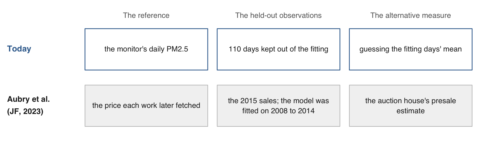{width="92%" fig-align="center"}

[Their model was fitted on the 2008 to 2014 sales and tested on 2015, so
nothing from after a sale predicts it. A photo-based measure is judged on
observations kept out of the fitting, with the best available alternative
beside it. [Aubry, Kräussl, Manso & Spaenjers (JF, 2023)](https://doi.org/10.1111/jofi.13203).]{.source}

:::::

# 4 · What can go wrong {#part-wrong}

## Error that depends on the weather {#weather}

::: {.slide-text}

From a window, fog and smog look alike; the monitor tells them apart. Grouped by
the sky the model named with its 0-to-10 haze score, overcast mornings scored
4.3 on average and clear ones 1.3, at the same 41 micrograms of PM2.5. The three
humid mornings at right scored 6 to 8 while the monitor read 25 to 55.

:::

:::: {.columns}

::: {.column width="60%"}

```{r}
#| label: weather
#| script: "Error that depends on the weather"
#| filename: "R Console; d: one row per day, haze (the score), sky named, pm25"
# the mean score and the monitor's mean, by the sky the model named
aggregate(cbind(haze, pm25) ~ sky, data = d,
          FUN = function(x) round(mean(x), 1))
```

:::

::: {.column width="38%"}

```{r}
#| label: weather-tiles
#| echo: false
#| purl: false
#| fig-width: 4.2
#| fig-height: 2.3
#| out-width: "100%"
wx <- c("2014-09-02", "2014-09-30", "2014-06-21")
par(mfrow = c(1, 3), mar = c(0, 0, 2.2, 0))
for (day in wx) {
  plot(as.raster(readJPEG(sprintf("data_clean/tiles/%s.jpg", day))))
  k <- which(d$date == day)
  title(sprintf("%s\nscore %d, monitor %.1f", day, d$haze[k], d$pm25[k]), cex.main = 0.8)
}
```

:::

::::

::: {.dashes}

- **Random error** cancels over many days; **systematic error** goes one way
  under a condition: humidity, cloud, season.
- Keep the sky column and the capture time; measure the error by condition.

:::

::: {.content-visible unless-format="revealjs"}

The three tiles are drawn with `readJPEG()` and `as.raster()` as in Exercise 1
(the code is in `code/3_judge.R` section 9). The held-out error by the sky the
model named: clear −11.7 on 40 days, heavy haze −16.7 on 46, light haze +5.7 on
22, overcast +36.1 on 2; the fog day is a fitting day. An error that differs
across groups of photographs, by season here, by place or by camera elsewhere,
is the same problem, measured on each group. A humidity record would be the
next column to add.

:::

## A mismatch in time windows {#hour-window}

::: {.slide-text}

Each Beijing photograph was taken between about 06:00 and 08:30; the monitor's
daily mean covers 24 hours. On 28 December the 08:00 reading was 160, falling,
and the day averaged 196. Against the 06:00-to-08:00 mean the haze score
correlates 0.70, against the daily mean 0.68.

:::

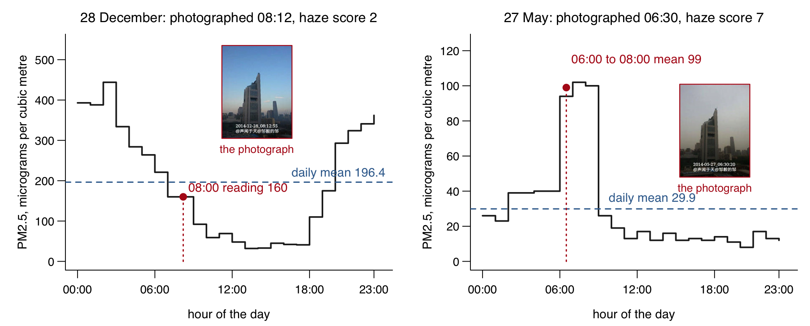{width="100%" fig-align="center"}

[**Measurement window**: the span of time a measurement covers; a photograph
covers an instant, a daily mean a day. On 28 December the camera saw a clear
sky after a night at 444; on 27 May it saw the morning peak of a clean day. The
gain over the year is small; on single days the window decides the miss. Match
the monitor's window to the photograph's; the code is Practice task 4.]{.source}

## Error that biases a comparison {#two-comparisons}

::: {.slide-text}

A measure with error still answers a comparison well, unless its error moves
with what is compared. The photograph's PM2.5 (the haze score through its line)
finds the APEC week: 50 micrograms cleaner, the monitor 67. It misses the
heating season: the monitor reads 39 higher, the photograph 4 lower.

:::

::: {.content-visible unless-format="revealjs"}

```{r}
#| label: two-comparisons
#| script: "Error that biases a comparison"
#| filename: "R Console, in the 21-photos folder; d: one row per day, pm25 (the monitor) and pred (the photograph, in micrograms, from the fitted line)"
gap  <- function(v, g) round(mean(v[g]) - mean(v[!g]))    # one group's mean minus the other's
apec <- d$date >= as.Date("2014-11-03") & d$date <= as.Date("2014-11-12")   # the APEC week
near <- d$date >= as.Date("2014-10-13") & d$date <= as.Date("2014-12-03")   # that week and three weeks either side
heat <- d$date <= as.Date("2014-03-15") | d$date >= as.Date("2014-11-15")   # the heating season
cmp  <- rbind(apec_week      = c(monitor = gap(d$pm25[near], apec[near]), photograph = gap(d$pred[near], apec[near])),
              heating_season = c(monitor = gap(d$pm25, heat),             photograph = gap(d$pred, heat)))
cmp
```

:::

```{r}
#| purl: false
#| include: false
sgn <- function(x) sub("-", "\u2212", sprintf("%+d", as.integer(x)))
```

| Difference in mean PM2.5 | The monitor | The photograph |
|:------------------|--------:|--------:|
| APEC week, against the three weeks before and after | `r sgn(cmp[1, 1])` | `r sgn(cmp[1, 2])` |
| Heating season, against the rest of the year | `r sgn(cmp[2, 1])` | `r sgn(cmp[2, 2])` |

```{r}
#| label: two-comparisons-figure
#| echo: false
#| purl: false
#| fig-width: 8
#| fig-height: 2.3
#| out-width: "92%"
mo <- as.integer(format(d$date, "%m"))
mm <- rbind(tapply(d$pm25, mo, mean), tapply(d$pred, mo, mean))
par(mar = c(2.2, 4.4, 0.4, 7), cex.lab = 0.9)
plot(1:12, mm[1, ], type = "n", ylim = c(0, 195), xlim = c(0.7, 12.3), xaxt = "n", xlab = "",
     ylab = "PM2.5, monthly mean", las = 1)
rect(c(0, 11), -20, c(3, 13), 220, col = "grey91", border = NA)       # 15 November to 15 March
axis(1, at = 1:12, labels = month.abb, tick = FALSE, line = -0.7)
lines(1:12, mm[1, ], type = "b", pch = 16, lwd = 2, col = "grey20")
lines(1:12, mm[2, ], type = "b", pch = 1, lwd = 2, col = "#3A6C9C")
text(c(1.75, 11.75), 186, "heating", cex = 0.8, col = "grey35")
box(); par(xpd = NA)
text(12.6, mm[1, 12], "the monitor", adj = 0, cex = 0.9, col = "grey20")
text(12.6, mm[2, 12], "the photograph", adj = 0, cex = 0.9, col = "#3A6C9C")
```

[**APEC week**: 3 to 12 November 2014; Beijing restricted cars and closed
factories for a summit. **Heating season**: 15 November to 15 March, the city's
district heating on (shaded). PM2.5: fine particles in the air, micrograms per
cubic metre, at the US Embassy monitor. In December the photograph reads 48 and
the monitor 82: the line reads low on the worst days, and cold, dry mornings
look clear.]{.source}

## Selection in which photographs exist {#selection}

::: {.slide-text}

Someone chose which photographs exist. Zou Yi's fixed window and routine remove
the choice of place and time, so the mornings differ only in the air. Street
images show the streets a camera car drove; a photograph posted online was
chosen by its poster.

:::

| What was chosen | The 365 mornings | Street images | Photographs posted online |
|:--|:--|:--|:--|
| the place | one window, fixed | the streets a car drove | wherever the poster stood |
| the time | roughly 06:00 to 08:30, every morning | the hour the car passed | the moment the poster chose |
| which photographs survive | all 365 | every frame the car took | the ones the poster kept |

::: {.dashes}

- **Selection**: the photographs you have are the ones someone chose to take and
  keep. Before using photographs as a variable, write down who took them, where,
  when and why, and what that leaves out.

:::

::: {.content-visible unless-format="revealjs"}

**A checklist for a photo-based measure.** Who held the camera, when and where;
what chose the frame and which photographs survived. The reference and its
window. The held-out days. The raw replies saved whole. The question, the
schema and the model recorded (`replies/haze_prompt.txt`).

:::

## Practice {#practice}

::: {.content-visible when-format="revealjs"}

Eight tasks on the session page run in the 21-photos folder, on the Beijing
photographs, the vision model's haze scores and the monitor's PM2.5, with
solutions behind a click. None needs a model key, Python or the network.

- **1–3** The model's replies: sky conditions · score against monitor by month ·
  words in its reasons
- **4–6** The monitor and the fitting: the reading at the photograph's hour ·
  missing hours · another random split
- **7** The street photograph: detector counts at other cutoffs · the blue car
  cut from the pixel array
- **8** A photograph of your own

:::

::: {.content-hidden when-format="revealjs"}

```{r}
#| label: practice
#| exercise: true
#| script: "Practice"
#| eval: false
# Practice. Run in the 21-photos folder after the slides' code has built
# files, read_reply(), h, d (with pred), fit, m and held.
# None needs a key, Python or the network.

# The replies table
#  1. The mean score by the sky the model named, beside the monitor's mean.
#     Which day did the model call "fog or mist", and what did the monitor read?
#     Which three sky levels did it never choose?
#  2. By month: d$month <- format(d$date, "%m"), then aggregate() the score and
#     the monitor. Which month scores highest, which lowest? Do December's low
#     scores mean clean air?
#  3. The words in the reasons, with grepl(): how often "sharp", "washed",
#     "grey" or "gray", and "blue" appear in the reasons at scores of 2 or less,
#     and at 8 or more.
# The reference and the split
#  4. The monitor at the photograph's hour: from h keep Hour %in% 6:8, one mean
#     per day with aggregate(), merge() by date, cor() with the score. Compare
#     with 0.68 for the daily mean. Then Hour %in% 5:10.
#  5. Days with a missing hour: keep hours == 24 (333 days) and redo the split,
#     the line and the held-out error. How much moves?
#  6. Another seed: set.seed(1), then 2 and 3. How much do the line and the
#     held-out error move?
# The street photograph
#  7. b <- read.csv("data_clean/street/boxes.csv"); table(b$label[b$conf >= 0.25]),
#     then 0.75. Then s <- readJPEG("data/street/porlamar.jpg"); dim(s); and cut
#     the truck's box (x1 1304, y1 807, x2 1895, y2 1253) out of the array with
#     plot(as.raster(s[807:1253, 1304:1895, ])). Rows are y, columns are x.
# A photograph of your own
#  8. A JPEG from a phone (convert HEIC first): readJPEG(), dim(), one pixel, the
#     mean red, green and blue of its top rows. A phone photograph is thousands
#     of pixels on a side, so dim() is the first thing to look at.
```

::: {.callout-tip collapse="true"}

## Solutions

```{r}
#| label: practice-solutions
#| purl: false
#| collapse: true
# 1. By sky; the fog day; the levels never chosen
aggregate(cbind(haze, pm25) ~ sky, data = d, FUN = function(x) round(mean(x), 1))
d[d$sky == "fog or mist", c("date", "haze", "pm25")]
setdiff(c("clear", "light haze", "heavy haze", "overcast", "fog or mist", "rain", "snow", "night or dark"),
        unique(d$sky))
# 2. By month
d$month <- format(d$date, "%m")
round(t(sapply(split(d[, c("haze", "pm25")], d$month), colMeans)), 1)
# 3. The words in the reasons, at scores of 2 or less and of 8 or more
words <- c("sharp", "washed", "gr[ea]y", "blue")
low <- d$haze <= 2; high <- d$haze >= 8
round(rbind(low = sapply(words, function(w) mean(grepl(w, d$reason[low]))),
            high = sapply(words, function(w) mean(grepl(w, d$reason[high])))), 2)
# 4. The monitor at the photograph's hour
win <- function(hours) {
  w <- aggregate(Value ~ date, data = h[h$Hour %in% hours, ], FUN = mean)
  z <- merge(d, w, by = "date")
  c(days = nrow(z), cor = round(cor(z$haze, z$Value), 3))
}
rbind(h06_08 = win(6:8), h05_10 = win(5:10), h07 = win(7))
# 5 and 6. The split, the line and the held-out error, for a table and a seed
judge <- function(dd, seed = 6850) {
  set.seed(seed); f <- sample(nrow(dd), round(0.7 * nrow(dd)))
  mm <- lm(pm25 ~ haze, data = dd[f, ]); p <- predict(mm, newdata = dd[-f, ])
  round(c(coef(mm), days = nrow(dd), held_out = nrow(dd) - length(f),
          mae = mean(abs(p - dd$pm25[-f])), guess = mean(abs(mean(dd$pm25[f]) - dd$pm25[-f]))), 2)
}
judge(d[d$hours == 24, ])                     # 5: the 333 days with all 24 hours
rbind(seed1 = judge(d, 1), seed2 = judge(d, 2), seed3 = judge(d, 3))   # 6
# 7. The street photograph
b <- read.csv("data_clean/street/boxes.csv")
table(b$label[b$conf >= 0.25]); table(b$label[b$conf >= 0.75])
s <- readJPEG("data/street/porlamar.jpg"); dim(s)
par(mar = c(0, 0, 0, 0)); plot(as.raster(s[807:1253, 1304:1895, ]))
```

Task 2: February scores highest (5.9) and December lowest (2.2); the monitor is
highest in February (175) and lowest in June (59). December's low scores sit
beside a monitor mean of 82: dry, cold, crisp mornings read as clean air. Task
4: the 06:00-to-08:00 window covers every morning but two (17 June at 05:55, 6
October at 10:19); 9 December has no reading before 11:00. Task 5: a rule about
missing hours moves the answer by a few micrograms and leaves the conclusion
where it was. Task 6: a held-out error can land on either side of the fitting
days' own error (39.7 here). Task 8: a phone photograph read on this machine
had `dim()` 3024 4032 3.

:::

:::

::: {.content-hidden when-format="revealjs"}

## Sources {#sources}

[Aubry, Kräussl, Manso & Spaenjers (JF, 2023)](https://doi.org/10.1111/jofi.13203);
[Gebru, Krause, Wang, Chen, Deng, Aiden & Fei-Fei (PNAS, 2017)](https://doi.org/10.1073/pnas.1700035114);
[Ludwig & Mullainathan (QJE, 2024)](https://doi.org/10.1093/qje/qjad055);
[Obaid & Pukthuanthong (JFE, 2022)](https://doi.org/10.1016/j.jfineco.2021.06.002);
[Adukia, Eble, Harrison, Runesha & Szasz (QJE, 2023)](https://doi.org/10.1093/qje/qjad028);
[Hu & Ma (JF, 2025)](https://doi.org/10.1111/jofi.13471);
[Naik, Kominers, Raskar, Glaeser & Hidalgo (PNAS, 2017)](https://doi.org/10.1073/pnas.1619003114);
[Zhang, Lee, Singh & Srinivasan (Management Science, 2022)](https://doi.org/10.1287/mnsc.2021.4175);
[Johnson, Tidwell & Villupuram (JREFE, 2020)](https://doi.org/10.1007/s11146-019-09713-z);
[Zou & Wang (ISPRS Journal of Photogrammetry and Remote Sensing, 2021)](https://doi.org/10.1016/j.isprsjprs.2021.03.020);
[Yu, Wang, Majumdar & Rajagopal (Joule, 2018)](https://doi.org/10.1016/j.joule.2018.11.021);
[Dell (JEL, 2025)](https://doi.org/10.1257/jel.20241733) and its companion site
[EconDL](https://econdl.github.io/). The task names are the computer-vision
section of the [Hugging Face task list](https://huggingface.co/tasks), read
2026-11-09. Photographs: Zou Yi (邹毅), 北京·一目了然 season 2, 2014, shown with
credit for teaching; who he is and how the series began:
[Global Times, 2022](https://www.globaltimes.cn/page/202208/1272130.shtml). Monitor: US Department of State, Mission China air quality
monitoring program, Beijing hourly PM2.5, 2014, as the file's header lines
state. Street photograph: ["Traffic and pedestrians on Calle Velásquez near
Catedral San Nicolás de Bari in Porlamar, Venezuela"](https://commons.wikimedia.org/wiki/File:Traffic_and_pedestrians_on_Calle_Vel%C3%A1squez_near_Catedral_San_Nicol%C3%A1s_de_Bari_in_Porlamar,_Venezuela.jpg),
by Wilfredor, Wikimedia Commons, CC0. The painting:
[Edvard Munch, The Scream, pastel, 1895](https://commons.wikimedia.org/wiki/File:The_Scream_Pastel.jpg),
public domain. The illustration:
[Randolph Caldecott, The Diverting History of John Gilpin, 1878](https://commons.wikimedia.org/wiki/File:Randolph_Caldecott_-_Picture_Book_No._1_-_page_7_-_The_Diverting_History_of_John_Gilpin,_Illustration_5_(2nd_colour).jpg),
public domain. The two houses:
[Calvert Avenue and La Salle Boulevard, Detroit, by Nyttend](https://commons.wikimedia.org/wiki/File:Calvert_and_La_Salle_collapsing_house.jpg)
and a
[US Department of Energy photograph of a residential solar installation](https://commons.wikimedia.org/wiki/File:Martin_000407_163308_506901_4578_(36155266293).jpg),
both public domain; the four answers on each come from `_house_questions-21.R`.
The cameras, all read 2026-11-09: the
[New York City DOT traffic cameras](https://webcams.nyctmc.org/api/cameras) (964
listed, four frames saved that evening; the boxes come from
`_camera_boxes-21.py`); the
[MTA's Congestion Relief Zone vehicle entries](https://data.ny.gov/d/t6yz-b64h),
in 10-minute blocks since 5 January 2025; the
[mall dataset](https://personal.ie.cuhk.edu.hk/~ccloy/downloads_mall_dataset.html)
of Chen, Loy, Gong & Xiang (2,000 frames from a public webcam, over 60,000 heads
marked, for research use); the [PhenoCam network](https://phenocam.nau.edu/)
(1,088 cameras listed). The dates of the APEC traffic restrictions (3 to 12
November 2014) are as reported by Xinhua and China Daily at the time; the
heating season (15 November to 15 March) is as the
[Beijing municipal government](https://english.beijing.gov.cn/livinginbeijing/housing/202005/t20200513_1895777.html)
states it. The model and the question behind every
reply are in `replies/haze_prompt.txt`; the open detector, segmenter and
embedding model are named in `tools/detect_street.py`.

**Links:** [slides](21-photos-slides.html) · [Syllabus](../syllabus.qmd)

:::

```{r}
#| purl: false
#| include: false
source(file.path(session_dir, "_purl.R"))
purl_session(file.path(session_dir, "21-photos.qmd"),
             file.path(session_dir, "21-photos.R"))
```
