```{r}
#| purl: false
#| include: false
knitr::opts_chunk$set(
  comment = "#>",
  collapse = FALSE,
  fig.width = 9,
  fig.height = 4.4,
  fig.align = "center",
  fig.show = "hold",
  dpi = 150
)
options(width = 100)
# Every chunk runs in the project folder, so the paths on the page are the
# paths students use.
session_dir <- getwd()
knitr::opts_knit$set(root.dir = file.path(session_dir, "data/22-photos-ii"))
```

::: {.content-hidden when-format="revealjs"}

[Slides](22-photos-ii-slides.html) · [Live script](22-photos-ii.R) ·
[Source](https://github.com/ArielOrtizBobea/aem6850/blob/main/fall-2026/sessions/22-photos-ii.qmd) ·
[the project, without the photographs](data/22-photos-ii.zip)

A photograph can be turned into one number for the whole image. It can also be
searched for the objects in it. This session works three cases of the second
type. A pre-trained detector counts the vehicles in 4,037 frames from New York
City traffic cameras. A classifier says which of 1,630 street views of Ithaca
show a house, first with a pre-trained model given descriptions in words and then after training on 200
views labelled by looking. A third classifier labels the expression on the Fed
chair's face in frames of his press conferences. In each case the reference is
a count or a label made by looking at the picture, and the session shows how to
build that reference and how to report a model against it.

**The project.** Download the [zip on this page](data/22-photos-ii.zip), unzip
it and open `22-photos-ii.Rproj`, so that R starts in the project folder. The
zip carries every table, the scripts and the live script, and everything on the
slides runs from it. Every script uses base R. Nobody needs Python, an account
or the network: the models ran before class and what they returned is saved in
the folder. Its `README.md` says what is where. The pictures themselves (the
camera frames, the street views, the video frames) are too large for the zip
and are left out; `tools/` holds the scripts that made the tables from them,
with the commands to run them again.

## Objectives {#objectives}

By the end of this session you can:

- Explain what an object detector returns (a box, a class and a confidence for
  each object) and what a classifier returns (one label).
- Turn a table of detected objects into a count per photograph, and judge how
  the confidence cutoff changes that count.
- Build a reference by looking (counts, labels) and report a model against it:
  missed objects, false objects, the share of labels that agree.
- Decide among a pre-trained model that matches pictures with descriptions, a
  pre-trained model built for one task, and a model you train on your own
  labels, by what each requires from you.
- Judge what an expression label on a face measures, and what is disputed
  about reading feelings from faces.

Left out: following one object across video frames, outlines in place of
boxes, images taken from above.

:::

## Plan for today {#plan}

::: {.slide-text}

What we are going to do today

1. **Counting vehicles in camera frames**\
   [A pre-trained detector · the confidence cutoff · hand counts · Exercise 1]{.topics}
2. **Classifying street views of Ithaca**\
   [Labels made by looking · a pre-trained model given descriptions · a classifier we train · Exercise 2]{.topics}
3. **Classifying expressions on a face**\
   [A face detector · expression labels · what they measure]{.topics}
4. **What can go wrong**\
   [A count that is too low after dark · vehicles in view and vehicles entering · a camera that turned · photographs from one car]{.topics}

:::

[Today: the objects in a photograph become counts and labels, and each is
judged against what a person sees in the same photograph. Left aside: following
one object across video frames, outlines in place of boxes, images from
above.]{.source}

# 1 · Counting vehicles in camera frames {#part-count}

## Three types of vision model {#three-types}

::: {.slide-text}

A vision model takes a photograph and returns an answer. All three types start
from a model somebody already trained. They differ in who sets the question.
Today uses all three.

:::

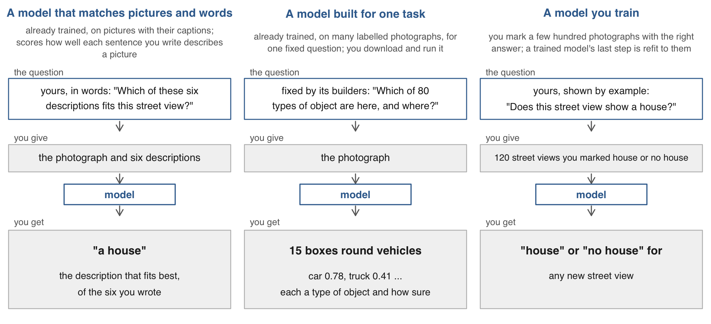{width="94%" fig-align="center"}

[**Training** sets a model's numbers from photographs with the right answers
attached, their **labels**. Today: the first type for houses and for faces, the
second for vehicles and for finding a face, the third for houses. A fourth
type, a general model that is asked a question and writes an answer, appears
today only as a second counter.]{.source}

## Vehicles at Manhattan's toll crossings {#count-design}

::: {.slide-text}

How many vehicles are in view at the crossings into Manhattan's congestion
zone, hour by hour? The zone is Manhattan south of 60th Street, where vehicles
pay a toll to enter.

:::

::: {.dashes}

- **The photographs**: New York City publishes live traffic cameras. I saved
  a frame from each of 33 cameras at the zone's crossings about every ten
  minutes for two days: 4,037 frames.
- **The model**: a pre-trained detector, used as released. It finds every car,
  truck, bus and motorcycle in a frame. Nothing is trained.
- **The reference**: on 30 frames I counted the vehicles by hand, one by one,
  from the enlarged frame.

:::

[Frames: [New York City DOT traffic cameras](https://webcams.nyctmc.org/api/cameras),
352 by 240 pixels, 9 to 11 November 2026. The city keeps no archive of past
frames. The toll began in January 2025.]{.source}

## The same camera at three times {#three-moments}

::: {.slide-text}

The same camera on a bridge exit ramp at 62nd Street: empty at night, a queue
at the morning rush, a queue with headlights in the evening. The count has to
work on all three.

:::

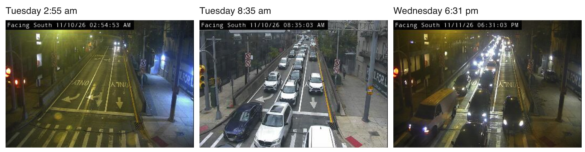{width="100%" fig-align="center"}

[62nd Street at the Queensboro Bridge upper-level exit ramp. Tuesday 10 and
Wednesday 11 November 2026.]{.source}

## The project folder {#project-folder}

::: {.slide-text}

Download the zip from the session page, unzip it and open
`22-photos-ii.Rproj`, so every path on the slides works. The folder holds what
each model returned for three sets of pictures: traffic-camera frames, street
views of Ithaca, frames of Fed press conferences.

:::

```{.default filename="22-photos-ii/, as its README.md describes it"}
22-photos-ii/
  data/cameras/      cameras.csv, the 33 cameras (the 4,037 frames are too large for the zip)
  data/ithaca/       the list of street panoramas of Ithaca, as Mapillary returned it
  data_clean/        boxes.csv and frames.csv: the detector's objects, one row each, and the frames searched
                     handcount.csv: 30 frames counted by hand
                     views.csv: the 1,630 street views cut from the panoramas
                     hand_labels.csv: 200 views labelled by looking
                     typed_labels.csv, view_embeddings.csv: what the pre-trained model returned for each view
                     fed_expressions.csv, fed_hand_labels.csv: the Fed chair's face, frame by frame
  code/              1_count.R, 2_houses.R, 3_faces.R in lecture order; run_everything.R runs all three
  22-photos-ii.R     the live script: every code slide in order
  tools/             what made data_clean/ from the pictures before class (Python)
```

::: {.slide-text}

Every script uses base R. Nobody needs Python, an account or the network: the
models ran before class and their output is in `data_clean/`.

:::

## A detector's boxes on one frame {#detector-returns}

::: {.slide-text}

An **object detector** takes one photograph and returns every object it finds:
a box, a **class** (the type of object) and a **confidence** (how sure it is,
from 0 to 1). This one found 15 vehicles in a frame from a New York City
traffic camera.

:::

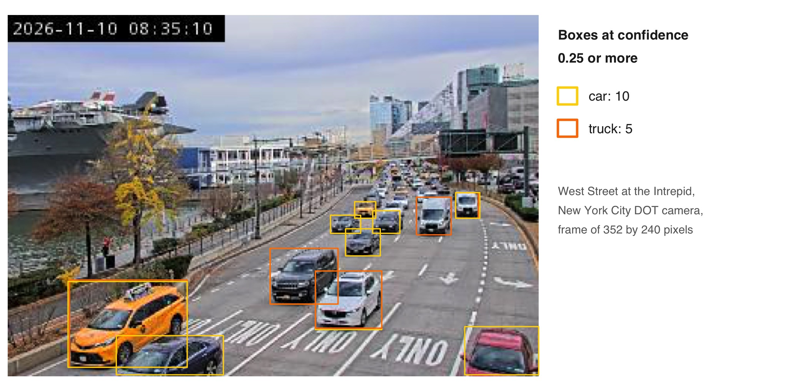{width="92%" fig-align="center"}

[A pre-trained detector: its authors trained it on about 118,000 everyday
photographs labelled with 80 classes. It ran on a laptop as released: nothing was trained
for this course. Only boxes at confidence 0.25 or more are drawn. It calls two
of these cars "truck".]{.source}

## One row per detected object {#box-table}

::: {.slide-text}

I saved one frame per camera about every ten minutes: 4,037 frames. The
detector's answer is the table `boxes`. Each row is one object it found: the
camera, the moment, the type of object, how sure it is, and the four corners of
its box. It holds no counts; we compute those in R. `frames` lists the frames
searched.

:::

```{r}
#| label: box-table
#| script: "One row per detected object"
#| filename: "R Console, in the 22-photos-ii folder; base R; reads data_clean/boxes.csv and frames.csv"
boxes  <- read.csv("data_clean/boxes.csv",  colClasses = c(cam = "character", stamp = "character"))
frames <- read.csv("data_clean/frames.csv", colClasses = c(cam = "character", stamp = "character"))
head(boxes[boxes$cam == "16" & boxes$stamp == "20261110_083455", ], 3)   # three objects of the frame shown before
head(frames, 2)                                # one row per frame searched, with its file
c(objects = nrow(boxes), frames = nrow(frames), cameras = length(unique(frames$cam)))
```

[`cam` is the camera, 00 to 32. `stamp` is the moment the frame was saved, as
year, month, day, hour, minute, second. `label` is the type of object and `conf`
the confidence. `x1, y1` is the box's top-left corner and `x2, y2` its
bottom-right, in pixels from the frame's top-left.]{.source}

## One camera over two days {#one-camera}

::: {.slide-text}

West Street at the Intrepid, one frame about every ten minutes from Monday night
to Wednesday evening. Each bar is one hour: the mean number of vehicles the
detector found per frame. Grey is night, where the detector finds too few
vehicles. Hatched hours have no frames.

:::

::: {.content-visible unless-format="revealjs"}

```{r}
#| label: one-camera
#| script: "One camera over two days"
#| filename: "R Console, in the 22-photos-ii folder; boxes and frames from the slide before"
#| fig-show: hide
one  <- boxes[boxes$cam == "16" & boxes$conf >= 0.25, ]        # one camera; boxes at confidence 0.25 or more
when <- frames$stamp[frames$cam == "16"]                       # its 122 frames
n <- table(factor(one$stamp, levels = when), one$label)        # objects per frame, by type
ny <- function(x) as.POSIXct(x, tz = "America/New_York")
d <- data.frame(hour = substr(when, 1, 11), cars = as.vector(n[, "car"]), large = as.vector(n[, "truck"] + n[, "bus"]))
h <- aggregate(cbind(cars, large, frames = 1) ~ hour, data = d, FUN = sum)   # one row per hour with frames
h <- h[h$frames >= 2, ]                                        # hours with at least two frames
h$t <- ny(strptime(h$hour, "%Y%m%d_%H", tz = "America/New_York"))
cars <- h$cars / h$frames; large <- h$large / h$frames         # the hour's mean per frame
all_hours <- seq(min(h$t), max(h$t), by = "hour")
miss <- all_hours[!all_hours %in% h$t]                         # hours with no frames
dusk <- ny(c("2026-11-09 16:44", "2026-11-10 16:43", "2026-11-11 16:42"))   # sunset
dawn <- ny(c("2026-11-10 06:37", "2026-11-11 06:38", "2026-11-12 06:39"))   # the next sunrise
par(mar = c(2.6, 4.2, 0.6, 0.6), bty = "n", mgp = c(2.6, 0.7, 0), tcl = -0.3)
plot(ny(c("2026-11-09 21:00", "2026-11-11 22:00")), c(0, 18), type = "n", xaxt = "n", xaxs = "i", yaxs = "i",
     xlab = "", ylab = "Vehicles per frame, mean of the hour", las = 1)
rect(dusk, 0, dawn, 18, col = "grey93", border = NA)                         # night: sunset to the next sunrise
rect(miss, 0, miss + 3600, 18, density = 14, col = "grey70", border = NA)   # hatched: no frames that hour
rect(h$t + 300, 0, h$t + 3300, cars, col = "grey20", border = NA)           # cars
rect(h$t + 300, cars, h$t + 3300, cars + large, col = "#B31B1B", border = NA)   # trucks and buses, stacked on top
axis.POSIXct(1, at = seq(ny("2026-11-10 00:00"), by = "6 hours", length.out = 8), format = "%a %H:%M")
text(ny("2026-11-10 01:30"), 17, "night", col = "grey45")
text(ny(c("2026-11-10 23:30", "2026-11-11 15:00")), c(9, 16.6), c("no frames saved", "no frames"), col = "grey30")
text(ny("2026-11-09 21:30"), c(15.2, 13.8), c("trucks and buses", "cars"), col = c("#B31B1B", "grey20"), pos = 4)
```

`aggregate()` sums by hour; `rect()` draws the bars, the night shading (sunset to
the next sunrise, computed for New York from the date) and the hatching.

:::

```{r}
#| label: one-camera-figure
#| ref.label: one-camera
#| echo: false
#| purl: false
#| fig-width: 9.6
#| fig-height: 4.5
#| out-width: "100%"
```

[Boxes at confidence 0.25 or more. No frames were saved from Tuesday 11:25 am to
Wednesday 11:14 am and on Wednesday from 1:49 to 4:32 pm: the laptop collecting
them was closed. Wednesday, November 11 was a public holiday. The R that draws
this is on the session page and in the live script.]{.source}

## Why the detector ran in Python {#where-it-ran}

::: {.slide-text}

The vehicle detector ran in Python, on a laptop, before class: 4,037 camera
frames in 169 seconds. Its output is `boxes.csv`. From that table on,
everything today is R.

:::

::: {.dashes}

- **R can run a pre-trained detector too**, through the `torchvision` package.
  We used Python for three reasons.
- **Speed.** About 22 frames a second in Python against 3 in R.
- **Detections.** On one frame, 19 vehicles in Python against 12 in R, at the
  same confidence.
- **Reliability.** The R detector stopped with an error on 1 of 40 frames.

:::

[The Python script is `tools/detect_frames.py`; `tools/requirements.txt` lists
its packages and the README gives the commands. Run again on the saved frames
it returns the same table. Nobody needs to run it. The two detectors are
different models, which is one reason their counts differ.]{.source}

## The count at three cutoffs {#cutoffs}

::: {.slide-text}

Every count so far kept the boxes at confidence 0.25 or more. That number is a
**cutoff**, the lowest confidence we accept, and it is our choice. One frame of
the FDR Drive at 64th Street, Tuesday 8:35 am, at three cutoffs.

:::

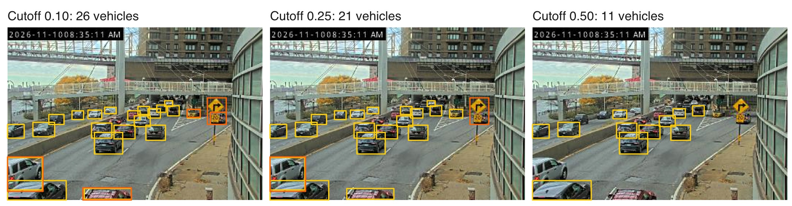{width="100%" fig-align="center"}

[A low cutoff keeps doubtful boxes, some of them a second box on the same
vehicle. A high cutoff drops small and partly hidden vehicles. Over all 4,037
frames the mean count is 6.2, 3.0 and 1.3 at the three cutoffs.]{.source}

::: {.content-visible unless-format="revealjs"}

The same count for every frame of every camera, at three cutoffs. `table()`
counts the rows for each frame and the square brackets put the counts in the
order of `frames`. A frame with no vehicle has no row in `boxes`, so its count
comes back `NA` and is set to 0.

```{r}
#| label: boxes-to-counts
#| script: "Counting every frame at three cutoffs"
#| filename: "R Console, in the 22-photos-ii folder; boxes and frames from the code slide before"
vehicles <- c("car", "truck", "bus", "motorcycle")
count_frames <- function(cut) {                      # vehicles per frame at a confidence cutoff
  v <- boxes[boxes$label %in% vehicles & boxes$conf >= cut, ]
  n <- table(paste(v$cam, v$stamp))[paste(frames$cam, frames$stamp)]   # NA where a frame has no box
  n[is.na(n)] <- 0
  as.integer(n)
}
frames$n10 <- count_frames(0.10); frames$n25 <- count_frames(0.25); frames$n50 <- count_frames(0.50)
frames[frames$cam == "13" & frames$stamp == "20261110_083455", c("cam", "stamp", "n10", "n25", "n50")]
round(colMeans(frames[, c("n10", "n25", "n50")]), 1)      # the mean over all 4,037 frames
```

:::

## Hand counts on 30 frames {#reference}

::: {.slide-text}

To choose a cutoff we need the true count on some frames. I counted the
vehicles by hand on 30 frames: ten cameras, each on Tuesday at 2:55 am, Tuesday
at 8:35 am and Wednesday at about 6:20 pm.

:::

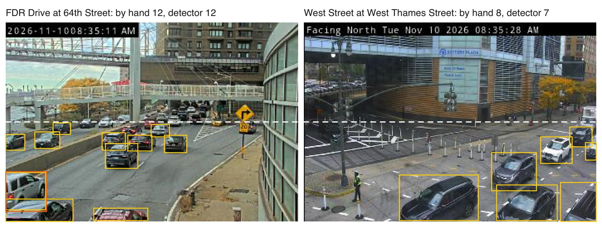{width="100%" fig-align="center"}

[My rule: count every car, truck, bus and motorcycle that is entirely below the
dashed line, parked ones included. That area is the **zone**. Beyond the line
vehicles are a few pixels wide and cannot be told apart. The detector's boxes
are counted by the same rule.]{.source}

::: {.content-visible unless-format="revealjs"}

The detector's count on the same 30 frames, by the same rule. `in_zone(k)` counts
the detector's boxes at confidence `k` or more that lie entirely below each
frame's line (`line_y`, in pixels from the top of the frame); `sapply()` runs it
once per frame. `count` is the hand count and `det` the detector at cutoff 0.25.

```{r}
#| label: detector-vs-reference
#| script: "Detector count against hand count"
#| filename: "R Console, in the 22-photos-ii folder; boxes from the slides before; reads data_clean/handcount.csv"
vehicles <- c("car", "truck", "bus", "motorcycle")
hand <- read.csv("data_clean/handcount.csv", colClasses = c(cam = "character", stamp = "character"))
in_zone <- function(cut) sapply(seq_len(nrow(hand)), function(i)      # one frame at a time
  sum(boxes$cam == hand$cam[i] & boxes$stamp == hand$stamp[i] & boxes$label %in% vehicles &
      boxes$conf >= cut & boxes$y1 >= hand$line_y[i]))                 # y1: the box's top edge, so the whole box is below the line
hand$det <- in_zone(0.25)
hand[13:15, c("id", "cam", "moment", "line_y", "count", "det")]             # Twelfth Avenue at 57th Street
mean(abs(hand$det - hand$count))               # the average miss, in vehicles per frame
```

:::

## Exercise 1 {#exercise-1}

::: {.panel-tabset}

### Exercise

The detector's count depends on the confidence cutoff, and the detector does
poorly in the dark. Thirty frames were counted by hand (`hand$count`): ten in
daylight, ten after dark, ten at 2:55 am. Find the cutoff that comes
closest to the hand counts in daylight, and see what any cutoff does after
dark. 5 minutes.

1. `cuts <- c(0.10, 0.15, 0.25, 0.35, 0.50)`.
2. The average miss at one cutoff, by moment:
   `tapply(abs(in_zone(k) - hand$count), hand$moment, mean)`.
3. The same for every cutoff, with `sapply()` over `cuts`.
4. One line: the cutoff you would use in daylight, and what no cutoff fixes.

```{r}
#| label: exercise-1
#| exercise: true
#| script: "Exercise 1 (5 minutes)"
#| include: false
#| eval: false
# Exercise 1 (5 minutes). The cutoff that comes closest to the hand counts, by day and in the dark.
# The detector's count moves with the cutoff; the 30 frames counted by hand say which cutoff to trust, and when.
# In the 22-photos-ii folder, with boxes, vehicles, hand and in_zone() from the lines just above
# (or run code/1_count.R sections 1 to 3 first).
# 1. cuts <- c(0.10, 0.15, 0.25, 0.35, 0.50)
# 2. tapply(abs(in_zone(0.25) - hand$count), hand$moment, mean)        # the average miss at one cutoff, by moment
# 3. miss <- sapply(cuts, function(k) tapply(abs(in_zone(k) - hand$count), hand$moment, mean))
#    colnames(miss) <- cuts; round(miss, 1)                            # rows: day, evening (after dark), night (2:55 am)
# 4. One line: the cutoff you would use in daylight, and what no cutoff fixes.
# Two answers to compare with the room: the best cutoff in daylight and its average miss,
# and the smallest average miss after dark.
```

[`hand` holds my 30 hand counts of vehicles. `moment` is `day` (8:35 am),
`evening` (6:20 pm, after dark) or `night` (2:55 am).
`in_zone(k)` is the detector's count below the line at cutoff `k`. Both come from
the live script, just above this exercise. Two answers to compare with the
room: the best cutoff in daylight and its miss, and the smallest miss after
dark.]{.source}

### Solution

```{r}
#| label: exercise-1-solution
#| purl: false
#| filename: "R Console, in the 22-photos-ii folder; hand and in_zone() from the live script"
#| collapse: true
cuts <- c(0.10, 0.15, 0.25, 0.35, 0.50)
miss <- sapply(cuts, function(k) tapply(abs(in_zone(k) - hand$count), hand$moment, mean))
colnames(miss) <- cuts; round(miss, 1)
```

[In daylight (`day`) cutoffs 0.25 and 0.35 come within two vehicles of the hand
count. After dark (`evening`) the best cutoff still misses by 3.7 where the hand
count averages 7.3: no cutoff fixes the dark. At 2:55 am (`night`) the frames
are nearly empty, so the miss is small whatever the cutoff.]{.source}

:::

## My count against a model's {#two-counters}

::: {.dashes}

- A second counter: a general vision model, shown each of the 30 frames and
  asked to count the vehicles. It also counted vehicles that cross the line.
- It and I give the same count on 12 of 30 frames, and differ by 1.6 vehicles
  on average.
- The detector differs from my count by 2.2 on average. Two careful counters
  already differ by 1.6.

:::

```{r}
#| label: two-counters
#| script: "My count against a model's"
#| filename: "R Console, in the 22-photos-ii folder; hand with det, the detector's count at cutoff 0.25, from the live script"
table(same_count = hand$count == hand$count_model)                 # count: mine, by hand; count_model: a vision model
mean(abs(hand$count - hand$count_model))                           # the average difference between the two counters
aggregate(cbind(by_hand = count, model = count_model, detector = det) ~ moment, data = hand,
          FUN = function(x) round(mean(x), 1))
```

[In daylight the model counted 10.8 vehicles a frame where I counted 8.0. Most of that gap is the rule at the line: whether a vehicle that crosses it
counts. A counting rule has to settle its boundary cases before anyone
counts.]{.source}

## Vehicles per frame by hour {#by-hour}

::: {.slide-text}

Vehicles per frame on Tuesday, averaged over the 33 cameras, at three
confidence cutoffs. Sunrise was at 6:37 and the detector misses vehicles in the
dark, so the jump at 6 am overstates the rise in traffic.

:::

```{r}
#| label: by-hour
#| script: "Vehicles per frame by hour"
#| filename: "R Console, in the 22-photos-ii folder; frames with n10, n25, n50 from count_frames() in the live script"
#| fig-height: 3.4
frames$day  <- substr(frames$stamp, 1, 8); frames$hour <- as.integer(substr(frames$stamp, 10, 11))   # yyyymmdd_hhmmss
tue <- frames[frames$day == "20261110" & frames$hour <= 11, ]
by_hour <- aggregate(cbind(n10, n25, n50) ~ hour, data = tue, FUN = mean)
par(mar = c(4, 4.5, 0.5, 6))
matplot(by_hour$hour, by_hour[, -1], type = "b", pch = 16, lty = 1, col = c("grey60", "black", "grey60"),
        xlab = "Hour of Tuesday, November 10", ylab = "Vehicles per frame", las = 1)
text(11.4, unlist(by_hour[12, -1]), c("cutoff 0.10", "0.25", "0.50"), pos = 4, xpd = NA)
```

# 2 · Classifying street views of Ithaca {#part-houses}

## Which Ithaca views show a house {#houses-design}

::: {.slide-text}

Along the streets of Ithaca, which stretches are lined with houses?

:::

::: {.dashes}

- **The photographs**: 1,630 views of the side of the street, cut from a
  volunteer's panoramas on Mapillary.
- **Two models**:
    1. A pre-trained model, used as released. It is given six descriptions in
       words and picks the one that fits the view. Nothing is trained.
    2. A classifier we train on our own labels.
- **Why two**: the first needs no labels. The second needs labels someone
  makes by looking. Comparing them says whether making labels is worth it.
- **The reference**: 200 views I labelled by looking. The labels judge both
  models and train the second.

:::

[Photographs: Mapillary contributor quickness805, CC BY-SA 4.0, April
2024.]{.source}

## Mapillary's street photographs of Ithaca {#mapillary}

::: {.slide-text}

Mapillary is a crowdsourced alternative to Google Street View. Volunteers
upload street photographs and anyone may download them. The quality is lower
and uneven. Green lines are the streets of Ithaca that have photographs.

:::

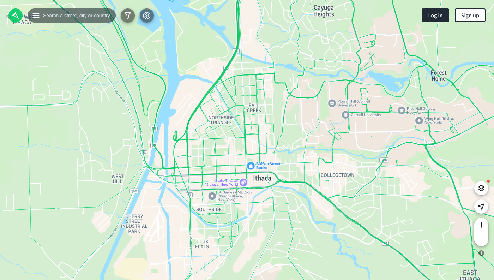{width="88%" fig-align="center"}

[Screenshot of mapillary.com, 11 November 2026. The panoramas used here are one
volunteer's, from about 17 km of these streets in April 2024, one kept every 20
metres or more. Mapillary blurs faces and licence plates.]{.source}

## Cutting a panorama into two views {#pano-views}

::: {.slide-text}

A panorama is the full circle around the car. Two ordinary photographs are cut
from each, one to the left and one to the right. Each faces the buildings on
its side of the street.

:::

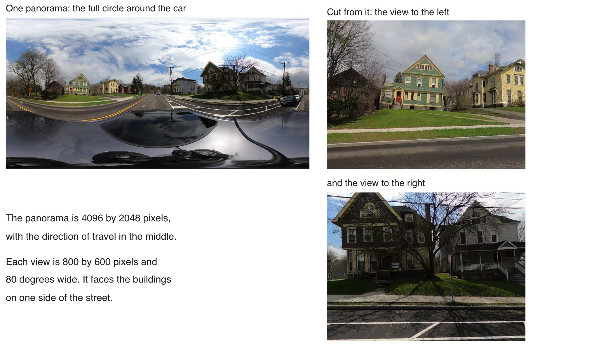{width="86%" fig-align="center"}

[815 panoramas give 1,630 views. A view is a stretch of street and can hold
two houses, half a house or none. Photographs: Mapillary contributor
quickness805, CC BY-SA 4.0.]{.source}

## My labels on 200 views {#hand-labels}

::: {.slide-text}

I looked at a random 200 of the 1,630 street views of Ithaca and labelled each
one: 41 show a house and 148 do not. I left 11 undecided. The labels judge the
first model and train the second.

:::

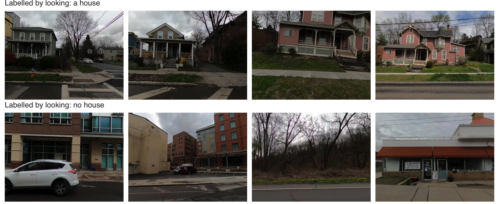{width="96%" fig-align="center"}

[My rule: "house" when I can see a house, "no house" when I cannot, and no label
when a house is barely visible or I am in real doubt.]{.source}

## Eleven views I left undecided {#hard-views}

::: {.dashes}

- On 11 of the 200 views I gave no label: a house was barely visible, or I
  doubted that the building is a house.
- These 11 are left out of the comparisons that follow.
- Another person would decide some of them differently. A label is a judgment.

:::

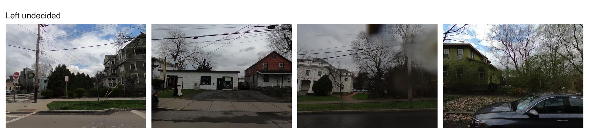{width="100%" fig-align="center"}

[Four of the eleven. For comparison, a general vision model asked the same
question gives my label on 178 of the 189 views I did label.]{.source}

## A pre-trained model given six descriptions {#typed-labels}

::: {.dashes}

- The first model is used as released. Its authors trained it on hundreds of
  millions of pictures with their captions, and we train nothing.
- **Its output**: a share from 0 to 1 for each description we wrote. The shares
  sum to 1, and its answer is the description with the largest share.
- **What it cannot do**: count ("how many people?"), say where an object is, or
  write an answer of its own. It only ranks the descriptions it is given.

:::

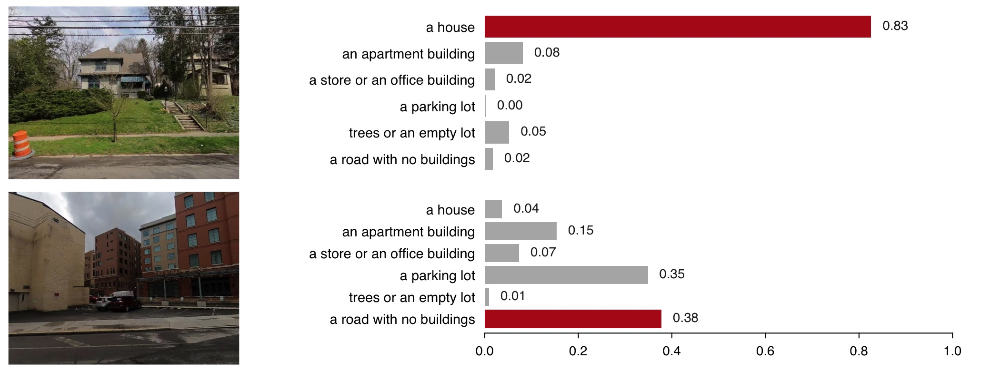{width="92%" fig-align="center"}

[Two street views and the model's six shares for each; its answer is in red.
Six descriptions, so that trees, shops and car parks each have somewhere to go.
The model is CLIP, released openly by OpenAI: 1,630 views in 26 seconds on a
laptop.]{.source}

## Reading the model's shares in R {#typed-shares-r}

::: {.slide-text}

`typed_labels.csv` holds the model's shares: one row for each street view and
each description. The model's answer for a view is its row with the largest
share.

:::

```{r}
#| label: typed-labels
#| script: "Reading the model's shares in R"
#| filename: "R Console, in the 22-photos-ii folder; base R; reads data_clean/hand_labels.csv and typed_labels.csv"
hand_labels <- read.csv("data_clean/hand_labels.csv")      # 200 views: house 1 or 0 by looking, NA where undecided
hand_labels <- hand_labels[!is.na(hand_labels$house), ]    # the 189 views with a label
typed <- read.csv("data_clean/typed_labels.csv")           # every view, every description, the model's share
shows <- typed[typed$set == "shows", ]                      # set "shows": the six descriptions of what a view shows
shows[shows$view == hand_labels$view[hand_labels$n == 8], c("label", "share")]   # one view: six shares that sum to 1
top <- shows[order(shows$view, -shows$share), ]                     # each view's descriptions, largest share first
top <- top[!duplicated(top$view), c("view", "label", "share")]      # keep the first: the model's answer
mean(top$label == "a house")                                        # the share of all 1,630 views it calls a house
```

[`order()` sorts each view's rows by share and `!duplicated()` keeps the first
row of each view. The model calls 23% of the 1,630 views a house.]{.source}

## The pre-trained model matches 169 of 189 labels {#typed-vs-hand}

::: {.slide-text}

Of the 41 views I labelled "house", the pre-trained model says "a house" for 33
and misses 8. Of the 148 I labelled "no house", it wrongly says "a house" for
12. Its answer matches my label on 169 of 189 views: 89.4%.

:::

```{r}
#| label: typed-vs-hand
#| script: "The pre-trained model matches 169 of 189 labels"
#| filename: "R Console, in the 22-photos-ii folder; hand_labels and top from the slide before"
h <- merge(hand_labels, top, by = "view")              # the 189 labelled views, each with the model's answer
h$pretrained <- as.integer(h$label == "a house")       # 1 when the model's answer is "a house"
table(by_looking = ifelse(h$house == 1, "house", "no house"),
      model      = ifelse(h$pretrained == 1, "house", "no house"))
mean(h$house == h$pretrained)                          # the share of views where model and label match
mean(h$house == 0)                                     # the share that show no house
```

::: {.slide-text}

Nearly four views in five show no house. A model that answered "no house" every
time would match 78% of my labels. The pre-trained model's 89.4% is judged
against that 78%.

:::

## Where the model and my labels disagree {#typed-wrong}

::: {.slide-text}

The pre-trained model and my labels disagree on 20 of the 189 views. Top: four
views it called a house and I did not. The first two are apartment buildings
that look like large houses. Bottom: four houses I labelled that it gave another
description, three of them behind a fence or trees.

:::

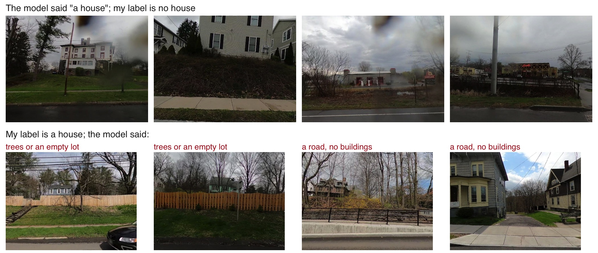{width="96%" fig-align="center"}

[Top row: the four it was most sure of, among the 12 it called a house and I did
not. Bottom row: four of the 8 houses it missed, with the description it
chose.]{.source}

## A view as 512 numbers {#embedding}

::: {.dashes}

- The second model starts from these. Each grid is the real list of 512
  numbers, the **embedding**, that a pre-trained model returns for the view
  above it.
- No single number means "roof" or "porch", and the grids look alike.
- Similarity of two lists (1 is identical): the two houses 0.86, the first house
  and the hotel 0.75.

:::

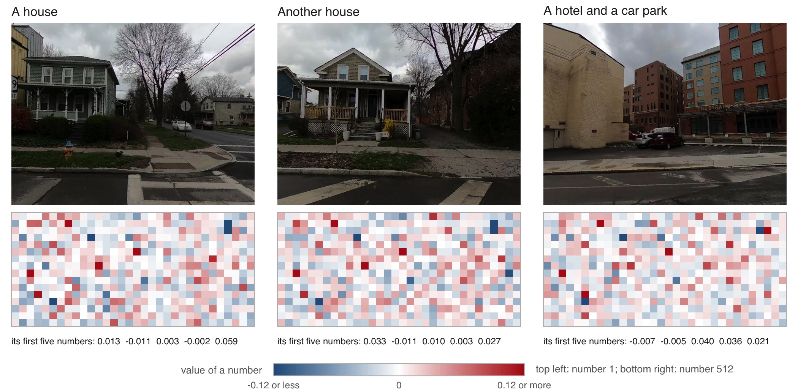{width="100%" fig-align="center"}

[The numbers are read from `data_clean/view_embeddings.csv`, one row per view,
and drawn in order in rows of 32. The model is the one that was given the six
descriptions.]{.source}

## Five summaries of the 512 numbers {#summaries}

::: {.dashes}

- Each view's 512 numbers are boiled down to five summaries, each a weighted
  sum of the 512. Five numbers are few enough to fit on about a hundred
  labelled views.
- Left: my 189 labelled views on the first two summaries. Houses, in red, sit
  together.
- Right: three houses and three other views, each with its five summaries as
  bars. The houses have a large negative first summary.

:::

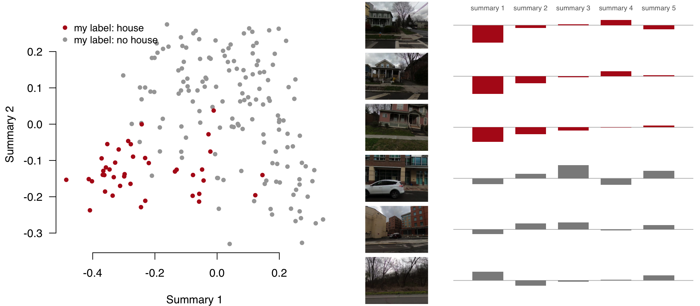{width="92%" fig-align="center"}

[The summaries are **principal components**: the weighted sums that keep most of
the variation in the 512 numbers. A logistic regression turns the five into a
probability of "house".]{.source}

## Fitting views and held-out views {#split}

::: {.dashes}

- The regression learns from 120 of my labelled views, picked at random.
- The other 69 are held out. The classifier never sees them, and it is judged
  on them.
- A classifier judged on the views it learned from looks better than it is.

:::

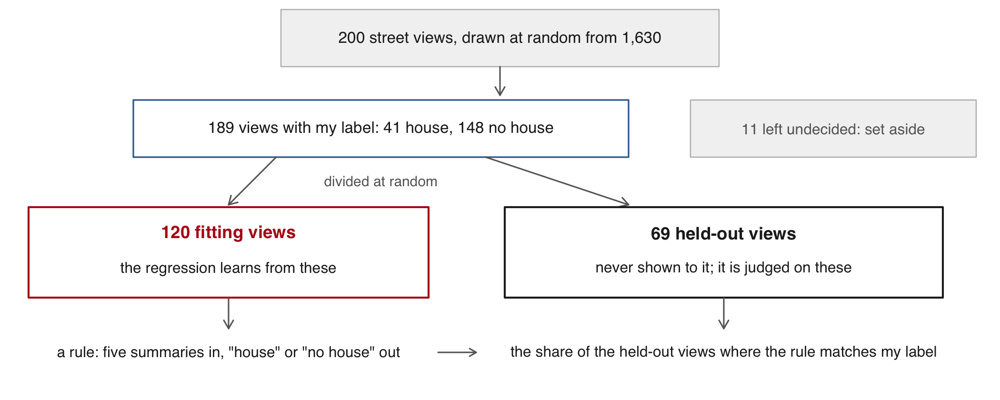{width="92%" fig-align="center"}

[This is one division into two groups. Cross-validation repeats the division
several times and averages the results.]{.source}

## Training a classifier on my labels {#trained}

::: {.dashes}

- `prcomp()` makes the five summaries of each view's 512 numbers, from the
  fitting views only.
- `glm(..., family = binomial)` is the logistic regression: it returns a
  probability of "house" for each view.
- A held-out view with a probability above 0.5 is called a house.

:::

```{r}
#| label: trained
#| script: "Training a classifier on my labels"
#| filename: "R Console, in the 22-photos-ii folder; hand_labels from the slides before; reads data_clean/view_embeddings.csv"
emb <- read.csv("data_clean/view_embeddings.csv")      # one row per view: view, e1 to e512
X <- as.matrix(emb[, -1]); rownames(X) <- emb$view
set.seed(6850)
fit <- sample(nrow(hand_labels), 120)                  # 120 labelled views to fit on; the other 69 held out
pc  <- prcomp(X[hand_labels$view[fit], ])              # principal components, from the fitting views only
Z   <- as.data.frame(predict(pc, X[hand_labels$view, ])[, 1:5]); Z$house <- hand_labels$house
m   <- glm(house ~ ., data = Z[fit, ], family = binomial)          # logistic regression on 5 components
p   <- predict(m, newdata = Z[-fit, ], type = "response")          # a probability for each held-out view
table(by_looking = ifelse(Z$house[-fit] == 1, "house", "no house"), trained = ifelse(p > 0.5, "house", "no house"))
```

[Rows: my label. Columns: the trained classifier. It matches my label on 64 of
the 69 held-out views.]{.source}

## Agreement on 69 held-out views {#three-compared}

::: {.slide-text}

On the 69 held-out street views the trained classifier agrees with my label on
92.8%. The pre-trained model, which needed no labels, agrees on 82.6%, and "no
house" every time on 76.8%. My 120 labels added ten percentage points.

:::

```{r}
#| label: three-compared
#| script: "Agreement on 69 held-out views"
#| filename: "R Console, in the 22-photos-ii folder; h, hand_labels, fit, p and Z from the slides before"
held <- hand_labels$view[-fit]                         # the 69 views kept out of the fitting
round(c(trained = mean((p > 0.5) == Z$house[-fit]),
        pretrained = mean(h$pretrained[match(held, h$view)] == hand_labels$house[-fit]),
        never   = mean(hand_labels$house[-fit] == 0)), 3)
```

[The comparison is fair only on views the trained classifier never saw.
Sixty-nine views is a small test: one view is 1.4 points, so 92.8 against 82.6
is seven views.]{.source}

## Exercise 2 {#exercise-2}

::: {.panel-tabset}

### Exercise

The classifier that says whether a street view shows a house was trained on
120 labelled views. Labels cost time. Train it on 20, 40, 80 and 120 of those
views and judge each on the same 69 held-out views. 5 minutes.

1. Copy `agree()` from the live script, `22-photos-ii.R` on the session page:
   it trains on `n` of the 120 fitting views and returns the share of the 69
   held-out views it gets right.
2. Run it for each size with 20 different draws of the labels, and take the
   mean: `sapply()` inside `sapply()`.
3. One line: where the gain from more labels flattens, and how that compares
   with the pre-trained model's 82.6%.

```{r}
#| label: exercise-2
#| exercise: true
#| script: "Exercise 2 (5 minutes)"
#| include: false
#| eval: false
# Exercise 2 (5 minutes). The trained classifier with fewer and with more labels.
# Every label costs a look; this shows what the next 40 labels buy.
# In the 22-photos-ii folder, with X, hand_labels and fit as on the slides before
# (or run code/2_houses.R sections 1 to 3 first).
# 1. agree <- function(n, seed) {              # train on n of the 120 fitting views, judge on the same 69
#      set.seed(seed); use <- sample(fit, n)
#      pc <- prcomp(X[hand_labels$view[use], ])
#      Z <- as.data.frame(predict(pc, X[hand_labels$view, ])[, 1:5]); Z$house <- hand_labels$house
#      m <- suppressWarnings(glm(house ~ ., data = Z[use, ], family = binomial))
#      mean((predict(m, newdata = Z[-fit, ], type = "response") > 0.5) == Z$house[-fit])
#    }
# 2. sizes <- c(20, 40, 80, 120)
#    round(sapply(sizes, function(n) mean(sapply(1:20, function(s) agree(n, s)))), 3)
# 3. One line: where the gain flattens, and how 20 labels compare with the pre-trained model's 0.826.
# Two answers to compare with the room: the agreement with 20 labels,
# and the gain from the last 40 labels.
```

[`X`, `hand_labels` and `fit` from the slides before, or run `code/2_houses.R`
sections 1 to 3 first. Two answers to compare with the room: the agreement with
20 labels, and the gain from the last 40.]{.source}

### Solution

```{r}
#| label: exercise-2-solution
#| purl: false
#| filename: "R Console, in the 22-photos-ii folder; X, hand_labels and fit from the slides before"
#| collapse: true
agree <- function(n, seed) {
  set.seed(seed); use <- sample(fit, n)
  pc <- prcomp(X[hand_labels$view[use], ])
  Z <- as.data.frame(predict(pc, X[hand_labels$view, ])[, 1:5]); Z$house <- hand_labels$house
  m <- suppressWarnings(glm(house ~ ., data = Z[use, ], family = binomial))
  mean((predict(m, newdata = Z[-fit, ], type = "response") > 0.5) == Z$house[-fit])
}
sizes <- c(20, 40, 80, 120)
round(sapply(sizes, function(n) mean(sapply(1:20, function(s) agree(n, s)))), 3)
```

[With 20 labels the trained classifier already agrees on 85.8%, above the
pre-trained model's 82.6% with none. From 80 to 120 labels the gain is 1.4
points, one view. Here the first few dozen labels do most of the work.]{.source}

:::

## Where the classifier finds houses {#city-map}

::: {.dashes}

- The classifier trained on my labels now labels all 1,630 views. Each dot is
  one view: red where it finds a house, 22% of them.
- Red runs along the residential streets north and east of downtown. The lake
  shore, the highway and the campus are grey.

:::

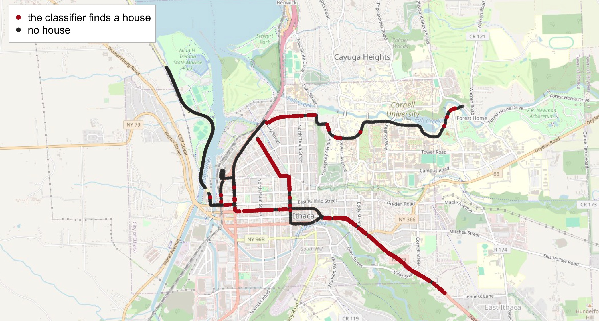{width="100%" fig-align="center"}

[189 labels became a measure for every street the car drove. Base map: ©
OpenStreetMap contributors.]{.source}

::: {.content-visible unless-format="revealjs"}

The same result as a plain plot of longitude against latitude, without the
street map.

```{r}
#| label: city-map
#| script: "Where the classifier finds houses"
#| filename: "R Console, in the 22-photos-ii folder; pc, m and X from the slides before; reads data_clean/views.csv"
#| fig-show: hide
views <- read.csv("data_clean/views.csv")              # all 1,630 views, with the car's position
Zall <- as.data.frame(predict(pc, X[views$view, ])[, 1:5])
views$house <- predict(m, newdata = Zall, type = "response") > 0.5
par(mar = c(4, 4.5, 0.5, 0.5))
plot(views$lon, views$lat, pch = 16, cex = 0.6, asp = 1 / cos(42.44 * pi / 180),   # asp: a degree of longitude is shorter
     col = ifelse(views$house, "#B31B1B", "grey75"), xlab = "Longitude", ylab = "Latitude", las = 1)
```

:::

# 3 · Classifying expressions on a face {#part-faces}

## Expressions at 24 Fed press conferences {#faces-design}

::: {.slide-text}

What expression does the chair of the Federal Reserve show while he speaks at
a press conference? Markets watch him for signs of what the Fed will do.

:::

::: {.dashes}

- **The photographs**: the Fed's own video of the 24 press conferences from
  January 2021 to December 2023. One frame was kept every 30 seconds: 2,486
  frames.
- **The models**: a pre-trained face detector finds his face. The pre-trained
  model used for the houses is given four descriptions (happy, neutral, angry,
  worried) and picks one. Nothing is trained.
- **The reference**: 80 of the faces, labelled one by one by a general vision
  model. A person has not checked them.

:::

[Video: Board of Governors of the Federal Reserve System, 480 by 270 pixels.
[Curti & Kazinnik (JME, 2023)](https://doi.org/10.1016/j.jmoneco.2023.06.007)
measured the chair's expressions at these press conferences and studied how
markets moved with them.]{.source}

## From a frame to an expression {#frame-to-face}

::: {.dashes}

- **Which frames show the speaker.** The pre-trained model used for the houses
  picks among four descriptions of a frame: 1,316 of 2,486 frames.
- **Where the face is.** A pre-trained face detector finds a face in 1,181 of
  them.
- **Which expression.** The first model again. We wrote four descriptions in
  plain English and it must pick one: "a happy, smiling face", "a neutral
  face", "an angry face", "a worried or sad face".
- **Time.** 49 seconds on a laptop for all three steps. Nothing was trained.

:::

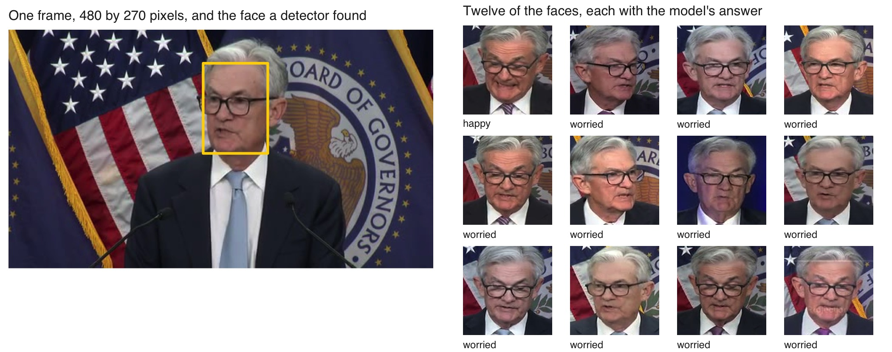{width="92%" fig-align="center"}

[Under each face: the description the model picked. The first model is CLIP,
released openly by OpenAI; the face detector is YuNet, from the OpenCV
project.]{.source}

## The model calls most faces worried {#faces-vs-hand}

::: {.slide-text}

The pre-trained model calls 98% of the Fed chair's 1,181 faces worried. To
judge that, a general vision model labelled 80 of the faces one by one: 75
neutral, 1 happy and 4 it could not judge ("unclear"). The two agree on 1 face
in 80.

:::

```{r}
#| label: faces-vs-hand
#| script: "The model calls most faces worried"
#| filename: "R Console, in the 22-photos-ii folder; base R; reads data_clean/fed_expressions.csv and fed_hand_labels.csv"
ex <- read.csv("data_clean/fed_expressions.csv")       # one row per face: a share for each of four descriptions
round(prop.table(table(ex$top)), 3)                    # the label with the largest share, all 1,181 faces
fh <- read.csv("data_clean/fed_hand_labels.csv")       # 80 of the faces, labelled by looking
f  <- merge(fh, ex[, c("file", "top")], by = "file")
table(by_looking = f$label, pretrained = f$top)
mean(f$label == f$top)                                 # the share of faces where the two agree
```

[A serious face of a man speaking sits closer to the description "a worried or
sad face" than to "a neutral face". The classifier cannot know that this is how he
looks at rest. No person has checked the 80 labels.]{.source}

## The answer depends on the descriptions {#descriptions}

::: {.dashes}

- The model has no list of answers of its own. We write the descriptions, and
  it must pick one of them.
- Offer a fifth description, "a serious, focused face", and 79% of the same
  faces move to it. "Worried" falls from 98% to 21%.
- "98% worried" says as much about our four descriptions as about his face.

:::

```{r}
#| label: descriptions
#| script: "The answer depends on the descriptions"
#| filename: "R Console, in the 22-photos-ii folder; base R; reads data_clean/fed_expressions_sets.csv"
sets <- read.csv("data_clean/fed_expressions_sets.csv")    # the same 1,181 faces, three sets of descriptions
sets[, c("set", "description", "share")]                   # share: the faces given that description
```

## What an expression label measures {#expression-measures}

::: {.slide-text}

An expression label describes the face in one frame. Whether it tells what
the person feels is disputed.

:::

::: {.dashes}

- **The evidence on feelings.**
  [Barrett et al. (Psychological Science in the Public Interest, 2019)](https://doi.org/10.1177/1529100619832930)
  reviewed the research and concluded that a facial movement is not a reliable
  sign of what a person feels.
- **A use in economics.**
  [Hu & Ma (JF, 2025)](https://doi.org/10.1111/jofi.13471) scored faces, voices
  and words in startup pitches. More positive pitches were funded more often,
  and those startups later did worse.
- **Privacy.** A face identifies a person. The Fed chair is a public official
  speaking in public. A study of private people's faces needs approval from the
  university's ethics board, and usually their consent.

:::

# 4 · What can go wrong {#part-wrong}

## Detector does poorly in the dark {#dark-frames}

::: {.slide-text}

Two New York cameras, each in daylight and after dark. Boxes are the
detector's at confidence 0.25 or more, entirely below the dashed line that
marks the counting zone. "By hand" is my count. After dark a vehicle is
two lights in glare.

:::

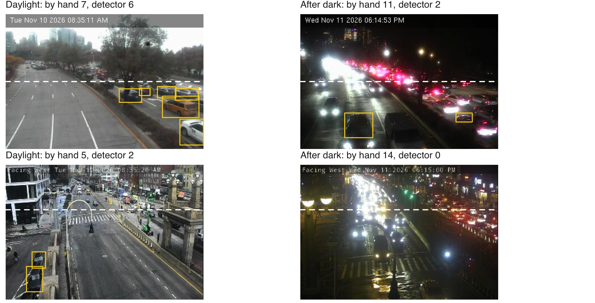{width="88%" fig-align="center"}

[Top: Twelfth Avenue at 57th Street. Bottom: the Williamsburg Bridge roadway at
Delancey Street. The detector was trained mostly on daylight photographs of
whole vehicles.]{.source}

## The count is too low after dark {#night-error}

::: {.dashes}

- In daylight the detector finds 7.6 vehicles a frame where I count 8.0. After
  dark it finds 4.0 where I count 7.3.
- This error is a bias that depends on the light. It does not average out over
  many frames.
- Every comparison across hours carries it: the evening rush looks like a lull.
  So does a comparison across seasons, since 5 pm is dark in December and light
  in June.
- To account for it: compare daylight hours only, or correct the dark hours
  with hand counts made in the dark, and report the error by light.

:::

```{r}
#| label: night-error
#| echo: false
#| purl: false
#| fig-width: 9.6
#| fig-height: 2.9
#| out-width: "88%"
mm <- aggregate(cbind(count, det) ~ moment, data = hand, FUN = mean)
mm <- mm[match(c("day", "evening", "night"), mm$moment), ]
par(mar = c(2.2, 4.4, 0.6, 0.6), mgp = c(2.8, 0.7, 0), tcl = -0.3)
bp <- barplot(t(as.matrix(mm[, c("count", "det")])), beside = TRUE, las = 1, border = NA, ylim = c(0, 9.5),
              col = c("grey20", "#B31B1B"), ylab = "Vehicles per frame",
              names.arg = c("Daylight, 8:35 am", "After dark, 6:20 pm", "Night, 2:55 am"))
text(bp, t(as.matrix(mm[, c("count", "det")])), sprintf("%.1f", t(as.matrix(mm[, c("count", "det")]))), pos = 3, xpd = NA)
legend("topright", legend = c("my hand count", "the detector"), fill = c("grey20", "#B31B1B"), border = NA, bty = "n")
```

::: {.content-visible unless-format="revealjs"}

The same numbers in R, and how closely the detector follows the hand count at
each moment. The slope says how many more vehicles the detector finds when the
hand count has one more: near 1 in daylight, near 0 after dark.

```{r}
#| label: day-night
#| script: "Detector error by day and night"
#| filename: "R Console, in the 22-photos-ii folder; hand with det, the detector's count at cutoff 0.25, from the live script"
aggregate(cbind(by_hand = count, detector = det) ~ moment, data = hand, FUN = function(x) round(mean(x), 1))
round(coef(lm(det ~ count, data = hand[hand$moment == "day", ])), 2)       # daylight: a slope near 1
round(coef(lm(det ~ count, data = hand[hand$moment == "evening", ])), 2)   # after dark: a slope near 0
```

:::

## Vehicles in view, vehicles entering {#stock-flow}

::: {.slide-text}

A camera frame shows the vehicles in view at one instant. New York's toll
authority counts vehicles entering Manhattan's congestion zone in each ten
minutes. In a jam the first rises while the second falls, so more vehicles in a
frame can mean fewer getting through.

:::

::: {.dashes}

- **What the photograph measures**: how full the road is.
- **What the record measures**: how many vehicles passed.
- **Counting vehicles that pass** needs the same vehicle followed from one
  frame to the next, and frames a fraction of a second apart. The city's
  cameras refresh about every five seconds.

:::

[The record: the Metropolitan Transportation Authority's
[Congestion Relief Zone vehicle entries](https://data.ny.gov/d/t6yz-b64h), in
ten-minute blocks by entry point and type of vehicle.]{.source}

## A camera that turned {#camera-turned}

::: {.slide-text}

A fixed camera is fixed until someone turns it. This one pointed north on
Tuesday morning and east on Wednesday evening. Its counts before and after
describe two different roads.

:::

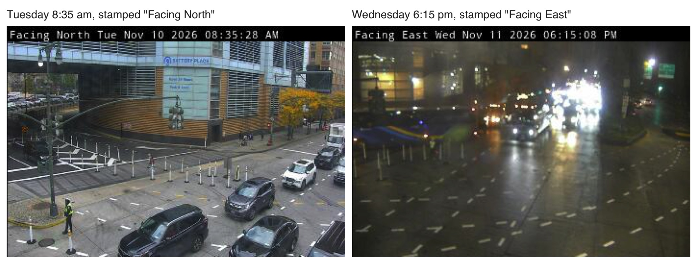{width="100%" fig-align="center"}

[West Street at West Thames Street, by the Battery Tunnel. The direction is in
the stamp the camera prints on each frame, which a script can read before
comparing counts across days.]{.source}

## All views from one car {#one-car}

::: {.slide-text}

Every street view of Ithaca comes from one volunteer's car on two days of
April 2024. The share of views with a house describes the streets that car
drove, and only those. The second day was wet, and drops on the lens hide part
of many views.

:::

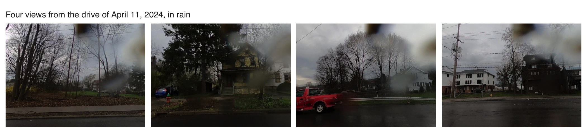{width="100%" fig-align="center"}

[A street the car skipped is missing, and so is every house built or torn down
since. Mapillary, the open street-photo site, has other years for Ithaca from
other volunteers, with other cameras and other streets.]{.source}

## Practice {#practice}

::: {.content-visible when-format="revealjs"}

Six tasks on the session page run in the 22-photos-ii folder, on the camera
frames' box table, the 30 hand counts and the 189 labelled views, with
solutions behind a click. None needs Python or the network.

- **1–2** The box table: classes by hour · the busiest camera
- **3–4** The hand counts: the detector's miss where the two counters
  agree · the cutoff at which too-high and too-low counts cancel
- **5–6** The house labels: the classifier with 10 components · views it is
  least sure of

:::

::: {.content-hidden when-format="revealjs"}

```{r}
#| label: practice
#| exercise: true
#| script: "Practice"
#| eval: false
# Practice. Run in the 22-photos-ii folder after the slides' code has built
# boxes, frames (with n25, day, hour), hand (with det), in_zone(), hand_labels, X, fit, Z, m and p.
# None needs Python or the network.

# The box table
#  1. Buses and trucks by hour on Tuesday morning: from boxes keep conf >= 0.25 and
#     label "bus" or "truck", take the hour from stamp, and table() label by hour.
#  2. The busiest camera: mean n25 by cam with aggregate(), merged with
#     data/cameras/cameras.csv for the name. Which three cameras see most vehicles?
# The hand counts
#  3. The detector's average miss at cutoff 0.25 on the frames where the two
#     counters gave the same count, and on the others.
#  4. Over the ten daylight frames, the average error with its sign at each
#     cutoff: at which cutoff do too-high and too-low counts come closest to cancelling?
# The house labels
#  5. The trained classifier with 10 components in place of 5: the agreement on
#     the fitting views and on the held-out views. Does the held-out agreement improve?
#  6. The held-out views the classifier is least sure of: the five with p closest
#     to 0.5, with their label by looking.
```

::: {.callout-tip collapse="true"}

## Solutions

```{r}
#| label: practice-solutions
#| purl: false
#| collapse: true
# 1. Buses and trucks by hour on Tuesday morning
b <- boxes[boxes$conf >= 0.25 & boxes$label %in% c("bus", "truck") & substr(boxes$stamp, 1, 8) == "20261110", ]
table(b$label, hour = as.integer(substr(b$stamp, 10, 11)))
# 2. The busiest cameras
cams <- read.csv("data/cameras/cameras.csv", colClasses = c(cam = "character"))
bc <- merge(aggregate(n25 ~ cam, data = frames, FUN = mean), cams[, c("cam", "name")])
head(bc[order(-bc$n25), ], 3)
# 3. The detector's average miss by whether the two counters agree
aggregate(abs(det - count) ~ I(count == count_model), data = hand, FUN = function(x) round(mean(x), 1))
# 4. The signed error in daylight, by cutoff
day <- hand$moment == "day"
bias <- sapply(cuts, function(k) mean((in_zone(k) - hand$count)[day])); names(bias) <- cuts; round(bias, 1)
# 5. Ten components
Z10 <- as.data.frame(predict(pc, X[hand_labels$view, ])[, 1:10]); Z10$house <- hand_labels$house
m10 <- glm(house ~ ., data = Z10[fit, ], family = binomial)
c(fitting  = mean((fitted(m10) > 0.5) == Z10$house[fit]),
  held_out = mean((predict(m10, newdata = Z10[-fit, ], type = "response") > 0.5) == Z10$house[-fit]))
# 6. The held-out views the classifier is least sure of
u <- data.frame(view = hand_labels$view[-fit], house = Z$house[-fit], p = round(p, 2))
head(u[order(abs(u$p - 0.5)), ], 5)
```

Task 4: in daylight the errors come closest to cancelling at 0.25, where the
detector is 0.4 vehicles too low on average; at 0.15 it is 0.7 too high. Task 5: with ten
components the classifier matches 95% of the 120 fitting views and 92.8% of the
held-out views, the same held-out agreement as with five.

:::

## Sources {#sources}

The camera frames come from the
[New York City DOT traffic cameras](https://webcams.nyctmc.org/api/cameras),
saved from the live feed between 9 and 11 November 2026 (33 cameras at the
crossings into the congestion zone, listed in `data/cameras/cameras.csv`). The
street panoramas come from [Mapillary](https://www.mapillary.com) (contributor
quickness805, 10 and 11 April 2024, CC BY-SA 4.0), requested through its API
with `tools/pull_ithaca.R`. The detector, the embedding model and their
versions are named in `tools/detect_frames.py` and `tools/embed_views.py`.
Sunrise and sunset in New York are computed from the date and the city's latitude and longitude with NOAA's solar equations.

**Links:** [slides](22-photos-ii-slides.html) · [Syllabus](../syllabus.qmd)

:::

```{r}
#| purl: false
#| include: false
source(file.path(session_dir, "_purl.R"))
purl_session(file.path(session_dir, "22-photos-ii.qmd"),
             file.path(session_dir, "22-photos-ii.R"))
```
