```{r}
#| purl: false
#| include: false
knitr::opts_chunk$set(
  comment = "#>",
  collapse = TRUE,
  fig.width = 9,
  fig.height = 4.4,
  fig.align = "center",
  fig.show = "hold",
  dpi = 150
)
options(width = 100)
# Every chunk runs in the project folder, so the paths on the page are the
# paths students use.
session_dir <- getwd()
knitr::opts_knit$set(root.dir = file.path(session_dir, "data/23-spatial-vector"))
```

::: {.content-hidden when-format="revealjs"}

[Slides](23-spatial-vector-slides.html) · [Live script](23-spatial-vector.R) ·
[Source](https://github.com/ArielOrtizBobea/aem6850/blob/main/fall-2026/sessions/23-spatial-vector.qmd) ·
[the project](data/23-spatial-vector.zip)

A vector layer stores places as points, lines or polygons, each with a row of
data. This session reads the Census Bureau's county file into R with `sf`,
joins it to points and to a table, and measures areas, lengths, distances and
directions in a projection chosen for the job. It then relates places to each
other: the nearest road, neighbouring counties, shortest routes, straight lines
between cities, closeness in friendships, and standard errors that allow nearby
places to be alike. Each operation comes with a published study that used it.
The application counts the people under wildfire smoke on each day of June
2023, from NOAA's daily maps of smoke, and checks the count against ground
monitors. Two worked examples close the page: county pairs across the line
between states that expanded Medicaid in 2014 and states that did not, and the
distance from forest clearings in the Brazilian Amazon to the nearest mapped
road.

**The project.** Download the [zip on this page](data/23-spatial-vector.zip),
unzip it and open `23-spatial-vector.Rproj`, so that R starts in the project
folder. Every path on the slides is relative to it. The scripts install `sf`,
`igraph`, `fixest` and `magick` if they are missing. I downloaded every file
before class, so nobody needs an account, a key or the network. The folder's
`README.md` says where each file came from and under what licence. Four large
downloads stay out of the zip: the Census primary-roads file, the yearly
health-insurance files, the EPA's daily fine-particle file for 2023 and Meta's
county friendship file. `tools/` holds the code that fetches them, and the small
files made from them are in `data_clean/`.

## Objectives {#objectives}

By the end of this session you can:

- Explain what a vector layer is: features stored as points, lines or polygons,
  a geometry column beside the attribute columns, and a coordinate reference
  system.
- Read, inspect, subset and plot a layer with `sf` and `[`, as on any data
  frame.
- Combine a layer with a table or another layer using `merge()`, `st_join()`
  and `st_intersection()`.
- Choose a projection in metres, then measure areas, lengths, buffers,
  distances and directions.
- Relate places to each other: the nearest feature, neighbours, shortest routes
  and straight-line networks with `igraph`, and standard errors that allow
  nearby places to be correlated.
- Name a published study for each of these operations, and say what it
  measured with it.
- Turn daily polygons into a county-by-day table, weight it by population, and
  check it against ground measurements.

Left out: grids of cells such as satellite images, interactive web maps,
turning addresses into coordinates, spatial regression models.

:::

## Plan for today {#plan}

::: {.slide-text}

What we are going to do today

1. **Vector data in R**\
   [Points, lines and polygons · a layer as a data frame · joining by location and by ID · Exercise 1]{.topics}
2. **Measuring areas, distances and angles**\
   [Degrees and metres · area · distance to a point and to a border · buffers · length inside a polygon · direction]{.topics}
3. **Relations between places**\
   [Nearest feature · neighbours · shortest routes · Exercise 2 · straight lines between cities · friendship as distance · standard errors for nearby places]{.topics}
4. **An application to wildfire smoke**\
   [Daily smoke maps · counties under smoke each day · people under heavy smoke · ground monitors]{.topics}

:::

[Today covers spatial data stored as points, lines and polygons. For each tool I
show a published study that used it, then R code on a small example. Not
covered: grids of cells such as satellite images, interactive web maps, turning
addresses into coordinates, and spatial regression models.]{.source}

# 1 · Vector data in R {#part-vector}

## Overview of part 1 {#overview-1}

::: {.slide-text}

How R stores spatial data.

:::

::::: {.columns}

:::: {.column width="58%"}

::: {.dashes}

- **Objects:** R's sf package stores points, lines and polygons in a table.
  Each row is one place, and one column holds its shape.
- **Reading and subsetting:** the Census county file and New York's counties.
- **Joining:** the county that contains Warren Hall, then that county's
  population.
- **Exercise 1:** the county and population of a place you pick.

:::

::::

:::: {.column width="40%"}

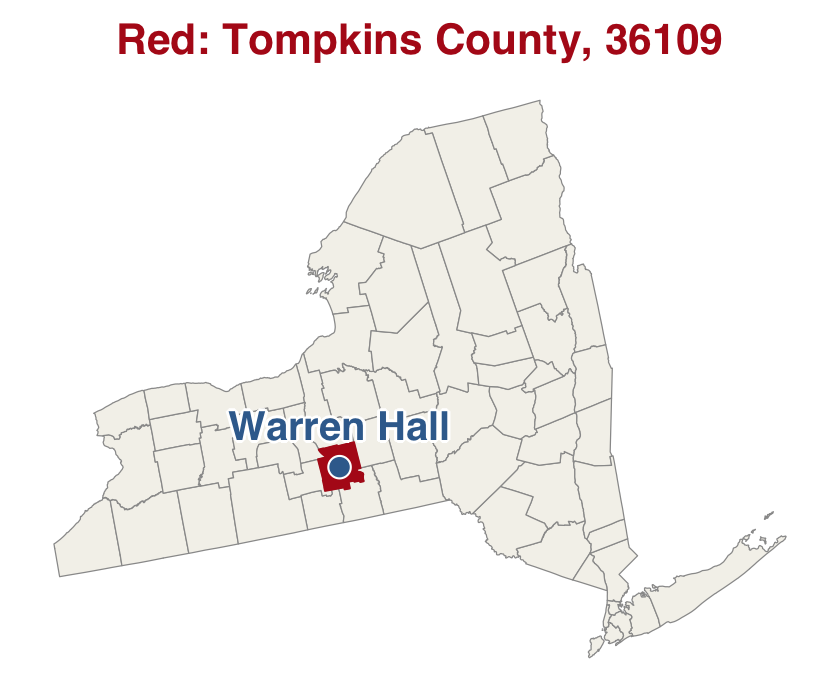{height="270px" fig-align="center"}

[Later in this part: Warren Hall is in Tompkins County, code 36109.]{.source}

::::

:::::


## Points, lines and polygons {#types}

::: {.slide-text}

- Vector data store each place as a point, a line or a polygon, with a row of
  data.
- Warren Hall is a point, I-90 is a line and Tompkins County is a polygon.
- A **layer** is a table with one row per place.

:::

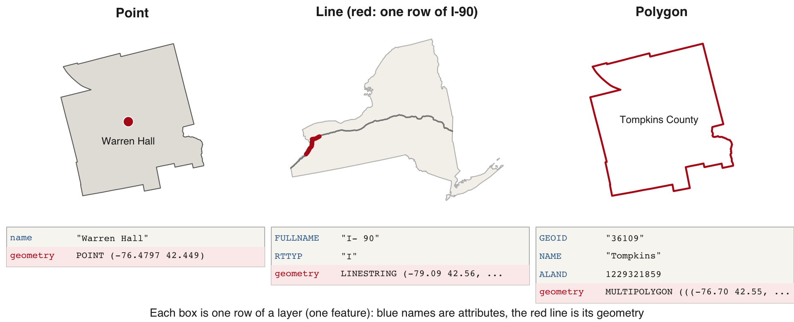{width="96%" fig-align="center"}

[Warren Hall is the Cornell building that houses this course's department, in
Ithaca. Ithaca is in Tompkins County. A county is the level of government below
the state. A MULTIPOLYGON can have several parts, such as a county with
islands. Data: Census Bureau county and road files, 2024.]{.source}

## The project folder {#project}

::: {.slide-text}

- Download the zip from the session page, unzip it and open
  `23-spatial-vector.Rproj`.
- Every path on the slides then works.
- I downloaded all the data before class, so you need no account, key or
  internet connection.

:::

```{.default filename="23-spatial-vector/, as its README.md describes it"}
data/census/    county and state outlines (cb_2024_us_*_500k.zip); county population, 2020-2024
data/noaa/hms/  NOAA's smoke outlines, one zip per day of June 2023
data_clean/     interstates_ny_box.gpkg: the Census Interstate lines near New York
                sci_tompkins.csv: Facebook friendship links between Tompkins and every county
                pm25_june2023.csv: EPA daily fine particles at 947 monitors, June 2023
data/inpe/, data/osm/, and the other files in data_clean/: the page's two worked examples
code/           1_vector.R ... 4_smoke.R in lecture order; 5_medicaid.R, 6_amazon.R; run_everything.R
23-spatial-vector.R   the live script: every code slide in order
tools/         what made data_clean/ from the full downloads before class (these need the network)
```

[NOAA is the US weather and ocean agency. Meta runs Facebook. A **box** is a
rectangle that sets a map's area. A .gpkg file holds one map layer. The scripts install
`sf`, `igraph`, `fixest` and `magick` if needed. The README gives each file's
source and licence.]{.source}

## Reading the county file {#read}

::: {.slide-text}

- `st_read()` reads the Census county file.
- The result is a table of 3,235 counties, with 12 columns of data and one
  column of shapes.
- `print(co, n = 0)` shows only the header: the shape type, the bounding box and
  the coordinate system.

:::

```{r}
#| label: idiom-sf
#| script: "Load or install sf"
#| output: false
#| message: false
#| filename: "R Console, in the 23-spatial-vector folder. Installs sf if missing"
want <- c("sf")
need <- want[!(want %in% installed.packages()[,"Package"])]
if (length(need)) install.packages(need)
lapply(want, function(i) require(i, character.only = TRUE))
```

```{r}
#| label: read-counties
#| script: "Reading the county file"
#| filename: "R Console, in the 23-spatial-vector folder; reads data/census/cb_2024_us_county_500k.zip"
unzip("data/census/cb_2024_us_county_500k.zip", exdir = "data_clean/counties")   # seven files
co <- st_read("data_clean/counties/cb_2024_us_county_500k.shp", quiet = TRUE)
print(co, n = 0)                                      # the header alone, no rows
```

[A **shapefile** is several files with the same name. The `.shp` file holds the
shapes, `.dbf` the table and `.prj` the coordinate system. The **bounding box**
is the smallest rectangle around all the counties. It runs from −179 to 180
because Alaska's islands cross the 180th meridian. The coordinate system, NAD83,
is in degrees of longitude and latitude.]{.source}

::: {.content-visible unless-format="revealjs"}

`unzip(..., list = TRUE)` lists the seven files in the zip: the `.shp` (16.7 MB)
holds the shapes, the `.dbf` (1.2 MB) the table, the `.shx` an index of the
shapes, the `.prj` the coordinate system, the `.cpg` the text encoding, and two
`.xml` files the documentation. `st_read("/vsizip/data/census/cb_2024_us_county_500k.zip")`
reads the zip without unzipping it, through GDAL's path syntax; this page unzips
it so that the code is plain R.

:::

## An sf object is a data frame {#sf-df}

::: {.slide-text}

An sf object is a data frame with one extra column, the geometry. The shapes
come along when you pick rows and columns.

:::

```{r}
#| label: sf-df
#| script: "An sf object is a data frame"
#| filename: "R Console, in the 23-spatial-vector folder; co from the slide before"
class(co)
co[1:3, c("GEOID", "NAME", "STUSPS", "ALAND")]        # three rows, four columns: the geometry comes too
```

[**GEOID** is the county code: two digits for the state, then three for the
county. Tompkins is 36109: New York is 36 and Tompkins is 109. Alabama's codes
start with 01, so the leading zero matters. **STUSPS** is the state's two
letters. **ALAND** and **AWATER** are land and water area in m². The file has
3,144 counties in the 50 states and DC, plus 91 rows for five
territories.]{.source}

::: {.content-visible unless-format="revealjs"}

```{r}
#| label: territories
#| script: "The rows outside the 50 states and DC"
#| filename: "R Console, in the 23-spatial-vector folder; co from the slides before"
table(co$STUSPS[!co$STUSPS %in% c(state.abb, "DC")])   # AS American Samoa, GU Guam, MP Northern Mariana
                                                       # Islands, PR Puerto Rico, VI US Virgin Islands
```

The Census Bureau's tally for 2020 was 3,143 counties and equivalents in the 50
states and DC. The 2024 file has 3,144 because Connecticut's nine planning
regions replaced its eight counties in 2022.

:::

## Subsetting and plotting New York's counties {#subset}

::: {.slide-text}

- `[` keeps the rows that meet a condition, as with any data frame.
- New York has 62 counties.
- `plot(st_geometry())` draws their shapes.

:::

```{r}
#| label: subset-ny
#| script: "Subsetting and plotting New York's counties"
#| filename: "R Console, in the 23-spatial-vector folder; co from the slides before"
#| fig-width: 9
#| fig-height: 3.1
#| out-width: "78%"
ny <- co[co$STUSPS == "NY", ]          # rows by a condition
nrow(ny)
tk <- ny[ny$NAME == "Tompkins", ]      # Tompkins County, used again below
par(mar = c(0, 0, 0, 0))
plot(st_geometry(ny), col = ifelse(ny$NAME == "Tompkins", "#B31B1B", "grey90"), border = "white")
```

[`st_geometry()` keeps only the shapes. `plot()` on the whole sf object would
draw one map per column. Tompkins is in red.]{.source}

::: {.content-visible unless-format="revealjs"}

## A polygon is a list of corners {#corners}

::: {.slide-text}

Tompkins County is stored as 176 corners in order, longitude then latitude. The
last corner repeats the first to close the outline.

:::

:::: {.columns}

::: {.column width="64%"}

```{r}
#| label: corners
#| script: "A polygon is a list of corners"
#| filename: "R Console, in the 23-spatial-vector folder; tk from the slide before"
#| fig-show: hide
xy <- st_coordinates(tk)          # one row per corner
nrow(xy)
head(xy, 2)
plot(st_geometry(tk))
points(xy[, "X"], xy[, "Y"], pch = 20, cex = 0.5)
```

:::

::: {.column width="34%"}

```{r}
#| label: corners-figure
#| ref.label: corners
#| echo: false
#| purl: false
#| results: hide
#| fig-width: 3.4
#| fig-height: 3.4
#| out-width: "100%"
```

:::

::::

[X is longitude and Y latitude. L1 numbers the ring (one closed outline; a hole
would be a second ring), L2 the part and L3 the feature. 194 of the 3,235
counties have more than one part; Monroe County, Florida, the Keys, has 96. A
line is stored the same way, without the closing corner.]{.source}

:::

## Joining by location {#use-join}

::::: {.columns}

:::: {.column width="47%"}

::: {.dashes}

- **Question:** [Berman, Couttenier, Rohner & Thoenig (AER, 2017)](https://doi.org/10.1257/aer.20150774)
  asked whether minerals fuel conflict in Africa.
- **Method:** They joined each mine and each conflict event to a grid of square
  cells about 55 km wide. Then they followed each cell as world mineral prices
  moved.
- **Data:** every cell of Africa, 1997-2010.
- **Result:** Violence rose in a cell when the price of its mineral rose. Rising
  prices may explain up to a quarter of average violence.

:::

::::

:::: {.column width="51%"}

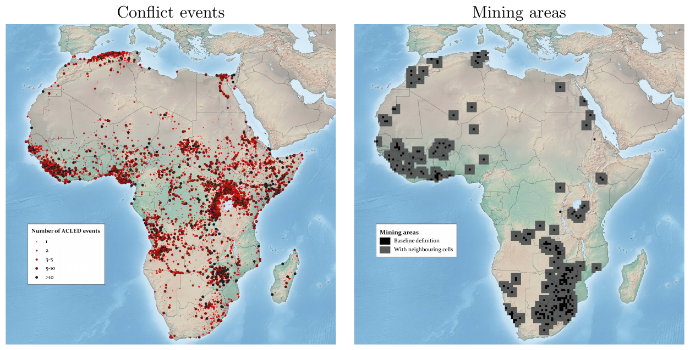{height="250px" fig-align="center"}

::::

:::::

[A **spatial join** matches each point to the polygon that contains it. The
maps are Figure 3 of "This Mine Is Mine! How Minerals Fuel Conflicts in Africa".
Left: conflict events. Right: cells with mines in black, their neighbours in
grey.]{.source}

## Points from longitude and latitude {#points}

::: {.slide-text}

- To find Warren Hall's county, first turn its coordinates into an sf point.
- `st_as_sf()` turns a table with longitude and latitude columns into points.
    - Longitude comes first.
    - `crs = 4326` marks the numbers as GPS degrees.

:::

```{r}
#| label: points
#| script: "Points from longitude and latitude"
#| filename: "R Console, in the 23-spatial-vector folder; sf loaded"
wh <- st_as_sf(data.frame(name = "Warren Hall", lon = -76.4797, lat = 42.4490),
               coords = c("lon", "lat"), crs = 4326)        # x (longitude) first, then y (latitude)
wh
```

[**Longitude** is degrees east or west of Greenwich, negative in the Americas.
**Latitude** is degrees north or south of the equator. 4326 is the code for GPS
coordinates (WGS 84). Web maps show latitude first: 42.4490, −76.4797. A table
of households or firms with coordinates works the same way.]{.source}

## The county that holds Warren Hall {#join}

:::: {.columns}

::: {.column width="58%"}

::: {.slide-text}

- `st_join()` adds to each point the columns of the county that contains it.
- Warren Hall is in Tompkins County, code 36109.
- A point outside every county, such as one at sea, gets NA.

:::

:::

::: {.column width="40%"}

{height="260px" fig-align="center"}

:::

::::

```{r}
#| label: join
#| script: "The county that holds Warren Hall"
#| filename: "R Console, in the 23-spatial-vector folder; co and wh from the slides before"
wh <- st_transform(wh, st_crs(co))                          # the point in the counties' CRS
st_drop_geometry(st_join(wh, co[c("GEOID", "NAME", "STUSPS")]))
```

[`co` is the county layer. Both layers must use the same coordinate system
(CRS), so `st_transform()` converts the point first. Otherwise `st_join()` stops
with an error. `st_drop_geometry()` drops the shapes and returns a plain data
frame.]{.source}

::: {.content-visible unless-format="revealjs"}

## County codes read as numbers {#codes}

::: {.slide-text}

Population comes from a separate Census table, matched to the counties by
GEOID. That file stores the state and county codes in two columns. `read.csv()`
reads them as numbers, so state 1 and county 1 paste to "11", and `merge()`
matches only 1,150 of 3,235 counties.

:::

```{r}
#| label: codes-numbers
#| script: "County codes read as numbers"
#| filename: "R Console, in the 23-spatial-vector folder; co from the slides before; reads data/census/co-est2024-alldata.csv"
pop <- read.csv("data/census/co-est2024-alldata.csv", fileEncoding = "latin1")
pop <- pop[pop$SUMLEV == 50, ]                        # 50: county rows; 40: state rows
head(pop[, c("STATE", "COUNTY", "CTYNAME")], 3)
pop$GEOID <- paste0(pop$STATE, pop$COUNTY)            # should be 01001, 01003, 01005
head(pop$GEOID, 3)
nrow(merge(co, pop[c("GEOID", "POPESTIMATE2024")], by = "GEOID"))
```

[Census Bureau, county population estimates 2020-2024 (co-est2024-alldata.csv).
`fileEncoding = "latin1"` reads names such as Doña Ana County.]{.source}

::: {.notes}
The 1,150 that match have a state code of 10 or more and a county code of 100 or
more, which need no zero; Tompkins (36, 109) is one of them. paste0() glues text.
:::

:::

## Merging population by GEOID {#merge}

::: {.slide-text}

- Population comes from a separate Census table.
- `merge()` joins it to the counties by GEOID, the county code.
- Read the codes as text with `colClasses`.
    - As numbers, "01" becomes 1 and only 1,150 of the 3,144 counties match.
- Tompkins had 105,602 people in 2024.

:::

```{r}
#| label: merge-pop
#| script: "Merging population by GEOID"
#| filename: "R Console, in the 23-spatial-vector folder; co from the slides before; reads data/census/co-est2024-alldata.csv"
pop <- read.csv("data/census/co-est2024-alldata.csv", fileEncoding = "latin1",
                colClasses = c(STATE = "character", COUNTY = "character"))   # codes stay text: "01"
pop <- pop[pop$SUMLEV == 50, ]
pop$GEOID <- paste0(pop$STATE, pop$COUNTY)
head(pop$GEOID, 3)
cp <- merge(co, pop[c("GEOID", "POPESTIMATE2024")], by = "GEOID")
nrow(cp)
st_drop_geometry(cp[cp$GEOID == "36109", c("NAME", "POPESTIMATE2024")])
```

[`colClasses` sets a column's type when R reads the file. `merge()` keeps the
rows found in both tables, so the 91 territory rows drop out. `all.x = TRUE`
would keep them, with NA. `cp` holds the counties with population, and `co` is
unchanged. POPESTIMATE2024 is the estimate for July 1, 2024.]{.source}

## Exercise 1 {#exercise-1}

::: {.panel-tabset}

### Exercise

4 minutes. Find the county and the population of a place you pick, with a
spatial join and a merge. `co` is the county layer and `pop` the population
table from the slides before.

1. Pick any spot in the United States on a web map. Right-click it to see its
   coordinates. Web maps show latitude first, but `st_as_sf()` takes longitude
   first.
2. Make the point and put it in the counties' CRS:
   `p <- st_as_sf(data.frame(name = "my place", lon = ..., lat = ...), coords = c("lon", "lat"), crs = 4326)`,
   then `p <- st_transform(p, st_crs(co))`.
3. Its county, by location: `j <- st_join(p, co[c("GEOID", "NAME", "STUSPS")])`,
   then `st_drop_geometry(j)`.
4. Its population, by GEOID:
   `merge(st_drop_geometry(j), pop[c("GEOID", "POPESTIMATE2024")], by = "GEOID")`.
5. Try a point on water near a coast, such as the middle of a bridge.

```{r}
#| label: exercise-1
#| exercise: true
#| script: "Exercise 1 (4 minutes)"
#| include: false
#| eval: false
# Exercise 1 (4 minutes). A place you know: its county by location, then its population by GEOID.
# Find the county and the population of a place you pick, with a spatial join and a merge.
# In the 23-spatial-vector folder, with co and pop as on the slides before
# (or run code/1_vector.R first).
# 1. Find a US place on a web map: right-click a spot to see its coordinates (most give latitude first).
# 2. p <- st_as_sf(data.frame(name = "my place", lon = -73.9855, lat = 40.7580),
#                  coords = c("lon", "lat"), crs = 4326)
#    p <- st_transform(p, st_crs(co))
# 3. j <- st_join(p, co[c("GEOID", "NAME", "STUSPS")]); st_drop_geometry(j)
# 4. merge(st_drop_geometry(j), pop[c("GEOID", "POPESTIMATE2024")], by = "GEOID")
# 5. Try a point on water near a coast, such as the middle of a bridge, and run steps 2 to 4 again.
# Two answers to compare with the room: the largest county population anyone found,
# and a place that returned no county, with the reason.
```

[Compare with the room: the largest county population anyone found. Then share
a spot that returned no county, and why.]{.source}

### Solution

```{r}
#| label: exercise-1-solution
#| purl: false
#| filename: "R Console, in the 23-spatial-vector folder; co and pop from the slides before"
pl <- data.frame(name = c("Times Square", "Willis Tower", "Hollywood sign", "Golden Gate Bridge"),
                 lon = c(-73.9855, -87.6359, -118.3217, -122.4783),
                 lat = c(40.7580, 41.8789, 34.1341, 37.8199))
p <- st_transform(st_as_sf(pl, coords = c("lon", "lat"), crs = 4326), st_crs(co))
j <- st_join(p, co[c("GEOID", "NAME", "STUSPS")])
merge(st_drop_geometry(j), pop[c("GEOID", "POPESTIMATE2024")], by = "GEOID", all.x = TRUE)
```

[Los Angeles County is the largest, with 9,757,179 people. Manhattan is New
York County. The middle of the Golden Gate Bridge returns no county, because the
county shapes stop at the shoreline, about 630 m away.]{.source}

:::

# 2 · Measuring areas, distances and angles {#part-measure}

## Overview of part 2 {#overview-2}

::: {.slide-text}

How to measure areas, distances and directions in R.

:::

::::: {.columns}

:::: {.column width="58%"}

::: {.dashes}

- **Units:** degrees and metres, and which coordinate system to use.
- **Area:** Tompkins County, compared with the Census figure.
- **Distance:** from each county to Times Square, and from Warren Hall to
  Pennsylvania.
- **Buffers and lengths:** the counties within 50 km of Warren Hall, and the
  Interstate miles in New York.
- **Direction:** from Warren Hall to Times Square.
- Each comes with a published study that used it.

:::

::::

:::: {.column width="40%"}

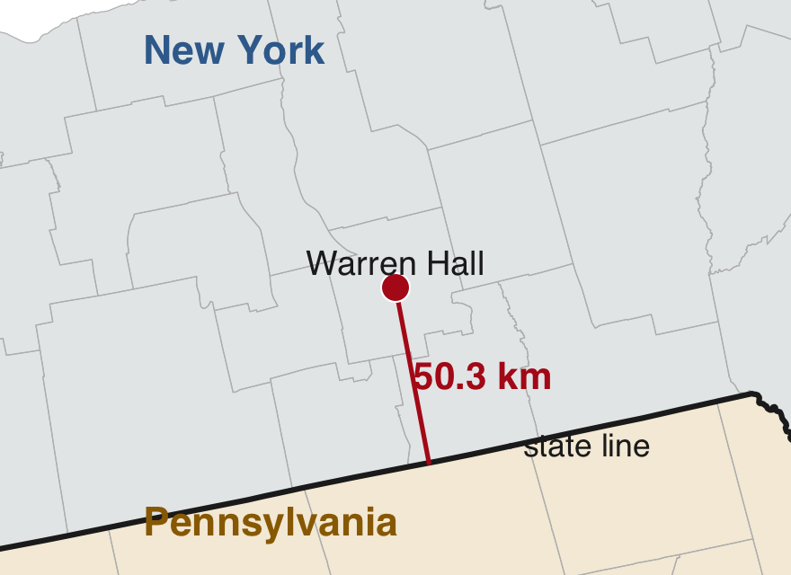{height="270px" fig-align="center"}

[Later in this part: Warren Hall's distance to Pennsylvania.]{.source}

::::

:::::


## Degrees and metres {#degrees}

::: {.slide-text}

- Longitude and latitude are angles.
- A degree of longitude spans 111 km at the equator, 82 km at Ithaca and nothing
  at the pole.
- To measure in kilometres, use the round Earth or a map projection in metres.

:::

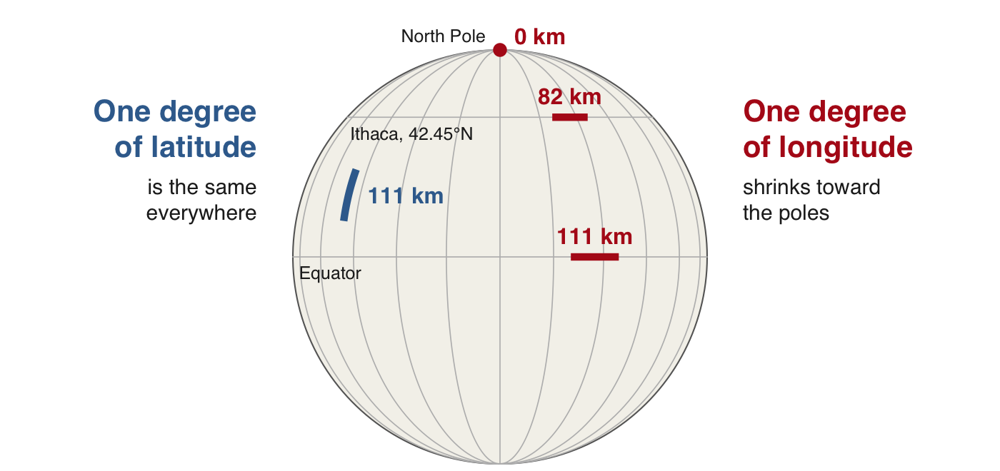{width="72%" fig-align="center"}

[A **geographic CRS**, such as 4269 or 4326, gives degrees. A **projected CRS**
gives metres on a flat map. Flattening the Earth always stretches something, the
way an orange peel tears when pressed flat. Lengths on the round Earth here use
a sphere of radius 6,371 km. Each coloured
segment spans 15 degrees, and its label gives the length of one degree.]{.source}

## Choosing a projection {#crs}

::: {.slide-text}

- A coordinate reference system (CRS) is either geographic, in degrees on the
  round Earth, or projected, in metres on a flat map.
- Every flat map distorts something.
- Pick the projection that better meets your needs.

:::

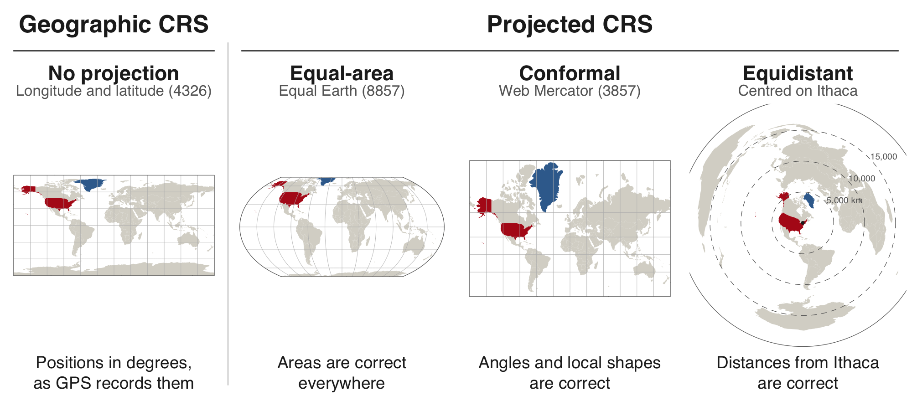{width="100%" fig-align="center"}

[Red: the United States. Blue: Greenland, which has about a fifth of the US's
area. The codes come from the EPSG registry, and `st_crs()` shows a layer's
code. UTM is a conformal projection made of 60 strips, each 6° wide. Azimuthal
projections keep directions from one point, as the Ithaca map does. Compromise
projections, such as Robinson, keep nothing exactly but distort less overall. The
grouping follows Lovelace, Nowosad & Muenchow
([*Geocomputation with R*, section 7.6](https://r.geocompx.org/reproj-geo-data.html)).]{.source}

## Area and perimeter of Tompkins County {#area}

:::: {.columns}

::: {.column width="64%"}

::: {.slide-text}

- `st_area()` measures in the layer's CRS, and the CRS changes the answer.
    - Conus Albers, an equal-area projection, gives 1,273.0 km², as the Census
      reports.
    - Web Mercator gives 1.84 times as much.
- Measure areas on the round Earth or in an equal-area projection.
- When the attribute table reports an area, such as ALAND, use it.

:::

:::

::: {.column width="34%"}

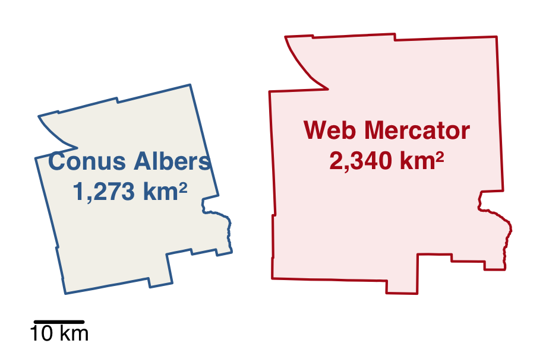{height="228px" fig-align="center"}

:::

::::

```{r}
#| label: area
#| script: "Area and perimeter of Tompkins County"
#| filename: "R Console, in the 23-spatial-vector folder; tk from the slides before"
tk_m <- st_transform(tk, 5070)                                  # Conus Albers: equal area, metres
round(c(albers       = as.numeric(st_area(tk_m)) / 1e6,         # km2
        web_mercator = as.numeric(st_area(st_transform(tk, 3857))) / 1e6,
        round_earth  = as.numeric(st_area(tk)) / 1e6,           # degrees: sf measures on a sphere
        census       = (tk$ALAND + tk$AWATER) / 1e6), 1)
round(as.numeric(st_length(st_boundary(tk_m))) / 1e3, 1)       # perimeter, km
```

[5070 is the EPSG code of Conus Albers. `st_area()` returns m². Web Mercator stretches areas by 1/cos²(latitude),
which is 1.84 at Ithaca. For the perimeter, `st_boundary()` turns the polygon
into a line and `st_length()` measures it. ALAND (1,229.3 km²) leaves out the
county's part of Cayuga Lake.]{.source}

## Distance to a point {#use-point}

::::: {.columns}

:::: {.column width="55%"}

::: {.dashes}

- **Question:** [Becker & Woessmann (QJE, 2009)](https://doi.org/10.1162/qjec.2009.124.2.531)
  asked why Protestant counties in Prussia were richer. Max Weber credited a
  Protestant work ethic.
- **Method:** Protestantism spread outward from Wittenberg, where Luther began
  the Reformation. Each county's distance to Wittenberg serves as an instrument
  for its share of Protestants.
- **Data:** 452 Prussian counties in the census of 1871.
- **Result:** Each 100 km from Wittenberg meant 9.5 percentage points fewer
  Protestants. Protestant counties were more literate, and literacy explains
  their higher incomes.

:::

::::

:::: {.column width="43%"}

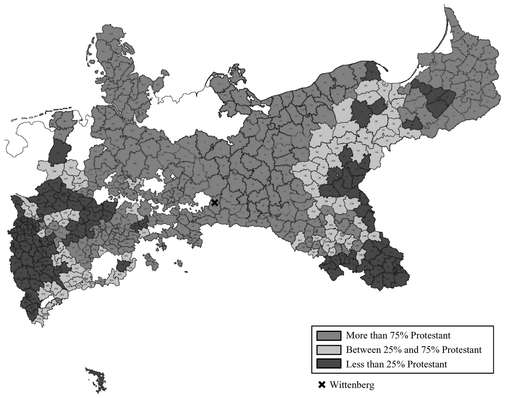{height="340px" fig-align="center"}

::::

:::::

[An **instrument** changes the treatment (here, the Protestant share) and
affects the outcome only through it. The map is Figure III of "Was Weber Wrong?
A Human Capital Theory of Protestant Economic History". The cross marks
Wittenberg.]{.source}

## Each county's distance to Times Square {#point}

:::: {.columns}

::: {.column width="50%"}

::: {.slide-text}

`st_distance()` gives the distance from a point inside each New York county to
Times Square. Tompkins is 280 km away; Niagara, the farthest, is 479 km away.

:::

:::

::: {.column width="48%"}

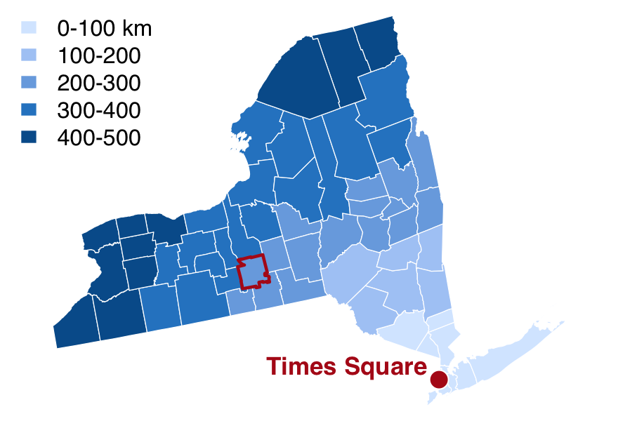{height="215px" fig-align="center"}

:::

::::

```{r}
#| label: point
#| script: "Each county's distance to Times Square"
#| filename: "R Console, in the 23-spatial-vector folder; ny (New York's 62 counties) from Part 1"
ts    <- st_as_sf(data.frame(name = "Times Square", lon = -73.9855, lat = 40.7580),
                  coords = c("lon", "lat"), crs = 4326)
ny_co <- st_transform(ny, 5070)                                   # New York's counties, in metres
pt_ny <- st_point_on_surface(st_geometry(ny_co))                  # a point inside each county
ny_co$km_ts <- as.numeric(st_distance(pt_ny, st_transform(ts, 5070))) / 1e3
km <- setNames(round(ny_co$km_ts), ny_co$NAME); km[c("Tompkins", names(which.max(km)))]
```

[`st_point_on_surface()` returns a point that is always inside the county. A
**centroid**, the centre of the area, can fall outside a curved shape. Tompkins
is outlined in red.]{.source}

## Distance to a border {#use-border}

::::: {.columns}

:::: {.column width="48%"}

::: {.dashes}

- **Question:** [Holmes (JPE, 1998)](https://doi.org/10.1086/250026) asked
  whether state policies that favour business attract manufacturing.
- **Method:** Counties on the two sides of a state border are alike except for
  their states' policies. He compared counties near the borders between
  right-to-work states and other states.
- **Data:** US counties near these borders, in bands of 25 miles.
- **Result:** Manufacturing's share of jobs is about a third higher on the
  right-to-work side.

:::

::::

:::: {.column width="50%"}

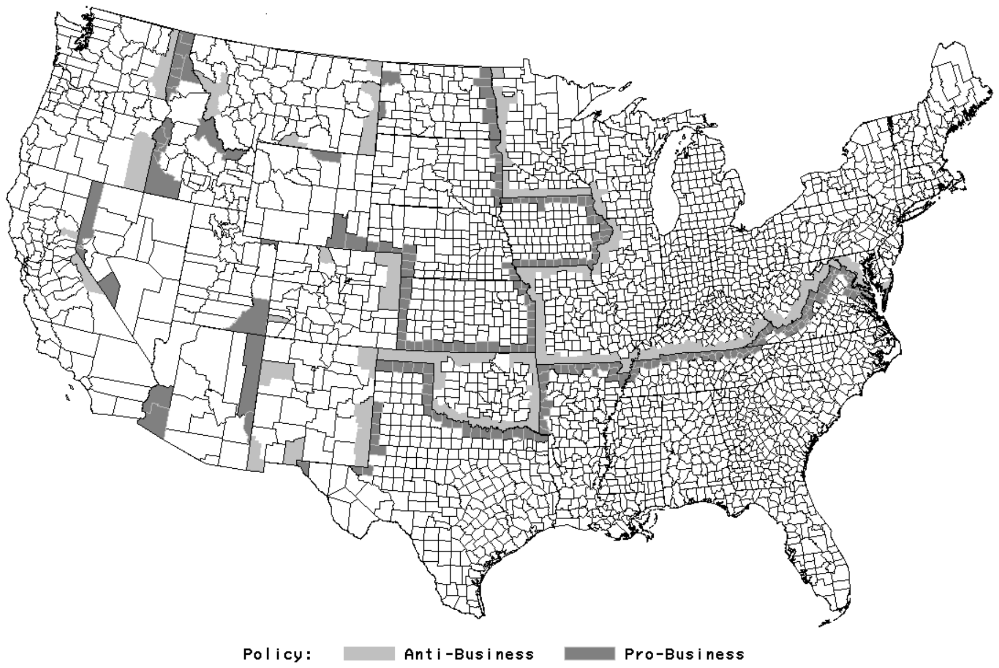{height="320px" fig-align="center"}

::::

:::::

[A **right-to-work** law bans contracts that require union membership. The map
is Figure 3 of "The Effect of State Policies on the Location of Manufacturing:
Evidence from State Borders" (working paper version, 1996). It shades the
counties within 25 miles of these borders, dark on the right-to-work side.]{.source}

## Distance to a state and its border {#distance}

:::: {.columns}

::: {.column width="57%"}

::: {.slide-text}

- Warren Hall is 50.3 km from Pennsylvania.
- Its distance to New York is 0, because it is inside New York.
- Its distance to New York's border, from `st_boundary()`, is also 50.3 km.

:::

:::

::: {.column width="41%"}

{height="228px" fig-align="center"}

:::

::::

```{r}
#| label: distance
#| script: "Distance to a state and its border"
#| filename: "R Console, in the 23-spatial-vector folder; wh from the slides before; reads data/census/cb_2024_us_state_500k.zip"
unzip("data/census/cb_2024_us_state_500k.zip", exdir = "data_clean/states")
states   <- st_read("data_clean/states/cb_2024_us_state_500k.shp", quiet = TRUE)
states_m <- st_transform(states, 5070); wh_m <- st_transform(wh, 5070)      # Conus Albers, metres
ny_m <- states_m[states_m$STUSPS == "NY", ]
km <- function(a, b) round(as.numeric(st_distance(a, b)) / 1e3, 1)
c(to_PA = km(wh_m, states_m[states_m$STUSPS == "PA", ]), to_NY = km(wh_m, ny_m),
  to_NY_border = km(wh_m, st_boundary(ny_m)))
```

[`st_distance()` returns 0 for a point inside a polygon. 5070 is Conus Albers,
an equal-area projection in metres. On the round Earth the distance is 50.0 km, 0.6%
shorter.]{.source}

## Buffers {#use-buffer}

::::: {.columns}

:::: {.column width="55%"}

::: {.dashes}

- **Question:** [Currie, Davis, Greenstone & Walker (AER, 2015)](https://doi.org/10.1257/aer.20121656)
  asked how much toxic plants harm the people who live near them.
- **Method:** They drew rings around about 1,600 plants that opened or closed.
  Then they compared homes and births inside and outside the rings, before and
  after.
- **Data:** house prices within 0.5 mile and birth weight within 1 mile of each
  plant.
- **Result:** An opening lowered house values within 0.5 mile by 11%. It raised
  the chance of low birth weight within 1 mile by about 3%.

:::

::::

:::: {.column width="43%"}

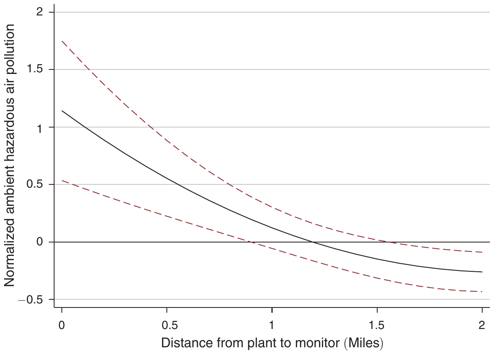{height="320px" fig-align="center"}

::::

:::::

[**Low birth weight** is under 2,500 g. The figure is Figure 2 of "Environmental
Health Risks and Housing Values: Evidence from 1,600 Toxic Plant Openings and
Closings". Air pollution falls with distance from the plant and is gone by about
1 mile, so the rings are small.]{.source}

## A 50 km buffer around Warren Hall {#buffer}

::: {.slide-text}

`st_buffer()` draws the area within 50 km of Warren Hall. It reaches 11
counties, all in New York, because Pennsylvania is 50.3 km away.

:::

::::: {.columns}

:::: {.column width="56%"}

```{r}
#| label: buffer
#| script: "A 50 km buffer around Warren Hall"
#| filename: "R Console; co and wh_m from the slides before"
b    <- st_buffer(wh_m, 50000)    # within 50,000 m
co_m <- st_transform(co, 5070)
near <- co_m[b, ]                 # the counties b reaches
table(near$STUSPS)
```

::::

:::: {.column width="42%"}

```{r}
#| label: buffer-map-figure
#| ref.label: buffer-map
#| echo: false
#| purl: false
#| fig-width: 4.6
#| fig-height: 3.6
#| out-width: "100%"
```

::::

:::::

::: {.content-visible unless-format="revealjs"}

```{r}
#| label: buffer-map
#| script: "The buffer on a map"
#| filename: "R Console, in the 23-spatial-vector folder; b, near, co_m, wh_m and ny_m from the slide before"
#| fig-show: hide
par(mar = c(0, 0, 0, 0))
plot(st_geometry(st_buffer(wh_m, 85000)), border = NA)                      # sets the map's extent
plot(st_geometry(co_m[co_m$STUSPS %in% c("NY", "PA"), ]), col = "grey95", border = "white", add = TRUE)
plot(st_geometry(near), col = "#C9DAEA", border = "white", add = TRUE)
plot(st_boundary(st_geometry(ny_m)), lwd = 3, add = TRUE)                   # New York's boundary
plot(b, col = NA, border = "#B31B1B", lwd = 2, add = TRUE)
plot(st_geometry(wh_m), pch = 19, col = "#B31B1B", add = TRUE)
text(st_coordinates(st_point_on_surface(st_geometry(near))), near$NAME, cex = 0.7)
```

:::


[The distance is in the CRS's units, metres in 5070. `co_m[b, ]` keeps the
counties that touch or overlap the circle. The thick line is New York's border.
The code for the map is on the session page and in the live script.]{.source}

## Length inside a polygon {#use-length}

::::: {.columns}

:::: {.column width="48%"}

::: {.dashes}

- **Question:** [Duranton & Turner (REStud, 2012)](https://doi.org/10.1093/restud/rds010)
  asked whether more highways make cities grow.
- **Method:** They cut the Interstates at each metropolitan area's boundary and
  measured the kilometres inside. Older networks, cut the same way, serve as
  instruments.
- **Data:** US metropolitan areas, 1983-2003. The older networks are the 1947
  highway plan, the 1898 railroads and early exploration routes.
- **Result:** 10% more highway in 1983 raised a city's employment by about 1.5%
  over the next 20 years.

:::

::::

:::: {.column width="50%"}

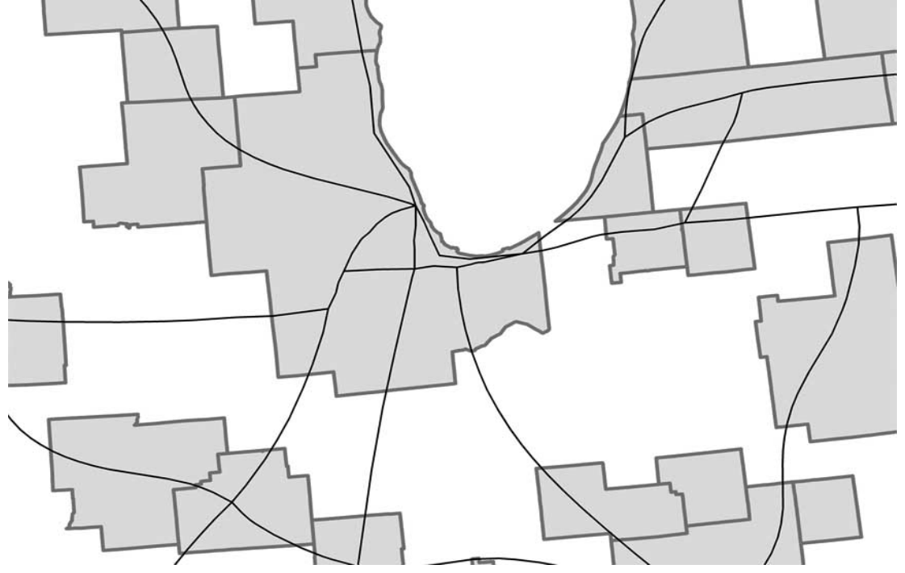{height="300px" fig-align="center"}

::::

:::::

[A **metropolitan area** is a city plus the counties that commute to it. The map shows
the 1947 plan's lines around Chicago, over the shaded metropolitan areas. It is
part of Figure 2 of the 2008 working paper of "Urban Growth and
Transportation".]{.source}

## Interstate miles in New York {#interstates}

:::: {.columns}

::: {.column width="60%"}

::: {.slide-text}

`st_intersection()` keeps the part of each Interstate inside New York: 3,599
miles (5,792 km) in the file. TIGER draws each direction of a divided highway as
its own line, so the road itself is about half that length.

:::

:::

::: {.column width="38%"}

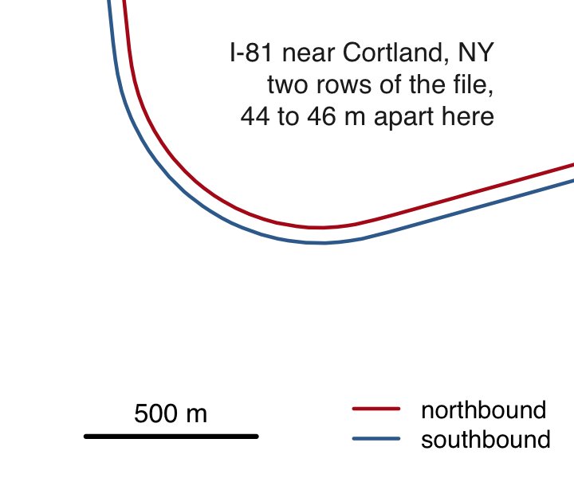{height="230px" fig-align="center"}

:::

::::

```{r}
#| label: interstates
#| script: "Interstate miles in New York"
#| filename: "R Console, in the 23-spatial-vector folder; ny_m (New York in 5070); reads data_clean/interstates_ny_box.gpkg"
#| warning: false
it    <- st_read("data_clean/interstates_ny_box.gpkg", quiet = TRUE)   # Census Interstate lines near New York
it_ny <- st_intersection(st_transform(it, 5070), ny_m["STUSPS"])      # the parts inside New York
# st_intersection() warns that attributes are assumed constant: expected here
it_ny$miles <- as.numeric(st_length(it_ny)) / 1609.344
round(sum(it_ny$miles), 1)
round(sort(tapply(it_ny$miles, it_ny$FULLNAME, sum), decreasing = TRUE)[1:3], 1)
```

[**TIGER** is the Census map database of roads and boundaries. RTTYP "I" marks
an Interstate highway. A divided highway has a separate roadway for each
direction. A GeoPackage (.gpkg) is one file with a layer's shapes, table and
CRS. One mile is 1,609.344 m.]{.source}

::: {.content-visible unless-format="revealjs"}

`tools/cut_interstates.R` made the GeoPackage from the national primary-roads
file (38 MB, fetched by `tools/fetch_data.R`): 17,522 lines, of which 5,619 are
Interstates and 569 touch New York's bounding box. The Federal Highway
Administration's route log lists I-90 in New York at 386.27 miles and I-87 at
333.65, about half of the lengths above. I-481 near Syracuse is two lines of
14.75 and 14.78 miles.

:::

## Direction {#use-direction}

::::: {.columns}

:::: {.column width="55%"}

::: {.dashes}

- **Question:** [Anderson (JEEA, 2020)](https://doi.org/10.1093/jeea/jvz051)
  asked whether years of breathing polluted air raise mortality.
- **Method:** He found the direction from each home to its nearest major highway.
  With daily wind data, this gives the share of days the home was downwind.
- **Data:** the homes of everyone who died in Los Angeles over three years.
- **Result:** Doubling the time spent downwind raised mortality among people 75
  and older by about 4% to 6.5%.

:::

::::

:::: {.column width="43%"}

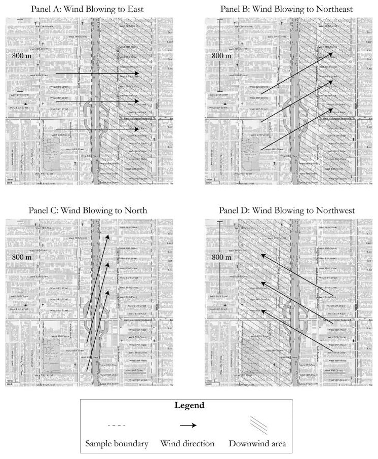{height="390px" fig-align="center"}

::::

:::::

[A home's direction from the highway is fixed, and the wind decides how often
the home is downwind. The panels are Figure 1 of "As the Wind Blows: The Effects
of Long-Term Exposure to Air Pollution on Mortality". The hatched side is
downwind for each wind direction.]{.source}

## Direction from Warren Hall to Times Square {#direction}

::: {.slide-text}

- A **bearing** is the angle clockwise from north.
- Measure it in the local UTM zone, a projection that keeps angles.
    - There, Times Square lies at 132° from Warren Hall, against 131° on the
      round Earth.
    - Conus Albers gives 120°, because its north tilts 12° here.

:::

::::: {.columns}

:::: {.column width="57%"}

```{r}
#| label: direction
#| script: "Direction from Warren Hall to Times Square"
#| filename: "R Console; wh and ts from the slides before"
bearing <- function(a, b, crs) {   # degrees from map north
  d <- st_coordinates(st_transform(b, crs)) -
       st_coordinates(st_transform(a, crs))  # east, north (m)
  (atan2(d[1], d[2]) * 180 / pi) %% 360   # 0 to 360
}
round(c(utm_18N = bearing(wh, ts, 32618),
        albers  = bearing(wh, ts, 5070)), 1)
```

::::

:::: {.column width="41%"}

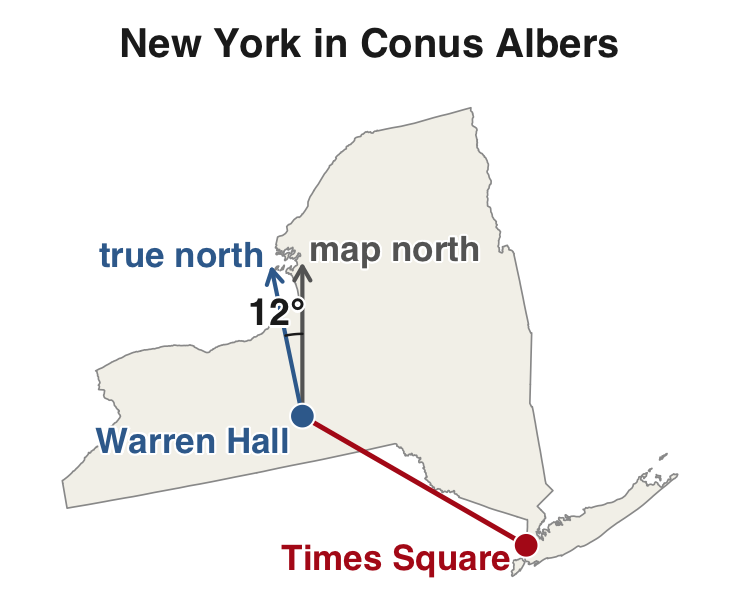{height="250px" fig-align="center"}

::::

:::::

[EPSG 32618 is UTM zone 18N, from 78°W to 72°W, which includes Ithaca and New
York City. `atan2(east, north)` gives the angle from north in radians. Raw
longitude and latitude give 124°, because they treat a degree east (82 km here)
as equal to a degree north (111 km). UTM's north is 1° off true north at Warren
Hall.]{.source}

::: {.content-visible unless-format="revealjs"}

The direction on the round Earth, from the great-circle formula for the
starting direction of the shortest route:

```{r}
#| label: direction-globe
#| script: "The direction on the round Earth"
#| filename: "R Console"
r  <- pi / 180                                   # degrees to radians
p1 <- 42.4490 * r; p2 <- 40.7580 * r             # latitudes of Warren Hall and Times Square
dl <- (-73.9855 - -76.4797) * r                  # difference in longitude
round((atan2(sin(dl) * cos(p2), cos(p1) * sin(p2) - sin(p1) * cos(p2) * cos(dl)) / r) %% 360, 1)
```

:::

# 3 · Relations between places {#part-routes}

## Overview of part 3 {#overview-3}

::: {.slide-text}

How to find nearby places, neighbours and routes.

:::

::::: {.columns}

:::: {.column width="58%"}

::: {.dashes}

- **Nearest feature:** the nearest Interstate to Warren Hall and to each county.
- **Neighbours:** counties that touch, and counties two borders away.
- **Shortest routes:** the fewest county lines from Tompkins to Los Angeles, and
  Exercise 2.
- **Other distances:** straight lines between cities, and Facebook friendships.
- **Standard errors** when nearby counties are alike.

:::

::::

:::: {.column width="40%"}

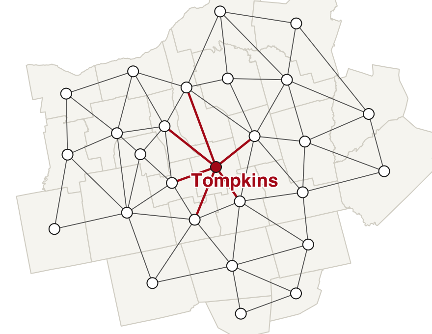{height="270px" fig-align="center"}

[Later in this part: each county is a dot, and a line joins two counties that
touch.]{.source}

::::

:::::

## Nearest feature {#use-nearest}

::::: {.columns}

:::: {.column width="46%"}

::: {.dashes}

- **Question:** [Asher, Garg & Novosad (EJ, 2020)](https://doi.org/10.1093/ej/ueaa013)
  asked whether new roads in India cause deforestation.
- **Method:** They compared new village roads with wider national highways. For
  each village, they measured the distance to the nearest road of each kind.
- **Data:** forest cover across India, measured from satellite images.
- **Result:** New roads to more than 100,000 villages had no effect on forest
  loss. Wider highways, 10,000 km of them, caused forest loss along their
  routes.

:::

::::

:::: {.column width="52%"}

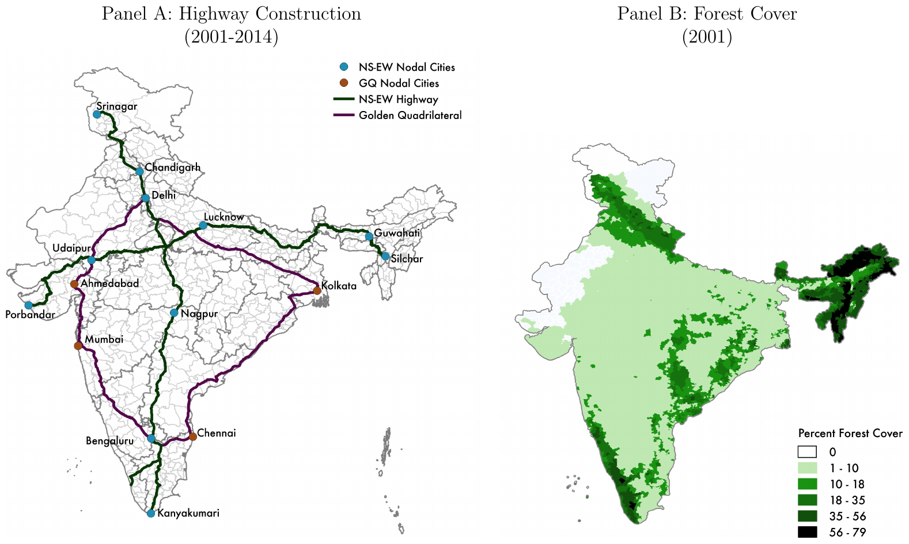{height="290px" fig-align="center"}

::::

:::::

[Forest cover is measured from satellite images. The maps are Figure 1 of the
authors' 2019 version of "The Ecological Impact of Transportation
Infrastructure". Left: the new national highways. Right: forest cover in
2001.]{.source}

## The nearest Interstate to Warren Hall {#nearest-it}

:::: {.columns}

::: {.column width="50%"}

::: {.slide-text}

- `st_nearest_feature()` finds the nearest Interstate, and `st_distance()`
  measures how far it is.
- Warren Hall's nearest Interstate is I-81, 30.4 km away.
- Among New York's counties, St. Lawrence is farthest from an Interstate, at
  75 km.

:::

:::

::: {.column width="48%"}

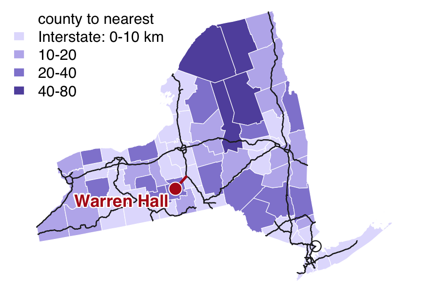{height="215px" fig-align="center"}

:::

::::

```{r}
#| label: nearest-it
#| script: "The nearest Interstate to Warren Hall"
#| filename: "R Console; wh_m, it_ny, ny_co and pt_ny from Part 2"
k <- st_nearest_feature(wh_m, it_ny)                       # row of the nearest Interstate piece
c(it_ny$FULLNAME[k], round(as.numeric(st_distance(wh_m, it_ny[k, ])) / 1e3, 1))   # name, km
kk <- st_nearest_feature(pt_ny, it_ny)                     # every New York county at once
ny_co$km_it <- as.numeric(st_distance(pt_ny, it_ny[kk, ], by_element = TRUE)) / 1e3
head(sort(setNames(round(ny_co$km_it), ny_co$NAME), decreasing = TRUE), 2)   # km, farthest two
```

[`wh_m` is Warren Hall in metres, `it_ny` the Interstates in New York and
`pt_ny` a point inside each New York county. With `by_element = TRUE`, each
point is measured to its own nearest road only.]{.source}

## Counties that touch {#use-neighbours}

::::: {.columns}

:::: {.column width="48%"}

::: {.dashes}

- **Question:** [Dube, Lester & Reich (REStat, 2010)](https://doi.org/10.1162/REST_a_00039)
  asked whether higher minimum wages cost jobs.
- **Method:** They compared every pair of touching counties on opposite sides of
  a state line. Each pair shares a local economy, but each county follows its
  own state's minimum wage.
- **Data:** earnings and jobs in restaurants and other low-wage work, 1990-2006.
- **Result:** Higher minimum wages raised earnings and cost no jobs.

:::

::::

:::: {.column width="50%"}

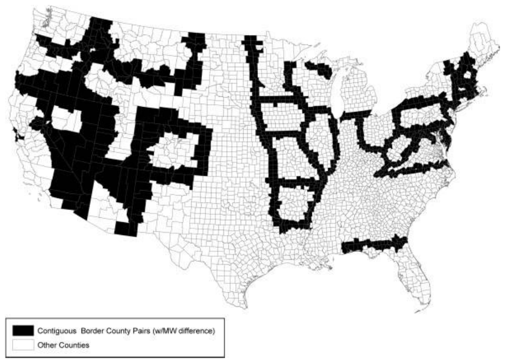{height="330px" fig-align="center"}

::::

:::::

[US states may set a minimum wage above the federal one. `st_touches()`, on the
next slide, finds such pairs. The map is Figure 2 of "Minimum Wage Effects
Across State Borders: Estimates Using Contiguous Counties". Black counties are
in a pair whose states had different minimum wages.]{.source}

## Counties that share a border {#touches}

:::: {.columns}

::: {.column width="56%"}

::: {.slide-text}

`st_touches()` lists, for each county, the counties that share part of its
border. Tompkins has six: Cayuga, Chemung, Tioga, Seneca, Cortland and
Schuyler.

:::

:::

::: {.column width="42%"}

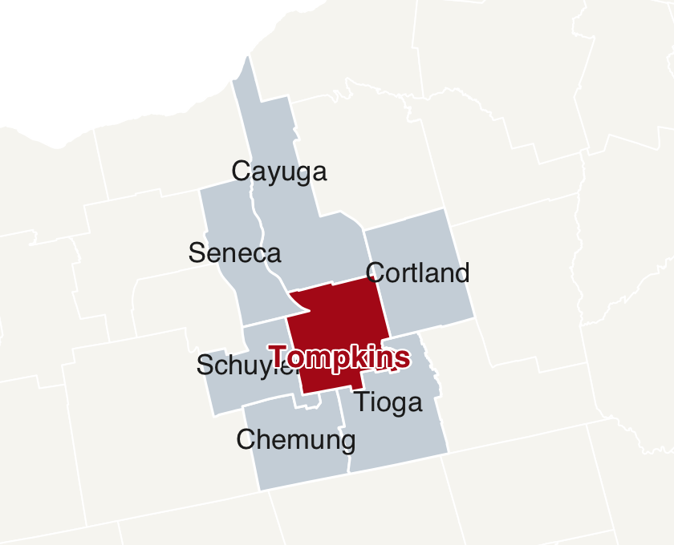{height="250px" fig-align="center"}

:::

::::

```{r}
#| label: touches
#| script: "Counties that share a border"
#| filename: "R Console, in the 23-spatial-vector folder; co from Part 1"
off <- c("AK", "HI", "PR", "AS", "GU", "MP", "VI")        # Alaska, Hawaii and the five territories
low <- st_transform(co[!co$STUSPS %in% off, ], 5070)     # the lower 48 and DC, in metres
nrow(low)
nb <- st_touches(low)                  # for each county, the rows of the counties it touches
i  <- which(low$GEOID == "36109")      # Tompkins's row
low$NAME[nb[[i]]]
```

[Two polygons **touch** when they share at least one border point. The result is
a list: for each county, the row numbers of its neighbours. It takes about 2
seconds. Four island counties have no neighbours, because the file cuts counties
at the shoreline. They are San Juan (WA), Nantucket and Dukes (MA), and
Richmond (Staten Island, NY).]{.source}

::: {.content-hidden when-format="revealjs"}

## Corner neighbours and island counties {#corners-islands}

`st_touches()` also counts counties that meet at a single corner. Such
neighbours are called **queen** neighbours, after the chess piece that moves
diagonally; **rook** neighbours must share a stretch of border. The pattern
`"F***1****"` in `st_relate()` asks for a shared stretch of border.

```{r}
#| label: rook
#| script: "Corner neighbours and island counties"
#| filename: "R Console, in the 23-spatial-vector folder; low and nb from the slide before"
rook <- st_relate(low, pattern = "F***1****")          # neighbours that share a stretch of border
c(touch = sum(lengths(nb)), share_border = sum(lengths(rook)))
low$NAME[lengths(nb) == 0]                             # counties that touch no other
```

Each pair is listed from both sides, so 634 of the 18,122 links meet only at a
corner. At the Four Corners, San Juan (New Mexico), San Juan (Utah), Apache
(Arizona) and Montezuma (Colorado) meet at one point: Apache and Montezuma touch
only there, and so do the two San Juans. The four islands join the graph only if
a bridge or a ferry counts.

:::

## Counties as a graph {#graph}

:::: {.columns}

::: {.column width="56%"}

::: {.slide-text}

A **graph** is a set of nodes joined by edges. Here each county is a node and
each pair of touching counties an edge: 3,109 nodes and 9,061 edges.

:::

:::

::: {.column width="42%"}

{height="198px" fig-align="center"}

:::

::::

```{r}
#| label: idiom-igraph
#| script: "Load or install igraph"
#| output: false
#| message: false
#| filename: "R Console. Installs igraph if missing"
want <- c("igraph")
need <- want[!(want %in% installed.packages()[,"Package"])]
if (length(need)) install.packages(need)
lapply(want, function(i) require(i, character.only = TRUE))
```

```{r}
#| label: graph
#| script: "Counties as a graph"
#| filename: "R Console, in the 23-spatial-vector folder; igraph from the chunk above; nb from the slides before"
g <- graph_from_adj_list(nb, mode = "all")     # node k is row k of low; an edge joins two neighbours
c(nodes = vcount(g), edges = ecount(g))
```

[`low` is the 3,109 counties of the lower 48 and DC, and `nb` lists each
county's neighbours. With a graph, igraph can count the fewest borders between
any two counties. On the map, a dot is a county and a line joins two counties
that touch. Tompkins's six lines are red.]{.source}

## First and second neighbours {#order}

:::: {.columns}

::: {.column width="58%"}

::: {.slide-text}

- A county's **first neighbours** touch it.
- Its **second neighbours** touch a first neighbour but not the county.
- Tompkins has 6 first and 12 second neighbours, 3 of them in Pennsylvania.
- The average of a variable over a county's first neighbours is its
  **spatial lag**.
    - It is the usual way to put neighbours in a regression.

:::

:::

::: {.column width="40%"}

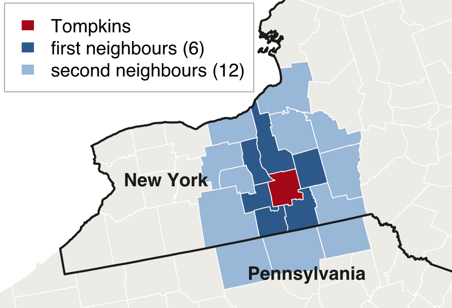{height="215px" fig-align="center"}

:::

::::

```{r}
#| label: order
#| script: "First and second neighbours"
#| filename: "R Console; low, nb, g and i from the slides before; pop from the population merge"
n2 <- as.numeric(ego(g, order = 2, nodes = i, mindist = 2)[[1]])   # rows of the second neighbours
x    <- pop$POPESTIMATE2024[match(low$GEOID, pop$GEOID)]           # population, 2024
x_nb <- sapply(nb, function(k) mean(x[k]))                         # first neighbours' average
round(c(Tompkins = x[i], first = x_nb[i], second = mean(x[n2])))
```

[`g` is the graph and `i` is Tompkins's row. `ego()` returns the counties
within a given number of edges, and `mindist = 2` drops the county and its first
neighbours. The second neighbours have more people because they include Syracuse
and Binghamton. In matrix form the spatial lag is W*x*, where each row of W sums
to 1. Second neighbours can instrument for the first neighbours' average
(Kelejian & Prucha, [Journal of Real Estate Finance and Economics, 1998](https://doi.org/10.1023/A:1007707430416)).
[Bramoullé, Djebbari & Fortin (Journal of Econometrics,
2009)](https://doi.org/10.1016/j.jeconom.2008.12.021) use friends of friends the
same way.]{.source}

## Shortest routes {#market-access}

::: {.dashes}

- **Question:** [Donaldson & Hornbeck (QJE, 2016)](https://doi.org/10.1093/qje/qjw002)
  asked how much the railroads added to the US economy.
- **Method:** They built a network of railroads, waterways and wagon roads, each
  with a cost per ton-mile. Then they found the cheapest freight route between
  every pair of counties.
- **Data:** US counties and the value of their farmland, 1870 to 1890.
- **Result:** Farmland was worth more where railroads cut the cost of reaching
  markets. Without railroads in 1890, it would have been worth about 60% less.

:::

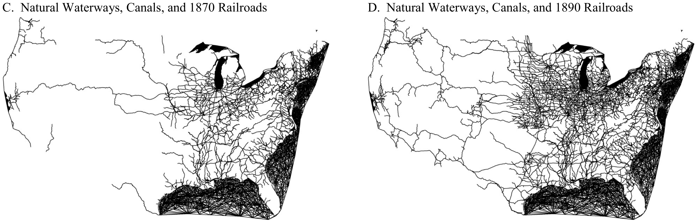{height="230px" fig-align="center"}

[**Market access** measures how cheaply a county can reach buyers in every other
county. The maps are panels C and D of Figure 2 in the 2013 working paper of
"Railroads and American Economic Growth: A 'Market Access' Approach".]{.source}

## Fewest county lines to Los Angeles {#route}

::::: {.columns}

:::: {.column width="46%"}

::: {.slide-text}

- Without costs, each county line counts as one step.
- The shortest route from Tompkins County to Los Angeles County crosses 57
  county lines.
- The route igraph returns passes through 58 counties in 14 states, north of the
  straight line.

:::

::::

:::: {.column width="52%"}

```{r}
#| label: route-map-figure
#| ref.label: !expr c("route", "route-map")
#| echo: false
#| purl: false
#| results: hide
#| fig-width: 6
#| fig-height: 2.9
#| out-width: "100%"
```

::::

:::::

```{r}
#| label: route
#| script: "Fewest county lines to Los Angeles"
#| filename: "R Console, in the 23-spatial-vector folder; low, g and i from the slides before"
la <- which(low$GEOID == "06037")                            # Los Angeles County
distances(g, i, la)                                          # fewest county lines
route <- shortest_paths(g, from = i, to = la)$vpath[[1]]     # one route with 57
unique(low$STUSPS[route])
cen <- st_centroid(st_geometry(low))                         # each county's centre
```


::: {.content-visible unless-format="revealjs"}

```{r}
#| label: route-map
#| script: "The route on a map"
#| filename: "R Console, in the 23-spatial-vector folder; low, route, cen, i and la from the slide before"
#| fig-show: hide
par(mar = c(0, 0, 0, 0))
plot(st_geometry(low), col = "grey92", border = NA)
plot(st_geometry(low[route, ]), col = "#B31B1B", border = NA, add = TRUE)
ends <- st_coordinates(cen[c(i, la)])
segments(ends[1, 1], ends[1, 2], ends[2, 1], ends[2, 2], lty = 2, lwd = 1.5)
text(ends[, 1], ends[, 2], c("Tompkins", "Los Angeles"), pos = c(4, 2), cex = 0.8)
round(as.numeric(st_distance(cen[i], cen[la])) / 1e3)        # km, straight line between the centres
```

:::

[`distances()` counts the borders crossed on the shortest route.
`shortest_paths()` returns one such route; many routes tie at 57. The dashed line
joins the two county centres, 3,692 km apart. The code for the map is on the
session page and in the live script.]{.source}

## Exercise 2 {#exercise-2}

::: {.panel-tabset}

### Exercise

4 minutes. Count the county lines from Tompkins to a county you pick, and the
kilometres per line. From the slides before, `low` is the lower-48 counties and
`g` their graph. `i` is Tompkins's row and `cen` each county's centre.

1. Find the county's GEOID, since names repeat (three counties are called Cook):
   `st_drop_geometry(low[low$NAME == "Cook", c("GEOID", "NAME", "STUSPS")])`,
   then `j <- which(low$GEOID == "17031")` (Cook County, Illinois).
2. The fewest county lines, and the states on one route: `n <- distances(g, i, j)`,
   then `unique(low$STUSPS[shortest_paths(g, from = i, to = j)$vpath[[1]]])`.
3. Kilometres per county line: `d_km <- as.numeric(st_distance(cen[i], cen[j])) / 1e3`,
   then `round(d_km / n[1], 1)`.

```{r}
#| label: exercise-2
#| exercise: true
#| script: "Exercise 2 (4 minutes)"
#| include: false
#| eval: false
# Exercise 2 (4 minutes). Fewest county lines from Tompkins to a county you pick, and kilometres per line.
# A county line counts one step whatever the county's size, so lines crossed and kilometres differ.
# In the 23-spatial-vector folder, with low, g, i and cen as on the slides before
# (or run code/3_relations.R first).
# 1. st_drop_geometry(low[low$NAME == "Cook", c("GEOID", "NAME", "STUSPS")])   # names repeat: pick by GEOID
#    j <- which(low$GEOID == "17031")
# 2. n <- distances(g, i, j); n                                            # fewest county lines
#    unique(low$STUSPS[shortest_paths(g, from = i, to = j)$vpath[[1]]])    # states on one route
# 3. d_km <- as.numeric(st_distance(cen[i], cen[j])) / 1e3                 # straight-line distance, km
#    round(d_km / n[1], 1)                                                 # kilometres per county line
# Two answers to compare with the room: the most county lines anyone found,
# and kilometres per line for a county in the east and one in the west.
```

[Compare with the room: the most county lines anyone found. Then compare the
kilometres per line for an eastern county and a western one.]{.source}

### Solution

```{r}
#| label: exercise-2-solution
#| purl: false
#| filename: "R Console, in the 23-spatial-vector folder; low, g, i and cen from the slides before"
gid <- c("36061", "17031", "12086", "48201", "53033", "06037", "53009")
j <- match(gid, low$GEOID)
r <- data.frame(NAME = low$NAME[j], STUSPS = low$STUSPS[j], lines = as.vector(distances(g, i, j)),
                km = round(as.numeric(st_distance(cen[i], cen[j])) / 1e3))
r$km_per_line <- round(r$km / r$lines, 1); r
```

[Each county line covers about 35 to 45 km in the East. Near the West Coast it
covers 60 to 65 km, because western counties are larger. The most is 63 lines, to
Clallam County, WA. The four island counties cannot be reached.]{.source}

:::

::: {.content-visible unless-format="revealjs"}

## County lines from Tompkins to every county {#lines-map}

::: {.slide-text}

Every lower-48 county lies within 63 county lines of Tompkins. Clallam, WA, is
the farthest, and the four island counties cannot be reached.

:::

::: {.content-visible unless-format="revealjs"}

```{r}
#| label: lines-map
#| script: "County lines from Tompkins to every county"
#| filename: "R Console, in the 23-spatial-vector folder; low, g and i from the slides before"
#| fig-show: hide
d  <- as.vector(distances(g, i))                       # county lines from Tompkins to every county
br <- c(-1, 0, 5, 10, 20, 30, 40, 50, 63)
pal <- hcl.colors(8, "YlOrRd", rev = TRUE)
par(mar = c(0, 0, 0, 8))
plot(st_geometry(low), col = ifelse(is.finite(d), pal[cut(d, br)], "grey60"), border = NA)
legend("right", c("0", "1-5", "6-10", "11-20", "21-30", "31-40", "41-50", "51-63"), fill = pal, border = NA,
       bty = "n", cex = 0.85, title = "county lines\ncrossed from\nTompkins", title.adj = 0, xpd = TRUE, inset = -0.17)
cl_wa <- st_coordinates(st_point_on_surface(st_geometry(low[which.max(replace(d, !is.finite(d), 0)), ])))
text(cl_wa[1], cl_wa[2], "Clallam, 63", pos = 4, cex = 0.8)
table(cut(d, br))
```

:::

```{r}
#| label: lines-map-figure
#| ref.label: lines-map
#| echo: false
#| purl: false
#| results: hide
#| fig-width: 8
#| fig-height: 4.4
#| out-width: "84%"
```

[One call, `distances(g, i)`, gives all 3,109 counties at once. The island
counties are grey. The R that draws this is on the session page and in the live
script.]{.source}

:::

## Straight lines between cities {#use-lines}

::: {.slide-text}

Roads are built where trade already is, so their effect is hard to measure.
Straight lines between cities depend only on
where the cities are, so they can serve as an instrument for roads.

:::

::: {.dashes}

- [**Faber (REStud, 2014)**](https://doi.org/10.1093/restud/rdu010) drew the
  cheapest network joining the cities in China's highway plan. Outlying counties
  on the highways grew about 18% less over nine years, as industry moved to the
  cities.
- [**Banerjee, Duflo & Qian (JDE, 2020)**](https://doi.org/10.1016/j.jdeveco.2020.102442)
  measured each Chinese county's distance to straight lines between historical
  cities. Counties nearer the lines had higher GDP per person but did not grow
  faster.

:::

[A **minimum spanning tree** is the shortest set of links that joins every city.
"Trade Integration, Market Size, and Industrialization: Evidence from China's
National Trunk Highway System"; "On the Road: Access to Transportation
Infrastructure and Economic Growth in China".]{.source}

## Straight lines between New York's cities {#lines}

:::: {.columns}

::: {.column width="50%"}

::: {.slide-text}

- igraph finds the shortest set of straight lines joining New York's five
  largest cities, a **minimum spanning tree**. It follows I-90 and I-87.
- A county's distance to these lines correlates 0.46 with its distance to the
  nearest Interstate.
- City locations alone predict where the roads are.

:::

:::

::: {.column width="48%"}

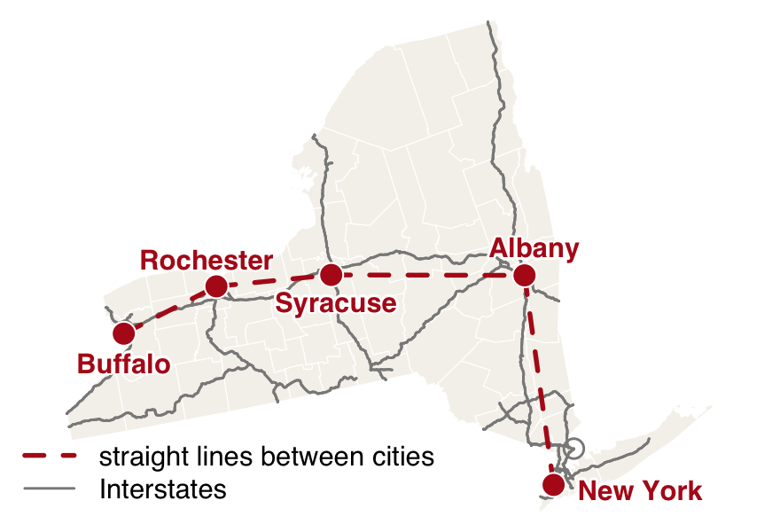{height="185px" fig-align="center"}

:::

::::

```{r}
#| label: lines
#| script: "Straight lines between New York's cities"
#| filename: "R Console; igraph loaded; pt_ny and ny_co from the slides before"
city <- data.frame(name = c("New York", "Buffalo", "Rochester", "Syracuse", "Albany"),   # each city hall
                   lon = c(-74.0060, -78.8784, -77.6088, -76.1474, -73.7562),
                   lat = c(40.7128, 42.8864, 43.1566, 43.0481, 42.6526))
city <- st_transform(st_as_sf(city, coords = c("lon", "lat"), crs = 4326), 5070)
d_c  <- matrix(as.numeric(st_distance(city)), 5) / 1e3                   # km between every pair
tree <- mst(graph_from_adjacency_matrix(d_c, mode = "undirected", weighted = TRUE))
e  <- as_edgelist(tree, names = FALSE); xy <- st_coordinates(city)       # the 4 lines it keeps
ln <- st_sfc(lapply(1:nrow(e), function(r) st_linestring(xy[e[r, ], ])), crs = 5070)
ny_co$km_line <- apply(st_distance(pt_ny, ln), 1, min) / 1e3             # county to the nearest line
round(cor(ny_co$km_line, ny_co$km_it), 2)
```

[The five cities are the main cities of New York's five largest metropolitan
areas. The tree's total length is 644 km. `st_linestring()` makes a line from a
matrix of points.]{.source}

## Distance in other spaces {#use-other}

::: {.slide-text}

Distance need not be on a map: firms can be close in what they patent, and
counties in their Facebook friendships.

:::

::: {.dashes}

- [**Bloom, Schankerman & Van Reenen (Econometrica, 2013)**](https://doi.org/10.3982/ECTA9466)
  placed firms by their patents in 426 technology classes. Firms close in this
  sense gain from each other's research.
- [**Bailey, Cao, Kuchler, Stroebel & Wong (JEP, 2018)**](https://doi.org/10.1257/jep.32.3.259)
  counted Facebook friendships between US counties. 10% more distance means
  14.8% fewer links.

:::

[Two firms with the same shares of patents in each class are as close as
possible. The social return to research is at least twice the private return.
"Identifying Technology Spillovers and Product Market Rivalry"; "Social
Connectedness: Measurement, Determinants, and Effects".]{.source}

## Tompkins County's friends, by county {#sci}

:::: {.columns}

::: {.column width="48%"}

::: {.slide-text}

- In Meta's Facebook data, Tompkins has the most friendship links with its six
  neighbours.
- Links fall with distance: 1% farther, 0.77% fewer links.
- Far away, the most linked counties hold universities, like Tompkins:
  Charlottesville (VA), Orange (NC) and Boulder (CO).

:::

:::

::: {.column width="50%"}

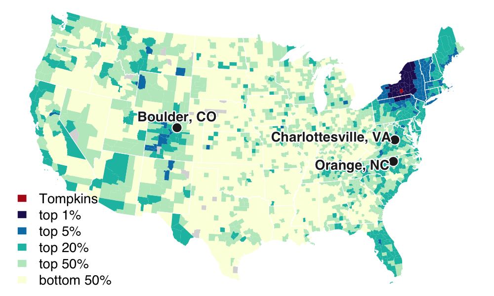{height="185px" fig-align="center"}

:::

::::

```{r}
#| label: sci
#| script: "Tompkins County's friends, by county"
#| filename: "R Console, in the 23-spatial-vector folder; low, i, cen and pop from the slides before"
sci <- read.csv("data_clean/sci_tompkins.csv", colClasses = c(GEOID = "character"))
k   <- match(sci$GEOID, low$GEOID)                           # NA outside the lower 48
sci$km <- as.numeric(st_distance(cen[i], cen))[k] / 1e3      # from Tompkins's centre
s <- sci[sci$GEOID != "36109" & !is.na(k), ]
coef(lm(log(sci) ~ log(km), s))["log(km)"]                   # % change in links per 1% more km
big <- pop$GEOID[pop$POPESTIMATE2024 > 40000]                # counties over 40,000 people
far <- s[s$km > 500 & s$GEOID %in% big, ]
head(low$NAME[match(far$GEOID[order(-far$sci)], low$GEOID)], 3)   # most linked, over 500 km away
```

[`sci` is Meta's Social Connectedness Index: friendship links between two
counties, divided by the product of their numbers of Facebook users. `big` drops
counties under 40,000 people, whose numbers are noisy. Over all county pairs,
Bailey et al. find 1.48. I cut the file with `tools/cut_sci.R`.]{.source}

## Standard errors for nearby places {#use-conley}

::: {.slide-text}

- Nearby counties share weather and markets, so their regression errors are
  correlated.
- Standard errors that ignore this are too small.
- [Conley (Journal of Econometrics, 1999)](https://doi.org/10.1016/S0304-4076(98)00084-0)
  allows the errors of places closer than a cutoff distance to be correlated.

:::

::: {.dashes}

- **In use:** [Berman, Couttenier, Rohner & Thoenig (AER, 2017)](https://doi.org/10.1257/aer.20150774)
  report Conley standard errors within 500 km for mines and conflict in Africa.
- The estimate does not change. Its standard error grows.
- The researcher picks the cutoff distance, and should try several.
- In R, the **fixest** package computes Conley standard errors.

:::

```{r}
#| label: idiom-fixest
#| script: "Load or install fixest"
#| output: false
#| message: false
#| filename: "R Console. Installs fixest if missing"
want <- c("fixest")
need <- want[!(want %in% installed.packages()[,"Package"])]
if (length(need)) install.packages(need)
lapply(want, function(i) require(i, character.only = TRUE))
```

[A **standard error** measures how much an estimate would vary from sample to
sample. Pairs of places get less weight the farther apart they are, and none
beyond the cutoff. Conley's paper is titled "GMM Estimation with Cross Sectional
Dependence".]{.source}

::: {.content-visible unless-format="revealjs"}

## Neighbouring counties err alike {#resid}

::: {.slide-text}

An example: across the lower 48, counties that were denser in 2020 grew faster
to 2024. The map shows each county's growth minus the fitted growth. Neighbours
miss in the same direction, as in Florida, Idaho and along the lower
Mississippi, so standard errors that treat counties as independent are too
small.

:::

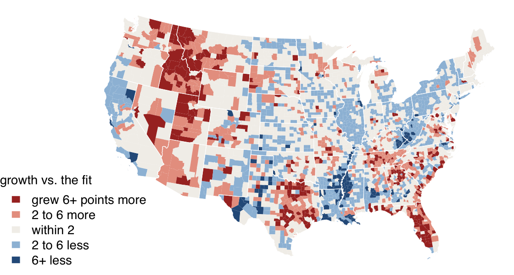{height="360px" fig-align="center"}

[Growth: the percent change in population from 2020 to 2024; the legend is in
percentage points. The fit: a line in
the log of people per km² in 2020, across the 3,109 counties of the lower 48 and DC. Census
Bureau county population estimates.]{.source}

:::

## Conley standard errors with fixest {#conley}

::: {.slide-text}

- Across the lower 48, denser counties grew faster from 2020 to 2024.
- Neighbouring counties have similar residuals, which the robust standard error
  ignores.
    - Allowing correlation within 100 km nearly doubles the standard error.
    - Within 500 km, it is 4.6 times as large.
- The estimate stays 0.65 points of growth per log point of density.

:::

```{r}
#| label: conley
#| script: "Conley standard errors with fixest"
#| filename: "R Console; fixest from the slide before; low and pop from the slides before"
p  <- pop[match(low$GEOID, pop$GEOID), ]
ll <- st_coordinates(st_transform(st_point_on_surface(st_geometry(low)), 4326))  # degrees, as conley() needs
dd <- data.frame(growth = 100 * (p$POPESTIMATE2024 / p$POPESTIMATE2020 - 1),     # % change, 2020 to 2024
                 ldens  = log(p$POPESTIMATE2020 / (low$ALAND / 1e6)),            # log people per km2, 2020
                 lon = ll[, 1], lat = ll[, 2])
m <- feols(growth ~ ldens, dd); round(coef(m)["ldens"], 2)
round(sapply(list(robust = "hetero", within_100km = conley(100), within_500km = conley(500)),
             function(v) se(summary(m, vcov = v))["ldens"]), 3)
```

[**fixest** is an R package for regressions; `feols()` fits one. `"hetero"` is
the robust standard error, which allows unequal variances but no correlation.
`conley(100)` allows correlation between counties up to 100 km apart.]{.source}

# 4 · An application to wildfire smoke {#part-smoke}

## Overview of part 4 {#overview-4}

::: {.slide-text}

How many people lived under wildfire smoke each day of June 2023.

:::

::::: {.columns}

:::: {.column width="58%"}

::: {.dashes}

- **A study:** wildfire smoke and earnings, by county and day.
- **The data:** NOAA's smoke outlines, one file per day of June 2023.
- **The variable:** each county's smoke each day, and the people under heavy
  smoke.
- **A check:** ground monitors, because smoke can pass high overhead.

:::

::::

:::: {.column width="40%"}

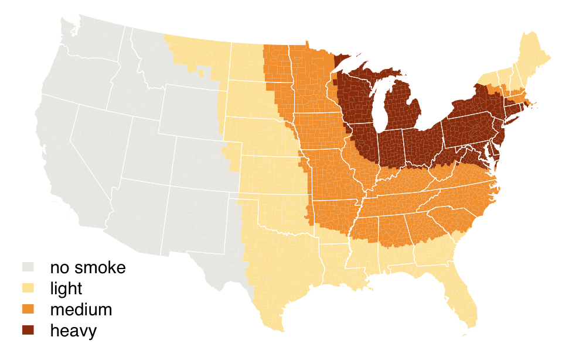{height="250px" fig-align="center"}

[Later in this part: each county's smoke on 7 June 2023.]{.source}

::::

:::::

## Wildfire smoke and earnings {#use-smoke}

::::: {.columns}

:::: {.column width="52%"}

::: {.dashes}

- **Question:** [Borgschulte, Molitor & Zou (REStat, 2024)](https://doi.org/10.1162/rest_a_01243)
  asked whether wildfire smoke lowers earnings.
- **Method:** Each day, NOAA analysts outline the smoke they see in satellite
  images. The authors counted the days a plume covered each whole US county.
- **Data:** smoke days per county and quarter, and EPA monitors within 20 miles
  of each county's centre.
- **Result:** Each smoke day lowered earnings per person that quarter by about
  0.1%.

:::

::::

:::: {.column width="46%"}

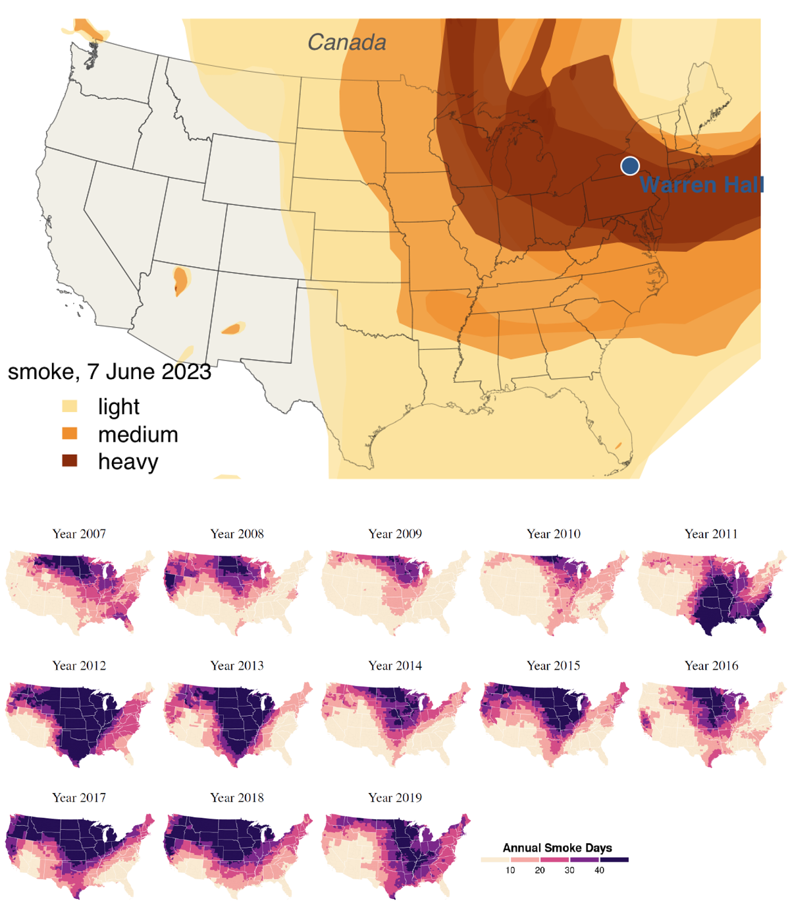{height="390px" fig-align="center"}

::::

:::::

[Top: the outlines from NOAA's Hazard Mapping System (HMS) on 7 June 2023, when
smoke from fires in Quebec reached New York. Bottom: the paper's Figure 1 (2022
working paper), the days each county was fully covered by smoke, 2007 to
2019.]{.source}

## Counties under smoke on 7 June 2023 {#smoke-counties}

:::: {.columns}

::: {.column width="54%"}

::: {.slide-text}

- NOAA analysts drew 88 smoke plumes on 7 June, each light, medium or heavy.
- As in the earnings study, a county is under smoke when a plume covers all of
  it.
- Heavy smoke covered 639 counties, home to 106 million people.

:::

:::

::: {.column width="44%"}

{height="170px" fig-align="center"}

:::

::::

```{r}
#| label: smoke-counties
#| script: "Counties under smoke on 7 June 2023"
#| filename: "R Console, in the 23-spatial-vector folder; low from Part 3, pop from Part 1; reads data/noaa/hms/"
s <- st_read("/vsizip/data/noaa/hms/hms_smoke20230607.zip", quiet = TRUE)   # /vsizip/ reads inside the zip
s <- st_transform(st_make_valid(s), 5070)                      # 88 plumes, in metres
lev <- c(Light = 1, Medium = 2, Heavy = 3)                     # densities as numbers
densest <- function(s) sapply(st_within(low, s), function(k) if (length(k)) max(lev[s$Density[k]]) else 0)
d7 <- densest(s)
table(d7)                                                      # 0 none, 1 light, 2 medium, 3 heavy
low$pop <- pop$POPESTIMATE2023[match(low$GEOID, pop$GEOID)]   # people, July 2023
sum(low$pop[d7 == 3]) / 1e6                                    # millions under heavy smoke
```

[`low` is the 3,109 counties of the lower 48 and DC. `st_within(low, s)` finds,
for each county, the plumes that cover all of it, and `max()` keeps the densest.
Large counties are rarely fully covered. A point inside each county, or the
share under smoke, would avoid this.]{.source}

::: {.content-visible unless-format="revealjs"}

## One day of smoke outlines {#smoke-day}

::: {.slide-text}

Each day is one zipped shapefile: 88 smoke polygons on 7 June 2023, each with a
density and the hours it was seen. Plumes overlap, so Warren Hall falls under six
of them, two of each density.

:::

```{r}
#| label: smoke-day
#| script: "One day of smoke outlines"
#| filename: "R Console; wh_m from Part 2, s from the slide before"
table(s$Density)
st_drop_geometry(st_join(wh_m, s[c("Density", "Start", "End")]))            # every plume over Warren Hall
```

[`wh_m` is Warren Hall in metres (5070). Start and End are the year, the day of
the year (158 is 7 June) and the hour in universal time (UTC, 4 hours ahead of
New York). `/vsizip/` is GDAL's way to read a file inside a zip, so the 30 zips
stay as downloaded.]{.source}

:::

## Thirty days, one table {#smoke-panel}

:::: {.columns}

::: {.column width="40%"}

::: {.slide-text}

Running the same function on each day's file gives a table of 3,109 counties by
30 days. Adding up the people in heavy-smoke counties gives the number under
heavy smoke each day.

:::

:::

::: {.column width="58%"}

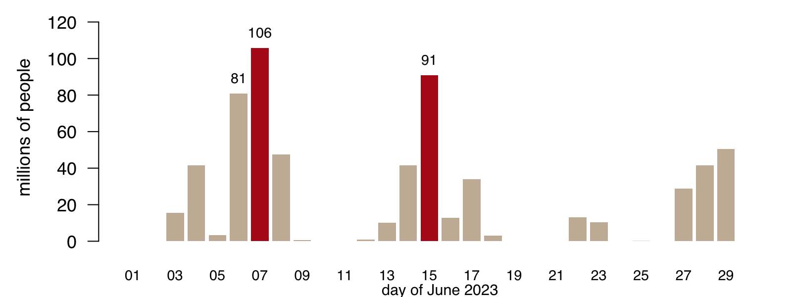{width="100%"}

:::

::::

```{r}
#| label: smoke-panel
#| script: "Thirty days, one table"
#| filename: "R Console, in the 23-spatial-vector folder; densest and low from the slide before; reads data/noaa/hms/"
hms_files <- list.files("data/noaa/hms", full.names = TRUE)        # one zip per day of June 2023
smoke <- function(f) st_transform(st_make_valid(st_read(paste0("/vsizip/", f), quiet = TRUE)), 5070)
day   <- as.Date(substr(basename(hms_files), 10, 17), "%Y%m%d")    # hms_smoke20230607.zip: 7 June
dens  <- sapply(hms_files, function(f) densest(smoke(f)))           # counties x days, about 6 seconds
colnames(dens) <- format(day); dim(dens)
heavy <- colSums(low$pop * (dens == 3), na.rm = TRUE) / 1e6        # millions under heavy smoke, each day
round(heavy[c("2023-06-07", "2023-06-15", "2023-06-29")])
```

[The table is a **panel**: each county over time, one column per day. Red marks
the two days above 90 million people, June 7 and June 15. Tompkins had 5 days of
heavy smoke in June. In all, 1,739 counties, home to 172 million people, had at
least one.]{.source}

## June 2023, day by day {#smoke-animation}

::: {.slide-text}

- Each frame is one day of June 2023, with each county coloured by its smoke.
- The bars below show the people under heavy smoke.

:::

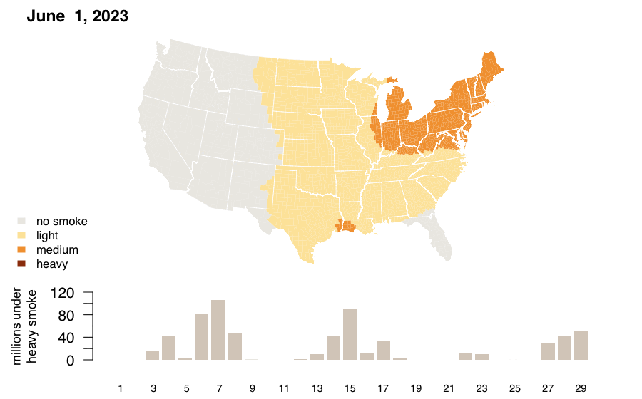{height="370px" fig-align="center"}

[I drew the table `dens` once per day and joined the frames into a GIF with the
`magick` package. The code is on the session page and in the live
script.]{.source}

::: {.content-visible unless-format="revealjs"}

```{r}
#| label: smoke-gif
#| script: "June 2023, day by day"
#| filename: "R Console, in the 23-spatial-vector folder; dens, heavy, day, low and states_m from the slides before; writes smoke_june2023.gif"
#| eval: false
want <- c("magick")                                             # joins the frames into a GIF
need <- want[!(want %in% installed.packages()[,"Package"])]
if (length(need)) install.packages(need)
pal <- c("#EDEBE6", "#FDE6A8", "#F4A03C", "#9C3D0B")            # none, light, medium, heavy
tmp <- file.path(tempdir(), "smoke"); dir.create(tmp, showWarnings = FALSE)
for (d in seq_along(day)) {
  png(file.path(tmp, sprintf("f%02d.png", d)), width = 900, height = 560, pointsize = 15)
  layout(matrix(1:2), heights = c(3.9, 1.7))
  par(mar = c(0, 0, 1.6, 0))
  plot(st_geometry(low), col = pal[dens[, d] + 1], border = NA)
  plot(st_geometry(states_m[states_m$STUSPS %in% low$STUSPS, ]), col = NA, border = "white", lwd = 0.5, add = TRUE)
  mtext(format(day[d], "%B %e, %Y"), side = 3, line = 0.2, font = 2, cex = 1.1, adj = 0.05)
  legend("bottomleft", c("no smoke", "light", "medium", "heavy"), fill = pal, border = "white", bty = "n", cex = 0.8)
  par(mar = c(2.2, 5.2, 0.8, 1), las = 1, bty = "n")
  barplot(heavy, col = ifelse(seq_along(heavy) == d, "#B31B1B", "#D9CFC4"), border = NA, ylim = c(0, 120),
          names.arg = format(day, "%e"), cex.names = 0.7, ylab = "millions under\nheavy smoke", cex.lab = 0.85)
  dev.off()
}
gif <- magick::image_animate(magick::image_read(list.files(tmp, full.names = TRUE)), fps = 2)
magick::image_write(gif, "smoke_june2023.gif")                  # two frames a second
```

:::

::: {.content-visible unless-format="revealjs"}

## Ground monitors under the plumes {#smoke-monitors}

::: {.slide-text}

The EPA measures fine particles at 947 ground monitors in the lower 48. A
spatial join gives each monitor-day the densest plume overhead. One day from
each of June's three smoke episodes: under a heavy plume, the median monitor
read 90 µg/m³ on June 8, 14 on June 15 and 114 on June 28.

:::

```{r}
#| label: smoke-monitors
#| script: "Ground monitors under the plumes"
#| filename: "R Console, in the 23-spatial-vector folder; hms_files, day, lev and smoke from the slides before"
pm  <- read.csv("data_clean/pm25_june2023.csv", colClasses = c(site = "character"))   # site, date, pm25, lon, lat
mon <- st_transform(st_as_sf(pm, coords = c("lon", "lat"), crs = 4326), 5070)
mon$smoke <- NA
for (k in seq_along(hms_files)) {                                # day by day: that day's monitors, that day's plumes
  s <- smoke(hms_files[k]); w <- which(mon$date == format(day[k]))
  over <- st_intersects(mon[w, ], s)                             # plumes over each monitor that day
  mon$smoke[w] <- sapply(over, function(j) if (length(j)) max(lev[s$Density[j]]) else 0)
}
hv <- mon[mon$smoke == 3, ]                                      # monitor-days under a heavy plume
round(tapply(hv$pm25, hv$date, median)[c("2023-06-08", "2023-06-15", "2023-06-28")])
```

[**PM2.5**: particles 2.5 micrometres across or smaller, in micrograms per cubic
metre (µg/m³); the EPA's daily standard is 35. **EPA**: the US Environmental
Protection Agency; each value is a monitor's 24-hour average. I cut June 2023
from the EPA's daily file for 2023 with `tools/cut_pm25.R`. For a point,
`st_intersects()` and `st_within()` give the same plumes.]{.source}

:::

## Smoke aloft and smoke at the ground {#smoke-aloft}

::: {.slide-text}

- A satellite sees smoke at any height, and a plume can pass kilometres
  overhead.
- The EPA's 947 ground monitors measure the fine particles people breathe.
- Under heavy plumes, the median monitor read 90 µg/m³ on June 8 and 114 on
  June 28.
- On June 15 it read only 14, below the daily standard of 35.
    - Heavy plumes still covered counties home to 91 million people that day.

:::

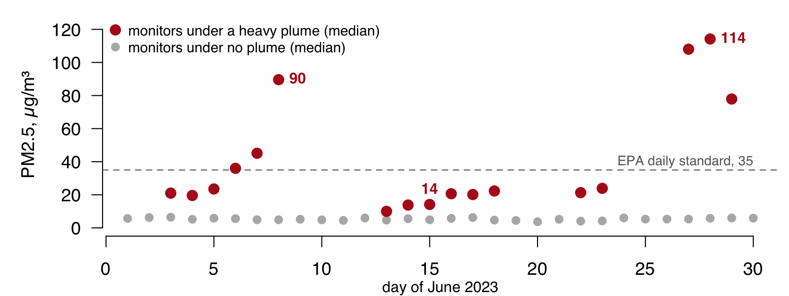{width="88%" fig-align="center"}

[Each red point is the median of the monitors under a heavy plume that day. Grey
is the median under no plume. Days with fewer than 10 monitors under a heavy
plume are left out. `st_intersects()` finds the plumes over each monitor; the
code is on the session page. **PM2.5** means particles 2.5 micrometres across or
smaller, as a 24-hour average. A smoke variable built from the plumes should be
compared with the monitors.]{.source}

::: {.content-visible unless-format="revealjs"}

# Worked example: Medicaid expansion at state lines {#part-medicaid}

The variables for comparing counties on the two sides of a state line, before
and after a policy: Medicaid's expansion in 2014. The design follows the county
pairs of Dube, Lester & Reich and the border distance of Holmes, from Part 3 and
Part 2.

## States that expanded Medicaid in 2014 {#medicaid}

:::: {.columns}

::: {.column width="50%"}

::: {.slide-text}

In 2014, 25 states of the lower 48 and DC extended Medicaid to low-income
adults. Another 19 had not expanded by the end of 2018. Did the uninsured share fall more
on the side of a state line that expanded?

:::

:::

::: {.column width="48%"}

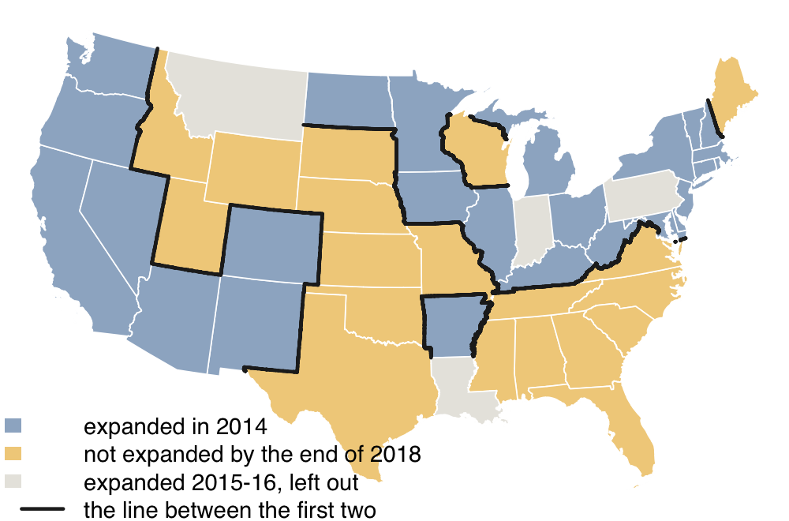{width="100%"}

:::

::::

[**Medicaid**: US public health insurance for people with low incomes, run by
each state with federal money. The **Affordable Care Act**, the 2010 federal
health-insurance law, extended it to adults with incomes up to 138% of the
**federal poverty line**; a 2012 Supreme Court ruling let each state decide.
Indiana, Louisiana, Montana and Pennsylvania (2015-16) are left out. 2018 is
where the insurance data used here end. KFF (a US health-policy research
organization), State Health Facts, Status of State Action on the Medicaid
Expansion Decision, read 2026-11-13.]{.source}

## Comparing counties across a state line {#border-design}

::: {.slide-text}

To see what the expansion changed, compare counties that touch across a state
line: close neighbours under different state laws. Published work compares such
pairs; the Kentucky and Tennessee line has 30 of them.

:::

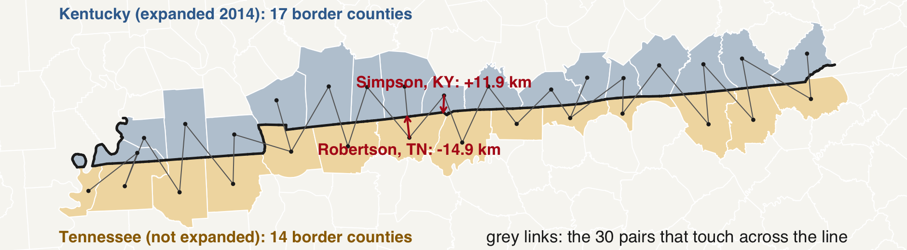{width="100%"}

[A **border design** compares places on either side of a border.
[Dube, Lester & Reich (REStat, 2010)](https://doi.org/10.1162/REST_a_00039)
compared every pair of touching counties across a state line, 1990-2006, for
restaurants and other low-wage jobs, and found no job losses from higher
minimum wages. US states may set a minimum wage above the federal one. The
signed distances are on the slides that follow.]{.source}

## Cross-border county pairs {#pairs}

:::: {.columns}

::: {.column width="56%"}

::: {.slide-text}

377 pairs of counties touch across the line between states that extended
Medicaid, US public health insurance for low-income people, in 2014 and states
that had not by 2018. Each pair compares two neighbours under different
policies.

:::

:::

::: {.column width="42%"}

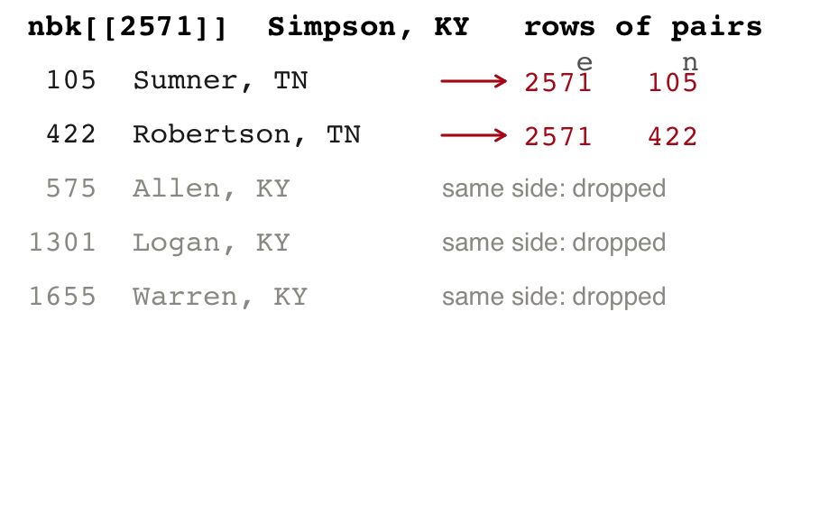{height="200px" fig-align="center"}

:::

::::

```{r}
#| label: pairs
#| script: "Cross-border county pairs"
#| filename: "R Console, in the 23-spatial-vector folder; low from Part 3; reads data_clean/medicaid_expansion.csv"
med   <- read.csv("data_clean/medicaid_expansion.csv")   # state, month, group: I typed it from KFF's table
exp14 <- med$state[med$group == "expanded 2014"]
not14 <- med$state[med$group == "not expanded by 2018"]
k <- low[low$STUSPS %in% c(exp14, not14), c("GEOID", "NAME", "STUSPS")]
k$exp14 <- k$STUSPS %in% exp14                           # TRUE in a state that expanded in 2014
nbk   <- st_touches(k)
pairs <- data.frame(e = rep(seq_along(nbk), lengths(nbk)), n = unlist(nbk))   # every touching pair
pairs <- pairs[k$exp14[pairs$e] & !k$exp14[pairs$n], ]   # keep each pair once: expansion county first
nrow(pairs)
```

[`low` holds the 3,109 counties of the lower 48 and DC, in metres. `st_touches()`
returns, for each county, the rows of the counties that share its border; for
Simpson, KY (row 2571 of `k`), two of five neighbours are in Tennessee and
become rows of `pairs` (e: the expansion county, n: its neighbour). `k` holds
the 2,830 counties of the two groups.]{.source}

## Signed distance to the state line {#signed}

:::: {.columns}

::: {.column width="52%"}

::: {.slide-text}

The border between the two groups of states is a line of 12,359 km. Each
county's distance to it is the **running variable**, negative on the side that
did not expand.

:::

:::

::: {.column width="46%"}

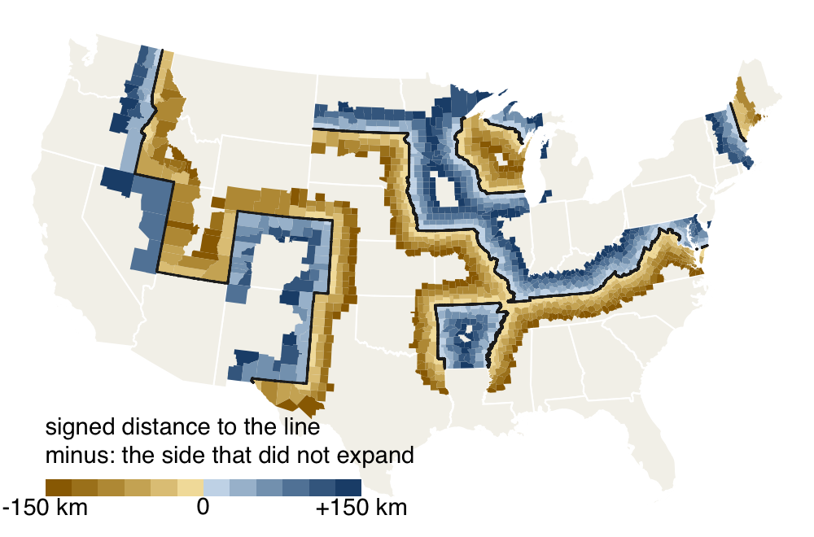{height="235px" fig-align="center"}

:::

::::

```{r}
#| label: signed
#| script: "Signed distance to the state line"
#| filename: "R Console, in the 23-spatial-vector folder; k, exp14, not14 from the slide before; states_m from Part 2"
states_k <- states_m[states_m$STUSPS %in% c(exp14, not14), ]
ln <- st_intersection(st_union(states_k[states_k$STUSPS %in% exp14, ]),   # the expansion states as one shape
                      st_union(states_k[states_k$STUSPS %in% not14, ]))   # where it meets the rest: a line
round(as.numeric(st_length(ln)) / 1e3)                                    # km
pt_co <- st_point_on_surface(st_geometry(k))                              # one point inside each county
k$dist_km <- ifelse(k$exp14, 1, -1) * as.numeric(st_distance(pt_co, ln)) / 1e3   # minus: did not expand
```

[`st_union()` merges many polygons into one shape; where two touching shapes
meet is their shared border. `st_point_on_surface()` gives a point sure to lie
inside each county. The **running variable** is the one whose crossing switches
the policy on. [Holmes (JPE, 1998)](https://doi.org/10.1086/250026) used this
distance: manufacturing's share of jobs rises by about a third on crossing into
a state whose law bars contracts that require union membership.]{.source}

## Uninsured share by county and year {#sahie}

::: {.slide-text}

SAHIE gives each county's uninsured share every year. Merging by GEOID and year
turns the 377 pairs into 4,147 pair-years. Simpson, KY, fell from 38.2% to 10.4%
from 2013 to 2016; its neighbour Robertson, TN, from 42.9% to 28.9%.

:::

```{r}
#| label: sahie
#| script: "Uninsured share by county and year"
#| filename: "R Console, in the 23-spatial-vector folder; k and pairs from the slides before; reads data_clean/sahie_uninsured.csv"
sahie <- read.csv("data_clean/sahie_uninsured.csv", colClasses = c(GEOID = "character"))  # GEOID, year, pctui
pp <- data.frame(GEOID_e = k$GEOID[pairs$e], GEOID_n = k$GEOID[pairs$n])
pp <- merge(pp, setNames(sahie, c("GEOID_e", "year", "pctui_e")), by = "GEOID_e")             # expansion side
pp <- merge(pp, setNames(sahie, c("GEOID_n", "year", "pctui_n")), by = c("GEOID_n", "year"))  # its neighbour
nrow(pp)                                                  # 377 pairs x 11 years
sp <- pp$GEOID_e == "21213" & pp$GEOID_n == "47147"       # Simpson, KY, and Robertson, TN
pp[sp & pp$year %in% 2013:2016, c("year", "pctui_e", "pctui_n")]
```

[**SAHIE**: the Census Bureau's Small Area Health Insurance Estimates, modelled
from survey answers with tax and program records. Here: adults aged 18 to 64 at
or below 138% of the poverty line; **pctui** is their percent uninsured. A
**pair-year** is one pair in one year. I made the CSV from eleven yearly Census
files with `tools/sahie_panel.R`.]{.source}

## Uninsured share fell more where Medicaid expanded {#bands}

::: {.slide-text}

Before the pairs, a simpler picture: each county's change in the uninsured share
from 2013 to 2016, averaged in 25 km bands of its signed distance to the line.
It fell 10 to 11 points in every band on the side that did not expand, and 18 to
20 on the expansion side. The change jumps at the line.

:::

::: {.content-visible unless-format="revealjs"}

```{r}
#| label: bands
#| script: "Uninsured share fell more where Medicaid expanded"
#| filename: "R Console, in the 23-spatial-vector folder; sahie and k from the slides before"
#| fig-show: hide
w  <- merge(sahie[sahie$year == 2013, c("GEOID", "pctui")], sahie[sahie$year == 2016, c("GEOID", "pctui")],
            by = "GEOID", suffixes = c("_2013", "_2016"))
kd <- merge(st_drop_geometry(k), w, by = "GEOID")
nrow(kd)                                                                  # of 2,830 counties
kd$change <- kd$pctui_2016 - kd$pctui_2013                                # percentage points
m  <- tapply(kd$change, cut(kd$dist_km, seq(-150, 150, 25)), mean)        # mean change in 25 km bands
round(m, 1)
par(mar = c(4.2, 6, 0.5, 0.5), las = 1, bty = "n")
x <- seq(-137.5, 137.5, 25)
plot(x, m, pch = 16, cex = 1.4, col = ifelse(x > 0, "#3A6C9C", "#9A6B00"), ylim = c(-22, 0),
     xlab = "distance from a county to the line, km (minus: did not expand)",
     ylab = "change in uninsured share,\n2013 to 2016 (points)")
abline(v = 0, lty = 2); abline(h = 0, col = "grey80")
text(x, m, sprintf("%.1f", m), pos = 1, cex = 0.75)
```

The merge loses 10 of the 2,830 counties: Connecticut's nine planning regions,
which the Census Bureau adopted as county equivalents in 2022, and Oglala Lakota,
South Dakota, coded 46113 (Shannon County) until May 2015 and 46102 after.

:::

```{r}
#| label: bands-figure
#| ref.label: bands
#| echo: false
#| purl: false
#| results: hide
#| fig-width: 8
#| fig-height: 3.8
#| out-width: "80%"
```

[A **percentage point** is the difference between two percentages. Bands are 25
km wide, out to 150 km each side, with 91 to 141 counties each. SAHIE is
model-based: its county estimates are made to sum to state totals, and its
inputs include Medicaid records, so part of a step at a state line can come from
the model. The R that draws this is on the session page and in the live
script.]{.source}

## Pair gap by year {#gap}

::: {.slide-text}

Now the 377 pairs. Each joins a county in a state that extended Medicaid, US
public health insurance for low-income people, in 2014 to a touching county
across the line in a state that did not. Their gap in the
share without health insurance moved little until 2013. It then fell 7.2 points
in 2014 and about 10 points by 2016-2018.

:::

::: {.content-visible unless-format="revealjs"}

```{r}
#| label: gap
#| script: "Pair gap by year"
#| filename: "R Console, in the 23-spatial-vector folder; pp from 'Uninsured share by county and year'"
#| fig-show: hide
gap <- tapply(pp$pctui_e - pp$pctui_n, pp$year, mean)     # expansion county minus its neighbour, mean over pairs
round(gap - gap["2013"], 2)                                # relative to 2013
yr <- as.numeric(names(gap)); y <- gap - gap["2013"]
par(mar = c(3, 6, 0.5, 0.5), las = 1, bty = "n")
plot(yr, y, type = "b", pch = 16, cex = 1.3, col = "#B31B1B", ylim = c(-11.5, 2), xaxt = "n",
     xlab = "", ylab = "pair gap minus its 2013 value\n(percentage points)")
axis(1, at = yr); abline(h = 0, col = "grey60"); abline(v = 2013.5, lty = 2)
text(2013.6, 1.6, "Medicaid expansion, January 2014", adj = 0, cex = 0.8)
text(yr, y, sprintf("%.2f", y), pos = ifelse(yr < 2014, 3, 1), cex = 0.75)
```

The raw gap, before subtracting 2013, is −1.26 in 2008, −2.15 in 2013, −9.38 in
2014 and −11.92 in 2016: expansion counties had slightly fewer uninsured adults
even before. A county on two borders sits in several pairs.
[Boone, Dube, Goodman & Kaplan (AEJ: Economic Policy, 2021)](https://doi.org/10.1257/pol.20160613)
used border county pairs to study extensions of unemployment benefits and found
a small, statistically insignificant effect on employment.

:::

```{r}
#| label: gap-figure
#| ref.label: gap
#| echo: false
#| purl: false
#| results: hide
#| fig-width: 8
#| fig-height: 3.8
#| out-width: "80%"
```

[Uninsured share: adults 18-64 at or below 138% of the poverty line without
health insurance (Census SAHIE). The **pair gap** is the expansion county's share
minus its neighbour's, averaged over the pairs, minus its 2013 value. An **event
study** traces an outcome year by year around a policy's start, relative to the
last year before it. The R that draws this is on the session page and in the
live script.]{.source}

# Worked example: Amazon clearing and roads {#part-amazon}

How close to a road forest clearing happens, measured year by year in Cujubim, a
municipality in the Brazilian Amazon. It repeats the first step of Asher, Garg &
Novosad, the nearest-feature study in Part 3.

## Cujubim's clearings and roads {#cujubim}

::: {.slide-text}

We take the India study's first step in Brazil: how close to a road does each
year's forest clearing happen? Cujubim, in Rondônia, covers 3,855 km², about
three Tompkins Counties. PRODES, INPE's yearly satellite map of clearing, marks
34% of it cleared by 2007 and another 30% from 2008 to 2025.

:::

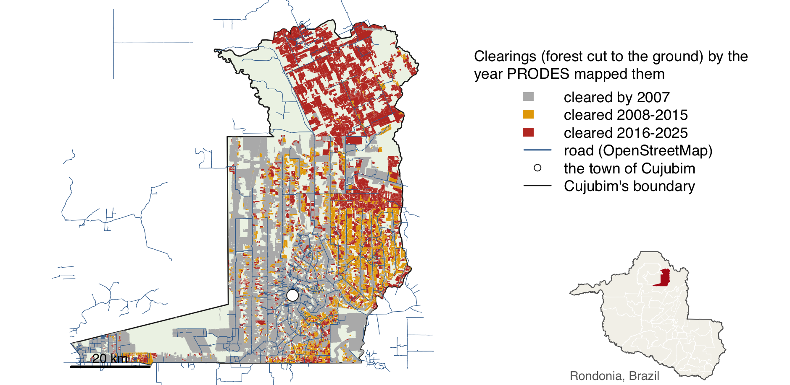{width="88%" fig-align="center"}

[A **municipality** is Brazil's unit of local government, like a county. How
close to a mapped road does each year's clearing happen? Clearings: PRODES, INPE
(Brazil's National Institute for Space Research), CC BY-SA 4.0. Roads: ©
OpenStreetMap contributors, ODbL.]{.source}

## Reading and repairing the clearings {#repair}

::: {.slide-text}

The clearings come as four GeoJSON files, 6,401 polygons in Cujubim's box; 764
outlines are invalid. After `st_make_valid()`, the areas match INPE's within 0.1%
at the median, and 4,955 clearings lie inside Cujubim.

:::

```{r}
#| label: repair
#| script: "Reading and repairing the clearings"
#| filename: "R Console, in the 23-spatial-vector folder; sf loaded; reads data/inpe/"
#| warning: false
mun   <- st_read("data/inpe/municipalities_RO.json", quiet = TRUE)   # Rondonia's 52 municipalities
cu    <- st_transform(mun[mun$nome == "Cujubim", ], 31980)          # nome: name; metres, UTM zone 20S
files <- list.files("data/inpe", "^yearly", full.names = TRUE)      # one download in four pages
cl    <- do.call(rbind, lapply(files, st_read, quiet = TRUE))       # 6,401 clearings in Cujubim's box
cl    <- st_transform(cl[c("year", "area_km")], 31980)
sum(!st_is_valid(cl))                                               # invalid outlines
cl <- st_make_valid(cl)                                             # repair them
round(median(as.numeric(st_area(cl)) / 1e6 / cl$area_km), 4)        # area from the shapes over INPE's
cl <- st_intersection(cl, st_geometry(cu))                          # the parts inside Cujubim
nrow(cl)
```

[**GeoJSON**: a text format for vector data. An **invalid** outline breaks the
rules for a shape, for instance by crossing itself; without the repair the cut
stops with "TopologyException". **area_km** is INPE's area for each polygon. A
PRODES year runs from August 1 to July 31. EPSG 31980 is SIRGAS 2000, the datum
of Brazil's official maps, with UTM zone 20S, metres in a 6° strip that holds
Cujubim; 5070 covers only the United States.]{.source}

::: {.content-visible unless-format="revealjs"}

```{r}
#| label: spellings
#| script: "One class, two spellings"
#| filename: "R Console, in the 23-spatial-vector folder; files from the slide before"
table(do.call(rbind, lapply(files, st_read, quiet = TRUE))$main_class)
```

INPE's class column spells one class two ways ("desmatamento" is Portuguese for
deforestation); the slides keep only the year and the area. After the cut, 11 of
the 4,955 rows are points or lines with no area, where a clearing only touches
the boundary. INPE's official annual rate differs from a sum of these polygons:
the mapping records clearings larger than 1 ha, the rate counts polygons larger
than 6.25 ha and adjusts for cloud cover.

:::

## Distance to the nearest road {#nearest}

:::: {.columns}

::: {.column width="62%"}

::: {.slide-text}

For each clearing, `st_nearest_feature()` finds the nearest mapped road and
`st_distance(by_element = TRUE)` measures the gap from a point inside the
clearing. The median was 491 m in 2008-12 and 1,031 m in 2022-25.

:::

:::

::: {.column width="36%"}

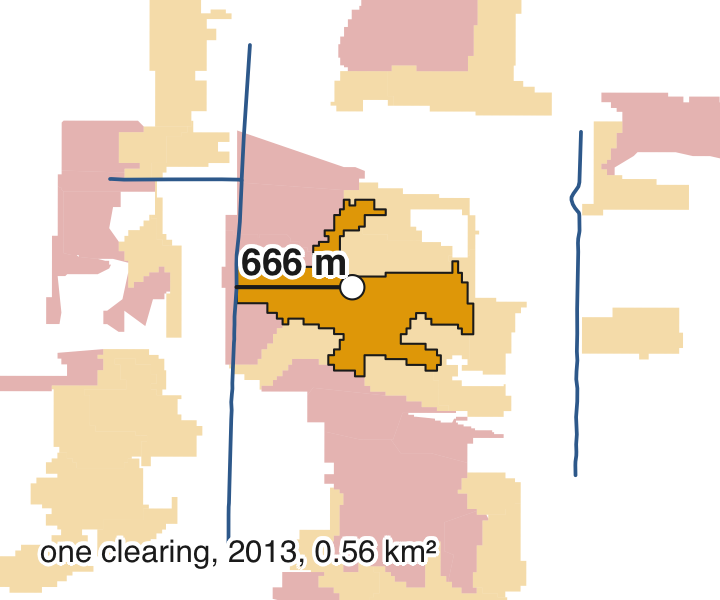{height="220px" fig-align="center"}

:::

::::

```{r}
#| label: nearest
#| script: "Distance to the nearest road"
#| filename: "R Console, in the 23-spatial-vector folder; cl from the slide before; reads data_clean/roads_cujubim.gpkg"
rd    <- st_read("data_clean/roads_cujubim.gpkg", quiet = TRUE)          # 1,162 OpenStreetMap roads, metres
pt_cl <- st_point_on_surface(st_geometry(cl))                            # one point inside each clearing
nr    <- st_nearest_feature(pt_cl, rd)                                   # row of the nearest road
cl$road_m <- as.numeric(st_distance(pt_cl, rd[nr, ], by_element = TRUE)) # metres, one per clearing
period <- cut(cl$year, c(2007, 2012, 2017, 2021, 2025), labels = c("2008-12", "2013-17", "2018-21", "2022-25"))
round(tapply(cl$road_m, period, median))
```

[**OpenStreetMap** is a world map drawn by volunteers, free to reuse with
credit; I dropped its paths and footways. A centroid can fall outside a curved
shape (383 of these clearings), so the distance runs from a point inside.
`by_element = TRUE` gives one distance per clearing in place of a 4,955 by 1,162
table.]{.source}

::: {.content-visible unless-format="revealjs"}

`code/5_amazon.R` builds `roads_cujubim.gpkg` from the downloaded JSON. Each
OpenStreetMap way is a list of longitude and latitude pairs, so a line is a
matrix of coordinates:

```{r}
#| label: build-roads
#| purl: false
#| filename: "R Console, in the 23-spatial-vector folder; writes data_clean/roads_cujubim.gpkg"
#| eval: false
js   <- jsonlite::fromJSON("data/osm/roads_cujubim_bbox.json", simplifyVector = FALSE)$elements
ways <- Filter(function(e) e$type == "way", js)                     # roads; the town is a node
line <- function(e) st_linestring(t(sapply(e$geometry, function(v) c(v$lon, v$lat))))
rd <- st_sf(osm_id = sapply(ways, function(e) e$id), highway = sapply(ways, function(e) e$tags$highway),
            geometry = st_sfc(lapply(ways, line), crs = 4326))
rd <- st_transform(rd[!rd$highway %in% c("path", "footway"), ], 31980)
st_write(rd, "data_clean/roads_cujubim.gpkg", delete_dsn = TRUE, quiet = TRUE)
```

:::

## Road distance to the town {#road-distance}

::::: {.columns}

:::: {.column width="44%"}

::: {.slide-text}

Timber and crops travel to town along the roads, so the next distance follows
the road network. Each road corner is a node and each stretch between corners an
edge, weighted by its length. Along the roads, the median clearing lies 35.8 km from the town,
1.38 times the straight line.

:::

::::

:::: {.column width="54%"}

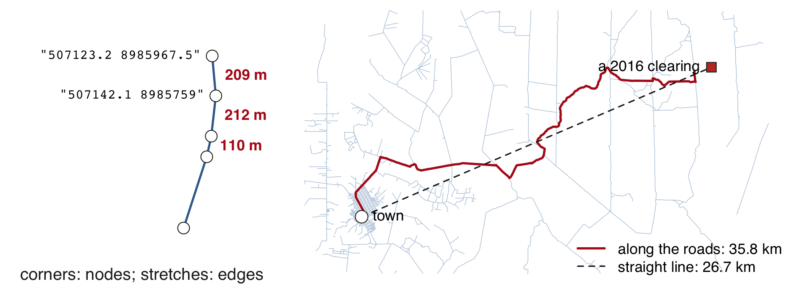{width="100%"}

::::

:::::

::: {.content-visible unless-format="revealjs"}

The road network: every corner of every road becomes a node, named by its
coordinates, and every stretch between two corners of the same road becomes an
edge weighted by its length. Roads join where they share a corner, which is how
OpenStreetMap draws junctions.

```{r}
#| label: network
#| script: "Roads as a network"
#| filename: "R Console, in the 23-spatial-vector folder; igraph loaded; rd from the slide before"
xy   <- st_coordinates(rd)                              # every corner; L1 = the road it belongs to
key  <- paste(round(xy[, "X"], 1), round(xy[, "Y"], 1)) # a name for each point, to 0.1 m
same <- xy[-nrow(xy), "L1"] == xy[-1, "L1"]             # is the next corner on the same road?
len  <- sqrt(diff(xy[, "X"])^2 + diff(xy[, "Y"])^2)     # metres from each corner to the next
ed   <- data.frame(from = key[-nrow(xy)][same], to = key[-1][same], weight = len[same])
gr   <- graph_from_data_frame(ed, directed = FALSE)
c(nodes = vcount(gr), edges = ecount(gr), components = components(gr)$no)
# a node's name is "x y": split it back into two numbers
nodes <- st_as_sf(data.frame(x = as.numeric(sub(" .*", "", V(gr)$name)),
                             y = as.numeric(sub(".* ", "", V(gr)$name))), coords = c("x", "y"), crs = 31980)
```

A **component** is a part of the network with no road to the rest; the largest
holds 88% of the nodes.

:::

```{r}
#| label: road-distance
#| script: "Road distance to the town"
#| filename: "R Console, in the 23-spatial-vector folder; gr and nodes from the live script; cl and pt_cl from the slides before"
town <- st_transform(st_as_sf(data.frame(lon = -62.5832107, lat = -9.3687919),
                              coords = c("lon", "lat"), crs = 4326), 31980)   # the town, from OpenStreetMap
town_m <- distances(gr, v = st_nearest_feature(town, nodes))[1, ]             # metres along roads, every node
cl$road_km <- town_m[st_nearest_feature(pt_cl, nodes)] / 1000
cl$line_km <- as.numeric(st_distance(pt_cl, town)) / 1000
ok <- is.finite(cl$road_km); sum(ok)                                           # clearings joined by road
round(median(cl$road_km[ok]), 1); round(median(cl$road_km[ok] / cl$line_km[ok]), 2)
```

[`cl`: forest clearings in Cujubim, Brazil, mapped from satellite images;
`pt_cl`: a point inside each. `gr`, built in the live script with igraph: 20,767
road corners as nodes and 21,148 stretches as edges weighted by metres; `nodes`:
the corners as points. The town and each clearing start at their nearest
corner. A **component** is a part of the network with no road to the rest. Road
distance is what timber or crops travel to the town.]{.source}

## Newer clearing lies farther from mapped roads {#share}

::: {.slide-text}

Back to the nearest road, with each clearing weighted by its size. In Cujubim,
the share of each year's cleared area within 1 km of a mapped road fell from 0.77 in 2008 to 0.35
in 2024‑25.

:::

```{r}
#| label: share
#| script: "Newer clearing lies farther from mapped roads"
#| filename: "R Console, in the 23-spatial-vector folder; cl and rd from the slides before"
gp   <- st_make_grid(cl, cellsize = 200, what = "centers")       # a point every 200 m across the box
hit  <- st_intersects(gp, cl)                                    # the clearing each point falls in
gp   <- gp[lengths(hit) > 0]                                     # keep the points inside a clearing
yr   <- pmin(cl$year[sapply(hit[lengths(hit) > 0], `[`, 1)], 2024)   # each point's year; 2025 joins 2024
d1   <- as.numeric(st_distance(gp, rd[st_nearest_feature(gp, rd), ], by_element = TRUE)) <= 1000
share <- tapply(d1, yr, mean)                                    # share of each year's area within 1 km
round(share[c("2008", "2016", "2024")], 2)
```

::: {.content-visible unless-format="revealjs"}

```{r}
#| label: share-map
#| script: "Clearing and the share near a road, by year"
#| filename: "R Console, in the 23-spatial-vector folder; cl and share from the slide before"
#| fig-show: hide
km2 <- tapply(as.numeric(st_area(cl)) / 1e6, pmin(cl$year, 2024), sum)   # km2 cleared each year
yrs <- as.numeric(names(km2))
par(mfrow = c(1, 2), mar = c(3, 4.6, 1.8, 1.5), las = 1, bty = "n")
barplot(km2, names.arg = sub("2024", "2024-25", names(km2)), col = "#C0392B", border = NA, cex.names = 0.7,
        ylab = "km² cleared that year")
mtext("Area cleared", side = 3, line = 0.4, adj = 0, font = 2)
plot(yrs, share, type = "b", pch = 16, col = "#3A6C9C", ylim = c(0, 1), xaxt = "n", xlab = "",
     ylab = "share within 1 km of a road", xlim = c(2008, 2025.5))
axis(1, at = c(2008, 2012, 2016, 2020, 2024), labels = c(2008, 2012, 2016, 2020, "2024-25"))
mtext("Share of the year's cleared area near a road", side = 3, line = 0.4, adj = 0, font = 2)
```

The share is measured on points every 200 m inside the clearings (28,856
points), so a large clearing counts by its area. Two quicker measures move the
same way: one point inside each clearing, weighted by area, gives 0.79 in 2008
and 0.32 in 2024-25; the centroid gives 0.80 and 0.30 but misreads 2023. A 1 km
zone drawn around every road gives 0.78 and 0.35, and needed 7 GB of memory in
preparation.

:::

```{r}
#| label: share-figure
#| ref.label: share-map
#| echo: false
#| purl: false
#| results: hide
#| fig-width: 9.4
#| fig-height: 2.6
#| out-width: "88%"
```

[`cl`: the 4,955 PRODES clearings inside Cujubim; `rd`: its OpenStreetMap roads.
Points every 200 m weigh each clearing by its area. I pool 2024 and 2025, since
2025 holds only 6.0 km². The R that draws this is on the session page and in
the live script.]{.source}

## Few mapped roads where clearing is newest {#caution}

:::: {.columns}

::: {.column width="44%"}

::: {.slide-text}

In Cujubim, north of 9°S, 429 km² of forest was cleared in 2016-25, against 17
km² in 2008-15. The map has 27 km of road per 100 km² there and 48 in the rest.
Part of the falling share of clearing near a road may be roads nobody mapped.

:::

:::

::: {.column width="54%"}

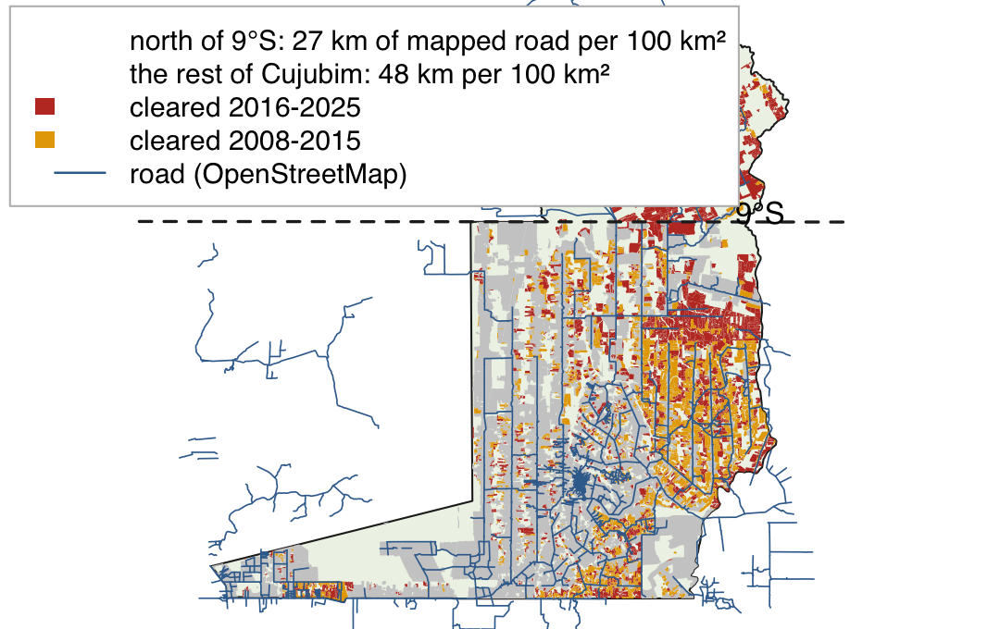{width="100%"}

:::

::::

::: {.dashes}

- Roads missing from the map make a recent clearing look far from a road.
- Today's map also holds roads built after an early clearing, which makes that
  clearing look close to one. Both errors steepen the fall.

:::

[A road map used as a variable needs the date each road was built or mapped.
Clearings: PRODES, INPE, CC BY-SA 4.0. Roads: © OpenStreetMap contributors,
ODbL.]{.source}

:::

## Practice {#practice}

::: {.content-visible when-format="revealjs"}

The session page has twelve practice tasks, with solutions you can open. They
run in the 23-spatial-vector folder. Task 4 downloads the Census road file
(38 MB), and task 9 installs spData, an R package of world maps.

- **1–3** Counties and their data: people per km² · how round each New York
  county is · the neighbours' average population
- **4–6** Measuring and routes: Interstate miles in Pennsylvania · each county's
  distance to Pennsylvania · every county on the 57-line route to Los Angeles
- **7–8** The page's Medicaid example (public health insurance): one state
  border at a time · without Wisconsin, which covered low-income adults without
  expanding
- **9** Distance by sea on a round world, from Los Angeles to Shanghai
- **10** The page's Cujubim example: clearing far from any mapped road · road
  distance to town by period
- **11–12** Smoke: heavy-smoke days for each New York county · people under
  smoke, using a point inside each county instead of the whole county

:::

::: {.content-hidden when-format="revealjs"}

```{r}
#| label: practice
#| exercise: true
#| script: "Practice"
#| eval: false
# Practice. Run in the 23-spatial-vector folder after the slides' code has built
# co, cp, ny, low, nb, g, i, la, states_m, k, pairs, pp, cl, pt_cl, rd, hms_files, day, lev, smoke and dens.

# Counties and their data
#  1. People per km2 for New York's counties: cp$POPESTIMATE2024 / (cp$ALAND / 1e6).
#     Which two are densest, which two least dense, and where is Tompkins?
#  2. Compactness, 4 * pi * area / perimeter^2 (1 for a circle), for New York's counties in 5070.
#     Which three are least compact, which three most?
#  3. The neighbours' average: for each county in low, the mean 2024 population of its
#     neighbours, with sapply(nb, function(j) mean(...)). Compare Tompkins with its six.
# Measuring and routes
#  4. Interstate miles in Pennsylvania, cut as on the Interstate slide. Download the full
#     primary-roads file first (tools/fetch_data.R, section 2) and subset RTTYP "I".
#  5. Each New York county's distance to Pennsylvania, from a point inside the county.
#     Which three are nearest, which two farthest?
#  6. Every county on some 57-line route from Tompkins to Los Angeles:
#     which(distances(g, i) + distances(g, la) == 57).
# The Medicaid border
#  7. The pair gap relative to 2013 for one border at a time: KY-TN, NM-TX, MN-WI.
#  8. The pair gap without the pairs on Wisconsin's border.
# Distance by sea
#  9. The distance from the Port of Los Angeles (-118.27, 33.74) to Shanghai (121.49, 31.23)
#     on the round Earth, and as a straight line in Web Mercator (3857). Then a route through
#     the water only (the worked example below the solutions).
# Cujubim
# 10. The share of each period's cleared area more than 2 km from a mapped road, and the median
#     road distance to town by period against the straight line.
# Smoke
# 11. The number of days in June 2023 each New York county was fully under heavy smoke:
#     rowSums(dens == 3) for the rows of low in New York. Which counties had the most?
# 12. The people under heavy smoke on 7 June with a point inside each county (st_intersects(pt, s))
#     in place of the whole county (st_within(low, s)). Which rule counts more, and why?
```

::: {.callout-tip collapse="true"}

## Solutions

```{r}
#| label: practice-solutions
#| purl: false
#| collapse: true
#| warning: false
# 1. People per km2 in New York
cpny <- cp[cp$STUSPS == "NY", ]
dny <- setNames(cpny$POPESTIMATE2024 / (cpny$ALAND / 1e6), cpny$NAME)
round(c(sort(dny, decreasing = TRUE)[1:2], sort(dny)[1:2], dny["Tompkins"]), 1)
# 2. Compactness
nym <- st_transform(ny, 5070)
cmp <- setNames(4 * pi * as.numeric(st_area(nym)) / as.numeric(st_length(st_boundary(nym)))^2, nym$NAME)
round(c(sort(cmp)[1:3], sort(cmp, decreasing = TRUE)[1:3], cmp["Tompkins"]), 3)
# 3. The neighbours' average
popl  <- pop$POPESTIMATE2024[match(low$GEOID, pop$GEOID)]
nbavg <- sapply(nb, function(j) mean(popl[j]))
round(c(Tompkins = popl[i], neighbours = nbavg[i]))
round(cor(log(popl), log(nbavg), use = "complete.obs"), 2)
# 5. Distance to Pennsylvania
dpa <- setNames(as.numeric(st_distance(st_point_on_surface(st_geometry(nym)),
                                        states_m[states_m$STUSPS == "PA", ])) / 1e3, nym$NAME)
round(c(sort(dpa)[1:3], sort(dpa, decreasing = TRUE)[1:2], dpa["Tompkins"]), 1)
# 6. Counties on some 57-line route
sum(distances(g, i) + distances(g, la) == 57)
# 7. One border at a time
fips <- setNames(states_m$STUSPS, states_m$STATEFP)
pp$border <- paste(fips[substr(pp$GEOID_e, 1, 2)], fips[substr(pp$GEOID_n, 1, 2)], sep = "-")
sapply(c("KY-TN", "NM-TX", "MN-WI"), function(b) {
  x <- pp[pp$border == b, ]; g_ <- tapply(x$pctui_e - x$pctui_n, x$year, mean)
  round((g_ - g_["2013"])[c("2014", "2016", "2018")], 2) })
# 8. Without Wisconsin
x <- pp[!grepl("WI", pp$border), ]; g_ <- tapply(x$pctui_e - x$pctui_n, x$year, mean)
c(pairs = nrow(x) / 11, round((g_ - g_["2013"])[c("2014", "2016", "2018")], 2))
# 9. Los Angeles to Shanghai: the round Earth and Web Mercator
ports <- st_as_sf(data.frame(name = c("Los Angeles", "Shanghai"), lon = c(-118.27, 121.49), lat = c(33.74, 31.23)),
                  coords = c("lon", "lat"), crs = 4326)
round(c(sphere = as.numeric(st_distance(ports[1, ], ports[2, ])) / 1e3,
        web_mercator = as.numeric(st_distance(st_transform(ports[1, ], 3857), st_transform(ports[2, ], 3857))) / 1e3))
# 10. Cujubim by period
cl$km2 <- as.numeric(st_area(cl)) / 1e6
round(tapply(cl$km2 * (cl$road_m > 2000), period, sum) / tapply(cl$km2, period, sum), 2)
rbind(road = round(tapply(cl$road_km[ok], period[ok], median), 1),
      straight = round(tapply(cl$line_km[ok], period[ok], median), 1))
# 11. Heavy-smoke days in New York
hd <- setNames(rowSums(dens == 3)[low$STUSPS == "NY"], low$NAME[low$STUSPS == "NY"])
table(hd); head(sort(hd, decreasing = TRUE), 4)
# 12. A point inside each county against the whole county, 7 June
s7 <- smoke(hms_files[day == as.Date("2023-06-07")])
pt <- st_point_on_surface(st_geometry(low))                     # a point inside each county
by_pt <- sapply(st_intersects(pt, s7), function(k) if (length(k)) max(lev[s7$Density[k]]) else 0)
round(c(point = sum(low$pop[by_pt == 3]), whole = sum(low$pop[dens[, "2023-06-07"] == 3])) / 1e6, 1)
```

Task 4: 3,931.2 miles of line, with I-76 at 701.0, I-80 at 618.8 and I-81 at
465.5; halve a divided highway's figure for miles of road. Task 7: Wisconsin
shows no gap because it covered adults up to 100% of the poverty line from 2014
under a waiver, without expanding Medicaid. Task 9: the straight line in Web
Mercator runs the other way round the world. Task 12: a point inside a county is
under a plume whenever the whole county is, and also when the plume covers only
part of it, so the point rule counts more people.

:::

**A route through the water only (task 9).** `st_distance()` on longitude and
latitude measures along the sphere, over land and water alike. A route that
stays at sea needs a network of ocean points: here a point every degree that
falls in no country of spData's world map, each joined to its eight neighbours
with the great-circle distance as the weight. `distances()` then works as on the
roads. Shipping routes over such networks are the variable in
[Pascali (AER, 2017)](https://doi.org/10.1257/aer.20140832).

```{r}
#| label: sea-route
#| script: "A route through the water only"
#| filename: "R Console; installs spData if missing; igraph and sf loaded"
#| message: false
want <- c("spData")
need <- want[!(want %in% installed.packages()[,"Package"])]
if (length(need)) install.packages(need)
invisible(lapply(want, function(i) require(i, character.only = TRUE)))
ports <- st_as_sf(data.frame(name = c("Los Angeles", "Shanghai"), lon = c(-118.27, 121.49), lat = c(33.74, 31.23)),
                  coords = c("lon", "lat"), crs = 4326)
gd  <- expand.grid(lon = seq(-179.5, 179.5, 1), lat = seq(-79.5, 84.5, 1))   # a point every degree
oc  <- gd[lengths(st_intersects(st_as_sf(gd, coords = c("lon", "lat"), crs = 4326), st_geometry(world))) == 0, ]
oc$id <- seq_len(nrow(oc)); idx <- setNames(oc$id, paste(oc$lon, oc$lat))
ed  <- do.call(rbind, lapply(list(c(1, 0), c(0, 1), c(1, 1), c(1, -1)), function(s) {   # 8 neighbours, once each
  nl <- oc$lon + s[1]; nl[nl > 180] <- nl[nl > 180] - 360                       # wrap across 180 degrees
  to <- idx[paste(nl, oc$lat + s[2])]; data.frame(from = oc$id[!is.na(to)], to = to[!is.na(to)]) }))
p   <- st_as_sf(oc, coords = c("lon", "lat"), crs = 4326)
ed$weight <- as.numeric(st_distance(p[ed$from, ], p[ed$to, ], by_element = TRUE)) / 1e3   # km on the sphere
sea <- graph_from_data_frame(ed, directed = FALSE, vertices = data.frame(name = oc$id))
nn  <- st_nearest_feature(ports, p)                                           # each port's nearest ocean point
round(distances(sea, v = as.character(nn[1]), to = as.character(nn[2]))[1, 1])   # km, through the water
```

The water route comes out a few percent longer than the great circle, partly
from the grid's zigzag. A one-degree grid has no Panama Canal, and the land map
has no sea ice, so a route from New York to Shanghai on this grid crosses the
Arctic Ocean.

## Sources {#sources}

County and state outlines: Census Bureau cartographic boundary files, 2024, at
1:500,000. Interstates: Census Bureau TIGER/Line primary roads, 2024. County
population: Census Bureau county population estimates 2020-2024. Uninsured
shares: Census Bureau Small Area Health Insurance Estimates, 2008-2018. Medicaid
expansion dates: KFF State Health Facts, Status of State Action on the Medicaid
Expansion Decision, read
2026-11-13 and typed into `data_clean/medicaid_expansion.csv`. Clearings:
PRODES, INPE, through the year that ended July 31, 2025, CC BY-SA 4.0. Roads: ©
OpenStreetMap contributors, ODbL, downloaded through the Overpass API on
2026-11-13. Smoke: NOAA Hazard Mapping System smoke polygons, June 2023. Fine
particles: EPA Air Quality System, daily PM2.5 for 2023 (`daily_88101_2023.zip`).
Friendship links: Meta, Social Connectedness Index between US counties, on the
Humanitarian Data Exchange, public domain. The census, health, Brazilian and
road files were downloaded on 2026-11-13 and the smoke, fine-particle and
friendship files on 2026-11-16, all by `tools/fetch_data.R`.

**Links:** [slides](23-spatial-vector-slides.html) · [Syllabus](../syllabus.qmd)

:::

```{r}
#| purl: false
#| include: false
source(file.path(session_dir, "_purl.R"))
purl_session(file.path(session_dir, "23-spatial-vector.qmd"),
             file.path(session_dir, "23-spatial-vector.R"))
```
