```{r}
#| purl: false
#| include: false
knitr::opts_chunk$set(
  comment = "#>",
  collapse = TRUE,
  fig.width = 9,
  fig.height = 4.4,
  fig.align = "center",
  fig.show = "hold",
  dpi = 150
)
options(width = 100)
# Every chunk runs in the project folder, so the paths on the page are the
# paths students use.
session_dir <- getwd()
knitr::opts_knit$set(root.dir = file.path(session_dir, "data/24-spatial-rasters"))
```

::: {.content-hidden when-format="revealjs"}

[Slides](24-spatial-rasters-slides.html) · [Live script](24-spatial-rasters.R) ·
[Source](https://github.com/ArielOrtizBobea/aem6850/blob/main/fall-2026/sessions/24-spatial-rasters.qmd) ·
[the project](data/24-spatial-rasters.zip)

A raster stores data as a grid of equal cells, and each cell holds one number.
This session reads PRISM's daily maximum temperature for July 2012 into R with
`terra`. It finds the cell over Warren Hall, crops the grid to New York and
computes new grids cell by cell. It moves wind from its own grid onto the
temperature grid and turns the wind's two layers into a speed and a direction.
It then averages the cells over each county: first with a packaged function,
then as a weight matrix times the matrix of cells by days. The weights can be
area, people or cropland. Two applications close the session: July heat over
cropland against the 2012 corn yield loss, and the people who lived downwind of
the Eaton fire on 9 January 2025.

**The project.** Download the [zip on this page](data/24-spatial-rasters.zip),
unzip it and open `24-spatial-rasters.Rproj`, so that R starts in the project
folder. Every path on the slides is relative to it. The scripts install `terra`,
`sf`, `exactextractr` and `Matrix` if they are missing. I downloaded every file
before class, so nobody needs an account, a key or the network. The folder's
`README.md` says where each file came from and under what licence. The raw
downloads stay out of the zip: 30 of PRISM's 31 daily files, the ERA5 wind
files, the cropland grid, the population grid and the corn yields. `tools/`
holds the code that fetched them, and the small files made from them are in
`data_clean/`.

## Objectives {#objectives}

By the end of this session you can:

- Read a grid with `rast()` and read its printout: size, resolution, extent, CRS
  and the range of values.
- Explain that a raster is a matrix of cells by layers, find a place's cell and
  read its value on every day.
- Crop and mask a grid to a state, and compute new grids cell by cell:
  differences, counts of days, degree days.
- Move one grid onto another grid's cells with `project()`, and compute wind
  speed and direction from u and v.
- Compute county means of a grid with a packaged function, and build the same
  means from the table of cells and fractions, as a weight matrix P times the
  matrix of cells by days.
- Change the weights (area, people, cropland) by changing the entries of P.

Left out: elevation and slope, night lights and vegetation measured from
satellites, turning weather-station records into a grid.

:::

## Plan for today {#plan}

::: {.slide-text}

What we are going to do today

1. **Raster data in R**\
   [Cells, resolution and extent · reading one day of temperature · a raster as a matrix · one layer per day · cropping to New York · Exercise 1]{.topics}
2. **Raster calculations**\
   [Arithmetic cell by cell · counting days · wind speed and direction]{.topics}
3. **Combining rasters and polygons**\
   [One mean per county · the cells of one county · Exercise 2 · a weight matrix · sparse matrices · population weights]{.topics}
4. **An application to heat and corn yields**\
   [Heat above 29 °C · cropland on the temperature grid · county heat over cropland · the 2012 yield loss]{.topics}
5. **An application to the Eaton fire**\
   [A satellite picture · the wind at the fire · the cells downwind · the people who live there]{.topics}

:::

[Today covers spatial data stored as a grid of cells: temperature, wind,
cropland and population. For most computations I show a published study, then R
code on New York. Two applications follow. Not covered: elevation and slope,
night lights and vegetation measured from satellites, turning weather-station
records into a grid.]{.source}

# 1 · Raster data in R {#part-raster}

## Overview of part 1 {#overview-1}

::: {.slide-text}

How R stores a grid.

:::

::::: {.columns}

:::: {.column width="58%"}

::: {.dashes}

- **Objects:** a raster is a grid of cells. Each cell holds one number.
- **Reading:** one day of temperature for the lower 48 states, then the 31 days
  of July 2012.
- **Cropping:** the cells over New York.
- **A point:** Warren Hall's temperature on each of the 31 days.
- **Exercise 1:** the hottest day at a place you pick.

:::

::::

:::: {.column width="40%"}

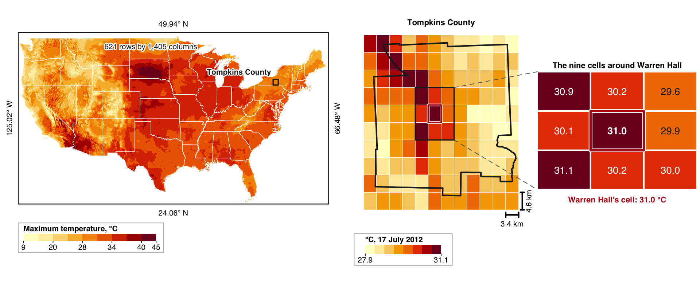{width="100%" fig-align="center"}

[Later in this part: 31.0 °C in Warren Hall's cell, in the layer dated 17 July
2012.]{.source}

::::

:::::

## Cells, resolution and extent {#cells}

::: {.slide-text}

A raster is a grid of equal cells. Each cell holds one number.

- A **cell** (or pixel) is one square of the grid.
- The **resolution** is the size of a cell: 1/24 of a degree, about 3.4 km by
  4.6 km at Ithaca.
- The **extent** is the rectangle the grid covers: here the lower 48 states.

:::

{width="88%" fig-align="center"}

[PRISM's daily maximum temperature, from Oregon State University. Warren Hall is
a Cornell building in Ithaca, in Tompkins County, New York.]{.source}

:::: {.content-visible unless-format="revealjs"}

## The project folder {#project}

::: {.slide-text}

- Download the zip from the session page, unzip it and open
  `24-spatial-rasters.Rproj`. Every path on the slides then works.
- I downloaded every file before class, so nothing needs an account, a key or
  the network.
- The scripts install terra, sf, exactextractr and Matrix if they are missing.

:::

```{.default filename="24-spatial-rasters/, as its README.md describes it"}
data/prism/    daily maximum temperature, 17 July 2012, one zip as PRISM serves it
data/census/   county and state outlines from the Census Bureau (cb_2024_us_*_500k.zip)
data/nasa/     NASA's satellite picture of Los Angeles, 9 January 2025
data_clean/    tmax_july2012.tif: the 31 days of July 2012 in one file
               u10_*.tif, v10_*.tif: hourly wind over New York and over Los Angeles
               pop_2010.tif: people in each cell
               cropland_2011.tif: percent of each cell under crops
               corn_yield_2002_2012.csv: county corn yields
               timings.csv: seconds I measured
code/          1_raster.R, 2_compute.R, 3_aggregate.R, 4_corn.R, 5_eaton.R; run_everything.R
24-spatial-rasters.R   the live script: every code slide in order
tools/         how I downloaded the files and made data_clean/ (needs the network)
```

[The README gives each file's source and licence.]{.source}

::::

## Reading one day of temperature {#read}

::: {.slide-text}

`rast()` reads the file. Its printout gives the grid's size, resolution, extent,
coordinate system and range of values.

- A **CRS** (coordinate reference system) ties the numbers to places on Earth.
  NAD83 gives longitude and latitude in degrees.

:::

```{r}
#| label: idiom-terra
#| script: "Load or install the four packages"
#| output: false
#| message: false
#| filename: "R Console, in the 24-spatial-rasters folder. Installs the four packages if missing"
want <- c("terra", "sf", "exactextractr", "Matrix")
need <- want[!(want %in% installed.packages()[,"Package"])]
if (length(need)) install.packages(need)
lapply(want, function(i) require(i, character.only = TRUE))
```

```{r}
#| label: read-day
#| script: "Reading one day of temperature"
#| filename: "R Console, in the 24-spatial-rasters folder; reads data/prism/prism_tmax_us_25m_20120717.zip"
unzip("data/prism/prism_tmax_us_25m_20120717.zip", exdir = "data_clean/prism")   # seven files
r <- rast("data_clean/prism/prism_tmax_us_25m_20120717.tif")    # the .tif holds the grid
r
```

[Download [24-spatial-rasters.zip](data/24-spatial-rasters.zip), unzip it and
open `24-spatial-rasters.Rproj`. The code runs in that folder.]{.source}

::: {.notes}
A file in Kelvin or in tenths of a degree reads just as well. The range of
values is where a wrong unit shows.
:::

::: {.content-visible unless-format="revealjs"}

PRISM's documentation gives the unit, degrees Celsius. PRISM estimates each
cell from weather stations, so most cells have no thermometer in them. PRISM's zip holds seven files. The `.tif` is the grid, `.prj` the CRS,
`.stn.csv` the stations behind that day's grid and `.info.txt` a note on how
the grid was modelled. The other three are `.stx`, `.tif.aux.xml` and `.xml`. A
`.tif` (GeoTIFF) is an image file that also stores where each cell sits.

```{r}
#| label: prism-zip
#| script: "What is in PRISM's zip"
#| filename: "R Console, in the 24-spatial-rasters folder"
unzip("data/prism/prism_tmax_us_25m_20120717.zip", list = TRUE)$Name
```

:::

## A raster is a matrix with coordinates {#matrix}

:::: {.columns}

::: {.column width="58%"}

::: {.slide-text}

R numbers the cells from the top left, row by row. Warren Hall sits in cell
252,660, in row 180 and column 1,165.

- `values()` returns one row per cell: 872,505 rows. 481,631 cells hold a
  temperature.
- The other cells are sea, Canada and Mexico. **NA** is R's mark for a missing
  value.

:::

:::

::: {.column width="40%"}

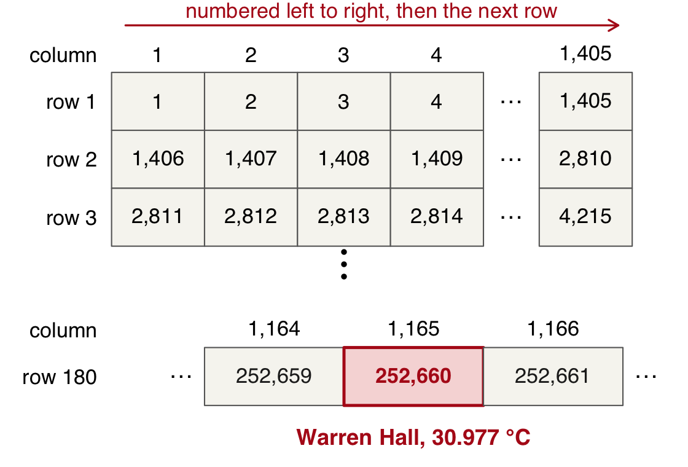{height="215px" fig-align="center"}

:::

::::

```{r}
#| label: matrix
#| script: "A raster is a matrix with coordinates"
#| filename: "R Console, in the 24-spatial-rasters folder; r from the slide before"
vals <- values(r)                               # every cell's value, row by row from the top left
c(rows = nrow(r), columns = ncol(r), cells = nrow(vals), with_value = sum(!is.na(vals)))
i <- cellFromXY(r, cbind(-76.4797, 42.4490))    # Warren Hall's cell (longitude, latitude)
i                                               # (180 - 1) x 1,405 + 1,165
rowColFromCell(r, i)                            # its row and column
vals[i]                                         # its value in the 17 July layer, degrees C
```

::: {.notes}
Analogy if useful: cells are numbered the way a page is read, left to right,
then the next line.
:::

## One layer per day {#layers}

:::: {.columns}

::: {.column width="66%"}

::: {.slide-text}

One file can hold many layers on the same cells. `tmax_july2012.tif` holds 31,
one for each day of July 2012.

- A **layer** is one grid. A **stack** is several layers on the same cells.
- Each layer is named by its date. PRISM's day ends at 8 am in New York. The
  layer dated 18 July holds the afternoon of 17 July.
- `values()` of the stack is a matrix of cells by days.

:::

:::

::: {.column width="32%"}

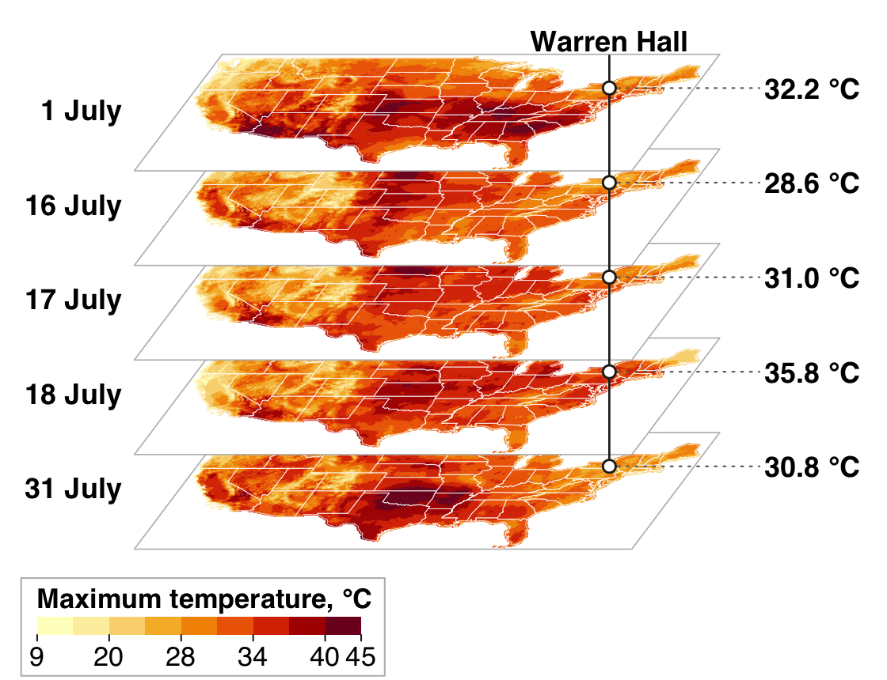{height="185px" fig-align="center"}

:::

::::

```{r}
#| label: layers
#| script: "One layer per day"
#| filename: "R Console, in the 24-spatial-rasters folder; i from the slide before; reads data_clean/tmax_july2012.tif"
tmax <- rast("data_clean/tmax_july2012.tif")    # the 31 daily grids of July 2012 in one file
nlyr(tmax)
names(tmax)[c(1, 2, 31)]
range(time(tmax))                               # the dates, stored as dates
dim(values(tmax))                               # cells by days
values(tmax)[i, 16:18]                          # Warren Hall's cell on 16, 17 and 18 July
```

[The file stores hundredths of a degree, so 30.977 reads 30.98. I built it from
PRISM's 31 daily files with tools/make_clean.R.]{.source}

::: {.content-visible unless-format="revealjs"}

I built `tmax_july2012.tif` from PRISM's 31 daily files with
`tools/make_clean.R`. **PRISM's day.** PRISM's documentation
([PRISM datasets](https://prism.oregonstate.edu/documents/PRISM_datasets.pdf))
defines a day as the 24 hours from 12:00 UTC on the day before to 12:00 UTC on
the date of the file. A daily maximum is reached in the afternoon, so it falls
in the file dated the next day. The stations agree: Syracuse, Rochester and
Binghamton peaked on 17 July 2012, a day before the layer dated 18 July. Death
Valley's 53.3 °C was on 11 July, in the layer dated 12 July. The wind of 18:00
UTC on 17 July falls in the temperature layer dated 18 July.

:::

## Cropping and masking to New York {#crop}

:::: {.columns}

::: {.column width="58%"}

::: {.slide-text}

`crop()` keeps the rectangle of cells around New York. `mask()` then sets the
cells outside the state to NA.

- The Census Bureau's county file has 3,235 counties, 62 of them in New York.
  The counties and the grid share one CRS, NAD83.
- The crop has 109 rows by 190 columns, and it renumbers the cells. Warren
  Hall's cell is now 11,669.

:::

:::

::: {.column width="40%"}

```{r}
#| label: crop-maps-figure
#| ref.label: [crop, crop-maps]
#| echo: false
#| purl: false
#| results: hide
#| fig-width: 5
#| fig-height: 2.2
#| out-width: "100%"
```

:::

::::

```{r}
#| label: crop
#| script: "Cropping and masking to New York"
#| filename: "R Console, in the 24-spatial-rasters folder; tmax from the slide before; reads data/census/cb_2024_us_county_500k.zip"
unzip("data/census/cb_2024_us_county_500k.zip", exdir = "data_clean/counties")
co  <- st_read("data_clean/counties/cb_2024_us_county_500k.shp", quiet = TRUE)   # county outlines
ny  <- co[co$STUSPS == "NY", ]                  # New York's 62 counties
st_crs(ny) == st_crs(tmax)                      # do the counties and the grid share one CRS?
tny <- crop(tmax, ny)                           # the cells inside New York's bounding box
dim(tny)
cellFromXY(tny, cbind(-76.4797, 42.4490))       # Warren Hall's cell number in the smaller grid
tny_in <- mask(tny, ny)                         # NA in every cell whose centre is outside New York
```

[The Census Bureau is the US statistics agency. A county is the level of
government below the state. The **bounding box** is the smallest rectangle around
the state.]{.source}

::: {.content-visible unless-format="revealjs"}

The two maps on the slide, from the layer dated 17 July. 16,572 cells hold a
temperature after the crop and 8,474 after the mask.

```{r}
#| label: crop-maps
#| script: "The crop and the mask on a map"
#| filename: "R Console, in the 24-spatial-rasters folder; tny, tny_in and ny from the slide before"
#| fig-show: hide
par(mfrow = c(1, 2))
plot(tny[["2012-07-17"]], main = "crop()", legend = FALSE, axes = FALSE); lines(vect(ny), lwd = 0.5)
plot(tny_in[["2012-07-17"]], main = "mask()", axes = FALSE); lines(vect(ny), lwd = 0.5)
c(crop = sum(!is.na(values(tny[["2012-07-17"]]))),
  mask = sum(!is.na(values(tny_in[["2012-07-17"]]))))
```

:::

## Daily temperature at Warren Hall {#point}

:::: {.columns}

::: {.column width="58%"}

::: {.slide-text}

`extract()` reads a point's cell in every layer. Warren Hall's hottest layer is
the one dated 18 July, at 35.8 °C.

- `project()` puts the point, built from longitude and latitude, in the grid's
  CRS.
- 13 of the 31 layers pass 30 °C. The month's mean is 29.9 °C.
- The same three lines serve any list of points, one row per point.

:::

:::

::: {.column width="40%"}

```{r}
#| label: point-plot-figure
#| ref.label: [point, point-plot]
#| echo: false
#| purl: false
#| results: hide
#| fig-width: 4.6
#| fig-height: 2.7
#| out-width: "100%"
```

:::

::::

```{r}
#| label: point
#| script: "Daily temperature at Warren Hall"
#| filename: "R Console, in the 24-spatial-rasters folder; tny from the slide before"
wh <- vect(cbind(lon = -76.4797, lat = 42.4490), crs = "EPSG:4326")   # Warren Hall: longitude first
wh <- project(wh, crs(tny))                     # the point in the grid's coordinate system
wh_t <- unlist(extract(tny, wh, ID = FALSE))    # the value of Warren Hall's cell in each layer
round(wh_t[16:19], 1)
data.frame(hottest = names(which.max(wh_t)), degrees = round(max(wh_t), 1),
           days_above_30 = sum(wh_t > 30))
```

[EPSG:4326 is the CRS of GPS coordinates. Web maps show latitude first, and
`vect()` takes longitude first.]{.source}

::: {.content-visible unless-format="revealjs"}

With longitude and latitude swapped, the point falls outside the grid and every
value is NA.

```{r}
#| label: point-plot
#| script: "Warren Hall's 31 days on a plot"
#| filename: "R Console, in the 24-spatial-rasters folder; tny and wh_t from the slide before"
#| fig-show: hide
par(mar = c(3, 4.2, 1, 1), las = 1, bty = "n")
plot(time(tny), wh_t, type = "b", pch = 19, xlab = "", ylab = "°C, Warren Hall's cell")
abline(h = 30, lty = 2)
text(time(tny)[which.max(wh_t)], max(wh_t), "35.8 °C", pos = 4)
```

:::

## Exercise 1 {#exercise-1}

::: {.panel-tabset}

### Exercise

The heat of July 2012 peaked on different days in different places.

4 minutes. Find the hottest July 2012 layer at a place you pick. `tmax` is the
stack of 31 days from the slides before.

1. Pick any spot in the lower 48 states on a web map. Right-click it to see its
   coordinates. Web maps show latitude first.
2. `p <- vect(cbind(lon = -73.9855, lat = 40.7580), crs = "EPSG:4326")` (Times
   Square; put your own numbers), then `p <- project(p, crs(tmax))`.
3. `x <- unlist(extract(tmax, p, ID = FALSE))`.
4. `names(which.max(x))`, `round(max(x), 1)` and `sum(x > 30)`.

```{r}
#| label: exercise-1
#| exercise: true
#| script: "Exercise 1 (4 minutes)"
#| include: false
#| eval: false
# Exercise 1 (4 minutes). The hottest July 2012 layer at a place you pick.
# The heat of July 2012 peaked on different days in different places.
# In the 24-spatial-rasters folder, with tmax as on the slides before
# (or run code/1_raster.R first).
# 1. Pick any spot in the lower 48 states on a web map; right-click it to see its coordinates
#    (web maps show latitude first).
# 2. p <- vect(cbind(lon = -73.9855, lat = 40.7580), crs = "EPSG:4326")   # Times Square
#    p <- project(p, crs(tmax))
# 3. x <- unlist(extract(tmax, p, ID = FALSE))
# 4. names(which.max(x)); round(max(x), 1); sum(x > 30)
# Compare with the class: the hottest day anyone found, with the place and the date.
```

[Compare with the class: the hottest day anyone found, with the place and the
date.]{.source}

### Solution

```{r}
#| label: exercise-1-solution
#| purl: false
#| filename: "R Console, in the 24-spatial-rasters folder; tmax from the slides before"
pl <- data.frame(name = c("Times Square", "Willis Tower, Chicago", "Des Moines",
                          "Furnace Creek, Death Valley", "Toronto"),
                 lon = c(-73.9855, -87.6359, -93.6250, -116.8669, -79.3832),
                 lat = c(40.7580, 41.8789, 41.5868, 36.4572, 43.6532))
p  <- project(vect(pl, geom = c("lon", "lat"), crs = "EPSG:4326"), crs(tmax))
X  <- as.matrix(extract(tmax, p, ID = FALSE))                       # places by days
data.frame(name = pl$name, hottest = names(tmax)[apply(X, 1, function(z) which.max(z)[1])],
           degrees = round(apply(X, 1, max), 1), days_above_30 = rowSums(X > 30))
```

[The hottest layer is dated 5 July in Chicago, 18 July in Ithaca and 26 July in
Des Moines. Each date is the day after the afternoon it records. Toronto returns
NA on every day. PRISM covers the lower 48 states, so its cells over Canada hold
no value.]{.source}

:::

::: {.notes}
On Zoom the answers go in the chat. Exercise 1 should be done by minute 20.
:::

# 2 · Raster calculations {#part-compute}

## Overview of part 2 {#overview-2}

::: {.slide-text}

How to compute a new grid from the grids we have.

:::

::::: {.columns}

:::: {.column width="58%"}

::: {.dashes}

- **Arithmetic cell by cell:** the 17 July layer against July's mean.
- **Counting days:** the days above 30 °C in each cell.
- **Wind speed and direction:** from the two wind layers, at Warren Hall.

:::

::::

:::: {.column width="40%"}

```{r}
#| label: overview-2-figure
#| ref.label: hot-days
#| echo: false
#| purl: false
#| results: hide
#| fig-width: 4.6
#| fig-height: 3.4
#| out-width: "100%"
```

[Later in this part: days above 30 °C across New York in July 2012, from 0 to
26.]{.source}

::::

:::::

::: {.content-visible unless-format="revealjs"}

## Arithmetic cell by cell {#use-arithmetic}

::::: {.columns}

:::: {.column width="52%"}

::: {.dashes}

- **Question:** [Miguel, Satyanath & Sergenti (Journal of Political Economy, 2004)](https://doi.org/10.1086/421174)
  asked whether a fall in income causes civil war in Africa.
- **Method:** Rain drives farm income. They averaged gridded rainfall over each
  country and year, then took the change from the year before. That change is
  their instrument for income growth.
- **Data:** rainfall from satellites and rain gauges on a 2.5-degree grid, for 41
  African countries, 1981 to 1999.
- **Result:** A fall of five percentage points in growth raised the chance of
  civil conflict the next year by one half.

:::

::::

:::: {.column width="46%"}

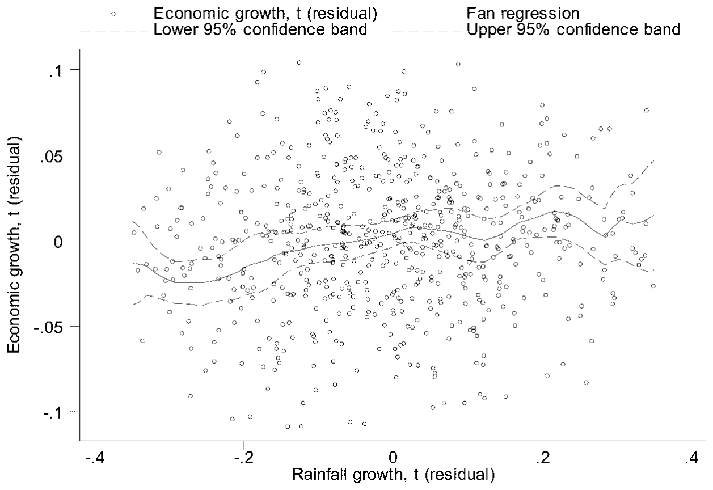{height="320px" fig-align="center"}

::::

:::::

[An **instrument** changes the treatment (here, income growth) and affects the
outcome (civil war) only through it. The figure is Figure 1 of the paper,
"Current economic growth rate on current rainfall growth", from the open copy on
Miguel's Berkeley page.]{.source}

:::

## 17 July minus July's mean {#difference}

::: {.slide-text}

Arithmetic on rasters works cell by cell. In the 17 July layer, New York's cells
ran from 1.2 °C below their July mean to 4.6 °C above.

:::

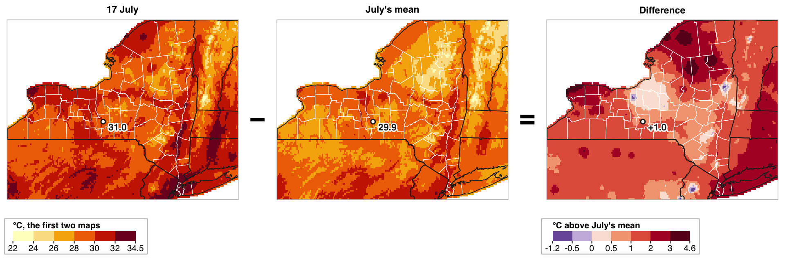{width="56%" fig-align="center"}

```{r}
#| label: difference
#| script: "17 July minus July's mean"
#| filename: "R Console, in the 24-spatial-rasters folder; tny, ny and wh from part 1"
#| fig-show: hide
t17 <- tny[["2012-07-17"]]
dev <- t17 - mean(tny)                          # mean() of a stack averages its 31 layers
round(range(values(dev), na.rm = TRUE), 1)
g <- c(t17, mean(tny), dev); names(g) <- c("day", "month_mean", "difference")   # c() stacks layers
round(unlist(extract(g, wh, ID = FALSE)), 1)    # Warren Hall
plot(g, nc = 3, fun = function() lines(vect(ny)))
```

[`tny` is July's 31 days cropped to New York and `wh` is Warren Hall's
point.]{.source}

::: {.notes}
If useful: the difference map shows round spots around weather stations. PRISM
estimates each cell from stations.
:::

## Counting days in each cell {#use-counting}

<!-- p_sr.png (corn panel of Figure 1, from the PMC copy) goes in a right-hand column once the PDF is saved -->

::: {.dashes}

- **Question:** [Schlenker & Roberts (PNAS, 2009)](https://doi.org/10.1073/pnas.0906865106)
  asked how temperature affects US corn, soybean and cotton yields.
- **Method:** They built daily temperatures on a 4 km grid. In each cell they
  counted the time spent in each 1 °C interval, then averaged each county's
  cropland cells.
- **Data:** county yields, 1950 to 2005, east of the 100th meridian for corn and
  soybeans.
- **Result:** Corn yields rise with temperature up to 29 °C and fall steeply
  above it. The threshold is 30 °C for soybeans and 32 °C for cotton.

:::

[A **yield** is the harvest per unit of land. The **100th meridian** runs through
the Great Plains.]{.source}

## Days above 30 °C in New York {#hot-days}

:::: {.columns}

::: {.column width="62%"}

::: {.slide-text}

`tny > 30` is TRUE or FALSE in every cell and day, and `sum()` counts the TRUE
days. New York's cells had 0 to 26 days above 30 °C.

- TRUE counts as 1 and FALSE as 0. `sum()` of a stack adds its layers in each
  cell and returns one layer.
- Warren Hall's cell gives 13, the count from its 31 values.
- The most days fall along the Hudson valley north of Albany and in New York
  City. The fewest are in the Adirondacks.

:::

:::

::: {.column width="36%"}

```{r}
#| label: hot-days-figure
#| ref.label: hot-days
#| echo: false
#| purl: false
#| results: hide
#| fig-width: 4.2
#| fig-height: 3.4
#| out-width: "100%"
```

:::

::::

```{r}
#| label: hot-days
#| script: "Days above 30 °C in New York"
#| filename: "R Console, in the 24-spatial-rasters folder; tny, ny and wh from part 1"
#| fig-show: hide
hot <- sum(tny > 30)                            # TRUE or FALSE per cell and day; sum() counts TRUE
range(values(hot), na.rm = TRUE)
unlist(extract(hot, wh, ID = FALSE))            # Warren Hall
plot(mask(hot, ny)); lines(vect(ny))
```

[`tny` is July's 31 days cropped to New York. 30 °C is a round number for this
example.]{.source}

::::: {.content-visible unless-format="revealjs"}

## Wind and temperature on different grids {#regrid}

:::: {.columns}

::: {.column width="38%"}

::: {.slide-text}

To use wind and temperature in the same cell, both must be on the same grid.

- Question: what was the wind in Warren Hall's temperature cell at 2 pm on 17
  July 2012?
- Temperature comes from PRISM on 4 km cells.
- Wind comes from ERA5 on 0.25-degree cells. One wind cell covers 36
  temperature cells.

:::

:::

::: {.column width="60%"}

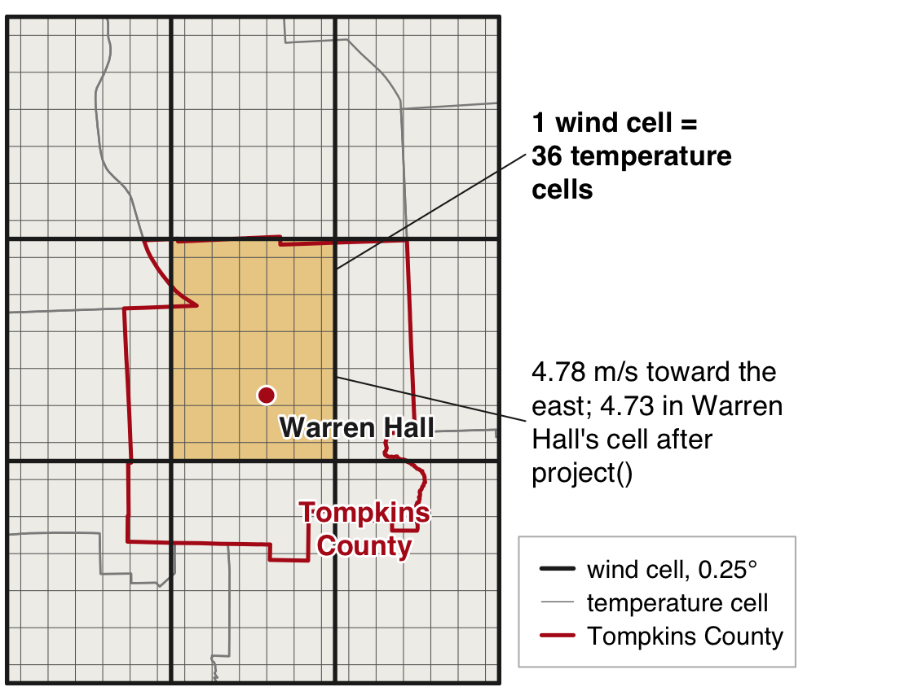{height="450px" fig-align="center"}

:::

::::

[ERA5 is the European weather centre's model run over past observations. A wind
cell is about 21 by 28 km at Ithaca.]{.source}

## Moving the wind onto the temperature grid {#regrid-code}

`project()` gives every temperature cell the wind of the cells around it. The
wind in Warren Hall's cell barely changes: 4.78 m/s before, 4.73 after.

```{r}
#| label: regrid
#| script: "Moving the wind onto the temperature grid"
#| filename: "R Console, in the 24-spatial-rasters folder; tny and wh from part 1; reads data_clean/u10_ny_20120717.tif"
u <- rast("data_clean/u10_ny_20120717.tif")     # wind toward the east, m/s, one layer per hour
res(u); res(tny)                                # cell size in degrees
compareGeom(u, tny, stopOnError = FALSE)        # do the two grids have the same cells?
u4 <- project(u[["18:00"]], tny)                # weighted mean of nearby wind cells, in tny's CRS
compareGeom(u4, tny, stopOnError = FALSE)
round(c(before = extract(u[["18:00"]], project(wh, crs(u)), ID = FALSE)[1, 1],
        after = extract(u4, wh, ID = FALSE)[1, 1]), 2)        # Warren Hall, m/s
```

[`compareGeom()` is TRUE when two grids have the same cells. 18 UTC is 2 pm at
Ithaca in July.]{.source}

:::::

## Wind speed and direction {#use-wind}

::::: {.columns}

:::: {.column width="52%"}

::: {.dashes}

- **Question:** [Deryugina, Heutel, Miller, Molitor & Reif (American Economic Review, 2019)](https://doi.org/10.1257/aer.20180279)
  asked how fine particles affect deaths among the elderly.
- **Method:** They computed the wind direction at each pollution monitor from
  the eastward and northward wind. Then they averaged each county's monitors by
  day. The direction brings pollution from elsewhere, so it is their instrument.
- **Data:** wind on a 32 km grid, and Medicare records by county and day, 1999
  to 2013.
- **Result:** One more microgram per cubic metre for one day caused 0.69 more
  deaths per million people over 65 within three days.

:::

::::

:::: {.column width="46%"}

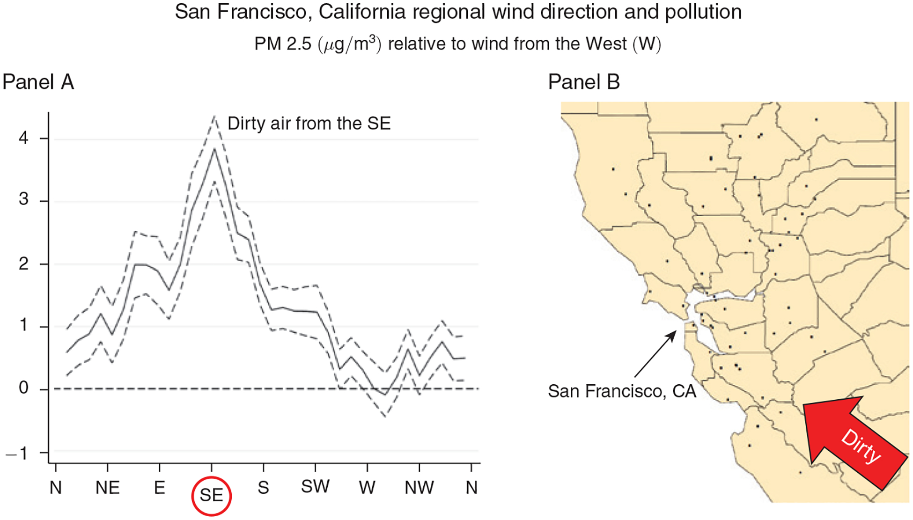{height="320px" fig-align="center"}

::::

:::::

[**Medicare** is US public health insurance for people 65 and over. **Fine
particles (PM2.5)** are smaller than 2.5 micrometres. The figure is Figure 2,
from PubMed Central. Its title is "Relationship between Daily Average Wind
Direction and PM2.5 Concentrations for Counties in and around the Bay Area,
CA".]{.source}

## The wind at Warren Hall {#wind}

:::: {.columns}

::: {.column width="60%"}

::: {.slide-text}

Wind comes as two layers: u toward the east and v toward the north. Speed is
`sqrt(u^2 + v^2)`, and `atan2()` gives the direction.

- At Warren Hall at 18 UTC on 17 July 2012, u was 4.8 m/s and v was 1.2 m/s.
  That is 17.7 km/h from 256°, a little south of west.
- A wind is named by where it comes from. Directions count clockwise from north:
  0 north, 90 east, 180 south, 270 west.

:::

:::

::: {.column width="38%"}

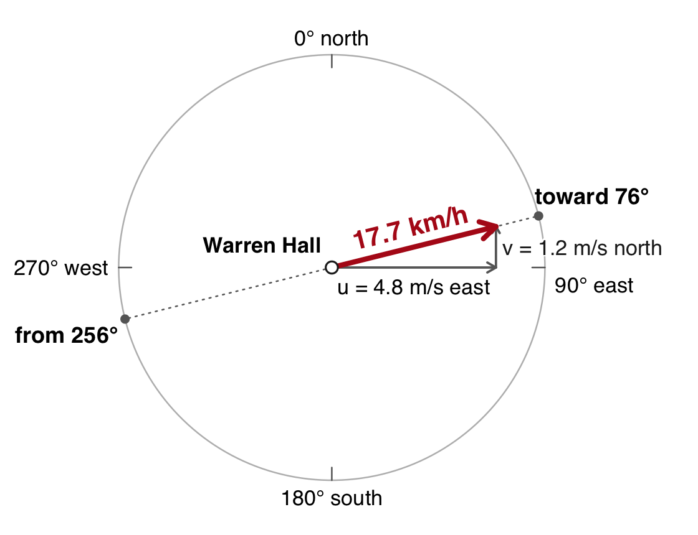{height="240px" fig-align="center"}

:::

::::

```{r}
#| label: wind
#| script: "The wind at Warren Hall"
#| filename: "R Console, in the 24-spatial-rasters folder; wh from part 1; reads the two wind files in data_clean/"
u    <- rast("data_clean/u10_ny_20120717.tif")  # wind toward the east, metres per second, one layer per hour
v10  <- rast("data_clean/v10_ny_20120717.tif")  # wind toward the north, metres per second
kmh  <- sqrt(u^2 + v10^2) * 3.6                 # speed: 1 metre per second is 3.6 km/h
from <- (atan2(-u, -v10) * 180 / pi) %% 360     # where the wind comes from, clockwise from north
now  <- c(u[["18:00"]], v10[["18:00"]], kmh[["18:00"]], from[["18:00"]])
names(now) <- c("u", "v", "kmh", "from")
round(unlist(extract(now, project(wh, crs(u)), ID = FALSE)), 1)    # Warren Hall at 18:00 UTC
```

[ERA5 is a weather model run over past observations, on 0.25-degree cells. 18 UTC
is 2 pm at Ithaca in July.]{.source}

::: {.notes}
Average u and v first, then compute the direction. Two winds from 350° and 10°
average to north, and their two angles average to 180°. Practice task 6 shows
it on the 24 hours.
:::

::: {.content-visible unless-format="revealjs"}

## Four more uses of a grid {#more-uses}

Each of these uses comes with a published study and R on New York's grid.

**The cell as the unit of observation.**
[Harari & La Ferrara (Review of Economics and Statistics, 2018)](https://doi.org/10.1162/rest_a_00730)
studied conflict on a grid of cells covering Africa, 1997 to 2011. Each cell
and year is one row of their data. `as.data.frame()` turns a grid into that
table: one row per cell with a value, with its longitude and latitude.

```{r}
#| label: cells-as-rows
#| script: "The cell as the unit of observation"
#| filename: "R Console, in the 24-spatial-rasters folder; t17 and tny from the slides before"
dim(as.data.frame(t17, xy = TRUE))              # x, y and the value
dim(as.data.frame(tny, xy = TRUE))              # x, y and one column per day
```

**The cells around each cell.**
[Burchfield, Overman, Puga & Turner (Quarterly Journal of Economics, 2006)](https://doi.org/10.1162/qjec.2006.121.2.587)
measured the undeveloped land around each urban dwelling on 30 m cells.
`focal()` computes a summary of the cells around each cell, here the mean of
the 3 by 3 block.

```{r}
#| label: focal
#| script: "The cells around each cell"
#| filename: "R Console, in the 24-spatial-rasters folder; t17 and wh from the slides before"
fo <- focal(t17, w = 3, fun = "mean")           # mean of each cell and its eight neighbours
round(c(cell = extract(t17, wh, ID = FALSE)[1, 1], around = extract(fo, wh, ID = FALSE)[1, 1]), 2)
```

**Categories in cells.**
[Burgess, Hansen, Olken, Potapov & Sieber (Quarterly Journal of Economics, 2012)](https://doi.org/10.1093/qje/qjs034)
counted the forest cells cleared each year in Indonesia, from satellites.
`classify()` turns numbers into categories and `freq()` counts the cells in
each. Here the cropland grid of part 4 is cut into four classes over New York.

```{r}
#| label: classify
#| script: "Categories in cells"
#| filename: "R Console, in the 24-spatial-rasters folder; ny from the slides before; reads data_clean/cropland_2011.tif"
cr  <- rast("data_clean/cropland_2011.tif")                  # percent of each cell under crops
nyw <- project(vect(ny), crs(cr))                            # New York in the grid's CRS
cl  <- classify(mask(crop(cr, nyw), nyw), c(-Inf, 1, 25, 50, Inf))   # four classes
f   <- freq(cl)
data.frame(class = c("1% or less", "1 to 25%", "25 to 50%", "over 50%"),
           percent_of_cells = round(100 * f$count / sum(f$count), 1))
```

**Gridded products that disagree.**
[Auffhammer, Hsiang, Schlenker & Sobel (Review of Environmental Economics and Policy, 2013)](https://doi.org/10.1093/reep/ret016)
compare the gridded weather products economists use. They differ most where
stations are few, so the choice of product can move an estimate.

:::

# 3 · Combining rasters and polygons {#part-aggregate}

## Overview of part 3 {#overview-3}

::: {.slide-text}

How to average a grid's cells over each county. A summary of the cells inside
each county is a **zonal statistic**.

:::

::::: {.columns}

:::: {.column width="58%"}

::: {.dashes}

- **The problem:** yields, deaths and incomes come by county. Weather comes by
  cell.
- **The packaged function:** one mean per county, and the time it takes.
- **Inside the function:** the cells of Tompkins County, and Exercise 2.
- **Every county and every day:** all 3,109 counties of the lower 48 states.
- **Other weights:** people in place of area.

:::

::::

:::: {.column width="40%"}

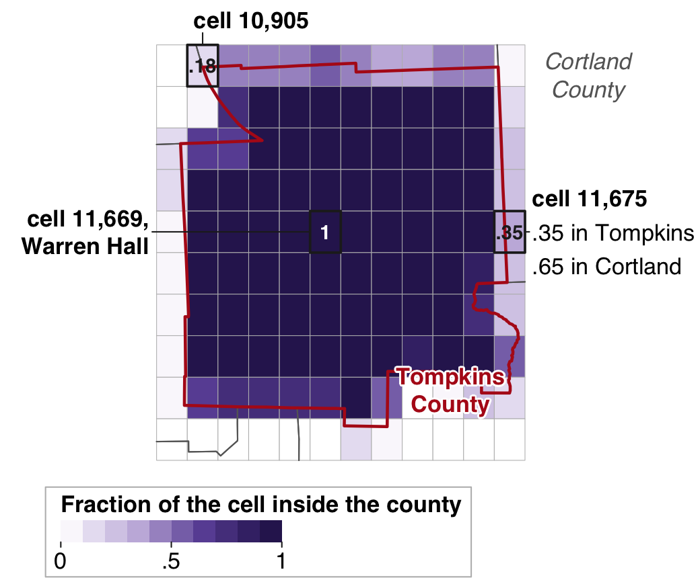{height="250px" fig-align="center"}

[Later in this part: the 107 cells that Tompkins County touches.]{.source}

::::

:::::

## County averages of gridded weather {#use-zonal}

::::: {.columns}

:::: {.column width="52%"}

::: {.dashes}

- **Question:** [Deschênes & Greenstone (American Economic Review, 2007)](https://doi.org/10.1257/aer.97.1.354)
  asked how climate change would affect US farm profits.
- **Method:** For rainfall they laid a land-use map over PRISM's 4 km cells and
  averaged the farmland cells of each county. Temperature came from weather
  stations. Then they compared each county's profits in its hotter and cooler
  years.
- **Data:** the Census of Agriculture of 1987 to 2002, PRISM for rainfall, and
  about 8,000 stations for temperature.
- **Result:** Predicted warming would raise yearly farm profits by about $1.3
  billion, or 4%.

:::

::::

:::: {.column width="46%"}

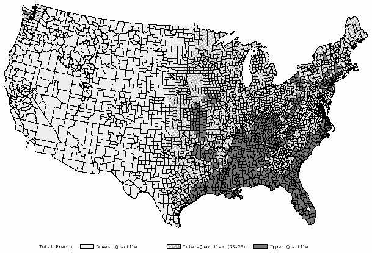{height="300px" fig-align="center"}

::::

:::::

[A **zonal statistic** is a summary of the cells inside each zone, here the mean
over a county. The map is Figure 2B of the working paper (NBER 10663), "Average
Growing Season Total Precipitation, by County 1970-2000".
[Fisher, Hanemann, Roberts & Schlenker (American Economic Review, 2012)](https://doi.org/10.1257/aer.102.7.3749)
later found errors in the paper's county weather data.]{.source}

## County means with extract() {#extract}

:::: {.columns}

::: {.column width="58%"}

::: {.slide-text}

`extract()` with county outlines and `fun = mean` returns one mean per county.
In the 17 July layer Tompkins County's was 29.28 °C.

- `exact = TRUE` counts a cell cut by the county line by the fraction of it
  inside the county.
- `na.rm = TRUE` leaves out cells with no value. Without it, Erie and Jefferson
  counties get NA from their cells over the Great Lakes.
- The 62 means run from 28.2 °C (Hamilton, in the Adirondacks) to 32.8 °C
  (Richmond, which is Staten Island).

:::

:::

::: {.column width="40%"}

```{r}
#| label: extract-map-figure
#| ref.label: extract
#| echo: false
#| purl: false
#| results: hide
#| fig-width: 4.6
#| fig-height: 3.4
#| out-width: "100%"
```

:::

::::

```{r}
#| label: extract
#| script: "County means with extract()"
#| filename: "R Console, in the 24-spatial-rasters folder; t17 and ny from the slides before"
#| fig-show: hide
ny$t17 <- extract(t17, ny, fun = mean, exact = TRUE, na.rm = TRUE, ID = FALSE)[, 1]
round(ny$t17[ny$GEOID == "36109"], 2)           # Tompkins County
round(range(ny$t17), 1)
plot(ny["t17"], main = "")
```

[`t17` is the 17 July layer over New York and `ny` is its 62 counties. GEOID is
the county code. 36109 is New York (36) and Tompkins (109).]{.source}

::: {.content-visible unless-format="revealjs"}

Without `na.rm = TRUE`,
Erie and Jefferson are NA, and 46 counties of the lower 48 states are NA
nationally. Without `exact = TRUE`, `extract()` uses the 78 cells whose centre is
inside Tompkins County and gives 29.30 °C.

```{r}
#| label: extract-checks
#| script: "Without na.rm, and with cell centres"
#| filename: "R Console, in the 24-spatial-rasters folder; ny and t17 from the slide before"
#| warning: false
m0 <- extract(t17, ny, fun = mean, exact = TRUE, ID = FALSE)[, 1]   # without na.rm = TRUE
ny$NAME[is.na(m0)]
cc <- extract(t17, ny[ny$GEOID == "36109", ], ID = FALSE)   # the cells whose centre is inside
c(cells = nrow(cc), mean = round(mean(cc[, 1]), 2))
```

:::

## Timing extract() on every US county {#timing}

::: {.slide-text}

One call takes about 30 seconds, for 1 day of temperature or for 31. Three calls
take three times as long.

- I timed `extract()` with `exact = TRUE`, as on the slide before, on the 3,109
  counties of the lower 48 states.
- The time follows the number of calls. The number of days hardly matters.
- At this rate, one call a month for 30 years takes about 3 hours.

:::

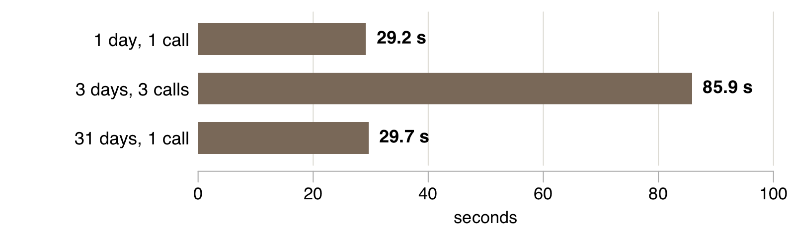{width="84%" fig-align="center"}

[A **call** is one run of `extract()`. I measured each case once on my laptop
with tools/time_methods.R. The figure reads data_clean/timings.csv.]{.source}

::: {.notes}
His question: "31 days in one call cost the same as one day. Three calls cost
three times as much. So what does the function spend its time on?" Let them
answer. The answer: the geometry of each call, which is finding the cells of
each county and the fraction of each inside. Extra layers cost almost nothing.
One call a day for a year would take about 3 hours (365 times 29 s is 2.9 hours,
not measured).
:::

::: {.content-visible unless-format="revealjs"}

`tools/time_methods.R` timed four ways of averaging July 2012 over the 3,109
counties, once each, and saved the seconds. `exact_extract()` comes from the
exactextractr package. `extract()` without `exact = TRUE` uses cell centres.

```{r}
#| label: timings
#| script: "The timings I measured"
#| filename: "R Console, in the 24-spatial-rasters folder; reads data_clean/timings.csv"
read.csv("data_clean/timings.csv")
```

:::

## The cells of Tompkins County {#fractions}

:::: {.columns}

::: {.column width="40%"}

::: {.slide-text}

Tompkins County touches 107 cells. 58 lie wholly inside it, and the county line
cuts the other 49.

- The **coverage fraction** is the share of a cell's area inside the county. A
  whole cell has 1.
- Three cells are labelled with their number and fraction.
- The fractions times the cells' areas sum to 1,273.0 km². The Census Bureau
  gives 1,273.1 km² of land and water.

:::

:::

::: {.column width="58%"}

{height="430px" fig-align="center"}

:::

::::

::: {.content-visible unless-format="revealjs"}

The area check, with `cellSize()`, which gives each cell's area in km². `tab` is
the table built on the next slide. The Census Bureau's 1,273.1 km² is 1,229.3 of
land plus part of Cayuga Lake.

```{r}
#| label: area-check
#| script: "The area of Tompkins County from its cells"
#| filename: "R Console, in the 24-spatial-rasters folder; t17 and ny from the slides before"
tk  <- ny[ny$GEOID == "36109", ]
tab <- exact_extract(t17, tk, include_cell = TRUE, progress = FALSE)[[1]]
a   <- cellSize(t17, unit = "km")[tab$cell][, 1]     # each cell's area, km2
round(c(from_cells = sum(a * tab$coverage_fraction), census = (tk$ALAND + tk$AWATER) / 1e6), 1)
```

:::

## The table of cells and fractions {#table}

::: {.slide-text}

`exact_extract()` with `include_cell = TRUE` returns the table the mean is
computed from: one row per cell that Tompkins County touches.

- `value` is the cell's temperature in the 17 July layer.
- `cell` is the cell's number in New York's grid `t17`.
- `coverage_fraction` is the share of the cell inside the county.

:::

```{r}
#| label: table
#| script: "The table of cells and fractions"
#| filename: "R Console, in the 24-spatial-rasters folder; t17 and ny from the slides before; exactextractr loaded"
#| fig-show: hide
tk  <- ny[ny$GEOID == "36109", ]                            # Tompkins County
tab <- exact_extract(t17, tk, include_cell = TRUE)[[1]]     # one row per cell the county touches
head(tab, 3)
c(cells = nrow(tab), whole = sum(tab$coverage_fraction == 1),
  partial = sum(tab$coverage_fraction < 1))
f <- rast(t17)                                              # an empty grid with the same cells
f[tab$cell] <- tab$coverage_fraction                        # the fractions go in by cell number
plot(crop(f, tk, snap = "out")); lines(vect(tk))
```

[The result is a list with one table per county, and `[[1]]` is Tompkins. The
last three lines draw the map on the slide before.]{.source}

::: {.notes}
His 2025 questions. On `head(tab)`: "What do you think you are seeing here?"
Then: "How could you verify that the cells that supposedly fall on top of a
county are the correct ones?" His 2025 answer: give those cells a value and plot
the grid, which is what the last three lines do. A second answer is the area sum
on the slide before (code on the page).
:::

::: {.content-visible unless-format="revealjs"}

terra returns the same table: `extract()` with `cells = TRUE` and `exact = TRUE`
gives ID, value, cell and fraction, 107 rows.

```{r}
#| label: terra-table
#| script: "terra's own table"
#| filename: "R Console, in the 24-spatial-rasters folder; t17 and tk from the slide before"
head(extract(t17, tk, cells = TRUE, exact = TRUE), 3)
nrow(extract(t17, tk, cells = TRUE, exact = TRUE))
```

:::

## Tompkins County's mean by hand {#by-hand}

::: {.slide-text}

The county mean is a weighted mean. Multiply each cell's temperature by its
fraction, add the products, and divide by the sum of the fractions.

- A **weighted mean** is an average in which some values count more than
  others.
- By hand: 29.279 °C, the number `extract()` returned.

:::

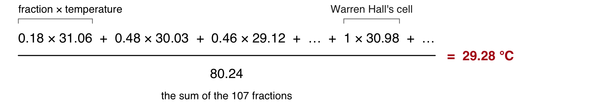{width="80%" fig-align="center"}

```{r}
#| label: by-hand
#| script: "Tompkins County's mean by hand"
#| filename: "R Console, in the 24-spatial-rasters folder; tab and ny from the slides before"
x <- tab$value; w <- tab$coverage_fraction
sum(w * x) / sum(w)                             # value times fraction, over the sum of fractions
ny$t17[ny$GEOID == "36109"]                     # extract()'s answer for Tompkins County
mean(x)                                         # every cell counted as whole
```

::: {.notes}
Analogy if useful: a course grade is a weighted mean, since the final counts
more than one homework.
:::

## Exercise 2 {#exercise-2}

::: {.panel-tabset}

### Exercise

4 minutes. Compute Tompkins County's mean temperature on each of the 31 days of
July 2012. Use `tab`, the table of the county's 107 cells, and `tny`, the 31
daily grids. Do not call `extract()` or `exact_extract()` again.

1. Print `head(tab)`. Decide which of its three columns would change on another
   day.
2. `Mny <- values(tny)`, then `dim(Mny)`. Row k of `Mny` is cell k of `tny`, and
   column d is day d.
3. Start with one day. 17 July is column 17 of `Mny`. Compute its weighted mean
   from `Mny`, `tab$cell` and `tab$coverage_fraction`. You should get 29.28.
4. Now compute all 31.

```{r}
#| label: exercise-2
#| exercise: true
#| script: "Exercise 2 (4 minutes)"
#| include: false
#| eval: false
# Exercise 2 (4 minutes). Tompkins County's mean on each of the 31 days, from the one table of cells
# and fractions. Do not call extract() or exact_extract() again.
# In the 24-spatial-rasters folder, with tny, tab and w as on the slides before
# (or run code/3_aggregate.R up to this exercise).
# 1. head(tab): which of its three columns would change on another day?
# 2. Mny <- values(tny); dim(Mny)      # row k is cell k of tny, column d is day d
# 3. One day first: 17 July is column 17 of Mny. Its weighted mean from Mny, tab$cell and
#    tab$coverage_fraction should be 29.28.
# 4. Now all 31.
# Compare with the class: the county's mean on 18 July, its hottest day. Then say what you had to
# compute again for each new day.
```

[Compare with the class: the county's mean on 18 July, its hottest day. Then say
what you had to compute again for each new day.]{.source}

### Solution

The cells and their fractions depend only on the county's outline and the grid.
Only the temperatures change from day to day. So the table is computed once and
serves all 31 days.

```{r}
#| label: exercise-2-solution
#| purl: false
#| filename: "R Console, in the 24-spatial-rasters folder; tny, tab and w from the slides before"
Mny  <- values(tny)                             # 20,710 cells by 31 days
dim(Mny)
sum(w * Mny[tab$cell, 17]) / sum(w)             # one day: 17 July is column 17
tk31 <- numeric(31); names(tk31) <- names(tny)
for (d in 1:31) tk31[d] <- sum(w * Mny[tab$cell, d]) / sum(w)   # the same line, once per day
round(tk31[16:19], 2)
data.frame(hottest = names(which.max(tk31)), degrees = round(max(tk31), 1),
           days_above_30 = sum(tk31 > 30))
```

[The hottest layer is dated 18 July, at 34.1 °C. The county's mean passed 30 °C
on 8 days, and Warren Hall's cell passed it on 13.
`colSums(w * Mny[tab$cell, ]) / sum(w)` gives the same 31 means in one
line.]{.source}

:::

::: {.notes}
Exercise 2 should start by minute 42. On Zoom the answers go in the chat.
:::

## The 31 daily means as a matrix product {#product}

::: {.slide-text}

The 31 weighted means are one matrix product: a row of 107 weights times a
matrix of 107 cells by 31 days.

- The weights are the fractions over their sum. `%*%` multiplies the row by each
  column and adds the products.

:::

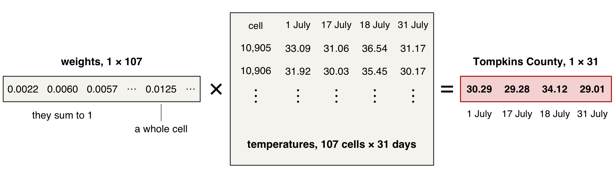{width="60%" fig-align="center"}

```{r}
#| label: product
#| script: "The 31 daily means as a matrix product"
#| filename: "R Console, in the 24-spatial-rasters folder; tny, tab and w from the slides before"
Mny <- values(tny)                              # 20,710 cells by 31 days
w1  <- matrix(w / sum(w), nrow = 1)             # the weights as one row that sums to 1
dim(w1); dim(Mny[tab$cell, ])
out <- w1 %*% Mny[tab$cell, ]                   # (1 by 107) times (107 by 31) gives 1 by 31
round(out[1, 16:19], 2)
```

::: {.notes}
His 2025 questions, in his order, before the next slide: "We want every county
at once: counties by days = P times M. M has 872,505 rows and 31 columns. What
do we need? What are the dimensions of P?" Then: "So how does P need to look?"
:::

## The weight matrix P {#P}

:::: {.columns}

::: {.column width="40%"}

::: {.slide-text}

For every county at once, the weights go in one matrix P, with a row per county
and a column per cell.

- For the lower 48 states P has 3,109 rows and 872,505 columns.
- Row 2,063 is Tompkins County, with 107 weights and 872,398 zeros.
- The figure draws New York's P: 62 rows, 20,710 columns, a dot for each weight.

:::

:::

::: {.column width="58%"}

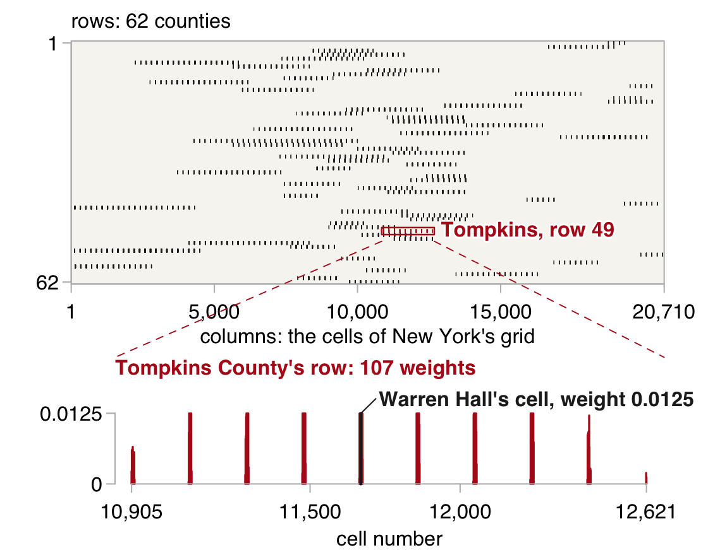{height="460px" fig-align="center"}

:::

::::

::: {.notes}
His question: "P has one row per county and one column per cell, and nearly
every entry is zero. How should R store it?" Two slides on, the answer.
:::

## The table of cells for every county {#P-table}

The table of cells and fractions for all 3,109 counties takes about 3 seconds.
Its weights are the entries of P.

```{r}
#| label: P-table
#| script: "The weight matrix P"
#| filename: "R Console, in the 24-spatial-rasters folder; co and tmax from part 1; exactextractr loaded"
low  <- co[!(co$STUSPS %in% c("AK", "HI", "PR", "GU", "VI", "AS", "MP")), ]    # lower 48 and DC
info <- exact_extract(tmax[[1]], low, include_cell = TRUE, progress = FALSE)   # a table per county
tabN <- data.frame(county = rep(1:nrow(low), sapply(info, nrow)),
                   do.call(rbind, info))        # stack the 3,109 tables into one
tabN <- tabN[!is.na(tabN$value), ]              # cells over water hold no temperature
tabN$w <- tabN$coverage_fraction / ave(tabN$coverage_fraction, tabN$county, FUN = sum)
c(counties = length(unique(tabN$county)), rows = nrow(tabN))
range(tapply(tabN$w, tabN$county, sum))         # each county's weights sum to 1
```

[`rep()` writes each county's number once per cell. `ave(x, g, FUN = sum)` puts
each county's sum on every row of that county.]{.source}


::: {.content-visible unless-format="revealjs"}

The figure draws New York's own P: 62 rows by 20,710 columns, with the rows
stretched to strips about 4 px tall, a dot at each of its 9,975 entries that are
not zero (0.78%), and Tompkins County's row in red. 567,158 of the national P's
2.7 billion entries are not zero (0.02%). The national P is the same
picture with 3,109 rows and 872,505 columns. 121 rows of the national table are
cells with no temperature. 82,544 cells lie on a county line and have a weight
in more than one row. The 2024 Census file counts Connecticut's nine planning
regions, so older files give 3,108 counties.

```{r}
#| label: P-table-checks
#| script: "The national table, counted"
#| filename: "R Console, in the 24-spatial-rasters folder; info and tabN from the slide before"
c(all_rows = sum(sapply(info, nrow)), kept = nrow(tabN),
  dropped = sum(sapply(info, nrow)) - nrow(tabN))
sum(table(tabN$cell) > 1)                       # cells with a weight in more than one county
which(low$GEOID == "36109")                     # Tompkins County's row
```

:::

## Sparse matrices {#sparse}

::: {.slide-text}

A sparse matrix stores only the entries that are not zero: each one's row, column
and value.

- The example has two counties, Tompkins and Cortland, and four cells of New
  York's grid.
- Cell 11,675 lies 35% in Tompkins and 65% in Cortland.
- Five of the eight entries are not zero, so the table on the right has five
  rows.

:::

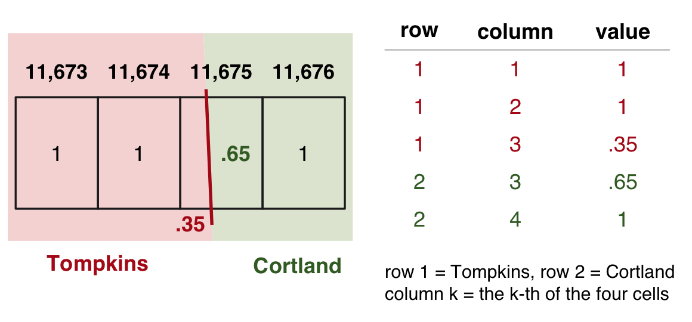{width="78%" fig-align="center"}

## P as a sparse matrix {#sparse-P}

::: {.slide-text}

P holds every county's cell weights. It takes 10.3 MB as a sparse matrix,
against 21.7 GB as an ordinary matrix.

- `i` is the county's row, `j` the cell's number and `x` the weight.
- The first call builds the small example. Dots are zeros.

:::

```{r}
#| label: sparse
#| script: "P as a sparse matrix"
#| filename: "R Console, in the 24-spatial-rasters folder; tabN, low and tmax from the slide before"
sparseMatrix(i = c(1, 1, 1, 2, 2), j = c(1, 2, 3, 3, 4), x = c(1, 1, 0.35, 0.65, 1), dims = c(2, 4))
P <- sparseMatrix(i = tabN$county, j = tabN$cell, x = tabN$w, dims = c(nrow(low), ncell(tmax)))
c(rows = nrow(P), columns = ncol(P), not_zero = nnzero(P))
round(c(sparse_MB = as.numeric(object.size(P)) / 1e6, ordinary_GB = prod(dim(P)) * 8 / 1e9), 1)
```

[`tabN` is the table of every county's cells and weights, and `low` is the 3,109
counties. A number takes 8 bytes: 3,109 × 872,505 × 8 bytes is 21.7 GB.]{.source}

::: {.content-visible unless-format="revealjs"}

Both sizes are in decimal units. `format(object.size(P), "Mb")` gives 9.8 Mb,
the same object in binary units.

:::

## Every county's mean on every day {#P-times-M}

:::: {.columns}

::: {.column width="64%"}

::: {.slide-text}

`P %*% M` returns every county's mean on every day, 3,109 counties by 31 days.
It takes a few hundredths of a second once M is read.

- M is July's 31 layers as a matrix, 872,505 cells by 31 days (about 220 MB).
- Tompkins County's row matches the means computed by hand.
- With P built, a month costs one `values()` (1.3 seconds) and the product.

:::

:::

::: {.column width="34%"}

```{r}
#| label: P-times-M-figure
#| ref.label: [P-times-M, P-times-M-map]
#| echo: false
#| purl: false
#| results: hide
#| fig-width: 4.6
#| fig-height: 3.2
#| out-width: "100%"
```

:::

::::

```{r}
#| label: P-times-M
#| script: "Every county's mean on every day"
#| filename: "R Console, in the 24-spatial-rasters folder; P, low and tmax from the slides before"
M <- values(tmax)                               # 872,505 cells by 31 days
system.time(cd <- P %*% M)                      # counties by days
round(cd[low$GEOID == "36109", 16:19], 2)       # Tompkins County
ee <- exact_extract(tmax, low, "mean", progress = FALSE)    # the packaged function, all 31 days
max(abs(as.matrix(cd) - as.matrix(ee)))         # the largest difference between the two, degrees C
```

::: {.notes}
P holds the table of cells once. A new weight, such as people or cropland,
changes one line. For the month, `exact_extract()` took 1.2 seconds and terra's
`extract()` 30. Clock: if Exercise 2 ended after minute 52, skip the next two
slides (area and population weights).
:::

::: {.content-visible unless-format="revealjs"}

The map on the slide is the column of `cd` for the layer dated 18 July 2012. The
hottest county mean that day is 40.2 °C, in Ottawa County, Kansas. `cd` has no
NA.

```{r}
#| label: P-times-M-map
#| script: "Every county's mean on 18 July, on a map"
#| filename: "R Console, in the 24-spatial-rasters folder; low and cd from the slide before"
#| fig-show: hide
low$t18 <- as.vector(cd[, "2012-07-18"])
plot(low["t18"], main = "°C, layer dated 18 July 2012", border = NA)
```

**A year of days.** `values()` on 365 national layers needs about 2.5 GB. Read
one month at a time, multiply P by it, and bind the columns.

:::

## Area weights or population weights {#use-people}

::::: {.columns}

:::: {.column width="52%"}

::: {.dashes}

- **Question:** Does a hotter year slow a country's economic growth?
  [Dell, Jones & Olken (American Economic Journal: Macroeconomics, 2012)](https://doi.org/10.1257/mac.4.3.66)
  asked it of 125 countries.
- **Method:** They averaged the temperature cells of each country and year,
  weighting each cell by its 1990 population. Area weights serve as a second
  version.
- **Data:** monthly temperature on a 0.5-degree grid (University of Delaware),
  1950 to 2003.
- **Result:** In poor countries a year 1 °C hotter lowers growth by about 1.3
  percentage points. Rich countries show no robust effect.

:::

::::

:::: {.column width="46%"}

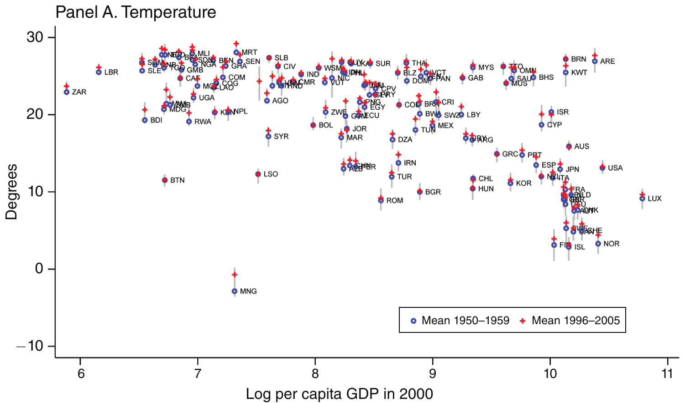{height="320px" fig-align="center"}

::::

:::::

[Area weights give the temperature of the land. Population weights give the
temperature where people live. The figure is panel A of Figure 1, "Changes and
Variability in Temperature and Precipitation", from the published version on
MIT's economics page.]{.source}

## Population weights in P {#people}

:::: {.columns}

::: {.column width="62%"}

::: {.slide-text}

Population weights change only the entries of P. Each cell's fraction is
multiplied by the people who live in the cell.

- Monterey County, California, averaged 28.3 °C in July 2012 by area and
  20.5 °C by people. Tompkins County moves little.
- `project()` moves the people onto the temperature grid. `method = "sum"`
  keeps their number.

:::

:::

::: {.column width="36%"}

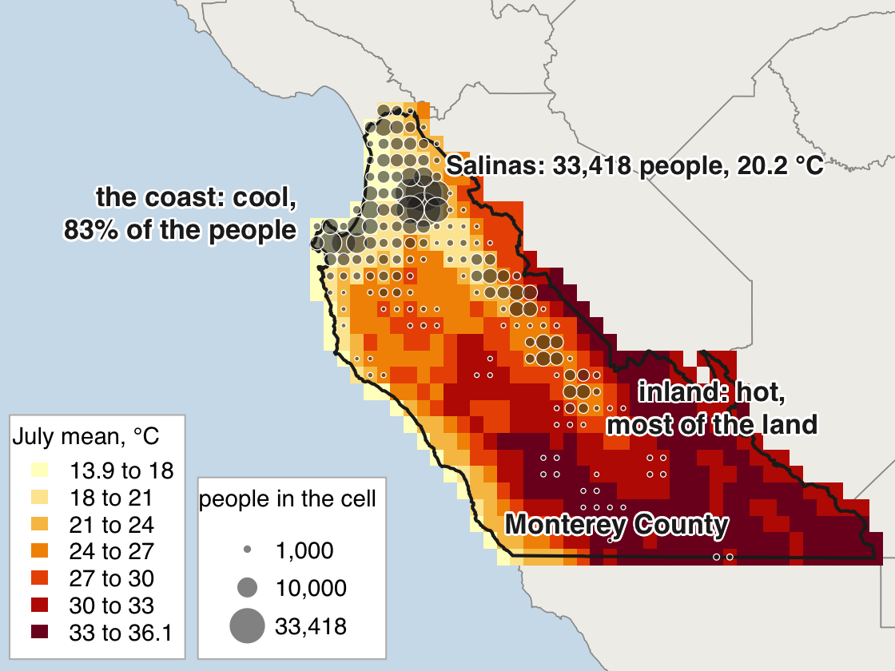{height="210px" fig-align="center"}

:::

::::

```{r}
#| label: people
#| script: "Population weights in P"
#| filename: "R Console, in the 24-spatial-rasters folder; objects from part 3; reads data_clean/pop_2010.tif"
popg <- project(rast("data_clean/pop_2010.tif"), tmax, method = "sum")  # people in each cell
tabN$wp <- tabN$coverage_fraction * values(popg)[tabN$cell]             # people in the part inside
tabN$wp <- tabN$wp / ave(tabN$wp, tabN$county, FUN = sum)               # sum to 1 in each county
Pp  <- sparseMatrix(i = tabN$county, j = tabN$cell, x = tabN$wp, dims = dim(P))
cdp <- Pp %*% M
k <- match(c("36109", "06053"), low$GEOID)      # Tompkins, New York and Monterey, California
data.frame(county = low$NAME[k], by_area = round(rowMeans(cd[k, ]), 1),
           by_people = round(rowMeans(cdp[k, ]), 1))        # July means, degrees C
```

[`tabN` is the table of cells and fractions for the 3,109 counties in `low`. `M`
is the 31 days as a matrix. The counts are the Gridded Population of the World
for 2010.]{.source}

::: {.notes}
The weight follows the question. Health and labour outcomes call for people,
crops for cropland, and area answers a question about land. Clock: part 4
should start by minute 58.
:::

::: {.content-visible unless-format="revealjs"}

In Monterey County 83% of the people live in the 21% of the area that averaged
under 24 °C, near the coast. No county comes out NA under these weights. Warren
Hall's cell has 1.2% of Tompkins County's area weight and 12% of its people.

**Moving counts between grids.** A count is summed when cells are merged, and a
share is averaged. The population file sums to 356.6 million before
`project(method = "sum")` and 354.3 million after, because the file's box
reaches into Canada and Mexico.

```{r}
#| label: people-checks
#| script: "People before and after the move"
#| filename: "R Console, in the 24-spatial-rasters folder; popg and cdp from the slide before"
pop0 <- rast("data_clean/pop_2010.tif")
round(c(before = global(pop0, "sum", na.rm = TRUE)[1, 1],
        after = global(popg, "sum", na.rm = TRUE)[1, 1]) / 1e6, 1)       # millions of people
sum(is.na(as.matrix(cdp)))                                               # counties with no value
```

:::

# 4 · An application to heat and corn yields {#part-corn}

## Overview of part 4 {#overview-4}

::: {.slide-text}

Whether the counties with more heat lost more corn yield in 2012.

:::

::::: {.columns}

:::: {.column width="58%"}

::: {.dashes}

- **The event:** the heat wave and drought of 2012 in the Corn Belt, the
  Midwestern states that grow most US corn.
- **Heat:** degrees above 29 °C in each cell, added over July.
- **Cropland:** the share of each cell under crops, as the weight.
- **The comparison:** county heat against the change in corn yield, 1,391
  counties.

:::

::::

:::: {.column width="40%"}

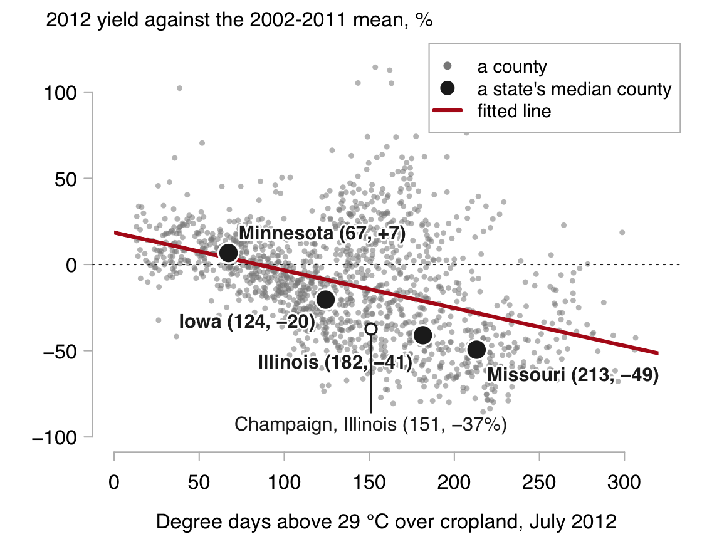{height="250px" fig-align="center"}

[Later in this part: each county's heat against its 2012 corn yield.]{.source}

::::

:::::

## The 2012 heat wave and corn yields {#yields}

::: {.slide-text}

In 2012 corn yields fell across the Corn Belt. Illinois's median county
harvested 41% less per acre than its 2002 to 2011 mean.

- I ask whether the counties with more July heat over their cropland lost more
  yield.
- I use PRISM's temperatures, a cropland grid from satellites and USDA county
  corn yields.

:::

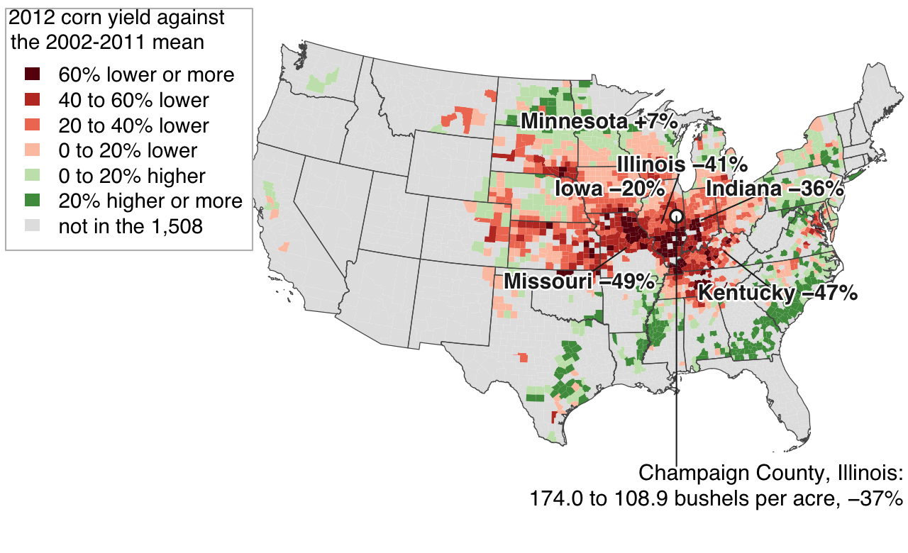{width="52%" fig-align="center"}

[USDA is the US Department of Agriculture. A bushel of corn weighs 25.4 kg and an
acre is 0.4 hectare. The map shows the 1,508 counties with a 2012 yield and at
least 8 earlier years.]{.source}

::: {.content-visible unless-format="revealjs"}

Each county's 2012 yield against its own 2002 to 2011 mean, from the Department
of Agriculture's survey. Reading GEOID as character keeps the leading zeros of
codes such as 01001. The median change over the 1,508 counties is -9.5%.

```{r}
#| label: yields
#| script: "The 2012 yield against each county's 2002 to 2011 mean"
#| filename: "R Console, in the 24-spatial-rasters folder; low from part 3; reads data_clean/corn_yield_2002_2012.csv"
y    <- read.csv("data_clean/corn_yield_2002_2012.csv", colClasses = c(GEOID = "character"))
yw   <- tapply(y$yield, list(y$GEOID, y$year), mean)                 # counties by years
base <- rowMeans(yw[, as.character(2002:2011)], na.rm = TRUE)        # each county's 2002-2011 mean
nb   <- rowSums(!is.na(yw[, as.character(2002:2011)]))               # years reported out of ten
chg  <- 100 * (yw[, "2012"] / base - 1)                              # 2012 against that mean, %
chg[nb < 8] <- NA
low$chg <- chg[match(low$GEOID, names(chg))]
c(report_2012 = sum(!is.na(yw[, "2012"])), with_8_years = sum(!is.na(low$chg)))
```

:::

## Heat above 29 °C in each cell {#heat}

:::: {.columns}

::: {.column width="40%"}

::: {.slide-text}

Heat is each day's degrees above 29 °C, added over the 31 days of July 2012.

- A **degree day** is one degree above the threshold for one day. A day at
  35.8 °C counts 6.8, and a day at 28 °C counts 0.
- Warren Hall's cell has 48.3 degree days.
- The largest total, 555, is in Death Valley, California.

:::

:::

::: {.column width="58%"}

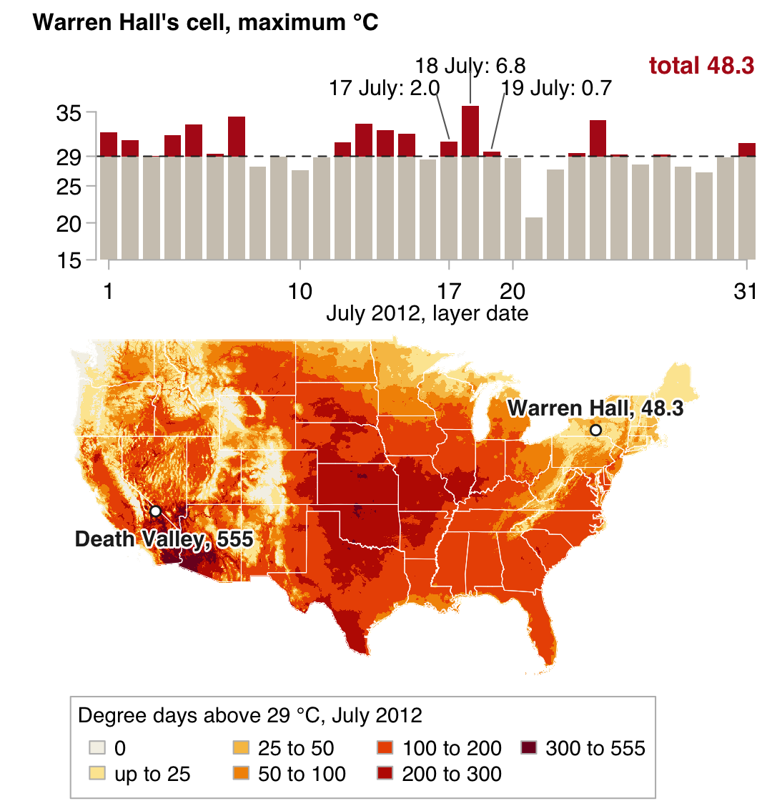{height="440px" fig-align="center"}

:::

::::

[29 °C is corn's threshold in [Schlenker & Roberts (PNAS, 2009)](https://doi.org/10.1073/pnas.0906865106).]{.source}

## Degree days from the 31 layers {#heat-code}

::: {.slide-text}

`(tmax - 29) * (tmax > 29)` is each day's degrees above 29 °C. `sum()` adds the 31
days in each cell.

- `(tmax > 29)` is 1 on days above 29 °C and 0 on the others, so cooler days add
  nothing.
- The heat runs from 0 to 555 degree days across the lower 48 states.

:::

```{r}
#| label: heat
#| script: "Degree days from the 31 layers"
#| filename: "R Console, in the 24-spatial-rasters folder; tmax (July's 31 layers) and wh (Warren Hall) from part 1"
heat <- sum((tmax - 29) * (tmax > 29))          # each day's degrees above 29, summed over 31 days
round(range(values(heat), na.rm = TRUE))
round(unlist(extract(heat, wh, ID = FALSE)), 1) # Warren Hall
```

[On a stack, `max()` returns one layer, the largest value across the 31 days, so
the heat is written as a sum.]{.source}

::: {.content-visible unless-format="revealjs"}

**The heat as a matrix.** `max(tmax - 29, 0)` has one layer, the month's
largest excess. The same grid comes from the matrix `M`, row by row, in a fraction
of a second.

```{r}
#| label: heat-matrix
#| script: "The heat as a matrix"
#| filename: "R Console, in the 24-spatial-rasters folder; tmax, M and heat from the slides before"
nlyr(max(tmax - 29, 0))                         # one layer: a different quantity
system.time(hm <- rowSums(pmax(M - 29, 0)))     # the same heat, from the matrix of cells by days
max(abs(hm - values(heat)[, 1]), na.rm = TRUE)
```

:::

## Cropland on the temperature grid {#cropland}

:::: {.columns}

::: {.column width="58%"}

::: {.slide-text}

The cropland grid has 3 km cells and the temperature grid 4 km cells. `project()`
with `method = "average"` gives each temperature cell the mean cropland share
over it.

- Each cropland cell holds the percent of its land under crops, from 0 to 100.
- Warren Hall's cell is 4.5% cropland. The cell at the centre of Story County,
  Iowa, is 86.6%.

:::

:::

::: {.column width="40%"}

```{r}
#| label: cropland-map-figure
#| ref.label: [cropland, cropland-map]
#| echo: false
#| purl: false
#| results: hide
#| fig-width: 4.6
#| fig-height: 2.8
#| out-width: "100%"
```

:::

::::

```{r}
#| label: cropland
#| script: "Cropland on the temperature grid"
#| filename: "R Console, in the 24-spatial-rasters folder; tmax and wh from part 1; reads data_clean/cropland_2011.tif"
crops <- rast("data_clean/cropland_2011.tif")   # percent of each cell under crops, 0 to 100
res(crops)
cropg <- project(crops, tmax, method = "average")   # the average share over each temperature cell
round(unlist(extract(cropg, wh, ID = FALSE)), 1)    # Warren Hall's cell, percent under crops
```

[The University of Maryland's GLAD laboratory classified satellite images of
2008 to 2011 ([Potapov et al., Nature Food, 2022](https://doi.org/10.1038/s43016-021-00429-z)).
A share is averaged when it moves to larger cells, and a count would be
summed.]{.source}

::: {.content-visible unless-format="revealjs"}

The two grids differ before the move and match after it.

```{r}
#| label: cropland-map
#| script: "Cropland on a map, and the two grids compared"
#| filename: "R Console, in the 24-spatial-rasters folder; crops, cropg and tmax from the slide before"
#| fig-show: hide
compareGeom(crops, tmax, stopOnError = FALSE)
compareGeom(cropg, tmax, stopOnError = FALSE)
unzip("data/census/cb_2024_us_state_500k.zip", exdir = "data_clean/states")
st <- st_read("data_clean/states/cb_2024_us_state_500k.shp", quiet = TRUE)
plot(cropg, axes = FALSE, col = hcl.colors(50, "YlGn", rev = TRUE))
lines(vect(st[st$STUSPS %in% low$STUSPS, ]), lwd = 0.4)
```

:::

## County heat over cropland {#heat-cropland}

::: {.slide-text}

Each weight is now the cell's fraction in the county times its cropland share.
In part 3 it was the fraction alone.

- Champaign, Illinois: 151 degree days by either weight.
- Sequatchie, Tennessee: 105 over cropland, 78 over the county.

:::

```{r}
#| label: heat-cropland
#| script: "County heat over cropland"
#| filename: "R Console, in the 24-spatial-rasters folder; tabN, P and low from part 3; heat and cropg from the slides before"
tabN$wc <- tabN$coverage_fraction * values(cropg)[tabN$cell]   # fraction times cropland share
tabN$wc <- tabN$wc / ave(tabN$wc, tabN$county, FUN = sum)      # 0/0 in a county with no cropland
Pc <- sparseMatrix(i = tabN$county, j = tabN$cell, x = tabN$wc, dims = dim(P))
low$heat      <- as.vector(Pc %*% values(heat))                # heat over each county's cropland
low$heat_area <- as.vector(P %*% values(heat))                 # heat over the whole county
k <- match(c("17019", "47153"), low$GEOID)                     # Champaign, IL and Sequatchie, TN
data.frame(county = low$NAME[k], over_cropland = round(low$heat[k], 1),
           whole_county = round(low$heat_area[k], 1))
```

[`tabN` is the table of every county's cells and fractions. `P` is the matrix of
area weights, and `low` is the 3,109 counties.]{.source}

::: {.content-visible unless-format="revealjs"}

Champaign County is 93% cropland. Nine counties have no cropland, so their heat
is NaN, R's mark for 0/0. None of them reports a corn yield.

The table of cells and fractions is the one built for temperature, and only the
weights change. The map shows the heat over each county's
cropland, east of the 100th meridian. The nine counties with no cropland are Loving (Texas); Lake,
Park, Jackson, Clear Creek, San Juan and Gilpin (Colorado); Monroe (Florida);
and Keweenaw (Michigan). Tompkins County has 24.8 degree days over its cropland
and 24.2 over the county.

```{r}
#| label: heat-cropland-map
#| script: "County heat over cropland, on a map"
#| filename: "R Console, in the 24-spatial-rasters folder; low from the slide before"
east <- low[st_coordinates(st_centroid(st_geometry(low)))[, 1] > -100, ]   # east of 100 W
plot(east["heat"], main = "", border = NA, key.pos = 1,                     # the key below the map
     breaks = seq(0, 320, 40), pal = hcl.colors(8, "YlOrRd", rev = TRUE))     # light to dark: more heat
sum(is.na(low$heat))                                    # counties with no cropland
paste(low$NAME, low$STUSPS)[is.na(low$heat)]
```

:::

## Hotter counties lost more corn yield {#scatter}

::: {.slide-text}

Counties with more heat over their cropland lost more of their corn yield.
Across 1,391 counties the correlation is -0.42.

:::

:::: {.columns}

::: {.column width="44%"}

::: {.slide-text}

- Each dot is a county east of the 100th meridian with a 2012 yield, at least 8
  earlier years and some cropland.
- The fitted line falls 2.2 percentage points for every 10 degree days.
- Missouri's median county had 213 degree days and lost 49%. Minnesota's had 67
  and gained 7%.

:::

:::

::: {.column width="54%"}

{height="330px" fig-align="center"}

:::

::::

[Drought struck the same counties in 2012, so the slope mixes heat and drought.
West of the 100th meridian much of the corn is irrigated.]{.source}

::: {.notes}
Clock: part 5 should start by minute 66.
:::

::: {.content-visible unless-format="revealjs"}

The merge and the fit. With area weights the correlation is also -0.42. R² is
0.175, and 467 of the 1,391 counties (34%) lost more than a quarter of their
yield.

```{r}
#| label: fit
#| script: "Heat against the yield change"
#| filename: "R Console, in the 24-spatial-rasters folder; low with heat and chg from the slides before"
lon <- st_coordinates(st_centroid(st_geometry(low)))[, 1]      # each county's centre, longitude
d   <- st_drop_geometry(low[!is.na(low$chg) & !is.na(low$heat) & lon > -100, ])
fit <- lm(chg ~ heat, d)
c(counties = nrow(d), correlation = round(cor(d$heat, d$chg), 2), slope = round(coef(fit)[[2]], 2))
round(tapply(d$chg, d$STUSPS, median)[c("MO", "KY", "IL", "IN", "IA", "MN")])
```

:::

# 5 · An application to the Eaton fire {#part-eaton}

## Overview of part 5 {#overview-5}

::: {.slide-text}

How many people lived downwind of the Eaton fire.

:::

::::: {.columns}

:::: {.column width="58%"}

::: {.dashes}

- **The picture:** a satellite image of Los Angeles on 9 January 2025.
- **The wind:** its speed and direction at the fire, from two layers.
- **Downwind:** the population cells within 100 km in the wind's direction.
- **The count:** the people who live in those cells.

:::

::::

:::: {.column width="40%"}

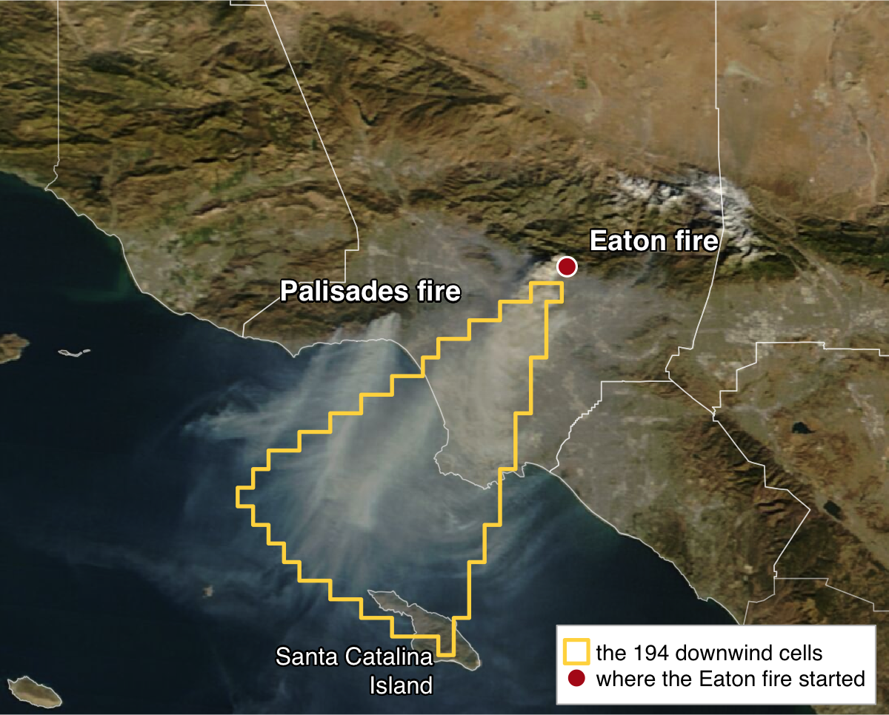{height="250px" fig-align="center"}

[Later in this part: the downwind cells drawn over the smoke.]{.source}

::::

:::::

## The Eaton fire on 9 January 2025 {#eaton}

:::: {.columns}

::: {.column width="44%"}

::: {.slide-text}

The Eaton fire started on the evening of 7 January 2025 in the hills north of Los
Angeles. Two days later NASA's Terra satellite photographed its smoke over the
city.

- I ask which way the wind blew at the fire that morning, and how many people
  lived downwind.
- The picture is a raster with four layers. `plotRGB()` draws the first three as
  red, green and blue.

:::

:::

::: {.column width="54%"}

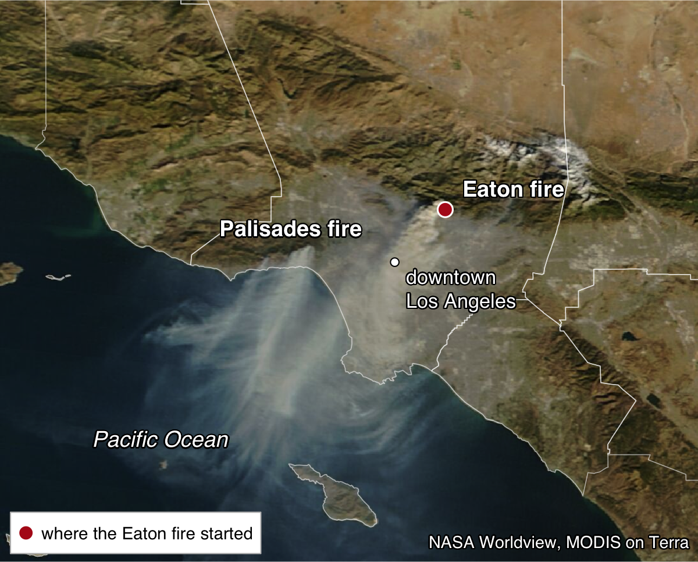{height="300px" fig-align="center"}

:::

::::

```{r}
#| label: eaton
#| script: "The Eaton fire on 9 January 2025"
#| filename: "R Console, in the 24-spatial-rasters folder; reads data/nasa/worldview_terra_20250109.tif"
#| fig-show: hide
img  <- rast("data/nasa/worldview_terra_20250109.tif")         # NASA's Terra, 9 January 2025
dim(img)                                                       # rows, columns, layers
fire <- vect(cbind(lon = -118.069155, lat = 34.203483), crs = "EPSG:4326")   # the fire's origin
plotRGB(img); points(fire, pch = 21, bg = "red", col = "white", cex = 1.6)
```

[The red dot is where the fire started, from CAL FIRE, California's state fire
agency. The plume at the coast, to the west, is the Palisades fire. NASA
Worldview, MODIS on Terra.]{.source}

::: {.content-visible unless-format="revealjs"}

**Where the picture came from.** NASA Worldview serves each day's true-colour
picture from the MODIS instrument on the Terra satellite. Terra passed over the
fire at about 17:20 to 17:25 UTC on 9 January 2025, about 9:20 am in Los Angeles.
CAL FIRE gives the start at 6:18 pm on 7 January, at 34.203483 N, 118.069155 W.
The Palisades fire started at 10:30 am the same day. The picture's fourth layer
marks the cells with data.

:::

## The wind at the fire at 10 am {#wind-fire}

:::: {.columns}

::: {.column width="58%"}

::: {.slide-text}

At 10 am on 9 January the wind at the fire blew at 9.7 km/h. It came from the
north-east (36°) and blew toward the south-west (216°).

- The two layers and the formulas are those used at Warren Hall. 18 UTC is
  10 am in Los Angeles in January.
- u = -1.6 means 1.6 m/s toward the west. v = -2.2 means 2.2 m/s toward the
  south.

:::

:::

::: {.column width="40%"}

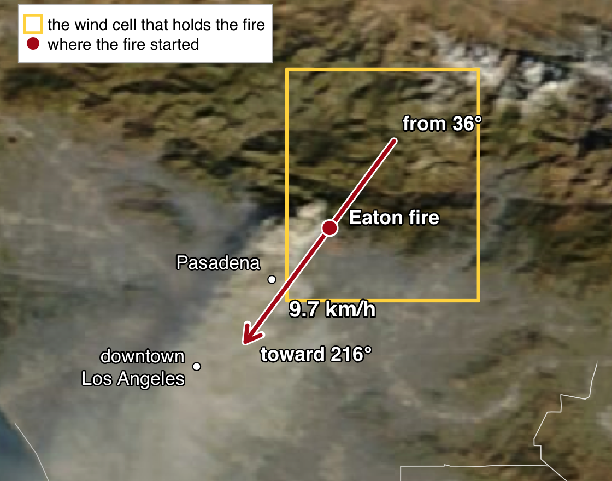{height="240px" fig-align="center"}

:::

::::

```{r}
#| label: wind-fire
#| script: "The wind at the fire at 10 am"
#| filename: "R Console, in the 24-spatial-rasters folder; fire from the slide before; reads the two wind files in data_clean/"
u_la <- rast("data_clean/u10_la_20250109.tif")                 # wind toward the east, by hour
v_la <- rast("data_clean/v10_la_20250109.tif")                 # wind toward the north
uf <- extract(u_la[["18:00"]], fire, ID = FALSE)[1, 1]         # 18:00 UTC is 10 am in Los Angeles
vf <- extract(v_la[["18:00"]], fire, ID = FALSE)[1, 1]
to <- (atan2(uf, vf) * 180 / pi) %% 360                        # the direction the wind blows toward
round(c(u = uf, v = vf, kmh = sqrt(uf^2 + vf^2) * 3.6,
        from = (atan2(-uf, -vf) * 180 / pi) %% 360, toward = to), 1)
```

[A wind cell here is about 23 km by 28 km. It averages the mountains and the
basin, so it smooths the gusts in the canyons.]{.source}

::: {.notes}
Overnight on 8 January ERA5 gives 19 to 23 km/h from 22° to 30°, far below the
gusts that stations recorded. At 17:00 UTC (9 am) the wind is 10.2 km/h from
29°, toward 209°.
:::

## The cells downwind of the fire {#downwind}

:::: {.columns}

::: {.column width="60%"}

::: {.slide-text}

A cell is downwind when it lies within 100 km of the fire and within 20° of the
wind's direction. 194 of the 2,166 cells in the picture qualify, 73 on land.

- Each cell has a distance from the fire and a **bearing**, its direction from
  the fire clockwise from north.
- I chose 100 km and 20°. Practice task 12 changes both.

:::

:::

::: {.column width="38%"}

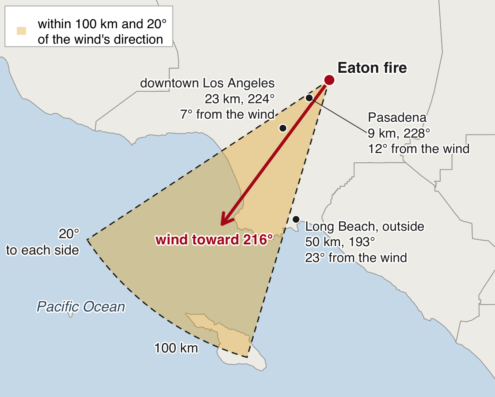{height="200px" fig-align="center"}

:::

::::

```{r}
#| label: downwind
#| script: "The cells downwind of the fire"
#| filename: "R Console, in the 24-spatial-rasters folder; img, fire and to from the slides before; reads data_clean/pop_2010.tif"
people <- crop(rast("data_clean/pop_2010.tif"), img)           # people per cell, 2010
km    <- values(distance(people, fire))[, 1] / 1000            # km from the fire to each cell
xy    <- xyFromCell(people, 1:ncell(people))                   # each cell's centre: lon, lat
east  <- (xy[, 1] - crds(fire)[1]) * cos(crds(fire)[2] * pi / 180)   # degrees east, shrunk at 34 N
north <-  xy[, 2] - crds(fire)[2]                              # degrees north of the fire
bear  <- (atan2(east, north) * 180 / pi) %% 360                # direction from the fire to the cell
gap   <- abs((bear - to + 180) %% 360 - 180)                   # degrees away from the wind
down  <- km <= 100 & gap <= 20
c(cells = ncell(people), downwind = sum(down))
```

[At latitude 34° a degree of longitude is 0.83 of a degree of latitude. The code
multiplies the east-west difference by the cosine of the latitude.]{.source}

::: {.notes}
The `gap` line measures the angle the short way round, so 350° and 10° are 20°
apart.
:::

## 3.6 million people lived downwind {#people-downwind}

:::: {.columns}

::: {.column width="52%"}

::: {.slide-text}

3.6 million people lived in the downwind cells in 2010, of the 16.7 million in
the picture. That is 22%.

- The yellow outline holds the 194 downwind cells. It covers the Eaton fire's
  smoke from the foothills to Santa Catalina Island.
- The population grid counts people per cell, so the answer is a sum. Cells over
  the ocean are NA.

:::

:::

::: {.column width="46%"}

{height="270px" fig-align="center"}

:::

::::

```{r}
#| label: people-downwind
#| script: "3.6 million people lived downwind"
#| filename: "R Console, in the 24-spatial-rasters folder; people and down from the slide before"
n <- values(people)[, 1]
round(c(downwind = sum(n[down], na.rm = TRUE), in_the_picture = sum(n, na.rm = TRUE)))
round(100 * sum(n[down], na.rm = TRUE) / sum(n, na.rm = TRUE), 1)
```

[The outline comes from the wind and the fire's location alone, and the picture
was taken about 40 minutes before the wind's hour. Smoke can pass high overhead,
so ground monitors measure the air people breathed.]{.source}

::: {.content-visible unless-format="revealjs"}

The plume that starts at the coast is the Palisades fire's. It drifts into the
outline over the ocean. The Eaton smoke leaves the fire toward the west for the
first few kilometres, left of the outline's tip. The code that draws the outline
over the picture:

```{r}
#| label: downwind-picture
#| script: "The downwind cells over the picture"
#| filename: "R Console, in the 24-spatial-rasters folder; img, fire, people and down from the slides before"
#| fig-width: 7
#| fig-height: 5.6
dw <- rast(people); values(dw) <- ifelse(down, 1, NA)          # 1 downwind, NA elsewhere
plotRGB(img); lines(as.polygons(dw), col = "yellow", lwd = 2)
points(fire, pch = 21, bg = "red", col = "white", cex = 1.6)
```

:::

## Practice {#practice}

::: {.content-visible when-format="revealjs"}

The session page has twelve practice tasks, with solutions you can open. They
run in the 24-spatial-rasters folder after the slides' code.

- **1–3** One grid: the hottest day in each New York cell · the hottest and
  coolest cell on one day · days above 32 °C
- **4–6** Raster calculations: days above 35 °C across the country · the month's
  range in each cell · the wind at Warren Hall hour by hour
- **7–9** Rasters and polygons: cell centres against exact fractions · a weight
  matrix for New York's 62 counties · a table of cells used on the wrong grid
- **10–11** Weights: counting hot days before and after averaging · the
  counties that population weights move most
- **12** The Eaton fire with another angle, distance and hour, and heat and corn
  with a 32 °C threshold

:::

::: {.content-hidden when-format="revealjs"}

```{r}
#| label: practice
#| exercise: true
#| script: "Practice"
#| eval: false
# Practice. Run in the 24-spatial-rasters folder after the slides' code has built
# tmax, tny, tny_in, ny, wh, i, t17, u, v10, tab, w, low, tabN, P, M, cd, cdp, heat, cropg,
# fire, u_la, v_la, people, km, bear, gap and n.

# One grid
#  1. The hottest day in each New York cell: which.max(tny_in) returns, in each cell, the number
#     of its hottest layer. Which layers are hottest in the most cells?
#  2. The hottest and the coolest cell of New York in the layer dated 18 July (tny_in):
#     which.max(values(...)) and which.min(), then xyFromCell(). Which counties are they in?
#  3. Days above 32 °C in each New York cell, sum(tny_in > 32): the range, the share of cells
#     with five or more, and Warren Hall's cell.
# Raster calculations
#  4. Days above 35 °C across the country, sum(tmax > 35): the share of cells with at least one,
#     the share with all 31, Warren Hall and St. Louis (-90.1848, 38.6247).
#  5. The month's range in each New York cell, max(tny_in) - min(tny_in). Where is it largest?
#  6. The wind at Warren Hall hour by hour: the speed at each of the 24 hours from u and v10.
#     The strongest and weakest hour, the mean of the 24 speeds, and the speed and direction
#     of the mean u and mean v.
# Rasters and polygons
#  7. Cell centres against exact fractions: extract(t17, ny, fun = mean, na.rm = TRUE) without
#     exact = TRUE. Which New York counties move most? How many cell centres does New York
#     County (Manhattan) have, and how many cells does it touch?
#  8. A weight matrix for New York's 62 counties on tny's 20,710 cells, built as P was.
#     The hottest and coolest county-day, and each county's days with a mean above 30 °C.
#  9. Use tab, the table of Tompkins County's cells in New York's grid, on the national matrix M:
#     sum(w * M[tab$cell, 17]) / sum(w). What comes out, and where is cell 10,905 in each grid?
# Weights
# 10. Counting hot days before and after averaging: P %*% (M > 30), with NA set to 0, against
#     the days each county's mean is above 30. Compare Tompkins and Santa Barbara, California.
# 11. The counties that population weights move most: the July mean by people minus by area.
#     Which four move most, and in what share of counties do the two differ by more than 1 °C?
# The two applications
# 12. The Eaton fire with 30° and 100 km, with 20° and 50 km, and with the wind at 12:00 UTC.
#     Heat and corn with a 32 °C threshold: Tompkins and Champaign, with area weights.
```

::: {.callout-tip collapse="true"}

## Solutions

```{r}
#| label: practice-solutions
#| purl: false
#| collapse: true
#| warning: false
# 1. The hottest layer in each New York cell, in percent of the cells
wm <- values(which.max(tny_in))[, 1]
round(100 * sort(table(wm), decreasing = TRUE)[1:4] / sum(!is.na(wm)), 1)   # layers 18, 19, 7, 15
# 2. The hottest and coolest cell in the layer dated 18 July
v18 <- values(tny_in[["2012-07-18"]])[, 1]
hc  <- c(hottest = which.max(v18), coolest = which.min(v18))
pts <- st_as_sf(data.frame(xyFromCell(tny_in, hc)), coords = c("x", "y"), crs = st_crs(ny))
data.frame(degrees = round(v18[hc], 1), round(xyFromCell(tny_in, hc), 2),
           county = st_join(pts, ny["NAME"])$NAME)
# 3. Days above 32 °C
h32 <- sum(tny_in > 32)
range(values(h32), na.rm = TRUE)
round(100 * mean(values(h32)[, 1] >= 5, na.rm = TRUE), 1)
extract(h32, wh, ID = FALSE)[1, 1]
# 4. Days above 35 °C across the country
h35 <- values(sum(tmax > 35))[, 1]
round(100 * c(at_least_one = mean(h35 >= 1, na.rm = TRUE), all_31 = mean(h35 == 31, na.rm = TRUE)), 1)
stl <- project(vect(cbind(-90.1848, 38.6247), crs = "EPSG:4326"), crs(tmax))
c(warren_hall = h35[i], st_louis = extract(sum(tmax > 35), stl, ID = FALSE)[1, 1])
# 5. The month's range in each New York cell
rg <- max(tny_in) - min(tny_in)
round(range(values(rg), na.rm = TRUE), 1)
round(extract(rg, wh, ID = FALSE)[1, 1], 1)
# 6. The wind at Warren Hall, hour by hour
whu <- project(wh, crs(u))
uh  <- unlist(extract(u, whu, ID = FALSE)); vh <- unlist(extract(v10, whu, ID = FALSE))
sp  <- sqrt(uh^2 + vh^2) * 3.6
data.frame(strongest = names(which.max(sp)), kmh = round(max(sp), 1),
           weakest = names(which.min(sp)), kmh_min = round(min(sp), 1), mean_kmh = round(mean(sp), 1))
round(c(kmh_of_mean_wind = sqrt(mean(uh)^2 + mean(vh)^2) * 3.6,
        from = (atan2(-mean(uh), -mean(vh)) * 180 / pi) %% 360), 1)
# 7. Cell centres against exact fractions
cen <- extract(t17, ny, fun = mean, na.rm = TRUE, ID = FALSE)[, 1]
head(sort(setNames(round(abs(cen - ny$t17), 3), ny$NAME), decreasing = TRUE), 2)
man <- ny[ny$NAME == "New York", ]
c(centres = nrow(extract(t17, man, ID = FALSE)),
  touched = nrow(exact_extract(t17, man, include_cell = TRUE, progress = FALSE)[[1]]))
# 8. A weight matrix for New York
infoN <- exact_extract(t17, ny, include_cell = TRUE, progress = FALSE)
tn <- data.frame(county = rep(1:nrow(ny), sapply(infoN, nrow)), do.call(rbind, infoN))
tn <- tn[!is.na(tn$value), ]
tn$w <- tn$coverage_fraction / ave(tn$coverage_fraction, tn$county, FUN = sum)
Pn <- sparseMatrix(i = tn$county, j = tn$cell, x = tn$w, dims = c(nrow(ny), ncell(tny)))
Mn <- values(tny); Mn[is.na(Mn)] <- 0                 # cells with no value carry no weight
cn <- as.matrix(Pn %*% Mn)
c(dim(Pn), not_zero = nnzero(Pn))
hi <- which(cn == max(cn), arr.ind = TRUE); lo <- which(cn == min(cn), arr.ind = TRUE)
c(ny$NAME[hi[1]], names(tny)[hi[2]], round(max(cn), 1), ny$NAME[lo[1]], names(tny)[lo[2]], round(min(cn), 1))
rowSums(cn > 30)[match(c("Richmond", "Tompkins", "Hamilton"), ny$NAME)]
# 9. A table of cells used on the wrong grid
sum(w * M[tab$cell, 17]) / sum(w)                     # NaN: in the national grid these cells lie in Canada
rbind(new_york_grid = xyFromCell(tny, 10905), national_grid = xyFromCell(tmax, 10905))
# 10. Hot days before and after averaging
M0 <- (M > 30) * 1; M0[is.na(M0)] <- 0
before <- rowSums(as.matrix(P %*% M0)); after <- rowSums(as.matrix(cd) > 30)
k2 <- match(c("36109", "06083"), low$GEOID)           # Tompkins and Santa Barbara
data.frame(county = low$NAME[k2], before = round(before[k2], 1), after = after[k2])
round(100 * mean(abs(before - after) > 2), 1)
# 11. The counties that population weights move most
df <- rowMeans(as.matrix(cdp)) - rowMeans(as.matrix(cd)); o <- order(df)
data.frame(county = low$NAME[o], state = low$STUSPS[o], people_minus_area = round(df[o], 1))[c(1:3, length(o)), ]
round(c(pct_over_1C = 100 * mean(abs(df) > 1), median_gap = median(abs(df))), 1)
# 12. Other choices in the two applications
for (s in list(c(30, 100), c(20, 50))) {
  dn <- km <= s[2] & gap <= s[1]
  cat(s[1], "degrees,", s[2], "km:", sum(dn), "cells,", round(sum(n[dn], na.rm = TRUE) / 1e6, 2), "million\n")
}
u12 <- extract(u_la[["12:00"]], fire, ID = FALSE)[1, 1]; v12 <- extract(v_la[["12:00"]], fire, ID = FALSE)[1, 1]
to12 <- (atan2(u12, v12) * 180 / pi) %% 360
d12  <- km <= 100 & abs((bear - to12 + 180) %% 360 - 180) <= 20
c(toward = round(to12), cells = sum(d12), million = round(sum(n[d12], na.rm = TRUE) / 1e6, 2))
heat32 <- sum((tmax - 32) * (tmax > 32))
round(as.vector(P %*% values(heat32))[match(c("36109", "17019"), low$GEOID)], 1)   # Tompkins, Champaign
```

Task 1: the layer dated 18 July is the hottest in 78.7% of New York's cells. Task
6: the mean of the 24 speeds is larger than the speed of the mean wind, because
winds from different directions partly cancel. So u and v are averaged before a
direction is computed. Task 9: `tab` comes from New York's grid, so its cell
numbers point elsewhere in the national grid. Task 10: Santa Barbara's cells
pass 30 °C on different days, so the county's mean rarely does. Task 12: at
30° and 100 km the count is 294 cells and 5.18 million people.

:::

## Quick reference {#reference}

The pattern to reuse on any polygons and any stack on one grid:

1. `exact_extract(r[[1]], polygons, include_cell = TRUE)` gives one table of
   cells and fractions per polygon.
2. Bind the tables with a polygon index and drop the cells with no value.
3. Divide each fraction by its polygon's sum, so the weights sum to 1.
4. `sparseMatrix(i, j, x, dims = c(nrow(polygons), ncell(r)))` builds P.
5. `P %*% values(r)` gives polygons by layers.
6. Compare one polygon with `exact_extract(r, polygons, "mean")`.
7. `saveRDS(P)` keeps P for the next stack on the same grid.

| Function | What it does |
|:--|:--|
| `rast()` | reads a grid from a file |
| `values()` | returns the cells as a matrix, one row per cell and one column per layer |
| `cellFromXY()` | gives the number of the cell at a longitude and latitude |
| `nlyr()`, `names()`, `time()` | the number of layers, their names and their dates |
| `crop()`, `mask()` | keep the cells in a rectangle; set the cells outside a polygon to NA |
| `extract()` | reads cells at points, or summarises them over polygons |
| `project()` | moves a grid onto another grid's cells, or a point into another CRS |
| `compareGeom()` | TRUE when two grids have the same cells |
| `exact_extract()` | the cells each polygon touches and the fraction of each inside |
| `sparseMatrix()` | a matrix stored as its entries that are not zero |
| `%*%` | the matrix product |
| `plotRGB()` | draws three layers as red, green and blue |

## Fetching the data {#fetch}

`tools/fetch_data.R` downloaded every raw file in `data/` before class. It needs
the network, and the corn yields need a free key from the Department of
Agriculture's Quick Stats. PRISM allows two downloads of a file in 24 hours, so
the script never asks for a file already on disk. The population grid needs a
free NASA Earthdata login, so it is downloaded by hand (see the README).

```{r}
#| label: fetch
#| eval: false
#| purl: false
#| filename: "tools/fetch_data.R (part); needs the network"
for (d in format(seq(as.Date("2012-07-01"), as.Date("2012-07-31"), by = "day"), "%Y%m%d")) {
  f <- paste0("data/prism/prism_tmax_us_25m_", d, ".zip")
  if (!file.exists(f))
    download.file(paste0("https://services.nacse.org/prism/data/get/us/4km/tmax/", d), f, mode = "wb")
}
download.file("https://www2.census.gov/geo/tiger/GENZ2024/shp/cb_2024_us_county_500k.zip",
              "data/census/cb_2024_us_county_500k.zip", mode = "wb")
download.file("https://glad.geog.umd.edu/Potapov/Global_Crop/Data/Global_cropland_3km_2011.tif",
              "data/glad/Global_cropland_3km_2011.tif", mode = "wb")
era5 <- "https://storage.googleapis.com/gcp-public-data-arco-era5/raw/date-variable-single_level/"
download.file(paste0(era5, "2012/07/17/10m_u_component_of_wind/surface.nc"),
              "data/era5/u10_20120717.nc", mode = "wb")
```

## Sources {#sources}

Daily maximum temperature: PRISM Climate Group, Oregon State University, 4 km
daily grids for July 2012. County and state outlines: Census Bureau
cartographic boundary files, 2024, at 1:500,000. Wind: ERA5 hourly 10 m wind
from the European Centre for Medium-Range Weather Forecasts (ECMWF), through
Google's public copy, for 17 July 2012 and 8 and 9 January 2025. Cropland:
GLAD, University of Maryland, share of each 3 km cell under crops, 2008 to 2011
([Potapov et al., Nature Food, 2022](https://doi.org/10.1038/s43016-021-00429-z)).
Population: NASA SEDAC, Gridded Population of the World v4, 2010, at 2.5
arc-minutes. Corn yields: USDA National Agricultural Statistics Service, Quick
Stats, county survey yields, 2002 to 2012. Satellite picture: NASA Worldview,
MODIS on Terra, corrected reflectance, 9 January 2025. The README in the zip
gives each source's address and licence.

**Links:** [slides](24-spatial-rasters-slides.html) · [Syllabus](../syllabus.qmd)

:::

```{r}
#| purl: false
#| include: false
source(file.path(session_dir, "_purl.R"))
purl_session(file.path(session_dir, "24-spatial-rasters.qmd"),
             file.path(session_dir, "24-spatial-rasters.R"))
```
