```{r}
#| purl: false
#| include: false
knitr::opts_chunk$set(
  comment = "#>",
  collapse = TRUE,
  fig.width = 9,
  fig.height = 4.4,
  fig.align = "center",
  fig.show = "hold",
  dpi = 150
)
options(width = 100)
# A chunk with out.lines shows only those lines of its printout; the page repeats the full one.
local({
  hook_output <- knitr::knit_hooks$get("output")
  knitr::knit_hooks$set(output = function(x, options) {
    keep <- unlist(options$out.lines)
    if (is.null(keep)) return(hook_output(x, options))
    x <- strsplit(x, "\n")[[1]]
    hook_output(paste0(paste(x[keep[keep <= length(x)]], collapse = "\n"), "\n"), options)
  })
})
# Every chunk runs in the project folder, so the paths on the page are the
# paths students use.
session_dir <- getwd()
knitr::opts_knit$set(root.dir = file.path(session_dir, "data/25-lidar-drones"))
```

::: {.content-hidden when-format="revealjs"}

[Slides](25-lidar-drones-slides.html) · [Live script](25-lidar-drones.R) ·
[Source](https://github.com/ArielOrtizBobea/aem6850/blob/main/fall-2026/sessions/25-lidar-drones.qmd) ·
[the project](data/25-lidar-drones.zip)

In this session we measure elevation, heights and hail with active sensors:
radar and LiDAR. An active sensor sends its own signal and measures what comes
back. We start with radar. We read a radar elevation raster of Tompkins County
and subtract USGS's ground elevation from it. We also map radar hail in seven
Plains states and compare it with hail reports, from my own preliminary work.
Then we read the USGS LiDAR data for Cornell's central campus with the `lidR`
package. From these points we build three rasters with 1 m cells: the ground
elevation, the surface elevation, and the height of buildings and trees. We
compare our heights for McGraw Tower and the Empire State Building with their
published heights. We also see how a thin tower loses height in larger cells.
Last, we use USGS's elevation raster
of Tompkins County, with 30 m cells. From it we compute slope, the view from
McGraw Tower and the land that drains to Fall Creek. Each use comes with a
published study.

**The project.** Download the [zip on this page](data/25-lidar-drones.zip),
unzip it and open `25-lidar-drones.Rproj`. R then starts in the project folder,
and every path on the slides is relative to it. The scripts install `lidR`,
`terra`, `sf` and `exactextractr` if they are missing. I downloaded every file
before class, so you do not need an account, a key or the network. The folder's
`README.md` says where each file came from and under what licence. The zip
leaves out the raw downloads: the original LiDAR tiles, the Manhattan points,
the USGS elevation tile, the radar tile and the index of USGS projects. `tools/` holds the code
that downloaded them, and `data_clean/` holds the files I made from them.

## Objectives {#objectives}

After the 75 minutes you can:

1. Explain the difference between active and passive sensors.
2. Explain how radar and LiDAR work, when each appeared and what each is used for.
3. Read a radar elevation raster in R and compare it with LiDAR.
4. Explain what a LiDAR flight records. Build three rasters from the points:
   the ground elevation, the surface elevation, and the height of buildings and
   trees.
5. Measure the height of a building or a tree from these rasters, and compare
   it with a published height.
6. Compute slope from an elevation raster and summarise it by town or county.
7. Compute the land in view from a point and the land that drains to a point.
   Turn each result into polygons that you can join with homes or farms.
8. Describe how published papers use terrain. Steep land limits building. River
   gradient and hills that block a signal serve as instruments. Home buyers pay
   for a view.
This session leaves out cameras on drones and satellites, and 3D views of point
clouds.

:::

## Plan for today {#plan}

::: {.slide-text}

What we are going to do today

1. **Active sensors**\
   [Active and passive · radar, LiDAR and sonar · port depth · history · free data]{.topics}
2. **Radar data in R**\
   [Radar elevation · trees and buildings · hail]{.topics}
3. **LiDAR data in R**\
   [Cornell's campus · ground, surface and height]{.topics}
4. **Heights of buildings and trees**\
   [Nairobi · McGraw Tower · Empire State Building · Exercise 1]{.topics}
5. **Slope and views**\
   [Steep land · views · Exercise 2 · terrain as an instrument]{.topics}

:::

::: {.slide-text}

Today's code and data are in [25-lidar-drones.zip](data/25-lidar-drones.zip) (53 MB).

:::

[Today we measure elevation, heights and hail with radar and LiDAR. We leave
aside cameras on drones and satellites.]{.source}

::: {.notes}
Clock: part 2 by minute 10, part 3 by minute 18, part 4 by minute 26, Exercise 1
from minute 31 to 37, part 5 by minute 38, Exercise 2 from minute 49 to 55. The
watershed section stays on the page.
:::

# 1 · Active sensors {#part-radar-lidar}

## Overview of part 1 {#overview-1}

::: {.slide-text}

In this part we learn what active sensors are and what data they produce.

:::

::::: {.columns}

:::: {.column width="44%"}

::: {.dashes}

- Active and passive sensors.
- The main active sensors.
- How radar, LiDAR and sonar work.
- A paper on port depth.
- When sonar, radar and LiDAR appeared.
- What radar and LiDAR are used for.
- How much detail they capture.
- Where to find free LiDAR data.

:::

::::

:::: {.column width="54%"}

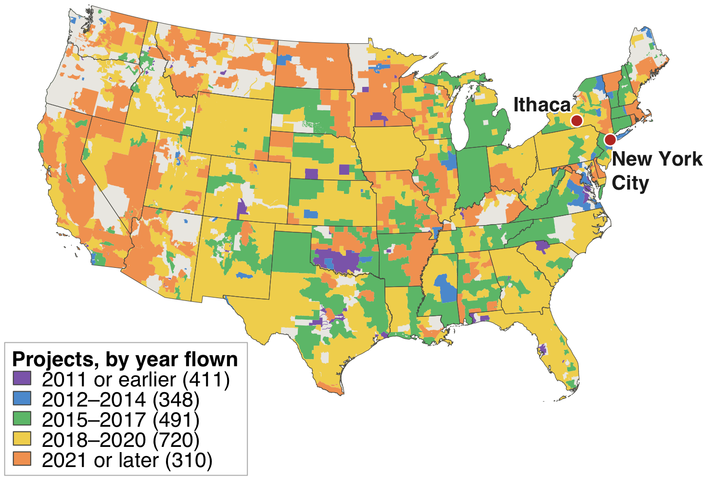{width="100%" fig-align="center"}

[Later in this part: where USGS has collected LiDAR data.]{.source}

::::

:::::

## Active and passive sensors {#active-passive}

::::: {.columns}

:::: {.column width="42%"}

::: {.slide-text}

Sensors on planes and satellites work in two ways.

- A passive sensor records energy from the ground, such as reflected sunlight.
  A camera is a passive sensor.
- An active sensor sends its own signal and times what comes back. Radar and
  LiDAR are active sensors.

:::

::::

:::: {.column width="58%"}

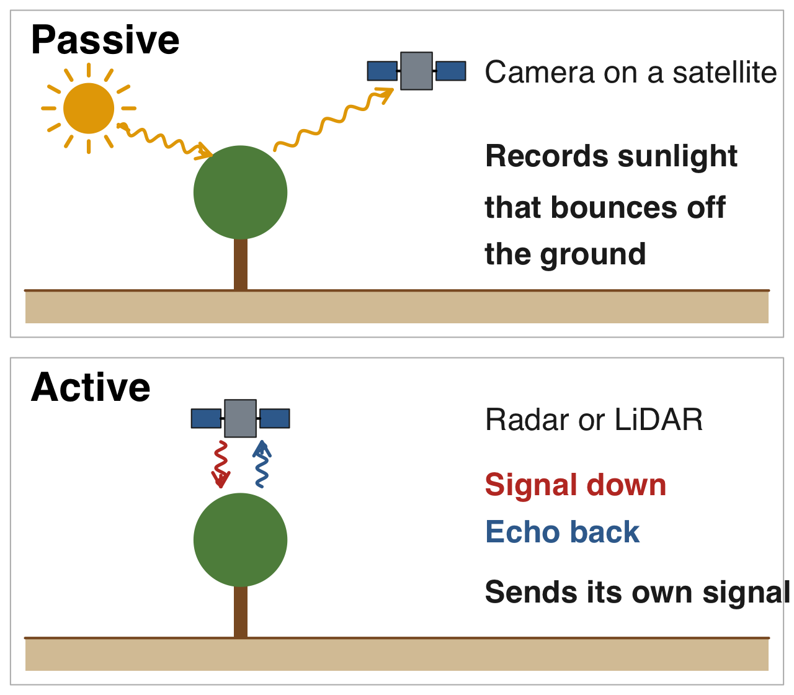{height="450px" fig-align="center"}

[Source: NASA Earthdata on
[active and passive instruments](https://www.earthdata.nasa.gov/learn/earth-observation-data-basics/remote-sensing).]{.source}

::::

:::::

::: {.content-visible unless-format="revealjs"}

Radar and LiDAR measure distance, so they give elevation and height. Radar
also works at night.

NASA Earthdata defines the two types this way: "Active instruments emit energy
and collect data based on changes in the return signal", and passive
instruments "detect energy emitted or reflected from an object". Its page on
active instruments says LiDAR and radar find the distance to a target by timing
the pulse that comes back. Its page on radar says radar gives images "night or
day, regardless of weather conditions".

:::

## The main active sensors {#active-sensors}

::: {.slide-text}

Every active sensor sends a signal and records the echo.

:::

| Sensor | What it measures |
|:--|:--|
| [Weather radar](https://www.weather.gov/about/radar) (radio waves) | rain, hail and wind |
| [Radar on satellites](https://science.nasa.gov/earth/earth-observatory/taking-a-measure-of-sea-level-rise-ocean-altimetry-147435) (radio waves) | elevation of land, height of the sea, wind over the ocean |
| LiDAR (laser light) | elevation, heights of buildings and trees |
| Sonar (sound in water) | depth of oceans and lakes |
| [Ground-penetrating radar](https://www.epa.gov/node/242485) (radio waves) | pipes and objects under the ground |
| [Seismic surveys](https://www.usgs.gov/programs/cmhrp/science/marine-seismic-imaging) (sound) | layers of rock below the sea floor |
| [Soil conductivity sensors](https://www.udel.edu/academics/colleges/canr/cooperative-extension/fact-sheets/using-apparent-electrical-conductivity-to-map-coastal-salinity/) (electric field) | clay, water and salt in farm soil |
| [Sodar](https://www.osti.gov/dataexplorer/biblio/dataset/2571202) (sound in air) | wind from 30 m to 600 m up |

::: {.slide-text}

Radar, LiDAR and sonar give free maps of large areas. Today we zoom in on these
three.

:::

::: {.content-visible unless-format="revealjs"}

More on each sensor, with its source:

- **Weather radar.** NOAA's radars measure rain and hail, and the Doppler shift
  of the echo gives the wind. NCEI keeps the archive free
  ([NCEI](https://www.ncei.noaa.gov/products/radar/next-generation-weather-radar)).
- **Radar on satellites.** Altimeters time a pulse sent straight down to get the
  height of the sea surface
  ([NASA](https://science.nasa.gov/earth/earth-observatory/taking-a-measure-of-sea-level-rise-ocean-altimetry-147435)).
  Scatterometers send pulses at an angle and get the wind over the ocean
  ([JPL](https://www.jpl.nasa.gov/news/watching-the-winds-where-sea-meets-sky/)).
- **Ground-penetrating radar.** EPA lists finding pipes, tanks and other
  utilities, archaeology, and unmarked graves
  ([EPA](https://www.epa.gov/node/242485)). Each survey covers one site.
- **Seismic surveys.** Air guns and other sources send sound into the sea floor.
  The echoes show sediment and rock from metres to kilometres down
  ([USGS](https://www.usgs.gov/programs/cmhrp/science/marine-seismic-imaging)).
  Data collected by companies stay confidential for 25 years
  ([BOEM](https://www.boem.gov/about-boem/released-geological-and-geophysical-data)).
  USGS and BOEM give free access to more than 1,100 released surveys
  ([NAMSS](https://www.usgs.gov/tools/national-archive-marine-seismic-surveys-namss)).
- **Soil conductivity sensors.** Farmers and researchers tow them across a
  field. The reading depends on clay, water and salt, to about 1.5 m deep
  ([USDA ARS](https://www.ars.usda.gov/research/publications/publication/?seqNo115=148589)).
  I found no public archive of these surveys.
- **Sodar.** It sends sound up and gets wind speed and direction from about
  30 m to 600 m. The example is a sodar at Argonne National Laboratory
  ([DOE Data Explorer](https://www.osti.gov/dataexplorer/biblio/dataset/2571202)).

I found no economics paper in a top journal that uses data from the last four
sensors.

:::

## How radar and LiDAR work {#how}

::: {.slide-text}

Radar and LiDAR both send a signal and measure how long it takes to come back.

- Radar sends radio waves. Radio waves pass through clouds
  ([NASA](https://www.earthdata.nasa.gov/learn/earth-observation-data-basics/sar)).
- LiDAR sends laser light. Clouds block it, so the plane flies under the clouds
  ([NOAA](https://coast.noaa.gov/data/digitalcoast/pdf/lidar-101.pdf)).

:::

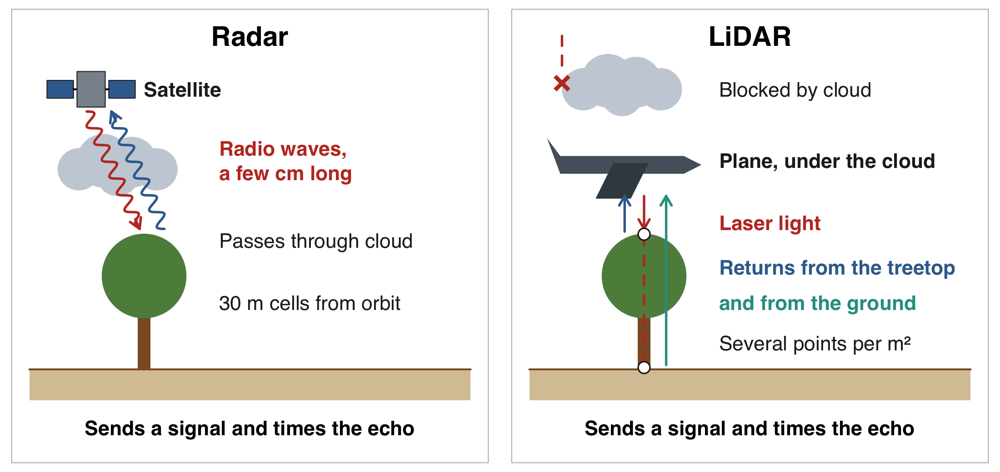{width="100%" fig-align="center"}


::: {.content-visible unless-format="revealjs"}

A longer time means the surface is farther away.

NASA's page says radar gives images "night or day, regardless of weather
conditions". NOAA's primer says that, unlike radar, lidar cannot see through
clouds, rain or dense haze. Radar waves are a few centimetres long. LiDAR light
is about a micrometre long.

:::

## How LiDAR measures distance {#pulse}

::: {.slide-text}

LiDAR stands for light detection and ranging.

- A plane flies over an area and sends laser pulses to the ground.
- The sensor times each pulse. A longer time means a surface farther away.
- A pulse can come back more than once, first from a treetop and then from the
  ground.

:::

::::: {.columns}

:::: {.column width="40%"}

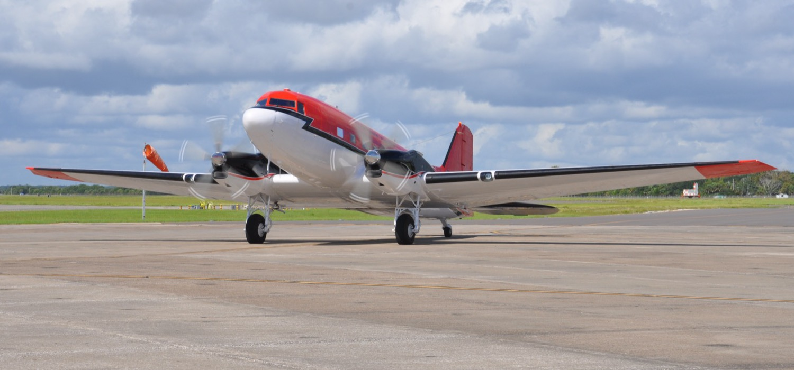{width="100%" fig-align="center"}

[A US Navy survey plane that carries a LiDAR for coastal mapping, 2013. US Navy
photo by Lt. Cmdr. Corey Barker, public domain
([Wikimedia Commons](https://commons.wikimedia.org/wiki/File:US_National_Oceanographic_Office_Basler_BT-67_(DC-3)_at_NS_Mayport_2013.JPG)).]{.source}

::::

:::: {.column width="58%"}

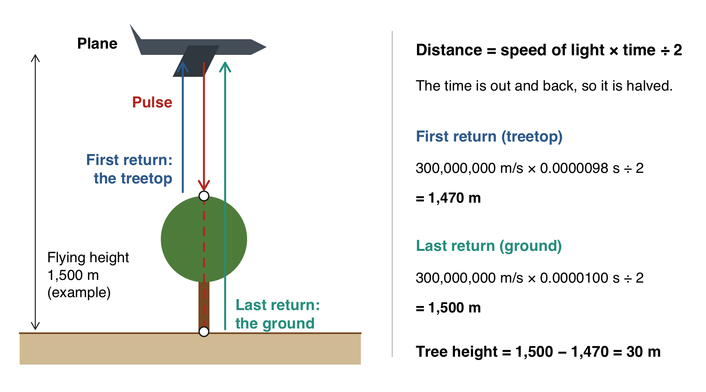{width="100%" fig-align="center"}

::::

:::::

::: {.content-visible unless-format="revealjs"}

Each time a pulse comes back is called a return. GPS and a motion sensor on the plane give each return its x, y and elevation.

In the drawing, the treetop sends back the first return and the ground the
last. The ground is 30 m below the treetop. The flying height of 1,500 m in the
drawing is an example.

:::

## How sonar measures depth {#sonar}

::::: {.columns}

:::: {.column width="50%"}

::: {.slide-text}

Sonar works like radar. It sends sound through water and times the echo.

- Light and radio waves fade fast under water. Sound travels about 1,500 m per
  second.
- A multibeam sonar sends a fan of beams. Each pass maps a strip of the floor.
- Only 28.7% of the ocean floor is mapped in detail. Satellites estimate the
  rest from bumps in the sea surface.

:::

::::

:::: {.column width="50%"}

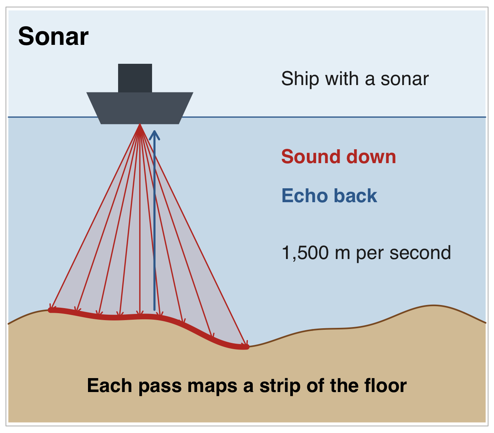{height="450px" fig-align="center"}

[The sources are NOAA's pages on [sonar](https://oceanservice.noaa.gov/facts/sonar.html)
and [survey ships](https://oceanservice.noaa.gov/education/tutorial_nautical_charts/nautical_charts06_tools_6b.html),
and GEBCO's [2026 release](https://www.gebco.net/news/release-gebco2026-grid).]{.source}

::::

:::::

::: {.content-visible unless-format="revealjs"}

Sonar stands for sound navigation and ranging. The depth comes from the time
between the pulse and its echo. NOAA's tutorial on nautical charts says sound
travels farther than light or radar under water, at about 1,500 m per second. An
echo from 100 m down comes back in about 0.13 seconds (2 × 100 / 1,500).

- **History.** Fessenden's oscillator echoed off an iceberg and the sea bottom
  in April 1914. USS Stewart sounded across the Atlantic with an echo sounder in
  1922. The first multibeam sonar went on a Navy ship in 1963
  ([NOAA Ocean Exploration timeline](https://oceanexplorer.noaa.gov/history/timeline-the-age-or-electronics-2-1946-1970/)).
- **Detail falls with depth.** NOAA's page on
  [multibeam sonar](https://oceanexplorer.noaa.gov/technology/sonar/multibeam.html)
  says "the deeper the water depth, the lower resolution this map".
- **Shallow water.** Green LiDAR from planes also maps the floor where the water
  is shallow and clear. NOAA says the depth it reaches depends on how clear the
  water is ([Digital Coast](https://coast.noaa.gov/digitalcoast/data/jalbtcx.html)).
- **Satellites.** Mountains on the sea floor pull the sea surface into bumps,
  and radar satellites measure them. NOAA says this is "not as accurate or
  detailed as echo sounding from ships"
  ([NOAA STAR](https://www.star.nesdis.noaa.gov/socd/lsa/AltBathy)).
- **Free data.** The GEBCO grid covers the world's oceans in 15 arc-second
  cells and is in the public domain
  ([GEBCO](https://www.gebco.net/data-products/gridded-bathymetry-data)).
- **Cayuga Lake.** I found no depth raster for the whole lake. USGS mapped the
  Cayuga Inlet channel in Ithaca in July 2016 with a single-beam echo sounder
  ([USGS](https://www.usgs.gov/data/geospatial-dataset-bathymetric-survey-cayuga-inlet-flood-control-channel-and-selected)).

:::

## Port depth and container ports {#use-depth}

::: {.slide-text}

Sonar measures how deep a port is. Depth predicted which US ports took container
ships.

:::

::::: {.columns}

:::: {.column width="52%"}

::: {.dashes}

- **Question:** [Brooks, Gendron-Carrier & Rua (Journal of Urban Economics, 2021)](https://doi.org/10.1016/j.jue.2021.103388)
  asked whether container ports made nearby counties grow.
- **Method:** Container ships need deep ports. They used each port's depth in
  1953, before containers, to predict which ports switched.
- **Data:** Each port's depth in 1953, in eight bands, from the World Port
  Index. The population of 3,023 US counties from 1950 to 2010.
- **Result:** Counties near container ports grew an extra 70% between 1950
  and 2010.

:::

::::

:::: {.column width="46%"}

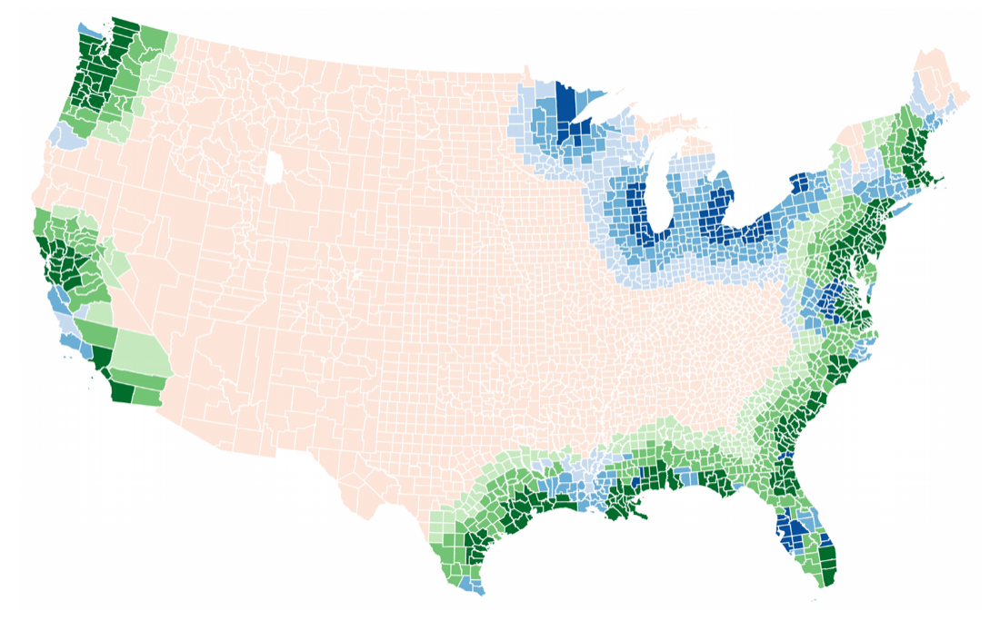{width="100%" fig-align="center"}

[Green counties are near a container port in 2010 and near a port 30 feet deep
or more in 1953. Blue counties are near a container port only. Figure 3b of the
2018 working paper
([Federal Reserve, FEDS 2018-045](https://doi.org/10.17016/FEDS.2018.045)).]{.source}

::::

:::::

::: {.content-visible unless-format="revealjs"}

The authors call a port "very deep" when it was 30 feet deep or more in 1953.
Ships before containers did not need more. The World Port Index records depth in
eight categories. Its deepest category was "40 feet and above" in 1953 and "76
feet and over" in 2015. Darker colours on the map are closer to a port, in bands
of 0 to 100, 100 to 200 and 200 to 300 km.

The 70% comes from the abstract of the 2018 working paper. The figure is from
the same open copy.

The paper does not use sonar data or a depth raster. It uses the depth band
that the 1953 World Port Index gives for each port's wharf. The results hold
with the anchorage and channel depths, which the Index also reports (footnote 17
of the working paper). US survey ships measured depth with echo sounders from
the 1920s
([NOAA](https://oceanexplorer.noaa.gov/history/timeline-the-age-or-electronics-1-1923-1945/)).
I have not found how the Index measured its 1953 depths.

:::

## When sonar, radar and LiDAR appeared {#timeline}

::: {.slide-text}

Sonar came first, in the 1910s, and radar in the 1930s. LiDAR needed the laser,
which was invented in 1960.

:::

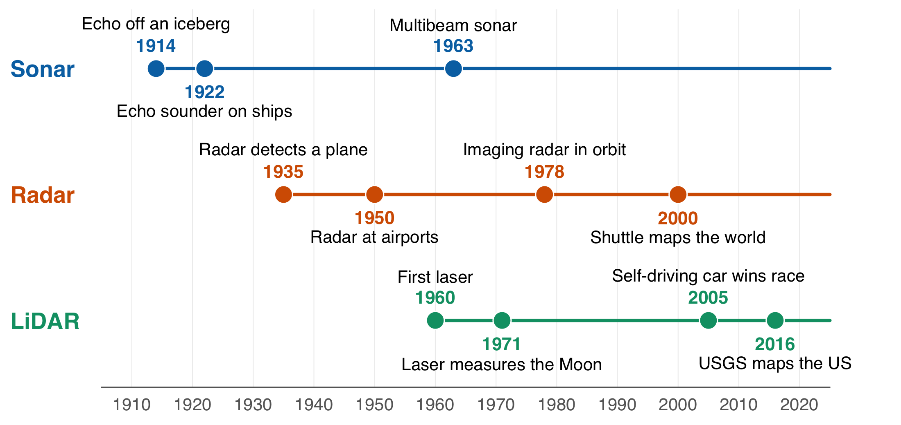{width="100%" fig-align="center"}

[Each date comes from the agency's or the paper's own page. The list is on the
session page.]{.source}

::: {.content-visible unless-format="revealjs"}

LiDAR is now in cars and in phones.

The dates and their sources:

- **1914.** Fessenden's oscillator echoes off an iceberg and the sea bottom
  ([NOAA Ocean Exploration](https://oceanexplorer.noaa.gov/history/timeline-the-breakthrough-years-1866-1922/)).
- **1922.** USS Stewart sounds across the Atlantic with an echo sounder. Within
  five years nearly all Coast Survey ships carry one
  ([NOAA Ocean Exploration](https://oceanexplorer.noaa.gov/history/timeline-the-age-or-electronics-1-1923-1945/)).
- **1963.** The first multibeam sonar goes on the Navy ship Compass Island
  ([NOAA Ocean Exploration](https://oceanexplorer.noaa.gov/history/timeline-the-age-or-electronics-2-1946-1970/)).
- **1935.** Watson-Watt and Wilkins detect an aircraft with radio waves at
  Daventry, England ([Royal Society](https://royalsociety.org/blog/2019/03/tracking-radar)).
- **1942.** The Navy gives the Weather Bureau 25 surplus aircraft radars
  ([National Weather Service](https://www.weather.gov/timeline)).
- **1950.** The first airport surveillance radars (ASR-1) are deployed
  ([FAA](https://www.faa.gov/about/history/photo_album/air_traffic_control?cid=early)).
- **1951.** Carl Wiley at Goodyear conceives synthetic aperture radar
  ([Lockheed Martin](https://www.lockheedmartin.com/en-us/news/features/history/sar.html)).
- **1952.** Washington National Airport starts radar departure control
  ([FAA](https://www.faa.gov/sites/faa.gov/files/about/history/milestones/radar_departure_control.pdf)).
- **1960.** Maiman reports the first laser, made of ruby
  ([Maiman, Nature, 1960](https://doi.org/10.1038/187493a0)).
- **1963.** A laser "optical radar" probes the upper atmosphere
  ([Fiocco and Smullin, Nature, 1963](https://doi.org/10.1038/1991275a0)).
- **1971.** A laser altimeter on Apollo 15 measures the Moon
  ([NASA](https://ntrs.nasa.gov/citations/19720015192)).
- **1978.** Seasat carries a radar into orbit
  ([JPL](https://www.jpl.nasa.gov/images/pia15816-seasat-celebrates-landmark-in-remote-sensing-history/)).
- **1999.** A journal issue is devoted to laser mapping from planes
  ([Wehr and Lohr, ISPRS Journal of Photogrammetry and Remote Sensing, 1999](https://doi.org/10.1016/S0924-2716(99)00011-8)).
- **2000.** The Space Shuttle maps the elevation of most of the world's land
  ([USGS](https://www.usgs.gov/centers/eros/science/usgs-eros-archive-digital-elevation-shuttle-radar-topography-mission-srtm-1)).
- **2005.** Stanley, a self-driving car, wins the DARPA Grand Challenge
  ([Thrun et al., Journal of Field Robotics, 2006](https://doi.org/10.1002/rob.20147)).
- **2014.** Europe launches the radar satellite Sentinel-1A
  ([ESA](https://www.esa.int/Applications/Observing_the_Earth/Copernicus/Sentinel-1)).
- **2016.** USGS has its first full year of LiDAR mapping for 3DEP
  ([USGS](https://www.usgs.gov/3dep/about)).
- **2018.** NASA launches ICESat-2 and GEDI
  ([ICESat-2](https://icesat-2.gsfc.nasa.gov/how-it-works),
  [GEDI](https://www.nasa.gov/missions/station/iss-research/gedi/)).
- **2020.** Apple puts a LiDAR scanner in the iPhone 12 Pro
  ([Apple](https://www.apple.com/newsroom/2020/10/apple-introduces-iphone-12-pro-and-iphone-12-pro-max-with-5g/)).
- **2024.** NHTSA requires automatic emergency braking in new cars by 2029. Its
  cost estimate assumes a radar sensor
  ([Federal Register](https://www.govinfo.gov/content/pkg/FR-2024-05-09/html/2024-09054.htm)).

:::

## Common uses of radar and LiDAR {#uses}

::: {.slide-text}

Governments and companies use radar and LiDAR every day.

:::

::::: {.columns}

:::: {.column width="48%"}

**Radar**

::: {.dashes}

- **Public**
  - [weather forecasts](https://www.ncei.noaa.gov/products/radar/next-generation-weather-radar)
  - [air traffic control](https://www.faa.gov/about/history/photo_album/air_traffic_control?cid=early)
  - [elevation maps of the whole world](https://www.usgs.gov/centers/eros/science/usgs-eros-archive-digital-elevation-shuttle-radar-topography-mission-srtm-1)
- **Private**
  - [flood maps sold to insurers](https://www.iceye.com/solutions/flood-monitoring)

:::

::::

:::: {.column width="48%"}

**LiDAR**

::: {.dashes}

- **Public**
  - [detailed elevation maps](https://www.usgs.gov/3dep/about)
  - [flood insurance maps](https://coast.noaa.gov/data/digitalcoast/pdf/lidar-101.pdf)
  - [the height of forests](https://www.earthdata.nasa.gov/data/instruments/gedi-lidar)
- **Private**
  - [self-driving cars](https://waymo.com/waymo-driver/)
  - [surveying and construction](https://coast.noaa.gov/data/digitalcoast/pdf/lidar-101.pdf)
  - [phones and tablets](https://www.apple.com/newsroom/2020/03/apple-unveils-new-ipad-pro-with-lidar-scanner-and-trackpad-support-in-ipados/)

:::

::::

:::::

## Resolution and coverage of public data {#resolution}

::: {.slide-text}

Elevation data are measured once. Weather radar scans every few minutes.

:::

| Data | Resolution in space and time | Coverage in space and time |
|:---------|:-------------|:-------------|
| [Radar elevation, Space Shuttle](https://www.usgs.gov/centers/eros/science/usgs-eros-archive-digital-elevation-shuttle-radar-topography-mission-srtm-1) | 30 m cells<br>one flight of 11 days | land from 60° N to 56° S<br>February 2000 |
| [Radar elevation, Copernicus](https://dataspace.copernicus.eu/explore-data/data-collections/copernicus-contributing-missions/collections-description/COP-DEM) | 30 m cells<br>one period of flights | all land<br>2011 to 2015 |
| [US weather radar](https://www.ncei.noaa.gov/products/radar/next-generation-weather-radar) | 250 m cells<br>a scan every 4.5 to 10 minutes | about 160 radars in the US<br>since 1992 |
| [LiDAR from planes, USGS](https://www.usgs.gov/ngp-standards-and-specifications/lidar-base-specification-tables) | 1 m cells, 2 or more points per m²<br>one flight per area | 88% of the lower 48 states<br>flights from before 2005 to today |
| [LiDAR on the International<br>Space Station (GEDI)](https://gedi.umd.edu/instrument/specifications/) | spots 25 m wide<br>no regular revisit | samples from 51.6° N to 51.6° S<br>since 2019, paused 2023 to 2024 |
| [Sonar depth grid (GEBCO)](https://www.gebco.net/news/release-gebco2026-grid) | 15 arc-second cells, about 460 m<br>a new grid each year | all oceans<br>28.7% of the floor mapped in detail |

::: {.content-visible unless-format="revealjs"}

Weather radar cells are 250 m long and half a degree wide. I counted the 88% in
USGS's archive on Amazon's cloud. The Space Shuttle flew from 11 to 22 February
2000. NOAA counts 160 weather radars, and the National Weather Service started
deploying them in 1992. GEBCO says 28.7% of the ocean floor is "mapped to
modern standards". The facts and their sources are in
`_planning/session25_coverage_facts.md`.

:::

## What sets the detail of a sensor {#detail}

::: {.slide-text}

A beam spreads as it travels, so a sensor sees less detail from farther away.

- At twice the distance, the spot is twice as wide.
- Laser light spreads very little. From a plane, a LiDAR spot is 30 to 50 cm
  wide.
- More power lets a sensor hear an echo from farther away. It does not narrow
  the beam.

:::

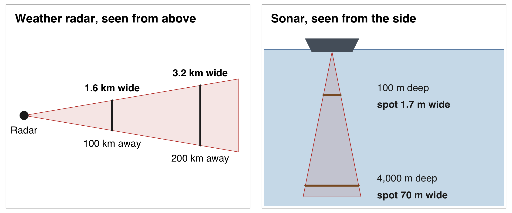{width="88%" fig-align="center"}

[The radar beam is 0.925° wide ([NOAA](https://roc.noaa.gov/public-documents/wsr88d/NEXRAD-Technical-Information.pdf)).
A NOAA ship's sonar beams are 1° wide. I computed the widths. Angles are drawn
wider than they are.]{.source}

::: {.content-visible unless-format="revealjs"}

The widths are 2 × distance × tan(angle / 2). The radar beam of 0.925° is 1.6 km
wide at 100 km and 3.2 km wide at 200 km. A sonar beam of 1° is 1.7 m wide at
100 m deep and 70 m wide at 4,000 m. The sonar drawing is not to scale in depth.

- **Weather radar.** NOAA's radars focus their energy into a beam of 0.925°.
  The data are recorded every half degree, with cells 250 m long along the beam
  ([NOAA ROC](https://roc.noaa.gov/public-documents/wsr88d/NEXRAD-Technical-Information.pdf)).
  The length comes from how long each pulse lasts, so it does not grow with
  distance.
- **Sonar.** NOAA Ship Okeanos Explorer carries a Kongsberg EM 304 sonar. Its
  beams are 0.5° along the ship and 1° across, in a fan of 150° with 512 beams
  ([NOAA, 2024 readiness report](https://repository.library.noaa.gov/view/noaa/65609/noaa_65609_DS1.pdf)).
  Sound is slow, so the sonar waits for each echo before the next ping. Deep
  water gets fewer pings per hour.
- **Radar on satellites.** It combines echoes taken along its path, as if it
  had a much larger antenna
  ([NASA Earthdata](https://www.earthdata.nasa.gov/learn/earth-observation-data-basics/sar)).
  That is how radar from orbit gives detail that one dish could not.
- **LiDAR.** NOAA's guide gives 50,000 to 150,000 pulses a second, spots of 30
  to 50 cm on the ground, and points 1 to 2 m apart or closer
  ([NOAA, Lidar 101](https://coast.noaa.gov/data/digitalcoast/pdf/lidar-101.pdf)).
  The number of points per m² also depends on how fast and how high the plane
  flies and on the overlap between flight lines.
- **Policy.** The free Copernicus elevation data come in 30 m and 90 m cells.
  They are derived from the WorldDEM radar model. A 10 m version over Europe is
  open only to public authorities, Copernicus services, EU institutions and
  EU-funded projects
  ([Copernicus](https://dataspace.copernicus.eu/explore-data/data-collections/copernicus-contributing-missions/collections-description/COP-DEM)).

:::

## Free LiDAR data from USGS {#usgs}

::: {.slide-text}

The US Geological Survey (USGS) publishes free LiDAR data for almost the whole
country.

- USGS collected the data one project at a time.
- USGS's elevation program is called 3DEP. It reports that 99% of the country
  is available or in progress ([USGS](https://www.usgs.gov/3dep/about)).
- USGS requires at least 2 points per m². This standard is called quality
  level 2
  ([USGS, Lidar Base Specification](https://www.usgs.gov/core-science-systems/ngp/ss/lidar-base-specification-collection-requirements)).
- USGS mapped Alaska with radar, because clouds cover it so often
  ([USGS](https://www.usgs.gov/faqs/what-lidar-data-and-where-can-i-download-it)).

:::

[You can download the data from LidarExplorer, The National Map, or Amazon's
cloud without an account. The data are US government work and in the public
domain ([AWS Open Data](https://registry.opendata.aws/usgs-lidar/)).]{.source}

::: {.content-visible unless-format="revealjs"}

USGS gives the 99% "at the end of fiscal year 2025". A fiscal year is the US
government's budget year. USGS lists the quality levels on its
[quality-levels page](https://www.usgs.gov/3d-elevation-program/topographic-data-quality-levels-qls).
Quality level 2 (QL2) means at least 2 points per m², 10 cm vertical accuracy
and a 1 m elevation raster. QL1 and QL0 have at least 8 points per m².

:::

## LiDAR data outside the US {#elsewhere}

::::: {.columns}

:::: {.column width="48%"}

::: {.slide-text}

Several other countries publish free LiDAR data for the whole country.

- England covered the whole country from 2017 to 2023
  ([Environment Agency](https://www.data.gov.uk/dataset/f0db0249-f17b-4036-9e65-309148c97ce4/national-lidar-programme-point-cloud)).
- The Netherlands has flown the country four times. The latest flight has
  about 10 to 14 points per m² ([AHN](https://www.ahn.nl/kwaliteitsbeschrijving)).
- Switzerland has covered the whole country since 2024
  ([swisstopo](https://www.swisstopo.admin.ch/en/height-model-swisssurface3d)).
- Spain has flown the country three times since 2009
  ([IGN, PNOA-LiDAR](https://pnoa.ign.es/pnoa-lidar)).
- GEDI is a NASA LiDAR on the International Space Station. It measures the
  height of forests in spots 25 m wide, along tracks 600 m apart.

:::

::::

:::: {.column width="50%"}

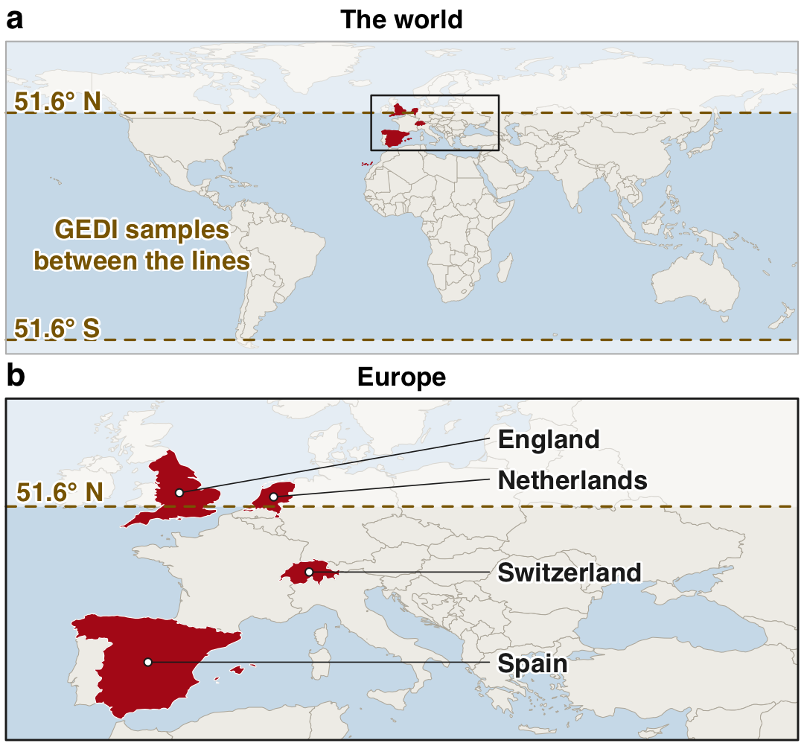{width="100%" fig-align="center"}

[GEDI samples the land between 51.6° N and 51.6° S
([GEDI](https://gedi.umd.edu/instrument/specifications/)). Most of the ground
between its tracks is never measured. The Dutch data are called AHN.]{.source}

::::

:::::

::: {.content-visible unless-format="revealjs"}

England's data come with a 1 m raster of the whole country. Swiss flights reach
15 to 40 points per m² in the newest areas. Other national programmes and space
lasers:

- **France.** IGN's LiDAR HD had published 47.8% of the country by December
  2025, with 10 or more points per m² on average. IGN plans to publish the rest
  (except French Guiana) by the end of 2026
  ([IGN](https://www.ign.fr/institut/lidar-hd-vers-une-nouvelle-cartographie-3d-du-territoire)).
- **Estonia.** The whole country is covered. Estonia publishes ground, surface
  and canopy rasters made from flights of 2021 to 2024
  ([Land and Spatial Development Board](https://geoportaal.maaamet.ee/eng/Spatial-Data/Elevation-data-p308.html)).
- **New Zealand.** A national programme brought coverage to over 80%. The 1 m
  ground and surface rasters are free to download ([LINZ](https://www.linz.govt.nz/node/5917)).
- **GEDI.** Its spots are 25 m wide and 60 m apart along each track. The eight
  tracks are 600 m apart, and each laser fires 242 times a second. NASA also
  grids the shots into 1 km cells
  ([GEDI](https://gedi.umd.edu/instrument/specifications/)). GEDI's pages give no
  revisit schedule. The data start in April 2019, with a pause from March 2023
  to April 2024.
- **ICESat-2.** NASA launched this laser satellite in 2018. It measures spots
  11 m wide up to 88° north and south ([NASA](https://icesat-2.gsfc.nasa.gov/science/specs)).
- **Global rasters.** Elsewhere, researchers use canopy-height rasters built
  from GEDI and ICESat-2. They also use radar elevation rasters such as SRTM and
  Copernicus GLO-30.

:::

## LiDAR coverage in the US {#coverage}

:::: {.columns}

::: {.column width="34%"}

::: {.slide-text}

USGS has LiDAR data for 88% of the lower 48 states.

- A project is one area that USGS had flown in one campaign.
- Inside each coloured area, the data cover the whole area.
- The grey areas have no data in this archive yet. USGS lists newer projects
  for most of them.

:::

:::

::: {.column width="64%"}

{width="100%" fig-align="center"}

[The colours give the year each project was flown. I checked 267 random
locations inside the coloured areas, and 265 have LiDAR points within 300 m. The
map shows the 2,284 projects in USGS's archive on Amazon's cloud.]{.source}

:::

::::

::: {.content-visible unless-format="revealjs"}

I counted the projects in USGS's free copy on Amazon's cloud (November 2026).
About 87% of the land has points there. USGS's own figure of 99% also counts
newer projects. A project is one area flown in one campaign.

**How complete US LiDAR data are, by USGS's own account.**

- USGS reports 99% "at the end of fiscal year 2025", counting data available or
  in progress ([USGS, 3DEP About](https://www.usgs.gov/3dep/about)).
- The archive on Amazon holds about 82 trillion points (81,984.5 billion).
- USGS's table of work units counts 43 before 2005, 299 in 2005 to 2009, 914 in
  2010 to 2014, 1,330 in 2015 to 2019 and 722 since 2020.
- Projects vary in age and quality. The baseline was planned on an 8-year
  cycle, and the next generation is flown where data are 5 or more years old
  ([USGS Circular 1553, 2025](https://pubs.usgs.gov/circ/1553/cir1553.pdf)).
- The test of 300 locations used seed 6850. 265 of 267 is 99.3% (95% interval
  97.3 to 99.8). The two failures are at the edges of areas in South Dakota and
  Montana. Of all 300 locations, 88.3% have points within 300 m (84.2 to 91.5).
  The corrected land share is 87.4%.

Two thirds of the dated projects were flown in 2015 or later.

The period counts in the legend sum to 2,280. Four projects carry no period.
`tools/make_coverage.R` drew the map and `tools/check_coverage.R` ran the test.

:::

# 2 · Radar data in R {#part-radar}

## Overview of part 2 {#overview-radar}

::: {.slide-text}

In this part we read radar data in R.

:::

::::: {.columns}

:::: {.column width="56%"}

::: {.dashes}

- We read the radar elevation raster of Tompkins County.
- We subtract USGS's ground elevation. What is left is the height of trees and
  buildings.
- We look at weather radar images of a hail storm in the Plains.
- We add up radar hail by county and compare it with hail reports. This is my
  own preliminary work.

:::

[To run the code, download [25-lidar-drones.zip](data/25-lidar-drones.zip)
(53 MB), unzip it and open `25-lidar-drones.Rproj`.]{.source}

::::

:::: {.column width="42%"}

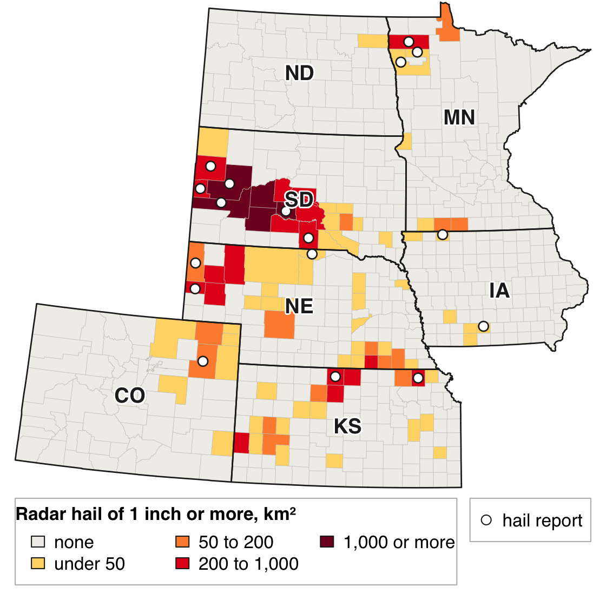{height="400px" fig-align="center"}

[Later in this part: radar hail by county on 12 June 2022.]{.source}

::::

:::::

## Radar elevation in Tompkins County {#radar-dem}

::::: {.columns}

:::: {.column width="60%"}

::: {.slide-text}

`rast()` reads the radar elevation raster of Tompkins County.

- The Copernicus program made it from two radar satellites (TanDEM-X), from
  2011 to 2013.
- Radar elevation is published as a raster, in GeoTIFF files. Nobody downloads
  the raw echoes.
- Before class I put it on the same 30 m cells as USGS's elevation raster.

:::

```{r}
#| label: idiom-lidr
#| script: "Load or install the four packages"
#| output: false
#| message: false
#| filename: "R Console, in the 25-lidar-drones folder; installs missing packages"
want <- c("lidR", "terra", "sf", "exactextractr")
need <- want[!(want %in% installed.packages()[,"Package"])]
if (length(need)) install.packages(need)
lapply(want, function(i) require(i, character.only = TRUE))
rm(want, need)
options(lidR.progress = FALSE); terraOptions(progress = 0)
```

::::

:::: {.column width="38%"}

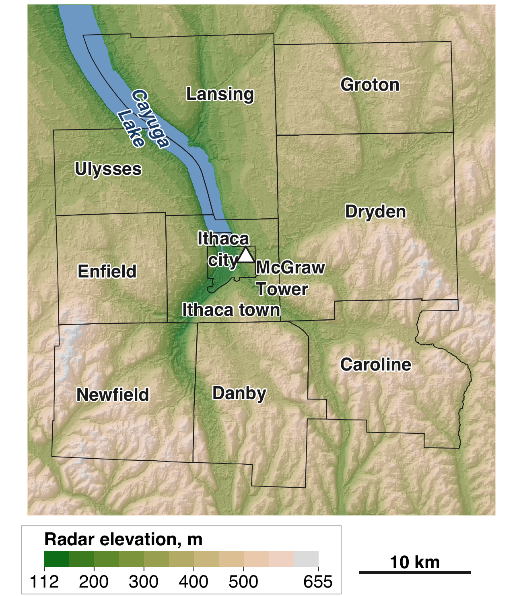{height="360px" fig-align="center"}

::::

:::::


```{r}
#| label: radar-read
#| script: "Radar elevation in Tompkins County"
#| filename: "R Console, in the 25-lidar-drones folder; reads data_clean/radar/ and data_clean/terrain/"
rad <- rast("data_clean/radar/tompkins_copernicus_utm.tif")   # radar elevation, m, 30 m cells
dem <- rast("data_clean/terrain/tompkins_dem_utm.tif")        # USGS ground elevation, m
compareGeom(rad, dem)                                         # TRUE: the same cells
```

::: {.content-visible unless-format="revealjs"}

The radar raster is Copernicus DEM GLO-30. Seventeen radar passes of the
TanDEM-X and TerraSAR-X satellites, from February 2011 to July 2013, went into
the tile that covers Ithaca. Copernicus calls it a surface model: it "represents
the surface of the Earth including buildings, infrastructure and vegetation"
([Copernicus DEM readme](https://copernicus-dem-30m.s3.amazonaws.com/readme.html)).
The tile has cells of 1 arc-second. `tools/make_radar.R` projected it onto the
cells of USGS's raster, so the two subtract cell by cell. The full printout:

```{r}
#| label: radar-read-full
#| purl: false
#| filename: "R Console, in the 25-lidar-drones folder; rad from above"
rad
```

:::

## Radar elevation minus ground elevation {#radar-minus-lidar}

::::: {.columns}

:::: {.column width="46%"}

::: {.slide-text}

Radar elevation includes trees and buildings. On half of Tompkins County it sits
more than 5 m above the ground.

- USGS publishes the elevation of the ground, without trees or buildings.
- Both rasters have 30 m cells on the same grid. We subtract them cell by cell.
- The median gap is 4.6 m. Newfield has the most land above 5 m (71%), and
  Lansing the least (28%).
- Radar elevation is the top of trees and roofs. It is not the ground.

:::

::::

:::: {.column width="52%"}

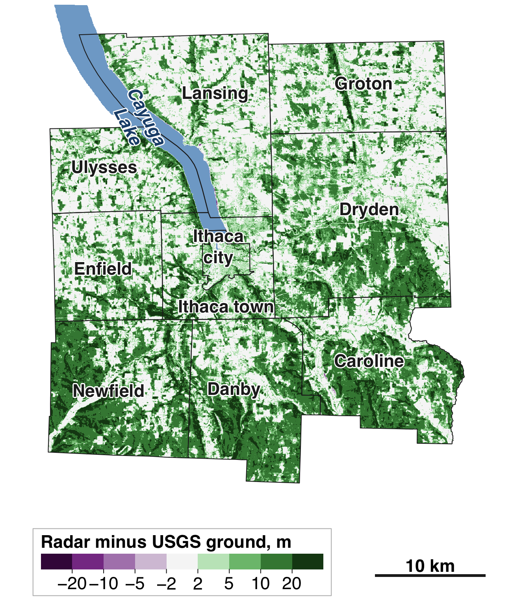{height="440px" fig-align="center"}

[Radar elevation minus USGS's ground elevation, in 30 m cells. I have not
checked against a land cover map that the green cells are forest.]{.source}

::::

:::::

## Radar minus ground elevation in R {#radar-minus-code}

::: {.slide-text}

We subtract the two rasters, keep the county and drop Cayuga Lake.

:::

```{r}
#| label: radar-minus
#| script: "Radar minus ground elevation"
#| filename: "R Console, in the 25-lidar-drones folder; rad and dem from the slide before"
towns <- st_read("data_clean/terrain/tompkins_towns.gpkg", quiet = TRUE)
diff <- mask(rad - dem + 0.49, vect(towns))   # radar minus ground in the county, m
diff[dem < 116.45] <- NA                      # drop Cayuga Lake
v <- values(diff, na.rm = TRUE)
round(c(median_m = median(v), pct_above_5m = 100 * mean(v > 5)), 1)
```

[The two rasters start from zero levels about 0.49 m apart, so I add 0.49 m.
USGS's raster puts Cayuga Lake at 115.95 m, so cells below 116.45 m are lake.]{.source}

::: {.content-visible unless-format="revealjs"}

Radar heights are on the EGM2008 geoid and USGS's are on NAVD88. On flat land,
where nothing stands, the radar sits 0.49 m below USGS. I found this gap as the
most common difference on cells with a slope under 1 degree. The campus lawns and
the two geoid models give gaps of about 0.6 m, which would move the share above
5 m by 2 to 4 points (`logs/prep_radar.txt`). Cayuga Lake is flat at 115.95 m in
USGS's raster, so cells below 116.45 m are lake.

Each town's share of land more than 5 m above the ground:

```{r}
#| label: radar-towns
#| script: "Each town's share of land above 5 m"
#| filename: "R Console, in the 25-lidar-drones folder; diff and towns from above"
tall <- exact_extract(diff > 5, towns, "mean", progress = FALSE)
d <- data.frame(town = towns$NAMELSAD, pct_above_5m = round(100 * tall))
d[order(-d$pct_above_5m), ]
```

:::

## Weather radar images of a hail storm {#radar-images}

::: {.slide-text}

NOAA combines its weather radars into one raster of the country, in cells of
about 1 km.

:::

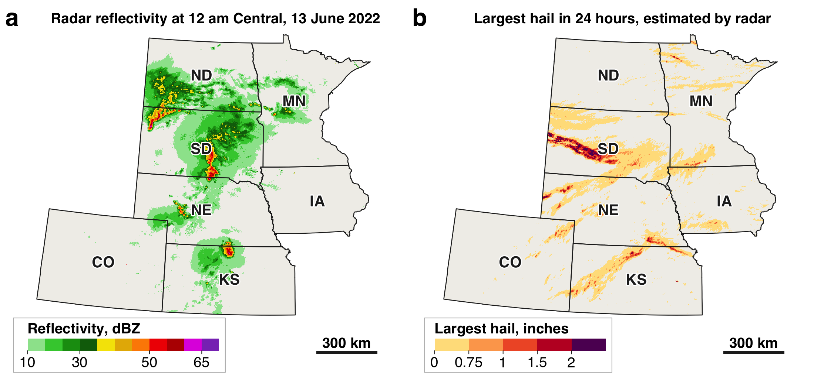{width="100%" fig-align="center"}

[Reflectivity is the strength of the echo. Large drops and hail send back the
strongest echoes, in red and purple. Panel a is one image, at midnight Central.
NOAA makes a new one every 2 minutes. Panel b is the largest hail in each cell
over 24 hours. Each streak is the path of one storm.]{.source}

::: {.content-visible unless-format="revealjs"}

NOAA's system is called MRMS, for Multi-Radar Multi-Sensor. Its rasters cover
the lower 48 states in cells of 0.01 degrees. Reflectivity is the strength of
the echo, in dBZ. Panel a is the snapshot stamped 05:00:41 UTC on 13 June 2022.
I picked this hour because it has the most area of 50 dBZ or more in the seven
states, 4,216 km². The public archive holds 1,440 snapshots for 12 and 13 June,
one every 2 minutes. Panel b is the product `MESH_Max_1440min`, the maximum
estimated size of hail from 12:00 UTC on 12 June to 12:00 UTC on 13 June. The
largest hail on this day is 101 mm (4 inches) and the strongest echo is 66 dBZ
(`logs/prep_mrms.txt`).

:::

## Reading the radar hail raster in R {#mesh-code}

::: {.slide-text}

`rast()` reads the radar hail raster, and `extract()` gives the largest hail in
each county.

- NOAA publishes these rasters in a weather format called GRIB2. terra reads it.
- I saved the seven states as a GeoTIFF. Each cell holds the largest hail in mm.
- 91 counties had hail of 1 inch (25.4 mm) or more.

:::

```{r}
#| label: mesh-read
#| script: "Reading the radar hail raster in R"
#| out.lines: [2, 3, 4, 5, 9, 11]
#| filename: "R Console, in the 25-lidar-drones folder; reads data_clean/hail/"
mesh <- rast("data_clean/hail/mesh_20220612.tif")       # largest hail in each cell, mm
mesh
counties <- vect("data_clean/hail/counties_7states.gpkg")
big <- extract(mesh, counties, fun = max)               # largest hail in each county
sum(big[, 2] >= 25.4)                                   # counties with hail of 1 inch or more
```

::: {.content-visible unless-format="revealjs"}

The slide shows six lines of the printout. A cell of 0.01 degrees is about
1.1 km from north to south and 0.8 km from east to west at 45° N. The zip also
holds the reflectivity image of panel a, `data_clean/hail/reflectivity_20220612.tif`.
`tools/fetch_mrms.R` downloaded both rasters from NOAA's public archive on
Amazon's cloud and cut them to the seven states.

```{r}
#| label: mesh-plot
#| script: "Plot the two radar rasters"
#| fig-show: hide
#| filename: "R Console, in the 25-lidar-drones folder; mesh from above"
plot(mesh > 0, main = "Cells with radar hail, 12 June 2022")
refl <- rast("data_clean/hail/reflectivity_20220612.tif")   # reflectivity at midnight Central, dBZ
plot(refl, main = "Radar reflectivity, dBZ")
```

:::

## Radar hail by county, 12 June 2022 {#hail-day}

::::: {.columns}

:::: {.column width="44%"}

::: {.slide-text}

I added up the radar hail raster by county, because hail reports and insurance
losses come by county.

- A county's colour is its area with radar hail of 1 inch or more, in km².
- A white dot marks a county where someone filed a hail report.
- Radar saw hail in 91 counties. Only 17 of them have a report.

:::

::::

:::: {.column width="54%"}

{height="450px" fig-align="center"}

[This is my own preliminary work. Radar hail is NOAA's MRMS estimate. Hail
reports come from NOAA's Storm Events database.]{.source}

::::

:::::

::: {.content-visible unless-format="revealjs"}

MRMS stands for Multi-Radar Multi-Sensor. Its product `MESH_Max_1440min` gives
the largest hail size estimated in each 1 km cell over 24 hours, from 12:00 to
12:00 UTC. For each county and day, my pilot added up the km² with hail of 1 inch
(25.4 mm) or more. The tables are in `data_clean/hail/`, and the README says how
I made them. The code below reads one day and maps it.

```{r}
#| label: hail-day
#| script: "Radar hail on 12 June 2022"
#| fig-show: hide
#| filename: "R Console, in the 25-lidar-drones folder; reads data_clean/hail/"
hail <- read.csv("data_clean/hail/hail_county_day.csv", colClasses = c(geoid = "character"))
cty  <- st_read("data_clean/hail/counties_7states.gpkg", quiet = TRUE)
day  <- hail[hail$date == "2022-06-12", ]                     # one radar day
cty$km2 <- day$km2_1in[match(cty$GEOID, day$geoid)]           # km2 of radar hail of 1 inch or more
cty$km2[is.na(cty$km2)] <- 0
plot(cty["km2"], breaks = c(0, 0.001, 50, 200, 1000, 3000), main = "Radar hail of 1 inch or more, km2")
c(radar_hail = sum(day$km2_1in > 0), with_report = sum(day$km2_1in > 0 & day$reports > 0))
```

:::

## Radar hail, hail reports and crop insurance {#hail-reports}

::: {.slide-text}

I compared radar hail with hail reports and with crop insurance payments for
hail.

- 56% of county-days with 25 km² or more of radar hail of 1 inch or more have
  no hail report.
- Radar predicts hail losses better than reports do. Take a county-month with
  more than $100,000 of hail losses and one without. Radar ranks the one with
  losses higher 85% of the time, and the number of reports 73% of the time.

:::

```{r}
#| label: hail-reports
#| script: "Radar hail, hail reports and crop insurance"
#| filename: "R Console, in the 25-lidar-drones folder; reads data_clean/hail/hail_county_day.csv"
hail <- read.csv("data_clean/hail/hail_county_day.csv", colClasses = c(geoid = "character"))
big  <- hail[hail$km2_1in >= 25, ]      # 25 km2 or more of hail of 1 inch or more
round(100 * mean(big$reports == 0))     # percent of these county-days with no report
```

[This is my own preliminary work. A county-day is one county on one day. The data
cover 567 counties in CO, IA, KS, MN, NE, ND and SD, April to September 2021 to
2025.]{.source}

::: {.content-visible unless-format="revealjs"}

Reports are rarer where few people live. In the least dense fifth of counties,
61% of these county-days have no report. In the densest fifth, 45% have none.
Where someone did file a report, radar shows hail of 0.75 inch or more on 95% of
the county-days.

```{r}
#| label: hail-density
#| script: "No report, by population density"
#| filename: "R Console, in the 25-lidar-drones folder; big from above"
round(100 * tapply(big$reports == 0, big$density_fifth, mean))   # Q1 is the least dense fifth
```

The losses are USDA Risk Management Agency payments with hail as the cause of
loss, $1.98 billion in all. The number on the slide is the AUC, the area under
the ROC curve. It is the chance that a county-month with more than $100,000 of
hail losses gets a higher score than one without; ties count half. A score that
says nothing gets 50%. 20% of the hail losses fell in county-months with no
hail report.

The chart shows the share of county-months with more than $100,000 of hail
losses. The share rises with the radar area of hail, in months with a report and
in months without one.

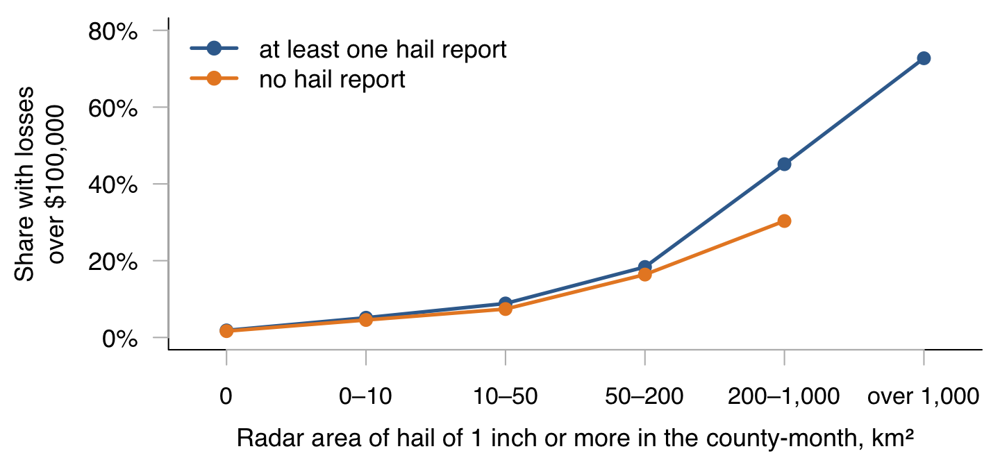{width="80%" fig-align="center"}

```{r}
#| label: hail-auc
#| script: "Radar hail and crop-insurance losses"
#| filename: "R Console, in the 25-lidar-drones folder; reads data_clean/hail/hail_county_month.csv"
hm  <- read.csv("data_clean/hail/hail_county_month.csv", colClasses = c(geoid = "character"))
auc <- function(score, y) { r <- rank(score); n1 <- sum(y); n0 <- sum(!y); (sum(r[y]) - n1 * (n1 + 1) / 2) / (n1 * n0) }
loss <- hm$loss_usd > 1e5                                       # more than $100,000 of hail losses
round(c(radar = auc(hm$km2_1in, loss), reports = auc(hm$reports, loss)), 2)
```

:::

# 3 · LiDAR data in R {#part-lidar}

## Overview of part 3 {#overview-lidar}

::: {.slide-text}

In this part we read the LiDAR data for Cornell's campus in R.

:::

::: {.dashes}

- We use the USGS LiDAR data collected over campus in May 2020.
- We read the points with the lidR package.
- We build three rasters: the ground, the top of buildings and trees, and the
  height of buildings and trees.
- We check them on a lawn, on a wider map with the gorges, and against radar.

:::

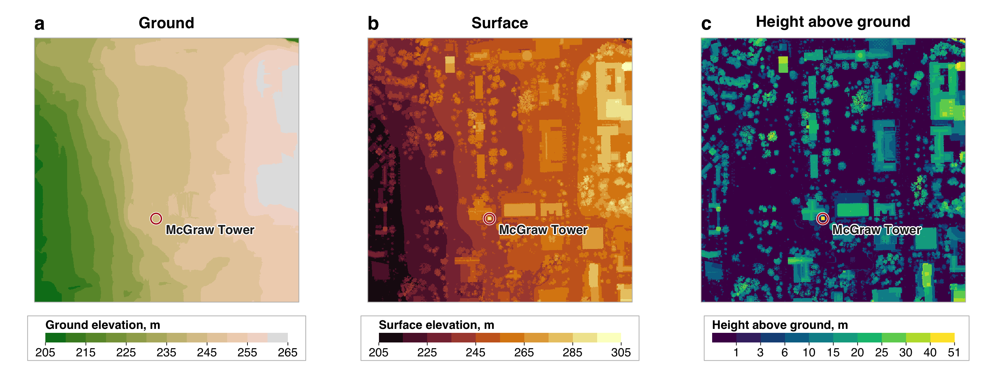{width="70%" fig-align="center"}

[Later in this part: the three rasters around McGraw Tower.]{.source}

::: {.content-visible unless-format="revealjs"}

Panels a and b show elevation above sea level. Panel c shows height above the
ground.

:::

## From New York to the campus {#zoom}

::: {.slide-text}

The LiDAR data for Ithaca come from a USGS project over the Finger Lakes in May
2020.

- 54 USGS projects cover parts of New York State.
- I cut out a square of 600 m by 600 m around McGraw Tower, Cornell's clock
  tower. Panel c shows this square.
- The colours in panel c show the height of buildings and trees in each 1 m
  cell.

:::

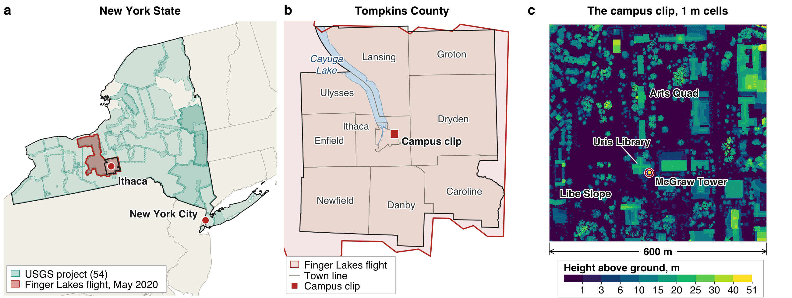{width="100%" fig-align="center"}

[The Finger Lakes are the lakes around Ithaca. The campus was flown on 13 May.
Uris Library and the tower stand at the top of Libe Slope, a hillside lawn. The
Arts Quad is the campus's main lawn.]{.source}

::: {.content-visible unless-format="revealjs"}

**Where the points came from.** USGS keeps a public copy of the archive on
Amazon's cloud. The copy is stored as Entwine Point Tiles, a tree of cubes. With
this format a script can download only the cubes around a box.
`tools/fetch_lidar.R` downloaded the 89 cubes that touch the campus. USGS's own
tile server holds the same points in 1.5 km tiles. That server is slow and
limits how often you can download.

```{r}
#| label: fetch-lidar
#| eval: false
#| purl: false
#| filename: "tools/fetch_lidar.R (part); needs the network"
ept <- "https://s3-us-west-2.amazonaws.com/usgs-lidar-public/NY_FingerLakes_1_2020/ept.json"
download.file(ept, "data/lidar/ept/ept.json", mode = "wb")   # then the cubes that touch the box
```

**The vertical datum.** Elevations are metres above NAVD88, the US zero level
for elevations. NAVD88 is close to mean sea level, and the gap varies by
location.

:::

## Reading LiDAR data in R {#read}

::: {.slide-text}

The lidR package reads LiDAR data in R.

- LiDAR points come in LAS files, or LAZ files when compressed. `readLAS()` reads
  both.
- The file has 2.31 million points, about 6 points per m².
- Each point has an x and a y in metres (UTM zone 18N), and an elevation.

:::

```{r}
#| label: read-las
#| script: "Reading LiDAR data in R"
#| out.lines: [3, 4, 6, 8, 9]
#| filename: "R Console, in the 25-lidar-drones folder, packages loaded in part 2; reads data_clean/lidar/campus.laz"
las <- readLAS("data_clean/lidar/campus.laz")   # about 2 seconds
las
```

::: {.content-visible unless-format="revealjs"}

x and y are metres east and north.

To run this code, download [25-lidar-drones.zip](data/25-lidar-drones.zip) and
open `25-lidar-drones.Rproj`.

The campus has 6.43 points per m² from 5.05 pulses per m², because some pulses
come back more than once. Each point is one return of a pulse, with x, y and
elevation in metres. A point cloud is the set of points. A LAS file stores a
point cloud, and a LAZ file is the same, compressed. The campus file is
15.8 MB.

The slide shows five lines of the printout. Here is all of it, with the number
of each return within its pulse. The area in the printout is the area inside
lidR's outline around the points, a little under 600 × 600 m.

```{r}
#| label: read-las-full
#| purl: false
#| filename: "R Console, in the 25-lidar-drones folder; las from above"
las
table(las$ReturnNumber)
```

```{.default filename="25-lidar-drones/, as its README.md describes it"}
data_clean/lidar/      campus.laz: the USGS points, 600 x 600 m around McGraw Tower
                       campus_dtm.tif, campus_dsm.tif, campus_height.tif: the three 1 m grids
data_clean/lidar_nyc/  esb_height.tif: height above ground around the Empire State Building
data_clean/terrain/    tompkins_dem_utm.tif, tompkins_towns.gpkg: elevation and towns
                       fallcreek_dem_filled.tif, fallcreek_dem_utm.tif: Fall Creek, filled and raw
data/usgs_gauge/       site_04234000.rdb: the Fall Creek gauge record
data_clean/radar/      tompkins_copernicus_utm.tif: radar elevation on the cells of tompkins_dem_utm.tif
data_clean/hail/       radar hail, hail reports and crop-insurance hail losses by county
code/                  1_radar.R to 6_watershed.R; run_everything.R
tools/                 how I downloaded the files and made data_clean/ (needs the network)
```

**A 3D view of the cloud.** `plot(las)` opens an interactive 3D window through
the rgl package. On a Mac it needs XQuartz.

:::

## Ground points {#classes}

::: {.slide-text}

USGS labels each point with a class.

- Class 2 means the laser hit the ground. 56% of the campus points are ground
  points.
- Class 1 is anything above the ground, such as buildings and trees.
- Classes 7 and 18 are errors, such as birds. I remove them.

:::

```{r}
#| label: classes
#| script: "Ground points"
#| filename: "R Console, in the 25-lidar-drones folder; las from readLAS() on the slide before"
table(las$Classification)                               # 1 other, 2 ground, 7 and 18 noise
las <- filter_poi(las, !Classification %in% c(7, 18))   # drop the noise
npoints(las)
```

[Some projects also label buildings (class 6) and trees and shrubs (classes 3 to
5). The campus project and the New York City project do not.]{.source}

::: {.content-visible unless-format="revealjs"}

Exactly 55.7% of the campus points are ground points and 44.2% are class 1. In
this project, trees and roofs share class 1. Classes 7 and 18 are noise, such
as birds, haze and errors. I remove the 3,532 noise points before I build any
raster.

:::

## A slice through McGraw Tower {#side}

::: {.slide-text}

Seen from the side, the points show Libe Slope, Uris Library, McGraw Tower and
the trees.

- The red line on the map is a strip 10 m wide, from west to east.
- Each dot is one point in the strip. Brown dots are ground points (class 2).
- Some pulses pass between the leaves, so we see the ground under the trees.

:::

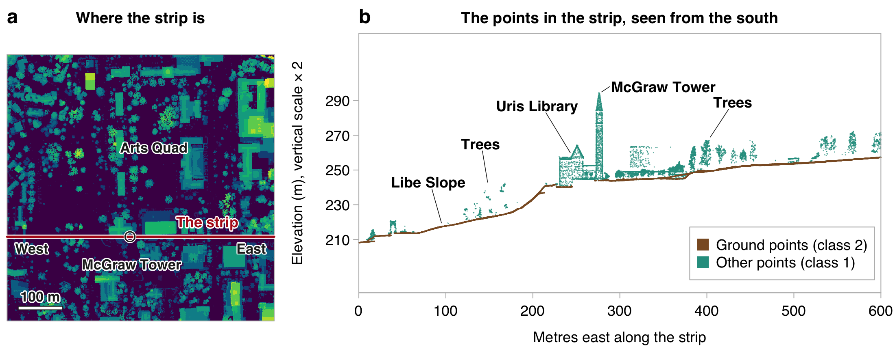{width="100%" fig-align="center"}

[Teal dots are the other points (class 1). The vertical scale is doubled. The
highest point on the tower is 294.62 m above sea level.]{.source}

::: {.content-visible unless-format="revealjs"}

The code below draws the strip on the slide with base R. `filter_poi()` keeps
the points that meet a condition.

```{r}
#| label: side-strip
#| script: "A slice through McGraw Tower"
#| fig-show: hide
#| filename: "R Console, in the 25-lidar-drones folder; las from the slide before"
strip <- filter_poi(las, abs(Y - 4700539.6) < 5, !Classification %in% c(7, 18))   # 10 m wide
plot(strip$X - 377600, strip$Z, pch = ".", asp = 2, xlab = "Metres east", ylab = "Elevation, m",
     col = ifelse(strip$Classification == 2, "tan4", "cyan4"))
```

:::

## Ground elevation {#dtm}

:::: {.columns}

::: {.column width="62%"}

::: {.slide-text}

`rasterize_terrain()` builds a raster of ground elevation from the ground
points.

- Each cell is 1 m by 1 m.
- Under a building there are no ground points. R fills those cells from the
  ground points around the building.
- This raster is called a digital terrain model (DTM).

:::

:::

::: {.column width="36%"}

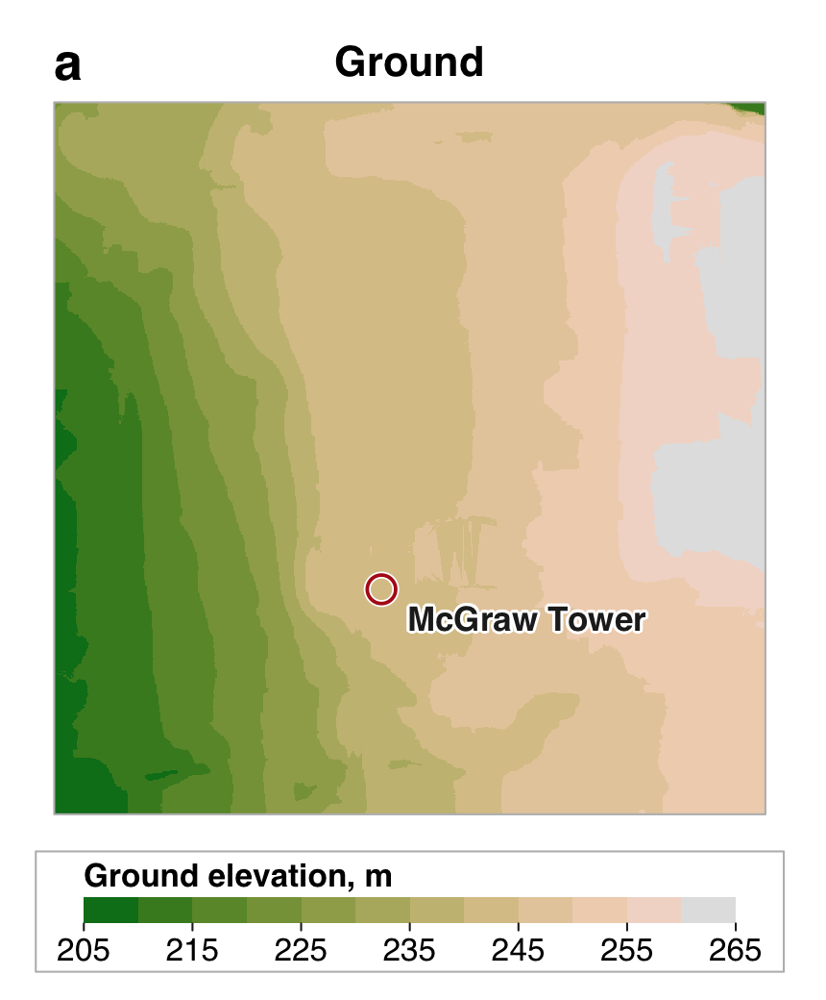{height="370px" fig-align="center"}

[`tin()` joins nearby ground points into triangles and reads the elevation off
them. The ring marks McGraw Tower.]{.source}

:::

::::

```{r}
#| label: dtm
#| script: "Ground elevation"
#| filename: "R Console, in the 25-lidar-drones folder; las, the campus points without noise"
ground <- rasterize_terrain(las, res = 1, algorithm = tin())   # bare ground, 1 m cells
```

::: {.content-visible unless-format="revealjs"}

The ground elevation goes from 205.3 m at the foot of Libe Slope to 264.3 m
above sea level. TIN stands for triangulated irregular network. Many sources
call a DTM a DEM, a digital elevation model. The call took about 4 seconds.

:::

## Surface elevation {#dsm}

:::: {.columns}

::: {.column width="62%"}

::: {.slide-text}

`rasterize_canopy()` builds a raster of the elevation of the top of buildings
and trees.

- `p2r()` puts each point in its 1 m cell and keeps the highest one.
- Where nothing stands on the ground, the cell has the ground elevation.
- This raster is called a digital surface model (DSM).

:::

:::

::: {.column width="36%"}

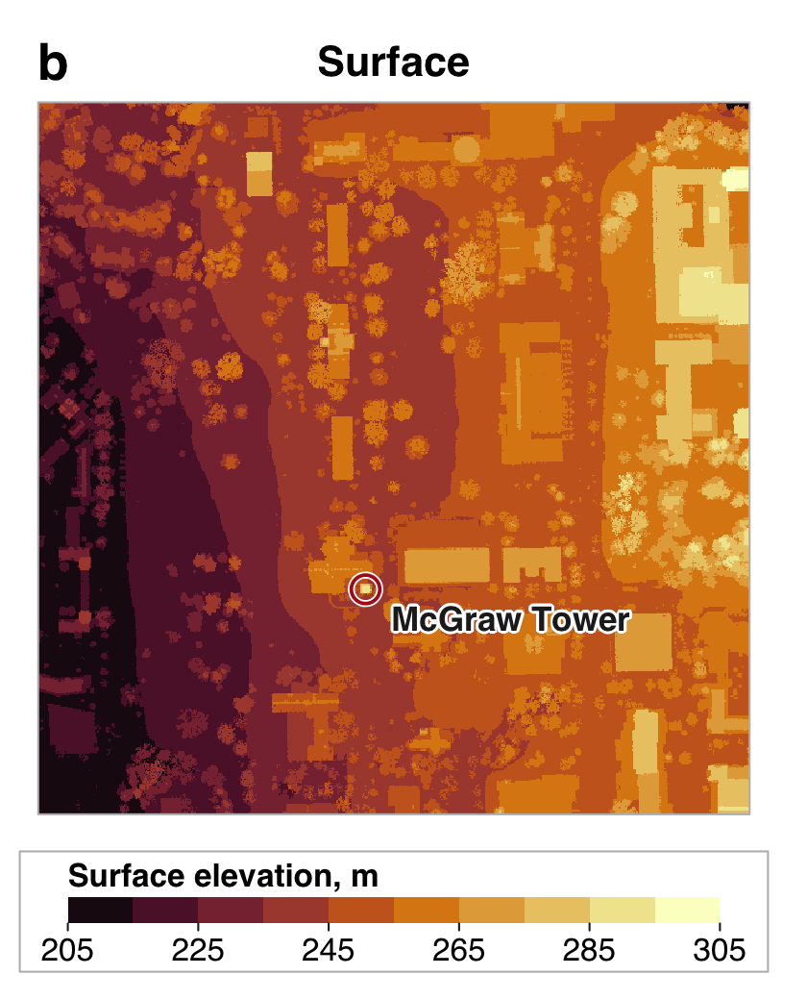{height="340px" fig-align="center"}

[3,278 cells have no point, mostly on dark roofs where no pulse came back.
`na.fill = tin()` fills them with triangles, as for the ground.]{.source}

:::

::::

```{r}
#| label: dsm
#| script: "Surface elevation"
#| filename: "R Console, in the 25-lidar-drones folder; las, the campus points without noise"
surface <- rasterize_canopy(las, res = 1, algorithm = p2r(na.fill = tin()))   # top point
```

::: {.content-visible unless-format="revealjs"}

The call took under 1 second. The surface elevation goes up to 304.4 m.

:::

## The height of buildings and trees {#height}

:::: {.columns}

::: {.column width="50%"}

::: {.slide-text}

We subtract the ground elevation from the surface elevation.

- The result is the height of buildings and trees above the ground.
- Open ground has a height of 0.
- The tallest object on campus is McGraw Tower, at 50.6 m.

:::

:::

::: {.column width="48%"}

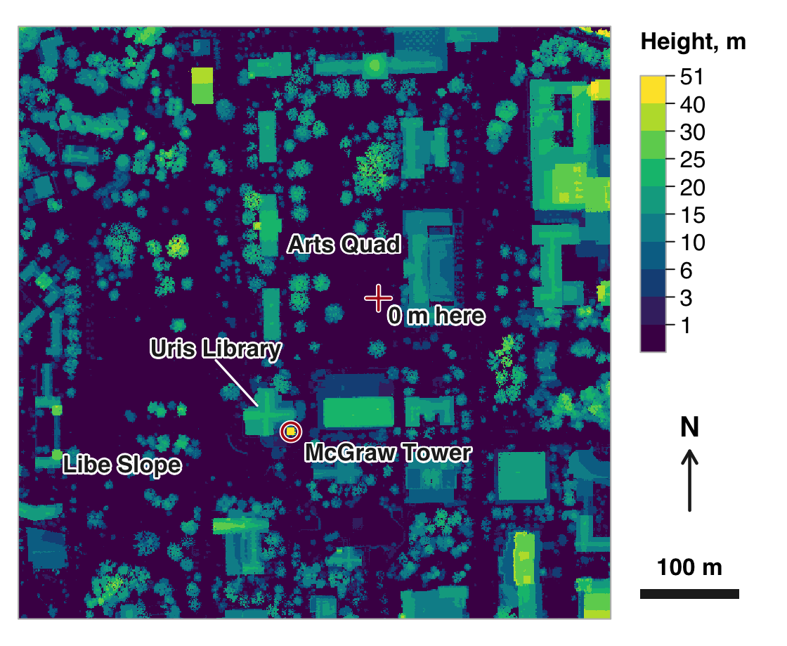{height="330px" fig-align="center"}

[The code prints the lowest height first, then the highest. A few cells are just
below 0 m, and the lowest is −3.3 m.]{.source}

:::

::::

```{r}
#| label: height
#| script: "The height of buildings and trees"
#| filename: "R Console, in the 25-lidar-drones folder; ground and surface from the slides before"
height <- surface - ground                         # height above ground, metres
round(range(values(height), na.rm = TRUE), 1)      # lowest and highest
```

::: {.notes}
8,023 cells read below 0, 13 below −1 m, and the lowest is −3.3 m. Nobody has
looked yet at where those cells sit, so say no cause.
:::

::: {.content-visible unless-format="revealjs"}

The two rasters have the same 1 m cells, so R subtracts them cell by cell. Roofs
and tree crowns get their height above the ground.

:::

## Checking the rasters on a lawn {#lawn}

:::: {.columns}

::: {.column width="64%"}

::: {.slide-text}

We check the rasters on the Arts Quad lawn, where the height should be 0 m.

- A lawn has no roof or tree, so its surface and ground elevations should be
  the same.
- Both elevations are 245.7 m, so the height is 0 m. The two rasters line up.
- If the rasters were shifted, the lawn would have a height of several metres.

:::

:::

::: {.column width="34%"}

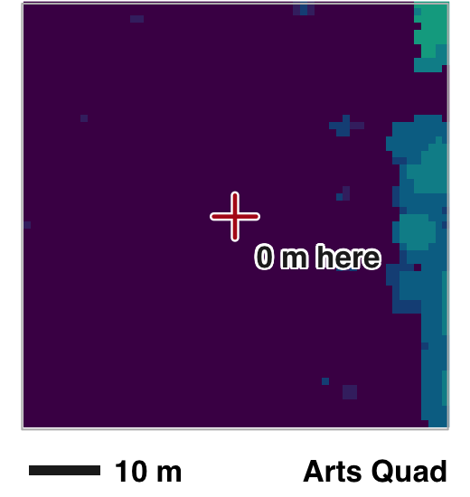{height="250px" fig-align="center"}

[The location is in the raster's own coordinates, metres east and north. The
tallest cell within 5 m has a height of 0.09 m.]{.source}

:::

::::

```{r}
#| label: lawn
#| script: "Checking the rasters on a lawn"
#| filename: "R Console, in the 25-lidar-drones folder; ground, surface, height from the slides before"
g3 <- c(ground, surface, height); names(g3) <- c("ground", "surface", "height")
lawn <- vect(cbind(377964.8, 4700674.7), crs = crs(g3))   # a point on the Arts Quad lawn
round(extract(g3, lawn), 2)
```

## A wider view of campus {#campus-wide}

::: {.slide-text}

The same steps on a 1.6 km square show the Ag Quad and both gorges.

:::

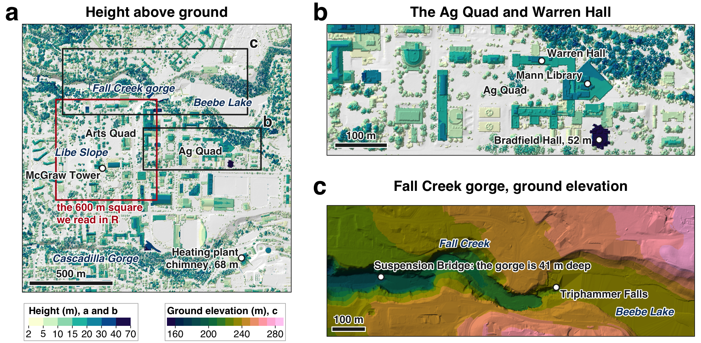{width="100%" fig-align="center"}

[13 million points from the same USGS flight. Fall Creek gorge is 41 m deep at
the Suspension Bridge, and Cascadilla Gorge is 30 m deep. Bradfield Hall, at
52 m, is taller than McGraw Tower.]{.source}

::: {.content-visible unless-format="revealjs"}

I built these rasters before class with `tools/fetch_lidar_wide.R` and
`tools/make_lidar_wide.R`. The square holds 13,017,930 points, 5.09 per m², all
from the flight of 13 May 2020. The points are 121 MB, so the zip keeps the 600 m
square only.

- I measured each gorge from the creek to its lower rim. Fall Creek gorge is
  41.2 m deep at the Suspension Bridge. Cascadilla Gorge is 30.1 m deep.
- The tallest structure is the chimney of the heating plant, at 68.5 m.
  Bradfield Hall reaches 52.1 m, McGraw Tower 50.6 m and Warren Hall 26.6 m.
- Beebe Lake returns almost no pulse, so it is a hole in the points. I gave
  those cells the ground elevation.
- The names and positions of the places come from OpenStreetMap
  (`logs/prep_lidar_wide.txt`).

:::

## Explore the campus map {#campus-viewer}

::: {.slide-text}

We can zoom and pan the three rasters. The buttons switch between ground,
surface and height.

:::

```{=html}
<iframe src="figures/25-lidar-drones/campus_wide.html" title="Campus LiDAR map" width="100%" height="440" style="border: 1px solid #bbbbbb;"></iframe>
```

[Scroll to zoom, drag to pan, double click to reset. The map also opens
[in its own tab](figures/25-lidar-drones/campus_wide.html).]{.source}

## Cornell's campus by radar and by LiDAR {#radar-lidar-campus}

::: {.slide-text}

Radar from a satellite gives one elevation for each 30 m cell. LiDAR from a
plane gives one for each 1 m cell.

- In the radar map, the cell with McGraw Tower has an elevation of 249 m. The
  top of the tower is at 295 m.
- Radar sees the top of trees and roofs. LiDAR also reaches the ground under
  the trees.

:::

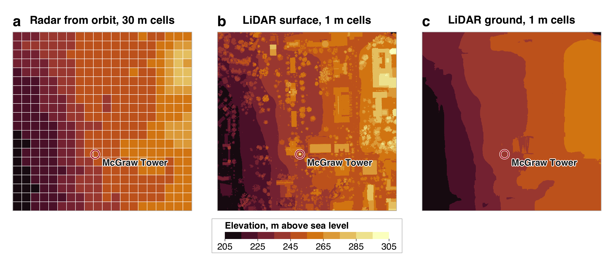{width="100%" fig-align="center"}

[I downloaded the radar data from the
[Copernicus](https://dataspace.copernicus.eu/explore-data/data-collections/copernicus-contributing-missions/collections-description/COP-DEM)
program. It is free and comes from two radar satellites (TanDEM-X), 2011 to 2013
for this area. The LiDAR data are from the USGS flight of May 2020.]{.source}

::: {.content-visible unless-format="revealjs"}

The three maps show the same 600 m square of campus. In the radar cell with the
tower, LiDAR's ground averages 244.1 m and its surface 251.2 m. The radar
elevation of 249 m lies between the two (`logs/prep_radar.txt`).

:::

# 4 · Heights of buildings and trees {#part-heights}

## Overview of part 4 {#overview-3}

::: {.slide-text}

In this part we measure the height of buildings and compare it with published
heights.

:::

::::: {.columns}

:::: {.column width="50%"}

::: {.dashes}

- We start with a study that measured every building in Nairobi with LiDAR.
- We measure McGraw Tower and compare our number with Cornell's.
- We measure the Empire State Building with LiDAR data for New York City.
- In Exercise 1 you merge the 1 m cells into 5 m and 10 m cells. Then you
  measure the tower again.

:::

::::

:::: {.column width="48%"}

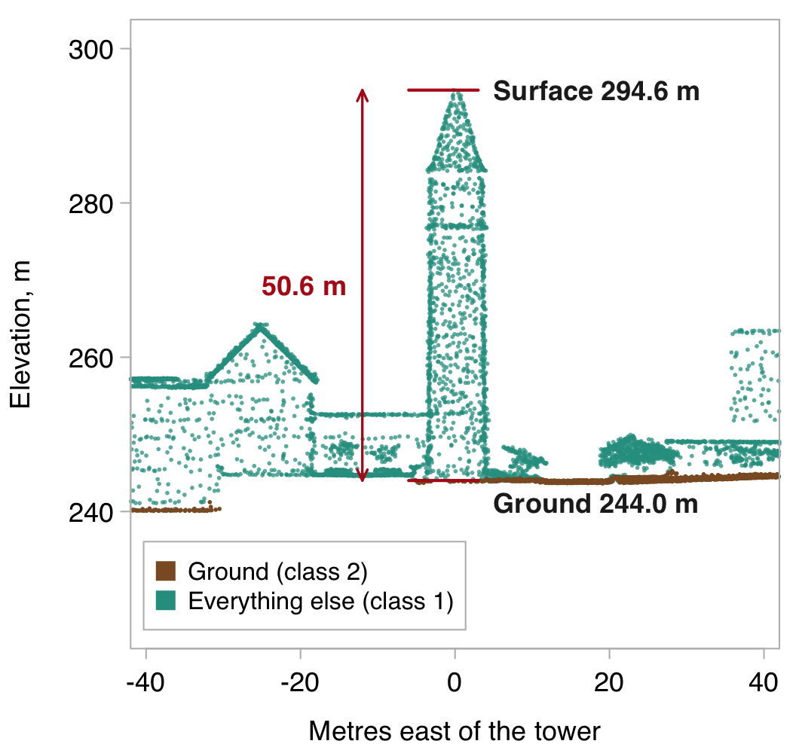{height="420px" fig-align="center"}

[Later in this part: McGraw Tower seen from the side, with one dot per
point.]{.source}

::::

:::::

## Building heights in Nairobi {#use-heights}

::::: {.columns}

:::: {.column width="52%"}

::: {.dashes}

- **Question:** [Henderson, Regan & Venables (Review of Economic Studies, 2021)](https://doi.org/10.1093/restud/rdaa042)
  asked how a growing city replaces its buildings. They also asked what keeps
  slums from becoming formal housing.
- **Method:** They used building outlines traced from aerial photographs of
  2003 and 2015. They took the height of each building from LiDAR data collected
  in 2015.
- **Data:** All buildings in Nairobi, Kenya's capital.
- **Result:** In the formal centre of the city, a third of the buildings were
  torn down in 12 years. The new buildings were three times taller.

:::

::::

:::: {.column width="46%"}

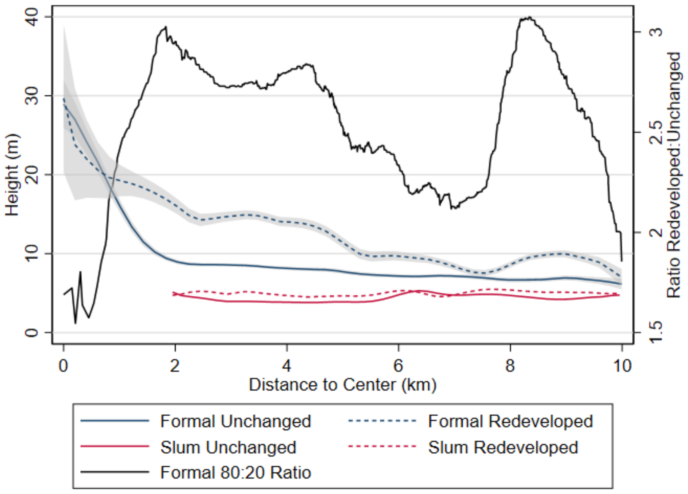{width="100%" fig-align="center"}

[A **slum** is housing built without formal title or permits. The figure plots
mean building height against distance from the centre. Blue lines are formal
buildings, red lines slums, and dashed lines rebuilt ones. Figure 7 of the
authors' accepted version (LSE Research Online).]{.source}

::::

:::::

::: {.content-visible unless-format="revealjs"}

They added up the buildings in squares of 150 m.

:::

## The height of McGraw Tower {#tower}

:::: {.columns}

::: {.column width="50%"}

::: {.slide-text}

Our height for McGraw Tower is 50.6 m.

- Cornell reports 173 feet, which is 52.7 m.
- Our number is 2.1 m lower. The top of the tower is narrow, and the laser may
  have missed its tip.

:::

:::

::: {.column width="48%"}

{height="460px" fig-align="center"}

[[Cornell Chronicle, 3 September 2025](https://news.cornell.edu/node/331424):
"the 173-foot-tall landmark". Each dot is one point in a strip 10 m wide
through the tower, at true scale.]{.source}

:::

::::

::: {.content-visible unless-format="revealjs"}

Our number is the tallest cell within 20 m of the tower. In that cell the
ground elevation is 244.0 m and the surface elevation is 294.6 m. The
difference is 50.6 m. The flight was in May 2020.

:::

## Measuring McGraw Tower in R {#tower-code}

::: {.slide-text}

To measure the tower, we look at the cells within 20 m of it.

- `buffer()` draws a circle of 20 m around the tower.
- `extract()` returns the 1,248 cells inside the circle. The tallest has a
  height of 50.6 m.
- `g3` stacks the three campus rasters: ground, surface and height.

:::

```{r}
#| label: tower
#| script: "Measuring McGraw Tower in R"
#| filename: "R Console, in the 25-lidar-drones folder; g3, the three rasters stacked on the lawn slide"
tower <- vect(cbind(377876.1, 4700539.6), crs = crs(g3))   # McGraw Tower
zone  <- buffer(tower, 20)                                 # every cell within 20 m
e <- extract(g3, zone)
nrow(e)
e[which.max(e$height), ]                                   # the tallest of them
```

[The tower's location is in the raster's own coordinates, metres east and
north. `buffer()` is terra's version of `st_buffer()`.]{.source}

::: {.notes}
The tower ends in a narrow top. At about 6 points per square metre, few pulses
hit its tip. That is my reading of the side view.
:::

## The height of the Empire State Building {#esb}

:::: {.columns}

::: {.column width="52%"}

::: {.slide-text}

Our height for the Empire State Building is 440.3 m above the street.

- I used the LiDAR data from a USGS flight over Manhattan in March 2014.
- The owners report 1,454 feet (443.2 m) to the tip of the antenna.
- Our tallest 1 m cell is on the mast, 2.9 m below its tip.
- Each dot is one point within 60 m of the centre of the building.

:::

:::

::: {.column width="46%"}

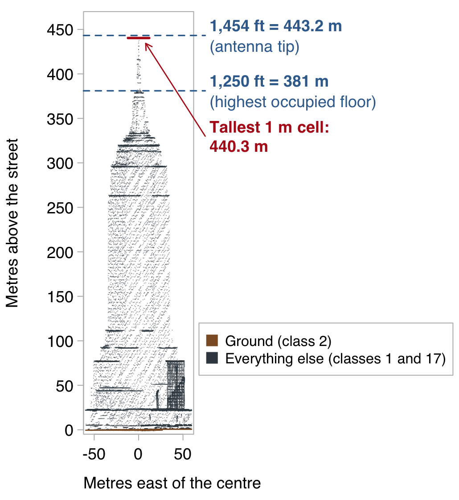{height="445px" fig-align="center"}

[The highest occupied floor is at 1,250 feet (381 m). The mast stands above it
([esbnyc.com, Facts & Figures](https://www.esbnyc.com/about/facts-figures)).]{.source}

:::

::::

## The Empire State Building in 30 m cells {#esb-code}

::: {.slide-text}

In 30 m cells, our height for the Empire State Building falls to 323.7 m.

- `aggregate()` merges blocks of cells into one larger cell. Here it merges 30
  by 30 cells.
- 30 m is the size of a pixel in free satellite images.
- `esb` is the 1 m height raster around the building. I built it like the
  campus rasters.
- `b` is a circle of 60 m around the centre of the building.

:::

```{r}
#| label: esb
#| script: "The Empire State Building in 30 m cells"
#| filename: "R Console, in the 25-lidar-drones folder; reads data_clean/lidar_nyc/esb_height.tif"
esb <- rast("data_clean/lidar_nyc/esb_height.tif")                    # height above ground, 1 m
b   <- buffer(vect(cbind(585631.7, 4511326.9), crs = crs(esb)), 60)   # 60 m around the building
max(extract(esb, b)[[2]], na.rm = TRUE)
esb30 <- aggregate(esb, fact = 30, fun = "mean")                      # 30 x 30 cells into one
max(extract(esb30, b)[[2]], na.rm = TRUE)
```

[In 30 m cells the building keeps 74% of its height (323.7 of 440.3 m). The
coordinates of the centre are metres east and north.]{.source}

::: {.content-visible unless-format="revealjs"}

I built the Manhattan rasters from a box of 400 m with 596,754 points. I used
the same steps as for the campus rasters (`tools/make_nyc.R`). The top point is
440.5 m above the median street level. Our 440.3 m is close to the 443 m at the
tip of the antenna. In 5 m and 10 m cells the building has these heights:

```{r}
#| label: esb-sizes
#| script: "The Empire State Building in 5 m and 10 m cells"
#| filename: "R Console, in the 25-lidar-drones folder; esb and b from above"
sapply(c(5, 10), function(k) round(max(extract(aggregate(esb, fact = k, fun = "mean"), b)[[2]],
                                       na.rm = TRUE), 1))
```

With the same flight, One World Trade Center has a height of 541.6 m
(1,777 ft). Its published height is 1,776 ft.

:::

## Exercise 1 {#exercise-1}

::: {.panel-tabset}

### Exercise

In 10 m cells McGraw Tower loses most of its height.

4 minutes. Measure the tower in 5 m and 10 m cells. `height` is the
height raster from part 3. `zone` is the 20 m circle around McGraw Tower.

1. `h5 <- aggregate(height, fact = 5, fun = "mean")` makes 5 m cells.
2. `max(extract(h5, zone)[[2]], na.rm = TRUE)` gives the tallest cell.
3. Repeat steps 1 and 2 with `fact = 10`.
4. Divide each by 50.6 m. Compare with the Empire State Building's 74% in 30 m
   cells.

```{r}
#| label: exercise-1
#| exercise: true
#| script: "Exercise 1 (4 minutes)"
#| include: false
#| eval: false
# Exercise 1 (4 minutes). McGraw Tower in 5 m and 10 m cells.
# In 10 m cells McGraw Tower loses most of its height.
# In the 25-lidar-drones folder, with height and zone as on the slides before
# (or run code/3_heights.R first).
# 1. h5 <- aggregate(height, fact = 5, fun = "mean")      # 5 m cells
# 2. max(extract(h5, zone)[[2]], na.rm = TRUE)            # the tallest 5 m cell near the tower
# 3. Repeat steps 1 and 2 with fact = 10.
# 4. Divide each result by 50.6 m. Compare with 323.7 / 440.3, the Empire State Building in 30 m.
# Two answers to compare with the class: the tower's height in 10 m cells, and the share of its
# height it keeps. Without lidR: height <- rast("data_clean/lidar/campus_height.tif").
```

[Share two answers with the class: the tower's height in 10 m cells and the
share of its height it keeps. Without lidR, read
`data_clean/lidar/campus_height.tif` with `rast()` and build `zone` as on slide
28.]{.source}

### Solution

```{r}
#| label: exercise-1-solution
#| purl: false
#| filename: "R Console, in the 25-lidar-drones folder; height and zone from the slides before"
h5 <- aggregate(height, fact = 5, fun = "mean")
max(extract(h5, zone)[[2]], na.rm = TRUE)
h10 <- aggregate(height, fact = 10, fun = "mean")
max(extract(h10, zone)[[2]], na.rm = TRUE)
```

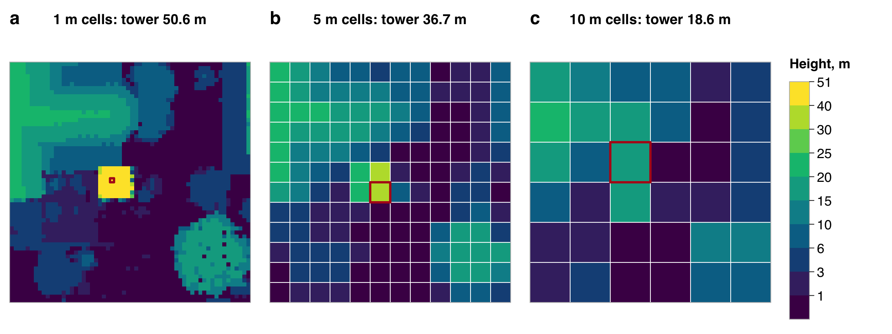{height="228px" fig-align="center"}

[The tower keeps 37% of its height in 10 m cells. The Empire State Building
keeps 74% in 30 m cells (323.7 of 440.3). Only 62 cells near the tower are
taller than 40 m. A 10 m cell mixes the tower with the lawn and roofs around
it.]{.source}

:::

::: {.notes}
On Zoom the answers go in the chat. Exercise 1 runs from minute 22 to 28.
:::

# 5 · Slope and views {#part-terrain}

## Overview of part 5 {#overview-5}

::: {.slide-text}

In this part we use an elevation raster to measure slope and views.

:::

::::: {.columns}

:::: {.column width="58%"}

::: {.dashes}

- The data are USGS's elevation raster of Tompkins County, with 30 m cells.
- For slope, we compute each town's share of land steeper than 15%.
- For views, we find the land we can see from the top of McGraw Tower. In
  Exercise 2 you do the same from the ground.
- Three studies used hills and rivers to predict who got a dam, television or
  radio.

:::

::::

:::: {.column width="40%"}

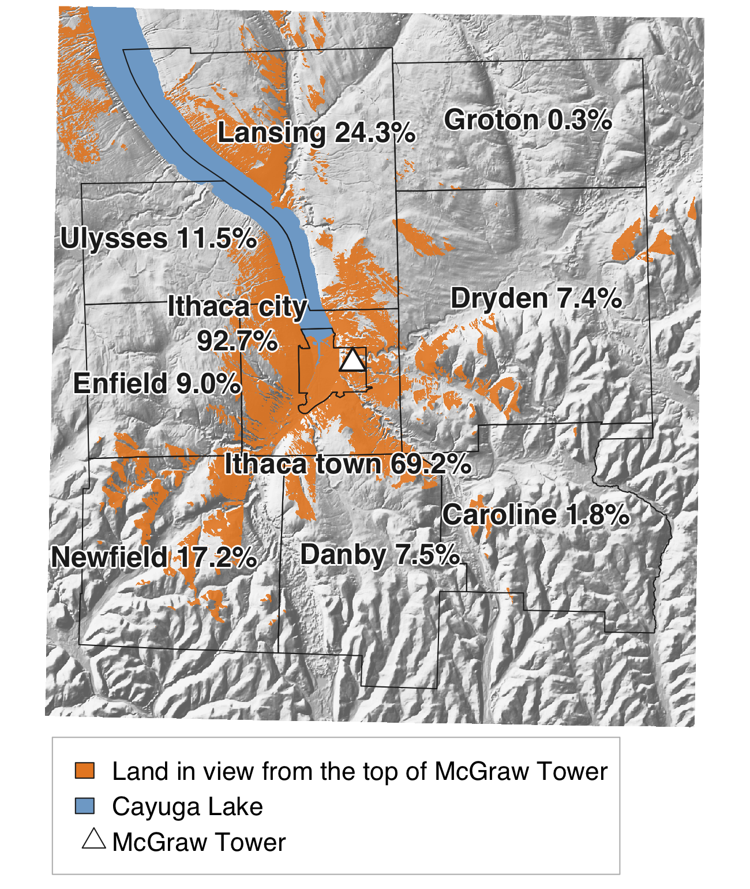{height="360px" fig-align="center"}

[Later in this part: the land in view from the top of McGraw Tower.]{.source}

::::

:::::

## Steep land and housing supply {#use-slope}

::::: {.columns}

:::: {.column width="56%"}

::: {.dashes}

- **Question:** [Saiz (Quarterly Journal of Economics, 2010)](https://doi.org/10.1162/qjec.2010.125.3.1253)
  asked why some US cities build few new homes when prices rise.
- **Method:** He measured the share of land within 50 km of each city centre
  that is water or steeper than 15%.
- **Data:** He used a USGS elevation raster with 90 m cells, satellite maps of
  water and wetlands, and US metro areas.
- **Result:** Most metro areas that build few new homes when prices rise are
  surrounded by water and steep slopes.

:::

::::

:::: {.column width="42%"}

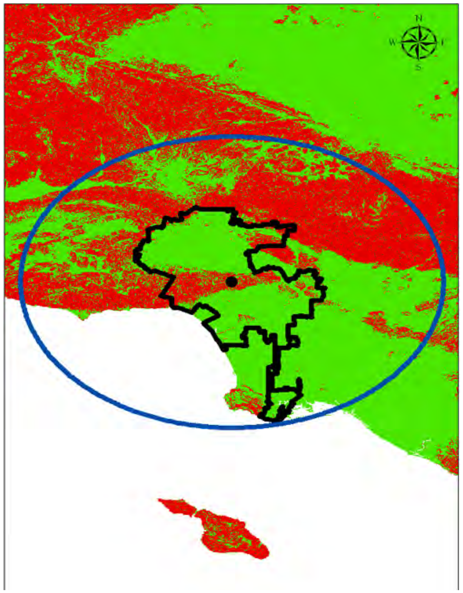{height="350px" fig-align="center"}

[**Inelastic supply** means few new homes get built when prices rise. The figure is
Figure 1.D of the 2008 working paper, "Embedding LA Data into 50km Radius". Red
is steeper than 15%, and the blue ring is 50 km around Los Angeles.]{.source}

::::

:::::

## Elevation in Tompkins County {#dem}

:::: {.columns}

::: {.column width="50%"}

::: {.slide-text}

USGS publishes an elevation raster of Tompkins County with 30 m cells.

- Tompkins County is the county around Ithaca.
- The elevation goes from 115.95 m at the surface of Cayuga Lake to 639.68 m.
- The county has nine towns and the city of Ithaca. In New York, a town is the
  level of government below the county.
- In the next slides we compute slope and views from this raster.

:::

:::

::: {.column width="48%"}

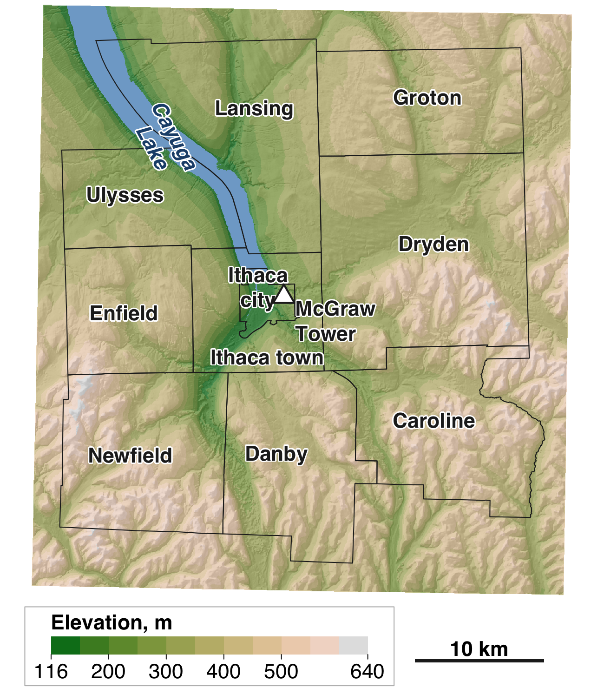{height="480px" fig-align="center"}

:::

::::

## Reading the elevation raster and towns {#dem-code}

::: {.slide-text}

`rast()` reads the elevation raster, and `st_read()` reads the ten town
polygons.

- The raster has 1,521 by 1,394 cells.
- I projected USGS's raster to metres (UTM zone 18N) before class. Slope then
  comes out in metres per metre.
- `ALAND` is the land area of each town in m², from the Census.

:::

```{r}
#| label: dem
#| script: "Reading the elevation raster and towns"
#| out.lines: [2, 3, 5, 8, 9]
#| filename: "R Console, in the 25-lidar-drones folder; reads data_clean/terrain/"
dem   <- rast("data_clean/terrain/tompkins_dem_utm.tif")     # elevation, m, 30 m cells
towns <- st_read("data_clean/terrain/tompkins_towns.gpkg", quiet = TRUE)
dem
```

[USGS's own cells are 1 arc-second (1/3600 of a degree), about 30 m.]{.source}

::: {.content-visible unless-format="revealjs"}

The full printout:

```{r}
#| label: dem-full
#| purl: false
#| filename: "R Console, in the 25-lidar-drones folder; dem from above"
dem
```

`tools/make_terrain.R` cropped USGS's 1 arc-second tile (n43w077) to the
county's towns plus 0.02 degrees, then projected it to UTM zone 18N with 30 m
cells:

```{r}
#| label: dem-project
#| eval: false
#| purl: false
#| filename: "tools/make_terrain.R (part); reads data/usgs_dem/USGS_1_n43w077.tif, not in the zip"
raw <- rast("data/usgs_dem/USGS_1_n43w077.tif")
ll  <- crop(raw, ext(vect(st_transform(towns, crs(raw)))) + 0.02)
dem <- project(ll, "EPSG:26918", res = 30, method = "bilinear")
```

:::

## Slope with terrain() {#slope}

:::: {.columns}

::: {.column width="62%"}

::: {.slide-text}

`terrain()` computes the slope of each cell from its eight neighbours.

- Slope is rise over run. A slope of 15% means 15 m of rise over 100 m, or 8.5
  degrees.
- `terrain()` returns the slope as an angle. `tan()` turns it into rise over
  run, and multiplying by 100 gives percent.
- The red cells on the map are steeper than 15%.

:::

:::

::: {.column width="36%"}

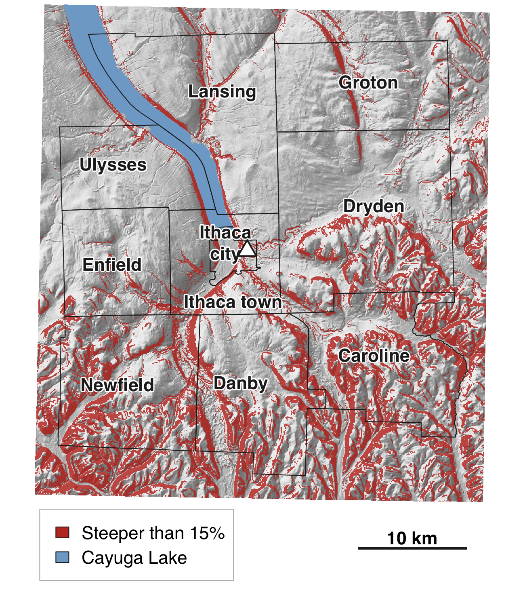{height="330px" fig-align="center"}

:::

::::

```{r}
#| label: slope
#| script: "Slope with terrain()"
#| filename: "R Console, in the 25-lidar-drones folder; dem from the slide before"
slope_pct <- tan(terrain(dem, v = "slope", unit = "radians")) * 100   # percent
steep     <- slope_pct > 15                                         # TRUE where steeper than 15%
```

::: {.content-visible unless-format="revealjs"}

**Slope from 4 neighbours and from 8.** `terrain()` uses all eight neighbours by
default. With `neighbors = 4` it uses only the cells north, south, east and
west. On this raster the county's share of land steeper than 15% barely
changes:

```{r}
#| label: slope-4
#| script: "Slope from 4 neighbours"
#| filename: "R Console, in the 25-lidar-drones folder; dem, towns and slope_pct from above"
s4 <- tan(terrain(dem, v = "slope", unit = "radians", neighbors = 4)) * 100
round(100 * c(eight = sum(exact_extract((slope_pct > 15) * 900, towns, "sum", progress = FALSE)),
              four  = sum(exact_extract((s4 > 15) * 900, towns, "sum", progress = FALSE))) /
        sum(towns$ALAND), 1)
```

:::

:::::: {.content-visible unless-format="revealjs"}

## Computing slope by hand {#by-hand}

::: {.slide-text}

To see what `terrain()` does, I computed one slope by hand.

- I used the 3 × 3 window around McGraw Tower's cell. I got 6.235%, as
  `terrain()` does.
- For the rise to the east, I subtract the west column from the east column.
  The middle row counts twice.
- The weights add to 4 and the columns are 60 m apart. So I divide by
  4 × 60 = 8 × 30 m.

:::

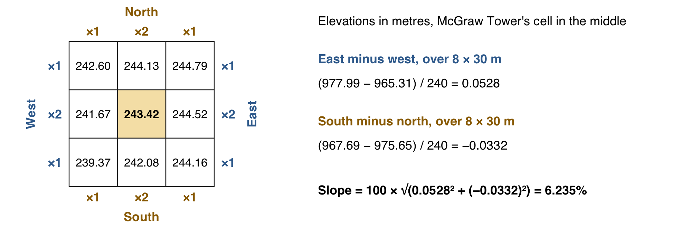{.nostretch width="84%" fig-align="center"}

[The rise from north to south works the same way, and the slope combines the
two. This weighting is Horn's formula, which terra uses.]{.source}

## The slope by hand in R {#by-hand-code}

::: {.slide-text}

Six lines of R give the same slope as `terrain()` at the tower's cell.

- `tw` is McGraw Tower in the raster's coordinates.
- `w` is the 3 × 3 window of elevations around the tower's cell.
- `dx` and `dy` are the rise per metre to the east and to the north.

:::

```{r}
#| label: by-hand
#| script: "The slope by hand in R"
#| filename: "R Console, in the 25-lidar-drones folder; dem and slope_pct from the slides before"
tw <- project(vect(cbind(-76.48505, 42.44757), crs = "EPSG:4326"), crs(dem))   # McGraw Tower
rc <- rowColFromCell(dem, cellFromXY(dem, crds(tw)))                          # row 753, col 651
w  <- matrix(values(dem, row = rc[1] - 1, nrows = 3, col = rc[2] - 1, ncols = 3), 3, byrow = TRUE)
dx <- (sum(w[, 3] * c(1, 2, 1)) - sum(w[, 1] * c(1, 2, 1))) / (8 * 30)
dy <- (sum(w[3, ] * c(1, 2, 1)) - sum(w[1, ] * c(1, 2, 1))) / (8 * 30)
round(c(by_hand = 100 * sqrt(dx^2 + dy^2), terrain = extract(slope_pct, tw)[1, 2]), 3)
```

[`slope_pct` is the slope raster in percent from `terrain()`.]{.source}

::::::

## Steep land in each town {#steep-towns}

::: {.slide-text}

In Newfield and Caroline, about a third of the land is steeper than 15%.

- In Ulysses, only 4.5% of the land is that steep.
- `exact_extract()` adds up the steep area in each town. Each 30 m cell is
  900 m², so `steep * 900` is the area of each steep cell.
- I divide by the Census land area, `ALAND`, because three towns reach into
  Cayuga Lake.

:::

```{r}
#| label: steep-towns
#| script: "Steep land in each town"
#| filename: "R Console, in the 25-lidar-drones folder; steep and towns from the slides before"
s <- exact_extract(steep * 900, towns, "sum", progress = FALSE)     # m2 steeper than 15%
d <- data.frame(town = towns$NAMELSAD, pct_of_land = round(100 * s / towns$ALAND, 1))
d[order(-d$pct_of_land), ]
```

[In the whole county, 205.7 of 1,229.3 km² of land is steeper than 15%. That
is 16.7%.]{.source}

::: {.content-visible unless-format="revealjs"}

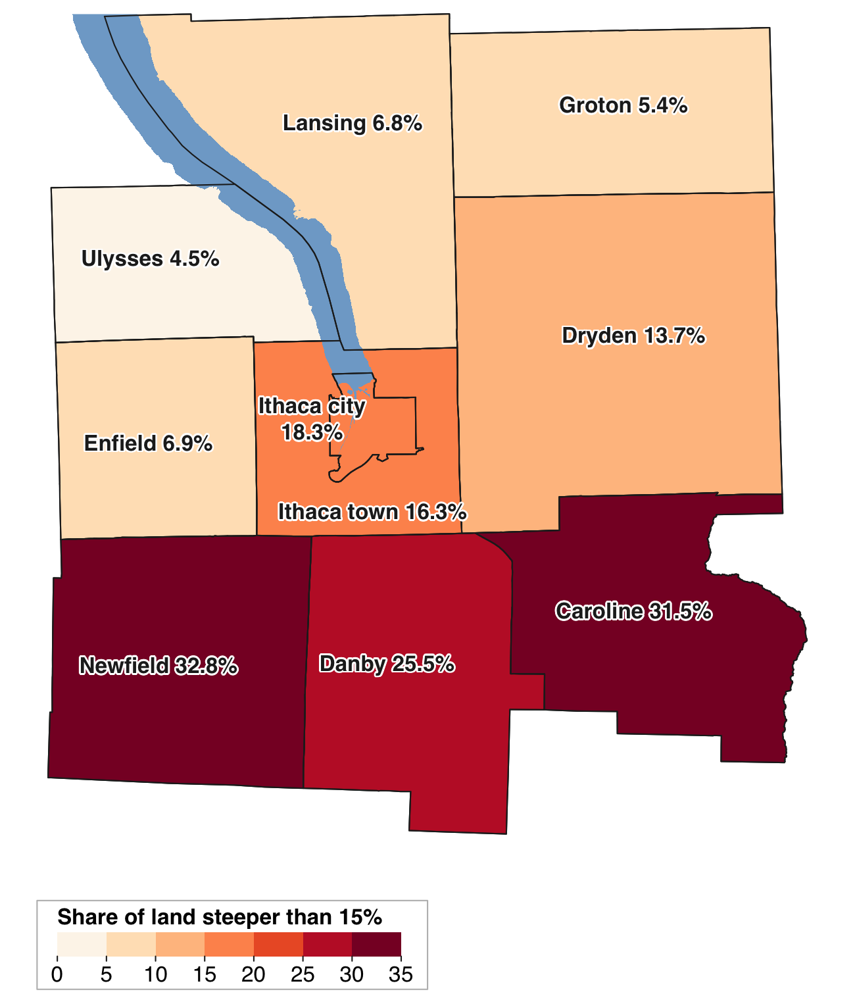{width="60%" fig-align="center"}

`exact_extract(steep, towns, "mean")` gives the steep share of each town's
polygon instead. Three of the polygons include water. The shares are Ithaca city
16.3, Danby 25.4, Dryden 13.6, Enfield 6.9, Newfield 32.7, Ulysses 4.0, Ithaca
town 15.5, Caroline 31.4, Groton 5.4 and Lansing 5.9.

```{r}
#| label: steep-county
#| script: "Steep land in the county"
#| filename: "R Console, in the 25-lidar-drones folder; s and towns from above"
round(c(km2_steep = sum(s) / 1e6, km2_land = sum(towns$ALAND) / 1e6,
        pct = 100 * sum(s) / sum(towns$ALAND)), 1)
```

:::

## Wind turbines in view of homes {#use-view}

::::: {.columns}

:::: {.column width="56%"}

::: {.dashes}

- **Question:** [Gibbons (Journal of Environmental Economics and Management, 2015)](https://doi.org/10.1016/j.jeem.2015.04.006)
  asked what a view of a wind farm costs the people nearby.
- **Method:** He computed the viewshed of each wind farm on an elevation raster
  with 90 m cells. Then he compared changes in house prices where turbines came
  into view.
- **Data:** Home sales in England and Wales from 2000 to early 2012, and 148
  wind farms in operation.
- **Result:** House prices fell 5 to 6% where a wind farm came into view within
  2 km.

:::

::::

:::: {.column width="42%"}

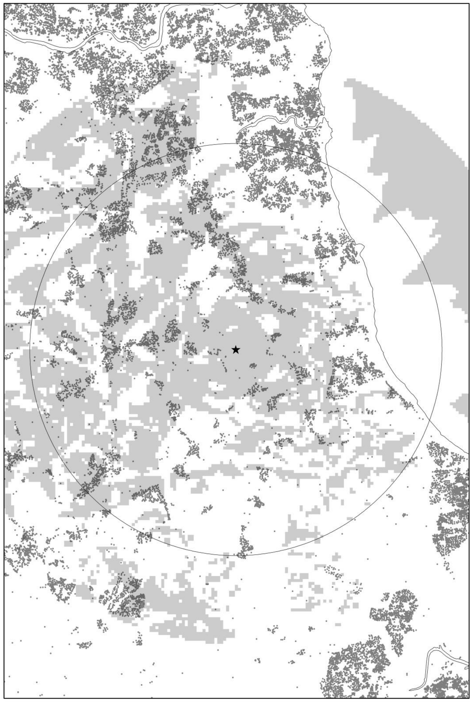{height="370px" fig-align="center"}

[A **viewshed** is the land you can see from a point. A **hedonic** study uses
house prices to measure what people pay for a view, a park or clean air. Light
grey is land that sees at least one turbine tip, and dark dots are the postcodes
of homes. Figure 3 of the accepted version (LSE Research Online), one wind farm
in north east England.]{.source}

::::

:::::

## The view from McGraw Tower {#view}

:::: {.columns}

::: {.column width="50%"}

::: {.slide-text}

From the top of McGraw Tower, we can see 236.5 km² of land and lake.

- We can see 92.7% of the land in the city of Ithaca and 7.4% of the land in
  Dryden.
- Orange cells are in view. Each town's label gives the share of its land in
  view.
- I put the eye 53 m up, at the top of the tower. Cornell reports 52.7 m.

:::

:::

::: {.column width="48%"}

{height="525px" fig-align="center"}

:::

::::

## Computing the view in R {#view-code}

::: {.slide-text}

`viewshed()` returns TRUE for each cell we can see from the tower.

- `tw` is McGraw Tower. `viewshed()` draws a line of sight from it to every cell.
- `observer = 53` puts the eye 53 m above the tower's cell. `target = 0` asks
  whether we can see the ground itself.
- Each cell is 30 × 30 = 900 m². `land` drops the lake, whose surface is flat at
  115.95 m.

:::

```{r}
#| label: view
#| script: "Computing the view in R"
#| filename: "R Console, in the 25-lidar-drones folder; dem (the 30 m raster) and towns from the slides before"
tw   <- project(vect(cbind(-76.48505, 42.44757), crs = "EPSG:4326"), crs(dem))   # McGraw Tower
top  <- viewshed(dem, crds(tw), observer = 53, target = 0)    # TRUE where visible
round(global(top, "sum", na.rm = TRUE)[[1]] * 900 / 1e6, 1)   # km2 in view
land <- dem > 116.45                         # 0.5 m above the lake's flat surface
towns$top <- round(100 * exact_extract(top * land * 900, towns, "sum", progress = FALSE) /
                   towns$ALAND, 1)
```

[`viewshed()` accounts for the curve of the Earth. It took 0.06
seconds.]{.source}

::: {.notes}
Ask: what should change when the eye comes down to the street?
:::

::: {.content-visible unless-format="revealjs"}

The 236.5 km² is for the whole raster, which extends past the county. Inside
the county, 179.0 km² of land is in view, 14.6% of its land. Over the lake the
view reaches 41 km north on a raster that runs to 43° N. The county raster stops
it at 28 km.

:::

## Exercise 2 {#exercise-2}

::: {.panel-tabset}

### Exercise

What you see depends on how high your eye is.

4 minutes. Compute the view from the foot of the tower, 1.7 m up.
`dem` is the 30 m raster and `tw` the tower. `land` marks the cells above the
lake, and `towns` holds the towns.

1. `gnd <- viewshed(dem, crds(tw), observer = 1.7, target = 0)`.
2. The area in view in km², as on the slide before.
3. Each town's share of land in view, in a column `towns$gnd`.
4. `towns[, c("NAMELSAD", "top", "gnd"), drop = TRUE]` shows both columns.

```{r}
#| label: exercise-2
#| exercise: true
#| script: "Exercise 2 (4 minutes)"
#| include: false
#| eval: false
# Exercise 2 (4 minutes). The view from the ground at McGraw Tower.
# What you see depends on how high your eye is.
# In the 25-lidar-drones folder, with dem, tw, land and towns as on the slides before
# (or run code/5_views.R up to this exercise).
# 1. gnd <- viewshed(dem, crds(tw), observer = 1.7, target = 0)
# 2. The area in view in km2, as on the slide before.
# 3. Each town's share of land in view, as on the slide before, in a column towns$gnd.
# 4. towns[, c("NAMELSAD", "top", "gnd"), drop = TRUE] sets the two columns side by side.
# Two answers to compare with the class: the area in view from the ground against 236.5 km2,
# and the towns whose share falls to zero.
```

[Share with the class the area in view from the ground and the towns that lose
all their view.]{.source}

### Solution

```{r}
#| label: exercise-2-solution
#| purl: false
#| filename: "R Console, in the 25-lidar-drones folder; dem, tw, land and towns from the slides before"
gnd <- viewshed(dem, crds(tw), observer = 1.7, target = 0)
round(global(gnd, "sum", na.rm = TRUE)[[1]] * 900 / 1e6, 1)
towns$gnd <- round(100 * exact_extract(gnd * land * 900, towns, "sum", progress = FALSE) /
                   towns$ALAND, 1)
towns[, c("NAMELSAD", "top", "gnd"), drop = TRUE]
```

[From the ground, the view shrinks from 236.5 to 124.6 km². The share of the
county's land in view falls from 14.6% to 8.1%. Dryden drops from 7.4% to zero,
and Groton from 0.3% to zero.]{.source}

::: {.content-visible unless-format="revealjs"}

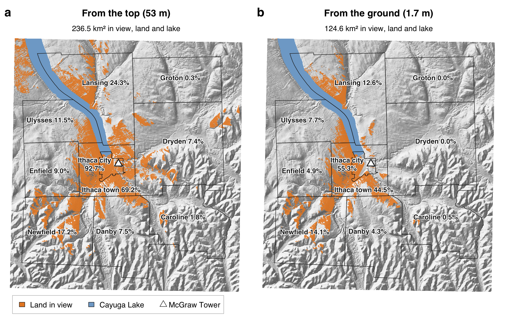{width="100%" fig-align="center"}

:::

:::

::: {.notes}
On Zoom the answers go in the chat. Exercise 2 runs from minute 45 to 51.
:::

## Turning the view into polygons {#view-polygons}

:::: {.columns}

::: {.column width="62%"}

::: {.slide-text}

To join the view with home sales or farm fields, we turn it into polygons.

- Gibbons joined views to homes in the same way.
- `top` is the view raster from `viewshed()`. `ifel(top, 1, NA)` keeps the cells in
  view.
- `as.polygons()` turns these cells into polygons. `disagg()` splits them into
  758 separate pieces.

:::

:::

::: {.column width="36%"}

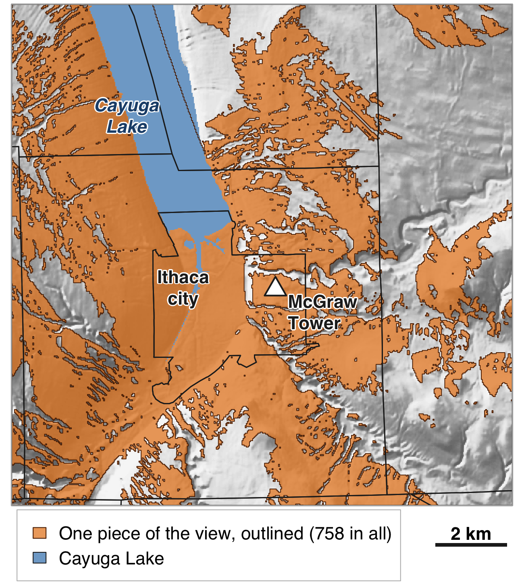{height="380px" fig-align="center"}

:::

::::

```{r}
#| label: view-polygons
#| script: "Turning the view into polygons"
#| filename: "R Console, in the 25-lidar-drones folder; top, the view raster from viewshed()"
view <- disagg(as.polygons(ifel(top, 1, NA)))   # one polygon per separate piece
nrow(view)
```

::: {.content-visible unless-format="revealjs"}

`expanse()` gives the area of each polygon. The pieces add up to 236.6 km². The
raster gave 236.5 km².

```{r}
#| label: view-area
#| script: "The area of the pieces"
#| filename: "R Console, in the 25-lidar-drones folder; view from above"
round(sum(expanse(view)) / 1e6, 1)
```

:::

## Terrain as an instrument {#instrument}

::::: {.columns}

:::: {.column width="52%"}

::: {.slide-text}

Three papers used terrain as an instrument.

- An **instrument** changes who gets a treatment. It affects the outcome only
  through that treatment.
- [Duflo & Pande (Quarterly Journal of Economics, 2007)](https://doi.org/10.1162/qjec.122.2.601)
  used river gradient, which predicts where India built dams.
- [Olken (American Economic Journal: Applied Economics, 2009)](https://doi.org/10.1257/app.1.4.1)
  used mountains that block television signals to villages in Indonesia.
- [Yanagizawa-Drott (Quarterly Journal of Economics, 2014)](https://doi.org/10.1093/qje/qju020)
  used hills that blocked a hate radio station during Rwanda's 1994 genocide.

:::

::::

:::: {.column width="46%"}

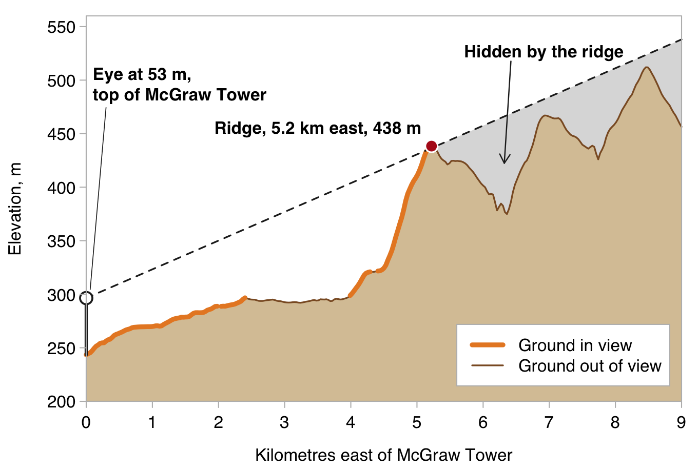{width="100%" fig-align="center"}

[My drawing, from the Tompkins raster east of McGraw Tower. From the top of the
tower, a ridge 5.2 km east at 438 m hides the land behind it.]{.source}

::::

:::::

::: {.notes}
The profile: the eye at 53 m sees the ground out to 2.43 km, loses it behind a
bump to 3.96 km, sees it again to 5.22 km, and then the ridge hides everything
beyond. Results, each from its abstract. Duflo and Pande: poverty fell in
downstream districts and rose in the district where the dam was built. Olken:
better reception went with less participation in village groups and lower
trust. Yanagizawa-Drott: about 10% of the violence, about 51,000 perpetrators,
is attributed to the station.
:::

::: {.content-visible unless-format="revealjs"}

The results, each from its abstract:

- Duflo & Pande: poverty declines in downstream districts and increases in the
  district where the dam is built.
- Olken: better television reception is associated with less participation in
  social organizations and lower self-reported trust.
- Yanagizawa-Drott: about 51,000 perpetrators, approximately 10% of the
  violence, are attributed to the station.

:::

:::::: {.content-visible unless-format="revealjs"}

## River pollution near sewage plants {#use-watershed}

In this section we find the land that drains to a point on a creek. We start
with a study of river pollution, which needed to know what lies upstream.

::::: {.columns}

:::: {.column width="56%"}

::: {.dashes}

- **Question:** [Keiser & Shapiro (Quarterly Journal of Economics, 2019)](https://doi.org/10.1093/qje/qjy019)
  asked whether federal grants to city sewage plants made US rivers cleaner.
  They also asked whether the benefits covered the cost.
- **Method:** They compared pollution downstream and upstream of each plant,
  before and after its grants. They used a model of the US river network.
- **Data:** 50 million readings from 240,000 monitoring sites, 1962 to 2001,
  and 35,000 grants to treatment plants.
- **Result:** Making one mile of river fishable for a year cost about $1.5
  million. This is more than the gain in home values.

:::

::::

:::: {.column width="42%"}

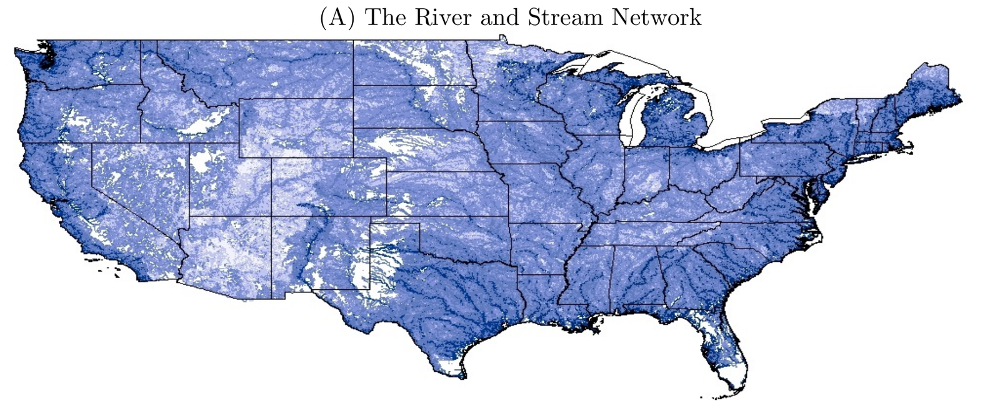{width="100%" fig-align="center"}

::::

:::::

[The **Clean Water Act** (1972) is the main US federal law on water pollution.
The map is panel A of Figure I of the 2018 working-paper version
(Cowles Foundation), "National Maps of Water Pollution Data".]{.source}

## Which way water flows {#flow}

::: {.slide-text}

Water in each cell flows to its steepest downhill neighbour. If we count the
cells that drain through each cell, the streams appear.

:::

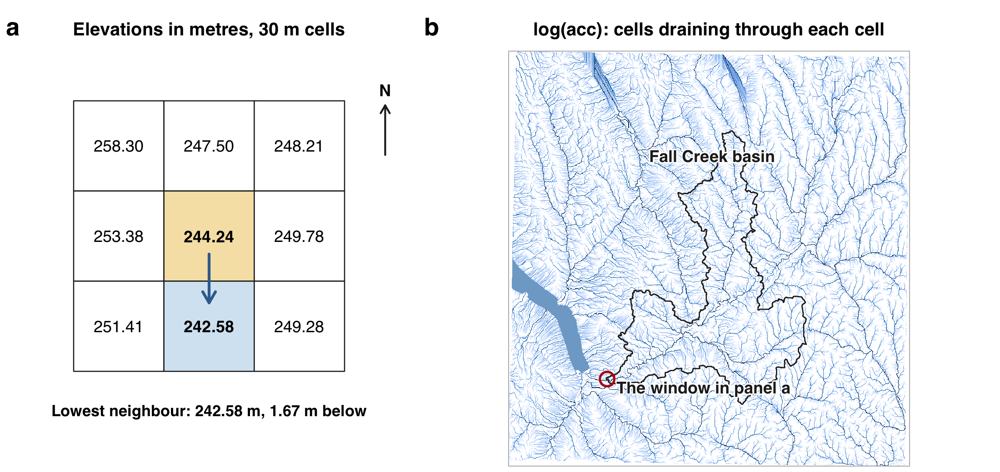{.nostretch width="78%" fig-align="center"}

[Panel a is a real 3 × 3 window of elevations on Fall Creek, a stream through
Ithaca. Its middle cell drains south, to its lowest neighbour. Panel b shows the
count for every cell on a log scale. The dark lines are streams.]{.source}

## Flow direction and accumulation in R {#flow-code}

::: {.slide-text}

Two calls compute flow direction and flow accumulation from the 30 m elevation
raster around Fall Creek.

- **Flow direction** is the neighbour each cell drains to.
- **Flow accumulation** is the number of cells that drain through each cell.
- A **pit** is a cell lower than all its neighbours, where water stops. I filled
  the 10,000 or so pits in the raster before class.

:::

```{r}
#| label: flow
#| script: "Flow direction and accumulation in R"
#| filename: "R Console, in the 25-lidar-drones folder; reads data_clean/terrain/fallcreek_dem_filled.tif"
filled <- rast("data_clean/terrain/fallcreek_dem_filled.tif")   # 30 m, pits filled before class
fd  <- terrain(filled, v = "flowdir")                          # the neighbour each cell drains to
acc <- flowAccumulation(fd)                                    # cells draining through each cell
```

[The fill took about 4 minutes, and the filled raster is in the project. The
two calls above take under a second.]{.source}

**The pit fill.** `tools/make_terrain.R` filled the pits with the Planchon and
Darboux routine in 222.6 seconds. It raised 63,573 cells, the most by 15.52 m.
terra's own `pitfiller()` did not finish in 10 minutes.

## The Fall Creek watershed {#basin}

:::: {.columns}

::: {.column width="50%"}

::: {.slide-text}

The land that drains to the USGS gauge on Fall Creek covers 324.6 km².

- USGS reports 126 square miles (326.3 km²). That is 0.5% more than ours.
- A **watershed**, or basin, is all the land that drains to one point. This
  point is called the **outlet**.
- Here the outlet is a stream gauge, which measures the flow of the creek.
- Light blue is the land that drains to the gauge.

:::

:::

::: {.column width="48%"}

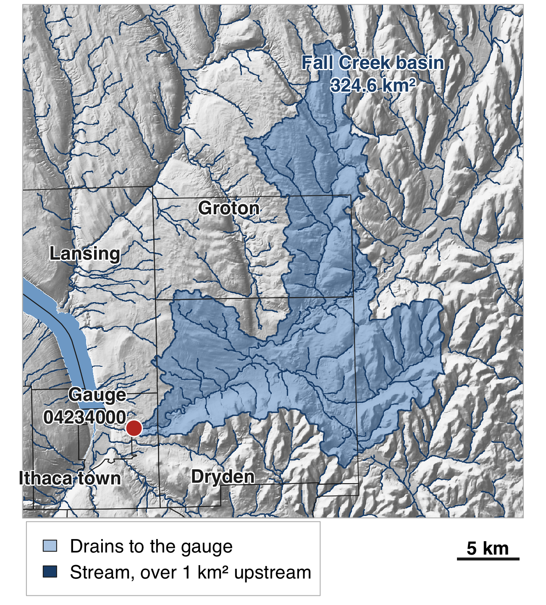{height="445px" fig-align="center"}

:::

::::

[USGS gauge 04234000, Fall Creek near Ithaca.]{.source}

## Computing the watershed in R {#basin-code}

::: {.slide-text}

`watershed()` gives 1 to every cell that drains to the outlet.

- The number of these cells times 900 m² is the area of the watershed.
- `fd` and `acc` are the flow direction and flow accumulation rasters from the
  code above.
- I moved the gauge to the cell within 150 m with the most cells upstream. This
  puts the outlet on the stream.

:::

```{r}
#| label: basin
#| script: "Computing the watershed in R"
#| filename: "R Console, in the 25-lidar-drones folder; fd and acc from the slide before"
gauge <- project(vect(cbind(-76.47278, 42.45333), crs = "EPSG:4269"), crs(fd))
e  <- extract(acc, buffer(gauge, 150), cells = TRUE)
ws <- terra::watershed(fd, xyFromCell(acc, e$cell[which.max(e[[2]])]))   # 1 = drains to the gauge
round(global(ws, "sum", na.rm = TRUE)[[1]] * 900 / 1e6, 1)              # km2
```

[The gauge's coordinates are longitude and latitude (EPSG:4269). lidR also has a
`watershed()` function, so the call names terra's.]{.source}

::::::

## Practice {#practice}

::: {.content-visible when-format="revealjs"}

Ten practice tasks extend today's code. The solutions are on the page.

- **1–3** Find the five tallest objects, tell trees from roofs, and
  count empty cells.
- **4–6** Compare steep shares with and without the lake, write 15% in degrees,
  and try 10% and 25%.
- **7–8** Test whether the tower's top sees a standing person, and pick your
  own viewpoint.
- **9–10** Trace the watershed before filling its pits, and split it by town.
  These go with the page's watershed section.

:::

::: {.content-hidden when-format="revealjs"}

```{r}
#| label: practice
#| exercise: true
#| script: "Practice"
#| eval: false
# Practice. Run in the 25-lidar-drones folder after the slides' code has built
# las, ground, surface, height, g3, dem, towns, slope_pct, steep, tw, land, top, fd and acc.

# Heights
#  1. The tallest objects on campus: the five tallest cells of height, each at least 30 m from a
#     taller one. Which is McGraw Tower?
#  2. Tree or roof from the returns: at each of the five, the share of points within 3 m (and more
#     than 2 m above the ground) from pulses with several returns (NumberOfReturns > 1).
#  3. The surface grid without na.fill: rasterize_canopy(las, res = 1, algorithm = p2r()).
#     How many cells stay empty, and where?
# Slope
#  4. The polygon mean against the share of land: exact_extract(steep, towns, "mean").
#     Which towns move most, and why?
#  5. The 15% threshold in degrees: terrain(dem, v = "slope") is in degrees. Which angle is 15%,
#     and does the county's share change?
#  6. Other thresholds: each town's share of land steeper than 10% and than 25%.
# Views
#  7. A target 1.7 m tall: can someone at the top of the tower see a person standing anywhere?
#     viewshed() with target = 1.7. The area in view and Ithaca city's share.
#  8. The view from a point of your choice, from 1.7 m.
# Watersheds
#  9. The basin on the grid as downloaded: data_clean/terrain/fallcreek_dem_utm.tif, with the
#     same 150 m snap. Why is it so small?
# 10. The basin's towns: the km2 of the basin in each Tompkins town, and the share of the basin
#     inside the county.
```

::: {.callout-tip collapse="true"}

## Solutions

```{r}
#| label: practice-solutions
#| purl: false
#| collapse: true
#| warning: false
# 1. The tallest objects on campus, each at least 30 m from a taller one
hv <- as.data.frame(height, xy = TRUE, na.rm = TRUE); names(hv)[3] <- "h"
hv <- hv[hv$h > 20, ]; hv <- hv[order(-hv$h), ]
pick <- hv[1, ]
for (i in seq_len(nrow(hv))) {
  if (nrow(pick) == 5) break
  if (all((hv$x[i] - pick$x)^2 + (hv$y[i] - pick$y)^2 > 30^2)) pick <- rbind(pick, hv[i, ])
}
pick$h <- round(pick$h, 1)
# 2. Tree or roof: the share of points from pulses with several returns
pick$multi <- sapply(seq_len(nrow(pick)), function(i) {
  g <- extract(ground, cbind(pick$x[i], pick$y[i]))[[1]]
  p <- filter_poi(las, abs(X - pick$x[i]) < 3 & abs(Y - pick$y[i]) < 3 & Z > g + 2)
  round(mean(p$NumberOfReturns > 1), 2)
})
pick
# 3. The surface grid without na.fill
raw_dsm <- rasterize_canopy(las, res = 1, algorithm = p2r())
global(is.na(raw_dsm), "sum")[[1]]
# 4. The polygon mean against the share of land
data.frame(town = towns$NAMELSAD, mean_of_polygon = round(100 * exact_extract(steep, towns, "mean",
           progress = FALSE), 1), share_of_land = round(100 * s / towns$ALAND, 1))
# 5. The threshold in degrees
deg <- atan(0.15) * 180 / pi; round(deg, 2)
slope_deg <- terrain(dem, v = "slope")
round(100 * sum(exact_extract((slope_deg > deg) * 900, towns, "sum", progress = FALSE)) /
        sum(towns$ALAND), 1)
# 6. Other thresholds
data.frame(town = towns$NAMELSAD,
           over_10 = round(100 * exact_extract((slope_pct > 10) * 900, towns, "sum",
                                               progress = FALSE) / towns$ALAND, 1),
           over_25 = round(100 * exact_extract((slope_pct > 25) * 900, towns, "sum",
                                               progress = FALSE) / towns$ALAND, 1))
# 7. A target 1.7 m tall
top17 <- viewshed(dem, crds(tw), observer = 53, target = 1.7)
in17  <- exact_extract(top17 * land * 900, towns, "sum", progress = FALSE)
round(c(km2_grid = global(top17, "sum", na.rm = TRUE)[[1]] * 900 / 1e6,
        pct_county_land = 100 * sum(in17) / sum(towns$ALAND),
        pct_ithaca_city = 100 * in17[towns$NAMELSAD == "Ithaca city"] /
          towns$ALAND[towns$NAMELSAD == "Ithaca city"]), 1)
# 8. The view from a point of your choice: here the Ithaca Commons, from 1.7 m
cm <- project(vect(cbind(-76.4977, 42.4396), crs = "EPSG:4326"), crs(dem))
round(global(viewshed(dem, crds(cm), observer = 1.7, target = 0), "sum", na.rm = TRUE)[[1]] *
        900 / 1e6, 1)
# 9. The basin on the grid as downloaded
rawdem <- rast("data_clean/terrain/fallcreek_dem_utm.tif")
fd0  <- terrain(rawdem, v = "flowdir"); acc0 <- flowAccumulation(fd0)
e0   <- extract(acc0, buffer(gauge, 150), cells = TRUE)
ws0  <- terra::watershed(fd0, xyFromCell(acc0, e0$cell[which.max(e0[[2]])]))
c(cells = global(ws0, "sum", na.rm = TRUE)[[1]],
  km2 = round(global(ws0, "sum", na.rm = TRUE)[[1]] * 900 / 1e6, 2))
# 10. The basin's towns
tw_ws <- st_transform(towns, crs(ws))
bt <- exact_extract(ws * 900 / 1e6, tw_ws, "sum", progress = FALSE)
bt <- setNames(round(bt, 1), towns$NAMELSAD); bt[bt > 0]
round(100 * sum(bt) / (global(ws, "sum", na.rm = TRUE)[[1]] * 900 / 1e6), 1)
```

In task 1, McGraw Tower is the tallest object at 50.6 m. In task 2, a share
near 1 means a tree crown, where pulses pass through leaves and come back
several times. A share near 0 means a roof. The second and fourth objects are
trees. In task 3, the empty cells are mostly on dark roofs. In task 4, Ithaca
city and Lansing move most, because their polygons include flat lake cells. In
task 9, the pits stop the water, so almost nothing reaches the gauge.

:::

## Quick reference {#reference}

| Function | What it does |
|:--|:--|
| `rast()` | reads a raster file, such as an elevation raster |
| `compareGeom()` | TRUE when two rasters have the same cells |
| `mask()` | sets cells to NA outside polygons, or where another raster has a given value |
| `readLAS()` | reads a LAS or LAZ file of LiDAR points |
| `filter_poi()` | keeps the points that meet a condition |
| `rasterize_terrain()`, `tin()` | builds the ground raster from ground points, through triangles |
| `rasterize_canopy()`, `p2r()` | builds the surface raster from the highest point in each cell |
| `buffer()` | a circle (or band) of a given distance around a point, line or polygon |
| `aggregate()` | merges blocks of cells into one larger cell |
| `terrain()` | computes slope, aspect or flow direction from an elevation raster |
| `viewshed()` | the cells visible from one point |
| `ifel()` | a value where a condition holds and another where it does not |
| `as.polygons()`, `disagg()` | cells into polygons; one polygon into its separate pieces |
| `expanse()` | the area of each polygon |
| `flowAccumulation()` | how many cells drain through each cell |
| `watershed()` | the cells that drain to one point (terra's) |

## Sources {#sources}

Radar elevation: Copernicus DEM GLO-30 from the TanDEM-X mission, tile N42
W077, "produced using Copernicus WorldDEM-30 © DLR e.V. 2010-2014 and © Airbus
Defence and Space GmbH 2014-2018 provided under COPERNICUS by the European Union
and ESA; all rights reserved". Radar hail: NOAA MRMS `MESH_Max_1440min`, from
NOAA's public copy on Amazon. Hail reports: NCEI Storm Events. Hail losses: USDA
Risk Management Agency, cause of loss. The hail tables come from my own pilot of
October 2026. LiDAR: USGS 3D Elevation Program (3DEP), project NY_FingerLakes_1_2020, flown 2
to 14 May 2020, and the New York City flight of March 2014, from USGS's public
copy on Amazon. US government work, public domain. Index of projects: Hobu
Inc.'s `resources.geojson` and USGS's work-unit table `WESM.csv`. Elevation:
USGS 3DEP 1 arc-second raster, tile n43w077, public domain. Towns:
Census Bureau TIGER/Line 2024, public domain. Stream
gauge: USGS 04234000, Fall Creek near Ithaca. The README in the zip gives each
source's address and licence.

**Links:** [slides](25-lidar-drones-slides.html) · [Syllabus](../syllabus.qmd)

:::

```{r}
#| purl: false
#| include: false
source(file.path(session_dir, "_purl.R"))
purl_session(file.path(session_dir, "25-lidar-drones.qmd"),
             file.path(session_dir, "25-lidar-drones.R"))
```
