```{r}
#| purl: false
#| include: false
knitr::opts_chunk$set(
  comment = "#>",
  collapse = TRUE,
  fig.width = 9,
  fig.height = 4.4,
  fig.align = "center",
  fig.show = "hold",
  dpi = 150
)
options(width = 100)
# A chunk with out.lines shows only those lines of its printout; the page repeats the full one.
local({
  hook_output <- knitr::knit_hooks$get("output")
  knitr::knit_hooks$set(output = function(x, options) {
    keep <- unlist(options$out.lines)
    if (is.null(keep)) return(hook_output(x, options))
    x <- strsplit(x, "\n")[[1]]
    hook_output(paste0(paste(x[keep[keep <= length(x)]], collapse = "\n"), "\n"), options)
  })
})
# Every chunk runs in the project folder, so the paths on the page are the
# paths students use.
session_dir <- getwd()
knitr::opts_knit$set(root.dir = file.path(session_dir, "data/26-satellite-local"))
```

::: {.content-hidden when-format="revealjs"}

[Slides](26-satellite-local-slides.html) · [Live script](26-satellite-local.R) ·
[Source](https://github.com/ArielOrtizBobea/aem6850/blob/main/fall-2026/sessions/26-satellite-local.qmd) ·
[the project](data/26-satellite-local.zip)

In this session we work with images from cameras on drones and satellites. A
camera is a passive sensor. It records the sunlight that the ground reflects, in
separate bands. We read a drone photo of a corn field in R and average it to
satellite-sized cells. Then we read one Sentinel-2 image of Cayuga Lake, taken
on 15 August 2024. We turn its stored numbers into reflectance and compute
NDVI, a vegetation index. Published papers used images like these to measure
growth, sprawl, crop output and crop burning. We compare sources by pixel size
and by how often they pass, and we see where error enters a number built from
images. Last, we measure the lake's area three ways and train a decision tree
on 200 points I labelled on aerial photos.

**The project.** Download the [zip on this page](data/26-satellite-local.zip),
unzip it and open `26-satellite-local.Rproj`. R then starts in the project
folder, and every path on the slides is relative to it. The scripts install
`terra`, `sf` and `rpart` if they are missing. I downloaded every file before
class, so you do not need an account, a key or the network. The folder's
`README.md` says where each file came from and under what licence. The code
that downloaded the files needs the network, so it is not in the zip. This page
shows its main steps.

## Objectives {#objectives}

After the 75 minutes you can:

1. Explain the difference between passive and active sensors.
2. Explain what a camera on a drone, a plane or a satellite records: bands of
   visible light, near-infrared light and heat, and lights at night.
3. Choose imagery for a research question from its resolution in space (the
   pixel size), its resolution in time (how often an image is taken, and how
   often it is clear) and its bands.
4. Read a drone image and a satellite image in R, and compute a vegetation
   index (NDVI) from two bands.
5. Explain how measurement error enters a variable built from images (pixel
   size, clouds, classification mistakes), and measure it against an outside
   source.
6. Describe how published papers used satellite images to measure economic
   growth, urban sprawl and crop burning.

This session leaves out radar and LiDAR, and jobs that process thousands of
images at once.

:::

## Plan for today {#plan}

::: {.slide-text}

What we are going to do today

1. **Passive and active sensors**\
   [Cameras and radar · cloud · bands]{.topics}
2. **Drone images**\
   [A corn field · larger cells]{.topics}
3. **Satellite images in R**\
   [Reflected light · colour · NDVI · Exercise 1]{.topics}
4. **Uses in economics**\
   [Growth · sprawl · crops · burning]{.topics}
5. **Resolution in space and time**\
   [Pixel size · ponds · Exercise 2 · clear days]{.topics}
6. **Measurement error**\
   [Two reviews · forest loss · lights with a top value]{.topics}
7. **An application to Cayuga Lake**\
   [Lake area · decision tree · accuracy]{.topics}

:::

[Today's code and data are in
[26-satellite-local.zip](data/26-satellite-local.zip) (63 MB). We work with one camera image at a
time. Radar and LiDAR, sensors that send their own signal, are left aside.]{.source}

::: {.notes}
Clock: part 2 by minute 6, part 3 by minute 12, Exercise 1 from minute 20.5 to
25.5, part 4 by 25.5, part 5 by 34.5, Exercise 2 from 39 to 44, part 6 by 45,
part 7 by 50.5, Summary at 60.
:::

# 1 · Passive and active sensors {#part-sensors}

## Overview of part 1 {#overview-1}

::: {.slide-text}

In this part we see what a camera records, and how it differs from radar and
LiDAR.

:::

::::: {.columns}

:::: {.column width="52%"}

::: {.dashes}

- Passive and active sensors.
- Cameras on drones, planes and satellites.
- Cayuga Lake on a cloudy day.
- What a band records.

:::

::::

:::: {.column width="46%"}

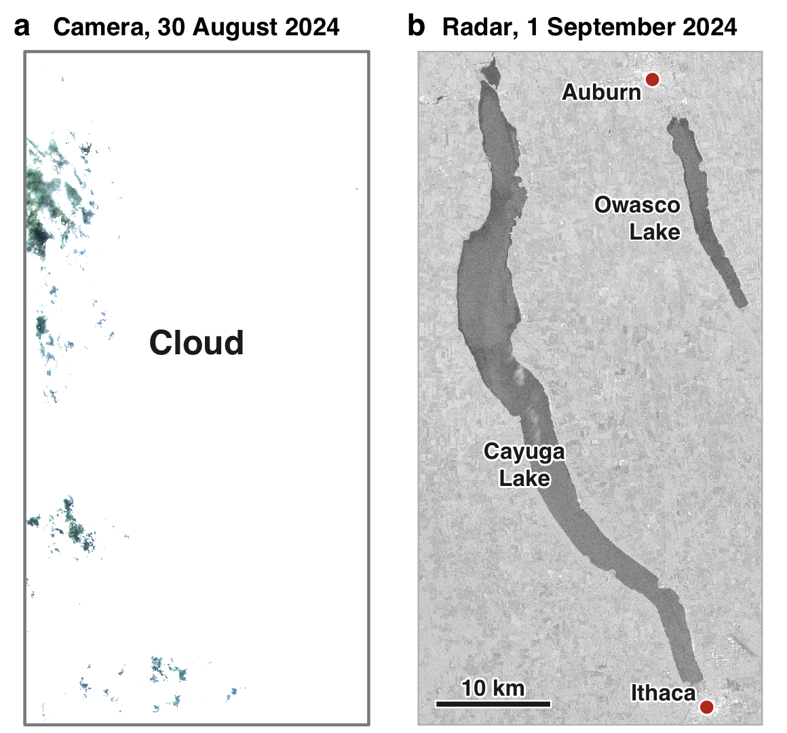{width="100%" fig-align="center"}

[Later in this part: Cayuga Lake under cloud. Left, the camera on Sentinel-2 on 30 August
2024. Right, radar two days later.]{.source}

::::

:::::

## Passive and active sensors {#active-passive}

::::: {.columns}

:::: {.column width="44%"}

::: {.slide-text}

Sensors on satellites work in two ways.

- A passive sensor records energy from the ground, such as reflected sunlight
  or heat. A camera is a passive sensor.
- An active sensor sends its own signal and times what comes back. Radar and
  LiDAR are active sensors.
- Radar works at night and through cloud.
- Today we work with cameras.

:::

::::

:::: {.column width="56%"}

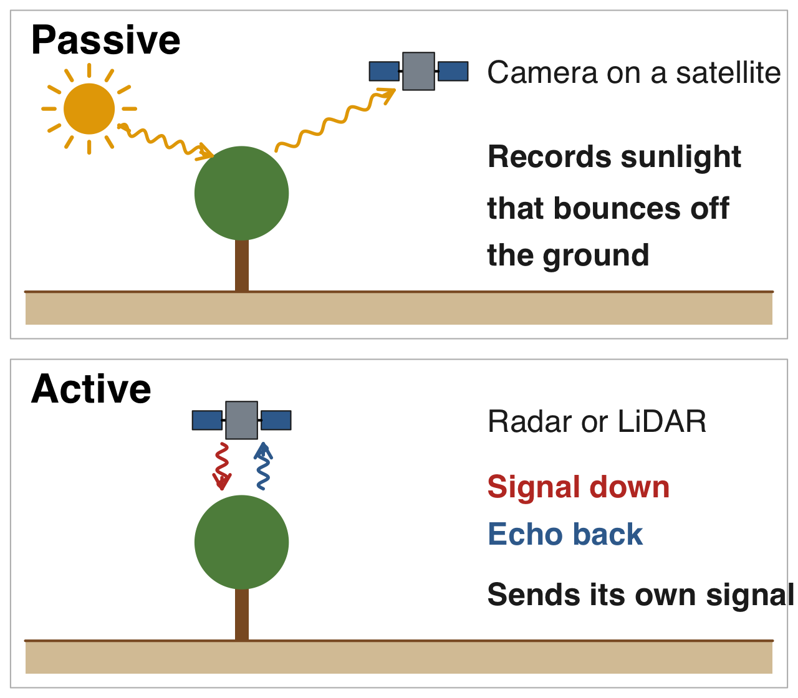{height="450px" fig-align="center"}

[Definitions from NASA Earthdata on
[remote sensing](https://www.earthdata.nasa.gov/learn/earth-observation-data-basics/remote-sensing).]{.source}

::::

:::::

::: {.content-visible unless-format="revealjs"}

NASA Earthdata defines the two types this way: "Active instruments emit energy
and collect data based on changes in the return signal", and passive
instruments "detect energy emitted or reflected from an object". The NASA page
names no instruments, so radar and LiDAR as active sensors are plain facts here.

:::

## Cameras on drones, planes and satellites {#platforms}

::: {.slide-text}

Cameras fly on drones, planes and satellites. A pixel is one cell of an image.

- A drone photographed one corn field in North Carolina at 4.1 cm.
- A plane photographs the lower 48 states at least every 3 years for USDA's
  aerial photos (NAIP), at 0.6 m.
- The Sentinel-2 satellites photograph almost all the world's land about every
  5 days, at 10 to 60 m.

:::

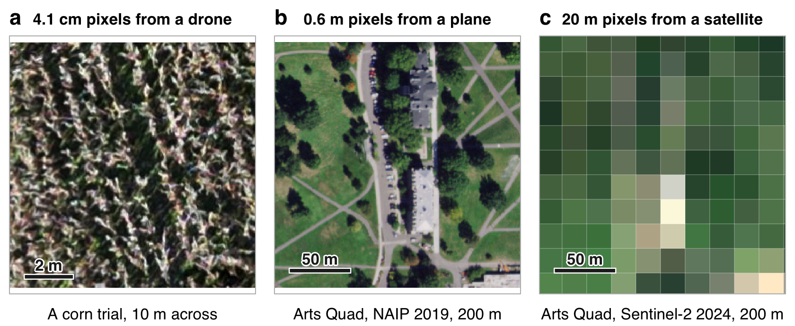{.nostretch width="68%" fig-align="center"}

[Drone: NC State Extension via OpenAerialMap, CC BY 4.0. Photo: USGS, USDA, The
National Map. Contains modified Copernicus Sentinel data (2024).]{.source}

::: {.content-visible unless-format="revealjs"}

USDA is the US Department of Agriculture. NAIP is its National Agriculture
Imagery Program.

Panel a is a 10 m square of the corn trial. Panel b is a 200 m square around
Cornell's Arts Quad on the aerial photo of 18 September 2019. Panel c is the
same 200 m square in our Sentinel-2 image of 15 August 2024, in cells of 20 m.
The three panels are printed at the same size, so only the ground in each pixel
changes.

:::

## Cayuga Lake on a cloudy day {#cloudy}

::::: {.columns}

:::: {.column width="46%"}

::: {.slide-text}

On 30 August 2024 the camera saw almost only cloud over Cayuga Lake. Two days
later, radar showed the lake's outline.

- Sentinel-2 carries a camera. The European Space Agency (ESA) marks about 99%
  of the land and water around the lake as cloud that day.
- Sentinel-1 carries a radar. Its radio waves pass through cloud.
- Calm water reflects the radar signal away from the satellite, so the lakes
  look dark.

:::

::::

:::: {.column width="54%"}

{height="440px" fig-align="center"}

[Contains modified Copernicus Sentinel data (2024). Terrain-corrected radar from
Microsoft's Planetary Computer.]{.source}

::::

:::::

::: {.content-visible unless-format="revealjs"}

ESA's class for each cell puts 98.6% of the image in its two cloud classes
(8 and 9) on 30 August, and 98.9% with thin, high cloud (class 10). On why calm
water looks dark, see NASA Earthdata's page on
[reading radar images](https://earthdata.nasa.gov/learn/earth-observation-data-basics/sar/image-interpretation).

I downloaded the camera image from the Earth Search catalog, which needs no
account. The radar image comes from Microsoft's Planetary Computer (collection
`sentinel-1-rtc`, 1 September 2024), and I put it on our 20 m cells. That
collection's catalog record says it needs an account, yet the search and the
download worked without one. The collection `sentinel-1-grd` has no such flag
and has an image of 20 August 2024. Both downloads need the network, so they do
not run here. The camera image came from this code:

```{r}
#| label: fetch-cloudy
#| eval: false
#| purl: false
#| filename: "R Console, in the 26-satellite-local folder; needs the network and the rstac package"
it  <- (stac("https://earth-search.aws.element84.com/v1") |>
          stac_search(collections = "sentinel-2-l2a", ids = "S2A_18TUN_20240830_0_L2A") |>
          get_request())$features[[1]]
tci <- rast(paste0("/vsicurl/", it$assets$visual$href))      # true colour, read over the web
box <- vect(ext(-76.80, -76.45, 42.43, 42.95), crs = "EPSG:4326")
tci <- crop(tci, project(box, crs(tci)), snap = "out")
writeRaster(tci, "data/sentinel2/s2_tci_20240830_cayuga.tif", datatype = "INT1U")
```

`code/1_sensors.R` in the project draws the two images of the cloudy day.

:::

## What a band records {#bands}

::: {.slide-text}

A camera records light in separate bands.

- A band is one range of wavelengths. The image stores one layer per band.
- Wavelength is measured in nanometres (nm), billionths of a metre. Our eyes see
  about 400 to 700 nm.
- Sentinel-2 adds near-infrared and shortwave infrared, which our eyes cannot
  see.
- Other sensors record heat the ground gives off, or lights from towns after
  dark.

:::

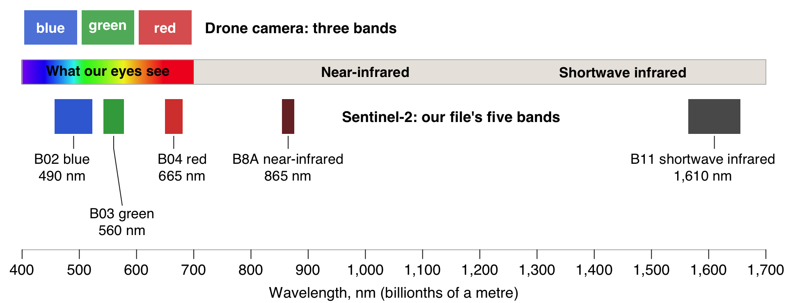{.nostretch width="74%" fig-align="center"}

[B8A is Sentinel-2's narrow near-infrared band. Band centres from ESA.]{.source}

::: {.content-visible unless-format="revealjs"}

Our Sentinel-2 file keeps five of the satellite's 13 bands: B02 blue (490 nm),
B03 green (560 nm), B04 red (665 nm), B8A near-infrared (865 nm) and B11
shortwave infrared (1,610 nm). The drone's bands are drawn as a typical camera's
red, green and blue. Its own response curves are not published.

Two other sensors appear later in the session. Landsat records heat in a
thermal band with 100 m pixels. The VIIRS sensor records lights at night in one
band from about 500 to 900 nm.

:::

# 2 · Drone images {#part-drone}

## Overview of part 2 {#overview-2}

::: {.slide-text}

In this part we read a drone photo of a corn field in R and see it in
satellite-sized cells.

:::

::::: {.columns}

:::: {.column width="36%"}

::: {.dashes}

- A drone photo of a corn field.
- Reading it in R.
- The same field in 10 m and 30 m cells.
- A Census road on the photo.

:::

::::

:::: {.column width="62%"}

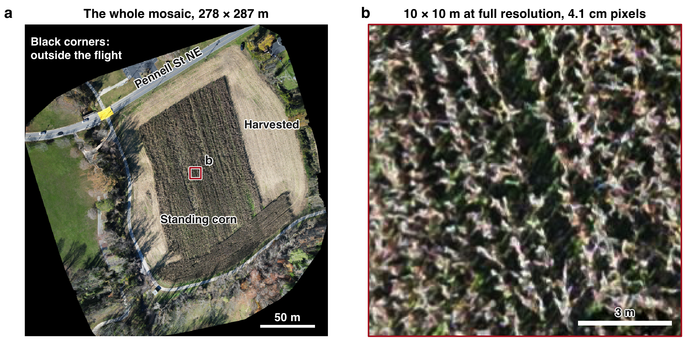{width="100%" fig-align="center"}

[Later in this part: a drone photo of a corn trial in North Carolina. Left, the whole field.
Right, a 10 m square of it, where single corn plants show.]{.source}

::::

:::::

## A drone photo of a corn field {#corn}

::: {.slide-text}

A drone photographed a corn trial in North Carolina in November 2024.

- Each pixel covers 4.1 cm of ground. We can see single rows of corn.
- Software stitches the overlapping drone photos into one image. This image is
  called an orthomosaic.
- The width of ground in one pixel is called the ground sample distance.
- The image covers 278 m by 287 m, or 7.96 hectares.

:::

{.nostretch width="51%" fig-align="center"}

[NC State Extension (the state university's farm advisers) flew it on 12
November 2024 with a small consumer drone. Imagery via OpenAerialMap, CC BY
4.0.]{.source}

::: {.content-visible unless-format="revealjs"}

The orthomosaic keeps true distances on the ground, like a map. A hectare is
100 m by 100 m.

:::

::: {.notes}
The field is in Lenoir, Caldwell County, North Carolina (about 35.92 N, 81.52
W). Henderson, Regan and Venables traced Nairobi's buildings from aerial
photographs of 2003 and 2015, the same type of picture from a plane.
:::

## Reading the drone image in R {#mosaic}

::: {.slide-text}

In R, a drone image is a raster with three layers: red, green and blue.

- 12.2 of the 47.1 million pixels (26%) are black corners outside the flight.
- The file does not mark these pixels as missing. They have 0 in every layer.
- `mask()` sets every pixel with 0 in all three layers to NA. Averages then
  skip these pixels.

:::

```{r}
#| label: packages
#| script: "Load or install the packages"
#| output: false
#| message: false
#| code-fold: true
#| code-summary: "Load or install terra for rasters, sf for vector data and rpart for decision trees"
#| filename: "R Console, in the 26-satellite-local folder; installs terra, sf and rpart if missing"
want <- c("terra", "sf", "rpart")
need <- want[!(want %in% installed.packages()[,"Package"])]
if (length(need)) install.packages(need)
lapply(want, function(i) require(i, character.only = TRUE))
rm(want, need)
options(width = 100); terraOptions(progress = 0, memmax = 2)
```

```{r}
#| label: mosaic
#| script: "Reading the drone image in R"
#| out.lines: [2, 3, 5, 8, 9, 10]
#| filename: "R Console, in the 26-satellite-local folder; reads data/drone/willis_corn_trial.tif (11.4 MB)"
mo <- rast("data/drone/willis_corn_trial.tif")
mo
mo <- mask(mo, sum(mo) == 0, maskvalues = TRUE)   # black corners become NA
```

[EPSG:32617 is UTM zone 17N, in metres. `sum(mo) == 0` is TRUE where all three
layers are 0, and `maskvalues = TRUE` sets those pixels to NA.]{.source}

::: {.content-visible unless-format="revealjs"}

The folded chunk above loads the three packages the session uses and installs
any that are missing. `terraOptions(memmax = 2)` holds terra to 2 GB of memory.
The project folder holds `code/` with seven scripts, one per part of the
session, and `run_everything.R`, which runs them in order. The `README.md` lists
every file and where it came from.

The full printout of the file as downloaded, before `mask()`:

```{r}
#| label: mosaic-full
#| purl: false
#| filename: "R Console, in the 26-satellite-local folder"
rast("data/drone/willis_corn_trial.tif")
```

12,232,330 of the 47,116,561 pixels are corners. `mask()` on 47 million pixels
needs memory. With terra held to 2 GB, the code on the three drone slides takes
about 16 seconds.

:::

## The same field in 10 m and 30 m cells {#mosaic-sizes}

::: {.slide-text}

In 10 m cells we can no longer see the corn rows. The field fills 643 cells of
10 m and 83 cells of 30 m.

:::

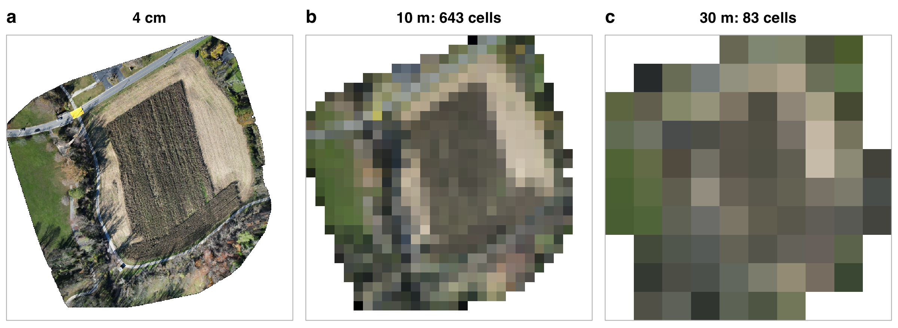{.nostretch width="80%" fig-align="center"}

```{r}
#| label: mosaic-sizes
#| script: "The same field in 10 m and 30 m cells"
#| filename: "R Console, in the 26-satellite-local folder; mo, the drone mosaic from the slide before"
m10 <- aggregate(mo, fact = 243, fun = "mean", na.rm = TRUE)   # 243 pixels x 4.1 cm = 10 m cells
m30 <- aggregate(mo, fact = 730, fun = "mean", na.rm = TRUE)   # 730 pixels x 4.1 cm = 30 m cells
```

[Free Sentinel-2 and Landsat satellite images have pixels of 10 m and 30 m.
`na.rm = TRUE` skips the black corners. `aggregate()` averages blocks of fact ×
fact pixels into one larger cell.]{.source}

::: {.content-visible unless-format="revealjs"}

`fact = 243` turns 243 × 243 pixels of 4.1 cm into a cell of 9.99 m.
`fact = 730` gives a cell of 30.0 m. The code below counts the cells with some
image:

```{r}
#| label: mosaic-counts
#| script: "Counting the cells"
#| filename: "R Console, in the 26-satellite-local folder; m10 and m30 from above"
n10 <- global(!is.na(m10[[1]]), "sum")[[1]]
n30 <- global(!is.na(m30[[1]]), "sum")[[1]]
c(cells_10m = n10, cells_30m = n30)
```

At 250 m, the size of the smallest MODIS pixel, the field touches 3 cells.

:::

::: {.notes}
At 250 m the field touches 3 cells.
:::

## A Census road on the drone image {#road}

:::: {.columns}

::: {.column width="45%"}

::: {.slide-text}

The Census line for the road next to the field is about 4 m off the road in the
image.

- TIGER is the Census Bureau's map file of US roads. It has one line per road.
- The line is 4.1 to 4.5 m from the centre of the road in the image.
- The road is 6.8 to 6.9 m wide, so the line runs along its edge.
- The drone's GPS and the TIGER line can each be off by a few metres.

:::

:::

::: {.column width="53%"}

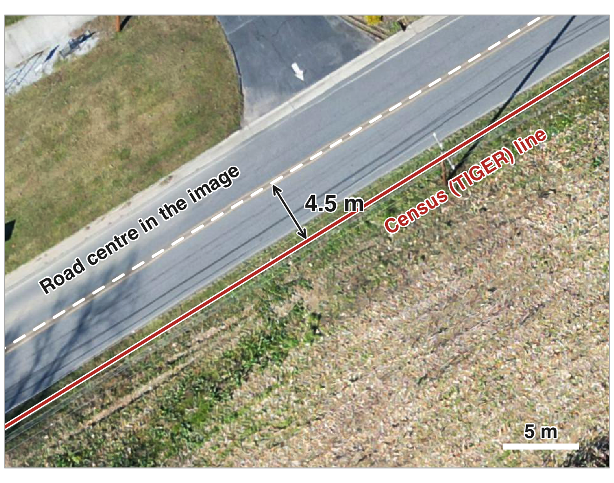{width="100%" fig-align="center"}

[I measured at 20, 50 and 80% of the length of Pennell St NE. The flight's
record does not say whether it used ground control points (marked spots with
surveyed coordinates).]{.source}

:::

::::

::: {.content-visible unless-format="revealjs"}

**Georeferencing** pins an image to the map. Drone software places each photo
with the drone's own GPS, which can be off by a few metres. Ground control
points tie the mosaic to true coordinates. These are spots marked on the ground
and surveyed before the flight. A road line from another source shows how far
off a mosaic is. A gap of 4 m can also come from the Census line. The Census
Bureau draws its TIGER lines for maps, which need less accuracy than survey work.

The code below comes from `code/2_drone.R`. At three points along the TIGER
line, it reads the pixels on a line of 50 m across the road, one every 4 cm.
Asphalt here is blue-grey, so its blue layer is higher than its red layer. The
road is the nearest stretch of asphalt wider than 3 m.

```{r}
#| label: road
#| script: "A Census road on the drone image"
#| filename: "R Console, in the 26-satellite-local folder; mo from the slides before"
rd <- st_read("data_clean/drone/caldwell_roads_near_mosaic.gpkg", quiet = TRUE)
ln <- st_cast(st_intersection(st_union(rd[rd$FULLNAME == "Pennell St NE", ]),
                              st_as_sfc(st_bbox(ext(mo) - 10, crs = st_crs(rd)))), "LINESTRING")[1]
off <- do.call(rbind, lapply(c(0.2, 0.5, 0.8), function(fr) {
  p0 <- st_coordinates(st_line_sample(ln, sample = fr))[1, 1:2]
  p1 <- st_coordinates(st_line_sample(ln, sample = fr + 0.01))[1, 1:2]
  tv <- (p1 - p0) / sqrt(sum((p1 - p0)^2)); nv <- c(-tv[2], tv[1])   # unit normal, left of the line
  s  <- seq(-25, 25, by = 0.04)
  v  <- extract(mo, cbind(p0[1] + s * nv[1], p0[2] + s * nv[2]))
  asph <- as.vector(stats::filter((v$blue > v$red) * 1, rep(1 / 25, 25)) > 0.5)
  asph[is.na(asph)] <- FALSE
  r <- rle(asph); en <- cumsum(r$lengths); stt <- en - r$lengths + 1
  runs <- data.frame(from = s[stt], to = s[en])[r$values, ]
  k <- 1
  while (k < nrow(runs)) {                       # join the two lanes across the centre stripe
    if (runs$from[k + 1] - runs$to[k] < 1) {
      runs$to[k] <- runs$to[k + 1]; runs <- runs[-(k + 1), ]
    } else k <- k + 1
  }
  runs <- runs[runs$to - runs$from > 3, ]
  runs <- runs[which.min(pmin(abs(runs$from), abs(runs$to),
                              ifelse(runs$from < 0 & runs$to > 0, 0, Inf))), ]
  data.frame(point = fr, width_m = round(runs$to - runs$from, 1),
             offset_to_centre_m = round((runs$from + runs$to) / 2, 1))
}))
off
```

:::

# 3 · Satellite images in R {#part-s2}

## Overview of part 3 {#overview-3}

::: {.slide-text}

In this part we read one image of Cayuga Lake from the Sentinel-2 satellites in R,
and compute NDVI, a vegetation index.

:::

::::: {.columns}

:::: {.column width="58%"}

::: {.dashes}

- The image of 15 August 2024.
- How much light plants, bare ground and water reflect.
- True and false colour.
- NDVI, a vegetation index.
- Exercise 1.

:::

::::

:::: {.column width="40%"}

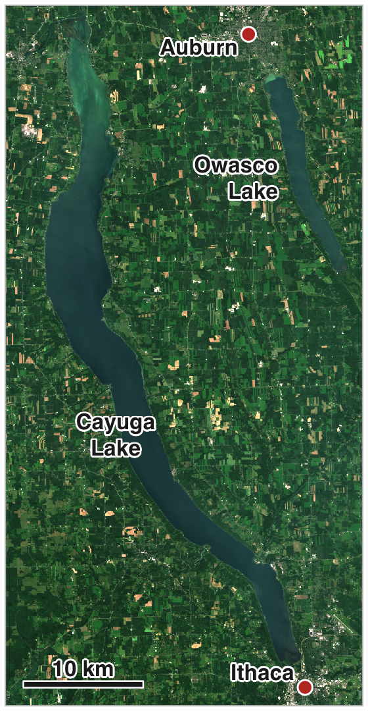{height="420px" fig-align="center"}

[Later in this part: our image of 15 August 2024 in true colour. It runs 58 km from Ithaca
to Auburn.]{.source}

::::

:::::

## The image of 15 August 2024 {#image}

::::: {.columns}

:::: {.column width="68%"}

::: {.slide-text}

I searched Earth Search, a free catalog, for Sentinel-2 images of the lake from 10
to 20 August 2024. Only 15 August was clear.

- Sentinel-2 has two satellites. Together they photograph each place about
  every 5 days.
- A catalog lists every image with its date, area and share of cloud.
- Images come in 110 km squares called tiles. Our image is a box of tile 18TUN,
  30 km by 58 km.

:::

::::

:::: {.column width="30%"}

{height="235px" fig-align="center"}

[This box is our image.]{.source}

::::

:::::

```{r}
#| label: search
#| script: "The image of 15 August 2024"
#| filename: "R Console, in the 26-satellite-local folder; reads data_clean/catalog/s2_search_20240810_20240820.csv"
s2_search <- read.csv("data_clean/catalog/s2_search_20240810_20240820.csv")
print(s2_search[s2_search$tile == "18TUN", c("id", "date", "cloud")], row.names = FALSE)
```

[The search code is on the page. Contains modified Copernicus Sentinel data
(2024).]{.source}

::: {.content-visible unless-format="revealjs"}

The catalog I used, Earth Search, needs no account. The box runs from Ithaca to the lake's north end: 1,490 columns and 2,916 rows
of 20 m cells, or 29.8 km by 58.3 km. In longitude and latitude it runs from
−76.815 to −76.438 and from 42.425 to 42.955.

Two orbits reach our tile. One photographs all of our image every 5 days. The
other covers about three quarters of it in between. So in August 2024 a picture
came every 2 or 3 days. ESA says the five-day revisit is "even faster at higher
latitudes"
([ESA](https://www.esa.int/Applications/Observing_the_Earth/Copernicus/Sentinel-2/Satellite_constellation)).

The search needs the network and the `rstac` package. It asks the Earth Search
catalog for every Sentinel-2 image over the box from 10 to 20 August 2024. The
cloud share is the tile's, in percent. Then the code reads only our box from
each band file, over the web, without downloading the whole tile. The 10 m bands
are averaged to 20 m.

```{r}
#| label: fetch-search
#| eval: false
#| purl: false
#| filename: "R Console, in the 26-satellite-local folder; needs the network and the rstac package"
s <- stac("https://earth-search.aws.element84.com/v1") |>
  stac_search(collections = "sentinel-2-l2a", bbox = c(-76.80, 42.43, -76.45, 42.95),
              datetime = "2024-08-10T00:00:00Z/2024-08-20T23:59:59Z", limit = 100) |>
  get_request() |> items_fetch(progress = FALSE)
it   <- s$features[[which(sapply(s$features, function(f) f$id) == "S2B_18TUN_20240815_0_L2A")]]
keys <- c(B02 = "blue", B03 = "green", B04 = "red", B8A = "nir08", B11 = "swir16", SCL = "scl")
b20  <- project(vect(ext(-76.80, -76.45, 42.43, 42.95), crs = "EPSG:4326"), "EPSG:32618")
lay  <- lapply(keys, function(k) {
  r <- crop(rast(paste0("/vsicurl/", it$assets[[k]]$href)), b20, snap = "out")   # read our box only
  if (res(r)[1] == 10) r <- aggregate(r, 2, fun = "mean")                         # 10 m bands to 20 m
  r
})
```

The full code, with the step that puts the six layers on one raster, is in the
project's `tools/fetch_sentinel2.R` on GitHub. The search found ten images over
the box, five on each of two tiles:

```{r}
#| label: search-all
#| purl: false
#| filename: "R Console, in the 26-satellite-local folder; s2_search from above"
print(s2_search, row.names = FALSE)
```

For a study of many dates or a large area, the same search returns hundreds of
images. A loop then downloads each file, keeps what it needs and deletes the
rest, so the disk does not fill. Today's image needs none of that.

:::

## Reading the image in R {#read}

::: {.slide-text}

Our image is a raster of 20 m cells with six layers. Five are bands, and the
sixth is ESA's class for each cell.

- The file stores reflectance times 10,000 as whole numbers. Dividing by 10,000
  gives reflectance.
- Reflectance is the share of sunlight a surface sends back, from 0 to 1.
- The bands are B02 blue, B03 green, B04 red, B8A near-infrared and B11
  shortwave infrared.
- SCL is ESA's class for each cell. 4 is vegetation, 5 is not vegetated (bare
  ground, roofs and roads), and 6 is water.

:::

```{r}
#| label: read-s2
#| script: "Reading the image in R"
#| out.lines: [2, 3, 5, 7]
#| filename: "R Console, in the 26-satellite-local folder; reads data/sentinel2/s2_20240815_cayuga_20m.tif (37 MB)"
s2 <- rast("data/sentinel2/s2_20240815_cayuga_20m.tif")
s2
refl <- s2[[1:5]] / 10000                        # reflectance, from 0 to 1
```

[SCL is short for scene classification layer. EPSG:32618 is UTM zone 18N, in
metres. I averaged the 10 m bands to 20 m, so all six layers share one
raster.]{.source}

::: {.content-visible unless-format="revealjs"}

The full printout:

```{r}
#| label: read-s2-full
#| purl: false
#| filename: "R Console, in the 26-satellite-local folder; s2 from above"
s2
```

I divided by 10,000 and applied no offset. With the catalog's offset of −0.1,
red reflectance on the Arts Quad comes out negative. Earth Search had already
subtracted ESA's offset of 1,000 from these files. Its items say
`earthsearch:boa_offset_applied: true`, while the band records still list an
offset of −0.1
([Element 84](https://github.com/Element84/earth-search/issues/41)).

The 10 m bands have 4,405 empty cells along the edge of the box. A median over
cells that include an empty one comes back NA, so every `zonal()` call below
sets `na.rm = TRUE`.

:::

## Reflectance of plants, bare ground and water {#reflectance}

::::: {.columns}

:::: {.column width="52%"}

::: {.slide-text}

On 15 August 2024, plants in our image reflect 0.40 of near-infrared and only
0.03 of red. Water reflects almost no shortwave infrared.

- `zonal()` takes the median of each band within ESA's classes 4, 5 and 6.
- Water's median in shortwave infrared is 0.010. Water absorbs that light, so we
  expect a value near 0.

:::

::::

:::: {.column width="46%"}

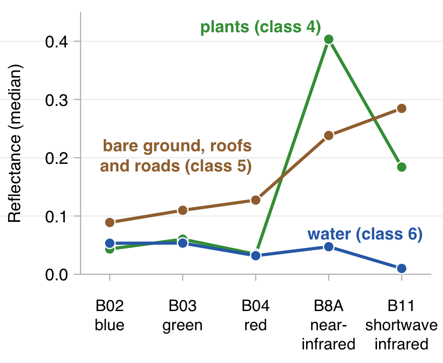{height="300px" fig-align="center"}

::::

:::::

```{r}
#| label: zonal-bands
#| script: "Reflectance of plants, bare ground and water"
#| filename: "R Console, in the 26-satellite-local folder; s2 and refl from Reading the image in R"
m <- zonal(refl, s2$SCL, fun = "median", na.rm = TRUE)   # about 6 seconds
m[m$SCL >= 4 & m$SCL <= 6, ]
```

::: {.content-visible unless-format="revealjs"}

The cell in mid-lake, at longitude −76.715 and latitude 42.700:

```{r}
#| label: mid-lake
#| script: "A cell in mid-lake"
#| filename: "R Console, in the 26-satellite-local folder; s2 and refl from above"
lake <- project(vect(cbind(-76.715, 42.700), crs = "EPSG:4326"), crs(s2))
round(extract(refl, lake, ID = FALSE), 4)
```

:::

## True and false colour {#colour .nostretch}

::: {.slide-text}

In false colour, near-infrared shows as red. Fields, lawns and forest turn bright
red, and the lake stays dark.

:::

```{r}
#| label: colour-map
#| ref.label: colour
#| echo: false
#| purl: false
#| fig-width: 10
#| fig-height: 4.4
#| out-width: "52%"
#| dev.args: !expr list(pointsize = 16)
```

[The south end of Cayuga Lake and Ithaca on 15 August 2024. False colour shows
near-infrared as red, red as green and green as blue.]{.source}

```{r}
#| label: colour
#| script: "True and false colour"
#| fig-show: hide
#| filename: "R Console, in the 26-satellite-local folder; refl from Reading the image in R"
box   <- project(vect(ext(-76.56, -76.44, 42.43, 42.50), crs = "EPSG:4326"), crs(refl))
south <- crop(refl, box)                                     # the south end of the lake
par(mfrow = c(1, 2))                                         # two pictures side by side
plotRGB(south, r = 3, g = 2, b = 1, stretch = "lin", mar = c(0, 0, 2, 0), main = "True colour")
plotRGB(south, r = 4, g = 3, b = 2, stretch = "lin", mar = c(0, 0, 2, 0), main = "False colour")
par(mfrow = c(1, 1))                                         # back to one plot per page
```

[`plotRGB()` draws three bands as one picture. `mar` leaves room for the title.]{.source}

::: {.content-visible unless-format="revealjs"}

`project()` turns the box into the image's metres, and `crop()` cuts it out.
`stretch = "lin"` spreads the values over the full brightness. The box is the south end of Cayuga Lake. The lake comes in at the top left,
downtown Ithaca sits below its tip, and the Cornell campus is east of downtown.
The Ithaca airport's runway is near the top right.

:::

## NDVI, a vegetation index {#ndvi}

::::: {.columns}

:::: {.column width="58%"}

::: {.slide-text}

NDVI compares near-infrared with red. Green plants reflect much near-infrared and
little red, so their NDVI is high.

- NDVI is the normalized difference vegetation index.
- It is near-infrared minus red, divided by their sum. It runs from −1 to 1.

:::

::::

:::: {.column width="40%"}

```{r}
#| label: ndvi-map
#| ref.label: ndvi
#| echo: false
#| purl: false
#| fig-width: 2.5
#| fig-height: 3.8
#| out-width: "220px"
```

::::

:::::

```{r}
#| label: ndvi
#| script: "NDVI, a vegetation index"
#| fig-show: hide
#| filename: "R Console, in the 26-satellite-local folder; refl from Reading the image in R"
ndvi <- (refl$B8A - refl$B04) / (refl$B8A + refl$B04)
names(ndvi) <- "NDVI"                              # otherwise the layer keeps the name B8A
plot(ndvi, col = hcl.colors(50, "Greens", rev = TRUE), plg = list(title = "NDVI"))
```

[Cayuga Lake is the pale band down the middle of our image. Contains modified
Copernicus Sentinel data (2024).]{.source}

::: {.content-visible unless-format="revealjs"}

NDVI over our image runs from −0.99 to 0.93. The lawn of the Arts Quad reads
0.57, in the 20 m cell that holds the point. A dry lawn in August is less green
than a crop field.

```{r}
#| label: ndvi-range
#| script: "The range of NDVI and the Arts Quad"
#| filename: "R Console, in the 26-satellite-local folder; s2 and ndvi from above"
minmax(ndvi)
aq <- project(vect(cbind(-76.4855, 42.4489), crs = "EPSG:4326"), crs(s2))   # the Arts Quad
round(extract(ndvi, aq, ID = FALSE), 3)
```

:::

## Exercise 1 {#exercise-1}

::: {.panel-tabset}

### Exercise

NDVI puts plants far above bare ground and water. Water still sits above 0.

3 minutes. Find the median NDVI of plants, bare ground and water. `ndvi` holds
NDVI for every cell, and `s2$SCL` holds ESA's classes.

1. `z <- zonal(ndvi, s2$SCL, fun = "median", na.rm = TRUE)` takes the medians.
2. `round(z[z$SCL >= 4 & z$SCL <= 6, ], 2)` keeps plants (4), bare ground (5) and water (6).
3. Rank the three by NDVI.
4. Say why water's NDVI is above 0, from its red and near-infrared medians.

```{r}
#| label: exercise-1
#| exercise: true
#| script: "Exercise 1 (3 minutes)"
#| include: false
#| eval: false
# Exercise 1 (3 minutes). The median NDVI of plants, bare ground and water.
# NDVI puts plants far above bare ground and water. Water still sits above 0.
# In the 26-satellite-local folder, with s2 and ndvi as on the slides before
# (or run code/3_sentinel2.R first).
# 1. z <- zonal(ndvi, s2$SCL, fun = "median", na.rm = TRUE)   # median NDVI in each of ESA's classes
# 2. round(z[z$SCL >= 4 & z$SCL <= 6, ], 2)                   # plants (4), bare ground (5), water (6)
# 3. Write the three classes from lowest to highest NDVI as a comment.
# 4. Water's NDVI is above 0. Use water's median red and near-infrared from Reflectance of
#    plants, bare ground and water to say why, in one comment.
# Two answers to compare with the room: how far plants sit above the other two, and why
# water's NDVI is above 0.
```

[Two answers to compare with the room: how far plants sit above the other two,
and why water's NDVI is above 0.]{.source}

### Solution

```{r}
#| label: exercise-1-solution
#| purl: false
#| filename: "R Console, in the 26-satellite-local folder; s2 and ndvi from the slides before"
z <- zonal(ndvi, s2$SCL, fun = "median", na.rm = TRUE)
round(z[z$SCL >= 4 & z$SCL <= 6, ], 2)
```

::: {.slide-text}

- Plants 0.84, bare ground 0.30, water 0.19. Plants sit more than 0.5 above the
  other two.
- On this date the lake reflects a little more near-infrared (0.047) than red
  (0.032), so its NDVI is above 0.
- NDVI alone cannot draw the lake, so part 7 uses a water index.

:::

:::

::: {.notes}
Exercise 1 runs from minute 20.5 to 25.5.
:::

# 4 · Uses in economics {#part-uses}

## Overview of part 4 {#overview-4}

::: {.slide-text}

In this part we see papers that measured economic outcomes from satellite
images, and R examples for two of them.

:::

::::: {.columns}

:::: {.column width="50%"}

::: {.dashes}

- How Donaldson & Storeygard's review groups the uses.
- Lights at night and GDP.
- Lights in New York's counties.
- Urban sprawl.
- Crop output from NDVI.
- Crop burning.

:::

::::

:::: {.column width="48%"}

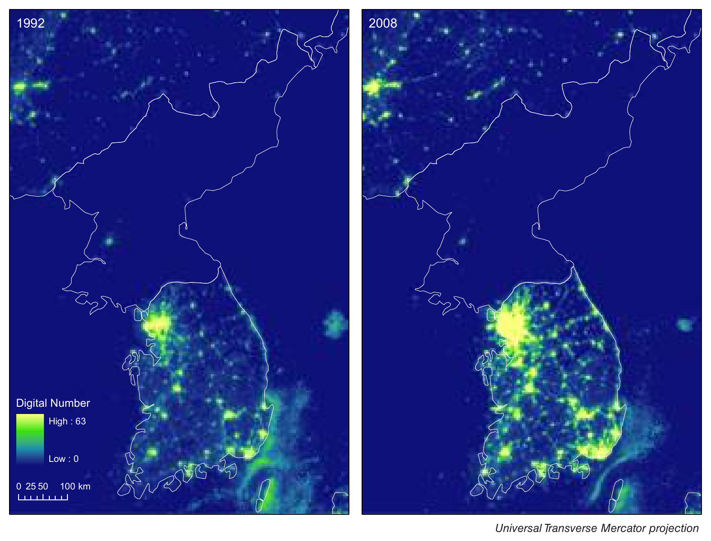{width="100%" fig-align="center"}

[Later in this part: lights at night over North and South Korea in 1992 and 2008, from
Henderson, Storeygard & Weil.]{.source}

::::

:::::

## Uses of satellite images in economics {#uses}

::::: {.columns}

:::: {.column width="84%"}

::: {.slide-text}

Donaldson & Storeygard group economic uses of satellite images by what the
images measure. Today we see papers from five of their groups.

:::

| Their heading | Paper today |
|:--------|:-----------------------------|
| Night lights | Henderson, Storeygard & Weil (American Economic Review, 2012) |
| Agricultural land use and crop choice | Asher & Novosad (American Economic Review, 2020) |
| Urban land use | Burchfield, Overman, Puga & Turner (Quarterly Journal of Economics, 2006) |
| Natural resources | Alix-García & Millimet (Journal of the Association of Environmental and Resource Economists, 2023) |
| Pollution monitoring | Jack, Jayachandran, Kala & Pande (American Economic Review: Insights, 2025) |

::::

:::: {.column width="14%"}

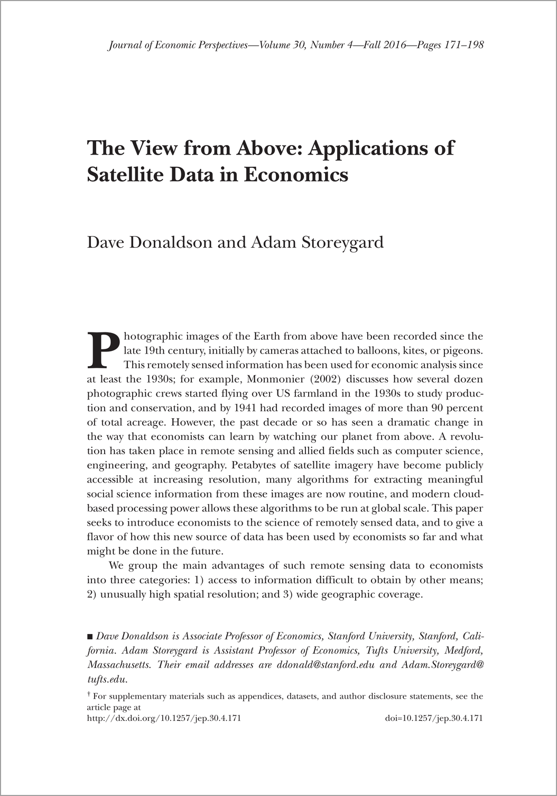{width="100%" fig-align="center"}

[The review's first page.]{.source}

::::

:::::

[[Donaldson & Storeygard (Journal of Economic Perspectives, 2016)](https://doi.org/10.1257/jep.30.4.171)
group uses by the physical thing measured (p. 183). Their other four headings are
climate and weather, topography, building types, and combinations of sources.
Placing crop burning under pollution monitoring is my choice.]{.source}

::: {.content-visible unless-format="revealjs"}

Donaldson & Storeygard's section on applications has nine headings (pp. 183 to
192):

- Night lights.
- Climate and weather.
- Topography.
- Agricultural land use and crop choice.
- Urban land use.
- Building types.
- Natural resources.
- Pollution monitoring.
- Combinations of sources.

Their pollution section covers air pollution measured from aerosols and forest
fires in Indonesia. It does not mention crop fires, so filing crop burning under
it is my choice.

:::

## Lights at night and GDP growth {#use-lights}

::: {.slide-text}

Henderson, Storeygard & Weil used lights at night to measure GDP growth where
national accounts are weak.

:::

::::: {.columns}

:::: {.column width="54%"}

::: {.dashes}

- **Question:** [Henderson, Storeygard & Weil (American Economic Review, 2012)](https://doi.org/10.1257/aer.102.2.994)
  asked whether lights seen from space can measure GDP growth.
- **Method:** They averaged the lights over each country's land each year. They
  compared each country with itself over time.
- **Data:** Lights from US Air Force weather satellites, 1992 to 2008, for 188
  countries, in cells about 1 km wide.
- **Result:** A 1% rise in lights goes with a 0.28% rise in GDP.

:::

::::

:::: {.column width="44%"}

{width="100%" fig-align="center"}

[Figure 2, "Long-Term Growth: Korean Peninsula", lights in 1992 (left) and 2008
(right). South Korea's lights rose 72% and North Korea's fell 7.4%.]{.source}

::::

:::::

::: {.content-visible unless-format="revealjs"}

The 0.28 is 0.277 in the published Table 2, column 1. The figure comes from the
published article as posted by
[Brown University](https://s4.brown.edu/sites/default/files/2024-01/Henderson%20Storeygard%20Weil%20AER%20April%202012.pdf).

:::

## Lights and population in New York's counties {#lights-ny}

::::: {.columns}

:::: {.column width="52%"}

::: {.slide-text}

We sum the lights in each of New York's 62 counties in 2023. Counties with more
people give off more light, and the correlation of the logs is 0.87.

- I used the newer VIIRS satellites, which need no account. The paper used the
  older Air Force satellites.
- `extract(..., fun = sum)` adds up the light of the cells inside each county.

:::

::::

:::: {.column width="46%"}

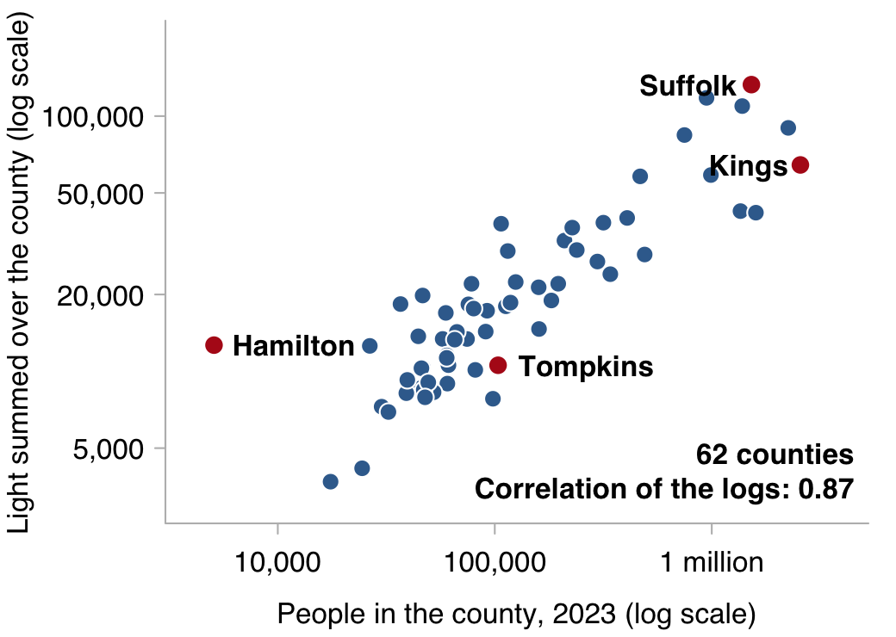{width="100%" fig-align="center"}

::::

:::::

```{r}
#| label: lights-ny
#| script: "Lights and population in New York's counties"
#| filename: "R Console, in the 26-satellite-local folder; reads data/lights/ and data_clean/census/"
viirs <- rast("data/lights/ntl_viirs_2023_ny.tif")             # mean light at night, 2023
ny    <- vect("data_clean/census/ny_counties.gpkg")            # 62 counties, 2023 population
s     <- extract(viirs, ny, fun = sum, na.rm = TRUE, exact = TRUE)  # exact: share of each cell inside
cor(log(s[, 2]), log(ny$pop2023))                              # column 2 holds the sums
```

[World Bank Light Every Night, World Bank Open Database License. Population from
the Census Bureau.]{.source}

::: {.content-visible unless-format="revealjs"}

`extract()` over the 62 counties takes about 20 seconds. Hamilton County (5,082
people) sits high in the figure because it is large, and faint light adds up
over its area. The AWS registry names the lights' licence "World Bank Open
Database License (ODbL)" and links it to CC BY 4.0.

:::

## Urban sprawl from land-cover maps {#use-sprawl}

::: {.slide-text}

Burchfield and coauthors measured US sprawl from 30 m land-cover maps. Sprawl
barely changed from 1976 to 1992.

:::

::::: {.columns}

:::: {.column width="62%"}

::: {.dashes}

- **Question:** [Burchfield, Overman, Puga & Turner (Quarterly Journal of Economics, 2006)](https://doi.org/10.1162/qjec.2006.121.2.587)
  asked how much new US development is scattered.
- **Method:** Around each 30 m cell of housing, they took the share of open land
  in the square kilometre. More open land means more scattered building.
- **Data:** Land use from aerial photos around 1976, and from Landsat in 1992.
- **Result:** Open land averaged 42% in 1976 and 43% in 1992.

:::

[A land-cover map gives each cell a type of cover, such as forest, crops, water
or built.]{.source}

::::

:::: {.column width="36%"}

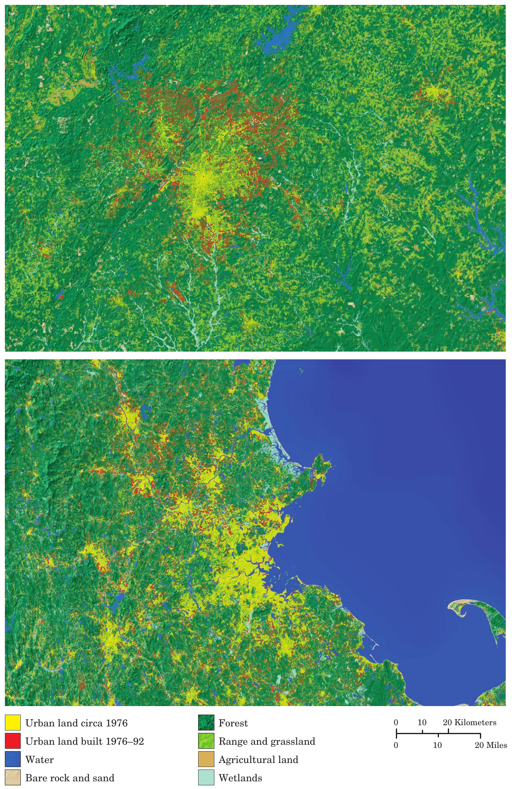{height="350px" fig-align="center"}

[Figure IIa, "Urban Land in Atlanta, GA (Top Panel) and Boston, MA (Bottom
Panel)". Yellow is urban land around 1976, and red is land built from 1976 to
1992.]{.source}

::::

:::::

::: {.content-visible unless-format="revealjs"}

Developed land grew 48% over those years. The figure comes from the published version on
[Diego Puga's site](https://diegopuga.org/papers/sprawl.pdf). Practice task 8
computes their index from ESA's land-cover map for Ithaca and Auburn.

:::

## Crop output from NDVI {#use-ndvi}

::: {.slide-text}

Asher & Novosad had no crop data for Indian villages, so they measured crop
output with NDVI. New roads raised it by 1.7%, which is not significant.

:::

::::: {.columns}

:::: {.column width="54%"}

::: {.dashes}

- **Question:** [Asher & Novosad (American Economic Review, 2020)](https://doi.org/10.1257/aer.20180268)
  asked whether new rural roads in India raised farm output and village incomes.
- **Method:** For each village, they took the season's peak NDVI, the greenness
  index, minus its early-season value.
- **Data:** Images from MODIS, a NASA sensor, in 250 m cells, 2000 to 2014.
- **Result:** They rule out rises above 6.8%.

:::

::::

:::: {.column width="44%"}

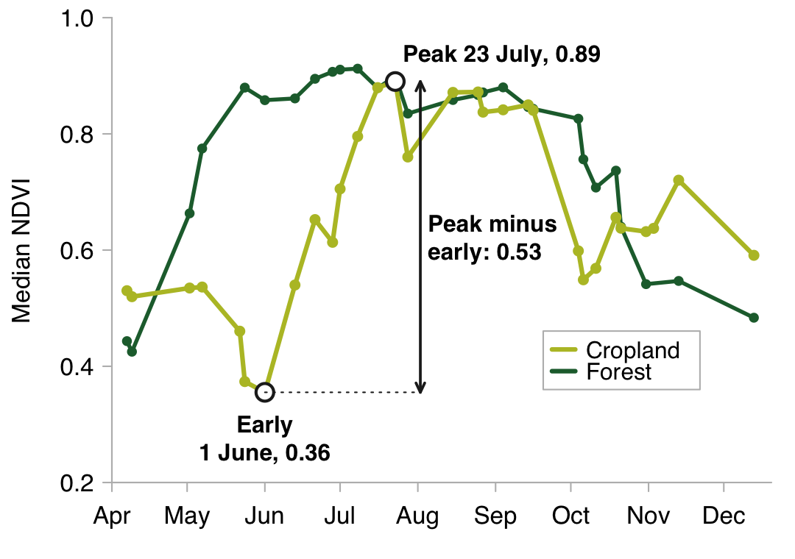{width="100%" fig-align="center"}

[The paper has no such figure. I drew this one from our 2024 Sentinel-2 images to
show the method. It is the median NDVI of cropland and forest near Aurora, New
York.]{.source}

::::

:::::

::: {.content-visible unless-format="revealjs"}

Forest stays green all season, so peak minus early NDVI is small for forest.
MODIS photographs the Earth every 1 to 2 days, and the paper uses its
composites of 16 days. The paper has no figure of the index. Its estimates are in Table 7 of the
[accepted version](http://paulnovosad.com/pdf/asher-novosad-roads.pdf)
(January 2019): the effect on peak NDVI minus June NDVI is 0.017, with a
standard error of 0.026.

The window of my figure runs from longitude −76.690 to −76.630 and latitude
42.720 to 42.780, farmland east of the lake from Aurora toward Poplar Ridge. A
date enters when most of the window is clear. Cropland reads 0.36 on 1 June and
peaks at 0.89 on 23 July. Forest is above 0.85 from late May to mid September.
The table is `data_clean/ndvi/ndvi_season_2024.csv` in the project.

:::

## NDVI of cropland and forest in August {#ndvi-cover}

::::: {.columns}

:::: {.column width="52%"}

::: {.slide-text}

On 15 August, cropland and forest around the lake have almost the same median
NDVI. One date cannot tell crops from trees.

- WorldCover is ESA's free 10 m land-cover map of 2021 (CC BY 4.0). It codes
  trees 10, crops 40 and water 80.
- Asher & Novosad subtract the early-season NDVI for this reason.

:::

::::

:::: {.column width="46%"}

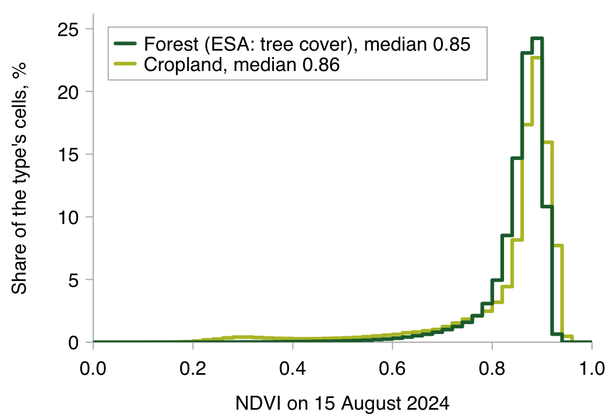{height="240px" fig-align="center"}

::::

:::::

```{r}
#| label: ndvi-cover
#| script: "NDVI of cropland and forest in August"
#| filename: "R Console, in the 26-satellite-local folder; reads data/worldcover/; s2 (our image) and ndvi from part 3"
wc <- rast("data/worldcover/worldcover2021_cayuga.tif")
names(wc) <- "esa"
wc20 <- project(wc, s2, method = "mode")           # each 20 m cell takes its most common class
z <- zonal(ndvi, wc20, fun = "median", na.rm = TRUE)
z$type <- c("trees", "grass", "crops", "built", "bare", "water", "wetland")
z$NDVI <- round(z$NDVI, 2)
z[z$esa %in% c(10, 40, 80), c("type", "NDVI")]
```

::: {.content-visible unless-format="revealjs"}

`method = "mode"` gives each 20 m cell of our image the most common class among
the 10 m cells inside it. All seven of ESA's types in our image:

```{r}
#| label: ndvi-cover-all
#| purl: false
#| filename: "R Console, in the 26-satellite-local folder; z from above"
z
```

The full credit for the map is "© ESA WorldCover project 2021 / Contains
modified Copernicus Sentinel data (2021) processed by ESA WorldCover
consortium" ([Zanaga et al., 2022](https://doi.org/10.5281/zenodo.7254221)).

:::

## Crop burning in Punjab {#use-burning}

::: {.slide-text}

Jack and coauthors paid farmers in Punjab not to burn rice straw. A classifier
measured burning on each field.

:::

::::: {.columns}

:::: {.column width="58%"}

::: {.dashes}

- **Question:** Do payments to farmers reduce crop burning?
  [Jack, Jayachandran, Kala & Pande (American Economic Review: Insights, 2025)](https://doi.org/10.1257/aeri.20230431)
  asked this in India.
- **Method:** Monitors checked 681 fields for burning. A classifier learned from
  them and scored every field from images.
- **Data:** 1,668 farmers in Punjab in 2019. Images at 3 m and 10 m.
- **Result:** Paying part up front raised the share who did not burn by 10
  percentage points.

:::

[A classifier puts each field into a class, here burned or unburned, from its
band values.]{.source}

::::

:::: {.column width="40%"}

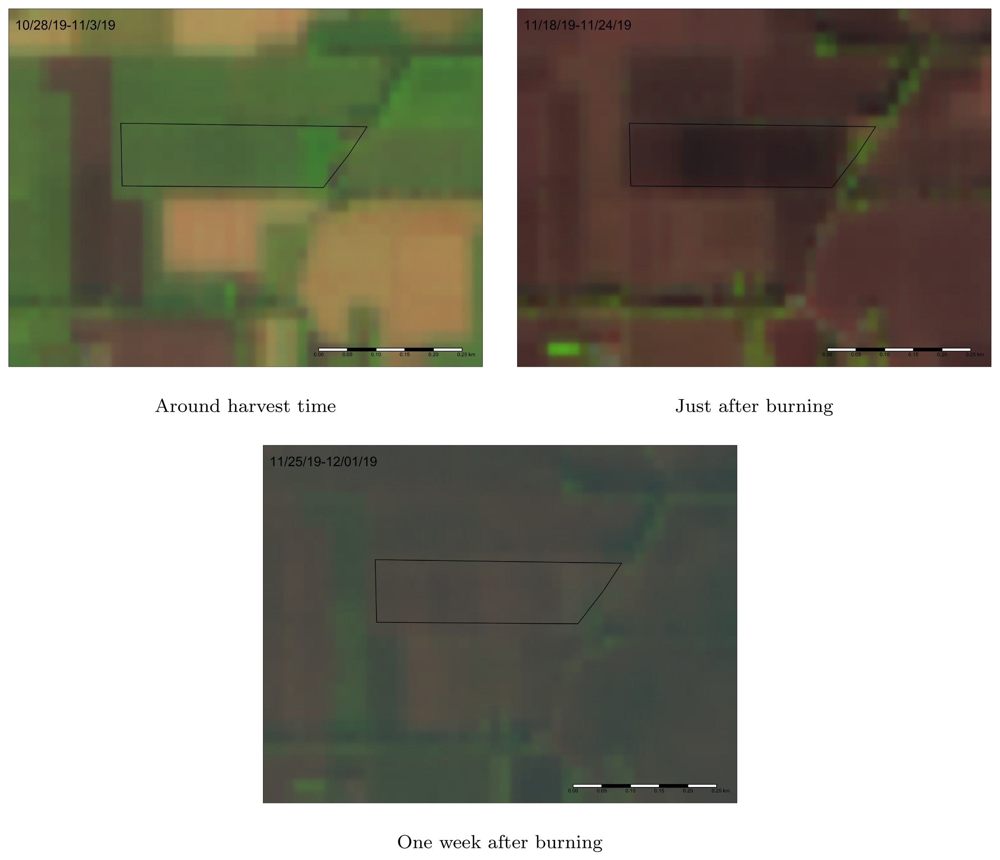{width="100%" fig-align="center"}

[Appendix Figure A3, "Visual Signs of Burning in Imagery: Example". One field,
outlined in black, around harvest, just after burning and a week later.]{.source}

::::

:::::

::: {.content-visible unless-format="revealjs"}

The images came from PlanetScope (3 m) and Sentinel-2 (10 m). The monitors saw 441 burned and 240 unburned fields, in 171 villages. The
classifier was 78 to 82% accurate. PlanetScope is a commercial company's set of
small satellites. The standard
payment, made after the season, had no effect. The 10 points come from the
published abstract, and the satellite measure agrees with the monitors. The
NBER working paper reports satellite estimates of 7.7 and 11.5 points at two
thresholds of the classifier's score. The figure comes from the
[AEA online appendix](https://www.aeaweb.org/content/file?id=22187).

:::

# 5 · Resolution in space and time {#part-resolution}

## Overview of part 5 {#overview-5}

::: {.slide-text}

In this part we compare image sources by pixel size and by how often a satellite
passes over. We also see how pixel size changes a count of ponds and lakes.

:::

::::: {.columns}

:::: {.column width="50%"}

::: {.dashes}

- Types of resolution.
- Sources of images compared.
- Ponds and lakes in 10 m cells.
- Exercise 2, the same count in larger cells.
- Clear images of the lake in 2024.

:::

::::

:::: {.column width="48%"}

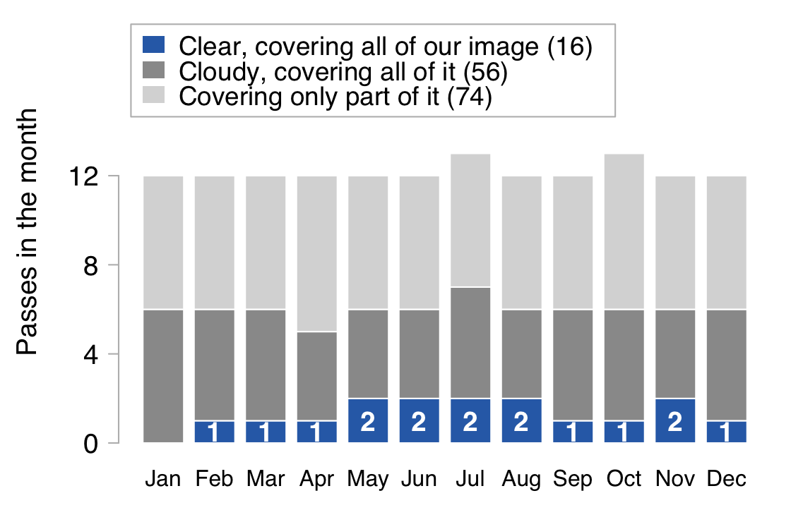{width="100%" fig-align="center"}

[Later in this part: Sentinel-2's passes over our image of Cayuga Lake in each month
of 2024. Blue passes were clear.]{.source}

::::

:::::

## Types of resolution {#resolution}

::: {.slide-text}

NASA lists four types of resolution. Today we use the first three.

- Spatial resolution is the pixel size, 4.1 cm for the corn-field drone.
- Temporal resolution is the time between images. Sentinel-2 passes over the
  lake about every 5 days.
- Spectral resolution is the number and width of bands. The drone has 3 and
  Sentinel-2 has 13.
- Radiometric resolution is the number of values a pixel can take. One series of
  lights at night stores only 0 to 63.

:::

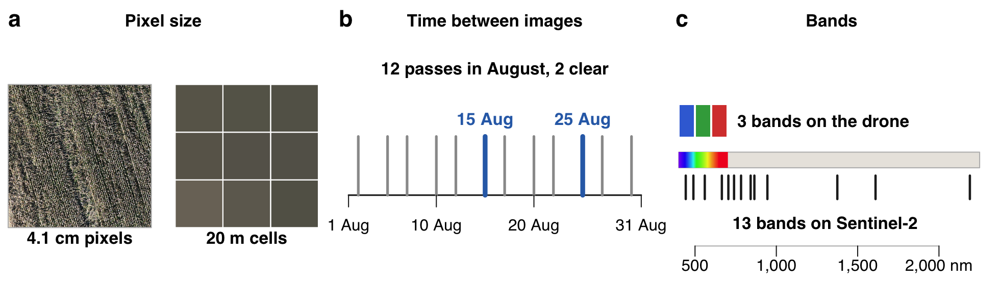{width="860px" fig-align="center"}

[NASA Earthdata on
[remote sensing](https://www.earthdata.nasa.gov/learn/earth-observation-data-basics/remote-sensing).
NASA defines temporal resolution by the orbit. Here it is the time between
images.]{.source}

## Sources of images compared {#sources-compared}

::: {.slide-text}

The sources with the smallest pixels cover the least ground or come least often.

:::

| Source | Resolution in space and time | Coverage in space and time |
|:------|:-------------------|:--------------|
| Drone (our corn trial) | 4.1 cm; once, when someone flies | One field |
| Aerial photos (NAIP) | 0.6 m (1 m before 2018); every 3 years or less | Lower 48 states, since 2003 |
| Sentinel-2 | 10 to 60 m; every 5 days | Land from 56° S to 83° N, since 2015 |
| Landsat | 30 m (about 80 m before 1982); every 8 days with two satellites | All land, since 1972 |
| VIIRS lights at night | about 500 m; every night | The whole Earth, since 2012 |
| MODIS | 250 m to 1 km; every 1 to 2 days | The whole Earth, since 2000 |

[Donaldson & Storeygard (Journal of Economic Perspectives, 2016, p. 179) write
"the higher the frequency of repeat coverage, the lower the resolution". Mission
pages of Copernicus, USGS and NASA.]{.source}

::: {.content-visible unless-format="revealjs"}

Sources for each row:

- **NAIP.** USGS's [NAIP page](https://www.usgs.gov/centers/eros/science/usgs-eros-archive-aerial-photography-national-agriculture-imagery-program-naip).
  NAIP has flown on a cycle of 3 years or less since 2010, and of 5 years from
  2003 to 2009.
- **Sentinel-2.** Copernicus's [mission page](https://sentiwiki.copernicus.eu/web/s2-mission)
  gives "all continental land surfaces (including inland waters) between
  latitudes 56° South and 82.8° North". Its bands have 10, 20 and 60 m pixels.
- **Landsat.** USGS's pages on [Landsat 9](https://www.usgs.gov/landsat-missions/landsat-9)
  and [Landsat 1](https://www.usgs.gov/landsat-missions/landsat-1). The first
  Landsat scanner had pixels of 57 by 79 m, and 30 m came in 1982.
- **VIIRS.** NASA's [Day/Night Band record](https://www.earthdata.nasa.gov/data/catalog/laads-vnp02dnb-2)
  gives 750 m pixels. The yearly and monthly
  [composites](https://eogdata.mines.edu/products/vnl/) use cells of about
  500 m.
- **MODIS.** NASA's [instrument page](https://www.earthdata.nasa.gov/data/instruments/modis).

**Small pixels come less often.** The figure below puts each source by its pixel
size and the days between its images, both on log scales. It adds PlanetScope,
a commercial company's satellites, at 3 m and about 2 days. Satellites with
1 m pixels take weeks to cover the Earth, while sensors with 1 km pixels cover
it every day (Donaldson & Storeygard, p. 179).
[Burgess, Hansen, Olken, Potapov & Sieber (Quarterly Journal of Economics, 2012)](https://doi.org/10.1093/qje/qjs034)
used 250 m MODIS images of Indonesia's forests for this reason. In cloudy
rainforest a clear 30 m Landsat image could take a year to come.

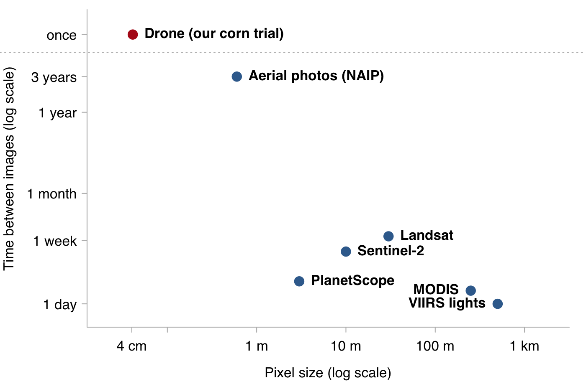{width="700px" fig-align="center"}

:::

## Separate water bodies at 10 m {#water-bodies}

::::: {.columns}

:::: {.column width="50%"}

::: {.slide-text}

ESA's land-cover map, put on 10 m cells, shows 406 separate water bodies in our
image. The largest is Cayuga Lake.

- Water is class 80 on ESA's map. A patch is a group of touching water cells.
- `patches()` numbers the patches, and `freq()` counts the cells in each.
- Exercise 2 counts the patches again in larger cells.

:::

::::

:::: {.column width="48%"}

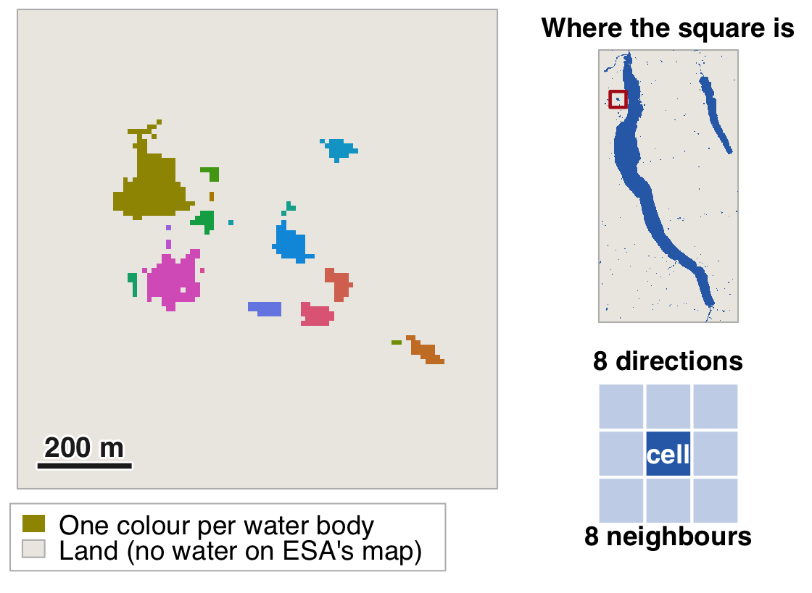{height="285px" fig-align="center"}

::::

:::::

```{r}
#| label: water-bodies
#| script: "Separate water bodies at 10 m"
#| filename: "R Console, in the 26-satellite-local folder; s2 (our image) and wc (ESA's map) from the slides before"
tm  <- rast(ext(s2), resolution = 10, crs = crs(s2))       # empty raster of 10 m cells
w10 <- project(wc == 80, tm, method = "near")               # 1 = water, 0 = other
f10 <- freq(patches(w10, directions = 8, zeroAsNA = TRUE))  # 8: corners touch; zeroAsNA leaves land out
nrow(f10)                                                   # water bodies
max(f10$count)                                              # cells in the largest, Cayuga Lake
```

::: {.content-visible unless-format="revealjs"}

Class 80 is water on ESA's map. With `directions = 4`, which counts only the
four cells that share a side, the count is 451. The figure shows a square of
1 km west of the lake, with each water body in its own colour.

:::

## Exercise 2 {#exercise-2}

::: {.panel-tabset}

### Exercise

Larger cells erase small ponds. The lake hardly changes.

3 minutes. Count water bodies in 30 m and 250 m cells, and measure the lake.
Start from `w10`, the 10 m water map.

1. `w30 <- aggregate(w10, fact = 3, fun = "mean", na.rm = TRUE) >= 0.5` makes
   30 m cells, water when half is water.
2. `f30 <- freq(patches(w30, directions = 8, zeroAsNA = TRUE))`, then
   `nrow(f30)`.
3. `max(f30$count) * 30^2 / 4046.86` gives the lake in acres.
4. Repeat with `fact = 25` (250 m, MODIS's smallest pixel).

```{r}
#| label: exercise-2
#| exercise: true
#| script: "Exercise 2 (3 minutes)"
#| include: false
#| eval: false
# Exercise 2 (3 minutes). Water bodies in 30 m and 250 m cells.
# Larger cells erase small ponds. The lake hardly changes.
# In the 26-satellite-local folder, with w10, the 10 m water map of the slide before
# (or run code/5_resolution.R first).
# 1. w30 <- aggregate(w10, fact = 3, fun = "mean", na.rm = TRUE) >= 0.5   # water if half is water
# 2. f30 <- freq(patches(w30, directions = 8, zeroAsNA = TRUE)); nrow(f30)
# 3. max(f30$count) * 30^2 / 4046.86                       # the lake in acres; an acre is 4,046.86 m2
# 4. The same for 250 m cells, MODIS's smallest pixel:
#    w250 <- aggregate(w10, fact = 25, fun = "mean", na.rm = TRUE) >= 0.5
#    then steps 2 and 3 with w250, f250 and 250^2.
# Two answers to compare with the room: how many of the 406 water bodies are left in
# 250 m cells, and how much the lake's area moves.
```

[Two answers to compare with the room: how many water bodies are left at 250 m,
and how much the lake's area moves.]{.source}

### Solution

```{r}
#| label: exercise-2-solution
#| purl: false
#| filename: "R Console, in the 26-satellite-local folder; w10 from Separate water bodies at 10 m"
w30 <- aggregate(w10, fact = 3, fun = "mean", na.rm = TRUE) >= 0.5
f30 <- freq(patches(w30, directions = 8, zeroAsNA = TRUE)); nrow(f30)
max(f30$count) * 30^2 / 4046.86
w250 <- aggregate(w10, fact = 25, fun = "mean", na.rm = TRUE) >= 0.5
f250 <- freq(patches(w250, directions = 8, zeroAsNA = TRUE)); nrow(f250)
max(f250$count) * 250^2 / 4046.86
```

::: {.slide-text}

- 406 water bodies at 10 m, 192 at 30 m and 5 at 250 m.
- The lake is 42,944 acres at 10 m, 42,950 at 30 m and 43,012 at 250 m.
- Half the other 405 are under 0.15 acres.

:::

::: {.content-visible unless-format="revealjs"}

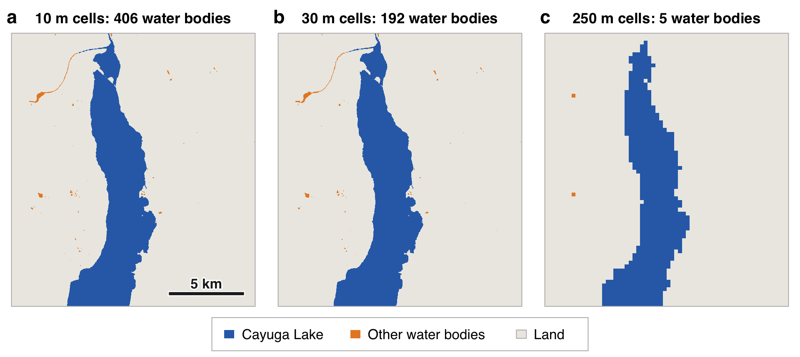{width="860px" fig-align="center"}

:::

:::

::: {.notes}
Exercise 2 runs from minute 39 to 44.
:::

## Clear images of the lake in 2024 {#clear}

::::: {.columns}

:::: {.column width="48%"}

::: {.slide-text}

Sentinel-2 passed over our image of Cayuga Lake on 146 days of 2024. Only 16
images covered all of it with under 10% cloud.

- Two orbits reach the lake. Only 72 of the 146 passes covered all of our image.
- The longest wait between clear images was 45 days, from 4 September to 19
  October. January had none.
- In August only 15 and 25 August were clear.

:::

::::

:::: {.column width="50%"}

{width="100%" fig-align="center"}

[Sentinel-2's passes over our image in each month of 2024. I measured the cloud
share inside our image, from ESA's class for each cell.]{.source}

::::

:::::

::: {.content-visible unless-format="revealjs"}

The table `data_clean/catalog/s2_box_clear_2024.csv` has one row per pass of
2024. It gives the share of our image the pass covers and the share of that
which is clear. A cell is clear unless ESA's class is 0 or 1 (no data or bad
data), 3 (cloud shadow), 8 or 9 (cloud) or 10 (thin, high cloud). A pass counts
as clear when it covers at least 90% of our image and more than 90% of it is
clear. No pass covers between 90% and 99%, so every clear pass covers all of
it.

```{r}
#| label: clear
#| script: "Clear images of the lake in 2024"
#| filename: "R Console, in the 26-satellite-local folder; reads data_clean/catalog/s2_box_clear_2024.csv"
bx <- read.csv("data_clean/catalog/s2_box_clear_2024.csv")
bx$date  <- as.Date(bx$date)
bx$clear <- bx$share_box_covered >= 0.9 & bx$share_clear > 0.9
c(passes = nrow(bx), whole_image = sum(bx$share_box_covered == 1), clear = sum(bx$clear))
table(month = format(bx$date, "%m"), clear = bx$clear)
cd <- bx$date[bx$clear]                                     # the clear dates
cd
gap <- diff(cd)                                             # days between clear images
data.frame(days = as.numeric(max(gap)), from = cd[which.max(gap)], to = cd[which.max(gap) + 1])
```

Counted on the whole tile, the catalog gives 22 passes under 10% cloud. About
half of the tile's passes cover only part of our image, which is why the count
inside our image is lower.

**Dropping cloudy cells.** A cloud mask marks the cells hidden by cloud or its
shadow. In ESA's class for each cell these are 3 (shadow), 8 and 9 (cloud) and
10 (thin, high cirrus). `global()` adds up a raster over all its cells. On 15
August the mask drops 44 of the 4.3 million cells (1 cloud, 43 cirrus). On 30
August it would drop about 99% of the image. With the mask, the lake areas of
part 7 do not change.

```{r}
#| label: cloud-mask
#| script: "Dropping cloudy cells"
#| filename: "R Console, in the 26-satellite-local folder; s2 and refl from Reading the image in R"
cloud <- (s2$SCL == 3) | (s2$SCL >= 8 & s2$SCL <= 10)
global(cloud, "sum", na.rm = TRUE)                 # 44
refl_masked <- mask(refl, cloud, maskvalues = TRUE)
```

:::

::: {.notes}
A cloud mask sets cloudy cells to NA. On 15 August it drops only 44 of 4.3
million cells. The code is on the page.
:::

# 6 · Measurement error {#part-error}

## Overview of part 6 {#overview-6}

::: {.slide-text}

In this part we see where error enters a number built from images, and what it
does to a regression.

:::

::::: {.columns}

:::: {.column width="54%"}

::: {.dashes}

- What two reviews say about error.
- Forest loss in Mexico.
- Lights at night that stop at a top value.
- The error in today's numbers.

:::

::::

:::: {.column width="44%"}

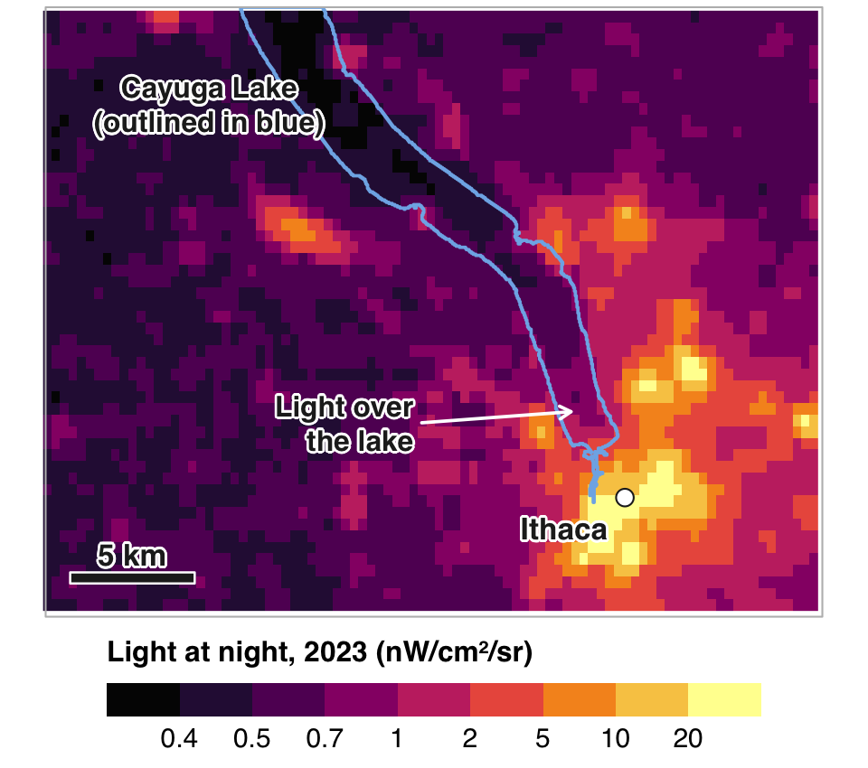{height="400px" fig-align="center"}

[Later in this part: lights at night around Ithaca in 2023. The glow spreads over
Cayuga Lake, where nobody lives.]{.source}

::::

:::::

## Measurement error in two reviews {#error-reviews}

::::: {.columns}

:::: {.column width="56%"}

::: {.slide-text}

Two reviews of satellite data in economics warn that numbers from images carry
error.

- Measurement error is the gap between our number and the true number.
- [Donaldson & Storeygard (Journal of Economic Perspectives, 2016)](https://doi.org/10.1257/jep.30.4.171)
  expect "false positives and false negatives" from any classification (p. 192).
- They add that a 1 km cell of lights at night records light from 3 to 5 km
  around.
- [Jain (Review of Environmental Economics and Policy, 2020)](https://doi.org/10.1093/reep/rez023)
  names misclassification, saturation, the atmosphere and cloud.

:::

::::

:::: {.column width="42%"}

{width="100%" fig-align="center"}

[Lights at night in 2023 around Ithaca, from the VIIRS satellites. The glow runs out
over Cayuga Lake, where nobody lives. World Bank Light Every Night.]{.source}

::::

:::::

[Saturation means the sensor stops counting at its top value. Jain's list is
from her abstract.]{.source}

::: {.content-visible unless-format="revealjs"}

Jain's abstract says the misclassification is not random. The median light over
lake cells is 0.79 near the south end (42.44° to 42.50° N), 0.51 a little
further north and 0.40 further still. The median land cell reads 0.58.

:::

## Forest loss in Mexico {#use-forest}

::: {.slide-text}

A satellite map misses about half of Mexico's forest loss.
Modelling that error almost triples the payments' effect.

:::

::::: {.columns}

:::: {.column width="54%"}

::: {.dashes}

- **Question:** Mexico pays landowners to keep forest. Did the payments cut forest loss?
  [Alix-García & Millimet (Journal of the Association of Environmental and Resource Economists, 2023)](https://doi.org/10.1086/723723).
- **Method:** They modelled missed loss and false loss.
- **Data:** 20,919 parcels, 2001 to 2014, and a 30 m Landsat map.
- **Result:** The usual estimate cuts the yearly chance of loss by 0.5 points,
  not significant. With the errors modelled, the cut is 1.4 points.

:::

::::

:::: {.column width="44%"}

::: {.crop-left}

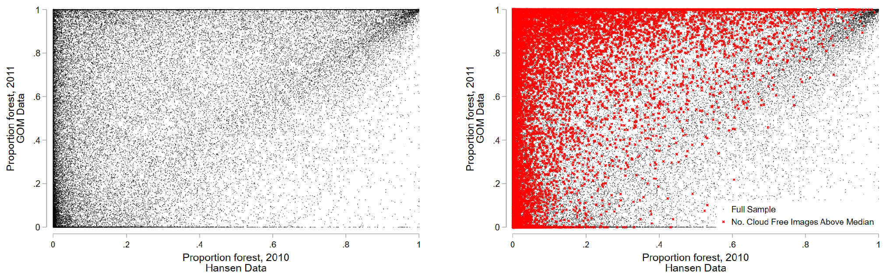

:::

[Each dot is a 5 km cell. Across is its forest share on a Landsat map (2010), and
up is its share on the government's map (2011). Dots far from the diagonal are
cells where the two maps disagree.]{.source}

[Figure 1 (left panel), "Scatterplot of forest cover in 5 x 5 km cells across
Mexico". Numbers and figure from the NBER conference version (2021).]{.source}

::::

:::::

```{=html}
<style>
.crop-left { width: 100%; overflow: hidden; }
.reveal .quarto-figure { margin-bottom: 0; }
.reveal .quarto-figure img { margin-bottom: 0; }
.reveal .quarto-figure + p:has(> span.source) { margin-top: 0.3em; }
.reveal details.code-fold summary { font-size: calc(var(--r-main-font-size) * 0.42); }
.crop-left img { width: 200%; max-width: none !important; max-height: none !important; height: auto; display: block; margin: 0; }
</style>
```

::: {.content-visible unless-format="revealjs"}

The two maps of Mexico disagree in about 18% of the 5 km cells: one shows forest
and the other none. The numbers in the slide come from the NBER conference
version of 2021 (p. 31), since I found no open copy of the journal text. Of 100
parcel-years with real loss, the map shows 49 and misses 51. Of 100 with no
loss, it shows about 1 with loss (1.2). The map shows loss in 17% of
parcel-years, and their model puts the true share near 34%. The numbers fit:
0.49 × 0.34 + 0.012 × 0.66 = 0.174.

```{r}
#| label: forest-numbers
#| script: "Forest loss in Mexico"
#| filename: "R Console; Alix-García & Millimet's numbers"
0.49 * 0.34 + 0.012 * 0.66
```

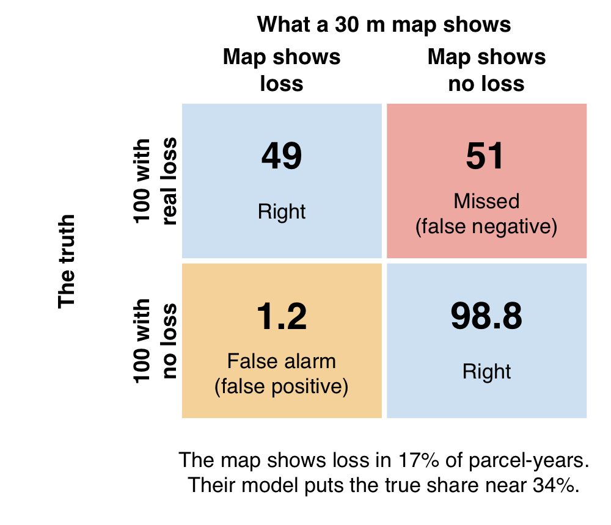{width="500px" fig-align="center"}

**Classical error.** Classical measurement error is noise unrelated to the true
value. A yes/no map's error is tied to the truth. Where the truth is loss, the
error can only lower the number. Where the truth is no loss, it can only raise
it. So the usual fixes for classical error do not apply, and Alix-García &
Millimet model the two error rates directly.

:::

## Lights stop counting at 63 {#saturation}

::: {.slide-text}

The older lights series stores brightness from 0 to 63. All 127 of Manhattan's
cells read 63, so its light no longer tracks its people.

:::

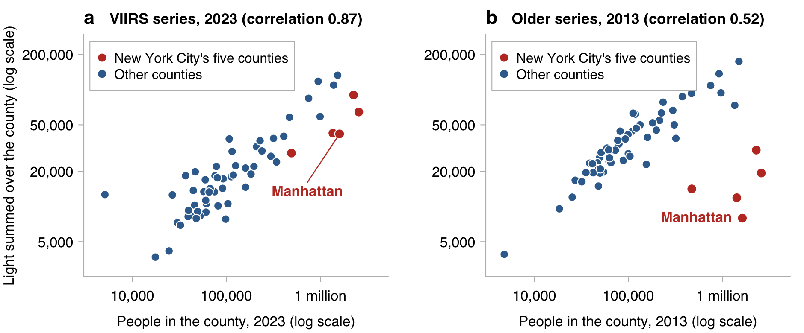{.nostretch width="58%" fig-align="center"}

```{r}
#| label: saturation
#| script: "Lights stop counting at 63"
#| filename: "R Console, in the 26-satellite-local folder; reads data/lights/ and data_clean/census/"
li <- rast("data/lights/ntl_li2020_2013_ny.tif")             # older series, 0 to 63
ny <- vect("data_clean/census/ny_counties.gpkg")
x  <- extract(li, ny[ny$NAME == "New York", ])               # Manhattan's cells
c(cells = nrow(x), at_63 = sum(x[[2]] == 63))
```

[Light summed over each of New York's 62 counties. New York County is Manhattan.
Older lights for 2013 from [Li et al. (Scientific Data, 2020)](https://doi.org/10.1038/s41597-020-0510-y).]{.source}

::: {.content-visible unless-format="revealjs"}

The older series stores brightness as whole numbers from 0 to 63, so a cell
brighter than 63 still reads 63. I used Li et
al.'s version for 2013, made comparable across years. Without New York City's
five counties, the correlation of log lights and log population rises to 0.93:

```{r}
#| label: saturation-cor
#| script: "Lights and population without New York City"
#| filename: "R Console, in the 26-satellite-local folder; li and ny from above"
nyc <- ny$NAME %in% c("Bronx", "Kings", "New York", "Queens", "Richmond")   # New York City
sl  <- extract(li, ny, fun = sum, na.rm = TRUE, exact = TRUE)
round(c(all = cor(log(sl[, 2]), log(ny$pop2013)),
        without_nyc = cor(log(sl[!nyc, 2]), log(ny$pop2013[!nyc]))), 3)
```

The two series differ in year as well as sensor (2013 against 2023).
[Gibson, Olivia, Boe-Gibson & Li (Journal of Development Economics, 2021)](https://doi.org/10.1016/j.jdeveco.2020.102602)
found 82% of Jakarta's cells at 63 in the older series (working-paper version).

**Lights and GDP as two measures.** Henderson, Storeygard & Weil treat lights
and official GDP as two noisy measures of growth. In countries with good
statistics, their best estimate puts 0.85 of the weight on official growth and
0.15 on lights. In the 30 countries with the poorest statistics, it puts 0.48
on official growth and 0.52 on lights. Their combined estimates differ from
official growth by up to 3 percentage points a year. The weights assume the
errors in lights and in GDP are unrelated.

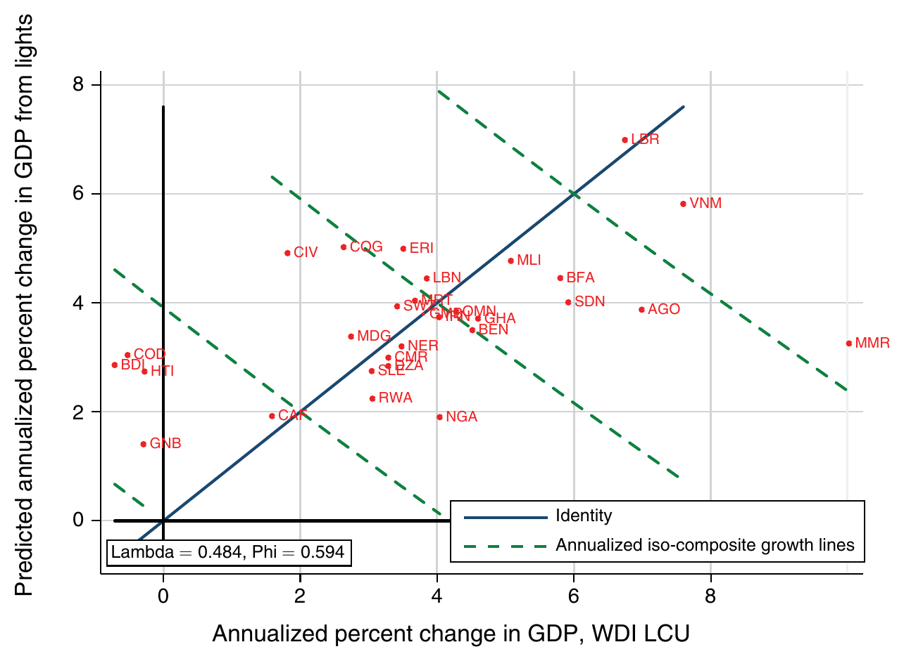{width="640px" fig-align="center"}

Henderson, Storeygard & Weil, Figure 7, "Growth in Fitted Lights versus WDI for
Bad Data Countries 1992–2006".

:::

## Error in today's numbers {#error-today}

::: {.slide-text}

Each source of error the two reviews name showed up in today's data or papers.

:::

| Source of error | Where we saw it today |
|:-----------|:-------------------|
| Large pixels | 406 water bodies in 10 m cells, only 5 in 250 m cells |
| Clouds | Only 16 of 146 Sentinel-2 passes over Cayuga Lake in 2024 were clear |
| Saturation, a sensor stuck at its top value | All 127 of Manhattan's cells read 63 in the older lights |
| Misclassification | Mexico's forest map missed about half of real loss (51 of 100) |
| Light spreading past its cell | Light over Cayuga Lake, where nobody lives |

[Sources of error from Donaldson & Storeygard (2016) and Jain (2020). Two more come
from our own data. The Census line for a road sits about 4 m off the road in the
drone photo. The aerial photos (2019), ESA's map (2021) and our image (2024)
differ in date.]{.source}

# 7 · An application to Cayuga Lake {#part-lake}

## Overview of part 7 {#overview-7}

::: {.slide-text}

In this part we measure Cayuga Lake's area against the 42,956 acres the state
publishes. Then we make our own land-cover map and measure its accuracy.

:::

::::: {.columns}

:::: {.column width="60%"}

::: {.dashes}

- The lake's area from ESA's land-cover map.
- The lake's area from two water indices.
- 200 points I labelled on aerial photos.
- A decision tree trained on 140 of them.
- Its accuracy on the other 60.

:::

[New York's Department of Environmental Conservation (DEC)
[publishes the lake's area](https://dec.ny.gov/places/cayuga-lake).]{.source}

::::

:::: {.column width="38%"}

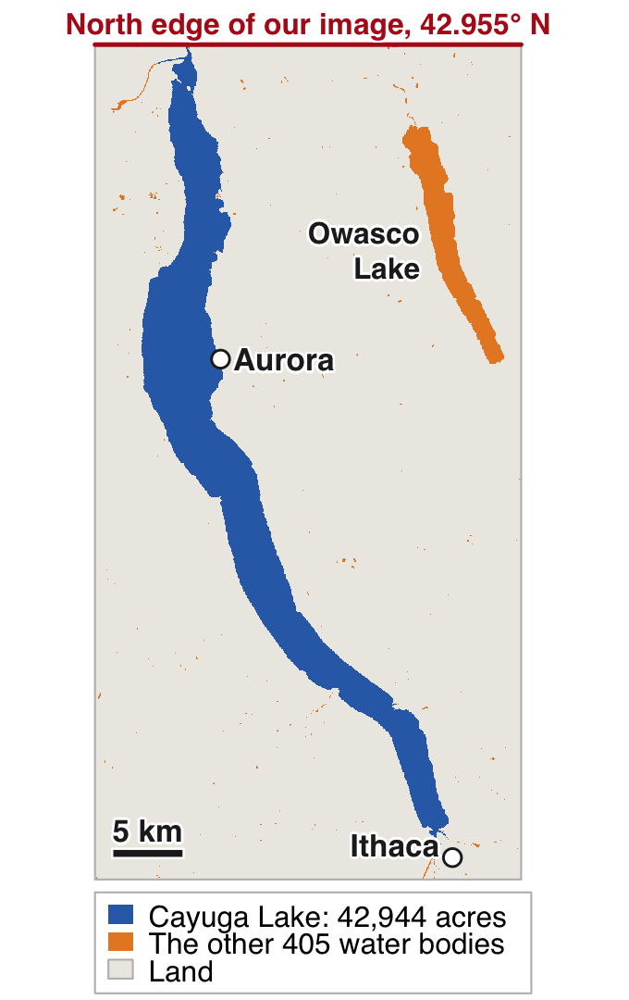{height="400px" fig-align="center"}

[Later in this part: Cayuga Lake on ESA's land-cover map, in our image from Ithaca
to just past the lake's north end.]{.source}

::::

:::::

::: {.content-visible unless-format="revealjs"}

A DEC brochure gives the lake 43,560 acres. Even the official figure depends on
where it is read.

:::

## Cayuga Lake's area from ESA's map {#lake-esa}

::::: {.columns}

:::: {.column width="56%"}

::: {.slide-text}

ESA's map gives Cayuga Lake 42,944 acres. The state publishes 42,956.

- The lake is the largest water body in our image. Each 10 m cell covers
  100 m².
- I multiplied the lake's 1,737,902 cells by 100 m² and converted to acres. One
  acre is 4,046.86 m².

:::

[On the image's 20 m cells ESA's map gives 42,964 acres, and on its own cells
42,998.]{.source}

::::

:::: {.column width="42%"}

{height="500px" fig-align="center"}

::::

:::::

::: {.content-visible unless-format="revealjs"}

The area in acres, from the water bodies of Separate water bodies at 10 m:

```{r}
#| label: lake-esa
#| script: "Cayuga Lake's area from ESA's map"
#| filename: "R Console, in the 26-satellite-local folder; f10 from Separate water bodies at 10 m"
max(f10$count) * 100 / 4046.86
```

Our image stops just past the lake's north end and cuts the outlet canal.
Counting the canal north of the edge gives 42,985 acres, 0.07% over the state's
figure. Inside the box, the lake already includes about 23 acres of channels.

:::

::: {.notes}
Our image stops just past the lake's north end and cuts the outlet canal.
Counting the canal north of the edge gives 42,985 acres, 0.07% over the state's
figure.
:::

## Two water indices {#water-indices}

::: {.slide-text}

MNDWI puts the lake at 42,655 acres, 0.7% under the state's 42,956. NDWI puts it
at 40,177 acres, 6.5% under.

- NDWI, a water index, is green (B03) minus near-infrared (B8A), divided by their
  sum.
- MNDWI, the modified version, uses shortwave infrared (B11) in place of
  near-infrared.
- A cell is water where the index is above 0. I fixed this threshold before
  measuring.

:::

```{r}
#| label: water-indices
#| script: "Two water indices"
#| filename: "R Console, in the 26-satellite-local folder; refl from Reading the image in R"
mndwi <- (refl$B03 - refl$B11) / (refl$B03 + refl$B11)
ndwi  <- (refl$B03 - refl$B8A) / (refl$B03 + refl$B8A)
fm <- freq(patches(mndwi > 0, directions = 8, zeroAsNA = TRUE))
fn <- freq(patches(ndwi > 0, directions = 8, zeroAsNA = TRUE))
round(c(mndwi = max(fm$count), ndwi = max(fn$count)) * 400 / 4046.86)   # acres; a 20 m cell is 400 m2
```

::: {.slide-text}

- NDWI misses about a quarter of the lake at its south end. The water there
  reflects about as much near-infrared as green.

:::

::: {.content-visible unless-format="revealjs"}

The percent under the state's figure, and the share of ESA's water cells that
NDWI finds in three bands of latitude: 42.45° to 42.50° N, 42.50° to 42.65° N
and 42.65° to 42.90° N.

```{r}
#| label: water-found
#| script: "Where NDWI finds the lake"
#| filename: "R Console, in the 26-satellite-local folder; mndwi, ndwi, s2 and wc20 from above"
round(100 * (1 - c(mndwi = max(fm$count), ndwi = max(fn$count)) * 400 / 4046.86 / 42956), 1)
found <- function(ymin, ymax) {
  b <- project(vect(ext(-76.85, -76.40, ymin, ymax), crs = "EPSG:4326"), crs(s2))
  v <- values(crop(c(wc20 == 80, ndwi > 0), b))
  round(100 * mean(v[!is.na(v[, 1]) & v[, 1] == 1, 2] == 1, na.rm = TRUE))
}
c(south = found(42.45, 42.50), middle = found(42.50, 42.65), north = found(42.65, 42.90))
```

**Where NDWI misses the lake.** NDWI misses about a quarter of the lake's south
end. There the lake reflects about as much near-infrared as green. Across the
whole lake the median water cell reflects 0.047 of near-infrared, 0.054 of green
and only 0.010 of shortwave infrared. NDWI misses 49,168 of ESA's water cells
over the whole image. I do not know why the south end reflects more
near-infrared on this date.

```{r}
#| label: ndwi-miss
#| script: "Where NDWI misses the lake"
#| filename: "R Console, in the 26-satellite-local folder; wc20, ndwi and refl from above"
#| fig-width: 5
#| fig-height: 5
miss  <- (wc20 == 80) & (ndwi <= 0)          # water on ESA's map, missed by NDWI
south <- project(vect(ext(-76.60, -76.44, 42.43, 42.55), crs = "EPSG:4326"), crs(miss))
plot(crop(miss, south), col = c("grey90", "red"),
     levels = c("other", "water on ESA's map, missed by NDWI"))
global(miss, "sum", na.rm = TRUE)            # ESA-water cells NDWI misses, whole image
wt <- c(refl$B03, refl$B8A, refl$B11, wc20 == 80)
v  <- values(wt)
vs <- values(crop(wt, south))
round(rbind(whole_image = apply(v[!is.na(v[, 4]) & v[, 4] == 1, 1:3], 2, median, na.rm = TRUE),
            south_end   = apply(vs[!is.na(vs[, 4]) & vs[, 4] == 1, 1:3], 2, median, na.rm = TRUE)), 3)
```

:::

## 200 points labelled on aerial photos {#labels}

::::: {.columns}

:::: {.column width="38%"}

::: {.slide-text}

I labelled 200 points on aerial photos from 2019, 50 in each of four classes.
A decision tree will learn the classes from them.

- The classes are water, forest, grass or crops, and built.
- The photos have 0.6 m pixels. A label is the class I read in the 20 m cell of
  our image at a point.
- I skipped cells that held two classes or that I could not call.

:::

::::

:::: {.column width="62%"}

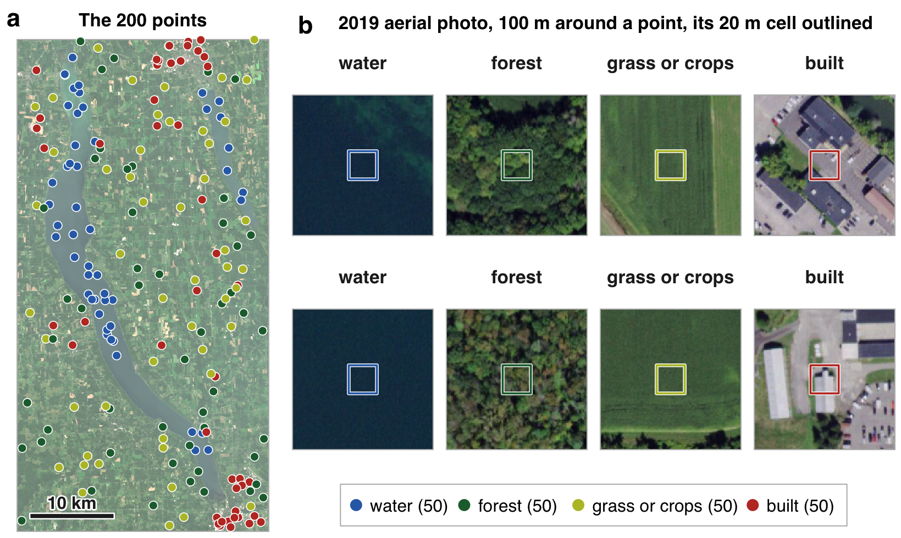{width="100%" fig-align="center"}

[a, the 200 points over our image of Cayuga Lake. b, two examples of each class.
Photos from USGS, USDA, The National Map. The labels are in
`data_clean/labels/labels_200.csv`.]{.source}

::::

:::::

::: {.content-visible unless-format="revealjs"}

The photos are from 2019 and our image from 2024, so a few fields may have
changed. ESA's map only decided where to look. I drew candidate points at the centres of
20 m cells of our image, the same number in each of four groups of ESA's map,
and left out cloudy cells. The class of each point is what the 2019 photo
shows. The project's `README.md` describes the steps. We treat these labels as
the true classes.

:::

## Training points and test points {#train-test}

::::: {.columns}

:::: {.column width="48%"}

::: {.slide-text}

We set 60 of the 200 labelled points aside as test points. The decision tree
learns from the other 140 and never sees the 60.

- We first read the five bands of our image at each point.
- `set.seed()` fixes the draw, so the same 60 come out every time.

:::

::::

:::: {.column width="50%"}

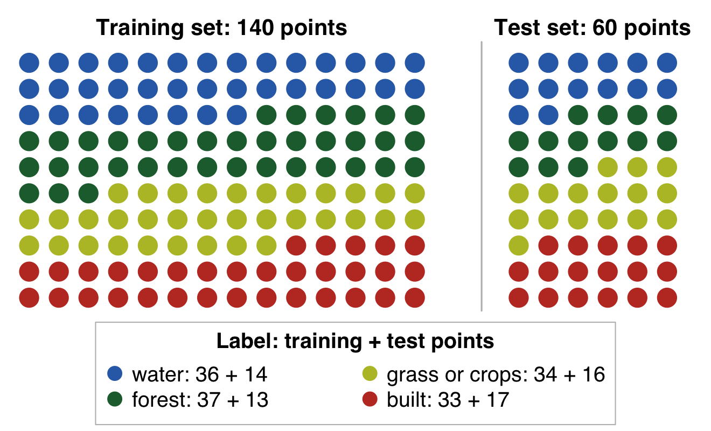{height="225px" fig-align="center"}

::::

:::::

```{r}
#| label: train-test
#| script: "Training points and test points"
#| filename: "R Console, in the 26-satellite-local folder; reads data_clean/labels/labels_200.csv; s2 and refl from part 3"
lab <- read.csv("data_clean/labels/labels_200.csv")             # lon, lat, class
lab$class <- factor(lab$class)
pts <- project(vect(lab, geom = c("lon", "lat"), crs = "EPSG:4326"), crs(s2))
lab <- cbind(lab, extract(refl, pts, ID = FALSE))               # five bands per point
set.seed(6850)
test  <- sample(nrow(lab), 60)
train <- lab[-test, ]                                           # 140 points to learn from
hold  <- lab[test, ]                                            # 60 test points
table(train$class)
```

## A decision tree on our labels {#tree}

::: {.slide-text}

A decision tree sorts each point by yes/no questions about its five bands. Ours
first splits at a near-infrared (B8A) value of about 0.068.

:::

::::: {.columns}

:::: {.column width="35%"}

::: {.slide-text}

- At each split, the points that meet the condition go left.
- The 36 training points below 0.068 are all water.
- Among the rest, red (B04) of about 0.059 or more means built.

:::

::::

:::: {.column width="63%"}

```{r}
#| label: tree-plot
#| ref.label: tree
#| echo: false
#| purl: false
#| fig-width: 6.2
#| fig-height: 3.2
#| out-width: "100%"
#| dev.args: !expr list(pointsize = 15)
```

::::

:::::

```{r}
#| label: tree
#| script: "A decision tree on our labels"
#| fig-show: hide
#| filename: "R Console, in the 26-satellite-local folder; train from Training points and test points"
fit <- rpart(class ~ B02 + B03 + B04 + B8A + B11, data = train, method = "class")   # the answer is a class
par(mar = c(0, 0, 0, 0))                     # no blank margin around the tree
plot(fit, uniform = TRUE, margin = 0.08)     # uniform: every level of the tree as tall
text(fit, cex = 0.9)
```

::: {.content-visible unless-format="revealjs"}

The tree as R prints it. Each line is a node: the split, the number of training
points, how many of them are not the node's class, the class, and the share of
each class. The tree uses only red (B04) and near-infrared (B8A).

```{r}
#| label: tree-print
#| script: "The tree's splits"
#| filename: "R Console, in the 26-satellite-local folder; fit from above"
fit
```

:::

## Accuracy and the confusion table {#accuracy}

::: {.slide-text}

The tree gets 52 of the 60 test points right (87%). The confusion table shows
which classes it mixes up.

- Accuracy is the share of test points the model gets right. Naming the largest
  class (built) for every point would score 28%.
- In a confusion table the rows are the true class and the columns the tree's
  class. The diagonal holds the right answers.
- The tree called 4 of the 13 forest points grass or crops.

:::

```{r}
#| label: accuracy
#| script: "Accuracy and the confusion table"
#| filename: "R Console, in the 26-satellite-local folder; fit and hold from the slides before"
pred <- predict(fit, hold, type = "class")
mean(pred == hold$class)
table(true = hold$class, predicted = pred)
```

[[Torchiana, Rosenbaum, Scott & Souza-Rodrigues (Review of Economics and Statistics, 2025)](https://doi.org/10.1162/rest_a_01301)
show that small map errors inflate measured change. In Mato Grosso, Brazil, a
map 92% accurate showed 6.2% of cropland turning to pasture each year, against
a true 0.7%.]{.source}

::: {.content-visible unless-format="revealjs"}

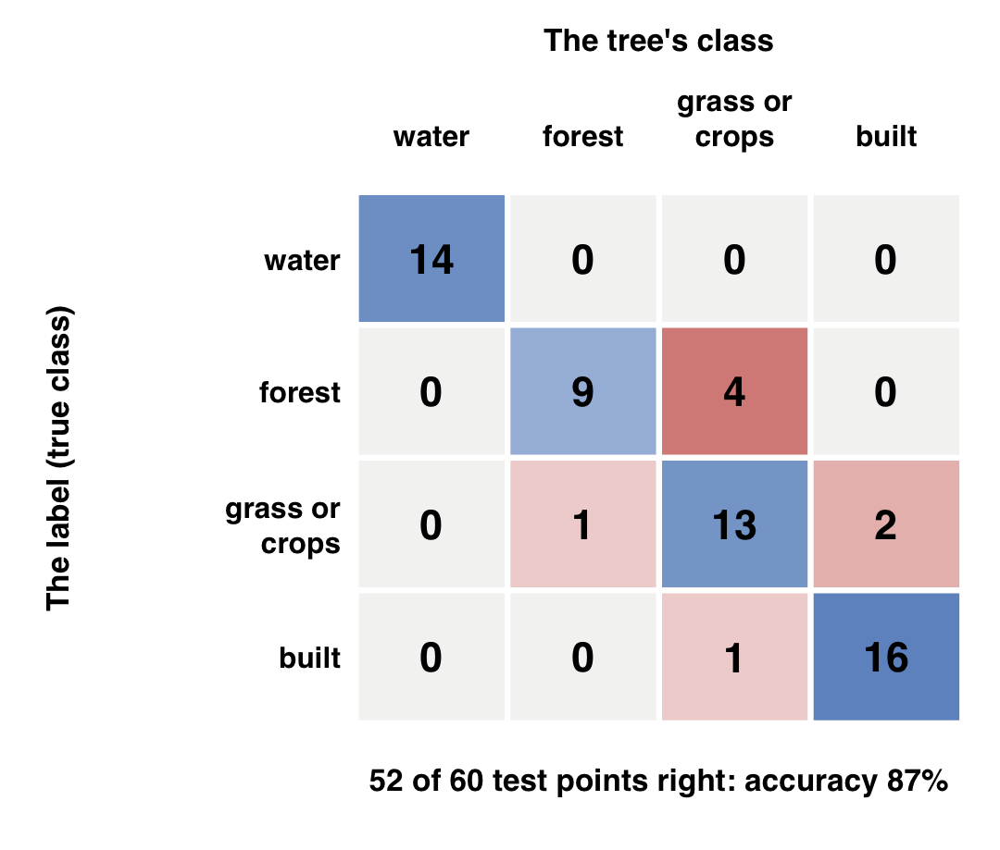{width="540px" fig-align="center"}

The Mato Grosso numbers come from the 2020 working paper (p. 21).

**Our map against ESA's map.** `predict()` on a raster applies the tree to all
4.3 million cells, in about 2 seconds. `crosstab()` counts the cells for each
pair of our class and ESA's class. The tree calls 12.0% of the image built,
against 1.6% on ESA's map. A quarter of my labels are built, so the tree treats
a rare class as a common one. Of the cells the tree calls water, 99.9% are water
on ESA's map.

```{r}
#| label: tree-map
#| script: "Our map against ESA's map"
#| filename: "R Console, in the 26-satellite-local folder; refl, fit and wc20 from above"
map <- predict(refl, fit, type = "class", na.rm = TRUE)     # our class for every cell
names(map) <- "tree"
crosstab(c(map, wc20))                                      # rows: our tree; columns: ESA
fq <- freq(map)
data.frame(class = fq$value, pct = round(100 * fq$count / sum(fq$count), 1))   # share of cells
round(100 * global(wc20 == 50, "mean", na.rm = TRUE)[[1]], 1)                # ESA's built, percent
```

A map with known accuracy can still give a biased area. The confusion table can
correct the area estimate.
[Olofsson et al. (Remote Sensing of Environment, 2014)](https://doi.org/10.1016/j.rse.2014.02.015)
give the steps. In their worked example, a map showing 18,000 ha of
deforestation gives an estimate of 21,158 ± 6,158 ha.

:::

::: {.notes}
Applied to every cell, the tree calls 12.0% of the image built, against ESA's
1.6%. A quarter of my labels are built, so a rare class looks common. The map
and its crosstab are on the page.
:::

## Summary {#summary}

::: {.slide-text}

A camera records light in bands, and R turns the bands into indices, areas and
maps. Every number from an image carries error.

- NDVI was 0.84 for plants and 0.19 for water in our image of Cayuga Lake.
- Papers used lights at night to measure GDP growth, and land-cover maps for
  sprawl.
- Only 5 of the 406 water bodies at 10 m were left at 250 m.
- ESA's map put the lake at 42,944 acres. The state publishes 42,956.
- Our decision tree got 52 of 60 test points right (87%).

:::

## Practice {#practice}

::: {.content-visible when-format="revealjs"}

The session page has nine practice tasks, with solutions. Each runs in today's
project folder after the slides' code.

- **1–2** NDVI and the five bands at a lake, a forest, a parking lot and a field.
- **3–4** Cayuga Lake with the MNDWI threshold moved, and Owasco Lake's area.
- **5–6** Lights and population without New York City. Clear images under 20%
  and 5% cloud.
- **7** The bands of ESA's land-cover types.
- **8** The sprawl measure for Ithaca and Auburn.
- **9** A decision tree that sees only blue, green and red.

:::

::: {.content-hidden when-format="revealjs"}

```{r}
#| label: practice
#| exercise: true
#| script: "Practice"
#| eval: false
# Practice. Run in the 26-satellite-local folder after the slides' code has built
# s2, refl, ndvi, wc, wc20, w10, f10, mndwi, ny, s, li, nyc, sl, bx, train, hold and pred.

# NDVI and bands
#  1. NDVI at four places: mid-lake (-76.654, 42.600), Sapsucker Woods (-76.444, 42.485),
#     the Shops at Ithaca Mall parking lot (-76.4917, 42.4840) and a field near Aurora
#     (-76.6817, 42.7601). Rank them by NDVI.
#  2. The five bands at those points. Which band separates the parking lot from the lake?
# Lake areas
#  3. Move the threshold: measure the lake with MNDWI above -0.1 and above 0.1.
#     How much does the area move?
#  4. Owasco Lake is the second-largest water body in f10. How many acres does ESA's map
#     give it? DEC publishes 6,665 acres.
# Lights and clouds
#  5. Lights without New York City: drop Bronx, Kings, New York, Queens and Richmond and
#     recompute both correlations (VIIRS with pop2023, the older series with pop2013).
#  6. Clear images: count the dates under 20% and under 5% cloud in
#     data_clean/catalog/s2_passes_2024_18TUN.csv (the tile's cloud). Then count the same
#     inside our image with bx, the table of Clear images of the lake in 2024.
# Land cover
#  7. The median of each band within ESA's types: zonal(refl, wc20, fun = "median",
#     na.rm = TRUE). Which band puts built cells (50) furthest from crops (40)?
#  8. Urban sprawl: Burchfield et al.'s index from ESA's map. Put it on 30 m cells, call a
#     cell developed when at least half of it is built-up (class 50), then average the share
#     of undeveloped land in the square kilometre around each developed cell (a focal()
#     window of 33 x 33 cells). Compare Ithaca with Auburn.
# Classification
#  9. Refit the tree with only the visible bands (B02, B03 and B04). Compare its accuracy
#     on the same 60 test points with the five-band tree's.
```

::: {.callout-tip collapse="true"}

## Solutions

```{r}
#| label: practice-solutions
#| purl: false
#| collapse: true
#| warning: false
# 1. NDVI at four places
pl <- data.frame(place = c("mid-lake", "Sapsucker Woods", "mall parking lot", "field near Aurora"),
                 lon = c(-76.654, -76.444, -76.4917, -76.6817),
                 lat = c(42.600, 42.485, 42.4840, 42.7601))
p <- project(vect(pl, geom = c("lon", "lat"), crs = "EPSG:4326"), crs(s2))
pl$NDVI <- round(extract(ndvi, p, ID = FALSE)$NDVI, 2)
pl[order(pl$NDVI), c("place", "NDVI")]
# 2. The five bands at those points
cbind(pl["place"], round(extract(refl, p, ID = FALSE), 3))
# 3. Move the threshold
for (th in c(-0.1, 0.1)) {
  f <- freq(patches(mndwi > th, directions = 8, zeroAsNA = TRUE))
  print(c(threshold = th, acres = round(max(f$count) * 400 / 4046.86)))
}
# 4. Owasco Lake
o <- sort(f10$count, decreasing = TRUE)[2]
c(cells = o, acres = round(o * 100 / 4046.86))                  # DEC publishes 6,665 acres
# 5. Lights without New York City
round(c(viirs_all   = cor(log(s[, 2]), log(ny$pop2023)),
        viirs_noNYC = cor(log(s[!nyc, 2]), log(ny$pop2023[!nyc])),
        older_all   = cor(log(sl[, 2]), log(ny$pop2013)),
        older_noNYC = cor(log(sl[!nyc, 2]), log(ny$pop2013[!nyc]))), 2)
# 6. Clear images under 20% and 5% cloud
ps <- read.csv("data_clean/catalog/s2_passes_2024_18TUN.csv")
c(under_20 = sum(ps$cloud < 20), under_5 = sum(ps$cloud < 5))
c(under_20 = sum(bx$share_box_covered >= 0.9 & bx$share_clear > 0.8),
  under_5  = sum(bx$share_box_covered >= 0.9 & bx$share_clear > 0.95))
# 7. The bands of ESA's land-cover types
zb <- zonal(refl, wc20, fun = "median", na.rm = TRUE)          # about 11 seconds
round(zb, 3)
round(zb[zb$esa == 50, -1] - zb[zb$esa == 40, -1], 3)          # built minus crops, by band
# 8. Urban sprawl around Ithaca and Auburn
sprawl <- function(xmin, xmax, ymin, ymax, wcc) {
  x <- crop(wcc, ext(xmin - 0.02, xmax + 0.02, ymin - 0.015, ymax + 0.015))
  tmpl <- rast(project(ext(x), "EPSG:4326", "EPSG:32618"), res = 30, crs = "EPSG:32618")
  dev <- project(x == 50, tmpl, method = "average") >= 0.5            # developed 30 m cells
  und <- focal(1 - dev, w = 33, fun = "mean", na.rm = TRUE)           # undeveloped share around
  inner <- project(vect(ext(xmin, xmax, ymin, ymax), crs = "EPSG:4326"), "EPSG:32618")
  d <- values(crop(dev, inner))[, 1] == 1
  round(100 * mean(values(crop(und, inner))[d, 1], na.rm = TRUE), 1)
}
c(Ithaca = sprawl(-76.56, -76.44, 42.41, 42.50, wc),
  Auburn = sprawl(-76.62, -76.50, 42.89, 42.97, wc))
# 9. A tree that sees only the visible bands
fit3  <- rpart(class ~ B02 + B03 + B04, data = train, method = "class")
pred3 <- predict(fit3, hold, type = "class")
c(five_bands = mean(pred == hold$class), visible_only = mean(pred3 == hold$class))
table(true = hold$class, predicted = pred3)
```

In task 1 the order is the parking lot (0.12), mid-lake (0.25), the forest
(0.86) and the field (0.89). In task 2, shortwave infrared separates the lot
from the lake best: 0.062 against 0.009. In task 3, MNDWI above −0.1 gives
42,919 acres and above 0.1 gives 42,501, against 42,655 at 0. In task 4, ESA's
map gives Owasco Lake 6,759 acres, 1.4% above DEC's 6,665. In task 5, VIIRS
stays at 0.87 without New York City, and the older series rises from 0.52 to
0.93. In task 6, the tile's cloud share gives 32 dates under 20% and 17 under
5%. Inside our image the counts are 18 and 11. In task 7, near-infrared puts
built cells furthest from crops (0.26 against 0.45). Red comes next (0.085
against 0.035), and shortwave infrared barely separates them. In task 8,
Ithaca scores 67.9 and Auburn 70.0. In task 9, the tree that sees only the
visible bands gets 44 of the 60 test points right (73%), against 52 (87%) with
all five. It calls 3 of the 14 water points grass or crops, and gets only 6 of
the 16 grass or crops points right. Without near-infrared, water and plants look
alike in the visible bands.

:::

## Quick reference {#reference}

| Function | What it does |
|:--|:--|
| `rast()` | reads a raster file, such as a satellite image |
| `mask()` | sets cells to NA where another raster has a given value |
| `aggregate()` | averages blocks of cells into one larger cell |
| `project()` | moves a raster or points to another coordinate system or onto another raster's cells |
| `crop()` | cuts a raster to a box |
| `plotRGB()` | draws three bands as one colour picture |
| `zonal()` | summarises one raster within each class of another |
| `global()` | summarises a raster over all its cells |
| `extract()` | the values of a raster at points or inside polygons |
| `patches()` | numbers each group of touching cells with the same value |
| `freq()` | counts the cells with each value |
| `focal()` | summarises the cells in a window around each cell |
| `rpart()` | fits a decision tree |
| `predict()` | applies a fitted model to new points or to every cell of a raster |
| `crosstab()` | counts the cells for each pair of values in two rasters |

## Sources {#sources}

Sentinel-2: Copernicus Sentinel-2 Level-2A, from Earth Search by Element 84,
"Contains modified Copernicus Sentinel data (2024)". Sentinel-1: terrain-corrected
radar from Microsoft's Planetary Computer, CC BY 4.0, "Contains modified
Copernicus Sentinel data (2024)". Land cover: "© ESA WorldCover project 2021 /
Contains modified Copernicus Sentinel data (2021) processed by ESA WorldCover
consortium", CC BY 4.0. Lights at night: World Bank Light Every Night, World
Bank Open Database License; the older series from Li et al. (Scientific Data,
2020), CC BY 4.0. Counties and population: Census Bureau, public domain. Aerial
photos: USGS, USDA, The National Map: Orthoimagery, public domain. Drone image:
NC State Extension via OpenAerialMap, CC BY 4.0. Census roads: TIGER/Line 2024,
public domain. The README in the zip gives each source's address and licence.

**Links:** [slides](26-satellite-local-slides.html) · [Syllabus](../syllabus.qmd)

:::

```{r}
#| purl: false
#| include: false
source(file.path(session_dir, "_purl.R"))
purl_session(file.path(session_dir, "26-satellite-local.qmd"),
             file.path(session_dir, "26-satellite-local.R"))
```
